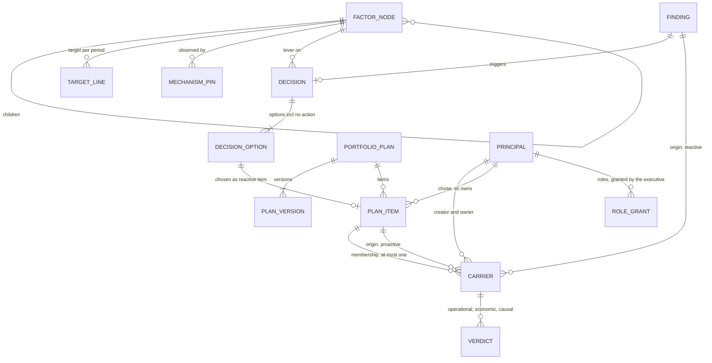
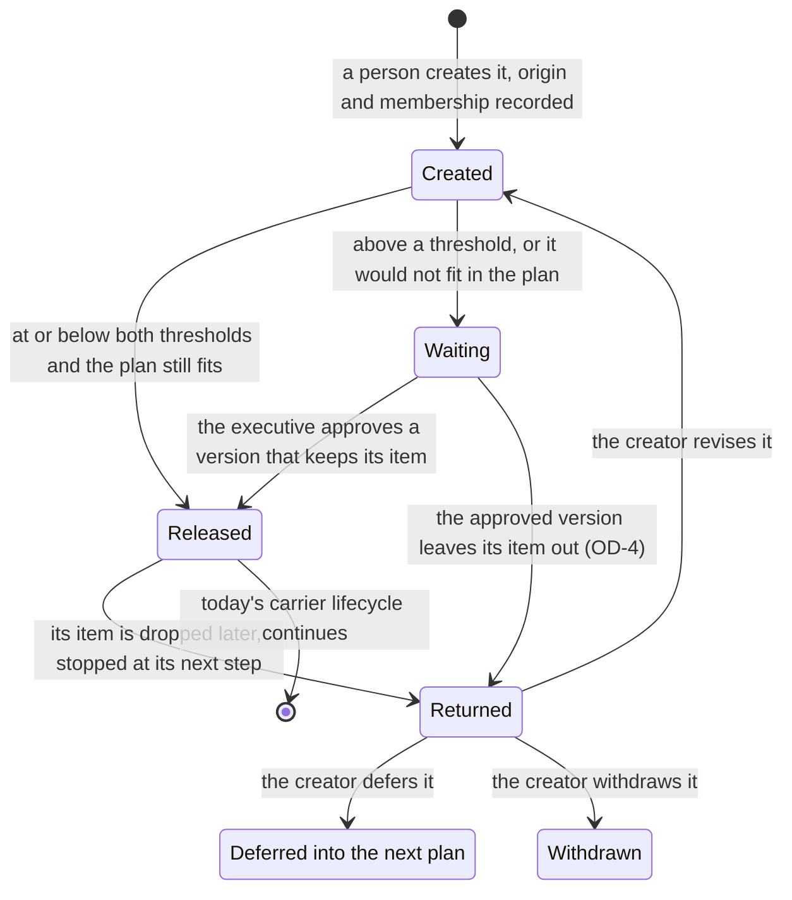

# Decision loop specification

**AssetEcon Layer 4 · builder specification · recreated from the design rev 16.7, updated to rev 16.8 (OD-13 to OD-18, plan item states) · AssetOps Architect (Claude) · 19 Nov 2026**

This document gives the records, rules, states, interfaces and acceptance tests for each construct of the design's Part 2. It replaces `economic-metric-and-effect-contracts.md` and `domain-and-decision-models.md` (regeneration F, #2). It adds detail beneath the design's constructs and never a new construct, role, decision, status or figure. Where the design leaves something undefined, this document says so in §12 and stops.

*Serves the objective:* operator executives adopt the product when they see their own money explained, their choices compared and results proven, with every decision recorded under a person's name. Each section below builds one part of that loop on top of records that already work.

Conventions:
- Paths are under `backend/assetops_backend/`, or `backend/migrations/versions/` for migrations. References were read on this branch [code-observed] unless the design is cited.
- Table and column names marked *proposed* are the builder's starting names. A builder may rename them; the rules may not change without the Architect.
- Acceptance tests are written as questions. Each must answer yes before its slice merges.

## 1. What stays: today's records and how the loop uses them

<!--derives: Part 1; §1.2; §1.3; §1.4; §2.0; §2.9-->

Today's core is a trusted evidence chain from reading to verdict (design §1.2). The loop is built on it. Nothing in this table is replaced; each row says what the loop reads or adds.

| Record today | Where | What stays | What the loop adds |
|---|---|---|---|
| Evidence ledger: batches and accepted readings | `0005_evidence_ledger.py:161-197` | Append-only, first-write-wins, provenance and envelope hash | Telemetry leaves of B1 read from it unchanged |
| Finding and its revisions | `0009_finding_store.py:33-106` | Identity per Site by key; revisions with typed transitions; claim, limitations, evidence digests | A factor pin derived at read time from the registry (CH1). No column is added |
| Finding thread and occurrences | `0042_chain_threads.py:29-71` | Recurrence history and response states | Unchanged. Actions link to it as today |
| Trial action, events, published change | `0016_action_store.py:46`, `:123`, `:171` | The reserve-trial carrier, its rule checks (`:60`, `:72`) and its events | A recorded person, owner, due date, origin and plan membership (CH2, P) |
| Domain action | `0033_w5_cold_work.py:39`; `work/domain_action.py:24-136` | Cold, EV, mini-grid and fuel work with an owner label and due date | The origin arm for a plan item, and plan membership (§7) |
| Work case and work events | `0027_w4_work_cases.py:12`, `:100`; `work/model.py:107-151` | Incidents and maintenance requests; assign, complete, close | One origin and at most one plan membership (§7) |
| Opportunity study | `mini_decisions/opportunities.py:366-401` | Headroom as capacity; the legacy origin of existing mill-shift Actions (OD-7) | Admits no new origin (OD-7) |
| Verification baseline and operational verdict | `0019_verification_core.py:48`, `:157`, `:166` | Freeze, comparability, guardrails, fail-closed families; Verified, Ineffective, Inconclusive | Economic and causal verdicts beside it (§9) |
| Trial cost comparison and credit | `0037_cc_trial_cost_comparison.py:27`; `outcomes/credit.py:57-73` | Credit only after Verified; never summed | The seed of the economic verdict (§9) |
| Objectives | `outcomes/objectives.py:57-143` | Six objectives and their Met, Missed, On pace and Behind pace judgements | Each becomes the target of the factor it measures (§5) |
| Maintenance schedules and their due rule | `0027_w4_work_cases.py:116`; `outcomes/plan_due.py:1-33` | Due state: overdue, due soon, not due | The same overdue rule for Actions (§8) |

## 2. The records and how they connect

<!--derives: §2.0; §2.5; Figure 1; Figure 6; B1; B2; B3; P; CH1; CH3-->

The diagram shows only the records the loop adds or changes. Today's Finding, thread and carriers appear as context.

*The carrier is any of today's three Action records: trial action, domain action or work case. Each records one origin and at most one plan membership (design "Words used here").*

**Who sees, decides, acts and tracks.** The system writes Findings, decisions, options, values and fit checks. People write choices, items, Actions, approvals and targets. Every write carries its principal (§8).

## 3. B1: the factor structure

<!--derives: §2.1; §2.9; B1; L1; L2; Rules; WP §1.0-->

*Serves the objective:* every outcome becomes a computed quantity, so the executive can see how far below target the month is and which factor moved it.

**Records** (code rows, versioned, no migration; *proposed*: `factor_node` in a new `structure/registry.py`). One row per factor, shared across Sites by its factor ID:

| Field | Meaning |
|---|---|
| `factor_id` | The shared ID. A quantity has one ID, so it carries money once (Rules 4) |
| `kind` | One of the design's relations: leaf; identity (signed sum); product; value-chain stage; physical split; composition (Σ over Sites); ratio (Σ/Σ) |
| `children` | Ordered (factor ID, sign) pairs; empty for a leaf |
| `unit` | Units must compose; a product of kWh and price per kWh gives money |
| `source_family` or `observer` | A leaf names the source family that evidences it (§2.3 of the design; `integration-design.md`) or the analysis that observes it |
| `vertical`, `business_model` | Which Sites the node exists for. A node that does not apply is *not applicable*, never zero |
| `tolerance` | The OD-3 tolerance, in the factor's unit (§4) |
| `levers` | The levers declared on the factor (§6) |
| `version` | Rows are versioned; a change is a new version |

**Start-up check.** The process refuses to start if the structure is cyclic, a leaf has neither source nor observer, units do not compose, or a named observer does not exist at its version. This follows today's chain check (`chain/graph.py:132`, `:177`).

**Evaluation.** One function evaluates a node for a Site and period on any side: actual, target, or an option's factors.
- A leaf returns its value, evidence class and provenance.
- A node combines its children by its kind. A missing child makes the node partial and names the missing record. It is never zero-filled (Rules 3).
- A node's evidence class is the weakest of its children, and it lists every source beneath it (Rules 2).
- Outcome totals are computed on read and never stored, as today's period read already requires (`chain/period_read.py:46-47`, `:139`).
- Portfolio nodes compose Site nodes as Σ amounts and Σ/Σ ratios. A Site that cannot be evaluated is excluded by name.
- The exact arithmetic for the demonstration is fixed in `structure-specification.md` §2 to §3.

**Named change (L1): the outcome map becomes structure rows.** Today's fixed signal-to-outcome rows (`outcomes/outcome_map.py:17-37`, `:149-180`) are computed from the registry behind their unchanged wire. The literal is removed only after the parity test passes. The site board's driver lines, written per vertical today (`site_outcomes/mini.py:1156-1177`), are generated from the same rows.

**Acceptance tests.**
- Does the parity test show that the registry reproduces every one of today's outcome-map entries, with every difference ruled by the Architect before the literal goes?
- Does Kobo's October contribution evaluate to 883<!--fig:sites.lakeside-power/Kobo.actual.nodes.contribution--> actual against 1,445<!--fig:sites.lakeside-power/Kobo.plan.nodes.contribution--> target, matching `derived-values.json`?
- Does Lakeside's portfolio contribution compose to 1,443.00<!--fig:portfolio.lakeside-power.actual.sums.contribution--> as a Σ over its three Sites?
- Does a captive EV depot show revenue as *not applicable*, and never as zero?
- With one leaf's record removed, is the node partial, with the missing record named?
- Does a structure with a unit mismatch stop the process at start-up?

## 4. CH1: Findings pinned to their factors, and the structure observer

<!--derives: §1.3; §2.1; CH1; OD-3; Q-A1; Figure 2-->

*Serves the objective:* today's Findings are the operator's reasons to act. Pinned to a factor, they enter the bridge and the money question, unchanged in nature.

**What stays.** A Finding remains the stored, living result of an analysis evaluating a declared condition over evidence: its identity, revisions, thread, claim ceiling and next step (`0009_finding_store.py:33-106`).

**The pin.** One registry row per mechanism names the factor it observes. It is read at query time, so no Finding column is added.

| Mechanism | Factor it observes (design §2.1) |
|---|---|
| Candidate running | candidate litres |
| Unexplained fuel | unexplained litres |
| Cold excursion | crate-minutes above limit |
| EV interruption | chargers in service |
| Backup start failure | nights without backup cover, a Protect measure (design §2.1; Thika in `worked-portfolios.md` §1.2) |

**The structure observer.** It reads the evaluated structure each period and stores a deviation as a Finding, with the same identity, revisions and thread. It raises one only under the owner's rule (Q-A1) and only outside the factor's tolerance (OD-3):
- an adverse bottom-line deviation, a risk to an obligation, asset or right, or an opportunity someone can act on;
- the deviation lies outside the factor's tolerance; with no tolerance set, every adverse deviation is raised (Architect's call);
- a favourable or neutral movement stays in the figures and raises nothing.

Its Finding key is (Site, factor ID, period, direction), so a re-run revises the same Finding rather than opening a second.

**What a Finding may claim.** Its condition, in its factor's unit and period, within its claim ceiling. Never an outcome value of its own, and never the value of acting.

**Who.** The system raises Findings. The finance and commercial lead sets money tolerances; the operations or site manager sets operational ones (§2.6 of the design). Each setting is recorded with its person and time.

**Acceptance tests.**
- At Kobo in October, is kWh billed above target (favourable) left without a Finding?
- Are outstanding bills of 278.00<!--fig:sites.lakeside-power/Kobo.actual.nodes.outstanding--> raised as a cash risk, visible to the finance lead?
- With a tolerance wider than the necessary-running effect, is no Finding raised for it, and with none set, is one raised?
- Does headroom with no signed letter of intent stay a capacity factor and raise no opportunity Finding?
- Does re-running the observer on unchanged records add no revision?

## 5. B2: targets, budget lines and the bridge

<!--derives: §2.2; B2; L3; OD-6; Figure 3; CH2-->

*Serves the objective:* it answers the brief's first question: why did the month come in below target, and by how much from each cause.

**Records** (*proposed*: `target_line`, append-only, one revision per change). Each line holds tenant, Site (or portfolio), factor ID, period, value, unit, its declarer and time. Budget lines are target lines on money factors. Today's objective store (`outcome_objective_revision`) stays; each objective becomes the target line of the factor it measures.

**Named change (L3).** Today a SYSTEM declarer sets objectives, "for the demonstration; not a customer target" (`objectives/model.py:23-24`). Under B2 the operator declares targets and budget lines, and the declarer is the recorded person: the finance and commercial lead for money targets and budget lines, the operations or site manager for operational targets.

**The bridge.** The targeted outcome is the same structure evaluated on the target lines. The gap is attributed to the factors that caused it:
- **Sums** (identity, stage, physical split, composition): each child's difference, exactly.
- **Products** (quantity × price): volume effect = (actual − target quantity) × target price; price effect = (actual − target price) × actual quantity. The two add exactly to the product's gap. This is the declared rule the design names, carried from the earlier attribution rule.
- **Unobserved leaf:** an explicit residual on that node, labelled as not yet explained. It is never spread over other factors.
- **Ratios:** numerator and denominator effects in their units; no money.
- **Identity check:** the effects add to actual − target to the cent, on every node.

A target declared only above leaf level is accepted. Attribution then stops at that node and says the target is not declared at factor level.

The "N of M objectives met" line stays beside the bridge. The Assure row line is renamed "Actual against target" (OD-6).

**Acceptance tests.**
- Does Kobo's October bridge show −562.00<!--figx:{sites.lakeside-power/Kobo.actual.nodes.contribution}-{sites.lakeside-power/Kobo.plan.nodes.contribution}--> in all, with candidate running −412.50<!--figx:-({sites.lakeside-power/Kobo.actual.nodes.candidate_l}-{sites.lakeside-power/Kobo.plan.nodes.candidate_l})*{sites.lakeside-power/Kobo.actual.nodes.diesel_price}--> and unexplained fuel −150.00<!--figx:-({sites.lakeside-power/Kobo.actual.nodes.unexplained_l}-{sites.lakeside-power/Kobo.plan.nodes.unexplained_l})*{sites.lakeside-power/Kobo.actual.nodes.diesel_price}-->, each opening to its Finding?
- Does a month with no Finding still show its bridge?
- Is a target line written without a recorded person refused?
- Do the effects on every node of every demonstration Site add to that node's gap to the cent?

## 6. CH3: decisions and options valued against doing nothing

<!--derives: §2.4; CH3; L5; OD-2; OD-8; OD-11; OD-12; OD-17; OD-18; Figure 5; Words; WP §1.5-->

*Serves the objective:* executives see their choices compared in money, net of cost, for every Site, with the option that breaks a service rule shown and rejected.

**What stays.** The reserve rule (`actions/reserve_trial.py:37`, `:42-45`) becomes one option generator. The what-if records (`mini_decisions/scenario_rules.py:191-228`) become an option's calculation record, referenced by revision ID and never edited. The possible extra fuel cost (`financials/fuel_cost.py:22`) stays an *at-stake* bound, never an option's value.

**Records** (*proposed*: `decision`, `decision_option`, `option_bound_result`).

| Record | Fields |
|---|---|
| `decision` | Site, factor ID with the declared lever, the triggering Finding (when there is one), period, horizon, preparing rule version, prepared at |
| `decision_option` | Decision, generator, factor changes over the horizon, the operator's one-off cost and its evidence class, crew visits, calculation record reference, value, disposition, reason. Exactly one option per decision is **no action** |
| `option_bound_result` | Option, bound, kind (hard, costed or advisory), measured value, limit, held or broken, price of a breach for a costed bound |

**Preparing a decision.** When a Finding sits on a factor with a declared lever, the system prepares a decision. It always includes no action, with current factors projected forward.

**Value.** One rule, exactly as the design states it (§2.4):

> value(option) = Σ over the horizon [ outcome(structure | the option's factor changes) − outcome(structure | no action) ] − ( the operator's one-off cost under the option − under no action )

The demonstration arithmetic is fixed in `structure-specification.md` §5.

**Bounds and dispositions.** A hard bound broken rejects the option. A costed bound prices the breach into the value. An advisory bound is shown and never decides. Each option gets one of the five dispositions: Recommended, Conditional, Acceptable, Deferred or Rejected. A disposition is a recommendation, never a choice. A hard-bound rejection is overridden only by a recorded change to the bound (Architect's call).

**Recommended set.** The Recommended option of each decision is found by one search across the period's decisions, so that the recommended set fits the budget and crew visits. The search order is the plan's: fewest service-rule breaches first, then the highest value, then the lowest spend (§7).

**Choosing and release.** The accountable role chooses an option, or none (§8). The choice is recorded with the person and time. The chosen option becomes a reactive plan item if it spends shared budget or crew visits (§7). Release follows the threshold rule:
- the spend threshold (OD-2) and the crew-visit threshold (OD-12, default zero) are Site or portfolio settings; for a change at one Site the Site's setting wins, and a change spanning Sites is judged against the portfolio's (OD-18);
- the rule applies to the item's total one-off and crew visits, summed over all its Actions, never one Action at a time (Architect's call);
- at or below both thresholds, an Action is released when it is created, provided the plan still fits its budget and crew visits. The fit is checked at each creation, in order, so two changes created together cannot jointly overrun it;
- otherwise the Actions wait for the plan's approval (OD-8). The same rule releases a proactive item's Actions;
- a capital item (an expansion, or a new connection the site manager proposed, OD-17) is never released at creation: it waits for the executive's approval of the version that holds it, whatever the thresholds, and its Actions are created after that approval (Architect's reading of OD-17).

**Acceptance tests.**
- Does every decision hold exactly one no-action option?
- At Kobo, is the stop-threshold option Recommended at +250.50<!--fig:options.KOB-STOPSOC.monthly_or_horizon_change--> a month against no action and 2,916.00<!--fig:options.KOB-STOPSOC.value--> over twelve months, labelled as design values until replay K runs?
- Is the reserve option Rejected for the dawn-charge bound, with the replayed days that broke it shown?
- Is the possible extra fuel cost never used as any option's value?
- With a spend threshold at or above 90.00<!--fig:options.KOB-STOPSOC.operator_one_off-->, are both of the stop-threshold change's Actions released at creation and still counted in the plan, and with a lower threshold or none, do both wait?
- Does splitting a change into several small Actions leave the threshold test unchanged?
- With the crew-visit threshold at its default of zero, does a change that uses a crew visit wait for approval, whatever its spend?
- In the demonstration on 6 Nov, does each Action's state (released at creation, or awaiting approval) match `worked-portfolios.md` §1.5?
- With a Site crew-visit threshold of 1 and a portfolio threshold of 0, is a one-visit change at that Site released at creation, and is a change spanning two Sites judged against the portfolio's 0 (OD-18)?
- Is a new connection's item held for the executive's approval even when its one-off is within the spend threshold, and is an Action against it refused before that approval (OD-17)?

## 7. P: the plan

<!--derives: §2.5; P; OD-1; OD-4; OD-5; OD-7; OD-8; OD-10; OD-11; OD-12; OD-16; OD-17; OD-18; Figure 6; Figure 6b; Figure 6c; G1; L5-->

*Serves the objective:* choices made Site by Site can each be right while the set breaks the budget or the crews. The plan is where the executive trades one Site against another, with no other home today.

**Records** (*proposed*; the design proposes `portfolio_plan` so the name cannot collide with today's `verification_plan`, `plan_due` and `actual_against_plan`).

| Record | Fields |
|---|---|
| `portfolio_plan` | Tenant (portfolio), period (a month unless the executive sets another), the crew-visit limit for each month of the period, state, opened at |
| `portfolio_plan_version` | Plan, version number, the items in it, the switches set, budget, crew visits, both thresholds, proposed at, approved at and approver, or sent back with its trade-off and person |
| `plan_item` | Plan, kind (reactive or proactive), capital kind (none, expansion or new connection; OD-17), Site, target factor IDs or "no factor (upkeep or compliance)" (OD-5), frozen prediction, planned, released and incurred spend, crew visits and the month of each, dates, dependencies, chosen by (the person who chose the option or declared the item) and item owner, always the same person (OD-16), the triggering Finding and chosen option (reactive). Its state is derived, not stored |
| `plan_item_left_out` | Version, item, reason |
| `plan_change` | Version in force, item, what changed, spend and crew-visit difference, person, time |

**States.** The plan (Figure 6b): Draft, Proposed, Approved, Revised, Closed. The plan's state is derived from its items and Actions. It is not a second execution workflow.

A plan item (design Figure 6c, Architect's call), derived from its Actions and the plan's versions at read time:

| Item state | Derived when |
|---|---|
| Chosen | chosen or declared; held in the draft or a proposed version only; not within both thresholds, or a capital item |
| Released | its whole change is within both thresholds, it is not a capital item and the plan fits; or the version in force holds it |
| Left out | the latest approved version leaves it out; its owner has neither revised nor withdrawn it (OD-4) |
| Done | every Action against it is closed; its spend is incurred |
| Withdrawn | its owner withdrew it |

Carrying an item into the next draft at close is an event recorded on the item, not a state.

**Rules.**
1. *Opening (OD-10).* The system opens the period's draft automatically when the period starts, within the executive's limits. Opening chooses nothing. Unfinished items carry forward with their approval, spend and owners; a carried item is approved again only if its spend changes (Architect's call).
2. *Items.* A reactive item comes from a chosen option. A proactive item is declared straight into the plan by its role (§8). A spending Finding-origin Action with no decision behind it creates its own reactive item, recording the Finding and the spend (Architect's call). The person who chose or declared it is its owner, and stays its owner when other roles create its Actions (OD-16). A new connection is proposed by the site manager and is a capital item (OD-17).
2a. *Crew visits by month.* Where a period spans months, each month has its own crew-visit limit, and each crew visit counts in the month it falls (Architect's call).
3. *Fit and proposal.* The system checks the items against budget, crew visits and dates. Where they do not fit, it proposes the nearest set that does: fewest service-rule breaches first, then the highest value, then the lowest spend. Every left-out item has a reason. The demonstration's search is fixed in `structure-specification.md` §6.
4. *Approval.* The executive approves a version or sends it back with a trade-off. A version sent back returns to draft, and each changed item returns to its creator with the reason (OD-4).
5. *Versions (OD-11).* A change that alters total spend by more than the spend threshold, or crew visits by more than the crew-visit threshold, creates a new version for approval. Smaller changes are recorded on the version in force with the person and time. Changes are counted together since the last approved version (Architect's call). While a successor is proposed, the version in force governs and the change's Actions wait.
6. *Spend, counted once.* Each item's spend moves through planned, released and incurred. Incurred is the expense records linked to the item in the commercial record store. The budget in use counts each item once: incurred where expense records exist, else released, else planned (Architect's call). Realised value comes only from economic verdicts (§9).
7. *Closing.* At the period's end the system runs the plan review: each item's predicted factor changes against those the bridge observed. The executive closes the plan; unfinished items carry into the next draft.

**Action links.** Every carrier records two links (design §2.5):
- **origin**, exactly one: a Finding (reactive) or a plan item (proactive). The opportunity study stays a legacy third origin for existing mill-shift Actions only, and admits no new one (OD-7);
- **plan membership**, at most one: the plan item that counts its spend and crew visits. A Finding-origin Action that spends always joins the plan (OD-8). It may also name the decision option it carries.

**Migration** (one migration, in the pattern of `0051_action_opportunity_origin.py`; design §2.9):
- `domain_action_one_origin` (`0051:73-77`) gains the plan-item arm;
- `domain_action_mini_origin` (`:78-79`) is replaced by a rule that admits no new opportunity origin;
- trial actions and work cases gain the same origin and membership columns;
- `chain_action_thread`'s one-origin check (`0051:87-88`), the `chain_action_thread_target()` trigger (`:34-50`) and the `chain_action` view (`:53-62`) widen in the same migration;
- the downgrade refuses while rows use the new arms.

*The release states of an Action, beside today's carrier lifecycle. Released Actions follow their carrier's existing events (accept, apply, assign, complete). Spend already incurred stays recorded against the item.*

**Acceptance tests.**
- Does the system open each period's draft without choosing any item?
- Does a Finding-origin Action that spends always carry a plan membership, and an Action never carry two?
- Is an Action whose item the approved version leaves out returned to its creator with the reason, and not released?
- Does a run of small changes that together pass a threshold create a new version?
- Is each item's spend counted once in the budget in use?
- Is a proactive item without a factor marked "no factor (upkeep or compliance)" and given no value?
- Is a new opportunity-study origin refused, while existing mill-shift Actions still read?
- At Lakeside, if the cooperative does not extend its letter of intent, does buying the Mto inverter now and dropping the Kisiwa repair appear as a revision (`worked-portfolios.md` §1.1)?
- Is every item's owner the person who chose it, so that at Mto David owns the inverter-claim item while Joseph creates and owns the notice Action (OD-16)?
- On 6 Nov, is the Kobo stop-threshold item Released and every other Lakeside item Chosen (Figure 6c)?
- Does the Kisiwa generator service count its crew visit against December's limit, not November's, and leave the November search unchanged?

## 8. CH2: the person in the loop, recorded

<!--derives: §2.6; §2.3; §1.4; CH2; G1; Q-A2; OD-13; OD-14; OD-15; OD-17; Figure 7; Figure 8b; WP §1.5-->

*Serves the objective:* an executive adopts what shows who decided, who approved and who is accountable.

**Named change (G1).** Today trial commands are a "SYSTEM demonstration" (`actions/lifecycle.py:43-58`), work writes refuse a user actor (`work/model.py:280-285`, `WORK_USER_AUTH_REQUIRED`), and a price write without a verified person is refused (`financial_api.py:205-212`, `HUMAN_PRINCIPAL_REQUIRED`). The schema already has the pattern: a human actor needs an author (`0010_financial_assumptions.py:57-78`).

**Principal.** Every command carries an authenticated person: person ID, tenant, the roles they hold, and the time. Stored SYSTEM events keep their actor and are never rewritten.

**Sign-in and roles** (OD-13, OD-14; *proposed* records `operator_account` and `role_grant`):

| Record | Fields |
|---|---|
| `operator_account` | Person ID, tenant (one set of accounts per operator), email, password hash (never the password), active or disabled, created at and by |
| `role_grant` | Person, role (one of the five), Site where the role is Site-bound, granted or removed, by whom (the operator executive), at what time. Append-only: a removal is a new row |

- People sign in with email and password. Single sign-on comes later, for larger clients, behind the same principal (OD-13).
- The operator executive grants and removes roles in Organisation settings. Every change is a `role_grant` row with its person and time (OD-14). The first executive of a tenant is created when the operator is onboarded.
- A principal's roles are read from its current grants at each command. In the demonstration a person is shown by role title, the Site for a Site manager, and a fictional first name labelled "Illustrative" (`worked-portfolios.md` §1.5).

**Who may do what.** Roles govern who may decide and what is recorded. They are not views: every role sees the same screens.

| Command | Operator executive | Finance and commercial lead | Operations or site manager | Field technician or O&M contractor | Analyst | System |
|---|---|---|---|---|---|---|
| Approve or send back a plan version | yes | | | | | never |
| Set budget, switches, spend and crew-visit thresholds | yes | | | | | never |
| Grant or remove a role in Organisation settings (OD-14) | yes | | | | | never |
| Declare an expansion; approve a new connection as capital (OD-17) | yes | | | | | never |
| Propose a new connection as a plan item (OD-17) | | | yes | | | never |
| Declare budget lines and money targets; set money tolerances | | yes | | | | never |
| Accept imported records | yes, as the lead's backup, recorded as the executive's acceptance (OD-15) | yes | | | | never |
| Choose an option, or none | capital choices | billing, collection, claims, notices | operations and O&M | | | never |
| Declare operational targets, proactive items; set operational tolerances | | | yes | | | never |
| Create an Action | | money and rights Findings | Findings and proactive items | | | never |
| Apply a setting change; assign work | | | yes | | | never |
| File a rights event | | yes | | | | never |
| Record readings, dips, completion | | | | yes | | never |
| Map sources to factors; place data-quality holds; review extracted contract rows | | | | | yes | never |
| Raise Findings, prepare decisions, value, recommend, reject on a hard bound, check fit, open the draft, record | | | | | | yes |

A command from a principal without the role is refused with a typed reason. The system never chooses, approves or creates an Action.

**Every Action records** its creator, owner, due date, origin and plan membership. The owner may differ from the creator. **Overdue** is computed as the maintenance-schedule rule computes it today (`outcomes/plan_due.py:1-33`): overdue when due strictly before the range end, due soon within fourteen days.

**Where requests appear.** A version awaiting approval appears beside the Finding triage on Act first. No notification is sent, as today (design §1.4).

**UI.** The controls that exist today only as API routes gain screens (design §2.6).

**Acceptance tests.**
- Is every command in the table recorded under the person who performed it?
- Is a system attempt to choose an option, approve a version or create an Action refused?
- Is a command from a person without the role refused, with its reason?
- Does an Action past its due date show as overdue on the Actions rail?
- At Kobo, do the manager's choice, the executive's approval and the technician's record each carry their own person (Figure 8b)?
- Does a person sign in with email and password, and is a command without a signed-in person refused (OD-13)?
- Is a role grant or removal by anyone but the operator executive refused, and is each grant and removal recorded with its person and time (OD-14)?
- Is an import the executive accepts recorded as the executive's acceptance, not the finance lead's (OD-15)?

## 9. CH4: three verdicts, field evidence and the option's cost

<!--derives: §2.7; CH4; L6; D14; Figure 9-->

*Serves the objective:* proof on the client's own Site is the pilot's purpose and the case for SaaS.

**What stays.** The baseline freeze, comparability, guardrails, fail-closed families and the operational verdict (`actions/verification_rules.py:675-815`; `actions/verification_families.py:502-516`). The outcome check on `verification_outcome` (`0019:166`) is not widened.

**Records** (*proposed*: `economic_verdict`, `causal_verdict`, each a revision beside the operational outcome).

| Verdict | Question | Evidence | Result |
|---|---|---|---|
| Operational (stays) | Did the factor move, with the bounds held? | Telemetry, frozen baseline | Verified, Ineffective or Inconclusive |
| Economic (new) | Did money move, in recorded records? | Dips, delivery notes, invoices in the commercial record store | Money followed, or "not proven yet" |
| Causal (new) | Did the action cause it? | Comparable days; untreated Sites as controls | Its strength, or "not proven yet" |

**Rules.**
- The frozen prediction of the chosen option becomes the verification target, and its bounds become the guardrails.
- "Not proven yet" is a verdict, not a pass.
- Field evidence is admitted with its label. Today only simulated or authored evidence is admitted as positive (`actions/verification_rules.py:688`).
- The option's one-off cost replaces the fixed zero (`actions/verification.py:1167`).
- Realised money comes only from economic verdicts on recorded records, with the option's cost subtracted. A prediction is never relabelled as realised. Emulated records never count as benefit (D14).
- A late record can withdraw a verdict, never silently, as today (`chain/lifecycle.py:53`).

**Acceptance tests.**
- Before the after-window closes, is the economic verdict "not proven yet"?
- With only emulated records, is no realised money shown?
- Is a non-zero option cost subtracted in the economic verdict?
- Does a late invoice that reverses the money withdraw the economic verdict and say so?

## 10. CH5: what the screens read

<!--derives: §2.8; CH5; L7; OD-6-->

*Serves the objective:* the screens are where the executive meets the value.

Each screen keeps its frame (the rail with no new menu items, the six Portfolio tabs, the range bar, the coverage line, the drill-down pages and "not available yet") and changes its read model:

| Screen | Read model |
|---|---|
| Overview cards | Each card read from its factors against target, with its evidence class |
| Optimize (mini-grid) | First, the last-day figure corrected (`site_outcomes/read.py:676-682`); then the period's cost factors |
| Act first | The Finding triage stays first (`estate/placement.py:1-8`), with the plan version awaiting approval beside it |
| Outcomes by site; site board | Drivers as factor rows; "Issues" shows Findings on their factors; "What can be done" opens the decision; "Already in hand" shows Actions and plan items (`frontend/src/sites/OutcomeBoard.tsx:42-48`) |
| Demand and capacity (was Opportunity) | Headroom stays capacity; demand needs evidence |
| Assure row line | "Actual against target" (`site_outcomes/mini.py:692`) |
| What changed | Actions with owners, the plan review and the three verdicts |

**Acceptance tests.**
- Does the Optimize card state its period, not one day over a period range?
- Does every figure on these screens carry its evidence word?
- Does no screen use "plan" for a target?

## 11. Evidence classes and negative accounting tests

<!--derives: Rules; Words; §2.1; §2.2; §2.7; D14-->

Every figure states how it is known, in one of the design's words: *Recorded*, *Emulated*, *Measured*, *Calculated*, *Estimated*, *Quoted*, *Modelled*, *At stake, not money*, *Verified*, *Not available yet*. The code name for this axis is `money_class`, kept apart from today's `evidence_class` source-basis columns (`0042_chain_threads.py:50`), which mean something else.

Negative tests, each a question that must answer yes:
- Are figures of different kinds never added together, and does a mixed node take its weakest class?
- Does a benefit total admit only field records?
- Is an unknown never shown as zero, and is the missing record named?
- Does a factor appear once, so the same litre never carries money twice?
- Are savings claimed only after proof, with the no-action baseline shown?
- Is no legal or insurance conclusion drawn, with "Coverage is decided by the supplier or insurer" shown instead?

## 12. Open questions and design gaps

<!--derives: Decisions; §2.1; §2.6; OD-13; OD-14-->

No design gap remains open here. The three gaps of the first draft are settled in design rev 16.8:
1. **Backup start failure** is pinned to nights without backup cover (design §2.1; §4 above).
2. **Where identities come from:** email-and-password accounts per operator, single sign-on later (OD-13; §8 above).
3. **Who grants roles:** the operator executive, in Organisation settings, every change recorded (OD-14; §8 above).

The structure observer's Finding key in §4 and the attribution rule for products in §5 are detail beneath CH1 and B2, flagged for the reviewer.
