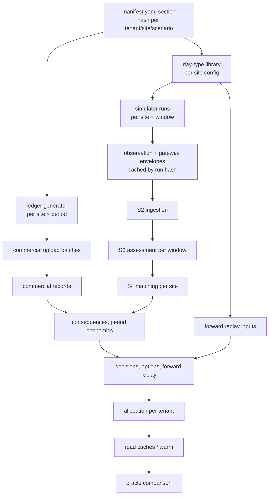

# Demo build cost plan: a shared economic world that is cheap to change

**Layer 4 companion artifact 6b · AssetOps Architect (Claude) · 16 Nov 2026 · design only**
Pairs with `demo-site-scenario-manifest.yaml`. Main narrative: `layer4-transformation-design.md` §10.
Labels: [code-observed] [test-confirmed] [implementation-report] [proposed] [assumption]. **Measured** means measured on a real build and cited; **derived** means arithmetic on measured figures; **target** means a design budget not yet achieved.

## 1. Build the story backwards, not the data forwards

The demo exists to make one executive choice per portfolio convincing. So the build starts from each portfolio's choice and asks: which contrasts must the screen show, which evidence must exist for the real analytics to produce them, and at what resolution? Anything not needed for a claim is not simulated.

| Portfolio | Claim the screen must make | Evidence the product must compute it from | Resolution actually needed |
|---|---|---|---|
| Lakeside | Kobo's after-dawn generator time is 210 L avoidable, Kisiwa's is not | dispatch-3.2 on generator, PV available, load, SOC; forward replay | 5-min, but only in the 11 Kobo Candidate days + 14 matched baseline days + the verification windows |
| Lakeside | −852.00 bridge | bills, receipts, settlement, dips, deliveries, plan lines | record level, monthly; no physics |
| Lakeside | huller profitable, welder not | 61 days of PV-available and load for the headroom replay | 15-min context is enough |
| Harvest Cold | Mwea is an occupancy problem, Kirinyaga an equipment problem | hourly energy, ambient, occupancy (storage ledger) | hourly, 60 days per room |
| Harvest Cold | B-1031 exposed, B-1034 not, B-1029 absent | chamber temperature around 14 Oct; batch in/out | 1-min for 6 hours; ledger for presence |
| Metro Bus | cheapest schedule fails 3 buses | roster + required kWh + charger and import limits | per night arithmetic over 31 nights; OCPP sessions for one evidence night |
| Metro Bus | CH-K2 outranks CH-R7 | fault events + roster consequence | event level |

The result is a world that is **broad in ledgers and narrow in physics**.

## 2. Three time scales

1. **Ledger history** — 2026-07 … 2026-10, four monthly periods, all commercial records. Generated directly by a deterministic ledger generator from the manifest (customers, tariffs, plan lines, invoices, receipts, settlement lags, storage movements, rosters, utility invoices, contract documents) and emitted as source-shaped CSV/JSON through the commercial upload path. No simulation. Cost is dominated by ingestion of a few thousand rows per site. [proposed]
2. **Sparse operational context** — 2026-09-01 … 2026-10-31 at 15-minute (mini-grid), hourly (cold energy) and per-session (EV) resolution, built from a small library of **day-types** (clear, cloudy, rainy; low/high occupancy; weekday roster). A day-type is simulated once per site configuration and reused across days and scenarios by hash. [proposed]
3. **High-fidelity evidence windows** — full resolution only where a claim is decided or verified: Kobo Candidate days and the 14 + 14 verification days (5-minute), the Thika incident night (1-minute), one Embakasi evidence night (OCPP event level). [proposed]

Baseline and counterfactual share the **same observed inputs** (PV available, load, ambient, roster); only the policy under test differs. That is what makes forward replay comparable, and it is why the forward replay reuses cached day-type inputs rather than new random weather.

## 3. What is generated, what is simulated, what is computed

| Kind | Produced by | Never |
|---|---|---|
| Commercial records (bills, receipts, plans, rosters, tariffs, contracts) | ledger generator from the manifest | never typed into the database; they go through the upload/batch path |
| Telemetry (generator, PV, SOC, chamber, connector) | simulator packs → observation transform → gateway → S2 (today's path, `tools/demo_combined_kobo.py:6-9`) [code-observed] | never authored as conclusions; scenarios author causes only (`kobo-mini-grid-reserve-trial.yaml:11-14`) [code-observed] |
| Findings, money, drivers, options, allocations, verdicts | the product's own analytics and decision code | never inserted; compared against the private `oracle:` after the build |

## 4. Measured cost today (historical, to be re-benchmarked)

**Status (review M4): Deliverable 7 is met except measurement.** Owner question Q10 decides whether to authorise one re-benchmark run or accept the gap for this phase.

All figures below are from the walk1113 build of 13 Nov 2026 as analysed in the reviewed baseline (§8.9–8.10) [implementation-report]. They were not re-measured for this design: this commission was not authorised to run a build or touch a database.

| Unit | Measured | Source |
|---|---:|---|
| One mini-grid simulation step | ≈ 1.4 ms | in-memory probe |
| 8 h Kobo window simulated + observed, no DB | 0.66 s (842 readings) | probe |
| One Kobo run through gateway, S2, S3, S4 | 24 s mean (10.6–78.3 s) | build log |
| One built Kobo site-day (ingest, assess, match) | 62 s (lower bound) | 1,724.7 s ÷ 28 |
| One Kisiwa night | 119 s (≈ 2,000 small batches) | build log |
| One cold session · one EV day | 2.8 s · 17 s | build log |
| Whole build | 7,208 s for 49 built site-days ≈ 147 s/site-day (mixed); ≈ 190 s for full-day mini-grid | manifest.json |
| Self-check | 1,474 s fixed | build log |
| Drains | 865 s, ≈ 310 s of it idle stage start-ups | tick reports |
| Per-run growth with history | 18.2 → 34.8 s over 12 identical runs | draft write times |
| Storage | 1,770 MB DB; ≈ 2.07 KB per accepted reading; route cache 635 MB | read-only queries |

**Conclusion carried into the design:** the simulator is under 5% of the cost; the product pipeline, idle process start-ups, the O(D²) matcher re-read and the fixed self-check dominate.

## 5. The regeneration design

### 5.1 Dependency graph

### 5.2 Cache keys and partial regeneration [proposed]

- Every node's output is keyed by `sha256(inputs digest + code version of that stage)`. The manifest is split into hashed sections (tenant, site, scenario, period), so changing the Mto huller's load changes only Mto's decision inputs and the Lakeside allocation, not Kobo's telemetry.
- **Change an intervention option** (e.g. KOB-STOPSOC threshold 70 → 75): re-run forward replay for Kobo only (in-memory, seconds), then decisions and allocation for Lakeside. No telemetry, no S2, no S3. Today the same change needs a full prepare of about 2 hours (baseline §8.8) [implementation-report].
- **Change a scenario cause** (e.g. a different Kobo trial-day irradiance): re-simulate that window, re-ingest that site from the first changed window, re-match that site, recompute its periods.
- **Change a commercial fact** (e.g. Kisiwa O&M invoice arrives): one upload; period economics for one site-period recompute.
- **Before/after branches**: a verification "after" window is a separate branch keyed by the option applied; the "before" branch is shared. Two alternative trials never contaminate each other.

### 5.3 Refactors the current build needs

| Problem (measured or code-read) | Change | Expected effect (target, to verify) |
|---|---|---|
| S4 matching re-reads every assessed window of a site each pass, so D days cost O(D²) (`analytics/finding_service.py:44-68`) [implementation-report, not profiled] | match only windows newer than the site's matcher watermark plus the open episodes' span | per-run cost flat with history; the 18 → 35 s drift disappears |
| Sites build one after another (`tools/demo_combined.py:1080-1088`) [code-observed via baseline] | build sites in parallel child processes using per-site claims (`schedule_site_head` exists but is unused) | wall time ≈ slowest site, not the sum |
| ≈ 1 s idle start-up per stage per site per tick (348 of 384 stage runs did no work) | skip a stage when its input watermark has not moved; one long-lived worker per tick | ≈ 300 s off drains |
| `prepare` always drops the database | per-tenant template databases (`CREATE DATABASE … TEMPLATE`, `tools/chain_clone.py:64`) [code-observed via baseline] + scoped re-run from the first changed node | a single-option change in minutes |
| Kisiwa's ≈ 2,000 tiny batches per night | batch per 15-minute envelope group in the demo gateway | Kisiwa night cost toward Kobo's |
| 25-minute self-check on every build | tiered self-check: oracle comparison for changed tenants on each build; full check nightly | minutes per iteration |

**Fallback if the matcher change is not ready:** keep the history short. Every hero claim in the manifest needs at most 61 days of context and 28 days of 5-minute evidence, so a per-site cap of 61 days bounds the O(D²) term.

## 6. Minimum build budget per hero (targets)

Targets assume the refactors above; they are design budgets for the acceptance suite, not measurements.

| Hero | Evidence | Target build (incremental, warm caches) |
|---|---|---|
| Kobo dispatch + forward replay + verification | 28 site-days at 5-min, 61 days 15-min context | ≤ 15 min cold, ≤ 2 min for an option change |
| Lakeside commercial bridge | 4 periods × 3 sites of ledger records | ≤ 3 min |
| Mto headroom + huller | 61 days 15-min context | ≤ 3 min |
| Harvest Cold normalisation + Thika incident | 60 days hourly × 3 rooms + 6 h at 1-min | ≤ 5 min |
| Metro Bus schedule + fault + capacity | 31 nights roster arithmetic + 1 OCPP night per depot | ≤ 5 min |
| Whole three-tenant world | all of the above + allocation + warm | ≤ 45 min cold on the VPS, one command |

## 7. Re-benchmark plan (must run before any budget is trusted)

Run on a quiet machine, scheduler off, on a scratch database permitted by the test-database rule (`*_test` or `<prefix>_audit*` in `assetopsv1-postgres-1`).
1. Instrument each DAG node with wall time, CPU time (process `rusage`), rows written per table, bytes added (`pg_total_relation_size` before/after) and source volume (records, batches, bytes).
2. Measure per stage, per site and per day for: today's Kobo path (baseline comparison), one Lakeside ledger period, one Harvest Cold room-month, one Metro Bus depot-month.
3. Repeat the Kobo 12-run series to test whether per-run growth persists after the matcher change.
4. Measure one option change and one late commercial record end to end.
5. Publish a table in the same shape as §4 and replace the targets in §6 with measured numbers.

## 8. One command and a repeatable live tour

- `demo build --tenant lakeside-power` (and `--all`) builds or incrementally refreshes from the manifest; `demo reset --tenant …` restores the tenant template; `demo tour --tenant …` replays the scripted tour clicks against the served UI and fails on any oracle mismatch.
- Dates are relative to the as-of date, as today's story calendar is relative to S (`backend/conversions/demo-combined-story-v1.json`) [code-observed via baseline], so a rebuild re-dates consistently.

## 9. Integration-to-pilot transfer

The demo must show one **authentic** ingestion path end to end: the Mto billing CSV through the commercial upload endpoint with dry-run, mapping errors and idempotent re-upload (manifest DUP-1, MAP-1). Labels on screen distinguish *demo-simulated* telemetry, *source-emulated* exports (GX-shaped Modbus, billing CSV, OCPP log), *bench-tested* edge hardware (BeagleBone path in `Docs/demo-sprint/telemetry-integration-plan-claude.html`) and *field-integrated* customer sources. No provider API access is promised.

**Minimum operator data ask for a paid diagnostic** (per vertical, 5–10 categories, from the manifest `sources:`): site list and asset register with serials; 60–90 days of controller/EMS export; billing/vending and receipts for 4 months; meter register with change dates; fuel deliveries and dips (mini-grid) / storage ledger and QA notes (cold) / roster and utility invoices (EV); monthly plan or budget; top 3 equipment contracts. Time to establish fit: about 2 weeks from data receipt for a three-site diagnostic [assumption].

## 10. Acceptance suite for the build

| Id | Check | Pass |
|---|---|---|
| B1 | Every oracle item in the manifest | computed result equals oracle expectation |
| B2 | Every `disorder_tests` item | expected behaviour observed |
| B3 | Determinism | two builds from the same manifest hash produce identical decision outputs |
| B4 | Isolation | TENANT-1 refused; no read returns another tenant's row |
| B5 | Option change | KOB-STOPSOC threshold change rebuilds only Kobo decisions + Lakeside allocation |
| B6 | Budget | measured times recorded against §6 targets (reported, not a gate until re-benchmarked) |
| B7 | Healthy controls | sites without a planted problem show no Finding and no option beyond do nothing |
