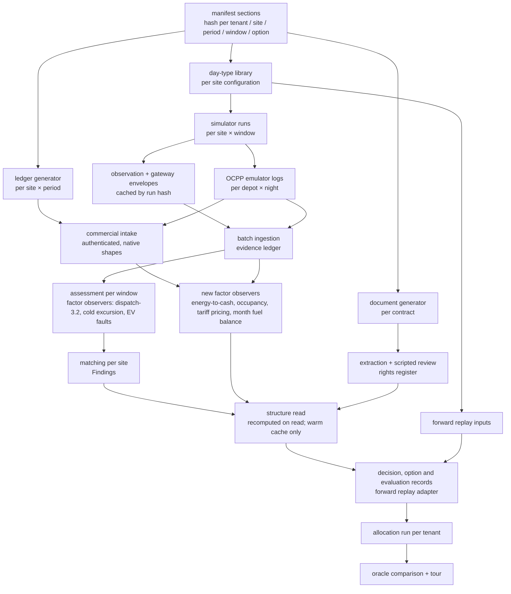

# The demonstration world: built backwards from each choice, cheap to change

**AssetEcon · Layer 4 companion to the main design (brief Part VI, Deliverable 7) · rev 12 (redesign) · AssetOps Architect (Claude) · 17 Nov 2026 · design only**
Pairs with `demo-site-scenario-manifest.yaml` (rev 4, the only source of figures) and `integration-source-to-canonical-design.md` (the source shapes). Main narrative: `layer4-transformation-design.md` §2 (mechanics) and §10.

**Labels.** [code-observed] read in current code · [test-confirmed] pinned by a named test · [implementation-report] stated only by the reviewed baseline (`.agent/decision-intelligence-mechanism-2026-11-14.html`) and **must be re-measured** · [proposed] this design · [assumption] to confirm. **Measured** means measured on a real build and cited; **derived** means arithmetic on measured figures; **target** means a budget not yet achieved. No build, test suite, database or Docker command was run for this document. Every figure is **illustrative** and reconciles with the manifest (`python3 evaluate_structure.py` produces them; `python3 check_manifest.py` asserts them, 0 failures).

---

## 1. Build the world backwards from each executive choice

The demonstration exists to make one executive choice per portfolio convincing, and to make it convincing *the way the product works*: source facts fill leaf factors, the declared structure computes each outcome's state, options change factors, the plan is chosen, and the same factors prove the result (main design §2). So the world is not "realistic data". It is a set of source facts chosen so that **each site's leaf factors produce the intended outcome states through the structure**, and so that the real ingest and analytics path, not an author, produces every Finding and every number (brief Deliverable 7: "all product findings and financial values must be computed through real ingest/analytics paths, not inserted as authored conclusions").

The build therefore starts from the choice and asks, mechanic by mechanic, what must exist for the choice to be demonstrable.

### 1.1 What each mechanic needs to be demonstrable

| Mechanic | What the tour must show | What the world must contain | What it must *not* contain |
|---|---|---|---|
| **M1 Define** | each outcome opens onto its structure, down to leaves, for each business model (captive fleet: revenue NOT_APPLICABLE) | the structure registry entries for three business models; plan values **at factor level** (billed kWh, tariff, litres, price, crate-days, peak share, departures) for four monthly periods | outcome values entered anywhere |
| **M2 Observe** | outcome state read off observed factors; per-node deviation; residual as a factor; coverage below 100% with the missing record named; a factor deviating before money closes | source facts for every leaf, at the cadence its observer needs (§2); planted **gaps** (Kisiwa O&M invoice, Thika and Kasarani service invoices) and **disorder** (manifest `disorder_tests`); one negative control per portfolio whose factors are healthy | any Finding, attribution or amount written directly; a healthy site with a planted problem |
| **M3 Evaluate** | every decision with no action, the accepted option and the rejected or deferred ones; a bound that rejects the cheapest option | the observed series the counterfactual reuses (61 days for Kobo's forward replay; 31 roster nights for Embakasi); effective-dated tariff revision (00:00–05:00 tier from 1 Nov); quotes; contract documents with reviewed terms; customer evidence (Mto letter of intent; Mwea draft contract; Ruiru city offer) | counterfactual series generated separately from the baseline (they must share inputs) |
| **M4 Choose** | a plan under budget and crews per portfolio, exclusions with reasons, switches that re-compute it | per tenant: budget, crew or technician visits, horizon; option costs, crew needs, dependencies and exclusions; the switch values | a pre-computed plan |
| **M5 Prove** | frozen predictions, the three verdicts, rights states by recorded events | (a) in the base world: rights events up to the demo date (Thika claim accepted 17 Oct; Kasarani acknowledged 3 Nov); (b) in a separate **after branch**: the 14-day after-window for Kobo, Thika's ACT-051 witnessed start test, Embakasi's 14 supervised nights and the next invoice | after-window facts leaking into the base world |

### 1.2 Per portfolio: the choice, the factor states it needs, and the facts that produce them

**Lakeside Power (mini-grid).** *Choice:* with 5,000 and three crew visits, repair Kisiwa's genset (must-do), trial Kobo's lower generator stop threshold, claim Mto's inverter under warranty, connect the rice huller, fix Mto's meter mapping and assemble Kobo's battery evidence: spend 3,750.00<!--fig:plans.lakeside-power.default.spend-->, modelled 12-month change +6,088.50<!--fig:plans.lakeside-power.default.value-->, not realised (both evaluated by `evaluate_structure.py`).

| Factor state the tour needs | Intended value (manifest) | Facts that must produce it | Time scale |
|---|---|---|---|
| Kobo candidate running (observed) and each option's feasible reduction of it (option effect) | 330 L observed; 210 L (stop threshold) / 20 L (reserve) as option effects | 5-minute generator, PV-available, load and SOC on the 11 candidate days; 61 days of 15-minute context for the replay | evidence window + sparse context |
| Kobo litres beyond the model | 120 L (above 2%) | dips 220 → 240, deliveries 1,200<!--rec:tenants[lakeside-power].sites[Kobo].period.fuel_balance.deliveries_l--> L (one entered 9 days late, OOO-1) | ledger history |
| Kisiwa every generator interval necessary (negative control) | 0 candidate minutes; 20 L residual within tolerance | 15-minute context showing load > PV + PCS every evening; battery near reserve on 22 days | sparse context |
| Mto unmapped kWh / authorised / unexplained | 140 / 40 / 120 kWh | meter register with the 3 Oct swap; meter reads; billing export | ledger history |
| Mto cash | 1,890 + 150 in transit + 120 outstanding | receipts; settlement 2 Nov (LATE-SETTLE-1) | ledger history |
| Mto daytime headroom vs huller | 3 days without headroom; 68 L extra fuel | 61 days of 15-minute PV-available and load | sparse context |
| Rights | INV-MT-02 potentially covered; GEN-KS-01 expired and excluded; BAT-001 insufficient evidence; Kisiwa O&M review required | contract documents with reviewed rows; fault event 28 Oct; run hours 1,240; tickets 30 Oct → 3 Nov; weather bulletin | documents + events |
| Coverage | 91.5% of cost Recorded | Kisiwa O&M invoice withheld (GAP-1) | ledger history |

**Harvest Cold (cold rooms).** *Choice:* Thika stopgap while the EPC remedy is pending, Kirinyaga condenser repair, Mwea aggregator contract: spend 720.00<!--fig:plans.harvest-cold.default.spend--> of 2,500, two technician visits.

| Factor state | Intended value | Facts | Time scale |
|---|---|---|---|
| Mwea occupancy vs energy efficiency | 4,340 crate-days (35%); kWh within 0.6% of model | storage ledger; hourly energy; ambient | ledger + sparse context |
| Kirinyaga efficiency deviation | 970 kWh (24%) above model at plan occupancy | same | ledger + sparse context |
| Thika exposure / damage / liability | 2,160.00 at stake / 108.00 / 108.00; B-1034 not exposed; B-1029 absent | chamber readings 6 Oct 19:00–20:00; grid and backup events; ledger; QA note 7 Oct; CN-0412; contract clause | evidence window + ledger + documents |
| Rights | EPC claim accepted 17 Oct; insurer notified, no claim (108 < 500) | documents; claim events; test log 3 of 3 | documents + events |

**Metro Bus (EV depots, captive).** *Choice:* Kasarani stopgap now (departures at risk), Embakasi deadline-aware schedule (largest money), absorb six more buses at Ruiru; spend 1,590.00<!--fig:plans.metro-bus.default.spend--> of 5,000.

| Factor state | Intended value | Facts | Time scale |
|---|---|---|---|
| Embakasi peak share, monthly peak kW | 55% vs 30%; 500 vs 450 kW | per-session OCPP energy and site import intervals for 31 nights; invoice lines | sparse context (per session) + ledger |
| Embakasi departures under candidate schedules | deadline schedule 31 of 31 nights; cheapest 2,500 < 2,800 kWh, 3 buses short | roster for 31 nights; charger and import limits | ledger (roster) + computed |
| Kasarani chargers in service → departure bound | 3 of 4 from 1 Nov 23:40; 1,050 < 1,200<!--fig:sites.metro-bus/Kasarani.november_to_date.nodes.required_kwh_night--> kWh | OCPP StatusNotification and fault event; roster; dispatch log; penalty statement | evidence window (event level) + ledger |
| Ruiru spare deliverable kWh | 3,200 vs 1,960 a night (+6 fits, +10 does not) | roster; import limit; charger count | ledger + computed |
| Ruiru CH-R7 connector 2 | one interrupted session 6 Oct; no departure affected | OCPP event (v7.0 F-130) | evidence window (event level) |
| Rights | CH-K2 acknowledged, SLA restore due 9 Nov; CH-R7 potential | ticket export; documents | events + documents |

**Contrasts carried by the same data** (brief Deliverable 7: "different outcomes and resource choices from the same data"): the highest diesel user has nothing to save (Kisiwa) while a smaller one has a policy lever (Kobo); the room with the worst cost per crate-day has no equipment fault (Mwea) while the one that looks fine has one (Kirinyaga); the cheapest bill fails departures (Embakasi); an idle connector ranks below a critical fault (Ruiru vs Kasarani); the same failed-asset event leads to different paths because of the contract and the evidence (main design §7.4).

---

## 2. Three time scales, and why each source needs its cadence

Each source is generated at the cadence its **factor observer** needs, and no finer.

1. **Ledger history: monthly commercial periods, July to October 2026** (manifest `time_scales.ledger_history`). Charges, receipts, settlements, adjustments, expenses, plan lines, storage movements, meter register and reads, rosters, dispatch logs, tariffs, invoices, tickets, contract documents. Generated directly from a coherent ledger generator (no physics) and emitted in each source's native shape through the authenticated commercial intake. Four periods are enough for actual against plan, the deviation by factor and seasonal context. Cadence reason: money factors close monthly; settlement lags (2 days at Mto) and late notes (9 days at Kobo) are record-level dates, not series.
2. **Sparse operational context: 1 Sep to 31 Oct 2026** (manifest `sparse_operational_context`). 15-minute mini-grid PV, load and SOC; hourly cold energy and ambient; per-session EV energy. Built from a small library of **day-types** per site configuration (clear, cloudy, rainy; low or high occupancy; weekday roster), each simulated once and reused across days and scenarios by hash. Cadence reasons: the forward replay and demand-on-headroom replay need hour-of-day shape over about 61 days; the refrigeration model needs 60 days of energy against occupancy and ambient; tariff pricing needs energy by tariff interval, which per-session energy with timestamps gives.
3. **High-fidelity evidence windows** (manifest `evidence_windows`), only where a claim is decided or verified:
   - **Kobo, 5-minute**, on the 11 candidate days and the 14-day before-window: dispatch-3.2 needs generator continuity (start, run and stop within 5 minutes), and verification uses 5-minute slots;
   - **Thika, chamber readings around 19:00–20:00 on 6 Oct**: the excursion and the batch bounds. The preserved v7.0 page shows 5-minute readings (probe TMP-003) and bounds the time above limit by them; this plan uses **5-minute** readings so the page and the figures agree, and the liability test uses the lower bound of the range (B-1031 above 5 °C for 20–30 minutes, against the contract's 15). The manifest's `sources` and the main design §10 say 1-minute; that conflict is reported to the Architect;
   - **EV, event level**: OCPP StatusNotification, StartTransaction and MeterValues on Kasarani's fault night (1–2 Nov), on one Embakasi evidence night (with CLOCK-1) and on Ruiru's 6 Oct interruption.

**Baseline and counterfactual share the same observed inputs.** PV available, load, ambient, occupancy and the roster are generated once; the baseline is the observed operation under the site's actual policy, and every counterfactual (stop threshold 70%, reserve 25%, huller load added, a charging schedule) is the same inputs under a changed factor. That is what makes identity M3 comparable, and it is why the forward replay reads cached day-type inputs rather than new weather. The no-action projection uses the same inputs under the prices and contracts in force over the horizon (Embakasi: tariff revision 2 from 1 Nov).

---

## 3. What is generated from ledgers, what is simulated, what is computed

| Kind | Produced by | Enters the product through | Never |
|---|---|---|---|
| Commercial records: bills, receipts, settlements, plan lines, storage movements, meter register and reads, rosters, dispatch logs, tariffs, invoices, tickets, penalty statements, credit notes | deterministic **ledger generator** from the manifest | the authenticated commercial intake, in native shapes, labelled *source-emulated* | typed into a database; carrying a conclusion (e.g. no row says "unmapped") |
| Contract documents (warranty, EPC, O&M/SLA, insurance, letter of intent, draft contract) | document generator from manifest terms, with page layout | document upload → AI-assisted extraction proposal → human review (a scripted reviewer in the build, labelled) | rows that skip review |
| Operator entries: fuel deliveries and dips, QA notes, manual starts | entry generator | the existing operational-entry path (`work/operational_entry.py:50`, `:108`) [code-observed] | entered directly as rows |
| Telemetry: generator, PV, SOC, load, chamber, grid and backup events, connector state and energy | **simulator packs** → observation transform → gateway → batch ingestion, today's path (`tools/demo_combined_kobo.py:5-9`) [code-observed] | evidence ledger, labelled *demo-simulated* | authored outputs: scenarios declare **causes only** (irradiance, demand, start states), never generator output or a conclusion (`config/scenarios/kobo-mini-grid-reserve-trial.yaml:11-14`) [code-observed] |
| OCPP logs | **OCPP emulator** emitting a CPMS log file from simulated sessions (new; none exists today, baseline §8.8 [implementation-report]) | OCPP adapter → existing EV roles; idTag → commercial session attribution | — |
| Factor values, outcome states, deviations, residuals, Findings, option values, plan, verdicts | the product's own observers, structure read, decision code and allocator | — | inserted; they are only compared, after the build, with the manifest's private `oracle:` |

**Fixture consistency rules** (checked by the ledger generator before emitting, and by `check_manifest.py` for the arithmetic): every site's actual and plan values satisfy its structure to the cent (revenue = billed × tariff; cash = collected + in transit + outstanding; fuel cost = litres × price; cold revenue = crate-days × 0.20 and model kWh = 1,550 + 0.25 × crate-days; EV energy cost = Σ bands + demand); each site's factor attributions sum to its deviation; portfolio = Σ sites; allocation spend = Σ options ≤ budget; generated rows sum to the manifest totals (the per-customer split of Mto's 140 kWh, the size of each Kobo delivery); unrelated sites stay healthy.

---

## 4. Historical cost (to be re-measured)

All figures below come from the walk1113 build of 13 Nov 2026 as analysed in the reviewed baseline (§8.9–8.10) [implementation-report]. **None was re-measured for this design**: this commission was not authorised to run a build or touch a database. They describe today's pipeline, not the proposed one.

| Unit | Reported | Basis in the report |
|---|---:|---|
| One mini-grid simulation step | ≈ 1.4 ms | in-memory probe |
| 8 h Kobo window simulated and observed, no database | 0.66 s (842 readings) | probe |
| One Kobo run through gateway, S2, S3, S4 | 24 s mean (10.6–78.3 s) | build log |
| One built Kobo site-day (ingest, assess, match) | ≈ 62 s, lower bound | 1,724.7 s ÷ 28 |
| One Kisiwa night | ≈ 119 s (about 2,000 small batches) | build log |
| One cold session · one EV day | 2.8 s · 17 s | build log |
| Whole build | 7,208 s for 49 built site-days ≈ 147 s per site-day (mixed); ≈ 190 s per full mini-grid day | build manifest |
| Self-check | ≈ 1,474 s, fixed | build log |
| Drains | 865 s, about 310 s of it idle stage start-ups | tick reports |
| Per-run growth with history | 18.2 → 34.8 s over 12 identical runs | write times |
| Storage | 1,770 MB database; ≈ 2.07 KB per accepted reading; route cache 635 MB | read-only queries |

**What the figures imply, if they hold:** simulation is under 5% of the cost; the product pipeline, idle stage start-ups, the growing matcher re-read and the fixed self-check dominate. Two code facts support the shape of that reading: the Finding matcher reads every assessed window of a site on each pass (`analytics/finding_service.py:44-48`, `assessed_days`) [code-observed], so cost grows with history; and the combined build runs sites one after another as child processes (`tools/demo_combined.py:1080-1087`) [code-observed] after dropping the database in `prepare` (`tools/demo_combined.py:1045`) [code-observed].

**Derived volume estimates for the proposed world** [assumption, for budgeting only]: ledger history is a few thousand rows per site over four months (Kobo: 300 connections × 4 months of charges, reads and receipts ≈ 4,000 rows); sparse context for one mini-grid site is about 61 days × 96 intervals × 10 roles ≈ 58,000 readings, ≈ 120 MB at the reported 2.07 KB per reading; evidence windows add 25 Kobo days at 5-minute resolution ≈ 72,000 readings. The ledger is cheap; telemetry volume is where storage and ingest time go, which is why the evidence windows are narrow.

---

## 5. Regeneration design

### 5.1 Scope keys

Every generated artefact and every product stage output is keyed by the **scope it depends on**: tenant, site, period or window, and the digest of the manifest **section** that defines it (the manifest is split into hashed sections: tenant constraints, site physical and policy, site period ledger, site windows, decision options, rights, disorder tests). A change re-runs only the stages whose keys change.

### 5.2 Dependency graph

### 5.3 Caching

- Each node's output is stored under `sha256(scope section digest + upstream output digests + that stage's code version)`. Simulator envelopes, OCPP logs and generated files are content-addressed and deterministic (fixed seeds per scope), so a rebuild with the same digest reuses them byte for byte.
- Database state is cached as **per-tenant template databases** created after each stable stage, and cloned for a run (`CREATE DATABASE … TEMPLATE …`, the pattern `tools/chain_clone.py:64` already uses) [code-observed]. Only databases permitted by the test-database rule are used (`*_test` or `<prefix>_audit*` in `assetopsv1-postgres-1`).
- The structure read is computed on read (D-MONEY.3); only a warm-up of the tour's reads is cached, keyed by the latest record revisions it read.

### 5.4 What a change costs, by kind

| Change | Re-runs | Does not re-run |
|---|---|---|
| An option parameter (Kobo stop threshold 70 → 75; huller hours) | forward replay for that site (in memory), its decision records, the tenant's allocation | simulation, ingestion, assessment, matching, ledger |
| A commercial fact (Kisiwa O&M invoice arrives; a credit note) | one intake; the site-period's stored lines (new revision); decisions citing it flagged | everything physical |
| A plan value or budget | the structure read's plan evaluation; allocation | everything else |
| A contract term | extraction and review for that document; rights assessment; affected options; allocation | everything physical |
| A scenario cause (a different irradiance on one Kobo day) | that window's simulation, ingestion from the first changed window, assessment and matching for that site, its period lines, its decisions, allocation | other sites and tenants |
| A new site | its full chain of nodes; its tenant's allocation | other tenants |

Today a single option change needs a full prepare of about two hours (baseline §8.8) [implementation-report].

### 5.5 Branch isolation for before and after

The base world ends at the demo date (6 Nov 2026). Everything that happens after a decision (a trial's after-window, a remedy's witnessed test, a schedule's supervised nights, the next invoice) lives in a named **after branch**: a clone of the tenant template with the story clock advanced, keyed by the option applied (`after/KOB-STOPSOC`, `after/THIKA-EPC-STOPGAP`, `after/EMB-DEADLINE`). Two alternative branches never share writes, and the base world never sees after-branch facts. The tour opens the base world by default and switches to a branch only on the *What changed* screens.

### 5.6 One command, one reset, one repeatable tour

- `demo build [--tenant <t>] [--site <s>]` builds or refreshes from the manifest using the DAG and caches; `demo reset --tenant <t>` restores the tenant template in seconds; `demo branch --tenant <t> --after <option>` builds an after branch; `demo tour --tenant <t>` replays the scripted tour against the served UI and fails on any oracle mismatch or any visible system vocabulary.
- All instants are relative to the demo date, as the current story calendar is relative to a story day S (`backend/conversions/demo-combined-story-v1.json`; `tools/demo_combined.py:13`) [code-observed], so a rebuild on another day re-dates consistently. Weekday-dependent facts (the Kasarani SLA's business days) are generated from the relative calendar, not fixed dates.

### 5.7 Refactors the current build needs, and the fallback

| Problem | Change [proposed] | Expected effect (target, to verify) |
|---|---|---|
| Matcher reads every assessed window per pass (`analytics/finding_service.py:44-48`) [code-observed]; cost grows with history [implementation-report] | match only windows after a per-site watermark plus open episodes' span | flat per-run cost with history |
| Sites built one after another (`tools/demo_combined.py:1080-1087`) [code-observed] | build sites in parallel child processes; the scheduler already takes per-site claims (`scheduling/tick.py:19`) [code-observed] | wall time near the slowest site |
| ≈ 1 s idle start-up per stage per site per tick [implementation-report] | skip a stage whose input watermark has not moved; one long-lived worker per tick | ≈ 300 s off drains |
| `prepare` drops the database (`tools/demo_combined.py:1045`) [code-observed] | per-tenant templates + re-run from the first changed node | an option change in minutes |
| Kisiwa's ≈ 2,000 tiny batches a night [implementation-report] | batch by 15-minute envelope groups in the demo gateway | Kisiwa toward Kobo's cost |
| Fixed self-check of ≈ 25 minutes [implementation-report] | oracle comparison for changed tenants on each build; full check nightly | minutes per iteration |

**Fallback if the matcher change is not ready:** cap each site's telemetry history at 61 days. Every claim in the manifest needs at most 61 days of context and 25 days of 5-minute evidence, so the cap bounds the growing term.

---

## 6. Minimum build budget per hero (targets)

These are design budgets for the acceptance suite, assuming §5's caches and refactors; they are **targets, not measurements**.

| Hero | Mechanics demonstrated | Evidence built | Target, cold | Target, one change warm |
|---|---|---|---|---|
| Kobo generator after dawn (+ Kisiwa negative control) | M2 observers, M3 replay with a hard bound, M5 after branch | 25 Kobo days at 5-minute; 61 days 15-minute for Kobo and Kisiwa | ≤ 15 min | ≤ 2 min (option change) |
| Lakeside structure and deviation (all three sites) | M1, M2 coverage and residual | 4 periods × 3 sites of ledger records | ≤ 3 min | ≤ 1 min (one record) |
| Mto energy to cash and huller | M2 leaks, M3 latent factor with a dependency | ledger + 61 days 15-minute | ≤ 3 min | ≤ 1 min |
| Harvest Cold occupancy vs efficiency + Thika incident | M2 normalisation, exposure vs damage vs liability, rights | 60 days hourly × 3 rooms; 1 h of chamber readings; ledger | ≤ 5 min | ≤ 1 min |
| Metro Bus schedule, fault and expansion | M2 early visibility, M3 departure bound, M4 priority | 31 roster nights × 3 depots; OCPP for 3 evidence nights; invoices | ≤ 5 min | ≤ 1 min |
| Three plans with switches | M4 | options and constraints of all three tenants | ≤ 1 min | seconds |
| Whole three-tenant world | all | all of the above | ≤ 45 min on the VPS, one command | — |

The brief asks for a minimum budget per hero "rather than 12 sites × 90 days": nine sites, of which only three need any 5-minute evidence, and none needs more than 61 days of telemetry.

---

## 7. Re-benchmark plan (must run before any budget is trusted)

Owner question Q10 decides whether one re-benchmark run is authorised in this phase. When it is:

1. Run on a quiet machine with the scheduler off, on a scratch database permitted by the test-database rule, with the keep-awake and cap rules for long runs.
2. Instrument each DAG node: wall time, CPU time (process `rusage`), rows written per table, bytes added (`pg_total_relation_size` before and after), and source volume (records, batches, bytes).
3. Measure per stage, per site and per day for: today's Kobo path (comparison with §4); one Lakeside ledger period; one Harvest Cold room-month; one Metro depot-month including the OCPP adapter.
4. Repeat the Kobo 12-run series to see whether per-run growth persists after the matcher change.
5. Measure the change kinds of §5.4 end to end: one option change, one late commercial record, one contract-term edit.
6. Publish the results in the shape of §4, replace the targets of §6 with measured numbers, and relabel §4's figures as superseded.

---

## 8. Integration-to-pilot transfer

The demo must show one **authentic** ingestion path end to end (brief Deliverable 7): the Mto billing export and meter register through the authenticated commercial intake, with dry-run preview, the 3 Oct swap surfacing as unmapped kWh, the idempotent re-upload (DUP-1) and the late settlement (LATE-SETTLE-1). It runs on the same parser and profile a pilot uses; only transport and the profile's pinned status change (`integration-source-to-canonical-design.md` §7.2).

On screen the provenance label stays with every value: *demo-simulated* (simulator telemetry), *source-emulated* (generated exports and OCPP logs in native shapes), *bench-tested* (real devices or export samples on a bench, including the BeagleBone edge path in `Docs/demo-sprint/telemetry-integration-plan-claude.html`), *field-integrated* (a live operator source), *observed-financial* (the operator's own books). No provider API access is promised.

**Minimum operator data ask** (five to seven categories per vertical, main design §4): mini-grid — EMS export, meter register, billing export, settlement statements, fuel records, plan, one asset's contract set; cold — storage ledger, energy bills, chamber log, invoices and receipts, QA notes, plan, refrigeration contract; EV — CPMS log, roster, utility invoice, service tickets, plan, charger warranty and SLA. Time to establish fit: about two to three weeks from data receipt for a three-site diagnostic after a data-processing agreement [assumption]; the cold energy model needs 60 days of data.

**What transfers unchanged** from demo to pilot: parsers, canonical records, factor observers, the structure registry and read, decision and allocation code, the acceptance tests below. **What changes:** transport, pinned profiles, provenance labels, and the reconciliation of one closed month against the operator's management accounts before any value is shown as Recorded money.

---

## 9. Acceptance suite for the build

| Id | Check | Pass |
|---|---|---|
| B1 | every `oracle:` item in the manifest | computed result equals the expectation |
| B2 | every `disorder_tests` item, plus the extensions in the integration design §8 | expected behaviour observed |
| B3 | structure identities | every site and portfolio outcome equals its declared function of factors, for actual and plan; attributions + residual = deviation, to the cent |
| B4 | negative cases (brief Deliverable 7) | correctly necessary generator (Kisiwa); demand without a paying customer (Kobo headroom, Mto welder); stock exposed but not confirmed damaged (B-1031 exposure vs damage); cheap schedule failing departures (Embakasi); expired and excluded warranty (GEN-KS-01); missing or ambiguous entitlement evidence (BAT-001, Kisiwa O&M) |
| B5 | healthy controls | sites and factors without a planted problem show no Finding and no option beyond no action |
| B6 | early visibility | Kasarani's departure bound shows *at risk* from 1 Nov 23:40 with November money *not available yet* |
| B7 | determinism | two builds from the same manifest digests produce identical records, factor values and decision outputs |
| B8 | isolation | TENANT-1 refused; no read returns another tenant's row; after-branch facts never visible in the base world |
| B9 | scoped change | a Kobo option change re-runs only Kobo's replay and decisions and Lakeside's allocation (node log) |
| B10 | provenance | every value carries its label; no Recorded money from a *demo-simulated* or *source-emulated* source is shown without that label |
| B11 | budget | measured times recorded against §6 (reported, not a gate until re-benchmarked) |
| B12 | tour | `demo tour` completes for each tenant with no oracle mismatch and no system vocabulary on client screens |
