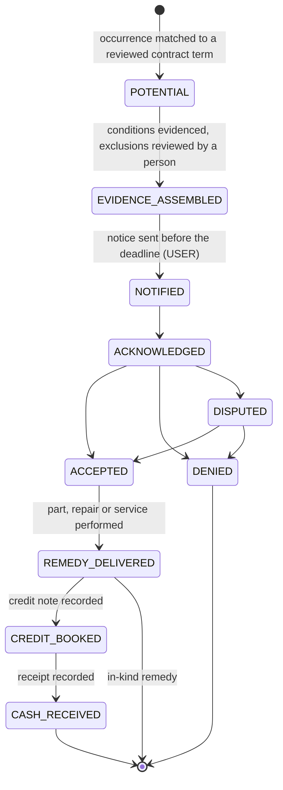

# Domain and decision models

**Layer 4 companion · rev 11 (redesign) · AssetOps Architect (Claude) · 17 Nov 2026 · design only, nothing built**
**Answers:** brief Part VI, C1 Deliverable 4 (vertical algorithms, time-series reasoning, intervention models) and Deliverable 5 (decision orchestration, safeguards, allocation, verification), and C3 (mandatory scenario tests), for the five mechanics of `layer4-transformation-design.md` §2: **M1 Define**, **M2 Observe**, **M3 Evaluate**, **M4 Choose**, **M5 Prove**.
**Figures:** illustrative USD from `demo-site-scenario-manifest.yaml` (rev 11), evaluated by `evaluate_structure.py` into `derived-values.json`; `check_manifest.py` asserts every stated figure, and every figure tagged in this document, against the evaluation. Derived figures show their arithmetic. The forward-replay quantities **210 L, 20 L, 68 L** (and the 4-of-61 and 0-of-61 dawn results) are **design values** held in the manifest: the replay adapter must reproduce them from real series before anything relies on them. No simulator run was made for this document.

> **Labels.** **[code-observed]** read in `/opt/assetecon/AssetOpsV1` at `f5d2b9a4f` (backend, simulator and host unchanged since `bf6014e02`) · **[test-confirmed]** pinned by a named product test · **[implementation-report]** stated only by the reviewed baseline (`.agent/decision-intelligence-mechanism-2026-11-14.html`) · **[proposed]** this design · **[research]** brief sources [R1]–[R12] or general engineering practice · **[assumption]** to validate in a pilot. Data provenance: the demonstration's telemetry is *demo-simulated*, its commercial records *source-emulated*; nothing here is *field-integrated* or *observed-financial*.

**Changes from rev 3.** Rev 3 was organised around ten extensions to today's code (D1–D10: thread origins, ledgers, safeguard registry, simulator feasibility, entitlement economics, allocation, verification triple), with the decision anchored on a Finding thread. Rev 4 is organised by mechanic. Its first section is new: **the structure registry, its bottom-up evaluation and attribution**, which every other model feeds or reads. Existing analyses reappear as **factor observers**; option models are **counterfactual factor models per lever**; safeguards are **obligation bounds on factors**; decisions anchor on a **factor key** (site, factor, cause), and threads attach to it as evidence. Rev 3's verified arithmetic, replay mechanics, calibration rules and refusal policies are carried over. The world changes of rev 4: Thika's incident is v7.0 INC-203 (6 Oct 19:11, backup generator GEN-CR-01 failed to auto-start, peak 8.2 °C, B-1031 French beans with a 5 °C limit, QA downgraded 6 crates = 108.00, EPC warranty on the start controller, witnessed start test ACT-051); Ruiru's idle connector is v7.0 F-130 (CH-R7 connector 2); Embakasi is valued against November no-action (8,082.00<!--fig:options.EMB-DEADLINE.monthly_or_horizon_change--> a month, 95,484.00<!--fig:options.EMB-DEADLINE.value--> over 12 months); the Mto huller connection is contractor work (0 crew visits).

**Reading order.** §1 shows how a decision arises at a factor and moves through its lifecycle. §2–§7 are the algorithms, by mechanic. §8 is the time dimension. §9 is the C3 scenario table. §10 collects uncertainty labels, refusals, calibration and repository placement. §11 lists open points.

---

## 1. How decisions arise and move: the factor key and the lifecycle

### 1.1 Attention arises at a factor

The product does not watch outcomes and then search for causes. It **observes factors** (M2), computes every outcome through its declared structure (M1), and therefore sees a deviation or a threat **at the factor where it arises**, usually before the outcome's money closes. Three things open a decision [proposed]:

1. **A factor deviates from its plan** beyond a declared materiality: Kobo's candidate litres (330 L of generator running while solar could carry the load, against 0 planned); Mwea's occupied crate-days (4,340 against 7,440); Embakasi's peak share (55% against 30%); Kirinyaga's efficiency factor (+970 kWh above the occupancy model).
2. **A factor approaches or breaches an obligation bound**: Kasarani's deliverable energy fell to 1,050 kWh a night on 1 Nov against 1,200 required, so the departures factor was at risk before any penalty; Kisiwa's generation redundancy fell to one genset at 95% evening load when GEN-KS-01 failed on 30 Oct; B-1031's chamber temperature crossed its 5 °C limit on 6 Oct.
3. **A new latent factor appears**: a customer's demand with evidence (Mto's cooperative letter of intent for a rice huller; the city's offer of 6 more buses at Ruiru; the Mwea aggregator's draft contract), or a contract deadline (Mto inverter warranty notice by 27 Nov).

Headroom without a customer does **not** open a decision: Kobo's 18–20 kW daytime headroom (v7.0 F-109) remains a capacity factor (§3.9).

### 1.2 The factor key

A decision is keyed by **(site, factor node, cause)** [proposed]: for example (Kobo, `fuel.litres.candidate`, generator stop threshold 90%); (Kasarani, `charging.chargers_in_service`, CH-K2 contactor weld); (Mto, `capacity.daytime_latent_demand`, cooperative huller LOI). The factor node is the shared factor ID of the structure (brief unit hierarchy, line 130), so every option, bound, commitment and verdict of the decision refers to the same node, and its money is counted once.

Findings, Finding threads, operational records and contract events **attach to the key as evidence**. The thread remains the right carrier for recurrence of a physical issue (REOPENED, RECURRED, RESOLUTION_WITHDRAWN, `chain/lifecycle.py:47-58`) [code-observed], but a decision can exist without any Finding (a plan deviation in occupancy, a customer proposal, a contract deadline), which is why rev 3's thread anchor is retired. Today a thread occurrence must be exactly a Finding or an opportunity (`0042_chain_threads.py:53`, `occurrence_one_source`) [code-observed]; that constraint stays as it is, because threads no longer carry the decision.

### 1.3 The decision lifecycle

```mermaid
stateDiagram-v2
    [*] --> OPEN: factor key (site, factor, cause) opened by a plan deviation, a bound threat or a latent factor
    OPEN --> OPTIONS_ASSEMBLED: lever generators propose factor changes + mandatory NO_ACTION; evidence (Findings, threads, records) attached
    OPTIONS_ASSEMBLED --> EVALUATED: per option QUALIFY → COUNTERFACTUAL → BOUNDS → VALUE (M3)
    EVALUATED --> ALLOCATED: portfolio allocation run (M4)
    ALLOCATED --> RECOMMENDED: one option per decision, or none (investigate / no action)
    RECOMMENDED --> APPROVED: named USER approves
    RECOMMENDED --> DECLINED: named USER declines, reason recorded
    APPROVED --> COMMITTED: prediction frozen (factor targets, bounds, windows); work carrier assigned
    COMMITTED --> OBSERVING: carrier executes (config trial, domain action, work case, supplier claim)
    OBSERVING --> CLOSED: three verdicts recorded (M5)
    OBSERVING --> OPEN: target factor did not move or a bound failed (reopen on same key)
    EVALUATED --> SUPERSEDED: a factor observation was revised
    RECOMMENDED --> SUPERSEDED: a factor observation was revised
    APPROVED --> WITHDRAWN: revised evidence breaks a hard bound or flips the value's sign
    SUPERSEDED --> OPTIONS_ASSEMBLED: re-evaluate on the new revision
    DECLINED --> [*]
    WITHDRAWN --> [*]
    CLOSED --> [*]
```



Each option carries its own evaluation trail; the first failing stage fixes its disposition.

| Stage | Question | Failure disposition | Writes |
|---|---|---|---|
| QUALIFY | Are the factors the option changes, and the factors its model needs, observed with adequate provenance and coverage? Is any competing explanation of the factor still open? | INSUFFICIENT_EVIDENCE (records named) | evidence digest, missing list |
| COUNTERFACTUAL | What do the changed factors become, forward over the horizon, by the lever's model? | REJECTED (infeasible) | model run id, factor trajectories |
| BOUNDS | Do the counterfactual factors hold every applicable obligation bound? | REJECTED (hard fail); INSUFFICIENT_EVIDENCE (unknown, REFUSE); CONDITIONAL (unknown, CONDITIONAL) | per-bound result, value, threshold, reason |
| VALUE | What is the structure's outcome under the option minus under no action, over the common horizon, net of one-off cost? | REJECTED (dominated or negative without a non-money reason); DEFERRED (positive outside horizon or budget) | effects per factor node, sensitivity, downside |
| ALLOCATE | Does it fit budget, crews, dependencies, exclusions and deadlines? | DEFERRED / CONDITIONAL with the binding constraint | run id, binding constraint |

Dispositions: RECOMMENDED, CONDITIONAL, ACCEPTABLE, DEFERRED, REJECTED, INSUFFICIENT_EVIDENCE. A RECOMMENDED option may carry an *execution* condition ("supervised 14-day trial"); CONDITIONAL means the *choice itself* depends on an unresolved fact (budget, letter of intent, signature).

### 1.4 Triage, comparison, allocation

These are three different operations [proposed; brief C1 D5]:
- **Triage** orders open factor keys for attention: consequence on an obligation bound in the next 72 hours, then the nearest contractual deadline, then money. It produces an order, never a value. Today's placement groups (`estate/placement.py:1-6`: "groups say where to look first, never a value ranking") [code-observed] stay for the Findings root.
- **Comparison** orders options inside one decision on one horizon, basis and factor node.
- **Allocation** chooses a set across decisions under shared constraints (§6).

### 1.5 Carriers (no second workflow engine)

| Lifecycle step | Existing carrier | Change |
|---|---|---|
| Evidence attached to a key | Findings and threads (`finding_thread`, 0042) [code-observed]; operational records; commercial records (new store) | none to threads |
| Config trial: reserve | `action` reserve-trial-1 (`actions/reserve_trial.py`) [code-observed] | unchanged; one option generator among several |
| Config trial: stop threshold | `stop-soc-threshold` is a CONTROL property (`sites/models.py:167-169`) [code-observed]; the `action` table is reserve-only by CHECK (`0016_action_store.py:60`, `:72`) [code-observed] | a domain-action APPLY path publishing a Foundation revision, rule `stop-soc-trial-1` [proposed]; `action` not widened |
| Repair, maintenance | `work_case` INCIDENT / MAINTENANCE_REQUEST (`work/model.py:27-29`) [code-observed] | cost fields on the option |
| Supplier claim | — | new `work_case` kind with typed claim events [proposed] |
| Approval | today `DecisionPrincipal` SERVICE in mini decisions | USER principal required [proposed] |
| Verification | plan freeze and operational verdict (`actions/verification.py:193`, `verification_rules.py:739-815`) [code-observed] | economic and causal verdicts beside it (§7) |

---

## 2. M1 Define: the structure registry, bottom-up evaluation and attribution (new)

### 2.1 Purpose and status

**Purpose.** Hold, as versioned code rows, the declared structure of every outcome per vertical: nodes, kinds, children, units, observers, plan declaration, bounds, lens and lever associations (contracts in `economic-metric-and-effect-contracts.md` §6.1). Evaluate it bottom-up on actual, planned and counterfactual factors with one function, and attribute deviations through it.

**Status: new**, replacing the role of the outcome map. **Basis in code:** the outcome map `CONTRIBUTIONS` declares 10 signal → outcome rows, all MOVES (`outcomes/outcome_map.py:149-180`) [code-observed], and a role table maps each Finding mechanism to the outcomes it moves and checks (`outcome_map.py:18-26`: e.g. `GENERATOR_SUPPORT_CANDIDATE` moves MG-2 and checks MG-5, MG-4; `COLD_START_FAILURE` F-118; `EV_INTERRUPTION` F-130) [code-observed]. A start-up integrity check exists (`chain/graph.py:177` `check`) [code-observed]. What is kept: the code-registry form, versioning and start-up check. What changes: rows declare **outcome → factor → leaf** relations; each signal row names the factor node it observes; MOVES / CHECKED become the brief's L2.5 roles (primary → value, trade-off → costed factor, constraint → bound, evidence → Assure state). Why not keep it as is: a signal → outcome row has no arithmetic relation to the outcome, so it cannot carry money once or explain a deviation.

**How the demonstration figures are produced.** The demo's structures, factor map and option inputs are in the manifest (`structures:` for every layer, `factor_map:` from records to leaf factors, `evaluation:` with options as parameters and factor-change expressions, `plans:`). `evaluate_structure.py` evaluates them **all the way down**: value chain stages, the physical split (litres, kWh model, deliverable energy), cost lines, the outcome, and Protect. Rights enter as **cost-bearer shares on cost lines** (a warranty-covered line has operator share 0 while the right is potentially covered or accepted; expired cover leaves it at 1). Restore dates are derived from drivers (Kisiwa repair 9 Nov = crew 8 Nov + 1 day; Mto claim 28 Nov = decision + 21-day lead time + 1 install day; buy-now 12 Nov = decision + 5-day local supply + 1 day; Kasarani 9 Nov = notice 2 Nov + 5 business days; Thika 8 Nov = the supplier's scheduled remedy). No figure is typed into the code: `check_manifest.py` asserts that every figure stated in the pack equals the evaluated one. **Valued-in-money rule:** an option is valued in money only when it changes a money node of the structure; otherwise its spend is shown as not valued in money, with its Protect effect.

### 2.2 Mechanism

```
# Definition (code rows, versioned)
Node(id, kind ∈ {LEAF, IDENTITY, PRODUCT, TIERED_PRODUCT, STAGE, PHYSICAL, COMPOSITION, RATIO},   # same list as contracts §2.1
     children[(id, sign)],
     unit, observer?, leaf_source?, plan_declared, bounds[], lenses[], levers[], tolerance?)

# Start-up integrity (fails the process, like chain/graph.py check)
assert acyclic; every leaf has a source or observer; units compose (kWh × USD/kWh → USD);
every observer named exists at its version; every bound derives from a Protect measure (§4.7);
every lens objective resolves; no PHYSICAL child is an option's counterfactual (observation only).

# Evaluation: one function for actual, plan and counterfactual
def evaluate(node, leaves, period):
    if node.kind == LEAF:      return leaves[node.id]            # value, class, coverage, clocks, lineage
    vals = [evaluate(c, leaves, period) for c in node.children]
    if any(v.coverage == MISSING for v in vals): return partial(node, vals)   # never zero-filled
    return combine(node.kind, vals)          # identity/stage/composition: signed sum; product; tiered product; physical: sum; ratio
# class of a combined node = the weakest class among its children (RECORDED > DERIVED > MODELLED);
# coverage = share of its value resting on RECORDED leaves.

# Composition: portfolio node = Σ eligible sites; ratios Σnum/Σden; missing sites excluded and named.

# Attribution (plan → actual), recursive, exact
def attribute(node, plan, actual):
    match node.kind:
      IDENTITY | STAGE | COMPOSITION: return concat(attribute(c) for c in children)   # rule AR1
      PHYSICAL:           concat(attribute(c) for c in children)                     # rule AR4
      PRODUCT (Q×P):      vol = (Qa−Qp)·Pp ; price = (Pa−Pp)·Qa                       # rule AR2 (decision A13)
      TIERED_PRODUCT (ΣQ·s_k·P_k): vol, mix, price as in contracts §4.2 rule AR3
      RATIO:              numerator / denominator effects in units, money null          # rule AR5
    assert Σ rows == actual(node) − plan(node)        # to the cent
    residual rows only on declared residual nodes: observed total − what the modelled children explain
    (label "not explained by the model yet"); never spread
```

**Plans at factor level.** Plan lines are entered at leaves (billed kWh, tariff, litres, price, crate-days, rate, peak share, max kW). A plan entered only at a line (Ruiru's 12,600.00 energy) is accepted; attribution stops at that line and says "plan not declared at factor level" (contracts AT-11).

**Why deterministic arithmetic, not a model.** The structure is an accounting identity plus declared physical sub-structures. Its job is to be reproducible to the cent; every judgement (what is avoidable, what is efficient) lives in a named observer or counterfactual model with its own label.

### 2.3 Error modes, uncertainty, refusal, tests

- **Error modes:** `STRUCTURE_INVALID` (start-up); `PLAN_NOT_AT_FACTOR` (attribution truncated, shown); `LEAF_MISSING` (node partial); `UNIT_MISMATCH`; `CURRENCY_UNCONVERTED` (FX-1: excluded by name); `REVISION_CONFLICT` (two revisions of one leaf in one read: newest wins, older retained).
- **Uncertainty label:** EXACT for identity arithmetic on recorded leaves; a node inherits the weakest label of its children.
- **Calibration:** none (identities). Tolerances on residual nodes are declared per node (Kobo fuel 2%).
- **Minimum sample:** one recognition period per node; four periods for context only.
- **Negative control:** a site with every leaf at plan yields zero attribution on every node (Thika's energy node: model 3,720 = plan 3,720 = meter 3,720).
- **Refusal:** no outcome is shown whose structure is not declared for the business model (captive revenue NOT_APPLICABLE); no stored totals (`chain/period_read.py:139`) [code-observed].

| Vector | Input | Expected |
|---|---|---|
| ST-1 | Lakeside October leaves | contributions 883.00 / −250.00 / 810.00; portfolio 1,443.00 vs 2,295.00 = −852.00; revenue −97.00, cost −755.00 |
| ST-2 | Harvest Cold leaves | −12.00 / 454.00 / 504.00 = 946.00 vs 1,716.00 = −770.00 |
| ST-3 | Metro leaves | cost 41,705.12 vs 38,520.80 = −3,184.32; 32.03 per departure; revenue NOT_APPLICABLE |
| ST-4 | attribution identity | every node of 9 sites: Σ rows = deviation (contracts AT-1 … AT-11) |
| ST-5 | Kisiwa O&M leaf MISSING (GAP-1) | node ESTIMATED at 700.00; Lakeside cost coverage 7,545.00 / 8,245.00 = 91.5% |
| ST-6 | broken unit in a test structure | start-up fails with `UNIT_MISMATCH` |

---

## 3. M2 Observe: factor observers

Factor observers are the analyses that turn source facts into leaf or sub-factor values. Several exist and are strong; they are kept as observers of specific nodes, not as places where value is computed. Each card below gives purpose, status and code basis, the mechanism, then error modes, uncertainty, calibration, sample, negative control, refusal and test vectors.

### 3.1 Recorded money leaves (modified)

**Purpose.** Fill money leaves (billed revenue, receipts, settlements, invoices, credit notes, plan lines) from commercial records by recognition period.
**Status: modified.** `recorded_amount@1` "returns no money with `NO_RECORDS`, always" (`chain/strategies/recorded_amount.py:1`) [code-observed]. `@2` reads revisions of a new commercial record store (immutable raw payload, source-versioned revisions, four clocks, idempotency key tenant + source system + record id + version) [proposed; integration design].
**Mechanism.** leaf(site, node, period) = Σ record amounts whose recognition period = period and whose mapping (effective-dated) resolves to the site and node; FX converted with declared basis.
**Error modes:** `NO_RECORDS` (leaf MISSING; plan carried as ESTIMATED only where declared); `DUPLICATE_SOURCE_ROW` (DUP-1: 0 new revisions); `CROSS_TENANT` (TENANT-1: refused at ingestion). **Uncertainty:** EXACT. **Calibration:** none. **Negative control:** a re-uploaded identical file changes nothing. **Refusal:** no amount without a record; ESTIMATED only with the label and in the coverage denominator. **Vectors:** OBS-R1 Mto billed 5,400 × 0.40 = 2,160.00; OBS-R2 DUP-1 idempotent; OBS-R3 GAP-1 Kisiwa O&M ESTIMATED 700.00.

### 3.2 Energy-to-cash observer (new, mini-grid)

**Purpose.** Observe each stage leak between delivered energy and cash so that losses, administration, timing and the truly unexplained are separate factors (brief MG-C3, C3 scenario 3).
**Status: new.** Nothing today joins meters, billing and settlement.

**Mechanism.**
```
expected_metered = delivered − delivered × loss_band          (declared band [assumption] 5% ± 1 pt)
unexplained_kwh  = expected_metered − metered                 → kWh factor, money null
billed           = metered − unmapped_kwh − authorised_adjustments_kwh
    unmapped_kwh = metered kWh on meters whose customer mapping (valid_from/valid_to) is absent in billing
revenue          = billed × tariff(effective at service instant)
revenue          = collected(settled_at ≤ period end) + in_transit(paid ≤ period end < settled_at) + outstanding
```
Mto, October: 6,000 − 300 = 5,700 expected; metered 5,580 → **120 kWh unexplained** (unpriced); 5,580 − 140 unmapped − 40 authorised = 5,400 billed × 0.40 = 2,160.00 = 1,890.00 collected + 150.00 in transit + 120.00 outstanding. The 140 kWh arise from a meter swap on 3 Oct for 6 customers not applied in billing (MAP-1): a correctable **charge**, not a loss. The 150.00 paid on 30–31 Oct settles on 2 Nov (LATE-SETTLE-1): revenue unchanged, collection status moves.

**Error modes:** `REGISTER_GAP` (meter without any mapping for part of the period → unmapped, not loss); `FEEDER_GAP`; `LOSS_BAND_UNDECLARED` (Kobo, Kisiwa: loss reported as one figure, unexplained split MISSING). **Uncertainty:** EXACT for billed and cash; BOUNDED for unexplained (± the loss band, ± 60 kWh at Mto). **Calibration:** loss band per feeder from a pilot's metered history. **Minimum sample:** one billing cycle; the unexplained factor is investigated only if it persists two cycles or exceeds the band's upper edge. **Negative control:** a site with a full register and no swap shows unmapped = 0. **Refusal:** the unexplained kWh are never priced, never called theft, never shown as collectible; no "recovered" money until a bill and a receipt exist. **Vectors:** OBS-E1 Mto chain as above (OR-MG-4); OBS-E2 Kobo 9,100 − 410 = 8,690 − 45 = 8,645; 3,180.00 + 278.00 = 3,458.00; OBS-E3 MAP-1 surfaces 140 kWh as unmapped, not loss.

### 3.3 Fuel balance (kept)

**Purpose.** Observe litres consumed per period and the residual factor "litres beyond what the generator model explains".
**Status: kept.** The fuel-balance analysis and its `UNEXPLAINED_FUEL` Finding (`0056_unexplained_fuel_finding.py:80`, basis `UNEXPLAINED_FUEL_AT_DECLARED_PRICE`; delivery tolerance 1% of ticket, `fuel_balance/rules.py:49`) [code-observed]. It already does the right thing; in the structure it fills the litres node and its residual sub-factor.
**Mechanism.** consumed = opening dip + deliveries − closing dip; model-implied = Σ generator energy × SFC (+ no-load fuel where declared); residual = consumed − model-implied; investigate if |residual| / consumed > tolerance (2%). Kobo: 220 + 1,200 − 240 = **1,180 L**; model-implied 1,060; residual **120 L (10.2%)** → investigate. Kisiwa: 2,400 vs 2,380 → **20 L (0.83%)** → reported, not investigated.
**Error modes:** missing dip at a period edge (balance MISSING, not zero); delivery note late (OOO-1: revision of October, bridge recomputed). **Uncertainty:** EXACT for consumed (within ticket tolerance); MODELLED for model-implied. **Calibration:** SFC per generator (datasheet or site test). **Minimum sample:** one month with dips at both edges. **Negative control:** Kisiwa within tolerance. **Refusal:** the residual is never attributed to theft, leak or meter error without evidence; it carries money only as its own DERIVED factor. **Vectors:** OBS-F1 Kobo 1,180 / 1,060 / 120 investigate; OBS-F2 Kisiwa 20 L inside tolerance; OBS-F3 OOO-1 revision kept, prior readable.
**Extension: fuel price-discrepancy check (brief MG-C4, P1-P).** For each delivery: delivery-note price vs invoice price vs contracted price (effective at the delivery date); a difference beyond the invoice rounding tolerance is a factor on the fuel-price leaf, shown with the three documents. No demonstration case: every October delivery is at the contracted 1.25 / 1.30.

### 3.4 Dispatch classification (kept): observer of the generator-energy split

**Purpose.** Split generator energy into **necessary** running (load exceeds what PV and battery can serve, or battery at or near reserve) and **candidate** running (PV could carry the load).
**Status: kept** as dispatch-3.2 (`analytics/dispatch_v3.py:42` `MODEL_VERSION = "dispatch-3.2"`; rule ladder `:290-293`: battery at or near reserve within 10 points and load > PV → NECESSARY; load > PV + discharge → NECESSARY (capability shortfall); PV ≥ 1.1 × load → CANDIDATE; continuity tolerance 20 min `:44`) [code-observed; test-confirmed per baseline §3.11]. Its role changes: it observes a sub-factor; it no longer stands for the value.
**Mechanism in the structure.** Kobo October: necessary litres 730 (plan 700: +30 from evening load growth) and candidate litres 330 on 11 of 31 days. Kisiwa: 0 candidate minutes (rainy month, load > PV + PCS every evening, battery at reserve) → all running necessary.
**Known limits** (baseline case B4) [implementation-report]: it does not model dawn energy needs, a stop setting kept for an equalisation charge, N−1 reserve or generator minimum load. These are why a candidate interval is **not** the same as an avoidable one; the forward replay (§4.2) closes them.
**Class and uncertainty:** both halves of the split are DERIVED ("Calculated from records"): one rule on metered generator energy with the declared consumption rate, so necessary and candidate litres always carry the same class; label BOUNDED (by the declared consumption rate). **Error modes:** input gap > 20 min (segment unassessed). **Negative control:** Kisiwa, 0 candidate minutes (OR-MG-2). **Refusal:** candidate litres are never shown as savings. **Vectors:** OBS-D1 Kobo candidate on 11 of 31 days (OR-MG-1); OBS-D2 Kisiwa 0.

Note on the 330 L: the manifest uses it both as the candidate sub-factor of the 1,060 L model-implied fuel and as fuel-cost-1's upper value (`financials/fuel_cost.py:57-79`, quantity_high = 1.10 × Σ P·h·SFC over candidate time) [code-observed]. In the build the candidate leaf is litres at the calibrated SFC and the upper bound is a separate EXPOSURE figure (§11).

### 3.5 Tariff pricing of energy (new, EV and any time-of-use site)

**Purpose.** Price every kWh at its interval under the tariff effective at the service instant, and the monthly maximum demand, so that energy cost is a sum of tier products whose shares are observable factors.
**Status: new.** Today the EV depth analysis only finds the peak import sample (`analytics/ev_depth.py:134-139` `_peak_sample`) [code-observed]; nothing prices energy.
**Mechanism.**
```
for each metered interval i (OCPP MeterValues or site meter): tier(i) = tariff_effective(t_i).tier_at(t_i)
energy_cost = Σ_i kWh_i × price(tier(i));   share_k = Σ_{i∈k} kWh_i / Σ_i kWh_i
demand_cost = max over demand intervals (contract interval, e.g. 15 min) of kW × demand rate
```
Embakasi October (C-114 before the new tier): peak 47,740 kWh × 0.24 = 11,457.60; other 39,060 × 0.12 = 4,687.20; 500 kW × 12 = 6,000.00 → 22,144.80. From 1 Nov the 00:00–05:00 tier at 0.09 applies; the same pricing function prices November no-action and every option.
**Error modes:** `TARIFF_UNCONFIRMED` (structure of C-114 assumed until the utility invoice confirms tiers and demand term; options CONDITIONAL); `CLOCK_OFFSET` (CLOCK-1: charger clock 4 min fast, corrected from StatusNotification pairing and flagged); interval gaps (demand max partial). **Uncertainty:** EXACT on invoiced periods; MODELLED for projected ones. **Calibration:** reconcile priced intervals with the invoice within 1% before use. **Minimum sample:** one invoice cycle. **Negative control:** Kasarani flat 0.15: shares change nothing (37,200 × 0.15 = 5,580.00 at any schedule). **Refusal:** no tier or demand charge assumed from a tariff name alone. **Vectors:** OBS-T1 Embakasi October 22,144.80; OBS-T2 Ruiru C-117 6,076 × 0.24 + 54,684 × 0.12 + 380 × 12 = 12,580.32; OBS-T3 Kasarani schedule-invariant.

### 3.6 Occupancy ledger observer (new, cold)

**Purpose.** Observe occupied and chargeable crate-days and idle capacity from batch check-in/out, with commodity compatibility.
**Status: new.** CC-2 Paid cold-room use is "not connected yet" (`outcomes/catalogue.py:61`) [code-observed].
**Mechanism.**
```
crate_days(period) = Σ_batches crates_b × |[in_b, out_b) ∩ period|_days
chargeable = crate_days − incompatible_or_unbilled;   idle = capacity − crate_days
revenue = chargeable × rate(contract effective at service day)
```
Mwea 4,340 × 0.20 = 868.00 (35% of 12,400); Thika 8,680 (70%); Kirinyaga 9,920 (80%).
**Error modes:** `LEDGER_OVERLAP` (a batch checked in twice), `OPEN_CHECKIN` (no check-out at period end: occupied to period end, flagged). **Uncertainty:** EXACT. **Calibration:** reconcile ledger revenue with invoices within 0.5%. **Minimum sample:** one period. **Negative control:** a batch checked out before an incident is not present (B-1029 left 5 Oct 16:00). **Refusal:** occupancy is never inferred from energy. **Vectors:** OBS-O1 Mwea 4,340 / 868.00 / idle 8,060; OBS-O2 portfolio 22,940 of 37,200.

### 3.7 Normalised refrigeration energy (new, cold)

**Purpose.** Split a room's energy into the part its occupancy and ambient explain and an **efficiency factor**, so that two rooms with similar unit cost can have opposite causes (brief CC-C3; C3 scenario 4).
**Status: new.** Today's cold analytics observe excursions and start response only (`analytics/cold.py:1`, `cold-excursion/1` and `cold-start-response/1`) [code-observed].

**Mechanism.**
```
kWh_model = a + b × crate_days, × (1 + 0.025 × max(0, T_amb − 24 °C))      [proposed fixture form; a = 1,550, b = 0.25]
efficiency_kwh = kWh_meter − kWh_model;   r = efficiency_kwh / kWh_model;   tolerance |r| ≤ 5%
```
| Room | Crate-days | Model | Meter | r | Reading |
|---|---:|---:|---:|---:|---|
| Mwea | 4,340 | 2,635 | 2,650 | +0.6% | within tolerance: the high unit cost (0.1221) is occupancy |
| Kirinyaga | 9,920 | 4,030 | 5,000 | +24.1% | efficiency factor −194.00 a month: equipment |

Model-implied unit cost: Mwea 2,635 × 0.20 / 4,340 = 0.121 (observed 0.122: normal for its occupancy); Kirinyaga 4,030 × 0.20 / 9,920 = 0.081 (observed 0.101). Normalisation inverts the raw ranking.
**Error modes:** `MODEL_NOT_CALIBRATED`; `B_NOT_IDENTIFIABLE` (occupancy too flat over the calibration window; b borrowed from same-design rooms, label WIDE). **Uncertainty:** MODELLED (WIDE with pooled b). **Calibration:** fit a and b per room on ≥ 60 days of hourly energy, daily occupancy and hourly ambient in a declared healthy period; accept if the coefficient of variation of daily residuals ≤ 8% and occupancy spans ≥ 30 points. **Minimum sample:** 60 days. **Negative control:** Mwea within tolerance → no equipment option qualifies (MWEA-COMPRESSOR rejected). **Refusal:** no efficiency claim from an uncalibrated model; door-opening and product-load terms are added only when measured. **Vectors:** OBS-N1 Mwea +0.6% → OCCUPANCY; OBS-N2 Kirinyaga +24% → EFFICIENCY (OR-CC-1).

### 3.8 Batch exposure observer (new, cold; Thika = v7.0 INC-203)

**Purpose.** Bound an equipment or power event's consequence to the batches actually present and above their own limits, and keep exposure, damage and liability as three different factors (brief C3 scenario 5).
**Status: new**, built on kept observers: `COLD_START_FAILURE` (F-118) and `COLD_EXCURSION` (F-119) Findings (`outcome_map.py:20-21`) [code-observed].

**Narrative (6 Oct, Thika).** Grid power failed at 19:11. The automatic start of backup generator GEN-CR-01 was requested at 19:11:05 and failed at 19:11:10 (start controller); staff started it by hand at 19:14; cooling ran from 19:15. The chamber, banded 2–4 °C, was above 4 °C for 25–35 minutes, peaked at **8.2 °C at 19:19**, and was back in band by 19:45. The peak came four minutes after cooling resumed: the air keeps warming while the coil pulls down.

```
present_b  = [in_b, out_b) ∩ excursion_window ≠ ∅
minutes_b  = minutes(T_chamber > limit_b) bounded by reading resolution
exposed_b  = present_b ∧ minutes_b > contract_threshold_b (15 min)
exposure_b = crates_b × declared value       → EXPOSURE, never money
damage_b   = QA-confirmed crates × declared value     → from QA notes only
liability_b = contract rule(damage_b, cause = operator equipment, minutes_b) → ECONOMIC_ACTUAL when a credit note exists
```
| Batch | Commodity, limit | Present | Above limit | Exposure | QA damage | Liability |
|---|---|---|---|---:|---:|---:|
| B-1031 | French beans, export grade, 5 °C | yes | 20–30 min (> 15) | 2,160.00 (120 × 18) | 6 crates = 108.00 | 108.00 (credit note CN-0412) |
| B-1034 | avocado, 12 °C | yes | no (peak 8.2 < 12) | — | — | — |
| B-1029 | cabbage | no (checked out 5 Oct 16:00) | excluded | — | — | — |

The decision is robust to resolution: even the lower bound (20 minutes above 5 °C) exceeds the contract's 15 minutes.
**Error modes:** `PROBE_GAP_IN_EXCURSION` (> 5 min missing inside the window → exposure UNKNOWN for present batches, never "not exposed"); ledger presence ambiguous. **Uncertainty:** BOUNDED (minutes as a range). Chamber air temperature is not pulp temperature: exposure is a statement about air. **Calibration:** commodity limits and contract thresholds from customer contracts. **Minimum sample:** the incident window at the recorded resolution (5-minute chamber readings in evidence windows, as the v7.0 probe; the time above limit is a bound). **Negative control:** B-1034 present but below its limit; B-1029 absent. **Refusal:** exposure is never presented as loss; no liability without a QA record and a contract clause; insurance never assumed (108.00 < 500.00 deductible: not claimed). **Vectors:** OBS-B1 as table (OR-CC-2); OBS-B2 remove 10 min of probe data inside the window → B-1031 UNKNOWN; OBS-B3 insurance notified 8 Oct, NOT_FILED, reimbursement 0.00 (OR-ENT-3).

**Optional thermal counterfactual.** The `cold-thermal/1` pack steps an exact heat balance per minute (`simulator/assetops_simulator/packs/cold.py:5-11`) [code-observed]. It is worth running only when it changes a decision: sizing a stopgap's response time (how long, at this load and ambient, before 5 °C is crossed) [proposed]. It is not needed for energy normalisation.

### 3.9 Charging capacity and fault consequence (new, EV)

**Purpose.** Observe chargers in service, the deliverable energy they imply under the import limit and window, and therefore whether the departures bound holds tonight. Rank faults by consequence, not by downtime (brief EV-C2; C3 scenario 7).
**Status: new**, over kept observers: EV interruption and connector-fault Findings (`analytics/ev.py:32` `EV_INTERRUPTION`, `:44` `EV_CONNECTOR_FAULT`) [code-observed].
**Mechanism.**
```
deliverable_kwh(night) = min(import_limit_kw, Σ_in_service charger_kw) × window_h
buses_short(night)     = ceil(max(0, required_kwh − deliverable_kwh) / kwh_per_bus)
consequence(fault)     = buses_short × penalty_per_missed_block over the restore horizon
                         + SLA / notice clock effects (listed, EXPOSURE)
```
| Fault | Binding limit | Deliverable without the asset | Required | Short | Downtime by 6 Nov | Priority |
|---|---|---:|---:|---|---|---|
| Kasarani CH-K2 (contactor weld, 1 Nov 23:40) | chargers: 3 × 50 kW × 7 h | 1,050 | 1,200 (8 × 150) | 1 bus a night; 2 missed departures, 240.00 penalties to date | 5 days | HIGH |
| Ruiru CH-R7 connector 2 (v7.0 F-130, one fault-aborted session 6 Oct, silent since) | import 400 kW × 8 h (chargers 720 kW) | 3,200 (unchanged) | 1,960 (14 × 140) | 0 | about a month | LOW |

A downtime count would rank Ruiru first; consequence ranks it last, because at Ruiru the import limit binds and losing a connector removes nothing deliverable (OR-EV-2).
**Error modes:** `ROSTER_MISSING` (no consequence without obligations: refuse); `STATUS_SILENT` (connector state unknown: deliverable computed both ways). **Uncertainty:** EXACT for capacity arithmetic; BOUNDED for missed departures (spare-bus availability). **Calibration:** required kWh per route block from the roster owner. **Minimum sample:** one roster cycle. **Negative control:** CH-R7. **Refusal:** no priority from downtime alone. **Vectors:** OBS-C1 Kasarani 1,050 vs 1,200 → 1 short; OBS-C2 Ruiru unchanged 3,200; OBS-C3 Embakasi 10 × 60 = 600 kW > 500 import: import binds.

### 3.10 Headroom qualification (modified): capacity factor vs latent demand factor

**Purpose.** Keep unused capacity as a capacity factor and create a **latent demand factor** only when a customer's evidence exists (brief R1: headroom is not demand).
**Status: modified.** The productive-use headroom signal moves MG-1 (`outcome_map.py:25`, `:157`) and the PRODUCTIVE_LOAD scenario computes gross sales from proposed kW × hours × tariff (`mini_decisions/scenario_rules.py:192-201`) [code-observed]. The signal is kept as the capacity observer; the money computation moves to the demand-on-headroom replay (§4.3), which needs a customer profile.
**Mechanism.** latent_demand(site) exists iff a customer record (signed LOI, contract draft, request with load, window and tariff) references the site; else capacity only. Kobo 18–20 kW, 10:00–15:00, no customer → capacity. Mto: cooperative LOI (15 kW, 10:00–15:00, 22 days, lapses 30 Nov) → latent factor; evening welder (verbal only) → latent factor flagged "no evidence".
**Refusal:** no money for capacity without a customer (contracts N11). **Vectors:** OBS-H1 Kobo no opportunity value; OBS-H2 Mto huller latent factor created.

### 3.11 Protect observer (new): the Protect measures, observed

**Purpose.** Observe each Protect measure (contracts §2.6) from its leaves, at the factor's own cadence (interval, night, day), compose it to site and portfolio, and attribute its deviation from target to the causing asset or event (brief L1.1 Protect, P1–P4).
**Status: new**, over kept observers: critical-feeder telemetry (the existing `unserved_critical_energy` metric, `verification_rules.py:787-790`) [code-observed]; the cold excursion and start-response Findings (`analytics/cold.py:1`) [code-observed]; EV interruption and connector-fault Findings (`analytics/ev.py:32`, `:44`) [code-observed]; fault logs in work cases; the occupancy ledger (§3.6); the charging capacity observer (§3.9).

**Mechanism.**
```
unserved_critical_kwh(site, period) = Σ_intervals max(0, critical_demand − critical_served)          # MEASURED
obligation_hours_without_redundancy = Σ_hours in obligation windows where available units < N−1 requirement
                                      or capacity < declared share                                      # DERIVED
asset_days_out_of_service           = Σ_assets days from failure record to restore record (or period end)   # RECORDED
batches_exposed, crate_minutes      = Σ_batches 1[exposed_b] ; Σ_b crates_b × minutes_b (as a range)      # DERIVED (§3.8)
days_with_backup_start_unproven     = days from a failed automatic start to a witnessed successful start  # DERIVED
customer_hours_interrupted          = Σ_customers Σ_hours supply-loss flag                                  # MEASURED
asset_value_at_risk                 = NOT AVAILABLE YET (needs a failure-likelihood basis; brief L1.1)   # EXPOSURE, listed
departures_missed                   = required − met (roster, departure log)                              # RECORDED
nights_deliverable_below_required   = Σ_nights 1[deliverable_kwh < required_kwh]                           # DERIVED (§3.9)
liability / penalties               = reference to the cost-to-serve factor (shared ID; no own amount)
rights_value_at_stake, stock_value_exposed = listed per item with state (EXPOSURE; never summed)
attribution: measure − target = Σ contributions tagged (site, asset or event, interval)                     # rule AR1
```
| Portfolio | Measure (period) | Observed | Attributed to |
|---|---|---:|---|
| Lakeside | obligation-hours without redundancy (Oct) | 30 h | Kisiwa GEN-KS-01 10 h (30–31 Oct, 18:00–23:00); Mto INV-MT-02 20 h (28–31 Oct, 10:00–15:00) |
| Lakeside | unserved critical energy (Oct) | 0 kWh | — |
| Lakeside | customer-hours interrupted (Oct) | 0 | — |
| Lakeside | asset value at risk | not available yet | deferred: "expected loss only with defensible likelihood" (brief L1.1) needs condition data and failure history (A17) |
| Lakeside | asset-days out of service (Oct) | 6 | GEN-KS-01 2; INV-MT-02 4 |
| Harvest Cold | crate-minutes above limit (Oct) | 2,400–3,600 | B-1031, 6 Oct, 120 crates × 20–30 min |
| Harvest Cold | days with backup start unproven (Oct) | 26 | GEN-CR-01, 6–31 Oct |
| Harvest Cold | liability (Oct) | 108.00 | = customer-compensation factor (counted once) |
| Metro | departures missed (Oct / Nov to 6 Nov) | 0 / 2 | Kasarani CH-K2 |
| Metro | nights deliverable below required (Nov to date) | 5 | Kasarani CH-K2, nights 1/2 to 5/6 Nov |
| Metro | charger-days out of service (Oct) | 26 | Ruiru CH-R7 connector 2 (no departure depended on it) |

**Why it matters for decisions.** Protect measures move before money: Kasarani's nights below required became non-zero on 1/2 Nov, opening the factor key days before any penalty. An option is valued in money only when it changes a money node of the structure (§2.1); otherwise its spend is shown as not valued in money, with its effect on these measures (§6). Must-do: Kisiwa's repair brings obligation-hours without redundancy back to 0; Thika's stopgap and the witnessed start test bring days with backup start unproven to 0; Kasarani's stopgap keeps departures missed at 0 until the 9 Nov restore and, because it also avoids 240.00 of penalties (a money node), is valued in money (+150.00<!--fig:options.KAS-OEM-STOPGAP.value-->). Protective: Kobo's battery evidence keeps 64,000.00 of cover claimable.
**Error modes:** `CRITICAL_FEEDER_UNMETERED` (unserved critical energy MISSING, never 0); `RESTORE_RECORD_MISSING` (asset-days open-ended, flagged); `PROBE_GAP_IN_EXCURSION` (§3.8). **Uncertainty:** EXACT for counts from records; BOUNDED for minutes. **Calibration:** obligation windows and N−1 requirements declared per site. **Minimum sample:** the period; nightly for EV. **Negative control:** Ruiru: 26 charger-days out of service and 0 missed departures, 0 nights below required. **Refusal:** a money-valued Protect measure never holds its own amount; at-stake values are never summed. **Vectors:** PR-T1 Lakeside 0 + 10 + 20 = 30 h; PR-T2 Harvest 2,400–3,600 crate-minutes, 26 days, liability 108.00 equals cost-to-serve factor; PR-T3 Metro Oct 0 missed of 1,302, Nov to date 2 and 5 nights; PR-T4 a Protect total that adds liability to cost to serve is refused (contracts N18).

### 3.12 Storage-ledger-to-invoice reconciliation (new, cold)

**Purpose.** Observe the cold realisation stages: occupied → chargeable (compatible commodity, rate card) → invoiced → received, so a service-to-cash discrepancy is a factor on its own stage (brief CC-L8 "find chargeable-vs-invoiced discrepancies, contract exceptions and collection mismatch"; CC-C1 "occupancy contribution reconciles with invoices").
**Status: new.** Nothing today joins the storage ledger, the rate card and invoices.
**Mechanism.**
```
chargeable_b     = crate_days_b if commodity_b compatible with the room's segregation, else 0 (flagged)
expected_b       = chargeable_b × rate(contract or rate card, effective at service day)
invoiced_b       = Σ invoice lines referencing batch b in the recognition period
leak_b           = expected_b − invoiced_b         # rows not invoiced, or invoiced at a rate not in the rate card
received_b       = Σ receipts allocated to those invoices;  outstanding_b = invoiced_b − received_b
```
October: no discrepancy at any room. Chargeable = occupied (22,940 crate-days); invoiced = expected = 4,588.00; received 4,370.00 + outstanding 218.00 = 4,588.00. **CC-L8 therefore has no demonstration option**; the screen states that the reconciliation ran and found nothing, rather than hiding the lever.
**Error modes:** `RATE_NOT_IN_CARD` (leak on its stage, row and rate named); `BATCH_NOT_INVOICED`; `RECEIPT_UNALLOCATED`. **Uncertainty:** EXACT. **Calibration:** none (records). **Minimum sample:** one invoice cycle. **Negative control:** October (no leak). **Refusal:** a leak is never reported as revenue lost or as collectible; accounting corrections and collections remain operator functions (brief CC-L8 boundary). **Vectors:** OBS-L1 October zero leak; OBS-L2 one ledger row invoiced at a rate not in the card → chargeable-to-invoiced leak, revenue = invoiced (contracts N20).

### 3.13 Operations (O2) observer (new composition over kept and new observers)

**Purpose.** Observe the brief's O2 measures (operational throughput and resource productivity) as declared factors, composed Σ/Σ (contracts §2.7).
**Mechanism.** asset availability = Σ available asset-days / Σ asset-days, from fault and restore records (Lakeside 428 / 434 = 98.62%); field visits from work records (3, plan 3); delivered kWh per visit 23,050 / 3 = 7,683.33; cooling availability from chamber-controller run state (Thika lost 4 minutes on 6 Oct: 99.997% over 3 × 44,640 chamber-minutes); crate-days without excursion = occupied − crate-days of exposed batches (22,820 against plan 26,040); deliverable energy used (import-limited) = Σ delivered kWh per night / Σ (min(chargers × kW, import limit) × window h) (5,960 / 10,600 = 56.23%); departures met per installed charger 1,302 / 26 = 50.08.
**Error modes:** `RESTORE_RECORD_MISSING`; `WINDOW_UNDECLARED` (utilisation refused without a declared usable window). **Uncertainty:** EXACT on records. **Negative control:** a site with no fault records has availability 100%, never "unknown" unless its asset list is missing. **Refusal:** never a mean of site percentages; O2 carries no money of its own. **Vectors:** OP-T1 98.62%; OP-T2 56.23% (Embakasi 46.67%, Kasarani 85.71%, Ruiru 61.25%); OP-T3 22,820.

**Assure A4** is not an observer: it is the evidence-pack export of A1–A3 (coverage, residuals, verdicts, rights states, lineage) per period, built in delivery slice 9 (P1-P), with no new measure.

---

## 4. M3 Evaluate: counterfactual factor models per lever

### 4.1 Option evaluation on the valuation identity (new)

**Purpose.** Evaluate every option as the same structure re-evaluated with the factors the option changes, against no action, on one horizon and basis.
**Status: new.** Today's alternatives and scenarios only read the Finding (`mini_decisions/alternatives.py:10-14`) [code-observed]; scenarios store kinds STOP_SOC, PRODUCTIVE_LOAD, TARIFF_ONLY, OTHER, and only PRODUCTIVE_LOAD calculates (`scenario_rules.py:24`, `:192-201`) [code-observed]. Kept: scenario revisions as the calculation record of an option.
**Mechanism.**
```
for option o in decision:
    F_o(t)  = lever_model(o).project(changed factors, horizon H)       # counterfactual factor trajectories
    F_0(t)  = no_action.project(current factors, same prices, tariff, contracts, H)
    value_o = Σ_t [ evaluate(structure, F_o(t)) − evaluate(structure, F_0(t)) ] − one_off_o
    effects recorded per factor node (overlap key); costed trade-offs inside value; bounds checked on F_o
```
Horizon: 12 months unless a contract sets it (Mwea aggregator 4 months). **Error modes:** `NO_ACTION_MISSING` (refused); `HORIZON_MISMATCH`; `OVERLAP` (two options of different decisions on one node → mutually exclusive or evaluated jointly). **Uncertainty:** the weakest of the lever model's label and the price assumptions. **Refusal:** no value without the no-action evaluation on the same prices (the Embakasi rule).

### 4.2 Forward dispatch replay (new adapter around the existing kernel): generator policy at Kobo

**Purpose.** Determine, for each candidate controller setting, how much of the observed candidate running it would avoid (an effect of that option, recorded on its `option_effect`; the observed structure keeps only necessary + candidate + not explained by the model), and the bound factors (dawn charge, lowest charge, battery throughput, starts, unserved critical energy) it produces (brief MG-C1; C3 scenario 1).
**Status: new adapter.** The simulator's mini-grid controller requests RUN at or below the start threshold and STOP only after minimum runtime and at or above the stop threshold (`simulator/assetops_simulator/packs/mini_grid.py:14-18`) [code-observed]; from model v5 the effective start is min(start, reserve + 5) (`:1153-1156`) [code-observed]; a scenario may override the stop threshold inside a step-aligned window (`:356-362`, handler `:949-961`) [code-observed]. The host runs a draft to the end (`host/execution_adapter.py:869` `run_to_end`) [code-observed]; the backend may not import the simulator and sees only a projection across `runs/execution_ports.py` [code-observed]. The adapter returns a neutral projection, never kernel types [proposed].

**Narrative.** Kobo's stop threshold is 90%. A pre-dawn start at 35% keeps the generator running after sunrise until the battery reaches 90%, while PV could already carry the load. That is the candidate running dispatch-3.2 observes. Whether it is *avoidable* depends on what the battery needs before the next dawn, which dispatch-3.2 does not model. The replay answers it: the same observed PV-available and load series for 61 days (1 Sep – 31 Oct) are replayed twice, under the baseline settings and under each candidate setting; the avoidable litres are the **difference of two model runs on identical inputs**, so systematic model error (an SFC bias) largely cancels.

```
F(π)      = Σ_days Σ_steps fuel_π(d, t)              # replayed litres under settings π
ΔF(π)     = F(baseline) − F(π)                        # the decision quantity
ΔF_cand(π) = part of ΔF on intervals dispatch-3.2 classified CANDIDATE   # an effect of option π (option_effect),
                                                                         # never a node of the observed structure
dawn_ok(π)  = ∀ d: SOC_π(d, 05:00) ≥ 35%              → bound
value(π)  = 12 × (p_diesel × ΔF_month − c_wear × Δthroughput_month − c_start × Δstarts) − one_off
```
**Why "reserve minus 5" is not the economic recommendation.** Today's only executable intervention is reserve r → r − 5 (`actions/reserve_trial.py:36-37`), which says of itself that it "does not predict less generator running time, any saving or any safety effect" (`:43-45`) [code-observed]. At Kobo: the reserve does not end the after-dawn run, the stop threshold does; and lowering the reserve from 30 to 25 lowers the effective start from min(35, 35) = 35% to min(35, 30) = 30%, so pre-dawn starts come later and the battery reaches dawn lower. Design values:

| Setting | Avoidable L/month | Dawn charge < 35% | Added throughput | Bound result | Value |
|---|---:|---|---:|---|---|
| reserve 30 → 25 (today's rule) | 20 | 4 of 61 days | — | dawn adequacy FAIL (hard) | REJECTED |
| stop 90 → 70, reserve 30 | 210 of the 330 candidate L (120 L of candidate running remain needed) | 0 of 61 | 150 kWh | dawn PASS; lowest charge 30% ≥ warranty floor 10%; wear costed 12.00 | (262.50 − 12.00) × 12 − 90.00 = **2,916.00<!--fig:options.KOB-STOPSOC.value-->** (design value) |
| 100 kWh battery (28,000) | acts on the same factor | — | — | — | DEFERRED: adds nothing the setting change does not |

Candidate grid [proposed]: stop ∈ {90, 85, 80, 75, 70, 65, 60} × reserve ∈ {30, 25}. Choose the highest value that passes every hard bound with the worst replayed day at least 2 points above the dawn limit; prefer the more conservative stop when two values are within 10%.

**Design values as calibration-spike inputs.** 210 L (stop 70), 20 L (reserve 25), the huller's 68 L and the 5 L a day of extra fuel at half inverter capacity at Mto are inputs to the evaluator taken from calibration spikes: **design values**, labelled as such wherever they appear, until the adapter reproduces them from site series. KIS-BATT60's 150 L a month of shifted fuel (195.00 at 1.30) is a flagged **assumption**: no Kisiwa battery replay exists (owner decision Q14).

**Calibration (before any counterfactual is admitted):** the baseline replay must reproduce observed generator kWh within ±5%, starts within ±10% and the SOC path within 5 points mean absolute error at 5 minutes; otherwise `REPLAY_NOT_CALIBRATED`. Input mapping: the kernel takes irradiance; the adapter converts G = 1000 × PV-available kW / rated kW, exact only below the inverter AC limit (Kobo 60 kW PV on 50 kW AC): clipped slots are refused or flagged, and the sample must still hold ≥ 14 usable days. Load is replayed as demand (critical requested power where it exists). The 120 L residual is **not** absorbed into calibration; it stays its own factor.
**Error modes:** `REPLAY_NOT_CALIBRATED`, `INPUT_GAP` (> 20 min), `PV_CLIPPED_INVERSION`, `SAMPLE_TOO_SHORT` (< 14 days), `POLICY_BAND_INVALID` (kernel refusal: stop not above start). **Uncertainty:** MODELLED. **Minimum sample:** 61 days for the dawn bound (0 failures in 61 bounds the daily failure rate below 3/61 ≈ 4.9% at 95%, rule of three [research]); ≥ 14 days for the litres. **Sensitivity / break-even [derived]:** diesel −20% → 2,286.00; feasible 160 L → 2,166.00; value 0 at 15.6 L/month ((90 / 12 + 12) / 1.25); wear would have to reach 1.70/kWh to cancel it. **Negative control:** Kisiwa replays to 0 avoidable litres (all necessary) → no generator-setting option qualifies (OR-MG-2). **Refusal:** no avoidable litres without a calibrated replay; dispatch-3.2 candidate litres never stand in. **Vectors:** MG-T1 reserve 25: 20 L, 4/61, REJECTED; MG-T2 stop 70: 210 L, 0/61, 2,916.00<!--fig:options.KOB-STOPSOC.value-->; MG-T3 sensitivities; MG-T4 Kisiwa nothing qualifies.

### 4.3 Demand-on-headroom replay (new, modifies PRODUCTIVE_LOAD): huller vs welder at Mto

**Purpose.** Value a latent demand factor by replaying the customer's load profile against supply by hour, with its marginal fuel (brief MG-C2; C3 scenario 2).
**Status: new**, reusing the PRODUCTIVE_LOAD scenario as the calculation record and the replay port of §4.2.
**Mechanism.** add load(t) for the customer's window and days; replay; marginal fuel = F(with) − F(without); value = tariff × kWh − marginal fuel × price − collection cost, × 12 − connection cost. The same kWh costs very different amounts by hour: daytime kWh are PV; evening kWh are diesel, because the battery's evening energy is already committed to dawn adequacy.

| Option | Load | Replay (design values) | Monthly (design value) | 12 months (design value) | Disposition |
|---|---|---|---|---|---|
| Rice huller (signed LOI) | 15 kW, 10:00–15:00, 22 days = 1,650 kWh | 3 days without headroom; 225 kWh from battery or genset; **68 L** | 1,650 × 0.30 = 495.00 − 68 × 1.25 = 85.00 − 15.00 = **395.00** | 395.00 × 12 − 1,200.00 = **3,540.00<!--fig:options.MTO-HULLER.value-->** | RECOMMENDED, depends on INV-MT-02 restored; 0 crew visits (contractor) |
| Evening welder (verbal) | 10 kW, 18:00–21:00, 22 days = 660 kWh | every kWh diesel | 660 × 0.40 = 264.00 − 660 × 0.33 × 1.25 = 272.25 → **−8.25** | — | REJECTED; break-even tariff 0.4125 → 0.42 |

Dependency: with INV-MT-02 failed, half the inverter capacity (25 kW AC) cannot carry the huller beside existing daytime load. Connection lead: 5 working days after the inverter is restored; a 28 Nov restore cannot connect before the 30 Nov lapse (§6.3).
**Error modes:** as §4.2; `NO_CUSTOMER_EVIDENCE` (value withheld, factor stays capacity). **Uncertainty:** MODELLED. **Calibration:** the customer's load profile (a metered trial day is better than a stated kW). **Minimum sample:** ≥ 28 days covering the window (days without headroom are weather-driven). **Break-even [derived]:** the huller recovers 1,200.00 within 12 months at ≥ 1,200 / (12 × 395 / 22) ≈ 5.6 operating days a month. Known omission: battery wear on the 225 kWh (≤ 18.00 a month at 0.08) is not in the manifest; immaterial. **Negative control:** the welder. **Refusal:** no value for demand without customer evidence. **Vectors:** MG-T5 huller 395.00 / 3,540.00<!--fig:options.MTO-HULLER.value--> (OR-MG-3); MG-T6 welder −8.25, 0.42.

### 4.4 Commercial correction and investigation (mini-grid leaks)

**Purpose.** Value changes to the metered → billed leak: restore the 6 unmapped meters at Mto, and investigate the 120 unexplained kWh.
**Mechanism.** MTO-BILLING changes the unmapped factor from 140 kWh to 0 → billed +140 kWh × 0.40 = **56.00 a month, 672.00 over 12 months**, class "restored charges, forward" (listed beside the plan, not added: charges become cash only when collected); back-billing October (56.00) is potential. MTO-METER-AUDIT (60.00, on the inverter visit, funded from routine O&M) prices nothing. **Refusal:** no collected money assumed. **Vector:** MG-T7.

### 4.5 Occupancy contract and repair-or-replace (cold)

**Mwea (occupancy factor).** The aggregator's draft contract changes occupied crate-days: 150 crates × 30 days = 4,500 crate-days a month at 0.18 = 810.00; energy through the normalised model 4,500 × 0.25 × 0.20 = 225.00; handling 100.00 → **485.00 a month**; × 4 months − 270.00 (sales 150 + ethylene curtain 120) = **1,670.00<!--fig:options.MWEA-AGG.value-->** (MODELLED). Capacity bound: 4,340 + 4,500 = 8,840 ≤ 12,400. Compatibility bound: avocado with cabbage needs a curtain and a shared 5 °C setpoint (hard, met by the curtain). Break-even rate [derived]: (225 + 100) / 4,500 + 270 / (4 × 4,500) = 0.087 per crate-day. Compressor replacement (4,800) is REJECTED: the efficiency factor is +0.6%, there is nothing to fix. Disposition RECOMMENDED, conditional on signature (switch).

**Kirinyaga (efficiency factor).** The excess is 970 kWh × 0.20 = 194.00 a month.
```
REPAIR  (350): value_m = recovery × 194.00, recovery 0.80 [assumption; range 0.60–0.90; design value until verified] → 155.20; 12 × 155.20 − 350 = 1,512.40<!--fig:options.KIRI-REPAIR.value--> (range 1,046.80 – 1,745.20)
REPLACE (4,800): value_m = 194.00 + 5% of 4,030 kWh × 0.20 (40.30) = 234.30; 12 × 234.30 − 4,800 = −1,988.40
NO_ACTION: −194.00 a month continues
```
Repair pays back within 12 months at recovery ≥ 15% (350 / (12 × 194)); replacement pays back in 20.5 months, and its extra 4,450 over repair is recovered by its extra 79.10 a month only after about 56 months [derived]. Repair now is right on the horizon and buys information: the verified recovery decides the replacement question (DEFERRED, trigger: verified recovery < 60%). **Vectors:** CC-T1 Mwea; CC-T2 Kirinyaga.

### 4.6 Deadline-aware charging feasibility (new): Embakasi schedule, Ruiru capacity

**Purpose.** Decide whether a charging schedule delivers every bus's required energy before departure within import and charger limits, and price it with §3.5 (brief EV-C1, EV-C3; C3 scenario 6).
**Status: new.**

**Mechanism (rule-based first).**
```
Necessary condition per night:  Σ_i e_i ≤ min(L_import, P_cap, Σ charger kW) × window_h
Then earliest-deadline-first over 5-min slots: allocate min(L_import, P_cap) to plugged buses by earliest
departure, each ≤ charger kW; a bus is MET if delivered ≥ required by departure. Plug moves are roster tasks.
cost(schedule) = tariff_pricing(Σ slot kWh, max kW)            # §3.5, November tariff
value = cost(no action under November tariff) − cost(schedule)
```
| Schedule | Window, cap | Deliverable / required | Monthly bill | Bound | Disposition |
|---|---|---|---:|---|---|
| No action (October pattern, November tariff) | as observed, max 500 kW | met | 11,457.60 + 1,860.00 + 2,120.40 + 6,000.00 = **21,438.00<!--fig:options.EMB-DEADLINE.energy_bill_reference-->** | met | ACCEPTABLE; 706.80 below October with no action |
| Cheapest | 00:00–05:00 at 500 kW | 2,500 / 2,800: 3 buses short every night | 77,500 × 0.09 + 6,000 = **12,975.00** | departures FAIL (hard) | REJECTED |
| Deadline-aware | 22:00–05:15 at 400 kW | 2,900 / 2,800 | 24,800 × 0.12 + 62,000 × 0.09 + 4,800 = **13,356.00<!--fig:options.EMB-DEADLINE.energy_bill_option-->** | departures PASS; import PASS | RECOMMENDED: **8,082.00<!--fig:options.EMB-DEADLINE.monthly_or_horizon_change--> a month; 95,484.00<!--fig:options.EMB-DEADLINE.value--> over 12 months** after 1,500 |

The cheapest bill is lowest only because it buys 9,300 kWh a month less: per kWh delivered it costs 0.167 against 0.154. The departures bound, not price, rejects it (OR-EV-1). Every one of 31 October nights is feasible under the deadline schedule with 20 buses (design value until the EDF replay is run on the roster and session data); a 21-bus night would need 2,940 / 7.25 ≈ 406 kW, inside the 500 kW limit but above the 400 kW plan.

**Ruiru (capacity for +6 buses).** 400 kW × 8 h (21:00–05:00) = 3,200 kWh. +6 buses: 20 × 140 = 2,800 ≤ 3,200 → feasible with existing chargers, avoids a 60,000.00 purchase (MODELLED, conditional on connector compatibility). +10: 24 × 140 = 3,360 > 3,200 → infeasible; four more chargers do not help alone because the import limit binds (grid upgrade ≈ 45,000 [assumption]) (OR-EV-3). Sensitivity [derived]: if charging must avoid the 21:00–22:00 peak hour, deliverable is 2,800 = required, zero slack; a 14-night roster replay is then a precondition of signature. The incremental energy of the 6 buses is common to every option and cancels.

**When LP/MILP is warranted** [research / proposed]. EDF is optimal for meeting deadlines on one shared power limit with per-vehicle caps when charging sits in one price tier. An LP is warranted when the cost trades several tiers against the demand charge, when connector compatibility makes assignment matter, when sessions are non-preemptive at scale, or across sites. Rule: keep EDF while its cost is within 2% of the LP relaxation's bound on the replayed month.
**Error modes:** `ROSTER_MISSING` (refuse), `TARIFF_UNCONFIRMED` (CONDITIONAL; switch: under a flat tariff the schedule saves nothing and is not recommended; without the demand term the value is 15,438.00 − 8,556.00 = 6,882.00 a month [derived]), `COMPATIBILITY_UNKNOWN`. **Uncertainty:** EXACT feasibility on replayed nights; MODELLED forward. **Calibration:** per-route required kWh; charger efficiency from session meter values. **Minimum sample:** ≥ 1 roster cycle (≥ 7 nights for a weekly roster); 31 nights for the monthly claim. **Negative control:** the cheapest schedule; Kasarani (flat tariff: KAS-SCHEDULE rejected, nothing to save). **Refusal:** no schedule recommended unless every required departure is met on every replayed night. **Vectors:** EV-T1 cheapest 12,975.00 rejected; EV-T2 deadline 13,356.00<!--fig:options.EMB-DEADLINE.energy_bill_option-->, 8,082.00<!--fig:options.EMB-DEADLINE.monthly_or_horizon_change-->, 95,484.00<!--fig:options.EMB-DEADLINE.value-->; EV-T3 no action 21,438.00<!--fig:options.EMB-DEADLINE.energy_bill_reference-->, windfall 706.80 not credited; EV-T4 Ruiru +6 / +10.

### 4.7 Obligation bounds (new, replacing text-only CHECKED)

**Purpose.** Make every obligation an explicit bound on a factor of the counterfactual structure, in one of three modes, with a declared policy when the factor cannot be evaluated (brief S5; C1 D5: "a hard constraint, a costed trade-off or unknown").
**Status: new.** Today the outcome map's CHECKED role produces sentences and counts [implementation-report §2]; the safeguards that act are literals in detection (`dispatch_v3.py:290-293`), trial eligibility (one segment with SOC > r + 10, `reserve_trial.py:247-252`, `SOC_HEADROOM_POINTS = 10`, `dispatch_v3.py:47`), three verification guardrails (`verification_rules.py:787-800`: unserved critical energy, below-reserve seconds "five-minute sampled guardrail, not continuous physical SOC proof", terminal SOC) and a trial block after a guardrail failure (`actions/service.py:164-166`) [code-observed]. The mill verification family has no guardrails at all (`verification_families.py:175` `"guardrails": {}`) [code-observed].

**Bounds derive from Protect measures.** Protect is a declared structure of measured factors (contracts §2.6): unserved critical energy, obligation-hours without redundancy, customer-hours interrupted, crate-minutes above limit, days with backup start unproven, departures missed, nights deliverable below required, all with target 0. A bound is the per-option limit of such a measure: **an option fails a bound when its counterfactual pushes a Protect measure above its target.** Dawn adequacy at Kobo is the limit at which unserved critical energy could become non-zero; departures met at Embakasi is the limit at which departures missed would exceed 0; evening redundancy at Kisiwa is the limit of obligation-hours without redundancy. COSTED bounds (wear, demand charge) are factors inside value, and their measure is money.

**Mechanism.** Each bound is a code row beside the structure: {obligation, Protect measure it limits, factor node, comparison and threshold source, mode HARD / COSTED / ADVISORY, unknown policy REFUSE / CONDITIONAL, phases (evaluate, verify), verification metric, reason}. It is evaluated on the option's counterfactual factors before recommendation, and the same row generates the verification guardrail, so they cannot drift apart. A bound evaluates only the conditions the option changes: KOB-STOPSOC passes warranty operating limits although cell temperature is MISSING, because the setting change does not alter the SOC floor, the C-rate (30 kW on 200 kWh = 0.15C) or the thermal regime; the missing temperature record is the battery right's problem (BAT-EVIDENCE).

| Bound | Factor limited | Protect measure it protects (target) | Mode | Unknown | Applies to |
|---|---|---|---|---|---|
| Dawn adequacy | SOC at 05:00 ≥ 35% every replayed day | unserved critical energy (0 kWh) | HARD | REFUSE | generator settings, demand connections (mini) |
| Critical load served | unserved critical kWh ≤ baseline | unserved critical energy (0 kWh) | HARD | CONDITIONAL | generator settings, reserve trial |
| Reserve respected | seconds below reserve = 0 (5-min sampled) | unserved critical energy; asset integrity (P2) | HARD | CONDITIONAL | reserve trial, settings |
| Terminal SOC | end-of-window SOC ≥ baseline | unserved critical energy | HARD | CONDITIONAL | reserve-trial-1 only (a stop-threshold trial lowers morning SOC by design) |
| Battery wear | Δthroughput × 0.08 [assumption] | money (costed in value) | COSTED | CONDITIONAL | any throughput change |
| Warranty operating limits | lowest SOC ≥ 10%, ≤ 0.5C, cell ≤ 45 °C, on changed conditions | rights value at stake (no right lost) | HARD | REFUSE | battery operation changes |
| Evening redundancy | N−1 generation for 18:00–23:00 | obligation-hours without redundancy (0 h) | HARD | REFUSE | no action, deferral, repair timing (Kisiwa) |
| Departures met | delivered ≥ required by departure, every bus | departures missed (0); nights deliverable below required (0) | HARD | REFUSE | schedules, fault paths, capacity use |
| Import limit | max kW ≤ contracted | departures missed (via deliverable energy); contract compliance | HARD | REFUSE | schedules, capacity use |
| Demand charge | Δpeak kW × rate, only if the tariff applies | money (costed in value) | COSTED | CONDITIONAL | schedules |
| Batch temperature | chamber ≤ limit of present batches | batches exposed (0); crate-minutes above limit (0) | HARD | REFUSE | cooling changes, load mixing, outage stopgaps |
| Backup start proven | witnessed automatic start after any failed start | days with backup start unproven (0) | HARD for no action / wait paths | REFUSE | Thika remedy paths |
| Commodity compatibility | co-stored commodities compatible | batches exposed (0) | HARD | CONDITIONAL (mitigation named) | demand contracts (cold) |
| Warranty preservation | path does not breach a cover condition | rights value at stake | COSTED (cover forfeited) | CONDITIONAL | repair paths |
| Notice deadline | notice sent ≤ deadline | rights value at stake | HARD for paths claiming cover | REFUSE | entitlement paths, no action |
| Mill safety | none defined today | to be declared | — | — | must be defined before mill trials are verified |

Semantics: HARD fails reject; COSTED enters value; ADVISORY informs. Unknown is never PASS. A HARD failure cannot be overridden in the product; a COSTED or ADVISORY result can be overridden only by a named USER with a reason. A configuration revision is not field actuation: the record says "configuration recorded; device change to be confirmed by the operator" until a field acknowledgement exists. Today's reserve-trial guardrails are reproduced byte-equal from rows (`test_ch9b2_reserve_byte_equal_postgres.py` as the model) [proposed]. **Vectors:** BD-1 reserve 25 FAIL dawn; BD-2 stop 70 PASS with wear 12.00; BD-3 Embakasi cheapest FAIL departures; BD-4 Kisiwa no action FAIL redundancy; BD-5 Mwea contract CONDITIONAL until the curtain is installed.

**Per-option Protect effects (rev 8, re-review CP-2).** A bound says pass or fail; the structure also gives each option's *value* on the Protect measure the bound protects, over a stated horizon, through the same counterfactual. The manifest declares them (`portfolio.protect_effects`) and the checker reconciles them with the option rows:

| Decision | Horizon | Protect measure | No action / waiting | Recommended | Other option | Class |
|---|---|---|---|---|---|---|
| Kisiwa generator 1 | evenings 6–30 Nov, from the decision (1–5 Nov: 25 h observed under every option) | hours without a backup generator | 125 h | repair: 15 h (crew 8 Nov, restored 9 Nov) | replace: 105 h (21-day lead, restored 27 Nov) | DERIVED |
| Mto inverter 2 | daytime 10:00–15:00, 6–30 Nov (1–5 Nov: 25 h observed) | hours at reduced capacity | 125 h | claim and wait: 110 h (restored 28 Nov) | buy now: 30 h (restored 12 Nov); local repair not evaluated | DERIVED |
| Kobo stop setting | 61 replayed days | days below 35% at 5 am | 0 | stop setting: 0 | reserve 25%: 4 | MODELLED, design value |
| Kobo battery evidence | until a claim | tracked assets with complete contract evidence | 1 of 3 | evidence: 2 of 3 | claim now: 1 of 3, claim fails | RECORDED |
| Thika backup start | nights 6/7, 7/8 Nov | nights without backup cover (declared Protect measure; October: 26) | 2 | stopgap: 0 | self-repair: 0, EPC cover on a 710.00 controller lost | DERIVED |
| Kasarani CH-K2 | nights 6/7–8/9 Nov | departures missed (penalties) | 2 (240.00) | stopgap: 0 (0.00) | local repair: 0, warranty lost | DERIVED |
| Embakasi schedule | 31 replayed nights | departures missed | 0 | deadline schedule: 0 | cheapest: 93 | MODELLED, design value |

Hours are derived by the checker from the restore dates in the option rows, counted from the decision date (`as_of`, 6 Nov); hours before the decision are observed, not option effects. Effects are shown on a declared Protect measure, with one exception: the Kobo stop setting is shown on its bound's own quantity (days below 35% at 5 am), because unserved critical kWh is 0 under every option and the bound count is what distinguishes them; the label says which measure the bound protects. Mto's inverter switch is decided on money; its Protect difference (80 h of reduced capacity) is shown beside the switch, not folded into the value.

This is what justifies must-do and protective spend that is not valued in money: the spend is shown with the measure it moves, computed, not asserted. Penalties are the same factor as the cost line (never added twice).

### 4.8 Residual cost per remedy path (new): rights inside repair decisions

**Purpose.** Compare repair paths on the operator's residual cost and restoration time, given the right's terms and evidence, with deadlines and service continuity; output possible rights and options, never legal conclusions (brief C1 D4 entitlement-aware economics; C3 scenarios 8–10).
**Status: new.** Warranty data exists only as withheld fields (`sites/battery_boundary.py:26`: `WARRANTY_EXPOSURE` among WITHHELD) [code-observed].

**Mechanism.**
```
eligibility = f(term dates, conditions evidenced, exclusions, notice deadline)
            ∈ {POTENTIALLY_COVERED, EXPIRED_AND_EXCLUDED, INSUFFICIENT_EVIDENCE, REVIEW_REQUIRED, NONE}
residual(p) = parts + labour + shipping + stopgap + downtime_consequence(restore_lead(p))
              + deductible + cover_forfeited(p) − 0           # remedies never subtracted as cash
if the counterparty decides: evaluate two branches (accepted, denied), not a probability, unless a rate is evidenced
```
Downtime consequence is computed through the structure: the failed asset changes capacity factors, and the factors it feeds (fuel, departures, stock protection) are re-evaluated over the lead time.

**The entitlement contrast (C3 scenario 8): three incidents, three different choices.**
- **Mto INV-MT-02 — potentially covered.** Failed 28 Oct (IGBT overcurrent, latched). Warranty to 14 Mar 2029; replacement unit, shipping at owner cost; conditions all evidenced (certified installer, ambient max 38 °C vs 45 °C spec, firmware current, fault log); notice by 27 Nov; lead time 21 days. Claim and wait: one-off 230.00 (shipping 150 + install 80; the 2,600 replacement unit is borne by the supplier under the warranty: operator share 0) + extra fuel 110 L (22 days × 5 L, 6–27 Nov) × 1.25 = 137.50 → **367.50<!--fig:options.MTO-INV-CLAIM.value-->**, restore 28 Nov. Buy now and claim the failed unit: one-off 2,600 + 80 + 150 + 80 = 2,910.00 + extra fuel 30 L (6 days, 6–11 Nov) × 1.25 = 37.50 → operator cost **2,947.50<!--fig:options.MTO-INV-BUYNOW.value-->**, restore 12 Nov; the returned unit becomes a spare, not cash. Local repair 450.00 voids cover (dominated). No action: half capacity indefinitely; notice lost after 27 Nov. Denied branch of the claim [derived]: ≥ 367.50<!--fig:options.MTO-INV-CLAIM.value--> + 2,600 = 2,967.50 plus a second lead time. Which path wins is a portfolio question (§6.3).
- **Kisiwa GEN-KS-01 — expired and excluded.** Warranty ended 30 Jun 2026; failed at 1,240 run hours; the 1,000-hour service record is MISSING. Operator-funded repair **1,800.00**, must-do (evening redundancy). Wording: "no supportable right identified from the evidence".
- **Kobo BAT-001 — insufficient evidence.** Usable capacity *estimate* 184 kWh (92%) at 2.7 years, below the 95%-at-year-3 interim guarantee if confirmed; no temperature record and no commissioning capacity test. A claim now would fail; assemble evidence (capacity test 250 + temperature sensor 180 = **430.00**, one crew visit). Covered value 64,000.00 is EXPOSURE.

**Other rights in the world.** Thika GEN-CR-01 start controller (EPC workmanship, CoolBuild, to 10 Feb 2027; 3 of 3 quarterly tests logged; WR-019 found the controller fault; notified 8 Oct, acknowledged 10 Oct, accepted 17 Oct; replacement scheduled 8 Nov): supplier remedy plus a night manual-start rota and SMS alarm relay (40 + 60 = **100.00**); waiting leaves stock unprotected until 8 Nov (two evening grid outages in October); self-funded controller 710.00 voids cover. Kasarani CH-K2 (warranty + SLA; notified 2 Nov 07:10, acknowledged 3 Nov 15:00, responded in 31 h, restore due 9 Nov = 5 business days from the 2 Nov notice): supplier remedy plus one bus short a night for the 3 nights to restore, the spare bus covering one of them, so 2 buses charged at Ruiru at 45.00 each (driver overtime 35 + energy 10) = **90.00** against about 240.00 of penalties and 2 broken departures if waiting; local repair 380.00 voids power-stage cover.

**EPC / O&M / SLA obligations (C3 scenario 9).** Kisiwa's O&M contract: 48 h response, 10% of the 700 monthly fee credited when late, exclusion "sea access prevented by weather". Reported 30 Oct 19:10, responded 3 Nov 19:30: 96 h. A calm-weather bulletin is on file. The model computes the clock after declared exclusions and flags **potential credit 70.00, REVIEW_REQUIRED**, never a breach verdict. Kasarani's SLA clock is RUNNING; any credit (5% × 400 per business day late) is EXPOSURE until booked and never netted against penalties.

**Insurance distinction (C3 scenario 10).** Thika's goods-in-custody policy: deductible 500.00, notice 14 days. The insurer was notified on 8 Oct (within 14 days) to preserve the right; the claim is NOT_FILED because confirmed loss 108.00 is below the deductible; reimbursement recorded 0.00. A covered-peril hypothesis links evidence to policy terms; no reimbursement is ever recorded until a settlement.

**Error modes:** `TERMS_NOT_REVIEWED` (AI extraction without human review cannot feed an option); `CLOCK_BASIS_UNKNOWN` (business vs calendar days must be an extracted term); `NO_CONTRACT_ON_FILE` (eligibility NONE, worded "no contract on file", never "not covered"). **Uncertainty:** EXACT residual costs from quotes; branch values BOUNDED. **Calibration:** none; terms are reviewed documents. **Negative control:** GEN-KS-01. **Refusal:** no legal or coverage conclusion; no remedy as money before a credit or receipt. **Vectors:** ENT-T1 three-incident contrast (OR-ENT-1); ENT-T2 Kisiwa SLA review (OR-ENT-2); ENT-T3 Thika insurance (OR-ENT-3); ENT-T4 Kasarani stopgap 90.00 vs 240.00.

### 4.9 Levers with a model line but no demonstration option

Some researched levers are part of the design but have no option in the demonstration world. Each is stated with its model line and the reason, so the gap is visible rather than silent.

| Lever (brief) | Model line | Why no demonstration option |
|---|---|---|
| MG-L2 Demand shaping / daytime use | load shift on an existing customer's profile under a time-linked tariff, evaluated through the demand-on-headroom replay (§4.3): move kWh from evening (diesel) to daytime (PV) and value the change in fuel and tariff | deferred: it needs an agreed tariff or operating change, and the brief's boundary is that "tariff and operating arrangements must be legal/customer-acceptable" |
| CC-L8 Service-to-cash correctness | storage-ledger-to-invoice reconciliation (§3.12) → correction option on the leak | no October discrepancy at any room |
| EV-L7 Charging reliability and battery health | charger reliability is carried by fault consequence (§3.9); battery health deferred | the brief's boundary: "battery wear/life estimation is uncertain without validated battery data" |
| MG-C4 Fuel procurement assurance (capability) | fuel balance (§3.3) plus the price-discrepancy check | P1-P; no October price discrepancy |

---

## 5. Sequence of one decision, end to end (Kobo)

```mermaid
sequenceDiagram
    participant SRC as Sources (5-min PV-available, load, SOC, generator state; dips; delivery notes)
    participant OBS as Factor observers (dispatch-3.2, fuel balance)
    participant ST as Structure (Kobo contribution)
    participant RP as Replay adapter (host, kernel)
    participant BD as Obligation bounds
    participant AL as Allocator
    participant H as Named operator (USER)
    SRC->>OBS: October readings and fuel records
    OBS->>ST: necessary 730 L, candidate 330 L (11 days), consumed 1,180 L, residual 120 L
    ST-->>ST: candidate litres 330 vs plan 0 → factor key (Kobo, candidate litres, stop 90%) opened
    ST->>RP: replay 61 days, baseline + candidate settings
    RP-->>BD: per setting: ΔF, dawn SOC, lowest SOC, throughput, starts
    BD-->>ST: reserve 25 FAIL dawn (4/61); stop 70 PASS, wear 12.00 costed
    ST->>AL: KOB-STOPSOC 2,916.00<!--fig:options.KOB-STOPSOC.value--> (MODELLED), 0 crew visits
    AL-->>H: plan includes KOB-STOPSOC; KOB-RESERVE excluded with reason
    H->>H: approves supervised 14-day trial; prediction frozen
    Note over H,SRC: configuration revision, not device actuation
    SRC->>OBS: 14 days after the change → same factors observed → three verdicts
```

---

## 6. M4 Choose: the allocator (new)

### 6.1 Purpose, status, mechanism

**Purpose.** Choose the set of options across a portfolio's sites that maximises modelled value over the horizon under budget, crew visits, dependencies, mutual exclusions and deadlines, after must-do options that hard bounds require (brief S6; C1 D5: "transparent comparator and constrained subset for three sites, not an opaque global optimizer").
**Status: new.** `estate/placement.py` is "never a value ranking" (`:5`) [code-observed] and stays for triage.

```
def allocate(options, budget, crews, H=12):
    eligible = [o for o in options if o.disposition in {RECOMMENDABLE, CONDITIONAL_MET}]
    must = [o for o in eligible if o.must_do]                       # a hard bound fails without it
    if not fits(must): return MUST_DO_UNFUNDED(must)                 # escalate, never drop
    pool = [o for o in eligible if not o.must_do and not o.protective]
    if len(pool) > 15: return REFUSED_TOO_MANY(shortlist_by_dominance(pool))
    best = argmax over S ⊆ pool with feasible(must + S):              # budget, crews (merged per site visit),
           key = (Σ value by distinct factor node, −downside, −spend, −visits, ids)   # dependencies, exclusions, deadlines
    plan = must + best + protective_pass(leftover, order=(deadline, exposure covered per USD))
    return plan, [exclusion_reason(o, plan) for o in options if o not in plan]
```
Rules: value is counted once per factor node; EXPOSURE, potential credits and restored charges never enter the objective (listed beside the plan). Protective options (preserve a right, close an evidence gap, investigate a residual) take leftover resources by deadline. Zero-cost non-negative options are always included. An exclusion reason is the binding constraint, or the resource level at which the option would enter. Downside = the set's value under the worst listed sensitivity. ≤ 2^15 subsets: exact, cheap, explainable.

### 6.2 Lakeside run: budget 5,000, 3 crew visits

Must-do: KIS-REPAIR 1,800.00, 1 visit (no action fails evening redundancy). Rejected before allocation: KOB-RESERVE (dawn), MTO-WELDING (negative, no evidence), MTO-INV-LOCAL and KIS-REPLACE (dominated), MTO-INV-NOACT and KIS-NOACT (hard fails), BAT-CLAIM-NOW (insufficient evidence). Pool: KOB-STOPSOC (90, 0 visits, +2,916<!--fig:options.KOB-STOPSOC.value-->), MTO-INV-CLAIM (230 one-off, 1 visit, −367.50<!--fig:options.MTO-INV-CLAIM.value--> with its extra fuel), MTO-INV-BUYNOW (2,910 one-off, 1 visit, −2,947.50<!--fig:options.MTO-INV-BUYNOW.value-->; excludes CLAIM), MTO-HULLER (1,200, 0 visits, +3,540<!--fig:options.MTO-HULLER.value-->; needs the inverter restored before the LOI lapses), MTO-BILLING (0), KIS-BATT60 (14,000, −11,660), KOB-BATT100 (28,000; same node as STOPSOC).

| Set (with KIS-REPAIR) | Spend | Visits | Σ value | Feasible |
|---|---:|---:|---:|---|
| STOPSOC + CLAIM + HULLER + BILLING | 3,320 | 2 | 2,916<!--fig:options.KOB-STOPSOC.value--> + 3,540<!--fig:options.MTO-HULLER.value--> − 367.50<!--fig:options.MTO-INV-CLAIM.value--> = **6,088.50<!--fig:plans.lakeside-power.default.value-->** | yes, best |
| STOPSOC + BUYNOW + HULLER + BILLING | 6,000 | 2 | 2,916<!--fig:options.KOB-STOPSOC.value--> + 3,540<!--fig:options.MTO-HULLER.value--> − 2,947.50<!--fig:options.MTO-INV-BUYNOW.value--> = 3,508.50<!--fig:plans.lakeside-power.switch_cases.6500/False.value--> | no (budget) |
| STOPSOC + CLAIM + BILLING | 2,120 | 2 | 2,916<!--fig:options.KOB-STOPSOC.value--> − 367.50<!--fig:options.MTO-INV-CLAIM.value--> = 2,548.50<!--fig:plans.lakeside-power.downside--> | yes, lower |
| any with KIS-BATT60 or KOB-BATT100 | > 15,800 | — | — | no |

Protective pass with 1,680 and 1 visit left: BAT-EVIDENCE 430 (1 visit) → **spend 3,750.00<!--fig:plans.lakeside-power.default.spend-->, 3 of 3 visits** (Kisiwa repair; Mto inverter with the meter audit on the same visit; Kobo battery evidence; the huller connection is contractor work). MTO-METER-AUDIT (60) is funded from routine O&M.

**What the plan figure says, and what it nets.** "Modelled 12-month change from the valued options: **+6,088.50<!--fig:plans.lakeside-power.default.value-->** (2,916.00<!--fig:options.KOB-STOPSOC.value--> + 3,540.00<!--fig:options.MTO-HULLER.value--> − 367.50<!--fig:options.MTO-INV-CLAIM.value-->), net of their own one-off costs (**1,520.00<!--fig:plans.lakeside-power.default.valued_option_costs-->**: KOB-STOPSOC 90 + MTO-INV-CLAIM 230 + MTO-HULLER 1,200). Must-do spend of **1,800.00** (Kisiwa repair) and protective spend of **430.00** (Kobo battery evidence), **2,230.00<!--fig:plans.lakeside-power.default.not_valued_in_money-->** in all, is not valued in money; its effect is on Protect measures" (obligation-hours without redundancy back to 0 at Kisiwa; 64,000.00 of battery cover kept claimable). The figure **includes design values not yet run on site data** (the stop-threshold 2,916.00<!--fig:options.KOB-STOPSOC.value--> and the huller 3,540.00<!--fig:options.MTO-HULLER.value-->). Spend = valued option costs + spend not valued in money: 1,520.00<!--fig:plans.lakeside-power.default.valued_option_costs--> + 2,230.00<!--fig:plans.lakeside-power.default.not_valued_in_money--> = 3,750.00<!--fig:plans.lakeside-power.default.spend-->. Kisiwa's repair and Kobo's battery evidence change no money node (valued-in-money rule, §2.1). The figure is MODELLED, not realised; the plan never shows a money figure that silently omits part of its spend. Listed beside, not added: restored charges 672.00; potential O&M credit 70.00; battery cover at stake 64,000.00 (OR-ALLOC-1).

### 6.3 The two switches

Every case uses the same wording and netting rule: valued option costs = spend − 2,230.00<!--fig:plans.lakeside-power.default.not_valued_in_money--> (must-do 1,800.00 + protective 430.00, not valued in money). Every value below includes design values.

| Budget / LOI extended | Inverter path | Huller | Spend | Valued option costs (netted) | Not valued in money | Modelled 12-month change from the valued options |
|---|---|---|---:|---:|---:|---:|
| 5,000 / yes | claim | yes | 3,750.00<!--fig:plans.lakeside-power.default.spend--> | 1,520.00<!--fig:plans.lakeside-power.default.valued_option_costs--> (90 + 230 + 1,200) | 2,230.00<!--fig:plans.lakeside-power.default.not_valued_in_money--> | +6,088.50<!--fig:plans.lakeside-power.default.value--> |
| 5,000 / no | claim | no (restore 28 Nov + 5 working days > 30 Nov lapse) | 2,550.00 | 320.00 (90 + 230) | 2,230.00<!--fig:plans.lakeside-power.default.not_valued_in_money--> | 2,916<!--fig:options.KOB-STOPSOC.value--> − 367.50<!--fig:options.MTO-INV-CLAIM.value--> = +2,548.50<!--fig:plans.lakeside-power.downside--> |
| 6,500 / yes | claim | yes | 3,750.00<!--fig:plans.lakeside-power.default.spend--> | 1,520.00<!--fig:plans.lakeside-power.default.valued_option_costs--> | 2,230.00<!--fig:plans.lakeside-power.default.not_valued_in_money--> | +6,088.50<!--fig:plans.lakeside-power.default.value--> (buy-now would give +3,508.50<!--fig:plans.lakeside-power.switch_cases.6500/False.value-->) |
| 6,500 / no | buy now | yes | 1,800 + 90 + 2,910 + 1,200 + 430 = 6,430.00 | 4,200.00 (90 + 2,910 + 1,200) | 2,230.00<!--fig:plans.lakeside-power.default.not_valued_in_money--> | 2,916<!--fig:options.KOB-STOPSOC.value--> + 3,540<!--fig:options.MTO-HULLER.value--> − 2,947.50<!--fig:options.MTO-INV-BUYNOW.value--> = +3,508.50<!--fig:plans.lakeside-power.switch_cases.6500/False.value--> |

Buy-now wins only with budget ≥ 6,430 **and** a letter of intent that will not be extended, by 3,508.50<!--fig:plans.lakeside-power.switch_cases.6500/False.value--> − 2,548.50<!--fig:plans.lakeside-power.downside--> = 960.00; below 6,430 even dropping STOPSOC and BAT-EVIDENCE leaves 1,800 + 2,910 + 1,200 = 5,910 > 5,000. More budget never lowers the result.

### 6.4 Other portfolios

Harvest Cold (2,500; 2 technician visits): must-do THIKA-EPC-STOPGAP 100 (0 visits), KIRI-REPAIR 350 (1), MWEA-AGG 270 (1) → **720.00, 2 of 2**; excluded KIRI-REPLACE (negative 12-month value), MWEA-COMPRESSOR (no fault), THIKA-SELF (voids cover). Valued options: KIRI-REPAIR (+1,512.40<!--fig:options.KIRI-REPAIR.value--> net of 350) and MWEA-AGG (+1,670.00<!--fig:options.MWEA-AGG.value--> over the contract, net of 270) → **modelled change from the valued options +3,182.40<!--fig:plans.harvest-cold.default.value-->**, valued option costs 620.00; THIKA-EPC-STOPGAP (100.00) is **must-do** (no action fails the hard bound on batch temperature: days with backup start unproven would keep growing) and is not valued in money: its effect is on days with backup start unproven and batches exposed. Must-do spend 100.00. Switch: aggregator does not sign → spend 450.00 (valued 350.00 → +1,512.40<!--fig:options.KIRI-REPAIR.value-->; not valued 100.00), 1 visit, Mwea stays at no action. Metro (5,000; 2 visits): must-do KAS-OEM-STOPGAP 90, EMB-DEADLINE 1,500, RUI-ABSORB6 0 → **1,590.00, 0 visits**; order: Kasarani (departures at risk now), Embakasi (largest money), Ruiru (contract decision), CH-R7 claim at the next routine visit. Valued options: EMB-DEADLINE (+95,484.00<!--fig:options.EMB-DEADLINE.value--> net of its 1,500 one-off) and KAS-OEM-STOPGAP (+150.00<!--fig:options.KAS-OEM-STOPGAP.value-->: penalties avoided 240.00 − 90.00) → **modelled change from the valued options +95,634.00<!--fig:plans.metro-bus.default.value-->**, valued option costs 1,590.00, not valued in money 0.00. RUI-ABSORB6 costs nothing; its 60,000.00 avoided charger purchase is MODELLED against a different comparator (buying chargers) and is listed beside, not added. KAS-OEM-STOPGAP (90.00) is **must-do** (no action fails the hard departures bound) and, because the penalties it avoids are a money node of the structure (the penalties factor of cost to serve), it is **valued in money**: waiting gives 2 missed departures and 240.00 of penalties, the stopgap 0, so +240.00 − 90.00 = **+150.00<!--fig:options.KAS-OEM-STOPGAP.value-->**; its Protect effect (departures missed 2 → 0) is shown beside. Switch: tariff not confirmed (flat) → schedule not recommended; modelled change from valued options **+150.00<!--fig:options.KAS-OEM-STOPGAP.value-->** (stopgap only); spend 90.00.

**The plan's downside, shown beside its value** (manifest `allocation.downside`, MODELLED; the value under the worst listed sensitivity):

| Portfolio | Plan value | Downside | Sensitivity that sets it | Other listed sensitivities |
|---|---:|---:|---|---|
| Lakeside | +6,088.50<!--fig:plans.lakeside-power.default.value--> | **+2,548.50<!--fig:plans.lakeside-power.downside-->** | the cooperative does not sign a supply contract (huller drops: 6,088.50<!--fig:plans.lakeside-power.default.value--> − 3,540.00<!--fig:options.MTO-HULLER.value-->) | diesel −20% on every valued option: 2,286 + 3,744 − 340 (claim: −230 − 110 L × 1.00) = +5,690.00<!--fig:plans.lakeside-power.sensitivity_values.diesel_minus_20pct.value-->; feasible fuel 160 L: 6,088.50<!--fig:plans.lakeside-power.default.value--> − (2,916<!--fig:options.KOB-STOPSOC.value--> − 2,166) = +5,338.50<!--fig:plans.lakeside-power.sensitivity_values.feasible_fuel_160l.value--> |
| Harvest Cold | +3,182.40<!--fig:plans.harvest-cold.default.value--> | **+1,512.40<!--fig:options.KIRI-REPAIR.value-->** | the aggregator does not sign (3,182.40<!--fig:plans.harvest-cold.default.value--> − 1,670.00<!--fig:options.MWEA-AGG.value-->) | Kirinyaga recovery 60%: 1,046.80 + 1,670.00<!--fig:options.MWEA-AGG.value--> = +2,716.80 |
| Metro | +95,634.00<!--fig:plans.metro-bus.default.value--> | **+150.00<!--fig:options.KAS-OEM-STOPGAP.value-->** | the time-of-use and demand-charge tariff does not apply (flat tariff: the Kasarani stopgap remains) | without the demand term only: 6,882.00 a month [derived] |

**One evidence base, different defensible allocations (brief EV-C5: "COO/CFO/CEO see same evidence but different defensible allocations").** Different defensible allocations are produced by **switch settings that a named person sets**: budget, and assumptions such as whether the tariff applies or the letter of intent is extended. They are never role views: every role reads the same factors, options, bounds and plan, and the switch setting in use is recorded with the allocation run.

### 6.5 When investigation or doing nothing wins

Investigation wins when a residual is not explained by the model and acting would price a guess (Kobo 120 L; Mto 120 kWh; BAT-001 capacity). Doing nothing wins when no option beats no action after bounds (Mwea compressor; Kasarani scheduling; Kisiwa generator settings; Mto welder): no action is ACCEPTABLE and shown first, with what it keeps. No action is REJECTED only by a hard bound or a lapsing right (KIS-NOACT, MTO-INV-NOACT).

**Error modes:** `MUST_DO_UNFUNDED`, `REFUSED_TOO_MANY`, `DEPENDENCY_CYCLE`. **Uncertainty:** inherits the options'. **Negative control:** a portfolio with only no-action-acceptable decisions returns an empty plan with reasons. **Refusal:** the plan never sums classes. **Vectors:** AL-T1 Lakeside 5,000 → spend 3,750.00<!--fig:plans.lakeside-power.default.spend--> = 1,520.00<!--fig:plans.lakeside-power.default.valued_option_costs--> valued + 2,230.00<!--fig:plans.lakeside-power.default.not_valued_in_money--> not valued; +6,088.50<!--fig:plans.lakeside-power.default.value-->; AL-T2 four switch cases; AL-T3 Harvest 720.00; AL-T4 Metro 1,590.00, +95,634.00<!--fig:plans.metro-bus.default.value--> (flat tariff +150.00<!--fig:options.KAS-OEM-STOPGAP.value-->).

---

## 7. M5 Prove: verification at factor level

### 7.1 The verification triple (modified)

**Purpose.** After a commitment, observe the **same factors** through the same structure and record three separate verdicts (brief S8; unit hierarchy: "economic benefit and causal attribution require separate evidence").
**Status: modified.** Kept: plan freeze and the operational verdict (`actions/verification.py:193`; comparability bands feeder and PV energy ± 10%, initial SOC ± 2 points, 5-minute slots, `verification_rules.py:29-41`; any unknown → INCONCLUSIVE, `:801-812`) [code-observed]. Changed: guardrails come from the bound rows; field sources are admitted with their provenance label (today only `REGISTERED_SIMULATION` and `AUTHORED_DEMONSTRATION` resolve positive, `verification_rules.py:688`) [code-observed]. New: economic and causal verdicts, beside the operational one (its table is not widened).

| Verdict | Question at factor level | Values | Rule [proposed] |
|---|---|---|---|
| Operational | did the targeted factor move as predicted, with bounds held? | VERIFIED / INEFFECTIVE / INCONCLUSIVE | existing rule with bound-generated guardrails |
| Economic | did the money nodes above that factor move? | NOT_YET / PARTIAL / REALIZED / NOT_REALIZED | NOT_YET until the after-window closes and money-leaf coverage ≥ 90%; ρ = normalised realised / modelled; REALIZED ρ ≥ 0.75; PARTIAL 0.25–0.75; NOT_REALIZED < 0.25 or wrong sign |
| Causal | how sure that the change caused it? | WEAK / MODERATE / STRONG | WEAK < 14 matched day-pairs or bands fail on > 30% of pairs; MODERATE ≥ 14 matched pairs, no flagged confounder; STRONG MODERATE plus untreated controls moving ≤ 25% of the treated effect, or a planned reversal reproducing it |

The three are never merged into one badge: "working; money not yet in the books" is a valid state.

**Plans in the demonstration world.**
- **Kobo stop-threshold trial:** baseline 14 matched days before (29 Sep – 12 Oct class days), 14 days after. Operational: candidate generator minutes −50% on comparable days, dawn SOC ≥ 35% every day. Economic: litres (dips + deliveries) per delivered kWh, weather-normalised. Causal: bands PV ± 10%, load ± 10%; Kisiwa and Mto as untreated controls (Mto stops being clean once the huller connects; Kisiwa's topology differs: both recorded as confounders, which may cap the verdict at MODERATE).
- **Embakasi schedule:** 14 supervised nights; operational: peak-price share near 0%, about 62,000 kWh a month in 00:00–05:00, peak ≤ 400 kW, every departure met; economic: the next utility invoice priced by §3.5 against November no-action.
- **Kirinyaga repair:** efficiency factor over 30 days after repair; ≥ 60% recovery, else the replacement decision reopens on the same factor key.
- **Thika:** witnessed automatic-start test ACT-051 after the controller replacement; the start-response observer must show a successful automatic start.
- **Mto huller:** metered huller kWh → billed → collected; fuel factor against the 68 L design value.
- **Kasarani:** SLA clock, departures met nightly, service credit only when a credit note is received.

**Error modes:** `AFTER_WINDOW_OPEN`, `COVERAGE_LOW`, `CONFOUNDER_FLAGGED`. **Refusal:** insufficient evidence is "not proven yet", never a pass; a prediction is never relabelled as realised. **Vectors:** VR-T1 operational VERIFIED with economic NOT_YET shown as two states; VR-T2 ρ = 0.5 → PARTIAL; VR-T3 Mto control flagged after huller connection (OR-VER-1).

### 7.2 Rights state machine (new)


Every transition is a recorded event set by a person from a document; the product never sets ACCEPTED, DENIED or DISPUTED. "Service restored" is an operational verdict, not a claim state. **Duplicate-recovery guard:** each recovery references one expense; Σ recoveries ≤ expense; an in-kind remedy records the full replaced work as recovered, so a later insurance payment for the same expense is refused. Rights are also measured by contract and period (contracts §5.5: tracked assets with complete evidence 1 of 3 / 1 of 1 / 2 of 2; rights with an open deadline 1 / 0 / 1; Thika remedy 22 days into a 30-day term; operator-funded residual expense and recognised credits 0.00 in October). Demonstration states: Thika EPC ACCEPTED (17 Oct); Kasarani ACKNOWLEDGED; Mto INV-MT-02 EVIDENCE_ASSEMBLED; Kisiwa O&M EVIDENCE_ASSEMBLED (credit EXPOSURE); BAT-001 POTENTIAL; CH-R7 POTENTIAL. **Vectors:** RS-T1 ACCEPTED ≠ CREDIT_BOOKED ≠ CASH_RECEIVED; RS-T2 second recovery on Thika's controller refused.

### 7.3 Late-data revision (modified)

A late or corrected leaf creates a new revision; the structure is recomputed for the affected site-periods; the old revision stays readable and the screen states the change. A decision whose option crosses a hard bound or changes the sign of its value goes SUPERSEDED before approval and WITHDRAWN after; a resolved thread that carried evidence uses the existing RESOLUTION_WITHDRAWN → CHANGE_APPLIED transition (`chain/lifecycle.py:53`) [code-observed]. Verdicts computed on the old revision are flagged and recomputed. Example: OOO-1, a Kobo delivery note for 26 Oct recorded on 4 Nov, revises October litres, the fuel balance and the residual factor; KOB-STOPSOC's value does not change (the replay uses telemetry), so the decision stays RECOMMENDED with a note. **Vectors:** LD-T1 OOO-1; LD-T2 a revision that moves the dawn bound to FAIL withdraws an approved option.

---

## 8. The time dimension

Four different objects use the same structure and must never be confused (brief C1 D4):

| Object | Question | Structure evaluated on | Example | Money class |
|---|---|---|---|---|
| Historical reconstruction | what happened? | observed factors of a closed period | Kobo October: 1,180 L, 883.00 contribution | ECONOMIC_ACTUAL / OPERATIONAL_ACTUAL |
| Normalisation | what would have happened under reference conditions? | observed factors adjusted by a calibrated model | Kirinyaga at 9,920 crate-days and 24 °C: 4,030 kWh | DERIVED |
| Plan projection | what did we intend? | planned factors | Kobo plan 700 L, 1,445.00 | plan |
| Counterfactual | what would happen under another choice, same inputs? | option-changed factors vs no action | Kobo stop 70 replay; Embakasi November no action | MODELLED |

A counterfactual is never a saving until verified; a normalisation is never a target; a plan is never an actual. Embakasi shows why the counterfactual must be projected under the **future** tariff: no action itself changes in November.

**Minimum samples and resolutions** [proposed]:

| Claim | Resolution | Minimum sample | Why |
|---|---|---|---|
| Necessary / candidate split | ≤ 5 min (continuity > 20 min breaks a segment) | one episode | segment-level rules |
| Avoidable litres (replay) | 5 min | ≥ 14 usable days; 61 days for the dawn bound | weather spread; rare failures |
| Setting-change verification | 5-min slots | ≥ 14 matched days before and after | MODERATE causal strength |
| Fuel balance | dips at both period edges + every delivery | 1 month | residual vs 2% tolerance |
| Demand replay | 5 min | ≥ 28 days over the window | days without headroom |
| Refrigeration normalisation | hourly energy, daily occupancy, hourly ambient | ≥ 60 days, ≥ 30 occupancy points span | identify a and b |
| Batch exposure | 5-minute chamber readings in evidence windows (time above limit stated as a bound); minute-stamped check-in/out | the incident window | minutes above a 15-min contract threshold |
| Charging feasibility | per-session meter values; roster per night | ≥ 1 roster cycle; 31 nights for a monthly claim | the worst night decides |
| Demand charge | contract interval (e.g. 15 min) | 1 invoice cycle | monthly maximum |
| Plan deviation | monthly | 1 period (4 for context) | no seasonality from 4 periods |

**What cannot be inferred from sparse data:** battery degradation rate from two months of SOC; a warranty capacity breach without a commissioning test; the cause of a fuel residual from monthly dips alone; welder demand at another tariff; pulp temperature from air probes; seasonal plan accuracy from four periods. In each case the product names the missing evidence and the cheapest way to obtain it.

**Sensitivities and break-evens** [derived]: KOB-STOPSOC 15.6 L/month for value 0; diesel −20% → 2,286.00; 160 L → 2,166.00 · MTO-HULLER ≈ 5.6 days/month · MTO-WELDING tariff 0.42 · inverter path: buy-now iff budget ≥ 6,430 and LOI not extendable · KIRI-REPAIR recovery 15% · KIRI-REPLACE 20.5 months payback, ≈ 56 months crossover · MWEA-AGG 0.087 per crate-day · EMB-DEADLINE without the demand term 6,882.00 a month; flat tariff 0 · RUI-ABSORB6 zero slack off-peak only.

---

## 9. C3 mandatory scenario tests

Each row gives the entry condition (where in the structure attention arises), the evidence path, the calculation, the alternatives, the affected outcomes and constraints, the executive decision, the expected result or unknown state, and the regression test with its manifest oracle. Test names are [proposed].

| # | Scenario | Entry condition | Evidence path | Calculation / model | Alternatives | Outcomes · constraints | Executive decision | Expected / unknown | Regression test · oracle |
|---|---|---|---|---|---|---|---|---|---|
| 1 | Candidate vs necessary diesel | Kobo candidate litres 330 vs plan 0; Kisiwa candidate 0 | 5-min PV-available, load, SOC, generator state → dispatch-3.2 → fuel balance → replay adapter | replay ΔF; value identity; fuel-cost-1 upper bound kept as exposure | no action; reserve 25; stop 70; 100 kWh battery; Kisiwa: none qualifies | Optimize fuel (primary); Protect dawn adequacy (hard), wear (costed), warranty limits | approve supervised stop-70 trial | 2,916.00<!--fig:options.KOB-STOPSOC.value--> MODELLED (design value); 412.50 upper bound never value; Kisiwa "no avoidable fuel"; design values until replay reproduces them | `test_l4_mg_candidate_vs_necessary_replay` · OR-MG-1, OR-MG-2 |
| 2 | Paying daytime vs unsupported evening demand | latent demand factors: Mto LOI (signed) and welder (verbal) | customer records → load profile → demand-on-headroom replay | 495 − 85 − 15 = 395.00/month; welder −8.25 | huller; welder; no action | Grow revenue (primary); fuel (trade-off); dawn adequacy; depends on INV-MT-02 | connect huller after inverter restore | 3,540.00<!--fig:options.MTO-HULLER.value--> (design value); welder rejected, break-even 0.42; huller conditional on inverter and LOI | `test_l4_mg_productive_schedule_margin` · OR-MG-3 |
| 3 | Physical-to-cash discrepancy | Mto metered→billed leak 140 kWh vs plan 0; unexplained 120 kWh | feeder + customer meters, billing CSV, effective-dated register, settlement statement | energy-to-cash stages | fix mapping; meter audit; no action | Grow / Optimize realisation; Assure coverage | fix mapping; audit the 120 kWh | 56.00/month restored charges listed, not collected; 120 kWh unpriced; 150.00 in transit, not shortfall | `test_l4_mg_energy_to_cash_chain` · OR-MG-4 |
| 4 | Underoccupancy vs inefficient refrigeration | Mwea occupancy 35% vs 60%; Kirinyaga efficiency factor +24% | storage ledger + hourly energy + ambient → occupancy observer + normalised model | efficiency factors +0.6% vs +24.1% | Mwea: aggregator, compressor, no action; Kirinyaga: repair, replace, no action | Grow (occupancy), Optimize (energy); compatibility (hard, conditional) | sell Mwea capacity; repair Kirinyaga | Mwea 1,670.00<!--fig:options.MWEA-AGG.value--> conditional on signature; compressor rejected; repair 1,512.40<!--fig:options.KIRI-REPAIR.value-->, replace −1,988.40 deferred | `test_l4_cc_normalised_root_cause` · OR-CC-1 |
| 5 | Cold batch exposure | Thika chamber above band 6 Oct 19:11 (v7.0 INC-203) | start-response + excursion observers → ledger presence → commodity limits → QA notes → contract → credit note | batch exposure observer | EPC remedy + stopgap; wait; self-fund | Protect stock (hard bound); Optimize liability | stopgap 100.00 while EPC replaces controller | B-1031 exposure 2,160.00 ≠ damage 108.00 ≠ liability 108.00; B-1034 not exposed; B-1029 excluded; probe gap → UNKNOWN | `test_l4_cc_batch_exposure_separation` · OR-CC-2 |
| 6 | Cheaper schedule vs fleet constraint | Embakasi peak share 55% vs 30% plan | OCPP sessions + roster + tariff C-114 + invoice | EDF feasibility; tariff pricing; value vs November no action | cheapest; deadline-aware; no action | Optimize energy and demand (primary); departures, import (hard) | adopt deadline schedule, 14 supervised nights | cheapest 12,975.00 rejected (3 buses short); deadline 13,356.00<!--fig:options.EMB-DEADLINE.energy_bill_option-->, 8,082.00<!--fig:options.EMB-DEADLINE.monthly_or_horizon_change-->/month, 95,484.00<!--fig:options.EMB-DEADLINE.value-->/12 months (31 of 31 nights: design value until replayed); 706.80 windfall not credited; tariff CONDITIONAL | `test_l4_ev_cheapest_schedule_rejected` · OR-EV-1 |
| 7 | Critical fault vs idle connector | Kasarani deliverable 1,050 < 1,200 required (1 Nov); Ruiru CH-R7 connector 2 silent since 6 Oct (F-130) | status notifications + roster + capacity observer + SLA | fault consequence | Kasarani: stopgap, wait, local repair, schedule; Ruiru: claim at routine visit | Protect departures (hard); Assure rights | Kasarani first, CH-R7 last | CH-K2 HIGH (1 bus short, 240.00 penalties); CH-R7 LOW (import binds) despite longer downtime | `test_l4_ev_fault_consequence_not_downtime` · OR-EV-2 |
| 8 | Entitlement contrast | three asset failures / gaps (INV-MT-02, GEN-KS-01, BAT-001) | asset serials, reviewed contract rows, maintenance logs, fault records | residual cost per path; eligibility | claim and wait, buy now + claim, paid repair, replace, no action, assemble evidence | Protect P4; service continuity bounds; notice deadline (hard) | claim (367.50<!--fig:options.MTO-INV-CLAIM.value--> operator cost); fund repair (1,800.00); assemble evidence (430.00) | POTENTIALLY_COVERED / EXPIRED_AND_EXCLUDED / INSUFFICIENT_EVIDENCE; notice preserved; no remedy as money | `test_l4_ent_three_incident_contrast` · OR-ENT-1 |
| 9 | EPC / O&M / SLA obligation | Kisiwa O&M response 96 h vs 48 h; Kasarani SLA clock; Thika EPC remedy | tickets, timestamps, weather bulletin, reviewed contract rows | clock after exclusions and calendar basis | review credit; do nothing | Assure rights; Protect | flag for human review | potential 70.00 REVIEW_REQUIRED, EXPOSURE; never a breach verdict | `test_l4_ent_sla_clock_review_not_verdict` · OR-ENT-2 |
| 10 | Insurance distinction | Thika confirmed damage 108.00 | QA notes, policy terms (deductible, notice), notice record | peril hypothesis vs deductible vs exclusions | notify only; claim | Protect P4 | notify, do not claim | notified 8 Oct; NOT_FILED (108 < 500); reimbursement 0.00 until a settlement | `test_l4_ent_insurance_deductible_no_reimbursement` · OR-ENT-3 |
| 11 | Portfolio underperformance bridge | Lakeside contribution computed from factors: 1,443.00 vs 2,295.00 | commercial records + plan lines + observers → structure | bottom-up evaluation; attribution AR1–AR5 | — | all four lenses over one structure | read the deviation by factor and site | −852.00 = Σ factor attributions incl. 120 L and 20 L residual factors; Kisiwa O&M ESTIMATED; coverage 91.5%; rights not stacked on cost | `test_l4_portfolio_attribution_sums_with_residual` · OR-MG-5 |
| 12 | Portfolio choice and execution | all open factor keys at Lakeside | evaluated options → allocator → approval → work carrier → late evidence | exhaustive subsets | four budget × LOI cases | budget 5,000, 3 crews, dependencies, exclusions, deadlines | approve the plan | 3,750.00<!--fig:plans.lakeside-power.default.spend--> spend = 1,520.00<!--fig:plans.lakeside-power.default.valued_option_costs--> valued + 2,230.00<!--fig:plans.lakeside-power.default.not_valued_in_money--> not valued in money; +6,088.50<!--fig:plans.lakeside-power.default.value--> MODELLED (includes design values), downside +2,548.50<!--fig:plans.lakeside-power.downside-->; every exclusion reasoned; OOO-1 re-evaluates; withdrawal path works | `test_l4_allocation_lakeside_switches` · OR-ALLOC-1 |
| 13 | Verification and integrity | committed options with frozen predictions | after-window factors + commercial records + claim events | verification triple; recovery guard | — | all | read verdicts separately | operational, economic, causal separate; ACCEPTED ≠ CREDIT_BOOKED ≠ CASH_RECEIVED; duplicate recovery refused | `test_l4_verification_triple_and_recovery_guard` · OR-VER-1 |
| 14 | Demo realism and tenancy | every build | source emulators + disorder tests DUP-1, OOO-1, LATE-SETTLE-1, MAP-1, FX-1, GAP-1, TENANT-1, CLOCK-1 | idempotent intake, revisions, isolation | — | all | — | DUP-1 0 revisions; TENANT-1 refused; FX-1 converted with basis; GAP-1 ESTIMATED; build time measured (not yet measured) | `test_l4_disorder_and_tenancy_suite` · OR-TEN-1 |

---

## 10. Uncertainty, refusal, calibration and placement

### 10.1 Uncertainty labels [proposed]

`EXACT` (identity arithmetic on recorded leaves) · `BOUNDED` (a stated range: recovery 0.60–0.90; minutes 20–30) · `MODELLED` (calibrated observer or counterfactual model) · `WIDE` (model with pooled or default coefficients) · `UNKNOWN` (evidence missing; never zero). Every figure carries one label and one money class; design values carry a design-value flag until reproduced.

### 10.2 Refusal policy, consolidated [proposed]

The product refuses to recommend, and names what is missing, when: a structure or plan is not declared at the needed factor; a replay or normalisation is not calibrated; a hard bound's factor is unknown under REFUSE; the roster is missing; contract terms are not human-reviewed; more than 15 value options remain after dominance; or the basis was revised during evaluation. It refuses to show as money anything whose class is EXPOSURE or whose record is missing. It never states a legal or coverage conclusion.

### 10.3 Calibration needs for a pilot

Mini-grid: replay calibration per site; SFC per generator; loss band per feeder; battery wear cost against warranty throughput terms. Cold: a and b per room over ≥ 60 days; commodity limits and contract thresholds. EV: tariff tiers and demand term from the invoice; required kWh per route block; connector compatibility per bus model.

### 10.4 Repository placement [proposed]

| Component | Placement | Why |
|---|---|---|
| Structure registry (nodes, bounds rows) | rework `outcomes/outcome_map.py` into `outcomes/structures/` per vertical; start-up check extended in `chain/graph.py` | one registry form, already integrity-checked |
| Bottom-up evaluation, attribution | `chain/structure_eval.py`, `chain/attribution.py` | the chain layer reads; no stored totals |
| Commercial record store, `recorded_amount@2` | new intake beside `evidence/`; strategy in `chain/strategies/` | money leaves with revisions; the evidence ledger stays first-write-wins for telemetry |
| Energy-to-cash, tariff pricing | `financials/energy_to_cash.py`, `financials/tariff_pricing.py` | price × quantity with published assumptions, like `fuel_cost` |
| Occupancy, normalised energy, batch exposure | `analytics/cold_occupancy.py`, `analytics/cold_energy_model.py`, `analytics/cold_batch_exposure.py` | analytics owns physical observation (`analytics/cold.py`) |
| Charging capacity, fault consequence, deadline feasibility | `analytics/ev_capacity.py`, `analytics/ev_deadline.py` | pure functions over sessions and roster |
| Decisions, options, evaluation, allocation | new `decisions/` package (factor key, options, stages, allocator) | cross-vertical; references existing carriers by id |
| Replay adapter | `host/` beside `execution_adapter.py:869`, across `runs/execution_ports.py` | backend never imports the simulator |
| Rights register and claim case | new `entitlements/`; new `work_case` kind (changes the 0027 kind CHECK and `work/model.py:27-29`) | claim lifecycle reuses assignment and the global work list |
| Protect observer and Protect measures | `chain/protect.py` reading kept observers; measures declared in the structure registry | Protect composes like any outcome; money-valued measures reference cost-to-serve factors |
| Economic and causal verdicts | `actions/verification_economic.py`, `actions/verification_causal.py` | siblings of `verification_rules.py` |

---

## 11. Open points (for the Architect)

1. **No executable carrier for the stop-threshold change today.** `action` is reserve-only by CHECK (`0016_action_store.py:60`, `:72`); a domain-action APPLY for `stop-soc-threshold` is a prerequisite of the Kobo decision [code-observed]. Unchanged from rev 3 (A10).
2. **Kobo 330 L.** The manifest uses it both as the candidate sub-factor of model-implied fuel (730 + 330 = 1,060) and as fuel-cost-1's upper value (which includes the 1.10 SFC allowance). The build must keep them separate (§3.4). No manifest change made.
3. **Thika EPC remedy timing — resolved in the manifest.** The remedy term is "replace start controller within 30 days of acceptance"; acceptance 17 Oct, replacement scheduled 8 Nov (day 22), inside the term.
4. **Thika chamber resolution — resolved in the manifest.** Chamber readings are 5-minute in evidence windows (as the v7.0 probe TMP-003); the time above limit is stated as a bound (B-1031 at least 20 min above 5 °C against the contract's 15 min).
5. **Replay design values** (210 L, 20 L, 68 L, 4/61, 0/61) remain unverified until the adapter reproduces them; clipped-PV inversion at Kobo (60 kW PV on 50 kW AC) may limit the usable sample (review residual risk RR1).
6. **Uncounted, immaterial:** huller battery wear (≤ 18.00 a month). The inverter paths' half-capacity fuel is now counted by the evaluator over each path's restore horizon (claim 137.50; buy-now 37.50).
7. **KIS-BATT60's 150 L a month** of shifted fuel is an assumption with no Kisiwa battery replay (owner decision Q14); the option is deferred, so no plan figure depends on it.
