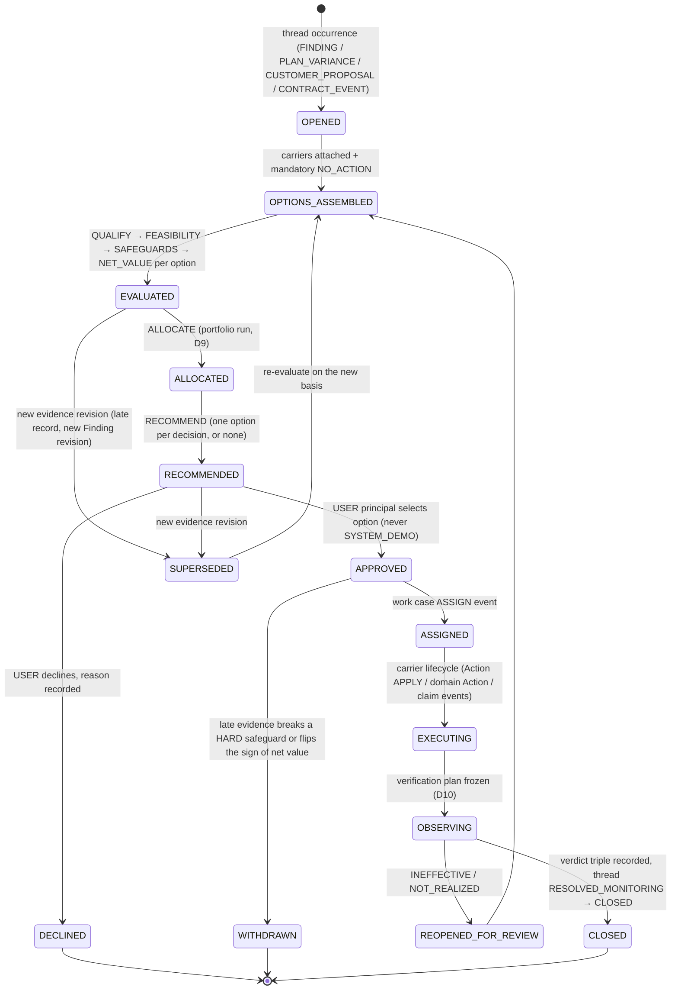
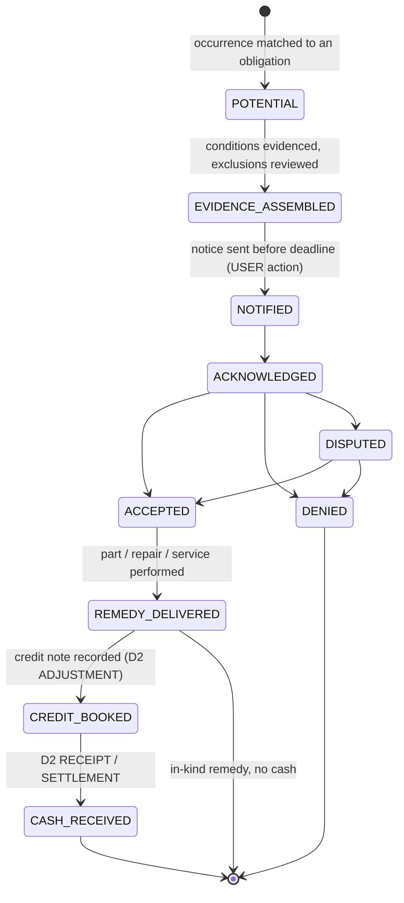

# Domain and decision models (Layer 4 companion: Deliverables 4 and 5)

Status: [proposed] design. Nothing in this document is built. It is the detailed home of design positions
D5 (option evaluation pipeline), D6 (SAFEGUARD_POLICIES), D7 (forward feasibility on the simulator kernel),
D8 (entitlement remedy economics), D9 (allocation) and D10 (verification triple). D1–D4 are used as given.

Sources. Every figure comes from `demo-site-scenario-manifest.yaml` in this folder (arithmetic re-checked:
`check_manifest.py` reports 126 checks passed in rev 2) [derived, arithmetic checked]. Code citations were re-read at HEAD
`fe2392899` under `/opt/assetecon/AssetOpsV1` [code-observed]. Where a figure is derived here from manifest
figures (a break-even, a margin), it says "derived" and shows the arithmetic. Money is illustrative USD.

Labels: [code-observed] read in the repository now · [test-confirmed] a committed test or the manifest checker
pins it · [implementation-report] reported by the reviewed baseline (`decision-intelligence-mechanism-2026-11-14`)
and not re-run here · [proposed] this design · [research] general engineering practice · [assumption] a value
or condition that must be validated in a pilot.

Reading order. Section 1 is the cross-vertical decision lifecycle. Sections 2–4 are the vertical mechanisms
(narrative, equations, diagram, then contracts and test vectors). Section 5 is entitlement economics. Sections 6–8
are safeguards, allocation and verification. Section 9 is the time dimension. Section 10 is the C3 scenario table.
Section 11 holds the contracts and repository placement. Section 12 lists open points for the Architect.

---

## 1. One decision lifecycle (D5)

### 1.1 What problem the lifecycle solves

Today the repository can detect a problem and run one fixed trial, but it cannot choose. The only executable
intervention is `reserve-trial-1`, and the database forces it: `rule_id = 'reserve-trial-1'` and
`proposed_value = old_value - 5` are CHECK constraints (`backend/migrations/versions/0016_action_store.py:60`,
`:72`) [code-observed]. Scenarios of kind STOP_SOC, PRODUCTIVE_LOAD, TARIFF_ONLY and OTHER are stored beside a
Finding (`mini_decisions/scenario_rules.py:24`), but only PRODUCTIVE_LOAD calculates (`:194-200`), and nothing
compares, ranks or selects among them [code-observed]. There is no no-action option with its own cost and risk;
the fuel exposure is implicitly "versus the generator being off" [implementation-report, baseline §4.3].

The lifecycle below turns several viable interventions into the one the operator should consider first, without
a second workflow engine. A `decision` is one question on one thread (D1). Its `decision_option` rows each point
at an existing carrier (D5). The pipeline writes evaluations; humans approve; the existing Action, domain Action,
work-case and verification lifecycles execute.

### 1.2 Where decisions come from

| Origin (D1 occurrence) | Entry condition | Demo instance |
|---|---|---|
| FINDING | A physical Finding is SUPPORTED on the thread | Kobo GENERATOR_SUPPORT_CANDIDATE on 11 of 31 days; Kisiwa GEN-KS-01 alternator failure |
| PLAN_VARIANCE | `site_period_economics` (D3) variance line beyond a declared materiality (proposed: ≥ 5 % of plan contribution or ≥ 100 USD) | Mwea −468, Kirinyaga −194, Embakasi −3,204 |
| CUSTOMER_PROPOSAL | A CUSTOMER_PROPOSAL or contract draft record (D2 CONTRACT_DOCUMENT) names load, window and tariff | Mto huller LOI (lapses 2026-11-30); Ruiru +6 buses; Mwea aggregator draft |
| CONTRACT_EVENT | A notice deadline or remedy date from D8 falls inside the horizon | Mto INV-MT-02 notice deadline 2026-11-27 |
| CONTRACT_EVENT (breach) | An SLA clock exceeds its term after declared exclusions | Kisiwa O&M response 96 h vs 48 h; Kasarani SLA clock RUNNING |

All origins land on `finding_thread` as occurrences. Today `occurrence_one_source` allows exactly a Finding or an
opportunity (`0042_chain_threads.py:53`) [code-observed]; D1 widens it. There is still exactly one physical
Finding engine (`finding_episode.py`) [proposed].

### 1.3 Decision and option state machines



Each option carries its own evaluation trail. A stage failure stops the trail and fixes the disposition.

| Stage | Question | Failure disposition | Writes |
|---|---|---|---|
| QUALIFY | Is the evidence the option needs present, current and of the right provenance? Is the Finding SUPPORTED and latest? | INSUFFICIENT_EVIDENCE (missing named) | evidence digest, missing list |
| FEASIBILITY | Can it physically and commercially happen? (D7 replay, EDF schedule, capacity, contract status, lead time) | REJECTED (infeasible, reason) | model run id, feasible quantities |
| SAFEGUARDS | Does it pass every applicable SAFEGUARD_POLICIES row? (D6) | REJECTED (HARD fail) · INSUFFICIENT_EVIDENCE (unknown, REFUSE) · CONDITIONAL (unknown, CONDITIONAL) | per-policy result, reason, evidence ids |
| NET_VALUE | Incremental money against NO_ACTION on a common horizon (12 months), by money class (D4), with sensitivities | REJECTED (dominated, or negative with no non-money reason) · DEFERRED (positive but outside horizon) | gross, costed trade-offs, one-off, net_12m, downside |
| ALLOCATE | Does it fit the portfolio's budget, crews, dependencies, exclusions and deadlines? (D9) | DEFERRED / CONDITIONAL with the binding constraint named | allocation run id, binding constraint |
| RECOMMEND | Which option per decision should the operator consider first? | — | RECOMMENDED / ACCEPTABLE |

Dispositions (D5): RECOMMENDED / ACCEPTABLE / CONDITIONAL / DEFERRED / REJECTED / INSUFFICIENT_EVIDENCE. Two
meanings of "condition" must not be confused [proposed]: a RECOMMENDED option may carry *execution* conditions
("supervised 14-day trial"), while CONDITIONAL means the *choice itself* depends on an unresolved external fact
(budget level, OEM decision, signature). Example: MTO-INV-BUYNOW is CONDITIONAL; KOB-STOPSOC is RECOMMENDED with a
trial condition.

### 1.4 Triage, comparable ranking and constrained allocation

These are three different operations and the product must not blur them [proposed].

1. **Triage** orders *threads* for attention before valuation. Key: service consequence in the next 72 hours,
   then the nearest contractual deadline, then money. It produces an order, never a value. Example: Kasarani
   CH-K2 (departures at risk tonight) is triaged ahead of Embakasi (larger money, no service risk).
2. **Comparable ranking** orders *options inside one decision*. All options share the horizon (12 months), the
   accounting basis (incremental to NO_ACTION, same currency) and distinct overlap groups (D4). Rank by net_12m
   after safeguards; tie-break by downside, then reversibility.
3. **Constrained allocation** chooses a *set* across decisions under shared budget, crews, dependencies and
   exclusions (D9). It can override a decision's local first choice (Mto: BUYNOW ranks first locally only when the
   LOI cannot be extended, but the portfolio cannot afford it at 5,000).

### 1.5 Mapping to existing carriers (no parallel engine)

| Lifecycle step | Existing carrier reused | Extension needed |
|---|---|---|
| OPENED | `finding_thread`, `finding_thread_occurrence` (0042:29, :43) [code-observed] | D1 origin kinds |
| Option = config trial (reserve) | `action` reserve-trial-1 proposal (`actions/reserve_trial.py:234-289`) [code-observed] | referenced by `decision_option`, unchanged |
| Option = config trial (stop SOC) | `mini_scenario_revision` kind STOP_SOC (stores assumptions, NO_CALCULATION today) + `domain_action` MINI intent (0051) [code-observed] | D7 result attached; an APPLY path that publishes a Foundation revision of `stop-soc-threshold` (a CONTROL property, `sites/models.py:167-169`) [proposed]; `action` table is **not** widened (its CHECKs encode one rule's safety) |
| Option = productive load | `mini_opportunity` + PRODUCTIVE_LOAD scenario (calculates gross) [code-observed] | D7 replay of added load |
| Option = repair / maintenance | `work_case` INCIDENT or MAINTENANCE_REQUEST (`work/model.py:27-29`) [code-observed] | cost estimate fields on option |
| Option = supplier remedy path | — | `work_case` kind SUPPLIER_CLAIM + claim events (D8) [proposed] |
| Option = CAPEX | — | capex quote as a D2 CONTRACT_DOCUMENT / PLAN_LINE reference [proposed] |
| Option = NO_ACTION | — | mandatory synthetic option, value 0 by definition, own risks listed [proposed] |
| Alternative explanation | `mini_alternative_revision` (disposition PLAUSIBLE … RULED_OUT) [code-observed] | QUALIFY reads it: a PLAUSIBLE POLICY/CAPABILITY alternative blocks RECOMMENDED until ruled out [proposed] |
| APPROVED | `mini_decisions/model.py:69` DecisionPrincipal (SERVICE today) | USER principal required; SYSTEM_DEMO refused for selection [proposed] |
| ASSIGNED | `work_case` ASSIGN events (`work/model.py:108-110`) [code-observed]; `mini_decision_work_link` | none |
| EXECUTING | Action ACCEPT/APPLY (`actions/service.py`), domain Action, claim events | none for reserve; D8 for claims |
| OBSERVING | `verification_plan` (0019), domain-Action plans (0052), `verification_outcome` | D10 economic and causal verdict rows |
| WITHDRAWN | thread `RESOLUTION_WITHDRAWN` (`chain/lifecycle.py:47-58`) [code-observed] | decision-level WITHDRAWN on late evidence |

---

## 2. Mini-grid models

### 2.1 Mechanism narrative: Kobo generator running after dawn

**Business condition.** Kobo's October contribution is 883 against a plan of 1,445 (variance −562). Diesel is
1,180 L against 700 L planned [proposed fixture]. Dispatch-3.2 marks generator time GENERATOR_SUPPORT_CANDIDATE
on 11 of 31 days and fuel-cost-1 values that time at 0 … 330 L (0 … 412.50 USD) [proposed fixture; model behaviour
code-observed in `financials/fuel_cost.py`].

**Competing causes.** The 480 L fuel overrun (1,180 − 700) has four candidates, and the bridge keeps them apart:
(a) a generator *policy* that keeps running after sunrise (210 L avoidable by replay); (b) Candidate time that the
replay shows is still needed later (120 L constrained); (c) genuine evening load growth (30 L Necessary); and (d)
fuel the model cannot explain (120 L residual, above the 2 % tolerance, MG-8 "Fuel accounted for"). 210 + 120 + 30
+ 120 = 480 L [derived]. In money: −262.50 − 150.00 − 37.50 − 150.00 plus +38.00 demand = −562.00
[derived, arithmetic checked].

**Why the generator runs after dawn.** The simulator controller requests RUN when SOC is at or below the start
threshold and STOP only after minimum runtime *and* SOC at or above the stop threshold
(`simulator/assetops_simulator/packs/mini_grid.py:14-18`) [code-observed]. Kobo's stop threshold is 90 %
(template `kobo-mini-grid-60kw.yaml`, baseline §8.1) [implementation-report]. A pre-dawn start at 35 % therefore
keeps the generator on after sunrise until the battery reaches 90 %, while PV could already carry the load. That
is Case A in the baseline, and the stop-SOC policy is its deliberate cause in the demo (baseline §8.7)
[implementation-report].

**Constraints that matter.** Clinic critical load 24/7 (MG-5, HARD); battery SOC at 05:00 ≥ 35 % on every
replayed day (evening-to-dawn adequacy); battery warranty limits (lowest SOC ≥ 10 %, ≤ 0.5C, ≤ 45 °C); battery
throughput wear (costed) [proposed fixture].

**How feasible alternatives are found (D7).** Replay the observed PV-available and load series for the 61 days
2026-09-01 … 2026-10-31 through the simulator kernel twice: once under the baseline policy (reserve 30, start 35,
stop 90, min runtime 30) and once under each candidate policy. Feasible saving is the *difference of two model
runs on the same inputs*, so systematic model bias (for example an SFC error) largely cancels. Observed fuel is
used only to calibrate the baseline replay (section 2.3).

**Negative control.** Kisiwa runs the same detection and the same replay. Every generator interval is NECESSARY
(load > PV + PCS every evening, battery at reserve; `dispatch_v3.py:290-293`) [code-observed rule]; zero
Candidate minutes; no fuel-saving option qualifies (OR-MG-2). The pipeline must output "no avoidable fuel" and
send Kisiwa's decision to redundancy (KIS-REPAIR), not to dispatch.

### 2.2 Why "reserve minus 5 points" is not the economic recommendation at Kobo

`reserve-trial-1` proposes exactly r → r − 5 for 15 ≤ r ≤ 90 (`actions/reserve_trial.py:36-37`, `:275`) and says
of itself that it "does not predict less generator running time, any saving or any safety effect" (`:42-45`)
[code-observed]. At Kobo it is the wrong lever for three mechanical reasons:

1. The reserve does not end the post-dawn run; the stop threshold does (`mini_grid.py:14-18`) [code-observed].
2. Under mini-grid model v5 (used by the demo through v6), the start threshold is
   `min(start, reserve + 5)` (`mini_grid.py:1153-1156`) [code-observed]. Lowering the reserve from 30 to 25 lowers
   the effective start from min(35, 35) = 35 % to min(35, 30) = 30 % [derived]. Pre-dawn starts happen later, so
   the battery reaches dawn lower. The replay shows only 20 L/month avoided, and SOC at 05:00 below 35 % on 4 of
   61 days → MG5_DAWN_ADEQUACY FAIL → KOB-RESERVE REJECTED [proposed fixture, OR-MG-1].
3. Lowering the stop threshold from 90 to 70 (reserve unchanged) ends the post-dawn run earlier and leaves the
   pre-dawn start untouched. The replay avoids 210 L/month, 0 dawn failures, +150 kWh/month battery throughput,
   lowest SOC 30 % ≥ 10 % warranty floor → KOB-STOPSOC RECOMMENDED [proposed fixture].

The kernel already accepts a stop-threshold override inside a step-aligned window, and refuses one that is not
above the start threshold or above 100 % (`mini_grid.py:358-403`, handler `:949-961`) [code-observed]; 70 > 35
passes. The reserve control and the stop threshold are both operator-commandable states in the scenario model
(`scenarios/models.py:256-258`) [code-observed].

Candidate policy set [proposed]: stop ∈ {90, 85, 80, 75, 70, 65, 60} × reserve ∈ {30, 25}, 14 replays. To avoid
fitting the replay sample, choose the highest-net policy that passes every HARD safeguard with the *worst* replayed
day still at least 2 SOC points above the dawn limit, and prefer the more conservative stop threshold when two
nets are within 10 %. The manifest fixes only the outcome for 70.

### 2.3 Equations (kernel and economics)

Kernel per step Δt (h) [code-observed, `packs/minigrid.py:1-44`, `packs/mini_grid.py:1-35`, `:715-735`]:

```
P_pv_ac(t)   = min(P_pv_rated · G(t)/1000, P_inv_ac)                 # linear, no temperature derate
E_bat(t+Δt)  = E_bat(t) + η·P_ch·Δt − P_dis·Δt/η                       # η = 0.95 each way
               with E_bat ≥ r·C (reserve), P_ch, P_dis ≤ P_pcs
gen RUN  when SOC ≤ s_start_eff,  s_start_eff = min(s_start, r + 5)    # model v5+
gen STOP when RUNNING ≥ t_min_runtime and SOC ≥ s_stop
generator charges the battery only while the battery is not discharging
fuel(t)      = SFC · (E_gen→load + E_gen→battery)                       # linear: no idle, no start fuel
```

Forward feasibility for policy π over replay days D [proposed]:

```
F(π)        = Σ_d Σ_t fuel_π(d,t)                     # litres, replayed
ΔF(π)       = F(baseline) − F(π)                      # feasible fuel reduction (the decision quantity)
ΔF_cand(π)  = part of ΔF on intervals dispatch-3.2 classified CANDIDATE
ΔF_other(π) = ΔF − ΔF_cand                            # e.g. fewer pre-dawn starts under a reserve change
G           = fuel-cost-1 high = 1.10 · Σ P·h·SFC over CANDIDATE   # gross exposure, upper bound only
constrained = G_L − ΔF_cand                           # Candidate by dispatch-3.2, not avoidable by replay
```

Kobo October: G = 330 L, ΔF_cand(stop 70) = 210 L, constrained = 120 L [proposed fixture; 330 = 210 + 120].
ΔF can exceed or fall outside the Candidate set, which is why the decision quantity is ΔF, not a share of G.

Monthly net and 12-month net [proposed]:

```
gross_m   = p_diesel · ΔF_month                         # 1.25 × 210 = 262.50
wear_m    = c_wear · ΔThroughput_month                  # 0.08 × 150 = 12.00   (MG4_BATTERY_WEAR, COSTED)
start_m   = c_start · ΔStarts_month                     # 0 here; kernel gives start counts, c_start [assumption]
net_m     = gross_m − wear_m − start_m                  # 250.50
net_12m   = 12 · net_m − one_off                        # 12 × 250.50 − 90 = 2,916.00
```

The one-off 90 is the manifest's value for trial setup and supervision; it is not itemised there.
Sensitivities (manifest): diesel −20 % → 2,286.00; feasible fuel 160 L → 2,166.00. Break-evens [derived]:
feasible fuel at net_12m = 0 is (90/12 + 12)/1.25 = 15.6 L/month; the wear rate at which net_12m = 0 is
3,060/1,800 = 1.70 USD/kWh (21 × the assumed 0.08), so the wear assumption is not decision-relevant here.

Dawn adequacy [proposed]: `∀ d ∈ D: SOC_π(d, 05:00) ≥ 35 %`. With 0 failures in 61 days, the rule of three bounds
the true daily failure rate below 3/61 ≈ 4.9 % at 95 % confidence [research]. That is why the sample is 61 days,
not 14.

### 2.4 Sequence: Kobo replay through decision

```mermaid
sequenceDiagram
    participant EV as Accepted evidence (5-min PV-avail, load, SOC, gen state)
    participant DS as dispatch-3.2 + finding-episode-3
    participant FC as fuel-cost-1/2 (gross)
    participant HA as host D7 adapter (simulator kernel)
    participant SG as SAFEGUARD_POLICIES
    participant NV as NET_VALUE (financials)
    participant AL as ALLOCATE (D9)
    participant H as Operator (USER principal)
    EV->>DS: classify segments → 11 Candidate days
    DS->>FC: exposure 0…330 L (upper bound, labelled)
    DS->>HA: decision opened; replay request (61 days, baseline + 14 policies)
    HA->>HA: calibrate baseline replay vs observed gen kWh and SOC
    HA-->>SG: per-policy trajectories: dawn SOC, min SOC, throughput, starts, ΔF
    SG-->>NV: reserve 25 FAIL MG5 (4/61); stop 70 PASS (0/61), wear costed
    NV-->>AL: KOB-STOPSOC net_12m 2,916 (MODELLED), 0 crew visits
    AL-->>H: recommended set incl. KOB-STOPSOC; KOB-RESERVE excluded with reason
    H->>H: approve 14-day supervised trial; ASSIGN on work case
    Note over H,EV: APPLY = new Foundation revision of stop-soc-threshold (config, not device command)
    EV->>DS: 14 days after apply → D10 operational / economic / causal verdicts
```

### 2.5 Calibration and the B4 gap

The baseline replay must reproduce what happened before its counterfactual is admitted [proposed]:
monthly generator kWh within ±5 %, generator start count within ±10 %, SOC trajectory mean absolute error ≤ 5
points at 5-minute resolution. Kobo's model-implied fuel is 1,060 L against 1,180 L consumed; the 120 L gap is
the UNEXPLAINED_RESIDUAL line and must be investigated (MG-8), not absorbed into calibration. If calibration
fails, the option goes to INSUFFICIENT_EVIDENCE with reason `REPLAY_NOT_CALIBRATED`.

Input mapping [proposed]: the kernel's PV input is plane-of-array irradiance, not PV-available power. The adapter
converts `G = 1000 · pv_available_kw / P_pv_rated`. This inversion is exact only where pv_available is below the
inverter AC limit; above it, the adapter must refuse or treat the slot as clipped. Load is replayed as *demand*;
where `critical_load_requested_power` exists it is used, because observed served load under-states demand when
service was short.

Case B4 constraints (baseline §3.11: accepted wrongly by dispatch-3.2 today) and how D7 + D6 close them:

| B4 constraint not modelled by dispatch-3.2 | Closed by | Result if unknown |
|---|---|---|
| Energy needed for the evening / dawn | replay runs through the night; MG5_DAWN_ADEQUACY | REFUSE |
| Battery kWh behind the PCS kW rating | kernel enforces energy above reserve [code-observed] | closed |
| SOC dip between reports | replay at 5-min exact steps sees model dips; observed sampling limit stays in verification (`verification_rules.py:793-795` "not continuous physical SOC proof") | partly closed |
| Stop-SOC kept for a reliability reason (e.g. equalisation charge) | operator declares it as a policy row (MG4 or WARRANTY_OPERATING_LIMITS) | CONDITIONAL until declared or ruled out |
| Spinning reserve / N−1 | not in kernel → P1_SERVICE_REDUNDANCY must be declared absent for the site | REFUSE |
| Generator minimum load, start limits | start counts from replay are costed; minimum loading not modelled | REFUSE if the site declares a minimum load |
| Operator command | days with operator overrides (operational records) excluded from the replay sample | sample must still hold ≥ 14 days |

### 2.6 Productive-use customer schedule: huller vs welding (Mto)

**Narrative.** Mto has daytime PV headroom and two requests. A rice huller (15 kW, 10:00–15:00, 22 days/month,
1,650 kWh) from a cooperative with a signed LOI, and an evening welder (10 kW, 18:00–21:00, 22 days, 660 kWh)
with a verbal enquiry. The same kWh has very different cost depending on *when* it is used.

Huller (replay with INV-MT-02 restored, load added) [proposed fixture]: 3 days without headroom, 225 kWh from
battery or generator, 68 L extra fuel.

```
revenue  = 1,650 kWh × 0.30 productive tariff          = 495.00
fuel     = 68 L × 1.25                                  =  85.00
collect  = 15.00
net_m    = 495.00 − 85.00 − 15.00                       = 395.00
net_12m  = 12 × 395.00 − 1,200 one-off                  = 3,540.00     (MODELLED)
```

Welding: PV is zero after 18:00 and the battery's evening energy is already committed to dawn adequacy, so every
evening kWh is diesel [proposed fixture].

```
fuel     = 660 kWh × 0.33 L/kWh × 1.25                  = 272.25
revenue  = 660 × 0.40                                   = 264.00
net_m    = −8.25   → REJECTED (also: no contract, no demand evidence)
break-even tariff = SFC × p_diesel = 0.33 × 1.25 = 0.4125 → 0.42 per kWh   [derived]
```

The break-even excludes collection cost and battery wear, so the true break-even is higher; the rejection is
robust. Huller break-even utilisation [derived]: one-off 1,200 is recovered within 12 months if the huller runs
at least 1,200 / (12 × 395/22) ≈ 5.6 days/month. The huller depends on the inverter being restored (half the
inverter capacity is 25 kW AC, insufficient with existing daytime load) — this is the dependency D9 enforces.
Omission noted: the 225 kWh partly served from the battery implies a small wear cost (≤ 18 USD/month at 0.08) not
in the manifest; immaterial to the ranking [derived].

### 2.7 Generation → feeder → meter → bill → settle reconciliation

**Narrative.** A CFO sees revenue below plan. The question is which part is physics (losses), which is
administration (unbilled meters, approved allowances), which is cash timing (settlement lag) and which is truly
unexplained. Only the last is an investigation, and it is never priced as collectible.

```
delivered_kwh                      (inverter/feeder meters, D2 CUSTOMER_METER_READ aggregates)
 − expected_technical_loss_kwh     (loss band: declared % ± tolerance, [assumption] 5 % ± 1 pt at Mto)
 = expected_metered_kwh
 − metered_kwh                     = unexplained_kwh            → kWh only, money = null (R4)
metered_kwh − unbilled_mapping_kwh − authorised_adjustments_kwh = billed_kwh
billed_kwh × tariff                = revenue (recognised)
revenue = collected + in_transit + outstanding                    (settlement statement, by settled_at)
```

Mto October [proposed fixture, OR-MG-4]: 6,000 − 300 = 5,700 expected; metered 5,580 → 120 kWh unexplained
(unpriced); 5,580 − 140 unmapped − 40 authorised = 5,400 billed; 5,400 × 0.40 = 2,160 = 1,890 collected + 150 in
transit + 120 outstanding. The 140 kWh comes from a meter swap on 3 Oct not applied to 6 customers (effective-dated
meter register, disorder test MAP-1); it is billable (MTO-BILLING: 56/month, back-bill 56 potential) and must not
appear as loss. The 150 in transit settles on 2 Nov (LATE-SETTLE-1): revenue unchanged, collection status moves.
Kobo: 9,100 delivered, 410 technical (4.5 %), 8,690 metered, 45 adjustments, 8,645 billed; collected 3,180 +
outstanding 278 = 3,458 [proposed fixture].

### 2.8 Capacity vs demand alternative (Kisiwa)

At Kisiwa the generator is Necessary because capacity is short (rules 1/2), not because of policy. Policy options
are therefore empty. A capacity option exists: +60 kWh battery (KIS-BATT60, capex 14,000) shifting PV surplus to
the evening. The replay with a larger battery (kernel capacity parameter changed) gives 195 USD/month modelled
saving [proposed fixture]. net_12m = 12 × 195 − 14,000 = −11,660; payback 14,000/195 ≈ 72 months [derived] →
DEFERRED with revisit trigger "quote + 7-year lifecycle". This is the realistic shape of most capacity options:
real but outside the operating horizon, and kept visible instead of silently dropped.

### 2.9 Mini-grid contracts and test vectors

Input contract (D7 replay request) [proposed]:

| Field | Source role | Resolution | Required |
|---|---|---|---|
| pv_available_power | accepted evidence | 5 min | yes |
| feeder_demand per load asset (or critical requested) | accepted evidence | 5 min | yes |
| battery_soc (initial per day) | accepted evidence | instant | yes |
| Foundation revision (pv, inverter, battery, PCS, η, SFC, start/stop/reserve, min runtime, start delay) | Foundation | pinned id | yes |
| candidate policy deltas | decision_option | — | yes |
| operator override days | operational records | day | exclusion list |
| diesel price, wear cost, start cost | published assumptions (time-valid) | — | for NET_VALUE only |

Output: per policy `{replay_days, excluded_days, calibration{gen_kwh_err, starts_err, soc_mae}, fuel_l,
dF_l, dF_candidate_l, dawn_soc_min, dawn_fail_days, min_soc, throughput_kwh, starts, unserved_critical_kwh}`,
labelled MODELLED, provenance of inputs carried through.

Error modes: `REPLAY_NOT_CALIBRATED`, `INPUT_GAP` (> 20 min continuity, mirroring `dispatch_v3.py:44`),
`PV_CLIPPED_INVERSION`, `SAMPLE_TOO_SHORT` (< 14 usable days), `POLICY_BAND_INVALID` (kernel refusal).

| Vector | Input (manifest) | Expected |
|---|---|---|
| MG-T1 | Kobo, reserve 30→25 | ΔF 20 L/month; dawn fails 4/61; KOB-RESERVE REJECTED by MG5_DAWN_ADEQUACY |
| MG-T2 | Kobo, stop 90→70 | ΔF_cand 210 L; constrained 120 L; dawn fails 0; +150 kWh; net_m 250.50; net_12m 2,916.00 |
| MG-T3 | Kobo sensitivities | diesel −20 % → 2,286.00; ΔF 160 L → 2,166.00 |
| MG-T4 | Kisiwa (negative control) | 0 Candidate minutes; no policy option passes QUALIFY; fuel bridge −104 Necessary, −26 residual within tolerance |
| MG-T5 | Mto huller | 3 days without headroom; 68 L; net_m 395.00; net_12m 3,540.00 |
| MG-T6 | Mto welding | net_m −8.25; break-even 0.42; REJECTED |
| MG-T7 | Mto energy-to-cash | 120 kWh unexplained, money null; 140 unmapped; 40 authorised; 2,160 = 1,890 + 150 + 120 |
| MG-T8 | Kisiwa battery +60 kWh | net_12m −11,660; DEFERRED |

---

## 3. Cold-chain models

### 3.1 Mechanism narrative: two rooms, one unit cost question

**Business condition.** Raw energy cost per crate-day is 0.122 USD at Mwea (530/4,340) and 0.101 at Kirinyaga
(1,000/9,920) [proposed fixture]. A naive reading says Mwea is the inefficient room. It is not.

**Competing causes.** Low occupancy spreads the fixed refrigeration load over fewer crates; poor equipment
efficiency adds energy for the same load. They need opposite actions: sell capacity, or repair.

**Model.** A per-room normalised energy model separates them [proposed fixture form]:

```
kWh_model(month) = a + b · crate_days,      a = 1,550 kWh, b = 0.25 kWh/crate-day   (reference ambient 24 °C)
                   × (1 + 0.025 · max(0, T_amb − 24))                               (ambient term)
                   + c · door_open_minutes                                          (proposed extension; c fitted)
residual r = (kWh_actual − kWh_model) / kWh_model;   tolerance |r| ≤ 5 %
```

Mwea: 1,550 + 0.25 × 4,340 = 2,635; actual 2,650; r = +0.57 % → within tolerance → root cause is occupancy.
Kirinyaga: 1,550 + 0.25 × 9,920 = 4,030; actual 5,000; r = +24.07 % → efficiency (OR-CC-1) [test-confirmed by
checker for kwh_model]. October values imply ambient at or below the reference [assumption].

Model-implied unit cost [derived]: Mwea 2,635 × 0.20/4,340 = 0.121 (observed 0.122: normal for its occupancy);
Kirinyaga 4,030 × 0.20/9,920 = 0.081 (observed 0.101: 24 % high). The ranking of the raw metric is inverted by
normalisation — the core cold-chain discrimination.

**Calibration requirement** [proposed]. Fit a and b per room on ≥ 60 days of hourly energy, daily occupancy from
the storage ledger (D2 STORAGE_MOVEMENT) and hourly ambient, in a period declared healthy (post-commissioning or
post-service). Accept only if the daily fit's coefficient of variation of residuals ≤ 8 % and the calibration
window spans ≥ 30 occupancy points; otherwise b is not identifiable (a room that sat at 35 % for 60 days cannot
separate fixed from variable load) and the model borrows b from same-design rooms (400-crate rooms here) with
`b_source = POOLED`, downgrading the residual's uncertainty label to WIDE.

### 3.2 Occupancy ledger → recognised contribution

```
crate_days(period) = Σ_batches crates_b × |[in_b, out_b) ∩ period|_days      (check-in/out from the ledger)
revenue            = crate_days × rate(contract)                                (0.20 pay-as-you-store)
contribution       = revenue − energy − staff − maintenance − liability
```

Mwea: 4,340 × 0.20 = 868; contribution 868 − 530 − 300 − 50 = −12; bridge −620 occupancy revenue, +155 energy
volume (775 kWh less at lower occupancy: not a saving), −3 efficiency (15 kWh inside tolerance) = −468
[derived, arithmetic checked]. The +155 is DERIVED and labelled "not a saving" because it is lost revenue's shadow.

**Mwea decision (PLAN_VARIANCE).** MWEA-AGG: 150 crates × 30 days = 4,500 crate-days/month at 0.18 = 810; energy
4,500 × 0.25 × 0.20 = 225; handling 100; net 485/month × 4 months − 270 one-off = 1,670 (MODELLED). Capacity check
[derived]: 4,340 + 4,500 = 8,840 ≤ 12,400 crate-days. Commodity compatibility (avocado with cabbage needs an
ethylene curtain and a shared 5 °C setpoint) is a HARD safeguard satisfied by the curtain (CONDITIONAL until
installed). MWEA-COMPRESSOR (4,800) is REJECTED: energy matches the model (+0.6 %), there is nothing to fix.
Break-even rate [derived]: (225 + 100)/4,500 + 270/(4 × 4,500) = 0.087 USD per crate-day.

### 3.3 Batch exposure reconstruction (Thika)

**Narrative.** On 14 Oct the grid failed 02:10–05:40; the transfer-switch controller faulted; manual start at
04:05; compressor at 04:07; chamber above 8 °C 02:50–05:05 (135 min), peak 9.8 °C [proposed fixture]. The
question "what is at risk?" must not become "what was lost?".

```
present_b   = [in_b, out_b) ∩ excursion_window ≠ ∅
exceeds_b   = minutes(T_chamber > limit(commodity_b)) ≥ min_exposure(commodity_b)   (declared per commodity)
EXPOSED_b   = present_b ∧ exceeds_b
exposure_b  = crates_b × declared_value_per_crate_b         → EXPOSURE class, never summed into actuals
damage_b    = QA-confirmed downgraded crates × value         → from QA notes only (ECONOMIC fact when recorded)
liability_b = contract rule(damage_b, cause, duration)        → ECONOMIC_ACTUAL only when a credit note exists
```

| Batch | Commodity / limit | Present | Exposed | Exposure | QA damage | Liability |
|---|---|---|---|---|---|---|
| B-1031 | tomato, 8 °C | yes | yes (135 min > 0 at 8 °C) | 2,160 | 6 crates × 18 = 108 | 108 (operator equipment, > 120 min) |
| B-1034 | avocado, 12 °C | yes | no (peak 9.8 < 12) | — | — | — |
| B-1029 | cabbage | no (out 13 Oct 16:00) | excluded | — | — | — |

Exposure ≠ damage ≠ liability (OR-CC-2) [proposed fixture]. Chamber air temperature is not pulp temperature;
the exposure flag is a hypothesis about air. Insurance: the goods-in-custody deductible is 500; confirmed loss 108
is below it; claim NOT_FILED; notice was still sent on 16 Oct (within 14 days) to preserve the right if more
damage surfaced.

**Optional thermal counterfactual — when it is worth it.** The `cold-thermal/1` pack already steps an exact
heat balance per minute: heat leak and door heat against compressor cooling over thermal capacity
(`packs/cold.py:6-10`, 13 Foundation properties `:50-64`) [code-observed]. It is worth running only when the
answer changes a decision [proposed]:
(a) sizing a stopgap: the fixture shows 40 minutes from outage (02:10) to 8 °C (02:50) [derived], so a manual-start
rota must respond inside ~40 minutes at that load and ambient; the kernel can map that window across occupancy
and ambient; (b) when liability depends on product (pulp) temperature, a two-node extension would be needed and
is not built [proposed]. It is not worth it for energy normalisation (3.1), where the statistical model answers
the question with less input.

### 3.4 Repair vs replace lifecycle (Kirinyaga)

```
excess_kWh       = 970;   excess_cost_m = 970 × 0.20 = 194.00
REPAIR  : value_m = recovery × 194.00;   recovery 0.80 (range 0.60–0.90) → 155.20;  net_12m = 12×155.20 − 350 = 1,512.40
REPLACE : value_m = 234.30 → net_12m = 12×234.30 − 4,800 = −1,988.40
NO_ACTION: −194.00/month continues
```

The 234.30 equals (970 + 5 % of 4,030) × 0.20, i.e. a new unit is assumed to beat the model by 5 % [derived;
the manifest does not state the basis]. Break-evens [derived]: repair pays back in 12 months at recovery ≥ 15 %
(350/(12 × 194)); recovery range gives net_12m 1,046.80 … 1,745.20. Replacement pays back in 20.5 months; against a
repair at 80 %, replacement's extra capex (4,450) is recovered by its extra 79.10/month only after ~56 months. So
repair now is right on the 12-month horizon *and* buys information: verified recovery after repair decides the
replacement question (DEFERRED trigger: verified recovery < 60 %).

### 3.5 Cold contracts and test vectors

Inputs: storage ledger rows (batch, customer, commodity, crates, in_at, out_at, rate), hourly energy, hourly
ambient, door events (if any), 1-min chamber probe inside incident windows, QA notes, contract rules (commodity
limit, minimum exposure, liability threshold). Outputs: `{crate_days, revenue, kwh_model, residual_pct,
root_cause ∈ {OCCUPANCY, EFFICIENCY, UNDETERMINED}, batch_exposure[], damage[], liability[]}`. Error modes:
`LEDGER_GAP` (overlapping or open check-ins), `MODEL_NOT_CALIBRATED`, `B_NOT_IDENTIFIABLE`, `PROBE_GAP_IN_EXCURSION`
(> 5 min missing inside the window → exposure UNKNOWN, never "not exposed").

| Vector | Expected |
|---|---|
| CC-T1 Mwea | kwh_model 2,635; residual +0.6 %; OCCUPANCY; MWEA-COMPRESSOR REJECTED; MWEA-AGG net 1,670 CONDITIONAL on signature |
| CC-T2 Kirinyaga | kwh_model 4,030; residual +24 %; EFFICIENCY; −194/month; KIRI-REPAIR 1,512.40; KIRI-REPLACE −1,988.40 DEFERRED |
| CC-T3 Thika | B-1031 exposed 2,160 / damage 108 / liability 108; B-1034 not exposed; B-1029 excluded; insurance not filed (deductible) |
| CC-T4 probe gap | remove 10 min of probe data inside 02:50–05:05 → exposure UNKNOWN for B-1031, not 0 |

---

## 4. EV depot models

### 4.1 Mechanism narrative: Embakasi cheapest vs deadline schedule

**Business condition.** Captive fleet: charging is a cost centre, the service unit is "required departure met",
and there is no charging revenue (G1/O3 not applicable) [proposed fixture]. Embakasi's energy cost is 22,144.80
against 18,940.80 planned (−3,204): 55 % of energy at peak instead of 30 % (−2,604) and a 500 kW monthly peak
instead of 450 kW (−600) [derived, arithmetic checked].

**Competing alternatives.** Charge everything in the cheapest window, or charge on a deadline-aware stagger.

**Deadline feasibility (rule-based first)** [proposed]:

```
Aggregate necessary condition per night:  Σ_i e_i ≤ min(L_import, K · p_charger) × window_h
Then EDF over 5-min slots: at each slot, allocate min(L_import, K·p) to plugged buses by earliest departure,
each capped at p_charger; a bus is MET if delivered ≥ required by departure.
```

| Schedule | Window | Power cap | Deliverable | Required (20 × 140) | Result |
|---|---|---|---|---|---|
| EMB-CHEAPEST | 00:00–05:00 (5 h) | 500 kW import | 2,500 kWh | 2,800 kWh | 300 short → 17 full, 1 partial, 2 empty = 3 buses short → EV1 FAIL, REJECTED |
| EMB-DEADLINE | 22:00–05:15 (7.25 h) | 400 kW (below 500 limit) | 2,900 kWh | 2,800 kWh | all met; EV5 PASS |

Chargers (10 × 60 = 600 kW) exceed the 500 kW import limit, so the import limit binds [derived]. The deadline
schedule runs 400 kW for 2 h before midnight (800 kWh at 0.12) and 5 h in the 00:00–05:00 tier (2,000 kWh at 0.09),
so cost = 24,800 × 0.12 + 62,000 × 0.09 + 400 × 12 = 2,976 + 5,580 + 4,800 = 13,356; saving 8,788.80/month;
net_12m 12 × 8,788.80 − 1,500 = 103,965.60 (MODELLED) [derived, arithmetic checked by check_manifest.py].
The cheapest schedule puts every kWh in the 0.09 tier at the 500 kW limit: 77,500 × 0.09 + 500 × 12 = 6,975 +
6,000 = **12,975**, the lowest bill of any option and 381 a month below the deadline schedule — and it is still
rejected, because 3 buses leave short every night (EV1 HARD_CONSTRAINT; OR-EV-1). The checker asserts that the
rejected option really is the cheapest bill, so the negative control carries a real cost temptation.

**Tariff applicability.** The demand charge term is included only if contract C-114 carries it, confirmed from
the utility invoice [assumption]. Sensitivity without demand charge [derived]: actual energy-only 16,144.80 vs
10,416 → saving 5,728.80/month; still RECOMMENDED.

**When LP/MILP is warranted** [research/proposed]. EDF is optimal for meeting deadlines on a single shared power
resource with per-vehicle rate caps when all charging is in one price tier. An LP becomes worth it when the cost
objective trades tiers against demand charge (multiple tiers inside the feasible window), when connector
compatibility makes assignment matter, when sessions are non-preemptive (plug moves cost labour), or across sites.
At depot scale (≤ 50 buses × 288 slots) an LP is small. Rule: keep EDF while its cost is within 2 % of the LP
relaxation's lower bound on the replayed month; otherwise adopt the LP for that site.

### 4.2 Fault consequence under the roster (Kasarani vs Ruiru)

Downtime count alone ranks the wrong fault first: CH-R7 connector 2 has been out since 29 Oct (8 days by 6 Nov),
CH-K2 since 1 Nov (5 days) [derived]. Consequence ranks them correctly [proposed]:

```
consequence(fault) = departures_at_risk(next 72 h) × penalty_or_service_cost
                     + contractual_clock_cost(SLA credit forgone, notice deadline)
departures_at_risk = max(0, required_kWh − deliverable_kWh_without_asset) → whole buses
```

| Fault | Binding constraint | Deliverable without asset | Required | Buses short | Priority |
|---|---|---|---|---|---|
| Kasarani CH-K2 (contactor weld) | chargers: 3 × 50 kW × 7 h | 1,050 | 1,200 (8 × 150) | 1 per night; 2 missed departures to date, 240 penalties (ECONOMIC_ACTUAL) | HIGH |
| Ruiru CH-R7 connector 2 | import limit 400 kW (chargers 720 kW) | 3,200 (unchanged) | 1,960 (14 × 140) | 0 | LOW |

At Ruiru the import limit binds, not the connectors, so losing one connector removes nothing deliverable
[derived] (OR-EV-2). Kasarani's flat tariff (0.15) makes scheduling immaterial (KAS-SCHEDULE REJECTED). Stopgap:
one bus charged overnight at Ruiru (90: overtime 70 + energy 20); Ruiru slack is 3,200 − 1,960 = 1,240 kWh/night,
and still 400 kWh after RUI-ABSORB6 [derived].

### 4.3 Slack vs expansion (Ruiru)

Ruiru: 400 kW × 8 h (21:00–05:00) = 3,200 kWh deliverable [test-confirmed identity]. +6 buses → 20 × 140 = 2,800 ≤
3,200 → feasible with 0 capex, avoided capex 60,000 (MODELLED). +10 → 24 × 140 = 3,360 > 3,200 → infeasible
(OR-EV-3); four more chargers (60,000) do not help alone because the import limit binds (grid upgrade ~45,000
[assumption]). Sensitivity [derived]: 21:00–22:00 is a peak hour; if charging is restricted to off-peak
(22:00–05:00), deliverable is 2,800 = required, zero slack — the +6 decision then needs the peak hour or a 14-day
roster replay before contract signature. Incremental energy for 6 buses is common to every option (they charge
somewhere) and cancels in the comparison.

### 4.4 EV contracts and test vectors

Inputs: OCPP sessions (StartTransaction, MeterValues, StatusNotification; clock offset corrected, CLOCK-1),
roster (bus, block, return, departure, required kWh), charger/connector compatibility, import limit, tariff
schedule with applicability evidence, service tickets. Outputs: `{night, required_kwh, deliverable_kwh,
buses_short, max_kw, peak_kwh, offpeak_kwh, energy_cost, demand_cost, feasible}`. Error modes: `ROSTER_MISSING`
(refuse: no feasibility without obligations), `TARIFF_UNCONFIRMED` (demand term CONDITIONAL), `COMPATIBILITY_UNKNOWN`.

| Vector | Expected |
|---|---|
| EV-T1 Embakasi cheapest | 2,500 vs 2,800; 3 short; bill 12,975 (lowest); REJECTED by EV1_DEPARTURE_READINESS |
| EV-T2 Embakasi deadline | 2,900 ≥ 2,800; max 400 kW; 13,356; saving 8,788.80; net_12m 103,965.60 |
| EV-T3 Kasarani CH-K2 | 1,050 vs 1,200; 1 short; HIGH; KAS-OEM-STOPGAP 90 RECOMMENDED |
| EV-T4 Ruiru connector | deliverable unchanged 3,200; LOW |
| EV-T5 Ruiru +6 / +10 | 2,800 feasible / 3,360 infeasible |
| EV-T6 captive fleet | no revenue line produced for any EV site |

Resolved (section 12.1, manifest corrected): the manifest's "31 of 31 nights feasible, including 2 nights with 21 buses" conflicts with
a 2,900 kWh deliverable at 400 kW: 21 × 140 = 2,940 needs ≥ 405.5 kW over 7.25 h [derived].

---

## 5. Entitlement-aware action economics (D8)

### 5.1 Mechanism narrative

When an asset fails, the operator's question is "what will this cost *us*, and how fast is service back?", not
"is the supplier liable?". The model compares paths on **operator-funded residual cost** and restoration time,
under the contract terms extracted (human-reviewed) into obligation / condition / exception / occurrence / notice /
remedy rows. Recovery money never enters a decision as cash until it is CREDIT_BOOKED or CASH_RECEIVED. Outputs are
*possible rights and options*, never legal conclusions [proposed].

### 5.2 Residual cost across paths

```
residual(path) = parts_paid + labour + shipping + transport
               + stopgap_cost
               + downtime_cost(restore_lead_time)          # extra fuel, penalties, lost margin, SLA credits forgone
               + deductible (insurance paths)
               + cover_forfeited (if the path breaches a condition, e.g. unauthorised repair)
               − 0                                            # supplier/insurer remedy is NOT subtracted as cash
Eligibility    = f(term dates, conditions satisfied by evidence, exclusions, notice deadline)
               ∈ {POTENTIALLY_COVERED, EXPIRED_AND_EXCLUDED, INSUFFICIENT_EVIDENCE, REVIEW_REQUIRED, NONE}
```

When the OEM or insurer decides, the path is evaluated as two branches, not as a probability-weighted number,
unless an acceptance rate is evidenced [proposed]: `accepted → residual_A`, `denied → residual_A + fallback_cost`.

Paths: SUPPLIER_REMEDY (claim, wait), STOPGAP_PLUS_CLAIM, REPAIR (paid), CAPEX (replace), NO_ACTION. Every path
must preserve the notice deadline; a path that lets it lapse carries `cover_forfeited`.

### 5.3 Worked cases

**Mto INV-MT-02 — budget-dependent switch** [proposed fixture]. Failed 28 Oct (IGBT overcurrent, latched).
Warranty to 2029-03-14, replacement unit, shipping at owner cost; conditions (certified installer, ambient within
spec, firmware current) all evidenced; notice deadline 27 Nov (30 days); lead time 21 days. POTENTIALLY_COVERED.

| Path | Residual | Restore by | Disposition |
|---|---|---|---|
| MTO-INV-CLAIM | 150 shipping + 80 install + 130 extra fuel (21 days at half capacity) = 360 | 28 Nov | RECOMMENDED |
| MTO-INV-BUYNOW | 2,600 unit + 80 install + 150 + 80 claim of failed unit = 2,910 (replacement becomes a spare, not cash) | 12 Nov | CONDITIONAL: budget ≥ 6,430 **and** LOI not extendable |
| MTO-INV-LOCAL | 450, but opening the unit voids the warranty | — | REJECTED (dominated) |
| MTO-INV-NOACT | half daytime capacity indefinitely; notice lost 27 Nov | — | REJECTED |

Denied branch for CLAIM [derived]: ≥ 150 + 80 + 130 + 2,600 = 2,960 plus further fuel during a second lead time.
The switch is a portfolio question (section 7). BUYNOW also avoids ~6 days of half-capacity fuel that its residual
does not count (≈ 37 at 130/21 per day) [derived; immaterial].

**Kisiwa GEN-KS-01 — expired and excluded.** Warranty ended 30 Jun 2026; failure in Oct at 1,240 run hours; the
1,000-hour service record is MISSING. Two independent bars → EXPIRED_AND_EXCLUDED; operator-funded 1,800; claim
state NONE. The output wording is "no supportable right identified from the evidence", not "no right exists".

**Kisiwa O&M SLA — review, not verdict.** Reported 30 Oct 19:10, responded 3 Nov 19:30 (96 h vs 48 h). Exclusion
"sea access prevented by weather"; port bulletin says calm. Potential credit 10 % × 700 = 70, class EXPOSURE,
REVIEW_REQUIRED, claim state EVIDENCE_ASSEMBLED. Booked only when a credit note arrives.

**Kobo BAT-001 — insufficient evidence.** Estimated usable 184 kWh vs 200 nameplate; temperature record and
commissioning capacity test MISSING; 412 of 6,000 cycles, 41 of 600 MWh. Claim now is REJECTED (a contested claim
fails without a baseline); BAT-EVIDENCE (430: capacity test 250 + temperature sensor 180, one crew visit)
RECOMMENDED; covered asset value 64,000 is EXPOSURE, not money gained. Note [derived]: the listed condition
"capacity 70 % at end of term" would not be breached by 184/200 = 92 %. Whether an occurrence exists at all depends
on an interim degradation schedule the manifest does not give; BAT-EVIDENCE is still right because it answers that
question too (section 12).

**Thika ATS-TK-01 + insurance deductible.** EPC workmanship warranty (CoolBuild, to 10 Feb 2027; quarterly tests
3 of 3 logged): NOTIFIED 16 Oct, ACKNOWLEDGED 18 Oct, ACCEPTED 25 Oct; controller replacement scheduled 8 Nov.
THIKA-EPC-STOPGAP (100: alarm relay 40 + labour 60) RECOMMENDED because waiting leaves stock unprotected through
8 Nov; THIKA-SELF (710) voids cover. The 108 customer compensation is operator-funded; the remedy terms cover the
controller, not consequential loss; goods-in-custody insurance is not claimed because 108 < 500 deductible.

**Kasarani CH-K2 — warranty plus SLA credit clock.** Warranty covers power-stage parts including the contactor;
unauthorised repair voids it. SLA: response 48 h (met: 31 h), restore 5 business days, credit 5 % × 400 = 20 per
business day late. NOTIFIED 2 Nov 07:10, ACKNOWLEDGED 3 Nov 15:00; restore due 9 Nov per the manifest (5 business days from the 2 Nov notice); clock
RUNNING. KAS-OEM-STOPGAP (90) RECOMMENDED; KAS-OEM-WAIT (expected 240 more penalties) REJECTED; KAS-LOCAL (380,
voids cover) REJECTED. The SLA credit, if earned, is EXPOSURE until booked and is never netted against the
penalties already paid. Note: 8 Nov 2026 is a Sunday; "5 business days" from the 2 Nov notice gives 9 Nov
[derived] — the clock's calendar basis must be an extracted term (section 12).

### 5.4 Claim lifecycle and contracts



Input contract: `{asset_id, occurrence{at, code, evidence_ids}, contract_terms[] (reviewed extraction with page
refs), operator costs (quotes), lead times, downtime consequence model ref, notice_deadline}`. Output:
`{eligibility, missing_evidence[], paths[{id, kind, residual, restore_by, branch_if_denied, disposition, reason}],
deadline_alerts[]}`. Refusal: no contract document → eligibility NONE with "no contract on file", never "not
covered". Error modes: `TERMS_NOT_REVIEWED` (AI extraction without human review cannot feed an option),
`CLOCK_BASIS_UNKNOWN`.

---

## 6. Safeguards (D6)

### 6.1 Why a registry

Today the outcome map's CHECKED role decides nothing: it produces text and counts only (baseline §2.2, Q4–Q5)
[implementation-report]. The safeguards that do act are literals in three places, none keyed to MG-5 or MG-4:
the dispatch rule ladder (`analytics/dispatch_v3.py:290-293`), the trial eligibility headroom `SOC > r + 10`
(`actions/reserve_trial.py:31`, `:249-252`), and three verification guardrails
(`actions/verification_rules.py:787-800`), plus a trial block after a guardrail failure
(`actions/service.py:159-166`) [code-observed]. The mill verification has no guardrail at all (baseline BL-09)
[implementation-report].

The registry makes a check executable only through an explicit row. The map's CHECKED role stays a *declaration*
("this outcome must not be harmed"); the row says *how* it is protected, in which mode, and what happens when the
evidence is missing. Verification guardrails are generated from the same rows, so pre-decision safeguards and
post-change guardrails cannot drift apart.

### 6.2 Row structure

```
SafeguardPolicy(
  policy_id, version,
  option_kinds,            # e.g. {CONFIG_TRIAL:dispatch, DEMAND_CONNECTION:mini}
  checked_outcome,         # outcome_map key, must appear as CHECKED (or MOVES) for the option's mechanism
  measure,                 # what is computed, from which model output
  threshold_source,        # declared objective / service obligation / contract term id / literal with reason
  mode,                    # HARD_CONSTRAINT | COSTED_TRADEOFF | ADVISORY
  unknown_policy,          # REFUSE | CONDITIONAL
  phases,                  # {FEASIBILITY, SAFEGUARDS, VERIFICATION}
  verification_metric,     # name serialised into verification_plan.guardrails, or None
  reason)                  # recorded with every evaluation, plus evidence ids
```

### 6.3 Rows

| policy_id | Option kinds | Outcome | Measure / threshold | Mode | Unknown | Verification metric |
|---|---|---|---|---|---|---|
| MG5_DAWN_ADEQUACY | dispatch config, demand connection (mini) | MG-5 | replay SOC at 05:00 ≥ 35 % every day (service obligation) | HARD | REFUSE | `dawn_soc_min` per after-day |
| MG5_CRITICAL_SERVED | dispatch config, reserve trial | MG-5 | unserved critical kWh not above baseline | HARD | CONDITIONAL (verdict INCONCLUSIVE) | `unserved_critical_energy` (today's literal) |
| MG4_RESERVE_RESPECT | reserve trial, dispatch config | MG-4 | seconds below reserve = 0 (5-min sampled) | HARD | CONDITIONAL | `below_reserve_seconds` (today's literal) |
| MG4_TERMINAL_SOC | reserve-trial-1 only | MG-4 | end-of-window SOC not below baseline | HARD | CONDITIONAL | `terminal_soc` (today's literal) |
| MG4_TRIAL_HEADROOM | reserve-trial-1 (QUALIFY) | MG-4 | ≥ 1 cited segment with lowest SOC > r + 10 | HARD | REFUSE | — |
| MG4_BATTERY_WEAR | any option changing throughput | MG-4 | Δthroughput × 0.08 USD/kWh [assumption] | COSTED | CONDITIONAL | `throughput_kwh` (reported) |
| WARRANTY_OPERATING_LIMITS | options changing battery operation | MG-4 / entitlement | min SOC ≥ 10 %, ≤ 0.5C, cell ≤ 45 °C — evaluated on conditions the option *changes* | HARD | REFUSE for changed conditions | `min_soc` |
| P1_SERVICE_REDUNDANCY | NO_ACTION, defer, repair timing | MG-5 | evening supply keeps N−1 generation | HARD | REFUSE | — |
| EV1_DEPARTURE_READINESS | schedules, fault paths, capacity use | EV-1 | every roster departure meets required kWh | HARD | REFUSE | `departures_met` |
| EV5_IMPORT_LIMIT | schedules, capacity use | EV-5 | max import kW ≤ contracted limit | HARD | REFUSE | `max_kw` |
| EV_DEMAND_CHARGE | schedules | EV-2 | Δpeak kW × demand rate, only if tariff applies | COSTED | CONDITIONAL | — |
| CC1_TEMPERATURE_LIMIT | cooling changes, load mixing, outage stopgaps | CC-1 | chamber ≤ commodity limit for present batches | HARD | REFUSE | `minutes_above_limit` |
| CC_COMMODITY_COMPATIBILITY | demand contracts (cold) | CC-1 | ethylene / setpoint compatibility of co-stored commodities | HARD | CONDITIONAL (mitigation named) | — |
| WARRANTY_PRESERVATION | repair paths | entitlement | path does not breach a cover condition | COSTED (cover_forfeited) | CONDITIONAL | — |
| NOTICE_DEADLINE | all entitlement paths, NO_ACTION | entitlement | notice sent ≤ deadline | HARD for paths claiming cover | REFUSE | claim event NOTIFIED |
| MILL_SAFETY (gap) | productive-load verification | MG-5 | none defined today | — | — | must be defined before mill trials are verified [proposed] |

On WARRANTY_OPERATING_LIMITS at Kobo: temperature is MISSING, yet KOB-STOPSOC passes. That is deliberate. The
stop-threshold change does not alter the SOC floor (reserve unchanged), C-rate (PCS-capped: 30 kW on 200 kWh =
0.15C [derived]) or the thermal regime materially, so the policy evaluates only conditions the option changes. The
missing temperature record is the battery entitlement's problem (BAT-EVIDENCE), not this option's [proposed].

On MG4_TERMINAL_SOC: a stop-threshold trial lowers morning SOC by design, so an end-of-window SOC guardrail would
fail it whenever the verification window ends in the morning. The guardrail set is therefore per option kind:
reserve-trial-1 keeps the three literals byte-equal; stop-soc-trial-1 uses MG5_DAWN_ADEQUACY, MG5_CRITICAL_SERVED
and MG4_RESERVE_RESPECT instead [proposed].

### 6.4 How today's literals map in

| Today | Becomes | Behaviour change |
|---|---|---|
| `dispatch_v3.py:290-293` near-reserve / capacity-short → NECESSARY | stays in detection; it is a classification, not a decision safeguard. The registry references it as the reason a Finding was not raised | none |
| `reserve_trial.py:249-252` one segment with SOC > r + 10 | MG4_TRIAL_HEADROOM row (QUALIFY phase) | none for reserve-trial-1; now named and versioned |
| `verification_rules.py:787-800` three guardrails | MG5_CRITICAL_SERVED, MG4_RESERVE_RESPECT, MG4_TERMINAL_SOC generated into the frozen plan | byte-equal plans for reserve-trial-1 (model: `test_ch9b2_reserve_byte_equal_postgres.py`) |
| `actions/service.py:159-166` guardrail failure blocks new trials | consequence attached to HARD verification failures of a row: block the same carrier on the same asset | unchanged for reserve; extended to other carriers by row |

### 6.5 Semantics that must hold

- A checked outcome is not automatically a veto: the row's mode decides (HARD vetoes, COSTED subtracts money,
  ADVISORY only informs) [proposed].
- Unknown is never PASS. REFUSE → INSUFFICIENT_EVIDENCE; CONDITIONAL → CONDITIONAL disposition with the missing
  evidence as the condition.
- Every evaluation stores `{policy_id, version, result, value, threshold, reason, evidence_ids, model_run_id}`.
- A software configuration change (a new Foundation revision of `stop-soc-threshold`, as `reserve-trial-1`'s APPLY
  publishes a reserve revision, `actions/service.py:504-535` per baseline) is not field actuation. The decision
  record says "configuration recorded; device change to be confirmed by the operator" until a field acknowledgment
  exists [code-observed for APPLY semantics via baseline; proposed for the wording].
- Selection, approval and any override of a COSTED or ADVISORY result require a USER principal; a HARD failure
  cannot be overridden inside the product [proposed].

---

## 7. Allocation (D9)

### 7.1 The simplest justified allocator

Three sites, 9–15 evaluated options per tenant. Exhaustive enumeration is exact, cheap (≤ 2^15 = 32,768 subsets)
and explainable; a global optimiser would add opacity without changing answers at this size [proposed]. The
existing `estate/placement.py` is explicitly "never a value ranking" (`:5`) and is not reused as an allocator
[code-observed].

```
def allocate(options, budget, crews, horizon_months=12):
    eligible = [o for o in options if o.disposition_pre in {RECOMMENDABLE, CONDITIONAL_MET}]   # after SAFEGUARDS/NET_VALUE
    must = [o for o in eligible if o.must_do]                     # HARD service obligations (P1, EV1 now)
    if not fits(must, budget, crews): return MUST_DO_UNFUNDED(must)   # escalate; never drop silently
    value = [o for o in eligible if not o.must_do and o.kind not in PROTECTIVE]
    if len(value) > 15: return REFUSED_TOO_MANY(shortlist_by_dominance(value))
    best = None
    for S in powerset(value):
        X = must + S
        if not feasible(X):  continue        # budget, crew visits (merged per site-trip), dependencies,
                                             # mutual exclusion, deadlines (restore_by + margin <= deadline)
        key = (sum_net_12m_by_overlap_group(X), -downside(X), -spend(X), -visits(X), ids(X))
        best = max(best, (key, X))
    X = best.X + protective_pass(remaining(budget, crews), order=(deadline, exposure_per_usd))
    return X, [exclusion_reason(o, X) for o in options if o not in X]
```

Rules [proposed]:
- Money counted once per overlap group (D4). Listed-not-summed items (EXPOSURE, potential credits, forward charges
  not yet collected) never enter the objective.
- PROTECTIVE options (preserve a right, close an evidence gap, investigate a residual) have no MODELLED money; they
  take leftover resources in deadline order, then by exposure covered per USD. A protective option with a hard
  deadline inside the horizon can be promoted to must-do by a USER.
- Zero-cost, non-negative options (MTO-BILLING, KIS-OM-SLA review) are always included.
- Exclusion reason = the binding constraint of the best feasible subset that contains the option, or, if none is
  feasible, the resource level at which one would be ("6,430 needed with everything else; budget 5,000").
- Downside = the subset's net under the worst listed sensitivity.

### 7.2 Worked run: Lakeside, budget 5,000, 3 crew visits

Must-do: KIS-REPAIR 1,800, 1 visit (P1_SERVICE_REDUNDANCY fails for KIS-NOACT).
Rejected before allocation: KOB-RESERVE (MG5 HARD fail), MTO-WELDING (negative net, no demand evidence),
MTO-INV-LOCAL and KIS-REPLACE (dominated), MTO-INV-NOACT and KIS-NOACT (HARD fails), BAT-CLAIM-NOW (insufficient).
Value pool: KOB-STOPSOC (90, 0 visits, +2,916), MTO-INV-CLAIM (360, Mto visit, −360), MTO-INV-BUYNOW (2,910, Mto
visit, −2,910; excludes CLAIM), MTO-HULLER (1,200, Mto visit, +3,540; needs CLAIM or BUYNOW), MTO-BILLING (0),
KIS-BATT60 (14,000, −11,660), KOB-BATT100 (28,000; same overlap group as STOPSOC, adds nothing).

| Candidate set (with KIS-REPAIR) | Spend | Visits | Σ net_12m | Feasible |
|---|---|---|---|---|
| STOPSOC + CLAIM + HULLER + BILLING | 3,450 | 2 | 2,916 + 3,540 − 360 = 6,096 | yes → best |
| STOPSOC + BUYNOW + HULLER + BILLING | 6,000 | 2 | 3,546 | no (budget) |
| STOPSOC + CLAIM + BILLING | 2,250 | 2 | 2,556 | yes, lower |
| STOPSOC + BILLING | 1,890 | 1 | 2,916 but inverter NO_ACTION is REJECTED → CLAIM required | no |
| any with KIS-BATT60 or KOB-BATT100 | > 15,800 | — | — | no (budget) |

Protective pass with 1,550 and 1 visit left: BAT-EVIDENCE 430 (1 visit) → spend 3,880, visits 3. MTO-METER-AUDIT
(60) rides on the Mto visit and is funded from routine O&M, outside the decision budget. KIS-OM-SLA review is a
zero-cost CONTRACT_EVENT task. Result equals the manifest: [KIS-REPAIR, KOB-STOPSOC, MTO-INV-CLAIM, MTO-HULLER,
MTO-BILLING, MTO-METER-AUDIT, BAT-EVIDENCE], spend 3,880, modelled 12-month change 6,096 (MODELLED, not realised);
listed not summed: MTO-BILLING charges 672, KIS-OM-SLA credit 70, BAT-001 cover 64,000 [derived, arithmetic checked].

### 7.3 Budget 6,430 and the LOI switch

The switch is two conditions together, not either [derived]:
- LOI extendable: CLAIM path keeps the huller; BUYNOW path at 6,430 gives 2,916 + 3,540 − 2,910 = 3,546 (plus
  ≈ 16 days of earlier huller margin, ≈ 210) < 6,096 → CLAIM still wins at any budget.
- LOI not extendable: the huller cannot be connected under CLAIM (restore 28 Nov leaves 2 days before 30 Nov on a
  21-day supplier lead time; with a 7-day margin rule [proposed] the dependency deadline fails). CLAIM path:
  2,916 − 360 = 2,556. BUYNOW path: 3,546 at spend 1,800 + 90 + 2,910 + 1,200 + 430 = 6,430. At budget ≥ 6,430,
  BUYNOW wins by 990; below it, BUYNOW + HULLER is infeasible even after dropping BAT-EVIDENCE and STOPSOC
  (1,800 + 2,910 + 1,200 = 5,910 > 5,000), so the huller drops and CLAIM stays.

The manifest's BUYNOW condition now reads "budget ≥ 6,430 **and** the cooperative will not extend" (corrected in
rev 2). `check_manifest.py` enumerates all four budget × letter-of-intent cases by brute force: 5,000/extends → CLAIM
+6,096; 5,000/no extension → CLAIM without the huller +2,556; 6,500/extends → CLAIM +6,096; 6,500/no extension →
BUYNOW +3,546 at spend 6,430 [derived, arithmetic checked].

### 7.4 Other tenants

Harvest Cold (budget 2,500, 2 technician visits): THIKA-EPC-STOPGAP 100 (0 visits), KIRI-REPAIR 350 (1),
MWEA-AGG 270 (1) → 720, 2 visits; excluded KIRI-REPLACE (negative 12-month net), MWEA-COMPRESSOR (no fault),
THIKA-SELF (voids cover). Metro Bus (5,000, 2 visits): KAS-OEM-STOPGAP 90, EMB-DEADLINE 1,500, RUI-ABSORB6 0 →
1,590, 0 visits; triage order Kasarani first (departures at risk now) although Embakasi carries the money.

### 7.5 When investigation or doing nothing wins

- Investigation wins when the residual is unexplained and acting would price a guess: Kobo 120 L fuel residual,
  Mto 120 kWh unexplained, BAT-001 capacity. The product recommends the investigation and prices nothing.
- Doing nothing wins when no option beats zero after safeguards: Mwea compressor (no fault); Kasarani scheduling
  (flat tariff); Kisiwa fuel policy (all Necessary); Mto welding (negative margin). NO_ACTION is then ACCEPTABLE
  and shown first, with the risks it keeps.
- Doing nothing is REJECTED only by a HARD safeguard or a lapsing right (KIS-NOACT, MTO-INV-NOACT).

---

## 8. Verification (D10)

### 8.1 Narrative

A recommended option becomes an approved change, then a frozen verification plan. The existing path stays: plan
freeze needs an APPLIED Action with the baseline before and the later window after the change
(`verification.py:222-266` per baseline), comparability bands (feeder and PV energy within 10 %, initial SOC within
2 points, `verification_rules.py:36-41`), 5-minute slots (`:29-31`) [code-observed]. D10 adds two verdicts beside
the operational one, each with its own evidence and timing.

### 8.2 Three verdicts and rules [proposed]

| Verdict | Values | Evidence | Rule |
|---|---|---|---|
| OPERATIONAL | VERIFIED / INEFFECTIVE / INCONCLUSIVE (existing) | physical readings, guardrails from SAFEGUARD_POLICIES | existing: target met and guardrails pass; any unknown → INCONCLUSIVE (`verification_rules.py:801-812`) |
| ECONOMIC_REALIZATION | NOT_YET / PARTIAL / REALIZED / NOT_REALIZED | D2 records in the post window (fuel deliveries + dips, invoices, credit notes, receipts) | NOT_YET until the post window closes and record coverage ≥ 90 %; ρ = normalised realised / modelled; REALIZED ρ ≥ 0.75; PARTIAL 0.25 ≤ ρ < 0.75; NOT_REALIZED ρ < 0.25 or wrong sign |
| CAUSAL_STRENGTH | WEAK / MODERATE / STRONG | comparability, sample size, controls, confounder log | WEAK: < 14 matched day-pairs or bands fail on > 30 % of pairs; MODERATE: ≥ 14 matched pairs in bands and no flagged confounder; STRONG: MODERATE and untreated controls change by ≤ 25 % of the treated effect (difference-in-differences) or a planned reversal reproduces the effect |

The three are never merged into one badge. An operationally VERIFIED change with NOT_YET economics is shown as
"working; money not yet in the books".

### 8.3 Kobo plan

Baseline: 14 matched days before the change (29 Sep – 12 Oct class days); after: 14 days. Operational target:
Candidate generator minutes down ≥ 50 % on comparable days; MG-5 dawn SOC ≥ 35 % every day. Economic: litres
consumed (dips + deliveries) per delivered kWh, weather-normalised, against baseline. Causal: bands PV ±10 %,
load ±10 %; Kisiwa and Mto as non-treated controls [proposed fixture]. Caveat [proposed]: Mto stops being a clean
control once the huller connects (daytime load step) and Kisiwa has a different topology and weather; the
confounder log must record both, which may cap causal strength at MODERATE.

### 8.4 Late data and withdrawal

Late or revised records create new revisions, never edits. OOO-1: a Kobo fuel delivery note for 26 Oct recorded
on 4 Nov revises the October fuel balance; the bridge is recomputed; the prior version is kept. If a revision
moves an option across a HARD threshold or flips the sign of net_12m, the decision goes SUPERSEDED (before
approval) or WITHDRAWN (after), and a resolved thread uses the existing RESOLUTION_WITHDRAWN →
CHANGE_APPLIED transition (`chain/lifecycle.py:53`) [code-observed].

### 8.5 Entitlement verification and duplicate-recovery prevention

Claim verification states are the D8 events plus one operational fact kept outside the claim:

| Brief term | Carrier |
|---|---|
| notice sent | claim event NOTIFIED |
| acknowledged | ACKNOWLEDGED |
| entitlement accepted | ACCEPTED |
| service restored | operational verification / work case COMPLETED (not a claim state) |
| supplier remedy performed | REMEDY_DELIVERED |
| credit booked | CREDIT_BOOKED (D2 ADJUSTMENT) |
| funds received | CASH_RECEIVED (D2 RECEIPT/SETTLEMENT) |

Duplicate prevention [proposed]: every operator expense that a recovery could offset is one D2 EXPENSE record,
and each recovery (supplier credit, insurer payment, SLA credit) references it with an amount. Invariant:
Σ recoveries(expense) ≤ expense.amount, and an in-kind remedy (replacement unit, supplier-performed repair) records
recovery = full expense of the replaced work, so a later insurance payment for the same expense is refused at
ingestion. The overlap group of a recovery is the expense id (D4). Example: had Thika's 108 compensation been
claimed from both the EPC contractor and the insurer, the second recovery would be refused, not summed.

---

## 9. Time dimension

### 9.1 Four different objects

| Object | Question | Example | Never confused with |
|---|---|---|---|
| Historical reconstruction | What happened? | Kobo generator runs, Thika excursion 02:50–05:05 | a forecast |
| Normalisation | What would have happened under reference conditions? | Kirinyaga kWh at 9,920 crate-days and 24 °C | a target or a plan |
| Forecast / plan | What do we expect or intend? | October plan lines; Mwea Dec–Mar contract volumes | an actual |
| Counterfactual | What would have happened under another policy, with the same inputs? | Kobo replay with stop 70 | a saving (it is MODELLED until verified) |

Each object carries its type in its output and money class: reconstruction → OPERATIONAL_ACTUAL; normalisation
→ DERIVED; plan → PLAN_LINE (D2); counterfactual → MODELLED [proposed].

### 9.2 Minimum samples and resolutions per claim [proposed]

| Claim | Resolution | Minimum sample | Why |
|---|---|---|---|
| Generator Candidate classification | ≤ 5 min (continuity breaks > 20 min, `dispatch_v3.py:44`) | one episode | rule ladder evaluates segment ends |
| Dispatch counterfactual (D7) | 5 min | ≥ 14 usable days per policy; 61 days for rare-failure safeguards (0/61 → < 4.9 %) | weather spread; dawn failures are rare events |
| Dispatch verification | 5-min slots | ≥ 14 matched days before and after | causal strength MODERATE needs matched pairs |
| Fuel balance | dips at period ends + every delivery; nightly windows where level sensors exist | 1 month | monthly residual vs 2 % tolerance |
| Productive-load replay | 5 min | ≥ 28 days covering the requested window | days without headroom are weather-dependent |
| Cold normalisation | hourly energy, daily occupancy, hourly ambient | ≥ 60 days, ≥ 30 occupancy points span | identify a and b separately |
| Batch exposure | 1-min chamber; minute-stamped check-in/out | incident window | 135-min excursion vs a 120-min contract threshold needs minute resolution |
| EV deadline feasibility | per-session meter values; roster per night | ≥ 1 roster cycle (≥ 7 nights for a weekly roster); 31 nights for the monthly claim | worst nights decide feasibility |
| Demand charge | contract metering interval (e.g. 15 min) | 1 invoice cycle | monthly maximum |
| Plan variance | record-level, monthly | 1 period (4 for context) | 4 months cannot establish seasonality |

### 9.3 What cannot be inferred from sparse data

Battery degradation rate from two months of SOC; a warranty capacity breach without a commissioning test; the
cause of a fuel residual (theft, meter error, SFC drift) from monthly dips alone; demand elasticity for welding at
another tariff; product (pulp) temperature from air probes; seasonal plan accuracy from four periods. In each case
the product names the missing evidence and the cheapest way to get it [proposed].

### 9.4 Sensitivities and break-evens (consolidated)

| Option | Break-even / sensitivity | Value |
|---|---|---|
| KOB-STOPSOC | feasible fuel for net_12m = 0 | 15.6 L/month [derived] |
| KOB-STOPSOC | diesel −20 % / feasible 160 L | 2,286.00 / 2,166.00 |
| MTO-HULLER | operating days for 12-month payback | ≈ 5.6 days/month [derived] |
| MTO-WELDING | tariff | 0.4125 → 0.42 |
| MTO-INV path | budget and LOI | BUYNOW iff budget ≥ 6,430 and LOI not extendable |
| KIRI-REPAIR | recovery for 12-month payback | 15 % [derived]; range 1,046.80–1,745.20 |
| KIRI-REPLACE | payback / crossover vs repair | 20.5 months / ≈ 56 months [derived] |
| MWEA-AGG | rate per crate-day | 0.087 [derived] |
| EMB-DEADLINE | without demand charge | saving 5,728.80/month [derived] |
| RUI-ABSORB6 | off-peak-only window | zero slack [derived] |

---

## 10. C3 mandatory scenarios

Each row names the entry condition, canonical evidence path, model, alternatives, affected outcomes and
constraints, the executive decision, the expected result or unknown state, a proposed regression test, and the
manifest oracle. "No oracle" means the manifest has none yet; a proposed id is given.

| # | Scenario | Entry → evidence path | Model · alternatives | Outcomes · constraints | Executive decision · expected / unknown | Regression test · oracle |
|---|---|---|---|---|---|---|
| 1 | Candidate vs necessary diesel | Kobo Finding (11 days) and Kisiwa (0) → 5-min PV-avail/load/SOC/gen → dispatch-3.2 → fuel-cost-1 gross → D7 replay | Replay difference; KOB-NOACT, KOB-RESERVE, KOB-STOPSOC, KOB-BATT100; Kisiwa: none qualifies | MG-2 moved; MG-5, MG-4 checked; MG5_DAWN_ADEQUACY HARD, MG4 wear COSTED | Approve STOPSOC trial; gross 412.50 shown as upper bound, net 2,916 MODELLED, never realised until D10 | `test_l4_mg_candidate_vs_necessary_replay` · OR-MG-1, OR-MG-2 |
| 2 | Paying daytime vs unsupported evening demand | CUSTOMER_PROPOSAL (LOI) + verbal enquiry → load profile + tariff + replay | Huller net 395, welding −8.25; NO_ACTION | MG-1 moved; MG-2, MG-5 checked; dependency on INV-MT-02 | Connect huller after inverter restore; welding rejected; break-even 0.42 stated | `test_l4_mg_productive_schedule_margin` · OR-MG-3 |
| 3 | Physical-to-cash discrepancy | Mto meters, billing CSV, meter register (valid_from), settlement statement | Reconciliation chain; MTO-BILLING, MTO-METER-AUDIT | MG-6 cash, MG-3 profitability | Correct mapping (56/month), audit the 120 kWh; unexplained unpriced; no automatic recovery | `test_l4_mg_energy_to_cash_chain` · OR-MG-4 |
| 4 | Underoccupancy vs inefficiency | PLAN_VARIANCE → storage ledger crate-days + hourly energy + ambient → normalised model | Mwea: AGG vs compressor vs NO_ACTION; Kirinyaga: repair vs replace vs NO_ACTION | CC-2, CC-3; commodity compatibility | Sell Mwea capacity; repair Kirinyaga; compressor rejected | `test_l4_cc_normalised_root_cause` · OR-CC-1 |
| 5 | Cold batch exposure | Thika incident → 1-min chamber + ledger presence + commodity limits + QA notes + contract | Exposure reconstruction; stopgap vs wait vs self-repair | CC-1, CC-6; CC1_TEMPERATURE_LIMIT | Exposure 2,160 (EXPOSURE) ≠ damage 108 ≠ liability 108; B-1034 not exposed; B-1029 excluded; probe gap → UNKNOWN | `test_l4_cc_batch_exposure_separation` · OR-CC-2 |
| 6 | Cheaper schedule vs fleet constraint | PLAN_VARIANCE → OCPP sessions + roster + tariff/invoice | EDF feasibility; cheapest vs deadline vs NO_ACTION | EV-1, EV-2, EV-5; EV1 and EV5 HARD | Cheapest bill (12,975/month) rejected because 3 buses leave short; deadline 13,356/month (saving 8,788.80); tariff applicability CONDITIONAL | `test_l4_ev_cheapest_schedule_rejected` · OR-EV-1 |
| 7 | Critical fault vs idle connector | Fault events + roster + capacity model + SLA | Consequence ranking; stopgap vs wait vs local repair | EV-1, EV-4 | CH-K2 first (1 bus short, penalties 240); CH-R7 LOW (import binds) | `test_l4_ev_fault_consequence_not_downtime` · OR-EV-2 |
| 8 | Entitlement contrast | Three incidents → CONTRACT_DOCUMENT terms + evidence | Paths: claim, stopgap + claim, paid repair, replace, NO_ACTION | MG-5, MG-4; NOTICE_DEADLINE, WARRANTY_PRESERVATION | INV-MT-02 POTENTIALLY_COVERED (claim 360); GEN-KS-01 EXPIRED_AND_EXCLUDED (1,800 funded); BAT-001 INSUFFICIENT_EVIDENCE (collect evidence 430); no remedy as money | `test_l4_ent_three_incident_contrast` · OR-ENT-1 |
| 9 | EPC/O&M/SLA obligation | CONTRACT_EVENT: Kisiwa O&M 96 h vs 48 h; Kasarani SLA clock; Thika EPC acceptance | Clock after exclusions and calendar basis | MG-5, EV-1, CC-6 | Kisiwa potential credit 70 REVIEW_REQUIRED (weather exclusion reviewed); never a breach verdict | `test_l4_ent_sla_clock_review_not_verdict` · OR-ENT-2 |
| 10 | Insurance distinction | Thika goods-in-custody policy + QA damage + credit note | Peril hypothesis vs deductible vs exclusions | CC-1 | Notice sent; claim NOT_FILED (108 < 500); reimbursement 0 recorded until settlement | `test_l4_ent_insurance_deductible_no_reimbursement` · OR-ENT-3 |
| 11 | Portfolio underperformance bridge | D2 ledger + plan lines → D3 site_period_economics | Driver bridge with residual and coverage | all categories | Lakeside −852 explained by site bridges incl. residual lines; Kisiwa O&M ESTIMATED; entitlements not stacked on OPEX | `test_l4_portfolio_bridge_sums_with_residual` · OR-MG-5 |
| 12 | Portfolio choice and execution | All decisions → D9 run → approval → work case ASSIGN → late evidence | Exhaustive subset | budget 5,000, 3 crews, dependencies, exclusions | Seven recommended, 3,880 spend, every exclusion reasoned; OOO-1 revision re-evaluates; withdrawal path | `test_l4_allocation_lakeside_5000_and_6430` · OR-ALLOC-1 |
| 13 | Verification and integrity | Frozen plan → post window readings + D2 records + claim events | Verdict triple; recovery ledger | MG-2, MG-5, MG-4 | Operational, economic and causal shown separately; ACCEPTED ≠ CREDIT_BOOKED ≠ CASH_RECEIVED; duplicate recovery refused | `test_l4_verification_triple_and_recovery_ledger` · OR-VER-1 |
| 14 | Demo realism and tenancy | Source emulators + disorder tests DUP-1 … CLOCK-1 | Ingestion idempotency, revisions, isolation | all | DUP-1 0 new revisions; TENANT-1 refused; FX-1 converted with basis; GAP-1 ESTIMATED never 0 | `test_l4_disorder_and_tenancy_suite` · OR-TEN-1 |

---

## 11. Contracts, uncertainty, refusal and placement

### 11.1 Decision and option schema [proposed]

```yaml
decision:
  id, tenant_id, site_id, thread_id, question, origin: FINDING|PLAN_VARIANCE|CUSTOMER_PROPOSAL|CONTRACT_EVENT
  state: OPENED|OPTIONS_ASSEMBLED|EVALUATED|ALLOCATED|RECOMMENDED|APPROVED|ASSIGNED|EXECUTING|OBSERVING|CLOSED|
         SUPERSEDED|WITHDRAWN|DECLINED
  horizon_months: 12, currency, basis_revision_ids[]
decision_option:
  id, decision_id, kind: NO_ACTION|CONFIG_TRIAL|DEMAND_CONNECTION|COMMERCIAL_CORRECTION|INVESTIGATION|REPAIR|
        CAPEX|SCHEDULE|CAPACITY_USE|SUPPLIER_REMEDY|STOPGAP_PLUS_CLAIM|DEMAND_CONTRACT
  carrier: {action_id | scenario_revision_id | domain_action_id | work_case_id | claim_case_id | quote_record_id | none}
  must_do: bool, protective: bool, depends_on[], mutually_exclusive_with[], crew_visit_key, deadlines[]
option_evaluation (append-only revision):
  stage results: qualify{missing[]}, feasibility{model_run_id, quantities}, safeguards[{policy_id, version, result,
  value, threshold, reason, evidence_ids}], net_value{gross, costed[], one_off, net_m, net_12m, class, overlap_group,
  sensitivities[], downside}, disposition, reason, uncertainty_label
allocation_run:
  id, tenant_id, budget, crews, options_in[], chosen[], excluded[{option_id, reason, binding_constraint}],
  objective_value, ties_broken_by, created_by
approval: {decision_id, option_id, principal(USER), at, override_of[] (COSTED/ADVISORY only), note}
```

### 11.2 Uncertainty labels [proposed]

`EXACT` (identity arithmetic on recorded facts) · `BOUNDED` (stated range, e.g. recovery 0.60–0.90) · `MODELLED`
(replay or normalised model, calibrated) · `WIDE` (model with pooled or default coefficients) · `UNKNOWN` (evidence
missing; never zero). Every money figure carries one label and one money class (D4).

### 11.3 Refusal policy [proposed]

The product refuses to produce a recommendation, and says what is missing, when: the baseline replay is not
calibrated; a HARD safeguard's evidence is unknown with REFUSE; the roster is missing (EV); contract terms are not
human-reviewed (entitlements); more than 15 value options remain after dominance; or the decision basis was
superseded during evaluation. It refuses to show a figure as money when its class is EXPOSURE or its record is
missing. It never states a legal conclusion.

### 11.4 Calibration needs (pilot)

Kobo-class sites: replay calibration per site (section 2.5); SFC per generator (datasheet or site test); battery
wear cost against warranty throughput terms. Cold: per-room a, b over ≥ 60 days; commodity limits and minimum
exposure durations from customer contracts. EV: tariff applicability from the invoice; required kWh per route
block from the roster owner; connector compatibility per bus model.

### 11.5 Repository placement [proposed]

| Model / component | Package | Why there |
|---|---|---|
| decision, option, pipeline, dispositions, approval | new `backend/assetops_backend/decisions/` | cross-vertical; `mini_decisions/` is mini-grid scenario/opportunity logic and would become a misnomer; decisions reference its carriers by id |
| SAFEGUARD_POLICIES rows | `outcomes/safeguard_policies.py` | beside `outcome_map.py` CONTRIBUTIONS, keyed to its outcome keys; start-up integrity check in `chain/graph.py`; `actions/verification*` imports it to generate guardrails (one source) |
| safeguard evaluation functions | `decisions/safeguards.py` | they read model outputs, not outcome declarations |
| D7 replay adapter | `host/` adapter beside `host/execution_adapter.py:869` `run_to_end`, returning a neutral projection (feasible litres, SOC summary, safeguard facts: dawn SOC, min SOC, throughput, starts, unserved critical kWh) through the existing port `runs/execution_ports.py` | backend may not import the simulator (`tools/checks/dependency-direction.ps1:8-9`) [code-observed]; the backend sees only the projection, never kernel types (binding Architect constraint) |
| D4 overlap groups on option effects | extend `estate/financials.py` `_overlaps` (:361) and `compare` (:379, CONFLICT marking) and the existing `overlap_group` columns (migrations 0011, 0023, 0026) | one overlap mechanism; `allocate` sums net only through it [code-observed locations] |
| D1 thread origins | rewrite `occurrence_one_source` (`0042_chain_threads.py:53`) on the 0051 `*_one_origin` precedent | PLAN_VARIANCE / CUSTOMER_PROPOSAL / CONTRACT_EVENT columns land with or after their D3/D2/D8 targets |
| SUPPLIER_CLAIM case kind | change the 0027 `work_case.kind` CHECK (`0027:14`, today `INCIDENT`,`MAINTENANCE_REQUEST`) and the `work_event` kind CHECK (or a sibling `supplier_claim_event` table) plus `work/model.py:27-29` and its TRANSITIONS | claim lifecycle reuses ASSIGN and the global work list |
| D7 request/result validation, policy grid | `decisions/feasibility/mini_grid.py` | pure, testable without the simulator |
| productive-load replay | same port; scenario carrier stays in `mini_decisions/` | reuse PRODUCTIVE_LOAD scenario |
| energy-to-cash reconciliation | `financials/energy_to_cash.py` | money identities on D2 records |
| net value, sensitivities | `financials/option_value.py` | price × quantity with published assumptions, like fuel_cost |
| cold normalised model, batch exposure | `analytics/cold_energy_model.py`, `analytics/cold_batch_exposure.py` | analytics owns physical reconstruction; cold already lives there (`analytics/cold.py`) |
| EV deadline feasibility, fault consequence | `analytics/ev_deadline.py` | pure EDF over sessions and roster |
| entitlement records and claim events | new `backend/assetops_backend/entitlements/` | D8 store; claim case is a `work_case` kind |
| residual-cost paths | `decisions/options/entitlement.py` | option evaluation, not record storage |
| allocator | `decisions/allocation.py` | reads option evaluations; replaces nothing in `estate/placement.py` |
| economic and causal verdicts | `actions/verification_economic.py`, `actions/verification_causal.py` | siblings of `verification_rules.py`; the operational verdict table is not widened (0019:166) |

---

## 12. Open points for the Architect

1. **KOB-STOPSOC has no executable carrier today.** `action` is reserve-trial-only by CHECK (0016:60, :72); the
   STOP_SOC scenario never calculates; `dispatch_v3` does not read the stop-SOC policy (baseline §3.6); only
   reserve-trial-1 has an APPLY that publishes a Foundation revision. A domain-Action APPLY path for
   `stop-soc-threshold` (CONTROL property, `sites/models.py:167-169`) is a prerequisite [code-observed].
2. **Manifest: MTO-INV-BUYNOW condition** says "budget ≥ 6,430 or the cooperative will not extend"; the arithmetic
   (section 7.3) and the manifest's own sensitivity line support "and".
3. **Manifest: Embakasi 21-bus nights** — 2,940 kWh > 2,900 deliverable at 400 kW; October kWh 86,800 = 20 × 140 ×
   31 also implies no 21-bus nights. Either cap ≥ 406 kW on those nights (demand charge +~72/month) or drop the claim.
4. **Manifest: Kasarani restore_due 2026-11-08** is a Sunday; 5 business days from the 2 Nov notice is 9 Nov. Make
   the SLA calendar basis an extracted term.
5. **Manifest: BAT-001** — 184/200 = 92 % does not breach "70 % at end of term"; the claim needs an interim
   degradation schedule. BAT-EVIDENCE still stands.
6. **Manifest omissions (immaterial):** KOB-STOPSOC one-off 90 is not itemised; KIRI-REPLACE 234.30 basis implied
   (new unit 5 % better than model); huller battery wear and BUYNOW's 6 days of extra fuel are not counted.
7. ~~No oracle ids for C3 scenarios 9, 10, 12, 13~~ — resolved: OR-ENT-2, OR-ENT-3, OR-ALLOC-1, OR-VER-1 are in the manifest.
8. **Not verified by running the simulator.** The replay figures (20 L / 4 days; 210 L / 0 days; huller 68 L) are
   manifest oracle values; no in-memory kernel run was made for this document. The mechanism (v5 start threshold,
   stop rule, override bounds) is code-observed and consistent with them.

### 12.1 Architect resolution of the open points (16 Nov 2026)

- **Point 1 (no carrier for the stop-setting change):** accepted as a prerequisite of slice 3. The carrier is a domain-Action APPLY path that publishes a Foundation revision of the `stop-soc-threshold` CONTROL property, with its own rule row `stop-soc-trial-1`; the `action` table is not widened. Verification guardrails become **per option kind**, generated from SAFEGUARD_POLICIES: today's `terminal_soc` guardrail would fail a stop-setting trial by design (the trial lowers morning SOC on purpose), so for this kind dawn adequacy (SOC ≥ 35% at 05:00) replaces it. Recorded in `design-questions-and-decisions.md` A10 and `phase-plan-and-acceptance.md` slice 3.
- **Points 2–7:** fixed in the manifest (BUYNOW condition now "and"; Embakasi claim limited to 20-bus nights with the 406 kW note; Kasarani restore due 9 Nov; BAT-001 now cites a 95%-at-year-3 interim guarantee; one-offs and the replacement basis itemised; OR-ENT-2, OR-ENT-3, OR-ALLOC-1, OR-VER-1 added). Huller battery wear and the buy-now path's extra fuel remain uncounted; neither changes a ranking, and both are listed here so they are not forgotten. `check_manifest.py` still passes 73 of 73.
- **Point 8:** stands. The replay figures are oracle expectations to be reproduced by the forward-replay adapter in slice 3; until then they are design values, labelled as such.
