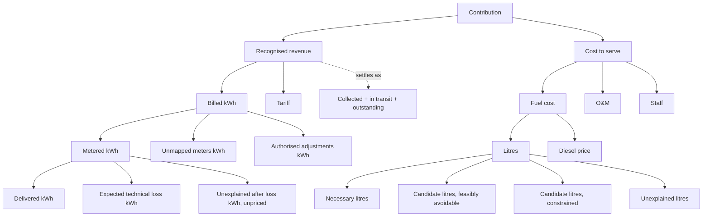

# Economic metric and effect contracts

**Layer 4 companion · rev 4 (redesign) · AssetOps Architect (Claude) · 17 Nov 2026 · design only, nothing built**
**Answers:** brief Part VI, C1 Deliverable 2 (economic truth, measurement, composition, financial models and contractual entitlements), for the mechanics of `layer4-transformation-design.md` §2: **M1 Define**, **M2 Observe**, **M3 Evaluate**, as corrected by the owner on 17 Nov 2026 (outcomes are *observed through the factors that structurally define them*, not traced backwards from a shortfall).
**Figures:** every amount is **illustrative** (USD) and comes from `demo-site-scenario-manifest.yaml` (rev 4). `python3 check_manifest.py` passes 167 checks; every other figure here was recomputed by hand and the working is shown. One test vector (AT-3) is a stated hypothetical, because the manifest holds prices at plan in October; it is labelled as such. Nothing here is an observed financial result.

> **Labels.** **[code-observed]** read in `/opt/assetecon/AssetOpsV1` at `f5d2b9a4f` · **[test-confirmed]** pinned by a named product test · **[implementation-report]** stated only by the reviewed baseline (`.agent/decision-intelligence-mechanism-2026-11-14.html`) · **[proposed]** this design · **[research]** brief sources [R1]–[R12] · **[assumption]** to validate in a pilot. Provenance of data is always one of *demo-simulated*, *source-emulated*, *bench-tested*, *field-integrated*, *observed-financial*; the demonstration world is demo-simulated (telemetry) and source-emulated (commercial records), never observed-financial.

**Changes from rev 3.** Rev 3 organised this file as "phases" plus extension positions D3/D4/D8 bolted onto today's strategies. Rev 4 replaces that frame with one idea: every outcome is a **declared structure of factors**, the value chain is its economic backbone, and money, attribution, valuation and rights are all readings of that structure. Rev 3's verified arithmetic, money classes, rights states and negative tests are carried over; its D-numbering is retired. The Thika incident is re-based on v7.0 INC-203 (6 Oct), and Embakasi's schedule is valued against November no-action.

---

## 1. Why outcomes need a declared factor structure with a value chain backbone

An executive's outcome ("contribution is below plan", "cost per departure is rising") is not a fact that can be measured directly. It is the result of many smaller facts: litres burned, kilowatt-hours billed, crate-days occupied, kilowatts drawn at the peak hour, buses that left charged. Today's product measures several of those facts carefully [code-observed: dispatch-3.2, fuel balance, cold excursion, EV interruption analyses] but never states how they *compose* into money, so it cannot say what the outcome is, nor how a change to one fact moves it. `recorded_amount@1` "returns no money with `NO_RECORDS`, always" (`chain/strategies/recorded_amount.py:1`) [code-observed], and five catalogue outcomes are "not connected yet", among them MG-6 Cash collected, EV-6 Energy billed against metered and CC-2 Paid cold-room use (`outcomes/catalogue.py:45`, `:54`, `:61`) [code-observed].

The design therefore **defines each outcome as an explicit structure** (M1) and **observes it bottom-up** (M2):

1. *(Brief: L1.1 objective definitions, L1.2 vertical translation, R1–R3 economic anatomy, C1 D2 phases.)* A structure is a tree of nodes. Each node is one of five kinds: an **identity** (a sum or difference: contribution = revenue − cost to serve), a **product** (fuel cost = litres × price), a **stage relation** of the value chain (billed = metered − unmapped − authorised adjustments), a **physical sub-structure** (generator litres = necessary + candidate-avoidable + candidate-constrained + unexplained), or a **composition** (portfolio = Σ eligible sites).
2. The tree ends in **leaf factors** that a source fact can observe: a billing row, a fuel delivery note, a tank dip, a storage check-in, an OCPP meter value, a utility invoice line, a roster entry.
3. *(Brief: S2 plan assumptions.)* **Plans are declared at leaf level** (planned billed kWh, tariff, litres, price, occupancy, peak share, peak kW). The planned outcome is the same structure evaluated on planned leaves, so plan and actual can be compared at every node, not only at the top.
4. *(Brief: P1, S5; R3a, P4.)* **Obligations are bounds on factors** (dawn battery charge ≥ 35%; a batch's chamber temperature ≤ its limit; departures met = departures required; import ≤ the contracted limit). **Rights are a factor on who bears a cost** (operator, supplier, insurer), never a change of the cost itself.

Why the backbone is a **value chain**: money reaches an operator only by passing stages — capacity becomes service, service becomes chargeable service, chargeable service becomes recognised revenue, revenue becomes cash — and each passage can leak. Collapsing the stages ("energy = revenue", "revenue = cash") is the most common way a dashboard misleads (brief C1 D2). Making each stage a node with its own source and clock means a leak is a factor that can be observed, planned and changed, and an option that acts on it (fixing a meter mapping) moves exactly that node. The physical and commercial sub-structures hang off the chain where they act: fuel litres under the fuel cost line, refrigeration kWh under the energy line, deliverable charging energy under the departures obligation.

Three consequences follow, and the rest of this file makes them exact:
- **The bridge is a reading, not an inference.** Because every node is computed from its children, the deviation of an outcome from plan *is* the propagation of leaf deviations. Attribution is exact for sums and uses one declared rule for products (§4.2).
- **A residual exists only where a leaf is not observed or the structure is incomplete** (Kobo: 120 L consumed beyond what the generator model explains). It is shown as a factor in its own right, never spread over other factors.
- **Deviations are visible before money closes.** Factors are observed daily; money closes monthly. A factor drifting from plan or approaching a bound is visible at the factor (Kasarani: charger CH-K2's capacity fell on 1 Nov, so its departures factor was at risk before any penalty or invoice existed).

---

## 2. The structures, per vertical

### 2.1 Common node rules [proposed]

Every node, at every level, carries the same attributes so it can be composed, compared and drilled into. These are the brief's unit hierarchy and outcome decision invariants (L1.2) made into fields:

- **Shared factor ID and period ID** (brief line 130: "shared driver IDs and period IDs prevent the same fuel, bill adjustment or recovered payment appearing as several independent gains"). A factor appears once; every outcome that depends on it references it. The brief's *driver* is called *factor* here because it also covers non-money factors (temperatures, departures).

- **Quantity and unit** in the vertical's own units (kWh, L, crate-day, departure, kW, USD).
- **Money class** (`money_class`, §4.4): what kind of number it is. Classes never sum with one another.
- **Coverage**: RECORDED, ESTIMATED (plan amount carried with a label because the record is missing), MISSING (no value; never zero) or NOT_APPLICABLE (the node does not exist for this business model; never zero).
- **Four clocks** for any commercial leaf: **service period** (when the kWh, crate-day or departure happened), **effective period** (when a tariff, contract term or meter mapping applies), **recognition period** (the accounting month a charge or expense is booked), **settlement instant** (when cash arrived). Telemetry leaves carry only the service clock.
- **Lineage** to the source records that observed the leaf, and the observer (model id and version) that computed a derived node.

Node kinds evaluate as follows: identity nodes add children with signs; product nodes multiply; stage relations subtract named leaks; physical sub-structures add sub-factors that a factor observer (an existing or new analysis) classifies; composition nodes sum eligible sites and **exclude and name** ineligible ones.

### 2.2 Mini-grid (billed electricity): Lakeside Power

The mini-grid business sells metered electricity, monthly-billed or prepaid. Its contribution structure is the chain from delivered energy to cash, minus three cost lines, with fuel carrying a physical sub-structure.

| Node | Kind | Rule | Leaf source (four clocks where commercial) | Plan declared? |
|---|---|---|---|---|
| Contribution | identity | revenue − (fuel + O&M + staff) | — | evaluated |
| Revenue | product | billed kWh × tariff | billing export: service period, recognition period | billed kWh, tariff |
| Billed kWh | stage | metered − unmapped − authorised adjustments | billing rows; effective-dated meter register; adjustment codes | yes |
| Metered kWh | stage | delivered − expected technical loss − unexplained | customer meter reads; declared loss band [assumption 5% ± 1 pt] | via delivered |
| Delivered kWh | leaf | feeder / inverter output | EMS telemetry (service clock) | no |
| Cash split | stage | revenue = collected + in transit + outstanding | receipts and mobile-money settlement statements (settlement instant) | no |
| Fuel cost | product | litres × price | delivery notes (price, effective period) | litres, price |
| Litres | physical sub-structure | necessary + candidate-avoidable + candidate-constrained + unexplained | fuel balance (dips + deliveries) observes the total; dispatch-3.2 splits necessary vs candidate; forward replay splits candidate into avoidable vs constrained | total litres (all "necessary at plan load") |
| O&M, staff | leaf | invoice amount | invoices (recognition period) | yes |

Obligations as bounds on factors at a mini-grid site: clinic critical load served 24/7; battery charge at 05:00 ≥ 35% on every day (dawn adequacy); evening supply with N−1 generation where declared; battery warranty operating limits (lowest charge ≥ 10%, ≤ 0.5C, cell ≤ 45 °C).

### 2.3 Cold room (pay-as-you-store): Harvest Cold Network

A cold room sells storage per crate-day to customers who own the produce. Its structure has the same backbone, with a capacity stage (crate-days available), an occupancy ledger, and an energy line carrying a normalised refrigeration sub-structure.

| Node | Kind | Rule | Leaf source | Plan declared? |
|---|---|---|---|---|
| Contribution | identity | revenue − (energy + staff + maintenance + liability) | — | evaluated |
| Capacity crate-days | leaf | crates × days in period (400 × 31 = 12,400 in October) | room configuration | — |
| Occupied crate-days | stage | Σ batches crates × days present; capacity − idle | storage ledger check-in/out | occupancy |
| Chargeable crate-days | stage | occupied − incompatible or unbilled occupancy | ledger + rate card | (equal in October) |
| Revenue | product | chargeable crate-days × rate (0.20) | invoices | rate |
| Cash split | stage | revenue = collected + outstanding | receipts | no |
| Energy cost | product | kWh × price (0.20) | electricity bill | kWh, price |
| kWh | physical sub-structure | base 1,550 + 0.25 × crate-days (reference ambient 24 °C, +2.5% per °C above) + efficiency deviation | energy meter, ledger, ambient; normalised model [proposed fixture form] | via occupancy |
| Liability | product | QA-confirmed damaged crates × declared value, when a contract clause applies | QA notes, customer contract, credit note | 0 |
| Staff, maintenance | leaf | invoice amount | invoices | yes |

Obligations: chamber temperature ≤ each present batch's commodity limit (French beans 5 °C, avocado 12 °C); commodity compatibility for co-stored batches (ethylene segregation). Exposure (value of stock in a batch that crossed its limit) is **not** a node of contribution; it is a separate EXPOSURE figure on the batch (§4.4).

### 2.4 EV depot, captive fleet: Metro Bus Depots

A captive fleet's depot sells nothing: charging is a cost centre and the service is a bus leaving on time with its required charge. **Revenue is NOT_APPLICABLE, never zero**, and the result is **cost per required departure met**.

| Node | Kind | Rule | Leaf source | Plan declared? |
|---|---|---|---|---|
| Cost per departure met | ratio | cost to serve ÷ departures met | — | evaluated |
| Cost to serve | identity | energy + demand charge + maintenance | utility invoice lines, service invoices | yes |
| Energy cost | Σ of products | Σ tiers (kWh in tier × tier price) | OCPP MeterValues priced by interval under the effective tariff | kWh, tier shares, prices |
| Demand charge | product | monthly maximum import kW × rate (12.00/kW-month) | site meter / invoice demand line | max kW |
| Departures met | stage | required − missed | roster (required), OCPP sessions + departure log | required |
| Deliverable kWh per night | physical sub-structure | min(import limit, chargers in service × charger kW) × charging window hours | charger status (StatusNotification), import limit, window | — |
| Revenue | — | **NOT_APPLICABLE** | — | — |

Obligations: every required departure met (required energy delivered before departure); import ≤ contracted limit. A commercial depot (later) adds the revenue and cash stages of §2.2 with session fees.

### 2.5 The four clocks in practice

Each clock answers a different question, and mixing them produces wrong months:

| Clock | Mini-grid example | Cold example | EV example |
|---|---|---|---|
| Service | kWh delivered 30–31 Oct | crate-days of B-1031 in October | energy delivered night of 6 Oct |
| Effective | Mto meter swap valid from 3 Oct for 6 customers | 0.18 aggregator rate Dec–Mar | Embakasi's 00:00–05:00 tier valid from 1 Nov |
| Recognition | October bill run | October storage invoice | October utility invoice |
| Settlement | 150.00 paid 30–31 Oct, settled 2 Nov | receipts in November for October | — (captive) |

Effective-dated mappings (meter → customer, serial → asset, tariff → site, idTag → bus) are resolved at the **service instant**, never at load time (disorder test MAP-1).

---

## 3. The three portfolios, observed through their structures

Each site below is the structure evaluated twice, on planned leaves and on observed leaves. The attribution column is the reading of each node's deviation (rules in §4.2). All figures are in the manifest; arithmetic was re-checked by hand.

### 3.1 Lakeside Power, October 2026

**Chain block (portfolio).** Delivered 23,050 kWh → metered 21,700 → billed 21,445 (plan 21,650) → revenue 9,688.00 (plan 9,785.00) → collected 8,870.00 + in transit 150.00 + outstanding 668.00 = 9,688.00. Cost to serve 8,245.00 (plan 7,490.00). **Contribution 1,443.00 vs plan 2,295.00: −852.00.**

**Per-site chain stages (actual).**

| Site | Delivered | Technical loss | Unexplained | Metered | Unmapped | Adjustments | Billed (plan) | Tariff | Revenue (plan) | Collected | In transit | Outstanding |
|---|---:|---:|---:|---:|---:|---:|---:|---:|---:|---:|---:|---:|
| Kobo | 9,100 | 410 | — | 8,690 | — | 45 | 8,645 (8,550) | 0.40 | 3,458.00 (3,420.00) | 3,180.00 | 0.00 | 278.00 |
| Kisiwa | 7,950 | 520 | — | 7,430 | — | 30 | 7,400 (7,500) | 0.55 | 4,070.00 (4,125.00) | 3,800.00 | 0.00 | 270.00 |
| Mto | 6,000 | 300 (expected) | 120 | 5,580 | 140 | 40 | 5,400 (5,600) | 0.40 | 2,160.00 (2,240.00) | 1,890.00 | 150.00 | 120.00 |
| **Σ** | **23,050** | | | **21,700** | | | **21,445 (21,650)** | | **9,688.00 (9,785.00)** | **8,870.00** | **150.00** | **668.00** |

Kobo and Kisiwa report loss as one figure (expected and unexplained are not separated there: the loss band leaf is not declared for them yet), so their unexplained cell is "—", not zero.

**Fuel sub-structure.** Litres are observed by the fuel balance and split by the factor observers. Plan litres are declared as necessary generation at plan load.

| Site | Price | Plan L | Necessary L | Candidate, avoidable L | Candidate, constrained L | Unexplained L | Actual L | Observers |
|---|---:|---:|---:|---:|---:|---:|---:|---|
| Kobo | 1.25 | 700 | 730 | 210 | 120 | 120 | 1,180 | balance: 220 + 1,200 − 240 = 1,180; model-implied 1,060; dispatch-3.2: Candidate on 11 of 31 days, 330 L; forward replay: 210 avoidable [design value] |
| Kisiwa | 1.30 | 2,300 | 2,380 | 0 | 0 | 20 | 2,400 | model-implied 2,380; 0 Candidate minutes |
| Mto | 1.25 | 300 | 320 | 0 | 0 | — | 320 | evening necessary generation |

Kobo's 730 + 210 + 120 = 1,060 model-implied litres; 1,060 + 120 unexplained = 1,180 consumed. The unexplained 120 L is 10.2% of consumption, above the 2% tolerance, so it is a factor to investigate; Kisiwa's 20 L (0.83%) is reported and not investigated. Mto has no fuel-balance figure in the manifest, so its unexplained cell is "—".

**Contribution per site.**

| Site | Revenue | Fuel | O&M | Staff | Contribution | Plan | Deviation | Cost coverage |
|---|---:|---:|---:|---:|---:|---:|---:|---|
| Kobo | 3,458.00 | 1,475.00 | 600.00 | 500.00 | 883.00 | 1,445.00 | −562.00 | all RECORDED |
| Kisiwa | 4,070.00 | 3,120.00 | 700.00 (ESTIMATED) | 500.00 | −250.00 | −65.00 | −185.00 | O&M invoice missing |
| Mto | 2,160.00 | 400.00 | 500.00 | 450.00 | 810.00 | 915.00 | −105.00 | all RECORDED |
| **Σ** | **9,688.00** | **4,995.00** | **1,800.00** | **1,450.00** | **1,443.00** | **2,295.00** | **−852.00** | 7,545.00 of 8,245.00 recorded = **91.5%** |

**Attribution (the bridge as a reading of the structure).** Prices and tariffs are at plan in October, so every product node's price effect is 0.00 and each deviation is a volume effect at plan price (rule A2, §4.2).

| Site | Factor node (overlap key) | Leaf deviation | × plan price | Attribution | Money class |
|---|---|---|---|---:|---|
| Kobo | billed kWh (`KOBO-2026-10-REV`) | +95 kWh | 0.40 | +38.00 | ECONOMIC_ACTUAL |
| Kobo | candidate-avoidable litres (`KOBO-2026-10-FUEL`) | +210 L | 1.25 | −262.50 | MODELLED split of a recorded total |
| Kobo | candidate-constrained litres (`KOBO-2026-10-FUEL`) | +120 L | 1.25 | −150.00 | MODELLED split |
| Kobo | necessary litres, evening load growth (`KOBO-2026-10-FUEL`) | +30 L | 1.25 | −37.50 | MODELLED split |
| Kobo | unexplained litres (`KOBO-2026-10-FUEL`) | +120 L | 1.25 | −150.00 | DERIVED |
| Kisiwa | billed kWh (`KIS-2026-10-REV`) | −100 kWh | 0.55 | −55.00 | ECONOMIC_ACTUAL |
| Kisiwa | necessary litres, solar shortfall (`KIS-2026-10-FUEL`) | +80 L | 1.30 | −104.00 | MODELLED split |
| Kisiwa | unexplained litres (`KIS-2026-10-FUEL`) | +20 L | 1.30 | −26.00 | DERIVED |
| Mto | billed kWh: demand (`MTO-2026-10-REV`) | −20 kWh | 0.40 | −8.00 | ECONOMIC_ACTUAL |
| Mto | billed kWh: unmapped meters (`MTO-2026-10-REV`) | −140 kWh | 0.40 | −56.00 | ECONOMIC_ACTUAL |
| Mto | billed kWh: authorised adjustment (`MTO-2026-10-REV`) | −40 kWh | 0.40 | −16.00 | ECONOMIC_ACTUAL |
| Mto | necessary litres, evening (`MTO-2026-10-FUEL`) | +20 L | 1.25 | −25.00 | MODELLED split |
| | | | | **−852.00** | equals the portfolio deviation |

By line: revenue +38 − 55 − 8 − 56 − 16 = **−97.00**; cost −262.50 − 150 − 37.50 − 150 − 104 − 26 − 25 = **−755.00**; −97 − 755 = −852.00.

Why two classes sit on one line: Kobo's fuel deviation of 480 L × 1.25 = −600.00 is an **economic actual** (dips and delivery notes). Its split into necessary, avoidable and constrained litres is **modelled** (dispatch classification and forward replay). The screen shows the line total as Recorded and the split as Modelled; the 262.50 is never shown as money already lost to a cause or as money that will be saved.

Mto's 120 kWh unexplained after expected losses sits on the metered stage, and Mto's plan deviation is not affected by it (the plan is on billed kWh). It stays **unpriced**: an investigation factor, never "theft", never collectible (oracle OR-MG-4).

### 3.2 Harvest Cold Network, October 2026

**Chain block (portfolio).** Capacity 37,200 crate-days → occupied 22,940 (plan 26,040) → chargeable 22,940 → revenue 4,588.00 (plan 5,208.00) → collected 4,370.00 + outstanding 218.00. Cost to serve 3,642.00 (plan 3,492.00). **Contribution 946.00 vs plan 1,716.00: −770.00** (revenue −620.00, cost −150.00). Cost recorded 3,562.00 of 3,642.00 = **97.8%** (Thika's 80.00 refrigeration service invoice is ESTIMATED).

| Site | Occupied crate-days (plan) | Occupancy | Revenue (plan) | kWh model | kWh actual (plan) | Energy | Staff | Maint. | Liability | Contribution (plan) | Deviation |
|---|---:|---:|---:|---:|---:|---:|---:|---:|---:|---:|---:|
| Mwea | 4,340 (7,440) | 35% (60%) | 868.00 (1,488.00) | 2,635 | 2,650 (3,410) | 530.00 | 300.00 | 50.00 | 0.00 | −12.00 (456.00) | −468.00 |
| Thika | 8,680 (8,680) | 70% | 1,736.00 | 3,720 | 3,720 (3,720) | 744.00 | 350.00 | 80.00 E | 108.00 | 454.00 (562.00) | −108.00 |
| Kirinyaga | 9,920 (9,920) | 80% | 1,984.00 | 4,030 | 5,000 (4,030) | 1,000.00 | 400.00 | 80.00 | 0.00 | 504.00 (698.00) | −194.00 |
| **Σ** | **22,940 (26,040)** | | **4,588.00 (5,208.00)** | | | **2,274.00** | **1,050.00** | **210.00** | **108.00** | **946.00 (1,716.00)** | **−770.00** |

kWh model = 1,550 + 0.25 × crate-days (October ambient at or below the 24 °C reference [assumption]). Cash: Mwea 820 + 48, Thika 1,650 + 86, Kirinyaga 1,900 + 84.

**Attribution.** The energy line has a physical sub-structure: plan kWh is the model at planned occupancy, so the energy deviation splits exactly into an **occupancy-volume** effect (model at actual occupancy − model at plan occupancy) and an **efficiency** effect (meter − model at actual occupancy), both at plan price 0.20.

| Site | Factor node (overlap key) | Leaf deviation | Attribution | Money class |
|---|---|---|---:|---|
| Mwea | occupied crate-days → revenue (`MWEA-2026-10-REV`) | −3,100 crate-days × 0.20 | −620.00 | ECONOMIC_ACTUAL |
| Mwea | kWh, occupancy volume (`MWEA-2026-10-ENERGY`) | 2,635 − 3,410 = −775 kWh × 0.20 | +155.00 | DERIVED (not a saving: the shadow of lost occupancy) |
| Mwea | kWh, efficiency (`MWEA-2026-10-ENERGY`) | 2,650 − 2,635 = +15 kWh × 0.20 | −3.00 | DERIVED (inside 5% tolerance) |
| Thika | liability (`THIKA-2026-10-LIAB`) | 6 crates × 18 | −108.00 | ECONOMIC_ACTUAL (credit note CN-0412) |
| Kirinyaga | kWh, efficiency (`KIRI-2026-10-ENERGY`) | 5,000 − 4,030 = +970 kWh × 0.20 | −194.00 | DERIVED |
| | | | **−770.00** | |

**What the structure shows that a unit-cost table hides.** Energy per crate-day is 530 / 4,340 = **0.1221** at Mwea and 1,000 / 9,920 = **0.1008** at Kirinyaga: Mwea looks worse. Read through the structure, Mwea's efficiency node is +0.6% (inside tolerance) and its occupancy node is 25 points below plan; Kirinyaga's occupancy is at plan and its efficiency node is +24.1% (970 / 4,030). The portfolio ratio is Σ/Σ: 2,274.00 / 22,940 = 0.0991 per crate-day, not the mean of site ratios.

**Thika (v7.0 INC-203).** The liability node is the only October deviation. The batch exposure on 6 Oct (B-1031, 120 crates × declared 18 = **2,160.00**) is EXPOSURE, a figure on the batch, not on the chain; only the QA-confirmed damage (6 crates, **108.00**) enters, and only because the customer contract makes it the operator's liability and a credit note recorded it.

### 3.3 Metro Bus Depots (captive), October 2026

**Chain block (portfolio).** Delivered 184,760 kWh; departures required 1,302, met 1,302; revenue **NOT_APPLICABLE**. Cost to serve 41,705.12 vs plan 38,520.80: **−3,184.32**. **Cost per departure met 32.03** (41,705.12 / 1,302) vs plan 29.59 (38,520.80 / 1,302). Cost recorded 41,405.12 of 41,705.12 = **99.3%** (Kasarani's 300.00 maintenance invoice is ESTIMATED).

| Depot | kWh | Peak kWh × 0.24 | Off-peak kWh × 0.12 | Max kW × 12 | Energy + demand | Maint. | Cost (plan) | Departures met / required | Deviation |
|---|---:|---:|---:|---:|---:|---:|---:|---|---:|
| Embakasi | 86,800 | 47,740 → 11,457.60 | 39,060 → 4,687.20 | 500 → 6,000.00 | 22,144.80 | 600.00 | 22,744.80 (19,540.80) | 620 / 620 | −3,204.00 |
| Kasarani | 37,200 | flat 0.15 → 5,580.00 | | — | 5,580.00 | 300.00 E | 5,880.00 (5,880.00) | 248 / 248 | 0.00 |
| Ruiru | 60,760 | 6,076 → 1,458.24 | 54,684 → 6,562.08 | 380 → 4,560.00 | 12,580.32 | 500.00 | 13,080.32 (13,100.00) | 434 / 434 | +19.68 |
| **Σ** | **184,760** | | | | | | **41,705.12 (38,520.80)** | **1,302 / 1,302** | **−3,184.32** |

Embakasi plan: 86,800 kWh at 30% peak = 26,040 × 0.24 = 6,249.60 + 60,760 × 0.12 = 7,291.20 + 450 kW × 12 = 5,400.00 → 18,940.80 + 600.00 = 19,540.80.

**Attribution.** Embakasi's energy node is a sum of tier products, so its deviation splits by rule A3 (§4.2) into a volume effect (0: total kWh equals plan), a **mix** effect (share moved between tiers at plan prices) and a price effect (0: October prices equal plan). Demand is one product with a volume effect.

| Depot | Factor node (overlap key) | Leaf deviation | Attribution | Money class |
|---|---|---|---:|---|
| Embakasi | energy, tier mix (`EMB-2026-10-ENERGY`) | peak share 55% vs 30%: 21,700 kWh moved to peak × (0.24 − 0.12) | −2,604.00 | ECONOMIC_ACTUAL |
| Embakasi | demand kW (`EMB-2026-10-DEMAND`) | 500 − 450 = +50 kW × 12 | −600.00 | ECONOMIC_ACTUAL |
| Ruiru | energy and demand vs plan line (`RUI-2026-10-ENERGY`) | plan declared as one energy amount (12,600.00) | +19.68 | ECONOMIC_ACTUAL |
| | | | **−3,184.32** | |

Ruiru's plan is declared at line level, not tier level, so its 19.68 cannot be split further; the structure says so ("plan not declared at factor level") rather than inventing a split.

**Early visibility.** On 1 Nov 23:40 Kasarani's charger CH-K2 failed (contactor weld). The deliverable-energy node fell from 4 × 50 kW × 7 h = 1,400 to 3 × 50 × 7 = **1,050 kWh** per night against **1,200** required (8 buses × 150): one bus short each night. The departures bound was at risk from that night, days before any penalty (2 missed departures, 240.00, ECONOMIC_ACTUAL by 6 Nov) or invoice existed.

---

## 4. Identities and attribution rules

### 4.1 Composition identity (site → portfolio)

*Brief:* L1.2 outcome decision invariants (Σ/Σ, coverage, unknown ≠ zero), S1.

- **Amounts**: portfolio node = Σ over eligible sites, same currency, same recognition period.
- **Ratios**: portfolio ratio = Σ numerator / Σ denominator over comparable sites, never an average of site ratios. Examples: diesel cost per billed kWh at Lakeside = (1,475 + 3,120 + 400) / (8,645 + 7,400 + 5,400) = 4,995 / 21,445 = **0.2329**; cost per departure at Metro = 41,705.12 / 1,302 = **32.03**; energy per crate-day at Harvest Cold = 2,274 / 22,940 = **0.0991**.
- **Exclusion**: a site whose node is MISSING is **excluded and named**, and the portfolio node is labelled partial ("2 of 3 sites"). It is never filled with zero.
- **NOT_APPLICABLE** composes as NOT_APPLICABLE: Metro has no revenue node at any level.
- Today's code already refuses stored totals ("no stored totals (D-MONEY.3)", `chain/period_read.py:139`) and keeps mixed-currency lines without a value (`test_ch6b_estate_chain.py::test_mixed_currency_has_no_value_but_keeps_the_lines`) [code-observed; test-confirmed]. The structure is recomputed from stored leaves on every read, consistent with D-MONEY.3 [proposed].

### 4.2 Attribution identity (plan → actual, through the structure)

*Brief:* S2 ("independently identified drivers" plus an "explicitly unexplained residual"), unit hierarchy line 130 (shared IDs). The product rule is **added** by this design (decision A13 in `design-questions-and-decisions.md`), because S2 requires the identity but leaves the rule open.

**Identity.** For every node N, site and period:

> N(actual) − N(plan) = Σ over its children of their attributed effects, exactly, by the rule of N's kind; recursively down to leaves. The residual of a node is non-zero only where a leaf is unobserved or the structure is incomplete, and it is then a named factor.

**Overlap key = the factor node (its shared factor ID).** Each attributed amount belongs to exactly one node (site × period × factor), so one money effect is counted once, however many outcomes read it. Kobo's generator running after dawn moves the candidate-avoidable litres node once; its relation to battery wear and clinic supply are bounds checked on options (M3), not further money. Today's `estate/financials.py:361` `_overlaps` (pairwise duplicate key or equal overlap group) and the existing `overlap_group` columns (`0011_financial_consequences.py:54`, `0023_w2_cold_consequence.py:66`, `0026_w2_ev_money.py:63`) [code-observed] are the seed of this rule; the key becomes the factor node.

**Rules by node kind** [proposed; one rule per kind, declared with the structure and versioned]:

- **A1 Sum / stage relation**: the child deviations add exactly. No rule choice.
- **A2 Product Q × P** (decision A13): *volume effect at plan price, then price effect at actual volume*: (Q_a − Q_p) × P_p + (P_a − P_p) × Q_a. This sums exactly to Q_a·P_a − Q_p·P_p with no cross term left over, and is the convention finance teams use for volume/price variance. The order (volume first) is declared and never changes silently.
- **A3 Sum of tier products Σ_k Q·s_k·P_k** (time-of-use energy): *volume* (Q_a − Q_p) × Σ s_p,k P_p,k; then *mix* Q_a × Σ (s_a,k − s_p,k) P_p,k; then *price* Q_a × Σ s_a,k (P_a,k − P_p,k). Exact by construction.
- **A4 Physical sub-structure** (litres, kWh model, deliverable energy): child deviations add (A1), each child observed by a named factor observer. Where a child is MODELLED (the avoidable/constrained split), the parent's total stays at its recorded class and the children carry MODELLED.
- **A5 Ratio** (cost per departure, energy per crate-day): ratios are not attributed in money. A ratio deviation is decomposed into numerator and denominator effects in their own units and labelled; its money is the numerator's, counted once.

**Test vectors** (AT-x; arithmetic shown):

| Id | Node | Input | Expected attribution |
|---|---|---|---|
| AT-1 | Kobo revenue (A2) | Q 8,645 vs 8,550; P 0.40 = 0.40 | volume +95 × 0.40 = +38.00; price 0.00; total 3,458.00 − 3,420.00 = +38.00 |
| AT-2 | Kobo fuel cost (A2 then A4) | L 1,180 vs 700; P 1.25 = 1.25 | volume −480 × 1.25 = −600.00 = −262.50 − 150.00 − 37.50 − 150.00; price 0.00 |
| AT-3 | **Hypothetical** (not in the manifest): Kobo fuel cost with diesel at 1.30 actual | L 1,180 vs 700; P 1.30 vs 1.25 | volume 480 × 1.25 = 600.00; price 1,180 × 0.05 = 59.00; total 1,534.00 − 875.00 = 659.00 adverse. Reversing the order (price at plan volume, volume at actual price) would give 35.00 + 624.00: the declared order is A2's |
| AT-4 | Embakasi energy (A3) | Q 86,800 = 86,800; shares 0.55/0.45 vs 0.30/0.70; prices 0.24/0.12 both periods | volume 0.00; mix 86,800 × (0.25 × 0.24 − 0.25 × 0.12) = 2,604.00 adverse; price 0.00; total 16,144.80 − 13,540.80 = 2,604.00 |
| AT-5 | Embakasi demand (A2) | 500 vs 450 kW; 12.00 | volume 600.00 adverse; price 0.00 |
| AT-6 | Mwea energy (A4 at plan price) | model at plan 3,410; model at actual 2,635; meter 2,650 | occupancy volume +155.00; efficiency −3.00; total 682.00 − 530.00 = +152.00 favourable |
| AT-7 | Kirinyaga energy (A4) | model 4,030 = plan; meter 5,000 | occupancy 0.00; efficiency −194.00 |
| AT-8 | Mto billed kWh (A1) | 5,600 plan vs 5,400 | −20 demand, −140 unmapped, −40 authorised = −200 kWh; × 0.40 = −80.00 |
| AT-9 | Metro cost per departure (A5) | 41,705.12 / 1,302 vs 38,520.80 / 1,302 | numerator effect +2.45 per departure (3,184.32 / 1,302); denominator effect 0; no money beyond the −3,184.32 already on the cost nodes |
| AT-10 | Residual placement | Kobo litres consumed 1,180, model-implied 1,060 | unexplained node 120 L (10.2%) above 2% tolerance: investigate; never distributed over the other litres nodes |
| AT-11 | Plan not at factor level | Ruiru plan 12,600.00 energy (one amount) | attribution stops at the line: +19.68 "plan not declared by tier", no invented split |

### 4.3 Valuation identity (options, M3)

*Brief:* L2 causal pathways, S4 ("net impact and common horizon"), C1 D2 ("one financial-benefit identity"), L2.5 lever roles. The rule that no-action also receives tariff and price changes is **added** by this design.

An option changes one or more factors; the structure propagates the change to the outcome. It is valued against **no action**, which is the *same structure projected forward* under the same horizon, prices, tariff, contracts and accounting basis:

> value(option) = Σ over horizon H [ outcome(structure | changed factors) − outcome(structure | no action) ] − one-off cost borne by the operator

with outcome = contribution for service businesses, and = −(cost to serve) with every required departure met for a captive fleet.

Consequences:
- **No-action windfalls are never credited to options.** Embakasi's tariff C-114 adds a 00:00–05:00 tier at 0.09 from 1 Nov 2026. November no-action (October's charging pattern under the November tariff) is 47,740 × 0.24 = 11,457.60 + 15,500 × 0.12 = 1,860.00 + 23,560 × 0.09 = 2,120.40 + 500 kW × 12 = 6,000.00 = **21,438.00** a month, which is 706.80 below October's 22,144.80 with no action at all (23,560 × 0.03). The deadline-aware schedule is 24,800 × 0.12 = 2,976.00 + 62,000 × 0.09 = 5,580.00 + 400 × 12 = 4,800.00 = **13,356.00**. Its value is 21,438.00 − 13,356.00 = **8,082.00 a month**, and 8,082.00 × 12 − 1,500.00 = **95,484.00 over 12 months** (MODELLED; tariff applicability to be confirmed from the invoice [assumption]). A comparison with October's bill (8,788.80 a month) would credit the option with the tariff's 706.80.
- **Gross exposure is never value.** Kobo's candidate fuel at stake, 0 … 330 L (0 … 412.50), from fuel-cost-1 (`financials/fuel_cost.py:57-79`, quantity_high = 1.10 × Σ P·h·SFC over Candidate time) [code-observed], stays labelled "upper bound of fuel at stake". The stop-threshold option's value is what the forward replay says is feasibly avoidable: (210 × 1.25 − 150 kWh × 0.08 wear) × 12 − 90.00 = (262.50 − 12.00) × 12 − 90.00 = **2,916.00** (MODELLED). 210 L is a **design value** held in the manifest that the forward-replay adapter must reproduce from real series before it is relied on.
- **Ratio effects are never added to the money they come from.** If Mwea's aggregator contract adds 4,500 crate-days a month, revenue rises 810.00 a month and energy per crate-day falls; the second is the A5 denominator effect of the first, reported with money null.
- **Options on the same factor node are mutually exclusive or evaluated together.** The Mto inverter remedy paths share one node; Kobo's 100 kWh battery and the stop-threshold change act on the same candidate-avoidable litres node, so the battery adds nothing the threshold change does not.
- **Other option values (manifest, recomputed):** Mto rice huller (495.00 − 85.00 − 15.00) × 12 − 1,200.00 = **3,540.00**; Mto evening welder 264.00 − 272.25 = **−8.25 a month** (break-even tariff 272.25 / 660 = 0.4125 → 0.42); Kirinyaga repair 0.80 × 194.00 × 12 − 350.00 = **1,512.40**, replacement (194.00 + 40.30) × 12 − 4,800.00 = **−1,988.40**; Mwea aggregator (810.00 − 225.00 − 100.00) × 4 − 270.00 = **1,670.00** over the contract.

### 4.4 Money classes (`money_class`)

*Brief:* the unit hierarchy (economic actual, operational actual, derived, estimated/modelled, exposure, verified effect) and its rule "should not sum different evidence classes".

Every node and every option effect carries one class. Different classes are shown side by side and **never summed**. The field is named `money_class` because `evidence_class` already exists in code as a *source-basis* column with a different vocabulary (MEASURED, RECORDED, DECLARED, MODELLED, EXTERNAL): `0042_chain_threads.py:50` on `finding_thread_occurrence` and `0043_chain_snapshots.py:37` on the measure snapshots [code-observed].

| `money_class` | On screen | Meaning | Example | May be summed with |
|---|---|---|---|---|
| ECONOMIC_ACTUAL | Recorded | sourced revenue, expense, receipt, settlement | Mto billed 2,160.00 | same class, currency, period |
| OPERATIONAL_ACTUAL | Measured | physical quantity from telemetry or operational records | Kobo 1,180 L consumed | same unit |
| DERIVED | Derived | computed from actuals by a stated method | Kirinyaga +970 kWh above model | its own components |
| MODELLED | Modelled | counterfactual, forecast or forward replay | Kobo 2,916.00 over 12 months | MODELLED effects on **distinct** factor nodes |
| EXPOSURE | At stake, not money | value that could be lost or recovered | B-1031 stock 2,160.00; BAT-001 cover 64,000.00; Kisiwa SLA credit 70.00 | never |
| VERIFIED | Verified | observed change under a frozen prediction | none yet in October | VERIFIED on distinct nodes |

ESTIMATED is a **coverage** state, not a class: an ECONOMIC_ACTUAL node whose record is missing carries the plan amount labelled Estimated, and counts in the coverage denominator.

**Verified replaces modelled, never adds to it.** When an option is verified, its VERIFIED effect supersedes its MODELLED effect on the same node; money appears as ECONOMIC_ACTUAL only through the later period's recorded leaves.

### 4.5 Day and window handling

Today the Portfolio's Optimize figure for a 7- or 30-day window is one lead Finding's exposure (`chain/read.py:190` `lead_finding`) [code-observed; implementation-report §5.2]. In the structure, a window's figure is the period node evaluated over the window's service days: Σ over every factor observation whose service clock falls in the window, de-duplicated by factor node. "Lead issue now" remains a separate, dated statement. Until the structure read exists, delivery slice 1 relabels the existing figure with its day [proposed].

### 4.6 Late and corrected data

A late or revised leaf (a delivery note recorded on 4 Nov for 26 Oct, OOO-1) creates a new **revision** of the affected site-period; every dependent node is recomputed, the previous revision stays readable, and the screen says what changed and why. Options and verdicts that cited the old revision are flagged "evidence changed since this was evaluated" (domain models §M5.3).

### 4.7 Units and currency

Money never crosses currencies without a declared basis (rate, date rule, source). An expense invoiced in KES at Kisiwa (FX-1) is converted at the declared monthly rate with the basis shown, or listed unconverted and excluded from the node with its name. Units are checked at every node (kWh × USD/kWh → USD); a unit mismatch is a structure definition error caught at start-up (domain models §M1).

---

## 5. Rights in money

### 5.1 What a right is in the structure

*Brief:* R3a, P4, A5, S12, C1 D2 ("contractual entitlements").

A right (equipment warranty, EPC workmanship or performance guarantee, O&M or service SLA, insurance) never changes a cost's physics or amount. It changes the **cost-bearer factor**: who pays a cost node, and when. So a right enters decisions as a property of each remedy path's **residual cost to the operator**, and enters the books only when a credit note, replacement invoice or receipt is recorded. The product evaluates evidence and options; it never states coverage, liability or enforceability ("Coverage is decided by the supplier or insurer").

### 5.2 Residual cost per remedy path

For a failure with paths p ∈ {claim and wait, buy now and claim later (stopgap plus claim), paid local repair, replace, no action}:

> residual(p) = operator-paid parts + labour + shipping and transport + stopgap + downtime consequence(p) + deductible (insurance paths) + cover forfeited (if p breaches a condition) − 0

The remedy is never subtracted as cash. Downtime consequence is the change it causes to other factor nodes over the restore time: extra fuel (Mto: 130.00 over 21 days at half inverter capacity), penalties (Kasarani 120.00 per missed block), stock protection (Thika rota). Where the counterparty decides, the path is two branches (accepted / denied), not a probability-weighted number, unless an acceptance rate is evidenced.

| Asset · contract | Evidence | Path: residual cost | Disposition (manifest) |
|---|---|---|---|
| Mto INV-MT-02 · warranty to 14 Mar 2029, replacement unit, shipping at owner cost, notice 30 days (by 27 Nov) | installer certificate, ambient max 38 °C (spec 45), firmware current, fault log | claim and wait: 150 + 80 + 130 = **360.00**, restore 28 Nov · buy now and claim the failed unit: 2,600 + 80 + 150 + 80 = **2,910.00**, restore 12 Nov (the returned unit becomes a spare, not cash) · local repair 450 + cover lost · no action: half capacity, notice lost 27 Nov | claim RECOMMENDED; buy-now CONDITIONAL (budget ≥ 6,430 **and** the cooperative will not extend its letter of intent); local REJECTED; no action REJECTED |
| Kisiwa GEN-KS-01 · warranty ended 30 Jun 2026; 1,000-hour service condition | run hours 1,240; service record MISSING | operator-funded repair **1,800.00** | must-do; "no supportable right identified from the evidence" (not "no right exists") |
| Kobo BAT-001 · warranty to 1 Mar 2034; 95% capacity at year 3 (interim), temperature and C-rate conditions | usable capacity *estimate* 184 kWh (92%) at 2.7 years; temperature and commissioning test MISSING | claim now: fails without a baseline · assemble evidence: capacity test 250 + sensor 180 = **430.00** | evidence RECOMMENDED; 64,000.00 cover is EXPOSURE |
| Thika GEN-CR-01 start controller · EPC workmanship warranty to 10 Feb 2027; quarterly test condition | 3 of 3 tests logged; WR-019 found the controller fault | supplier remedy + stopgap (rota, SMS relay 40 + labour 60) = **100.00** · wait = 0.00 now, stock unprotected · self-funded 710.00 voids cover | stopgap RECOMMENDED |
| Thika stock · goods-in-custody insurance, deductible 500, notice 14 days | confirmed loss 108 | notify (done 8 Oct) and do not claim: 108 < 500 deductible; reimbursement recorded 0.00 | not filed |
| Kasarani CH-K2 · parts warranty to 31 Aug 2027 (unauthorised repair voids power stage) + SLA (48 h response, 5 business days restore, 5% × 400 per late day) | fault log, ticket; responded in 31 h; restore due 9 Nov | supplier remedy + one bus charged at Ruiru on each of 3 nights: overtime 70 + energy 20 = **90.00** · wait: 0.00 now, about 240.00 of penalties and 2 broken departures · local repair 380 voids cover | stopgap RECOMMENDED |
| Kisiwa O&M · 48 h response; 10% × 700 credit when late; weather exclusion | reported 30 Oct 19:10, responded 3 Nov 19:30 (96 h); calm-weather bulletin | potential credit **70.00** | EXPOSURE, REVIEW_REQUIRED; never booked until a credit note |

### 5.3 Rights states and their money

Each state is a recorded event set by a person from a document; the system never sets ACCEPTED, DENIED or DISPUTED.

| State | Money effect |
|---|---|
| POTENTIAL, EVIDENCE_ASSEMBLED, NOTIFIED, ACKNOWLEDGED | none (EXPOSURE only) |
| ACCEPTED, DENIED, DISPUTED | none; DENIED moves the option to its operator-funded branch |
| REMEDY_DELIVERED | in-kind: the operator expense that would have existed does not; recorded as a recovery of the named expense, no cash |
| CREDIT_BOOKED | ECONOMIC_ACTUAL contra-expense on the cost node it offsets |
| CASH_RECEIVED | ECONOMIC_ACTUAL receipt |

### 5.4 No double recovery

Every operator expense a right could offset is one expense record; each recovery (supplier credit, in-kind remedy, insurer payment, SLA credit) references it with an amount. **Σ recoveries(expense) ≤ expense amount**, and a recovery against an already fully recovered expense is refused at ingestion. The overlap key of a recovery is the expense id. An SLA credit is never netted against penalties already paid; both stay on their own nodes.

---

## 6. Typed contracts

All contracts are [proposed]. Names are illustrative; storage placement is in `repo-reuse-and-gap-matrix.md`.

### 6.1 `factor_node` (structure definition, versioned code row)

| Field | Type | Rule |
|---|---|---|
| node_id, structure_id@version | string | e.g. `MINI_GRID.contribution@1/fuel.litres.candidate_avoidable` |
| vertical / business model | MINI_GRID_BILLED, COLD_PAY_AS_YOU_STORE, EV_CAPTIVE, EV_COMMERCIAL | decides NOT_APPLICABLE nodes |
| kind | IDENTITY, PRODUCT, STAGE, PHYSICAL, COMPOSITION, RATIO, LEAF | fixes the attribution rule (A1–A5) |
| children[] with sign | node ids | acyclic; units must compose |
| unit | kWh, L, crate_day, departure, kW, USD, ratio | checked at start-up |
| observer | model id@version (for PHYSICAL children and derived leaves) | e.g. `dispatch-3.2`, `fuel-balance`, `cold-energy-norm@1` |
| leaf_source | source family + record kind (for LEAF) | e.g. billing export row; delivery note |
| plan_declared | bool | if false, attribution stops above it (AT-11) |
| bounds[] | obligation ids that bound this node | §6.6 |
| outcome_lenses[] | Grow / Optimize / Protect / Assure objective ids reading this node | lenses, not separate money |
| lever_ids[] | brief lever ids that can change this node | traceability CSV |
| tolerance | for residual nodes | e.g. 2% of litres |

### 6.2 `factor_observation` (one leaf or derived node, one site-period)

| Field | Rule |
|---|---|
| tenant_id, site_id, node_id, period (recognition), revision | tenant isolation on every read; new revision on any input change |
| value, unit, currency, fx_basis | money only with currency; fx_basis required when converted |
| money_class, coverage | §4.4; MISSING has value null |
| clocks {service, effective, recognition, settlement} | as applicable |
| provenance | demo-simulated / source-emulated / bench-tested / field-integrated / observed-financial |
| lineage {record_refs[], observer_run_id, inputs_digest} | two interactions to source |
| plan_value | from plan lines at the same node |

### 6.3 `outcome_state` (site × period evaluation) and `attribution_row`

`outcome_state`: {site, period, structure@version, nodes[{node_id, actual, plan, deviation, coverage, money_class}], result (contribution, or cost per departure met), coverage {recorded_share, estimated[], missing[]}, exclusions[{site or node, reason}], bounds_at_risk[], computed_at, inputs_digest}. Not stored as a total: recomputed from observations (D-MONEY.3).

`attribution_row`: {site, period, node_id (= overlap key), effect_kind (VOLUME, PRICE, MIX, SUBFACTOR, RESIDUAL), amount, money_class, rule (A1–A5)@version, basis_text, refs[]}. Invariant: Σ rows under a node = node deviation, to the cent.

### 6.4 `option_effect` (one option's change to one factor node)

| Field | Rule |
|---|---|
| option_id, node_id (overlap key), beneficiary | OPERATOR, CUSTOMER, SUPPLIER, INSURER |
| changed_factor, from, to | e.g. stop threshold 90 → 70; litres −210/month |
| monthly_effect, horizon {start, end, months}, one_off | identity §4.3 against the decision's NO_ACTION, same prices and basis |
| money_class | MODELLED (or ECONOMIC_ACTUAL_FORWARD for restored charges, listed not summed) |
| assumptions[] {key, value, source, label} | e.g. wear 0.08/kWh [assumption] |
| bound_results[] | §6.6 per obligation |
| residual_cost_paths[] | for remedy options (§5.2) |
| sensitivity[] {variable, value, resulting value} | e.g. diesel −20% → 2,286.00 |
| audit {model_id@version, inputs_digest, design_value: bool} | design_value true until the adapter reproduces it |

### 6.5 `right` and `right_event`

`right`: {asset or service, contract type (EQUIPMENT_WARRANTY, EPC_WORKMANSHIP_WARRANTY, EPC_PERFORMANCE, OM_SLA, SERVICE_SLA, INSURANCE), counterparty, term, conditions[], exclusions[], notice {days, deadline}, remedy, extraction {page_refs, reviewed_by, reviewed_at}}. A right with unreviewed extraction cannot feed an option. `right_event`: {state (§5.3), at, by (USER), document_ref}. `recovery`: {expense_id, amount, kind (IN_KIND, CREDIT, CASH, INSURANCE)} with Σ ≤ expense.

### 6.6 `obligation_bound`

{obligation_id, node_id, bound (≥ / ≤ / =, value or source), mode (HARD, COSTED, ADVISORY), unknown_policy (REFUSE, CONDITIONAL), evidence requirement, reason}. Evaluated on the option's counterfactual structure (domain models §M3.6).

### 6.7 Acceptance tests

| Id | Test | Expected |
|---|---|---|
| E1 | Node attribution identity | Σ attribution rows = node deviation to the cent for every node of all 9 sites |
| E2 | Composition | Σ site deviations = portfolio: −852.00 / −770.00 / −3,184.32 |
| E3 | Cash stage | collected + in transit + outstanding = revenue at every revenue site (e.g. Mto 1,890 + 150 + 120 = 2,160) |
| E4 | Ratio composition | Lakeside diesel per billed kWh 0.2329; Metro 32.03 per departure; never a mean of site ratios |
| E5 | Product rule | AT-1 … AT-5 reproduce exactly; the hypothetical AT-3 gives 600.00 volume + 59.00 price |
| E6 | Valuation identity | each option's value recomputes from its effects against NO_ACTION; Embakasi 8,082.00 / 95,484.00, never 8,788.80 |
| E7 | Cheapest is rejected by a bound, not by price | Embakasi cheapest bill 12,975.00 < 13,356.00 because it buys 9,300 kWh less (0.167 vs 0.154 per kWh); the departures bound rejects it |
| E8 | No-action present | every decision has exactly one NO_ACTION option, evaluated on the same structure |
| E9 | Residual placement | residual nodes exist only beside an unobserved leaf; AT-10 |
| E10 | Unit check | a structure whose units do not compose fails start-up |

---

## 7. Negative accounting tests

Each test names the wrong behaviour the structure must make impossible.

| Id | Situation (manifest) | Wrong behaviour | Expected behaviour |
|---|---|---|---|
| N1 Partial coverage | Kisiwa October O&M invoice missing (GAP-1) | O&M shown as 0; contribution overstated by 700.00 | node ESTIMATED at plan 700.00, coverage 91.5%, contribution labelled "includes 1 estimated line"; never zero |
| N2 Currency mismatch | one Kisiwa expense invoiced in KES (FX-1) | KES added to USD | converted with declared basis shown, or listed and excluded by name |
| N3 Late settlement | Mto 150.00 paid 30–31 Oct, settled 2 Nov (LATE-SETTLE-1) | shown as uncollected or as November revenue | October revenue unchanged; IN_TRANSIT at 31 Oct; COLLECTED by 2 Nov |
| N4 Overlap / dedup | Mwea contract raises revenue and lowers energy per crate-day | both priced and added | revenue priced on its node; per-unit effect A5 with money null |
| N5 Overlap across outcomes | Kobo after-dawn generator running read by Optimize (fuel), Protect (battery) and Assure (verification) | 262.50 counted under several lenses | one node, one amount; other lenses show bounds and evidence, not money |
| N6 Contract remedy double counting | Thika start controller: EPC remedy plus an insurance claim plus an operator invoice | two recoveries against one expense | second recovery refused; Σ recoveries ≤ expense |
| N7 Remedy as money | Kisiwa 70.00 potential SLA credit; BAT-001 64,000.00 cover | added to contribution or to plan value | EXPOSURE, listed beside the plan until a credit note or receipt |
| N8 Exposure as loss | B-1031 stock 2,160.00 exposed | shown as loss or liability | exposure 2,160.00; confirmed damage 108.00; liability 108.00 by contract and credit note |
| N9 Modelled as realised | Kobo 2,916.00 | shown as savings | MODELLED; VERIFIED only through the verification triple; money only as later recorded litres |
| N10 No-action windfall | Embakasi November tariff tier | option credited with 706.80 a month (8,788.80 instead of 8,082.00) | no-action projected under the November tariff; 706.80 shown as a no-action effect |
| N11 Headroom without a customer | Kobo daytime headroom 18–20 kW (v7.0 F-109), no customer evidence | priced as an opportunity (kW × hours × productive tariff) | shown as capacity; no money node until customer evidence creates a latent demand factor |
| N12 Last-day exposure | 30-day window, lead Finding on its last day | presented as the period's avoidable cost | dated "lead issue now", or the window node |
| N13 Captive revenue | Metro Bus Depots | income invented from kWh × tariff | revenue NOT_APPLICABLE at every level; cost per departure 32.03 |
| N14 Unknown as zero | unexplained Mto 120 kWh; Kobo/Kisiwa loss split; Ruiru tier plan | treated as 0 or priced | MISSING / unpriced / "plan not declared at factor level" |
| N15 Gross as net | fuel-cost-1 upper bound 412.50 at Kobo | used as option value | "upper bound of fuel at stake"; option 262.50 gross, 250.50 net a month |
| N16 Duplicate source row | Mto billing CSV re-uploaded (DUP-1) | revenue doubled | idempotent: 0 new revisions |
| N17 Cross-tenant | Harvest Cold row carrying Lakeside's tenant key (TENANT-1) | read into Lakeside's structure | refused at ingestion |

---

## 8. Open points found while revising (for the Architect)

1. **Kobo candidate litres and the fuel-cost-1 upper bound.** The manifest uses 330 L both as fuel-cost-1's upper value (which includes the 1.10 SFC allowance) and as the candidate part of the 1,060 L model-implied fuel (730 + 330). In the structure the candidate leaf must be litres at the calibrated SFC, and the upper bound a separate EXPOSURE figure (≈ 1.10 × the candidate litres). The demo figures are internally consistent; the build must not wire the two together. No manifest change made.
2. **Thika EPC remedy timing — resolved in the manifest.** The remedy term is "replace start controller within 30 days of acceptance"; acceptance 17 Oct, replacement scheduled 8 Nov (day 22), inside the term.
3. **Thika chamber resolution — resolved in the manifest.** Chamber readings are 5-minute in evidence windows (as the v7.0 probe TMP-003); the time above limit is stated as a bound (B-1031 at least 20 min above 5 °C against the contract's 15 min).
4. **Embakasi without the demand-charge term** (tariff switch): the schedule's monthly value becomes (21,438.00 − 6,000.00) − (13,356.00 − 4,800.00) = 15,438.00 − 8,556.00 = **6,882.00** [derived]; it stays recommended. The manifest switch covers only a flat tariff.
