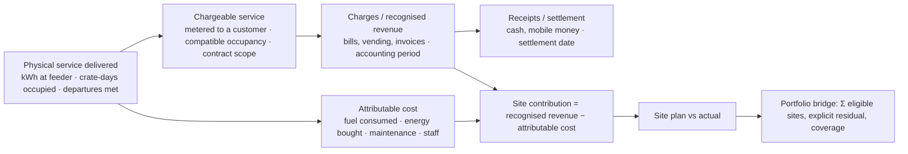

# Economic metric and effect contracts

**Layer 4 companion artifact 3 · AssetOps Architect (Claude) · 16 Nov 2026 · design only, nothing built**
Cross-referenced from the main document `layer4-transformation-design.md` §4. Figures are **illustrative** and come from `demo-site-scenario-manifest.yaml`; `check_manifest.py` proves they reconcile to the cent (73 checks).

Labels used: **[code-observed]** read in code at `fe2392899` · **[test-confirmed]** pinned by a named test · **[implementation-report]** stated by the reviewed baseline document only · **[proposed]** this design · **[research]** industry source from the brief · **[assumption]** to validate with a pilot.

---

## 1. Why AssetEcon needs an economic truth model at all

Today every money figure in the product is an estimate built from a declared price: estimated income is measured kWh × declared tariff, fuel exposure is a modelled upper bound, verified value is a modelled post-trial change. `recorded_amount@1` exists but "always returns NO_RECORDS because no billing source exists" (`chain/strategies/recorded_amount.py:1`) [code-observed]. Five catalogue outcomes are permanently "not connected yet": MG-6 Cash collected, MG-3 Site profitability, EV-6 Energy billed against metered, CC-2 Paid cold-room use, CC-4 Market value of produce (`outcomes/catalogue.py:45-62`) [code-observed]. A CFO therefore cannot ask the product "why are we off plan?" — there is no plan in money and no actual in money.

The design does not replace the estimates. It adds the missing layer under them: a reconstruction of the operator's economic reality from source records, phase by phase, so that estimates, exposures and verified effects can be placed next to actuals **without being added to them**.

## 2. The phases from physical service to portfolio contribution

A kilowatt-hour, a crate-day or a completed departure becomes money only by passing through distinct phases. Each phase has its own source, its own clock and its own reasons for loss. Collapsing them is the most common way a dashboard misleads.

| Phase | Mini-grid (billed electricity) | Cold room (pay-as-you-store) | EV depot, captive fleet | EV depot, commercial operator |
|---|---|---|---|---|
| Physical service | kWh delivered at feeder | crate-days occupied | required departures met | kWh delivered in sessions |
| Chargeable service | kWh metered to identified customers, after expected technical loss | crate-days of compatible stored batches under a rate | **not applicable** (no customer) | sessions under a contract or tariff |
| Recognised revenue | billed charges in the accounting period, net of authorised adjustments | invoiced storage and handling | **none** (cost centre) | invoiced session fees |
| Settlement | receipts and mobile-money settlement dates | receipts | — | receipts |
| Attributable cost | fuel consumed (dips + deliveries), O&M, staff | electricity, maintenance, staff, customer compensation | electricity energy + demand charges, maintenance, penalties | same as captive |
| Contribution | revenue − cost | revenue − cost | **cost per completed departure** (no contribution) | revenue − cost |

The common financial composition contract (§6) carries all four columns. What changes per business model is which phases exist, not how a phase is computed. A captive EV fleet has no revenue phase; the contract marks it `NOT_APPLICABLE`, never zero, and the executive measure becomes cost per required departure met [proposed].

## 3. Worked reconciliation — Lakeside Power, October 2026 (illustrative)

### 3.1 Mto: energy to cash

| Step | kWh | USD | Evidence class | What explains the step |
|---|---:|---:|---|---|
| Delivered at feeder | 6,000 | | OPERATIONAL_ACTUAL | feeder meter |
| Expected technical loss (5% band) | −300 | | DERIVED | declared loss band [assumption] |
| Unexplained after expected loss | −120 | not priced | DERIVED | investigate; never "theft", never collectible |
| Metered to customers | 5,580 | | OPERATIONAL_ACTUAL | customer meters |
| Unbilled: meter swap on 3 Oct not applied to 6 customers | −140 | (56.00 chargeable) | ECONOMIC_ACTUAL (correctable charge) | effective-dated meter register |
| Authorised adjustment (clinic allowance) | −40 | (16.00) | ECONOMIC_ACTUAL | approved adjustment |
| **Billed** | **5,400** | **2,160.00** | ECONOMIC_ACTUAL | 5,400 × 0.40 |
| Collected in October | | 1,890.00 | ECONOMIC_ACTUAL | receipts |
| Paid 30–31 Oct, settled 2 Nov | | 150.00 | ECONOMIC_ACTUAL (in transit) | settlement statement |
| Outstanding | | 120.00 | ECONOMIC_ACTUAL (receivable) | ledger |
| Check | | 1,890 + 150 + 120 = **2,160.00** ✓ | | |

Three things this table refuses to do: price the 120 unexplained kWh; treat the 56.00 unbilled charge as cash (it becomes a charge when the mapping is fixed, and cash only when collected); or count the 150.00 in transit as a collection shortfall.

### 3.2 Site contribution and the portfolio bridge

| Site | Plan contribution | Actual contribution | Variance |
|---|---:|---:|---:|
| Kobo | 1,445.00 | 883.00 | −562.00 |
| Kisiwa | −65.00 | −250.00 | −185.00 |
| Mto | 915.00 | 810.00 | −105.00 |
| **Portfolio** | **2,295.00** | **1,443.00** | **−852.00** |

Kobo actual: revenue 8,645 kWh × 0.40 = 3,458.00 − diesel 1,180 L × 1.25 = 1,475.00 − O&M 600.00 − staff 500.00 = 883.00.

The variance is decomposed into **non-overlapping drivers**. Every driver belongs to exactly one overlap group (site × period × money line); within a group the drivers sum to the line's variance, and an explicit residual closes the gap.

| Site | Driver | Overlap group | Amount | Class | Basis |
|---|---|---|---:|---|---|
| Kobo | Demand volume | KOBO-2026-10-REV | +38.00 | ECONOMIC_ACTUAL | 95 kWh × 0.40 |
| Kobo | Generator stop policy: avoidable share | KOBO-2026-10-FUEL | −262.50 | MODELLED | 210 L × 1.25, forward replay |
| Kobo | Generator stop policy: constrained share | KOBO-2026-10-FUEL | −150.00 | MODELLED | 120 L × 1.25 |
| Kobo | Evening load growth | KOBO-2026-10-FUEL | −37.50 | MODELLED | 30 L × 1.25 |
| Kobo | **Unexplained fuel residual** | KOBO-2026-10-FUEL | −150.00 | DERIVED | 120 L consumed beyond model |
| Kisiwa | Demand volume | KIS-2026-10-REV | −55.00 | ECONOMIC_ACTUAL | 100 kWh × 0.55 |
| Kisiwa | Solar shortfall → necessary generation | KIS-2026-10-FUEL | −104.00 | MODELLED | 80 L × 1.30 |
| Kisiwa | Unexplained residual (inside 2% tolerance) | KIS-2026-10-FUEL | −26.00 | DERIVED | 20 L × 1.30 |
| Mto | Demand volume | MTO-2026-10-REV | −8.00 | ECONOMIC_ACTUAL | 20 kWh × 0.40 |
| Mto | Meter mapping not applied | MTO-2026-10-REV | −56.00 | ECONOMIC_ACTUAL | 140 kWh × 0.40 |
| Mto | Authorised adjustment | MTO-2026-10-REV | −16.00 | ECONOMIC_ACTUAL | 40 kWh × 0.40 |
| Mto | Evening necessary generation | MTO-2026-10-FUEL | −25.00 | MODELLED | 20 L × 1.25 |
| | **Total** | | **−852.00** | | equals the portfolio variance ✓ |

The fuel line shows why classes matter. The −600.00 Kobo fuel variance (480 L × 1.25) is an **economic actual**: the litres came from dips and delivery notes. The split of those litres into causes is **modelled**: it comes from dispatch classification and forward replay. The bridge therefore carries the line total as recorded and the split as modelled, and it never presents the 262.50 avoidable share as money already saved.

Coverage travels with the bridge: 91.5% of October portfolio cost (7,545.00 of 8,245.00) is from recorded invoices; Kisiwa's 700.00 O&M is the plan amount carried as ESTIMATED because the invoice has not arrived. An estimated line is shown, labelled, and counted in the coverage denominator. It is never shown as zero.

## 4. Computational mechanics

### 4.1 Periods and effective dating
- Every commercial record carries up to four instants: **service period** (when the kWh/crate-day/departure happened), **effective period** (when a tariff, contract term or meter mapping applies), **recognition period** (the accounting month a charge is booked), **settlement instant** (when cash arrives) [proposed].
- Site period economics are computed per site × recognition period × currency. A late record for a closed period creates a new **revision** of that period's economics; the earlier revision stays readable, and the UI states "revised on 4 Nov after a late delivery note" (manifest OOO-1). This follows the existing assessment-revision and succession patterns (`financials/assumptions.py` succession rules) [code-observed] rather than overwriting.
- Effective-dated mappings (meter → customer, serial → asset, tariff → site) are resolved at the service instant, never at load time. The Mto meter swap is the test (MAP-1).

### 4.2 Units, currency and comparability
- Money never crosses currencies without a declared conversion basis (rate, date rule, source). Unconverted amounts are listed, never summed — the existing Portfolio rule "mixed currency has no value but keeps the lines" (`test_ch6b_estate_chain.py::test_mixed_currency_has_no_value_but_keeps_the_lines`) [test-confirmed] is kept and extended to recorded amounts.
- Ratios are computed as Σ numerator / Σ denominator over eligible comparable sites, never as an average of site ratios (brief L1.2 invariant). Example: portfolio diesel cost per billed kWh = (1,475 + 3,120 + 400) / (8,645 + 7,400 + 5,400) = 4,995 / 21,445 = 0.2329 USD/kWh, not the mean of the three site ratios.
- A site whose denominator is unknown is **excluded and named**, and the ratio is marked partial.

### 4.3 Day and window handling
Today the Portfolio Optimize figure for a 7-day or 30-day window is one Finding's exposure from the window's last day (`site_outcomes/read.py:586`, `:901-924`) [implementation-report, baseline §5.2]. The design separates two quantities that the current card merges:
- **Exposure in window** = Σ over every Finding revision whose episode intersects the window, of the exposure attributable to the intersecting days, de-duplicated by overlap group (generator × day) [proposed];
- **Lead issue now** = the current lead Finding's exposure, labelled with its day.
Slice 1 of the delivery plan only relabels the existing figure honestly; the window sum arrives with `site_period_economics` (slice 2).

### 4.4 Opportunity value
Every decision option is valued on one identity:

> **Net effect over horizon H** = Σ_months (incremental recognised revenue − incremental attributable cost − costed trade-offs) − one-off cost, versus the **no-action** option over the same H, same accounting basis.

- Kobo stop-setting change: (262.50 − 12.00) × 12 − 90.00 = **2,916.00** [MODELLED]. 12.00/month is battery wear on 150 kWh of added throughput at 0.08 USD/kWh [assumption].
- Mto rice huller: (495.00 − 85.00 − 15.00) × 12 − 1,200.00 = **3,540.00** [MODELLED].
- Mto evening welding: 264.00 − 272.25 = **−8.25 per month** before connection cost; break-even tariff = 272.25 / 660 = 0.4125, rounded up to 0.42 [MODELLED].
- Kirinyaga repair: 0.80 × 970 kWh × 0.20 × 12 − 350.00 = **1,512.40**; replacement: (194.00 + 40.30) × 12 − 4,800.00 = **−1,988.40** [MODELLED].
- Embakasi deadline-aware schedule: (22,144.80 − 15,216.00) × 12 − 1,500.00 = **81,645.60** [MODELLED; tariff applicability is an assumption until the utility invoice confirms the time-of-use and demand-charge lines].

The gross upper bound produced today by fuel-cost-1/2 (0 … 1.10 × Σ P·h·SFC × price; `financials/fuel_cost.py:56-79`) [code-observed] stays visible as "upper bound of fuel at stake", next to — never instead of — the forward-feasible net value.

### 4.5 Estimate, actual, exposure, verified
These six classes are carried on every effect and never summed with one another:

| Class | Meaning | Example | May be summed with |
|---|---|---|---|
| ECONOMIC_ACTUAL | sourced revenue, expense, receipt, settlement | Mto billed 2,160.00 | same class, same currency, same period |
| OPERATIONAL_ACTUAL | physical quantity from telemetry or records | Kobo 1,180 L consumed | same unit |
| DERIVED | computed from actuals with stated method | Mwea energy within 0.6% of model | its own components only |
| MODELLED | counterfactual, forecast or forward replay | Kobo 2,916.00 over 12 months | other MODELLED effects in **distinct** overlap groups |
| EXPOSURE | value at stake, not a loss | B-1031 stock 2,160.00; BAT-001 cover 64,000.00; SLA credit 70.00 | never |
| VERIFIED | observed change under a frozen plan | (none yet in October) | VERIFIED of distinct overlap groups |

The existing labels already say this in words ("not billed or collected", "not a saving", "Modelled change after the trial · not realised savings") (`chain/vocabulary.py:298`, `:580`; `financials/trial_fuel_comparison.py:34`) [code-observed]. The design turns the words into a type that the composer enforces [proposed].

### 4.6 Competing benefits and the no-stacking rule
One physical change can show up in several places. If Mwea signs the aggregator contract, revenue rises by 810.00 a month **and** energy per crate-day falls from 0.1221 toward the network average. The second is a ratio effect of the first; it is not an extra saving. Rules:
1. **One overlap group, one money contribution.** Overlap group = (driver, site, period, money line). The composer refuses a second contribution to the same group.
2. **Ratio effects are reported, never priced.** Per-unit improvements caused by denominator growth carry `money: null`.
3. **Exposure and remedies sit outside the cash identity** until a recorded credit or receipt exists (§5).
4. **Verified replaces modelled, never adds to it.** When an option is verified, its VERIFIED effect supersedes its MODELLED effect in the same overlap group.

Today's code already refuses sums in several places (Optimize per-Site listing, verified value lines, unique credit keys: `test_ch5d1_optimize_card.py::test_two_priced_sites_list_each_and_never_sum`, `test_ch3_rows.py::test_recovered_value_fails_loud_on_two_items_with_one_key`) [test-confirmed]. It does not guard the same physical cost appearing as an MG-2 exposure and as an Assure credited value for the same period (baseline §5.4) [implementation-report]. Overlap groups close that gap.

### 4.7 Recompute on late or corrected data
A new commercial record revision, a new assessment revision or a new price succession marks the affected (site, period) dirty; `site_period_economics` recomputes that period only, writes a new revision with the triggering record cited, and leaves decisions that cited the old revision flagged "evidence changed since this was decided". This mirrors the existing recompute work rows (`financials/recompute.py`) [code-observed].

## 5. Contractual entitlements in money terms

A potential warranty or service credit is a **right**, not money. It changes who should pay for a repair, so it enters the decision as a property of an option. It enters the books only when a supplier credit note, replacement invoice or receipt is recorded.

### 5.1 Claim states and their economic meaning

| State | Meaning | Money effect |
|---|---|---|
| POTENTIAL | facts suggest a contract may apply | none (EXPOSURE only) |
| EVIDENCE_ASSEMBLED | serial, terms, maintenance log, fault record assembled | none |
| NOTIFIED | notice sent within the contract window | none; protects the right |
| ACKNOWLEDGED | counterparty confirms receipt | none |
| ACCEPTED / DENIED / DISPUTED | counterparty decision | none yet; DENIED moves the option to operator-funded |
| REMEDY_DELIVERED | part, repair or replacement performed | avoided operator cost becomes ECONOMIC_ACTUAL via the absence of an invoice and presence of the supplier work order |
| CREDIT_BOOKED | credit note recorded | ECONOMIC_ACTUAL (contra-expense) |
| CASH_RECEIVED | funds received | ECONOMIC_ACTUAL (receipt) |

The system never sets ACCEPTED, DENIED or DISPUTED itself; those are recorded from counterparty documents by a person. Legal interpretation is review-required [proposed; brief C0].

### 5.2 Operator residual cost

For a failure with repair paths p ∈ {supplier remedy, stopgap + claim, paid repair, replace, no action}:

> **Residual(p)** = operator-paid parts + labour + transport + deductible + downtime cost(p) + claim-process cost − (recorded credits, only once booked)

**Downtime cost** is service consequence × duration: extra fuel (Mto: 104 L ≈ 130.00 over 21 days at half inverter capacity), penalties where contractual (Kasarani 120.00 per missed block), stock protection cost (Thika rota 40.00 + labour 60.00).

| Case | Paths compared | Residual | Recommended | Why |
|---|---|---:|---|---|
| Mto inverter INV-MT-02, potentially covered | claim and wait: 150 + 80 + 130 | 360.00 | yes at budget 5,000 | cheapest; notice by 27 Nov |
| | buy now + claim failed unit: 2,600 + 80 + 150 + 80 | 2,910.00 | yes only if budget ≥ 6,430 and the cooperative will not extend | restores by 12 Nov and secures the huller letter of intent; the claimed unit becomes a spare **asset**, not cash |
| | open the unit locally | 450.00 + lost cover | rejected | voids warranty |
| Kisiwa genset GEN-KS-01, expired and excluded | repair | 1,800.00 | yes (must-do) | no cover; evening redundancy |
| Kisiwa O&M response, 96 h vs 48 h SLA | review credit | 70.00 EXPOSURE | flag for review | weather exclusion must be checked by a person |
| Kobo battery BAT-001, insufficient evidence | assemble evidence: test 250 + sensor 180 | 430.00 | yes | a claim filed now would fail; 64,000.00 is cover at risk, not money gained |
| Thika ATS, EPC covered and accepted | remedy + stopgap | 100.00 | yes | self-funding (710.00) voids cover |
| Thika stock damage, insurance | claim | 0 recorded | not filed | 108.00 loss below 500.00 deductible; notice sent to keep the right |
| Kasarani charger CH-K2, warranty + SLA | OEM remedy + bus moved to Ruiru | 90.00 | yes | waiting risks 240.00 more penalties; local repair voids cover |

### 5.3 One identity for mutually exclusive remedies
Remedy options for one failure share one overlap group. Only the chosen path's residual enters the plan; a supplier-paid repair, an insurance reimbursement and an operator payment for the **same expense** can never all appear: the composer checks that Σ recorded recoveries for an expense ≤ the expense, and refuses a second recovery record against an expense already fully recovered (negative test N5).

## 6. Typed contracts

### 6.1 `site_period_economics` revision [proposed]

| Field | Type | Rule |
|---|---|---|
| tenant_id, site_id | uuid | tenant isolation on every read |
| period | `YYYY-MM` recognition period | |
| revision, computed_at, inputs_digest | int, timestamptz, sha256 | new revision on any input change |
| business_model | enum MINI_GRID_BILLED, COLD_PAY_AS_YOU_STORE, EV_CAPTIVE, EV_COMMERCIAL | decides which lines are NOT_APPLICABLE |
| currency, fx_basis | ISO 4217, {rate, rule, source} or null | null only for single-currency sites |
| service_quantity | {value, unit: kWh / crate_day / departure} | OPERATIONAL_ACTUAL |
| lines[] | {line: REVENUE / FUEL / ENERGY / DEMAND / OM / STAFF / MAINTENANCE / LIABILITY / PENALTY, amount, coverage: RECORDED / ESTIMATED / MISSING / NOT_APPLICABLE, record_refs[]} | MISSING has amount null |
| contribution | amount or null | null if any non-NA line is MISSING; "at least" semantics never invented |
| plan | {lines[], contribution, plan_ref} | from PLAN_LINE records |
| variance | contribution − plan.contribution | |
| drivers[] | {driver_id, overlap_group, amount, class, basis_text, refs[]} | Σ drivers = variance exactly |
| coverage | {recorded_share, estimated_lines[], missing_lines[]} | |
| exclusions[] | {reason, refs[]} | named, never silent |

### 6.2 `effect` on a strategy result [proposed extension of `chain/strategies/base.py` Effect]

| Field | Type | Rule |
|---|---|---|
| direction | existing ADVERSE / FAVOURABLE / CHECK | unchanged |
| basis | existing RECORDED / MEASURED / DECLARED / MODELLED | unchanged |
| evidence_class | ECONOMIC_ACTUAL / OPERATIONAL_ACTUAL / DERIVED / MODELLED / EXPOSURE / VERIFIED | new; required |
| overlap_group | string `driver:site:period:line` | new; required when money is non-null |
| horizon | {start, end} or null | required for MODELLED |
| beneficiary | OPERATOR / CUSTOMER / SUPPLIER / INSURER | who gains or bears |
| assumptions[] | {key, value, source, label} | |
| audit | {model_id@version, inputs_digest} | |

### 6.3 `decision_option` economics [proposed]

| Field | Rule |
|---|---|
| option_id, decision_id, kind | kind ∈ NO_ACTION, CONFIG_TRIAL, REPAIR, CAPEX, DEMAND_CONNECTION, DEMAND_CONTRACT, SCHEDULE, CAPACITY_USE, COMMERCIAL_CORRECTION, INVESTIGATION, SUPPLIER_REMEDY, STOPGAP_PLUS_CLAIM |
| carrier_ref | the existing record that will carry execution (scenario revision, action proposal, domain action, work case, claim case) |
| one_off_cost, monthly_effects[], horizon_months, net_over_horizon | identity in §4.4 against the NO_ACTION option of the same decision |
| residual_cost | for repair/remedy options (§5.2) |
| safeguards[] | {policy, mode, result PASS/FAIL/UNKNOWN, cost_if_costed, evidence_refs} |
| disposition, reason | RECOMMENDED / ACCEPTABLE / CONDITIONAL / DEFERRED / REJECTED / INSUFFICIENT_EVIDENCE |
| sensitivity[] | {variable, value, resulting net} |
| outcome_links[] | outcome keys moved / checked (from the outcome map) |
| lever_ids[] | brief lever ids (traceability CSV) |

### 6.4 Acceptance tests for the contracts

| Id | Test | Expected |
|---|---|---|
| E1 | Bridge identity per site | Σ drivers = variance to the cent for all 9 manifest sites |
| E2 | Portfolio identity | Σ site variances = portfolio variance; −852.00 / −770.00 / −3,184.32 |
| E3 | Cash chain | collected + in transit + outstanding = billed (Kobo, Mto) |
| E4 | Ratio composition | portfolio diesel per billed kWh = 0.2329, not the mean of site ratios |
| E5 | Option identity | each option's net equals §4.4 recomputation from its monthly effects |
| E6 | No-action present | every decision has exactly one NO_ACTION option |

## 7. Negative accounting tests

| Id | Situation | Wrong behaviour to prevent | Expected behaviour |
|---|---|---|---|
| N1 Partial coverage | Kisiwa O&M invoice missing | O&M shown as 0; contribution overstated by 700 | line ESTIMATED, coverage 91.5%, contribution labelled "includes 1 estimated line" |
| N2 Currency mismatch | one Kisiwa expense invoiced in KES (FX-1) | KES amount added to USD | converted with declared basis shown, or listed unconverted and excluded from the total |
| N3 Late settlement | 150.00 paid 30–31 Oct, settled 2 Nov | shown as uncollected or as November revenue | October revenue unchanged; in transit on 31 Oct; collected on 2 Nov |
| N4 Overlap | Mwea contract raises revenue and lowers energy per crate-day | both priced and added | revenue priced; per-unit effect reported with money null |
| N5 Double recovery | Thika ATS remedy by EPC plus an insurance claim plus an operator invoice for the same controller | two recoveries against one expense | second recovery refused; Σ recoveries ≤ expense |
| N6 Remedy as revenue | Kisiwa 70.00 potential SLA credit | added to contribution or to "value found" | EXPOSURE, listed separately until a credit note is recorded |
| N7 Exposure as loss | B-1031 stock 2,160.00 exposed | shown as loss or liability | exposure; confirmed damage 108.00; liability 108.00 by contract |
| N8 Modelled as realised | Kobo 2,916.00 modelled | shown under "savings" | MODELLED; becomes VERIFIED only through the verification triple, and ECONOMIC_ACTUAL only through fuel records |
| N9 Last-day exposure | 30-day window, lead Finding on last day | presented as the period's avoidable cost | labelled with its day, or replaced by the window sum |
| N10 Captive revenue | Metro Bus Depots | charging income invented from kWh × tariff | revenue NOT_APPLICABLE; measure is cost per departure (31.19) |
| N11 Unknown as zero | unmapped meter, unknown denominator | treated as 0 | MISSING / excluded and named |
| N12 Gross as net | fuel-cost-1 upper bound 412.50 at Kobo | used as option value | upper bound shown as "fuel at stake"; option value 262.50 gross, 250.50 net per month |
