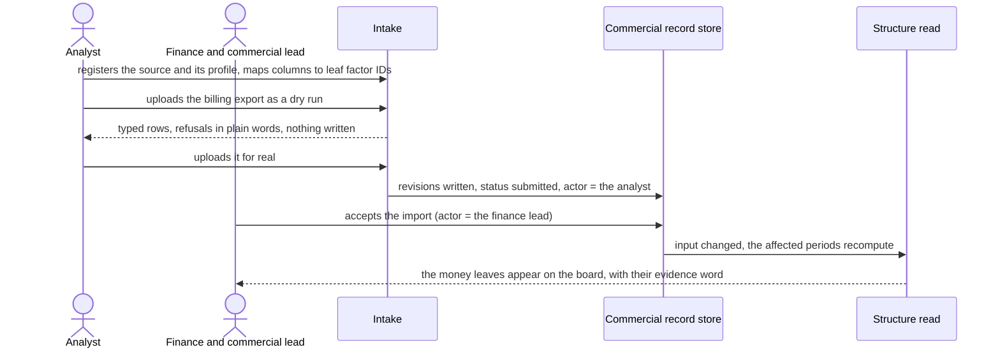

# Integration design: from source records to leaf factors

**AssetEcon Layer 4 · builder and analyst specification for B3 · recreated from the design rev 16.7 (with OD-12) · AssetOps Architect (Claude) · 19 Nov 2026**

This document specifies how the operator's commercial and operational records reach the factor structure: the canonical format, the stores, the emulators, the contract test, the path to a pilot adapter, and the tests. It replaces `integration-source-to-canonical-design.md` (regeneration F, #3). It adds detail beneath B3 and never a new construct, role, decision or figure.

*Serves the objective:* the executive's question spans revenue, cash, cost to serve and contracts, and today's product holds only telemetry and fuel. B3 fills that data gap through one canonical contract, so that during the deep-dive (D1) the operator's own exports show their target against actual within weeks.

## 1. What today's intake carries, and does well

<!--derives: §1.2; §1.5; L4; Part 1-->

Today's intake is built for telemetry and does that well. It stays as it is.

| Path | What it does | Done well | Evidence [code-observed] |
|---|---|---|---|
| Evidence ledger | Sealed batches of readings, with source, unit, quality, live or simulated flag and an envelope hash | Provenance on every reading; first write wins, and a changed payload is a conflict, so a device cannot rewrite its past | `0005_evidence_ledger.py:161-197`; `evidence/service.py:478-492` |
| Authenticated gateway batches | A registered gateway credential is bound to its Site; a mismatch is refused | Tenant and Site come from the credential, never the row | `evidence/ledger_service.py:194-211` |
| Field path | Modbus poller, edge gateway, upload to the batch route | Source-shaped telemetry on a bench | `field/assetops_field/modbus_poller.py:16-17`; `gateway/assetops_gateway/uploader.py:66` |
| Reading upload | CSV readings with a dry run, whole-file refusal in plain words, and a receipt | The right intake shape for files | `reading_upload/service.py:213`, `:244-248`; `0061`, `:10`, `:29-55` |
| Operational records | Fuel delivery notes and tank dips per tank, with a version chain and review state | Operator-entered physical facts | `0027_w4_work_cases.py:163-192`; `work/fuel_records.py:23` |
| Typed prices | Diesel price, tariff and productive price, entered by hand | Effective-dated, with succession and correction | `financials/assumptions.py:32-58` |

**Limit (L4).** No client calls any external system, and no store holds money records. Billing, collections, budgets, O&M and staff invoices, rosters and contracts are absent, so revenue, cash and contribution cannot be stated (`chain/strategies/recorded_amount.py:1-10`: "returns no money with NO_RECORDS, always").

## 2. Which facts each leaf needs

<!--derives: §2.3; §2.1; B3; WP §1.0-->

Each leaf factor needs one family of source records, and that sets the integration scope. The table follows the design's value-chain stages (design §2.3).

| Value-chain stage | Leaf factors it evidences (mini-grid · cold room · EV depot) | Source family | Held today? |
|---|---|---|---|
| Service delivered | delivered kWh; litres split by running class · chamber temperature, cooling minutes · delivered kWh per night, chargers in service | EMS, inverter, BMS and genset telemetry · chamber control unit, energy meter · CPMS or OCPP log, site meter | Yes, telemetry |
| Chargeable service | metered kWh by customer · occupied and chargeable crate-days · buses and required departures | meter register (meter ↔ customer) · storage ledger · fleet roster, session ↔ bus | No |
| Revenue and cash | billed kWh, tariff, collected, in transit, outstanding · rate, invoiced, received · not applicable for a captive fleet | billing or vending export; receipts and mobile-money settlements · invoices, receipts | No |
| Cost to serve, O&M | litres and diesel price; O&M; staff · electricity, maintenance, staff · energy by tariff interval, demand charge, maintenance | fuel notes and dips; O&M and staff invoices · electricity bills, service invoices · utility invoice with time-of-use lines | Fuel only |
| Budget | target and budget line per factor | monthly budget lines by Site | No |
| Contracts and rights | who bears a repair cost; notice deadlines | warranty, EPC, O&M and SLA, insurance documents; notices | No |

The minimum pilot asks per vertical are in `design-appendix.md` §5.

## 3. The canonical format, version 1, and the leaf factor IDs

<!--derives: §2.9; OD-9; B3; B1; Figure 10-->

Step 2 of the delivery order agrees the canonical format and the leaf factor IDs, a small step under W1 (OD-9). This section is the proposal for that step. The Architect's caution stands: this is version 1, to be revised under the contract test when the first operator sample is pinned (D1).

**Leaf factor IDs.** The starting set is the manifest's `factor_map`, per vertical, which the demonstration evaluator and the independent model already use. Examples: `candidate_l`, `unexplained_l`, `diesel_price`, `tariff`, `outstanding`, `om`, `staff` (mini-grid); `crate_days`, `rate`, `elec_price` (cold room); `chargers_in_service`, `peak_price`, `demand_rate` (EV depot). Each becomes a `factor_id` in the registry (`decision-loop-specification.md` §3). An ID is never reused for another quantity.

**Canonical record** (*proposed*: `commercial_record`, one per source record; `commercial_record_revision`, append-only).

| Field | Rule |
|---|---|
| Identity | tenant, Site (portfolio-level for a budget line that is not per Site), kind, source system, source record ID; unique per (tenant, source system, source record ID) |
| Revision | revision number, source version, the intake receipt, raw row text and its digest, parser and profile versions |
| Clocks | occurred, effective from and to, recognition period, settled. Each is null where it does not apply |
| Amount | exact decimal text, ISO currency, quantity, unit |
| Subject | customer, meter, batch, vehicle, asset or Site, as a pseudonymised reference |
| Quality | Good or Suspect, with reasons. A refused row goes to a rejection row, never into the store |
| Evidence word | *Recorded* for the operator's own records; *Emulated* for an emulator's output (D14) |
| Review | for kinds that need it: submitted, accepted or rejected, with the person and time, as operational records already do (`0027_w4_work_cases.py:174`) |

**Kinds**, one per source family of §2. Figure 4 shows the four money kinds; the others serve the same stages.

| Kind | Feeds | Reviewed by a person before it counts? |
|---|---|---|
| CHARGE | billed kWh, revenue; utility energy and demand cost | Accepted with its import |
| RECEIPT (receipts and settlements) | collected, in transit, outstanding | Accepted with its import |
| EXPENSE | O&M, staff, repair and fuel cost lines; an item's incurred spend; a quote's one-off cost | Accepted with its import |
| BUDGET_LINE and target lines | the target side of each factor (B2) | Accepted with its import, which records the declarer |
| METER_ASSIGNMENT | meter ↔ customer, effective-dated | Accepted with its import |
| STORAGE_MOVEMENT | occupied and chargeable crate-days | Accepted with its import |
| FLEET_ROSTER | required departures; session ↔ bus | Accepted with its import |
| CONTRACT_DOCUMENT and its extracted rows | who bears a repair cost; notice deadlines | Every extracted row, one by one |

**Effective-dated identity.** Assignments (meter to customer, tag to bus, serial to asset, tariff schedule to Site) are half-open periods with no overlap per subject, using the succession and correction rule typed prices already follow (`financials/assumptions.py:32-58`). Correcting a past assignment needs a reason and recomputes every period it touches.

## 4. Stores, by the nature of the fact

<!--derives: §2.3; B3; Figure 4; Rules-->

Each fact lives in the store whose shape and life already fit it. One new store is added, only for facts no existing store can hold.

| Fact | Store | Why |
|---|---|---|
| Telemetry, device events, charger logs | Evidence ledger (stays) | First write wins is right for a device that does not correct its past |
| Fuel deliveries, dips, manual readings | Operational records (stay) | Version chain, review state, occurred and recorded time |
| Charges, receipts, expenses, budget and target lines, assignments, storage movements, rosters, contracts | **Commercial record store (new)** | Money records arrive in bulk, are corrected by their source, and carry currency and effective periods |
| Factor values, outcomes, bridges | Not stored as totals | Computed on read from leaves (`chain/period_read.py:139`) |

**Named change (design §2.3).** The commercial store is separate because today's intake is first-write-wins and refuses late intervals (`evidence/service.py:484-492`; `reading_upload/service.py:244-248`). That suits telemetry and does not suit bills. A late record appends a revision and revises the closed periods it touches, which then recompute.

**What is reused from today's intake.** The dry run that writes nothing; the size limit and receipt; the append-only trigger; per-row refusal that never sinks its siblings; tenant and Site from the credential (`evidence/ledger_service.py:194-211`). Money records enter only on the authenticated, Site-bound path. The unauthenticated legacy batch path (`evidence_api.py:201-204`) never accepts them.

**Cached reads.** Every new table that feeds a cached route registers an input-change trigger, as today's cached responses require (`0047`), or the boards go stale silently.

## 5. Emulators and the contract test

<!--derives: §2.3; D14; Figure 4; Figure 10; owner: .agent/owner-grounded-transition-request-2026-11-18.md-->

**What an emulator is** (owner, 18 Nov, verbatim): "the emulator is a palcehodler that should be replaced by real integration , it jsut defines a practical canonical  data to use downstream". It writes native-shape files through the same adapter an operator's export uses (Figure 4).

**Its rules.**
- It may encode only what a real source of its type provides: the required fields, in native shape and units, with realistic disorder, with values derived from the manifest.
- It may not encode what a real source lacks: no factor IDs, classifications, attributions, option effects, verdicts or typed figures inside records.
- Its output is labelled *Emulated* wherever a real record would read *Recorded*, and is never counted as benefit (D14). Nothing downstream branches on the label except the label itself, coverage and the benefit gate.

**The contract test.** One suite per source type runs against both the emulator and every real adapter: on the emulator's output and on the operator's pinned sample. It checks kinds, required fields, units, clocks, the identity key, disorder handling and plain-word refusals, and that the same logical content gives the same canonical records and the same factor values. A real adapter is admitted only when it passes. A change the suite rejects is a contract change, decided by the Architect.

**Order (lane 3A, Figure 10).** Billing, collections, fuel purchases and budget are emulated first, then the contract test runs on all of them. At the join (step 4) the money leaves appear: contribution, cost to serve and collections. For Kobo that includes the 278.00<!--fig:sites.lakeside-power/Kobo.actual.nodes.outstanding--> of collections outstanding, labelled *Emulated*.

**Who.** The analyst onboards each source and maps it to factors. The finance and commercial lead accepts imported records. The system validates, records and recomputes. It accepts nothing on a person's behalf.

*A record import, from mapping to acceptance. The analyst maps and uploads; the finance and commercial lead accepts; only accepted records count. Each step carries its person.*

## 6. From emulator to pilot adapter

<!--derives: §2.3; D1; D14; DA §5; §2.9-->

An adapter has three parts: **transport** (how bytes arrive), **parser** (bytes to typed rows, pure) and **profile** (columns, units, timezone, mutability, personal-data fields). The field package already separates them: profiles are data files (`field/profiles/`), and the poller reads but never uploads (`field/assetops_field/modbus_poller.py:16-17`).

| Stage | Transport | Profile | Evidence word |
|---|---|---|---|
| Demonstration | Emulator writes native-shape files into the authenticated intake | the source type's illustrative profile | *Emulated* |
| Deep-dive and pilot | The operator's export, uploaded or dropped on a schedule | the operator's pinned profile | *Recorded* |

Only transport and profile change. The parser, canonical records, observers and structure do not.

**Pilot gate.** One closed month is reconciled against the operator's management accounts, on revenue and on fuel or energy cost, before any money is shown as Recorded. Until then the money leaves carry their provenance.

**Order of replacement** (D1). The first mini-grid deep-dive's exported files (billing, collections, budget, fuel, quotes); then that operator's contract set; then scheduled drops in the pilot; then the second vertical's files. An interface to the operator's system replaces only the transport, and only with contractual access. A replaced emulator stays as the contract test's fixture.

**The pilot asks** per vertical are in `design-appendix.md` §5.

## 7. Personal data and source permissions

<!--derives: §2.3; §2.6; Rules-->

- No source is connected without the operator's contractual right to share it, and a signed data-processing agreement naming the hosting location precedes any per-customer intake.
- Customer, meter, payer and driver references are pseudonymised at intake with a per-tenant keyed hash. Names, phone numbers and addresses are dropped before storage, per the profile. The raw file sits in an access-restricted store.
- Each source is registered per tenant with its profile. An unregistered source is refused.
- Reads follow the roles (`decision-loop-specification.md` §8). Everyone sees factor values and counts. Customer-level rows and contract documents are shown only to the roles that work with them: the finance and commercial lead and the analyst.

## 8. Disorder and isolation tests

<!--derives: §2.3; Rules; D14; B3-->

Each test is a question that must answer yes on the emulated fixture before any pilot profile is pinned. The first eight are the manifest's `disorder_tests` and keep their IDs.

| ID | Question |
|---|---|
| DUP-1 | Re-uploading an identical billing file adds no revision and says the file is already recorded? |
| OOO-1 | A fuel delivery note entered days late for October appends a revision, keeps the first, and the bridge still sums to its gap? |
| LATE-SETTLE-1 | Payments settled after the month end show as in transit at month end and collected later, with revenue unchanged? |
| MAP-1 | After a meter swap, kWh from re-pointed meters land on the unmapped factor, not on loss? |
| FX-1 | An expense in another currency is converted at the declared rate with its basis shown, and never summed unconverted? |
| GAP-1 | A missing O&M invoice leaves the node partial with the record named, never zero, and the coverage reduced? |
| TENANT-1 | A row carrying another tenant's key is refused, with nothing written and nothing readable across tenants? |
| CLOCK-1 | A charger clock that runs fast is corrected, its readings marked Suspect, and the offset shown? |
| CONF-1 | A settlement row changed under the same source version is refused as a conflict, with the original kept? |
| LATE-1 | A re-issued invoice creates a new revision; the affected periods recompute; an earlier decision keeps its citation and is flagged? |
| EXT-1 | An extracted contract row with no page reference cannot be accepted? |
| REC-1 | A second recovery for the same expense (a supplier credit and an insurance payment) is refused? |
| PII-1 | A phone-number column is dropped at intake, per the profile? |
| SRC-1 | An upload from an unregistered source, or through the unauthenticated legacy path, is refused with nothing written? |
| EMU-1 | No total marked as realised or saved includes an emulated record? |
| REV-1 | A record the finance lead has not accepted never reaches a money leaf? |

## 9. Open questions

<!--derives: Decisions; §2.3; §2.6; D9-->

| Question | Context | Default |
|---|---|---|
| Who accepts imports when the finance and commercial lead is absent? | The design gives acceptance to that role alone (§2.6) | No one else; imports wait. A second accepting role would need the design first |
| Retention of raw files | Raw files hold personal data | Operator-configurable, with a default set in the data-processing agreement |
| Contract extraction posture (D9) | Pending with the owner | AI-assisted, a person approves every row (`decisions-register.md` §5) |
