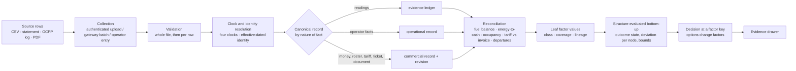
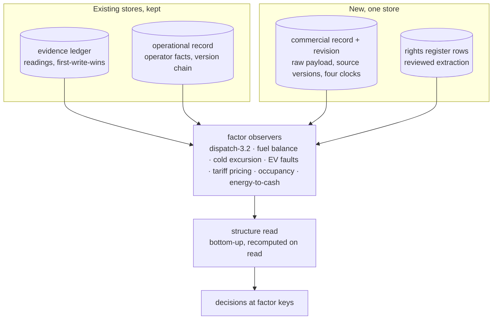

# Integrations needed: from source facts to leaf factors to outcome state

**AssetEcon · Layer 4 companion to the main design (brief Part VI, Deliverable 3) · rev 9 (redesign) · AssetOps Architect (Claude) · 17 Nov 2026**
**Status:** design only. Nothing here exists in the repository unless it is labelled [code-observed] or [test-confirmed]. No code, test, database or mock-up was changed or run for this document.

**Labels.** [code-observed] read in current code (backend, frontend, simulator and tools are unchanged since `bf6014e02`) · [test-confirmed] pinned by a named product test · [implementation-report] stated only by the reviewed baseline (`.agent/decision-intelligence-mechanism-2026-11-14.html`) · [proposed] this design · [research] external protocol or law · [assumption] a value or behaviour a pilot must confirm. **Provenance** of every record is one of *demo-simulated* (simulator pack), *source-emulated* (a generator that emits the source's native shape), *bench-tested* (a real device or export on a bench), *field-integrated* (a live operator source), *observed-financial* (the operator's own ledger, bill or statement). Simulated and observed values never share a number.

**Figures.** Every quantity, date and amount comes from `demo-site-scenario-manifest.yaml` (rev 4) and is **illustrative**. Where a source row needs a value the manifest does not fix (how Mto's 140 kWh splits over six customers, the size of Kobo's late delivery), the value is marked [assumption] and always sums to the manifest total.

**Paths.** Code paths are relative to `backend/assetops_backend/` unless they start with `field/`, `gateway/`, `contracts/`, `host/` or `tools/`. Migrations in `backend/migrations/versions/` are shortened to `00NN:line`.

**What this document does not promise.** No provider API access is assumed for any vendor. No contract clause is interpreted as a legal conclusion. AssetEcon does not become a billing system, a contract-lifecycle tool or a claims administrator (brief L2.7); it reads their outputs.

---

## 0. The mechanism this document serves, in one paragraph

Every outcome AssetEcon shows is a **declared structure of factors**: identities (contribution = revenue − cost to serve), products (revenue = billed kWh × tariff; fuel cost = litres × price), value-chain stage relations (billed = metered − unmapped − authorised adjustments), physical sub-structures (generator litres = necessary + candidate-avoidable + candidate-constrained + unexplained; refrigeration kWh = base + k × crate-days; deliverable charging energy = chargers in service × power × window, capped by the import limit) and composition (portfolio = Σ eligible sites). The structure ends in **leaf factors**, and each leaf factor is observable only from particular source facts. The system observes the leaves, evaluates the structure bottom-up, and the outcome's state, including any deviation from plan or any obligation bound at risk, is *read off the structure*; it is never entered (main design §2.1 M1 Define and §2.2 M2 Observe; brief L1.1 objective definitions, the unit hierarchy, L1.2 invariants, S1, S2). Options change factors and the same structure carries the change to the outcome (M3 Evaluate; brief L2 causal pathways, S4); after a change the same factors are observed again (M5 Prove; brief S8). Each factor carries a shared factor ID and period ID (brief, "shared driver IDs and period IDs"; main design §2.1), which is what the canonical records below resolve to.

So the integration question is exact: **which source fact fills which leaf factor, through which canonical record**. A leaf that no source fills is a hole in the structure: the nodes above it are *not available*, or carry an explicit residual, never zero. That is how this document is organised. Section 1 walks the leaf factors of each vertical's outcome structures and says what fills them today and what must be integrated. Section 2 explains the four clocks, and why factors observed continuously show a problem before the month's money closes. Section 3 traces real-looking records from source to outcome state to decision to evidence drawer. Sections 4 to 8 give the store decisions, recipes, contracts, pilot path and tests.

---

## 1. Why each leaf factor needs particular facts

This section answers the brief's first instruction for Deliverable 3, "why each vertical decision requires particular physical, commercial, contractual and financial facts", by walking the leaf factors that the structures of main design §3.1a end in. Each vertical below starts with its outcome structure (manifest `chain_model`; brief R1–R3 economic anatomy, L1.2), then a table of leaf factors in value-chain order: capacity, service, chargeable service, revenue, cash, cost lines, plan, obligations (bounds on factors), rights (who bears a cost), and option inputs (latent factors that exist only as options). For every leaf it states the outcome nodes it feeds, the source fact that fills it, the canonical record, whether a store or path exists today, and the integration needed.

A recurring point: a leaf factor needs a fact of a specific **kind**. Physical facts (what the plant did) come from telemetry or operational records; commercial facts (what was charged, paid, settled) from billing and payment exports; contractual facts (what a counterparty owes or excludes) from documents; plan facts (what the operator intended) from the budget. One kind cannot stand in for another: energy is never turned into revenue without a charge record, revenue never into cash without a receipt (main design, refusal rule of M1).

### 1.1 Mini-grid (Lakeside Power: Kobo, Kisiwa, Mto)

**Structure.**
```text
contribution = revenue − cost_to_serve                                     (per site, period; portfolio = Σ sites)
  revenue          = Σ_class billed_kwh × tariff
    billed_kwh     = metered_kwh − unmapped_kwh − authorised_adjustment_kwh
    metered_kwh    = delivered_kwh − expected_technical_loss − unexplained_loss
  cash: revenue    = collected + in_transit + outstanding
  cost_to_serve    = fuel_cost + om_cost + staff_cost
    fuel_cost      = litres_consumed × diesel_price
      litres_consumed = opening_dip + deliveries − closing_dip
      litres_consumed = necessary + candidate_avoidable + candidate_constrained + unexplained   (physical sub-structure)
bounds: battery SOC at 05:00 ≥ 35 % · clinic load served 24/7 · evening supply has a running genset with redundancy
        · lowest SOC ≥ 10 %, cell temperature ≤ 45 °C (battery warranty operating limits)
```
Lakeside October, evaluated on observed factors: delivered 23,050 → metered 21,700 → billed 21,445 kWh → revenue 9,688.00 → collected 8,870.00 + in transit 150.00 + outstanding 668.00; cost to serve 8,245.00; contribution 1,443.00 against 2,295.00 evaluated on plan factors.

| Place in the structure | Leaf factor | Feeds | Source fact | Canonical record (store) | Exists today? | Integration needed |
|---|---|---|---|---|---|---|
| Capacity | PV available power, PCS discharge capability, genset in service | usable supply by hour; headroom; dawn bound | EMS/inverter/BMS/genset registers | accepted reading of roles `pv_available_power`, `pcs_discharge_capability`, `generator_state` (`sites/binding_roles.py:91-107`) | **yes** [code-observed]: evidence ledger via field poller and gateway | none for the demo; pilot pins a real register profile |
| Service | delivered kWh | metered, loss, energy-to-cash | feeder meter / EMS energy | `feeder_demand` readings (`binding_roles.py:93`), integrated to kWh | **yes** [code-observed] | none |
| Service | expected technical loss | metered | declared loss band per site (Mto 300 of 6,000) | site configuration [proposed declared property] | no | declared property with effective dates |
| Chargeable | metered kWh per customer meter | metered, unexplained loss | meter-data or vending export (read per meter per period) | commercial record `CUSTOMER_METER_READ` | **no** | billing/vending export intake |
| Chargeable | meter → customer assignment | unmapped kWh | meter register with valid-from/valid-to | effective-dated identity history | **no** | register intake; identity history |
| Chargeable | authorised adjustments | billed kWh | billing adjustment codes, approval | commercial record `ADJUSTMENT` | **no** | billing export intake; code list per operator |
| Revenue | billed kWh, tariff by class | revenue | billing export; tariff schedule | `CHARGE`; `TARIFF_SCHEDULE` | **no**: `recorded_amount@1` returns NO_RECORDS always (`chain/strategies/recorded_amount.py:1`) [code-observed] | billing intake; `recorded_amount@2` reads charge revisions |
| Cash | collected, in transit, outstanding | cash | receipts; mobile-money settlement statement | `RECEIPT`, `SETTLEMENT` | **no** | statement intake (CSV), no provider API |
| Cost: fuel | deliveries, opening and closing dips | litres consumed | delivery notes, dip log | operational records `FUEL_DELIVERY`, `TANK_DIP` (`0054`) | **yes** [code-observed] | none; month-level balance is new |
| Cost: fuel | diesel price | fuel cost | supplier invoice; declared price | declared price exists (`financials/assumptions.py`); invoice → `EXPENSE` | partly | invoice intake for the recorded price |
| Cost: fuel | necessary / candidate split; modelled litres | physical sub-structure; unexplained litres | generator, PV-available, load, SOC telemetry | factor observer dispatch-3.2; forward replay | dispatch-3.2 **yes** [test-confirmed, baseline §3.11]; replay **new** | forward replay adapter (main design §8.4) |
| Cost: O&M, staff | O&M and staff cost | cost to serve | service invoices; payroll summary | `EXPENSE` | **no** | invoice intake; missing invoice → ESTIMATED (Kisiwa O&M 700) |
| Plan | planned billed kWh, tariff, litres, price, O&M, staff | every node evaluated on plan | monthly budget spreadsheet | `PLAN_LINE` at factor level | **no** (objectives are operational targets, not money plans) | plan intake |
| Obligations | dawn SOC, clinic load served, gensets in service | bounds checked on actual and counterfactual | `battery_soc`, `critical_load_delivered_power`, `generator_state` | readings; bound rows declared per site | readings **yes**; critical-load priority exists as a site control (`sites/models.py:513`) [code-observed]; bound rows **new** | obligation policy rows |
| Obligations | battery cell temperature | warranty operating limit | BMS temperature register | a reading of a temperature role | **no role exists** (no battery temperature in `binding_roles.py`; withheld input `ACCEPTED_BATTERY_TEMPERATURE_HISTORY`, `sites/battery_boundary.py:28-30`) [code-observed] | add the role; Kobo needs a sensor (BAT-EVIDENCE) |
| Rights | cost bearer per remedy path (INV-MT-02, GEN-KS-01, BAT-001, Kisiwa O&M SLA) | residual cost of repair options | warranty and O&M contracts; asset serials and commissioning; fault log; run hours; service log; tickets | rights register rows from reviewed extraction; `SERVICE_TICKET`; claim events | **no** (warranty appears only as a withheld field, `sites/battery_boundary.py:26`) [code-observed] | document intake, reviewed extraction, supplier-claim work case |
| Option inputs | latent demand (huller 15 kW 10:00–15:00, 22 days; welder 10 kW evening) | revenue and fuel of a counterfactual | signed letter of intent; enquiry note; productive tariff | `CONTRACT_DOCUMENT`; `TARIFF_SCHEDULE` | **no** | document intake; headroom alone stays capacity |
| Option inputs | quotes (repair 1,800, replace 9,500, battery 28,000, connection 1,200) | one-off cost of options | supplier quotes | `EXPENSE` status QUOTE | **no** | quote upload |

**Why these, decision by decision.** Kobo's fuel node is observed only when deliveries and dips (operational records, existing) meet the price (invoice) and the plan (budget); dispatch-3.2 then splits the litres into observed sub-factors — necessary, candidate (330 L) and not explained by the generator model (120 L). How much of the candidate running each option avoids (210 L for the stop-threshold change, 20 L for the reserve change) is computed by the forward replay as that option's effect, which is what tells KOB-STOPSOC from KOB-RESERVE. Without the deliveries the unexplained 120 L cannot be stated; without the plan nothing is "off plan". Kisiwa is the negative control because its observed sub-factors put every generator interval in *necessary*; its repair decision needs the evening-supply bound (genset in service) and two quotes, and its rights factor needs the Kestrel warranty end (30 Jun 2026) and the service log (1,000-hour service MISSING at 1,240 run hours). Mto's revenue node cannot be explained from telemetry at all: the unmapped 140 kWh appears only when the meter register's effective dates meet the customer meter reads and the billing export.

### 1.2 Cold rooms, pay-as-you-store (Harvest Cold: Mwea, Thika, Kirinyaga)

**Structure.**
```text
contribution = revenue − (energy_cost + staff + maintenance + liability)
  revenue            = chargeable_crate_days × rate
    chargeable       = occupied_crate_days − incompatible_or_unbilled
    occupied         = Σ_batches crates × days present in period        (presence: in_at ≤ t < out_at)
    idle capacity    = capacity_crate_days − occupied                    (400 crates × 31 days = 12,400 per room)
  energy_cost        = kWh × electricity_price
    kWh              = (1,550 + 0.25 × occupied) × ambient correction + efficiency deviation   (physical sub-structure)
  liability          = Σ QA-confirmed damage on batches the contract makes the operator's
    exposure (not money) = Σ present batches above their limit × declared value
bounds: chamber 2–4 °C policy band · each batch ≤ its commodity limit (French beans 5 °C, avocado 12 °C)
```
Harvest Cold October: occupied 22,940 of 37,200 crate-days (plan 26,040), revenue 4,588.00, cost to serve 3,642.00, contribution 946.00 against 1,716.00.

| Place in the structure | Leaf factor | Feeds | Source fact | Canonical record (store) | Exists today? | Integration needed |
|---|---|---|---|---|---|---|
| Capacity | crates per room (400) | idle capacity | site configuration | declared property | partly (cold Foundation exists) | capacity in crates, declared |
| Service | batch presence intervals, crates, commodity | occupied crate-days; exposure | storage ledger check-in/out | `STORAGE_MOVEMENT` | **no** | storage ledger export intake |
| Chargeable | paying contract and rate per batch; compatibility | chargeable crate-days; revenue | rate card, customer contracts, invoices | `CONTRACT_DOCUMENT`, `CHARGE` | **no** | invoice intake; rate card as a reviewed document |
| Revenue, cash | charges, receipts | revenue, cash | invoices, receipts | `CHARGE`, `RECEIPT` | **no** | intake |
| Cost: energy | room kWh, electricity price | energy cost | electricity bill (monthly); meter | `CHARGE` on the utility bill; `compressor_power` readings | bill **no**; compressor power role **yes** (`binding_roles.py:165`), but no room energy-meter role [code-observed] | bill intake; optional meter role |
| Cost: energy | ambient temperature | normalisation | ambient sensor or weather series | `ambient_temperature` readings (`binding_roles.py:188`) | **yes** [code-observed] | none |
| Cost: staff, maintenance | staff, service invoices | cost to serve | invoices | `EXPENSE` | **no** | intake; Thika's October service invoice missing → ESTIMATED |
| Cost: liability | QA-confirmed damage; compensation rule; credit note | liability line | QA note; customer contract clause; credit note CN-0412 | operational record `QA_INSPECTION` [proposed kind]; rights register row; `ADJUSTMENT` | **no** | QA form; credit note intake |
| Plan | planned crate-days, rate, kWh, staff, maintenance | plan evaluation | budget | `PLAN_LINE` | **no** | plan intake |
| Obligations | chamber temperature; grid and backup events; transfer | batch bound; exposure | chamber probe, controller events | `chamber_temperature`, `grid_power_event`, `backup_start_event`, `transfer_result` (`binding_roles.py:152-183`) | **yes** [code-observed]; cold excursion analysis is the factor observer | none; commodity limits come from the contract |
| Rights | cost bearer for the backup start controller; insurance deductible | residual cost of the Thika options | EPC workmanship warranty (CoolBuild); quarterly backup test log; goods-in-custody policy | rights register; maintenance records; claim events | **no** | documents, reviewed extraction, supplier-claim case |
| Option inputs | draft aggregator contract (150 crates Dec–Mar at 0.18); curtain cost; repair and replacement quotes | counterfactual occupancy, revenue, cost | draft contract; quotes | `CONTRACT_DOCUMENT`; `EXPENSE` QUOTE | **no** | intake |

**Why these.** The cold room earns per crate-day, so its revenue factor is paid occupancy, which only the storage ledger observes. Mwea's high energy cost per crate-day (0.1221) and Kirinyaga's lower one (0.1008) look like the same kind of problem until the structure is evaluated: Mwea's kWh sits within 0.6% of the occupancy model (2,650 against 2,635) and its occupancy factor is 35% against 60%; Kirinyaga's occupancy is on plan and its efficiency factor is 970 kWh (24%) above model. Both conclusions need the ledger and the bill. Thika's liability factor needs four sources on one clock: chamber readings, the ledger (which batches were present), the QA note (what was damaged) and the customer contract (whose cost it is). Exposure, damage and liability are three different factors (§3.3).

### 1.3 EV depots, captive fleet (Metro Bus: Embakasi, Kasarani, Ruiru)

**Structure.**
```text
cost_per_departure_met = (energy_cost + demand_cost + maintenance + penalties) / departures_met     (revenue NOT_APPLICABLE)
  energy_cost   = Σ_band kWh_band × rate_band               (bands from the effective tariff schedule)
  demand_cost   = max_kW_in_month × demand_rate
  penalties     = missed_blocks × penalty_rate
  deliverable_kWh_per_night = min(chargers_in_service × charger_kW × window_h, import_limit_kW × window_h)
bounds: departures_met = departures_required (each bus leaves with its required kWh) · site import ≤ import limit
```
Metro October: cost 41,705.12 against 38,520.80; 1,302 of 1,302 departures met; 32.03 per departure (plan 29.59).

| Place in the structure | Leaf factor | Feeds | Source fact | Canonical record (store) | Exists today? | Integration needed |
|---|---|---|---|---|---|---|
| Capacity | chargers in service, connector state, faults | deliverable kWh; departure bound | OCPP 1.6J `StatusNotification` (status, errorCode) [research: OCPP 1.6J] | `ev_connector_state`, `ev_connector_fault` (`binding_roles.py:203-210`) | roles **yes** [code-observed]; OCPP log adapter **no** (no OCPP emulator, baseline §8.8) [implementation-report] | OCPP log export adapter mapping to the existing roles |
| Capacity | import limit, charger power, window | deliverable kWh | site configuration; grid connection agreement | declared property | partly | declared, effective-dated |
| Service | delivered kWh per session and per interval | energy by band; departure readiness | OCPP `MeterValues` (Energy.Active.Import.Register), `StartTransaction`/`StopTransaction`; site import meter | `ev_connector_energy` (INTERVAL_DELTA), `ev_session_event`, `ev_site_import` (`binding_roles.py:199-213`) | **yes** [code-observed] | same adapter |
| Chargeable (service obligation) | which bus took which session | departure readiness | OCPP `idTag` + roster tag assignment | session attribution in the commercial store; identity history idTag → bus | **no**: `ev-roles-1` carries no vehicle identity (`binding_roles.py:195-215`) [code-observed] | roster intake; attribution row |
| Chargeable | departures required, return and departure times, required kWh | departure bound; feasibility | fleet roster | `FLEET_ROSTER` | **no** | roster CSV intake |
| Chargeable | departures met, missed blocks | departures met; penalties | depot dispatch log; operator penalty statement | `DEPARTURE`; `EXPENSE` category PENALTY | **no** | intake |
| Revenue, cash | — | — | — | — | NOT_APPLICABLE for a captive fleet; never zero | commercial depots later: session fees and receipts |
| Cost: energy, demand | tariff bands, rates, demand rate, effective dates | energy and demand cost | utility tariff contract C-114 / C-117; utility invoice lines | `TARIFF_SCHEDULE` (effective-dated revisions); `CHARGE` per invoice line | **no**: only a peak warning exists (`analytics/ev_depth.py:134-158`, per main design §5) | tariff and invoice intake; tariff pricing |
| Cost: maintenance | service fee and invoices | cost | service contract invoices | `EXPENSE` | **no** | intake; Kasarani October invoice missing → ESTIMATED |
| Plan | planned kWh, peak share, max kW, maintenance, departures | plan evaluation | budget | `PLAN_LINE` | **no** | plan intake |
| Rights | cost bearer for CH-K2 and CH-R7; SLA clock | residual cost; service credit (potential) | OEM warranty and SLA (Ampere Charge Co); vendor tickets | rights register; `SERVICE_TICKET`; claim events | **no** | documents, ticket export, supplier-claim case |
| Option inputs | candidate schedules; November tariff tier; fleet expansion offer (+6 / +10 buses); charger quotes | counterfactual cost, deliverable kWh | tariff schedule revision; city offer; quotes | `TARIFF_SCHEDULE`, `CONTRACT_DOCUMENT`, `EXPENSE` QUOTE | **no** | intake |

**Why these.** EMB-DEADLINE against EMB-CHEAPEST cannot be decided from charger sessions alone: the departure bound needs the roster, the price needs the effective tariff, and the economic verdict needs the invoice. Kasarani's priority comes from a capacity factor (chargers in service) feeding the departure bound, observed from OCPP status within minutes, long before any penalty or invoice (§3.5). Ruiru's +6 / +10 decision is the same deliverable-kWh structure evaluated on a proposed roster.

### 1.4 Rights, across all verticals

A right is a factor on **who bears a cost** (brief R3a, P4, A5, S12; main design §2.1), never a physical factor and never money until a credit note or receipt exists. The leaf factors are the same everywhere:

| Leaf factor | Source fact | Canonical record |
|---|---|---|
| asset identity: serial, commissioning date, owner | asset register, installer certificate, commissioning report | effective-dated identity serial → asset [proposed]; asset exists in the Foundation [code-observed] |
| applicable terms: obligation, condition, exception, notice, remedy, term | contract document (warranty, EPC, O&M/SLA, insurance) | rights register rows from reviewed extraction (§6.3) |
| occurrence | fault event (telemetry), ticket, incident | link to the reading, `SERVICE_TICKET` or work case |
| condition evidence | test logs, service log, ambient log, firmware record, run hours | links to readings, maintenance and operational records |
| claim state | notices, acknowledgements, decisions, remedy delivery | claim events on a supplier-claim work case |
| money | supplier credit note, replacement invoice, insurer payment | `ADJUSTMENT`, `RECEIPT` only |

The manifest's rights contrast lives inside repair decisions: INV-MT-02 *potentially covered*, GEN-KS-01 *expired and excluded*, BAT-001 *insufficient evidence*, Thika's start controller *accepted*, CH-K2 *acknowledged with an SLA clock running*, Kisiwa's O&M response *review required*.

---

## 2. The four clocks, and why factors move before money

Every fact carries one or more of four business clocks (brief Deliverable 3: "operational telemetry timestamps, commercial effective periods, invoice recognition periods and settlement dates"). Mixing them is the most common way a reconciliation goes wrong, so canonical records keep them in separate fields and every read states which clock it buckets by.

| Clock | Question | Where it comes from | Field |
|---|---|---|---|
| **Service (operational) time** | when did the physical thing happen? | device timestamp, OCPP message time, the occurrence typed on an operator record | `accepted_evidence.source_time` (`0005:178`) [code-observed]; `operational_record.occurred_at` (`0027:175`) [code-observed]; `occurred_at` on commercial records [proposed] |
| **Effective period** | which period does a charge, tariff, mapping or roster apply to? | bill period, tariff validity, meter-register validity, roster day | `effective_from`, `effective_to`, half-open, as declared prices already are (`financials/assumptions.py:153`) [code-observed] |
| **Recognition period** | which accounting period carries the revenue or cost? | the operator's accounting policy: usually the service period for usage charges and the invoice period for purchases | `recognition_period` (e.g. `2026-10`) [proposed] |
| **Settlement time** | when did cash move? | payment-provider statement, bank value date | `settled_at` [proposed] |

Two further instants are bookkeeping: `received_at` (when a batch arrived) and `recorded_at` (when AssetEcon stored a version). They answer "as known when?" and drive revision, never period membership. The repository already separates them for fuel: the fuel-records read selects by `recorded_at <= known_at` but places a record by its head's `occurred_at`, so a corrected time moves a delivery to its true night, and it keeps `root_recorded_at` (`work/fuel_records.py:3-7`, `:30`) [code-observed], which the night balance uses to flag `DELIVERY_RECORDED_LATE` (`fuel_balance/rules.py:258-259`) [code-observed].

**Early visibility** (main design §2.2, "factors are visible before money closes"; an addition to the brief, see main design §2.7). Leaf factors arrive on different clocks, so the structure is evaluated with whatever leaves are observed, and each node states its coverage. Factors observed continuously (telemetry every 5 to 15 minutes, OCPP events within seconds, operator records daily) show a deviation or a bound at risk **before** the money factors of the month close (invoices days after month end, settlements up to days later, credit notes weeks later). The structure makes that early signal precise rather than a guess:

| Site | Continuously observed factor | Visible from | Money node that confirms it | Confirmed from |
|---|---|---|---|---|
| Kasarani | chargers in service 4 → 3 (CH-K2 fault, 1 Nov 23:40) → deliverable 1,050 < required 1,200 kWh: departure bound at risk | 1 Nov 23:40, before the 2 Nov departures | penalties 240.00 (2 missed blocks × 120) | penalty statement in November |
| Embakasi | peak share of energy 55% against 30% planned, from interval energy bucketed by tariff band | the first October nights | invoice peak line 47,740 kWh × 0.24 = 11,457.60 | October invoice, early November |
| Kobo | candidate generator time after dawn on 11 of 31 days (dispatch-3.2) | each day after its window is assessed | fuel line 1,475.00 | dips, delivery notes, invoice at month end |
| Thika | chamber above 4 °C from about 19:15 on 6 Oct; B-1031 above its 5 °C limit | 6 Oct, minutes | liability 108.00 | QA note 7 Oct, credit note CN-0412 |
| Mto | readings on six new meters with no billing account after the 3 Oct swap | first read cycle after 3 Oct [assumption on read cadence] | revenue 56.00 short | October billing run |

Attention therefore arises at the factor where something happens (a factor deviating from plan, a bound threatened, a latent factor appearing), not when the month's outcome is booked. Before the money node closes, the outcome is shown as **provisional**: the observed factors with their classes, the money nodes that are not yet recorded named as *not available yet* (or ESTIMATED at plan, labelled), and no total that mixes the two (invariant 3 of the main design).

**Worked example: Mto late settlement (LATE-SETTLE-1).** Three Mto customers pay by mobile money on 30 and 31 Oct; the provider settles on 2 Nov. The split of the manifest's 150.00 is an [assumption].

| txn_id | paid_at (service) | recognition_period | settled_at | amount |
|---|---|---|---|---|
| MM-7F31 | 2026-10-30T18:42+03:00 | 2026-10 | 2026-11-02 | 60.00 |
| MM-7F58 | 2026-10-31T09:15+03:00 | 2026-10 | 2026-11-02 | 50.00 |
| MM-7F77 | 2026-10-31T20:03+03:00 | 2026-10 | 2026-11-02 | 40.00 |

Revenue is recognised on the charge, so October revenue stays 2,160.00 whatever the settlement date. The cash factors read: collected 1,890.00 + in transit 150.00 + outstanding 120.00 = 2,160.00 as of 31 Oct; as of 6 Nov the three receipts show "settled 2 Nov". No October amount changed, so October gets no new revision; only the receipts' status moved.

**How a period closes and reopens.** A period is soft-closed when the operator's books close it (October, by 6 Nov in the demo). Closing writes nothing; it is a statement about the latest revision. A late record whose recognition period is closed appends a new revision of the record, the period's stored lines are rebuilt into a new append-only revision exactly as `site_period_read` does today (one row per site, kind, period and revision with `input_fp` and `builder_version`, append-only by trigger, `0059:31-51`) [code-observed], and the structure read recomputes every node from those lines on each read, because stored totals are refused (`chain/period_read.py:138-139`, D-MONEY.3) [code-observed]. Decisions and verdicts that cited the earlier revision keep their citation and are flagged for re-evaluation (main design M5, late-data revision).

---

## 3. Worked record traces: source → leaf factor → structure → outcome state → decision → evidence drawer

Each trace follows the same stages:



Stages that exist in code are labelled; everything else is [proposed].

### 3.1 Trace A — Mto: meter swap, billing export and settlement (MAP-1, DUP-1, LATE-SETTLE-1)

**Source rows.** The vending/billing export and the meter register. Customer identifiers are shown pseudonymised; they remain personal data (§6.9).

```text
# mto_billing_2026-10.csv (excerpt)
customer_id,meter_id,period,kwh,tariff_code,amount,adjustment_code
C-MTO-0412,MT-OLD-1187,2026-10,0,RES-040,0.00,
C-MTO-0413,MT-OLD-1188,2026-10,0,RES-040,0.00,
C-MTO-0099,MT-0099,2026-10,40,CLINIC,0.00,ADJ-CLINIC-ALLOW
# meter_register.csv (excerpt)
meter_id,customer_id,valid_from,valid_to
MT-OLD-1187,C-MTO-0412,2023-05-01,2026-10-03
MT-2201,C-MTO-0412,2026-10-03,
# meter_reads_2026-10.csv (excerpt, from the meter-data system)
meter_id,read_from,read_to,kwh,read_type
MT-2201,2026-10-03,2026-11-01,31,ACTUAL
```

**Collection.** Authenticated, site-bound file upload to the commercial intake with a dry-run preview first; size limit and receipt modelled on reading uploads (`reading_upload/service.py:26`, `MAX_BYTES`; dry run writes nothing, `0061:10`) [code-observed pattern]. Unlike reading uploads, the raw file bytes are kept (§4).

**Validation.** Whole-file rules (encoding, header, duplicate rows) as the reading-upload CSV codes (`reading_upload/service.py:27-29`) [code-observed pattern]; row rules: `amount = kwh × tariff` unless an adjustment code from the operator's declared list is present; period parses; the tenant comes from the credential, never from the row (TENANT-1).

**Clock and identity resolution.** Each read resolves to a customer through the register **at the read's effective time**. From 3 Oct the six new meters (MT-2201 … MT-2206) accumulate energy, but the billing rows still name the old meters with 0 kWh.

**Canonical records.** `CUSTOMER_METER_READ` per meter-period; `CHARGE` per billing row; `ADJUSTMENT` for the clinic allowance; the register as identity history (meter → customer, half-open). Mobile-money rows become `RECEIPT` (occurred = paid_at) and one `SETTLEMENT` (settled 2 Nov, 150.00).

| customer (pseudonymised) | new meter | kWh read 3–31 Oct | kWh billed | unmapped kWh |
|---|---|---:|---:|---:|
| C-MTO-0412 | MT-2201 | 31 | 0 | 31 |
| C-MTO-0413 | MT-2202 | 27 | 0 | 27 |
| C-MTO-0414 | MT-2203 | 22 | 0 | 22 |
| C-MTO-0415 | MT-2204 | 25 | 0 | 25 |
| C-MTO-0416 | MT-2205 | 18 | 0 | 18 |
| C-MTO-0417 | MT-2206 | 17 | 0 | 17 |
| **total** | | **140** | **0** | **140** |

(Per-customer split [assumption]; the total is the manifest's.)

**Reconciliation and leaf factors.** delivered 6,000 kWh (feeder telemetry) − expected loss 300 (declared band) − unexplained 120 = metered 5,580; billed = 5,580 − unmapped 140 − authorised 40 = 5,400. The 140 is the factor *unmapped kWh* because every unbilled kWh sits on a meter the register assigns to an active customer; it is not loss. The 120 kWh is the factor *unexplained loss*: observed, not priced, investigated, never called theft. Cash factors: collected 1,890.00, in transit 150.00, outstanding 120.00.

**Structure → outcome state.** Revenue = billed kWh × 0.40 = 2,160.00 against plan 5,600 × 0.40 = 2,240.00. Billed kWh is a sum, so the 200 kWh deviation is attributed exactly (brief S2 bridge; main design identity M2): lower demand −20 kWh (−8.00), unmapped −140 (−56.00), authorised allowance −40 (−16.00). Tariff equals plan, so the price effect is 0 (rule: volume at plan price, then price at actual volume). With the fuel line (320 L against 300 L, −25.00, necessary evening generation) Mto's contribution is 810.00 against 915.00, −105.00.

**Decision at factor key** (site Mto, factor *unmapped kWh*, cause: meter swap 3 Oct): MTO-BILLING (fix the mapping; restores 56.00 a month of charges, 672.00 over 12 months listed beside the plan, never summed; collection is a separate step) and MTO-METER-AUDIT (60.00, for the unexplained 120 kWh; no money attached).

**Evidence drawer.** "140 kWh were read on six meters installed on 3 Oct but billed to the old meter numbers. Billing file mto_billing_2026-10.csv (uploaded 4 Nov), meter register revision 2. Charges this would restore: 56.00 a month. Collection is a separate step." Customer-level rows only for roles with customer-data access; others see counts and amounts.

**DUP-1.** Re-uploading the identical file gives the same idempotency key per row (tenant, source system, source record id, source version) and the same row digest: 0 new revisions, receipt state *already recorded, identical*. This mirrors the evidence ledger's duplicate rule (`evidence/service.py:24-26`, `:486`) [code-observed].

### 3.2 Trace B — Kobo: a fuel delivery note entered nine days late (OOO-1)

**Source.** A paper delivery note, entered by the site admin on 4 Nov through the existing operational-entry screen. The size of the late delivery is an [assumption] (400 L of the manifest's 1,200 L October deliveries).

```json
{"entry": "FUEL_DELIVERY", "value": "400", "taken_at_local": "2026-10-26T10:30",
 "ticket_reference": "DN-KB-2610", "idempotency_key": "oprec-entry-5d0c…"}
```

**Collection and validation (existing).** `validate_entry` requires exactly these five keys (`work/operational_entry.py:29`, `:50`) [code-observed]; `compose_entry` turns the site-local minute into UTC (`:87`), names the single active tank or refuses with `OPREC_ENTRY_NO_TANK` (`:108-114`), and stores `source_document_sha256` as the hash of a composed ticket text, not of the paper document (`:121`, `:127`) [code-observed]. The record lands in `operational_record` with `occurred_at` 26 Oct and `recorded_at` 4 Nov, unique per tenant, site and idempotency key (`0027:175`, `:192`) [code-observed].

**Clock resolution.** Membership uses the head's occurrence, so the delivery belongs to the night of 25–26 Oct and to October (`work/fuel_records.py:5-6`) [code-observed]; the night is flagged `DELIVERY_RECORDED_LATE` because the record was first stored after the window ended (`fuel_balance/rules.py:258-259`) [code-observed].

**Leaf factors and structure, before and after.**

| | revision 1 (as of 3 Nov) | revision 2 (as of 4 Nov) |
|---|---:|---:|
| deliveries (L) | 800 | 1,200 |
| litres consumed = 220 + deliveries − 240 | 780 | 1,180 |
| modelled litres (generator observer) | 1,060 | 1,060 |
| consumed − modelled | −280: impossible (less than the generator's own output needs) | +120 (10.2%, above the 2% tolerance) |
| fuel cost = consumed × 1.25 | 975.00, flagged *a delivery may be missing* | 1,475.00 |
| contribution = 3,458.00 − fuel − 600.00 − 500.00 | 1,383.00, provisional | 883.00 |
| attribution of the fuel deviation | withheld | sums to −562.00 with the revenue line |

The structure itself detects the hole in revision 1: the litres-consumed leaf contradicts the physical sub-structure, so the fuel node is not attributed and the outcome is marked provisional. In revision 2 the 480 L above plan (700 L) is attributed to observed sub-factors: candidate running 330 L (−412.50, Calculated from records), necessary running for evening load growth 30 L (−37.50, Modelled) and unexplained 120 L (−150.00, Derived; investigate). With more demand (+95 kWh × 0.40 = +38.00) the site's deviation is −562.00.

**Decision.** The factor key (site Kobo, factor *candidate running*, cause: generator after dawn) carries KOB-STOPSOC, unchanged in value because its effect is the forward-feasible reduction of that factor (210 L); its evidence now cites revision 2. The unexplained 120 L opens an investigation; no recovery is claimed.

**Evidence drawer.** "October fuel: 1,180 L used (dips 220 → 240, deliveries 1,200). Revised 4 Nov: delivery DN-KB-2610 (26 Oct) was entered 9 days late. 120 L more than the generator's output explains; investigate. Previous figure kept."

### 3.3 Trace C — Thika: storage ledger, chamber readings, QA note, credit note and EPC contract (v7.0 INC-203)

**Source rows.** Telemetry for 6 Oct (demo-simulated, through today's cold batch path): grid lost from 19:11; automatic start requested 19:11:05; GEN-CR-01 failed to start 19:11:10 (start controller); started by hand 19:14 (operator log); cooling running 19:15; chamber peak 8.2 °C at 19:19; back within 2–4 °C by 19:45. Chamber readings are 5-minute, as on the preserved v7.0 page (probe TMP-003), so durations are bounded ranges.

```text
# storage_ledger_thika.csv (excerpt; in/out times other than B-1029's check-out are [assumption])
batch_id,customer,commodity,crates,in_at,out_at,rate
B-1029,<customer>,cabbage,60,2026-10-01T09:00+03:00,2026-10-05T16:00+03:00,0.20
B-1031,Kamau Cooperative,French beans (export),120,2026-10-05T14:20+03:00,2026-10-08T06:30+03:00,0.20
B-1034,<customer>,avocado,80,2026-10-04T10:00+03:00,,0.20
# qa_notes_thika.csv
batch_id,inspected_at,crates_downgraded,inspector
B-1031,2026-10-07T08:30+03:00,6,QA-03
# credit note (customer billing system)
CN-0412, B-1031, 6 crates downgraded from export grade, 6 x 18.00 = 108.00, recognition 2026-10
```

Documents: the customer storage contract (commodity limits French beans 5 °C, avocado 12 °C; "operator compensates QA-confirmed downgrades when an operator-equipment excursion keeps a batch above its limit for more than 15 min"); the CoolBuild EPC workmanship warranty (commissioned 10 Feb 2025, term to 10 Feb 2027, condition "quarterly backup test logged", notice 14 days, remedy "replace start controller within 30 days of acceptance"); the goods-in-custody policy (deductible 500, notice 14 days).

**Collection.** Ledger, QA notes and credit note by authenticated upload; chamber, grid, backup and transfer events by the existing batch ingestion of `cold-roles-1` (`binding_roles.py:152-183`) [code-observed]; contracts as documents into reviewed extraction (§3.6).

**Resolution.** A batch is present at instant t iff `in_at ≤ t < out_at` (open out_at = still present). Batch → customer → contract through the customer account; the room maps to its chamber asset.

**Canonical records.** `STORAGE_MOVEMENT` (one IN and one OUT per batch), a `QA_INSPECTION` operational record [proposed kind], `CHARGE` rows (crate-days × 0.20), CN-0412 as `ADJUSTMENT` −108.00, rights-register rows, claim events NOTIFIED 8 Oct → ACKNOWLEDGED 10 Oct → ACCEPTED 17 Oct, insurer notice 8 Oct.

**Reconciliation → leaf factors.** The cold excursion observer establishes the chamber above 4 °C for 25–35 minutes (bounded by 5-minute readings). Joining presence and limits:

| batch | present at 19:11–19:45? | limit | above limit | exposure (At stake, not money) | QA-confirmed damage | contract liability (> 15 min) |
|---|---|---|---|---|---|---|
| B-1031 French beans, 120 crates | yes | 5 °C | 20–30 min | 2,160.00 (120 × declared 18) | 6 crates = 108.00 | 108.00 (even the 20-minute lower bound exceeds 15) |
| B-1034 avocado, 80 crates | yes | 12 °C | no (peak 8.2 °C) | — | — | — |
| B-1029 cabbage, 60 crates | no (out 5 Oct 16:00) | — | excluded | — | — | — |

Three different factors: exposure is a bound violation with a value at stake; damage needs the QA note; liability needs the contract clause. The bound check uses the lower end of the duration range, so the 5-minute cadence cannot create a liability that the readings do not support.

**Structure → outcome state.** Thika's occupancy (8,680 crate-days), revenue (1,736.00) and energy (3,720 kWh, equal to the occupancy model) are on plan; the liability leaf is 108.00 (Recorded, from CN-0412), so contribution is 454.00 against 562.00. The 2,160.00 exposure is shown beside it, never added. The insurance factor: loss 108 below the 500 deductible, claim not filed, reimbursement recorded 0.00.

**Decision at factor key** (site Thika, factor *backup start*, cause: start controller). The rights factor puts the controller's cost on CoolBuild (claim accepted 17 Oct; replacement scheduled 8 Nov), so the operator's residual cost per path is: stopgap (night manual-start rota and SMS alarm relay) 100.00, recommended; wait with no stopgap, rejected (stock unprotected until 8 Nov); self-funded controller 710.00, rejected (voids the EPC cover). Verification: the witnessed automatic-start test ACT-051 after replacement. The remedy clock is itself a factor: the extracted term "within 30 days of acceptance" put the remedy due on 27 Oct, and the scheduled date is 8 Nov, so the product would flag the supplier's remedy timing for human review, never as a legal conclusion (see the manifest note in the report to the Architect).

**Evidence drawer.** Timeline (grid lost 19:11 → start request 19:11:05 → failed start 19:11:10 → manual start 19:14 → cooling 19:15 → peak 8.2 °C 19:19 → in band by 19:45), the temperature curve with the 4 °C and 5 °C lines, the three batches with presence, limit and result, QA note 7 Oct, CN-0412, the contract clause with page reference, the claim events, and: "Exposure is not damage; damage is not liability. Coverage is decided by the supplier or insurer."

### 3.4 Trace D — Embakasi: OCPP log, roster and utility invoice (CLOCK-1)

**Source rows.** A CPMS log export of OCPP 1.6J messages [research: OCPP 1.6J defines StartTransaction (connectorId, idTag, meterStart, timestamp), MeterValues and StatusNotification (connectorId, status, errorCode, timestamp)]; identifiers are [assumption].

```json
[2,"a1","StatusNotification",{"connectorId":1,"status":"Charging","errorCode":"NoError","timestamp":"2026-10-14T19:04:00Z"}]
[2,"a2","StartTransaction",{"connectorId":1,"idTag":"RF-0417","meterStart":1834200,"timestamp":"2026-10-14T19:04:10Z"}]
[2,"a3","MeterValues",{"connectorId":1,"transactionId":88121,"meterValue":[{"timestamp":"2026-10-14T19:08:00Z",
  "sampledValue":[{"value":"1834480","measurand":"Energy.Active.Import.Register","unit":"Wh"}]}]}]
```
```text
# fleet_roster_embakasi_2026-10.csv
service_day,bus_id,rfid_tag,route_block,return_at,departure_at,required_kwh
2026-10-14,BUS-E07,RF-0417,B-22,18:40,05:30,140
# utility invoice, contract C-114, October 2026
line,quantity,unit,rate,amount
peak energy 18:00-22:00,47740,kWh,0.24,11457.60
off-peak energy,39060,kWh,0.12,4687.20
demand charge (monthly maximum),500,kW,12.00,6000.00
total,,,,22144.80
# tariff schedule C-114, revision 2 (effective 2026-11-01): adds 00:00-05:00 at 0.09
```

**Collection.** The OCPP log by file per night (no live OCPP connection, no CPMS API assumed); an OCPP adapter maps messages to the existing EV roles and the batch path, and keeps the raw log bytes in the intake store. Roster, tariff and invoice by upload.

**Validation and CLOCK-1.** Each charger's StatusNotification timestamps are paired with the CPMS receive time of the same messages; a consistent offset (here, 4 minutes fast) is estimated per charger-day, applied to MeterValues, and the corrected readings are marked SUSPECT with reason *clock offset corrected* (the v4 envelope already has SUSPECT, `contracts/assetops_contracts/source_envelope_v4.py:65-66`) [code-observed]. An offset above 15 minutes [assumption] refuses the charger-day.

**Identity.** `idTag RF-0417` → `BUS-E07` through the roster's effective-dated tag assignment; connector → charger through the site's bindings. Because `ev-roles-1` has no vehicle identity (`binding_roles.py:195-215`) [code-observed], the bus lives on a session-attribution row in the commercial store, not in the evidence ledger.

**Leaf factors.** Energy by tariff band from interval energy (peak 47,740 kWh, non-peak 39,060 kWh; peak share 55% against 30% planned), monthly maximum 500 kW, departures required and met (620 of 620). **Reconciliation:** invoice kWh against the site import meter within 1% [assumption], and the computed peak line against the invoice's peak line within the same tolerance before the tariff is treated as confirmed (the manifest marks tariff applicability as to be confirmed from the invoice).

**Structure → outcome state.** Energy cost = 47,740 × 0.24 + 39,060 × 0.12 + 500 × 12.00 = 22,144.80 against plan 18,940.80; with maintenance 600.00, cost 22,744.80 against 19,540.80 (−3,204.00). Attribution: 21,700 kWh more at peak than plan × 0.12 premium = −2,604.00 (Recorded); 50 kW above the 450 kW plan × 12 = −600.00 (Recorded). The peak-share factor was visible from the first October nights; the invoice confirms it.

**Evaluate on the same structure.** No action = October's factor values under tariff revision 2: peak 11,457.60 + 22:00–24:00 15,500 kWh × 0.12 = 1,860.00 + 00:00–05:00 23,560 kWh × 0.09 = 2,120.40 + demand 6,000.00 = 21,438.00 a month (706.80 lower than October's bill with no action; never credited to an option). EMB-DEADLINE (22:00–05:15 staggered, 400 kW): 24,800 × 0.12 + 62,000 × 0.09 + 400 × 12 = 13,356.00, so 8,082.00 a month better than no action and 95,484.00 over 12 months after 1,500.00 (Modelled; condition: tariff confirmed, 14 supervised nights). EMB-CHEAPEST (00:00–05:00 at 500 kW) has the lowest bill, 12,975.00, but deliverable 2,500 < required 2,800 kWh a night: the departure bound fails for 3 buses, so it is rejected.

**Evidence drawer.** Night-by-night departures (required, met, kWh by bus), the invoice lines with page reference, the tariff revision and its effective date, "charger CH-E03 clock 4 minutes fast on 14 Oct, corrected and flagged".

### 3.5 Trace E — Kasarani: a charger fault and the SLA ticket clock

**Source rows.** OCPP StatusNotification from CH-K2: `status: Faulted` at 2026-11-01T23:40+03:00 with a vendor error code for a welded contactor [assumption on code]; the vendor ticket export (`ticket_id, asset, created_at, acknowledged_at, restored_at, status`): created 2 Nov 07:10 (notice), acknowledged 3 Nov 15:00, restored empty; the depot dispatch log and the operator's penalty statement (two missed blocks at 120.00); roster (8 buses × 150 kWh, window 22:00–05:00).

**Collection and canonical records.** Fault into `ev_connector_fault` and `ev_connector_state` (existing roles); ticket as `SERVICE_TICKET` with source-versioned revisions (the vendor updates the same ticket); dispatch log as `DEPARTURE`; penalties as `EXPENSE` category PENALTY; claim events on the supplier-claim case (NOTIFIED 2 Nov 07:10, ACKNOWLEDGED 3 Nov 15:00).

**Leaf factors → structure, as time passes.**
- 1 Nov 23:40: chargers in service 4 → 3. Deliverable = 3 × 50 kW × 7 h = 1,050 kWh < required 1,200: the departure bound is **at risk for one bus per night**, visible before the first affected departure and before any money.
- 2–5 Nov: departures met fall below required on two nights (a spare bus covered one night); penalties 240.00 Recorded.
- SLA clock (rights factor): response 31 h after notice, within the 48 h term; restore due Mon 9 Nov (5 business days after the Mon 2 Nov notice: 3, 4, 5, 6, 9 Nov); status running. A late restore would make a service credit of 5% of the 400.00 monthly fee per business day *potential*, never money until a credit note arrives.

**Outcome state.** October is on plan (5,880.00, all 248 departures met); November shows the departure bound breached twice and the penalty node moving, weeks before the November invoices.

**Decision at factor key** (site Kasarani, factor *chargers in service*, cause: CH-K2 contactor): KAS-OEM-STOPGAP (one bus charged at Ruiru on each of the 3 nights to the restore, 6–8 Nov: 90.00), recommended; wait (about 240.00 of penalties and two broken departures), rejected; local repair 380.00, rejected (voids power-stage cover); scheduling, rejected (flat tariff, nothing to save). Ruiru's CH-R7 connector 2 fault (6 Oct, v7.0 F-130) ranks below: no departure depends on it.

**Evidence drawer.** Fault message, deliverable vs required by night, the ticket with its clock ("responded in 31 h; restore due 9 Nov"), the SLA clause with page reference, penalties, and "a service credit is potential until a credit note is received".

### 3.6 Trace F — A contract document through AI-assisted extraction and human review (INV-MT-02)

**Source.** `Sunfield_INV_warranty.pdf`, uploaded as a contract document (raw bytes kept, sha256 recorded). Page references are [assumption].

**Extraction, bounded.** A language model proposes candidate rows into a review queue. Each row needs a verbatim quote and a page reference; the model never fills a field without a quote, never infers acceptance or enforceability, and never sets eligibility. Nothing is usable until a named reviewer accepts, edits or rejects each row; rejected rows are kept with the reason. Extraction is evidence for a person, never a coverage decision (main design §4, decision 3).

| row | kind | normalised content | quote ref | review |
|---|---|---|---|---|
| E1 | obligation | supplier replaces a defective unit during the term | p.2 §3.1 | accepted (reviewer U-17) |
| E2 | condition | installed by a certified installer | p.3 §4.2 | accepted |
| E3 | condition | operated within ambient specification (≤ 45 °C) | p.3 §4.3 | accepted |
| E4 | condition | firmware kept current | p.3 §4.4 | accepted |
| E5 | exception | opening the unit by unauthorised persons voids cover | p.4 §5.1 | accepted |
| E6 | notice | written notice within 30 days of failure | p.4 §6.1 | accepted |
| E7 | remedy | replacement unit; shipping at owner cost; lead time 21 days | p.5 §7.1–7.2 | edited ("approx. 3 weeks" → 21 days) |
| E8 | term | valid until 14 Mar 2029 | p.1 | accepted |

**Occurrence and condition evidence.** Fault event 28 Oct, "IGBT overcurrent trip, latched" (telemetry). Notice deadline = 28 Oct + 30 days = 27 Nov. Installer certificate on file; ambient maximum 38 °C (telemetry, specification 45 °C); firmware current (service ticket); fault log on file. Eligibility: *potentially covered* (a product state, not a legal finding).

**Rights factor → option values.** The factor is who bears the cost under each remedy path, giving the operator's residual cost: claim and wait 360.00 (shipping 150 + install 80 + extra fuel 130 during 21 days at half inverter capacity; restore by 28 Nov); buy now and claim the failed unit 2,910.00 (2,600 + 80 now; 150 + 80 to claim; restore by 12 Nov; the replacement becomes a spare, not cash); local repair 450.00, rejected (triggers E5); no action, rejected (half daytime capacity; notice lost on 27 Nov). The huller's letter of intent lapses on 30 Nov and the connection needs 5 working days after restore, so the claim path loses the huller unless the cooperative extends: that is the plan's switch (main design §7.1).

**Money.** The covered remedy is never shown as money. Only a supplier credit note or receipt becomes an `ADJUSTMENT` or `RECEIPT`.

**Evidence drawer.** Each accepted term with quote, page, reviewer and date; the evidence behind each condition; the deadline countdown; "Potentially covered. This is not a legal assessment. Coverage is decided by the supplier."

---

## 4. Store decisions: keep stores by the nature of the fact

**The rule.** Each fact lives in the store whose shape and lifecycle already fit it; one new store is added only for facts no existing store can hold. There is no universal event table replacing existing stores (main design §4, decision 1).

| Fact | Store | Why |
|---|---|---|
| Interval telemetry, device events, OCPP-derived readings | **evidence ledger** (`accepted_evidence`, `0005:161`) [code-observed] | readings of bound roles with source time, quality and full envelope text (`0005:190-191`); first-write-wins with conflict detection is right for a device that does not correct its past |
| Operator-entered physical facts: fuel deliveries and dips, manual readings, QA inspections | **operational record** (`0027:163`) [code-observed] | version chain (`supersedes_record_id`, `canonical_record_id`, one successor), occurred vs recorded time, idempotency key and payload digest (`0027:164-192`); a QA note is a person's observation of physical state, so it is a new kind here (as `0054` widened the kinds for fuel) |
| Money-denominated, effective-dated or contract-shaped source transactions: charges, receipts, settlements, adjustments, expenses, plan lines, storage movements, customer meter reads, rosters, departures, tariffs, tickets, contract documents | **commercial record store** [proposed] with immutable raw payload and source-versioned revisions | nothing in the repository holds them; they arrive in bulk exports, are corrected by the *source* issuing a new version, and carry currency and effective periods |
| Computed factor values, outcome state, attribution | **not stored as totals**; read recomputed from stored lines (D-MONEY.3); heavy period lines append-only by revision like `site_period_read` (`0059:31-51`) | stored totals are refused (`chain/period_read.py:138-139`) [code-observed] |

**Why the existing intake paths cannot be copied for commercial records.** Each fact below was read in current code:

1. **Reading uploads refuse late data.** `ReadingUploadService._overlap` refuses a file if any role's first interval ends at or before the site's latest accepted reading for that role, with `ALREADY_RECORDED` (`reading_upload/service.py:9-10`, `:244-248`) [code-observed]. For telemetry that is a guard against double counting; for commercial records late arrival is the normal case (invoices, credit notes, re-issued bills).
2. **The evidence ledger is first-write-wins.** The same message id with other content becomes a `Conflict` and the original stays (`evidence/service.py:24-26`, `:487-492`) [code-observed]. Commercial sources are allowed to correct themselves; that needs versioned revisions.
3. **Reading uploads keep only a file hash.** `reading_upload` stores `file_sha256` and `profile_sha256`, not the file (`0061:29-55`, `:34-35`) [code-observed]. A hash cannot re-derive a record when a parser is corrected or a dispute needs the original row.
4. **V1 ingestion batches are unauthenticated.** `POST /api/ingestion/batches` without an `Authorization` header keeps "the legacy V1 path for YAML Sites" (`evidence_api.py:201-204`, `:319-353`) [code-observed]; only V2 binds a credential to a site and gateway and refuses mismatches with `SCOPE_MISMATCH` (`evidence/ledger_service.py:194-199`) [code-observed]. Commercial records carry personal and financial data: they enter only on the authenticated, site-bound path.
5. **EV telemetry has no vehicle identity.** `ev-roles-1` has session events, connector state, energy, faults, power and site import, all per connector or meter (`sites/binding_roles.py:195-215`) [code-observed]. The bus a session served, which the departure bound needs, must come from a roster-attributed commercial record.

**What is reused.** The patterns: dry run that writes nothing (`0061:10`), size limit and receipt (`reading_upload/service.py:26`), append-only trigger `ledger_append_only()` (`0061:11`, `0059:13`), per-row refusal that never sinks siblings (`evidence/service.py:22-24`; `evidence_rejection`, `0005:219-237`), fingerprinted revisions with builder version (`0059:39-40`), the credential-bound scope check (`ledger_service.py:194-211`). The commercial store adds what they lack: raw bytes per intake and raw row text per revision, source versions, currency, the four clocks.



---

## 5. Source → canonical → leaf factor → outcome recipes

Each recipe states sources, minimum fields, canonical records, the factor observer, the leaf factors and outcome nodes fed, the consumer decisions, the failure policy and the pilot path. "Pilot path" assumes no provider API: export or upload of the native shape first, an emulator emitting the same shape for the demo, then a validation plan (§7).

### 5.1 Mini-grid

**Dispatch and fuel (MG-C1, MG-C4).** Sources: EMS/inverter/genset telemetry; delivery notes and dips; fuel invoice; plan. Minimum: generator state and power, feeder demand, SOC, PV available, PCS capability; reserve and stop/start policy; price. Canonical: readings; `FUEL_DELIVERY`, `TANK_DIP`; `EXPENSE` (fuel), `PLAN_LINE`. Observers: dispatch-3.2 (necessary vs candidate), forward replay (candidate-avoidable vs constrained), month fuel balance (2% tolerance; the existing night balance has a 40 L materiality and 1% per-ticket tolerance, `fuel_balance/rules.py:47-51`) [code-observed]. Factors: litres consumed and its sub-factors; price. Outcome nodes: fuel cost → cost to serve → contribution; dawn SOC bound. Consumers: KOB-STOPSOC, KOB-RESERVE, Kisiwa negative control. Failure: no PV-available or PCS role → candidate refused; no closing dip → fuel node *not available*, options conditional. Pilot: GX/VRM interval export through the generic interval profile (`field/profiles/generic-interval-csv-illustrative-1.json`) or a bench Modbus poll (`field/assetops_field/modbus_poller.py:1-17`) [code-observed]; dips via operational entry; validation by a 14-day supervised trial.

**Energy to cash (MG-C3).** Sources: feeder energy, customer meter reads, meter register, billing export, settlement statements. Canonical: `CUSTOMER_METER_READ`, `CHARGE`, `ADJUSTMENT`, `RECEIPT`, `SETTLEMENT`; identity history. Observer: energy-to-cash reconciliation. Factors: technical loss, unexplained loss, unmapped kWh, authorised adjustments, collected, in transit, outstanding. Nodes: metered → billed → revenue → cash. Consumers: MTO-BILLING, MTO-METER-AUDIT. Failure: customer-meter coverage below 95% of connections [assumption] → unexplained loss shown as a range, no mapping factor. Pilot: vending/billing CSV export (most platforms export files [assumption]); data-processing agreement first (§6.9).

**Productive demand (MG-C2).** Sources: supply headroom (telemetry), signed letter of intent or contract, productive tariff, marginal fuel. Canonical: `CONTRACT_DOCUMENT` with reviewed terms; `TARIFF_SCHEDULE`. Observer: demand-on-headroom replay (days without headroom 3; extra fuel 68 L). Factor: latent demand, which exists only as an option input. Consumers: MTO-HULLER (+395.00 a month net), MTO-WELDING (−8.25, rejected). Failure: no signed demand evidence → headroom stays capacity, never revenue.

**Capital and repair choices (MG-C5).** Sources: quotes, budget and crew constraints. Canonical: `EXPENSE` QUOTE, `PLAN_LINE` (budget). Consumer: the allocation run (Lakeside 3,880.00 of 5,000, 3 crew visits). Failure: quote missing → option *insufficient evidence*, listed.

### 5.2 Cold rooms

**Paid occupancy (CC-C1).** Sources: storage ledger, rate card and customer contracts, invoices. Canonical: `STORAGE_MOVEMENT`, `CHARGE`. Observer: occupancy ledger: occupied crate-days = Σ crates × days present (half-open, site-local midnight); chargeable = occupied on a paying contract; check chargeable × rate against invoiced charges within 0.5% [assumption]. Nodes: occupied → chargeable → revenue; idle capacity. Consumer: Mwea (4,340 against 7,440 crate-days). Failure: open batches older than 60 days [assumption] → suspect, excluded, coverage shown. Pilot: warehouse system or spreadsheet export.

**Normalised refrigeration energy (CC-C3).** Sources: electricity bill or meter, ambient, occupancy. Observer: kWh = 1,550 + 0.25 × crate-days at 24 °C (+2.5% per °C above), tolerance 5%. Factor: efficiency deviation. Consumers: Kirinyaga (+24%), Mwea (+0.6%). Failure: fewer than 60 days of meter and occupancy → coefficients declared from the manifest and labelled, not fitted.

**Batch exposure and liability (CC-C2).** Trace C. Failure: no ledger → excursion shown, "batches unknown"; no QA note → damage *not available*, never 0; no contract clause → liability *not available*.

**Occupancy contracts (CC-C4).** Source: draft aggregator contract; compatibility table. Consumer: MWEA-AGG (+1,670.00 over the contract, conditional on signature). Failure: forecast is an option, never booked revenue.

### 5.3 EV depots

**Fleet-ready charging cost (EV-C1).** Trace D. Sources: OCPP log, roster, tariff schedule, utility invoice. Observers: tariff pricing by interval; deadline-aware feasibility per night. Failure: no roster → departure bound *unknown*, every schedule option refused (never "feasible"); tariff unconfirmed → schedule option conditional.

**Critical repair priority (EV-C2).** Trace E. Sources: fault and state events, roster, penalty terms, tickets. Observer: fault consequence (deliverable vs required after the fault). Consumer: CH-K2 outranks CH-R7 connector 2. Failure: no roster → priority by downtime only, labelled as such.

**Capacity and expansion (EV-C3).** Sources: proposed roster (+6 / +10 buses), import limit, chargers. Consumer: RUI-ABSORB6 feasible (2,800 ≤ 3,200 kWh a night), RUI-ABSORB10 not (3,360). Failure: connector compatibility unknown → conditional.

**Commercial charging (EV-C4).** Not applicable to a captive fleet: explicit NOT_APPLICABLE, no invented revenue. For a commercial depot, the MG-C3 recipe with session → charge → receipt. **Blocking condition:** card and PSP settlement data is held by the payment processor; operator-assisted export only.

### 5.4 Rights (MG-C6, CC-C6, EV-C6, S12)

Sources: asset register (serial, commissioning, owner); warranty, EPC, O&M/SLA and insurance documents; fault events and tickets; maintenance and test logs; notices and supplier or insurer decisions; credit notes and receipts. Canonical: `CONTRACT_DOCUMENT` → reviewed rights rows (§6.3); `SERVICE_TICKET`; claim events on a supplier-claim work case; money only as `ADJUSTMENT` or `RECEIPT`. Observer: residual cost per remedy path; notice and SLA clocks; condition evidence check. Factor: who bears each cost line, and when. Consumers: every repair decision of §3.3, §3.5, §3.6 and the Kobo battery and Kisiwa genset and O&M cases. Failure: missing condition evidence → *insufficient evidence*, with an evidence-assembly option (BAT-EVIDENCE 430.00). **Blocking conditions:** (a) the operator does not hold the document (an EPC contract kept by a funder) → operator-assisted: request a copy, or record terms as "declared by the operator, document not on file", eligibility capped at *review required*; (b) insurer decisions are held by the insurer or broker → AssetEcon records only the operator's notice and the insurer's written decision as documents; it does not administer claims.

---

## 6. Contracts

### 6.1 Commercial record and revision (logical) [proposed]

The physical migration is a build decision; this is the logical contract.

```text
commercial_record                     -- identity: one per source record
  id, tenant_id, site_id (null only for portfolio-level PLAN_LINE), kind
  source_system                       -- registered per tenant, e.g. "mto-vending-export", "cpms-ocpp-log"
  source_record_id                    -- the source's own key (invoice line, txn_id, batch_id, ticket_id)
  first_recorded_at
  UNIQUE (tenant_id, source_system, source_record_id)

commercial_record_revision            -- append-only (ledger_append_only trigger)
  id, record_id, revision_no, source_version
  intake_id                           -- the upload/batch receipt; raw file bytes live with the intake
  raw_row_text, raw_row_sha256        -- exact source bytes of this row
  parser ("<id>@<version>"), profile_sha256
  occurred_at, effective_from, effective_to, recognition_period, settled_at   -- the four clocks, null where not applicable
  amount (exact decimal text), currency (ISO 4217), quantity, unit
  subject_kind, subject_ref           -- CUSTOMER | METER | BATCH | VEHICLE | ASSET | SITE; pseudonymised refs
  quality GOOD | SUSPECT, quality_reasons[]     -- refused rows go to commercial_rejection, never here
  status                              -- kind-specific (RECEIPT: PAID_IN_TRANSIT | COLLECTED; EXPENSE: QUOTE | INVOICED | PAID)
  body                                -- kind-specific typed fields
  provenance                          -- demo-simulated | source-emulated | bench-tested | field-integrated | observed-financial
  supersedes_revision_id, recorded_at
  UNIQUE (record_id, source_version)
```

| kind | required fields | clocks | feeds leaf factor | example |
|---|---|---|---|---|
| CHARGE | account ref, quantity + unit, tariff code, amount, line type (USAGE, FIXED, DEMAND, STORAGE) | effective, recognition | billed kWh, revenue; utility energy and demand cost | Embakasi peak line 47,740 kWh × 0.24 = 11,457.60 |
| RECEIPT | payer ref, method, amount, applied-to charges | occurred, recognition | collected / in transit | MM-7F31 60.00 |
| SETTLEMENT | provider, batch ref, total, receipts | settled | in transit → collected | 150.00 on 2 Nov |
| ADJUSTMENT | reason code, authorised by, amount or quantity, applies to | effective, recognition | authorised adjustments; liability; supplier credit | clinic allowance 40 kWh; CN-0412 −108.00 |
| EXPENSE | counterparty, category (FUEL, OM, STAFF, REPAIR, ENERGY, PENALTY), amount, status, document ref | occurred, recognition | cost lines; option one-off cost (QUOTE) | Kisiwa repair quote 1,800; Kasarani penalties 240 |
| PLAN_LINE | factor (billed kWh, tariff, litres, price, crate-days, peak share…), value, plan version | recognition | plan evaluation of the structure | Kobo plan 700 L at 1.25 |
| STORAGE_MOVEMENT | batch, direction IN/OUT, crates, commodity, customer ref, rate | occurred | occupied crate-days; presence | B-1031 IN 120 crates |
| CUSTOMER_METER_READ | meter, kWh or register start/end, read type | effective | metered kWh | MT-2201 31 kWh |
| FLEET_ROSTER | bus, service day, return, departure, required kWh, tag, block | effective | departures required; session attribution | BUS-E07 140 kWh 05:30 |
| DEPARTURE | bus, service day, departed at, state of charge or kWh at departure, block met | occurred | departures met | — |
| TARIFF_SCHEDULE | contract, bands {from, to, rate}, demand rate, currency, applicability evidence | effective | band rates | C-114 rev 2 from 1 Nov |
| SERVICE_TICKET | asset, created, acknowledged, restored, status, counterparty | occurred (per field) | SLA clock; occurrence | CH-K2 ticket |
| CONTRACT_DOCUMENT | document sha256, counterparty, type, parties, term, pages, review state | effective (term) | rights; latent demand terms | Sunfield warranty to 14 Mar 2029 |

### 6.2 Factor value (read contract, computed, not stored as totals) [proposed]

```text
factor_value
  tenant_id, site_id | portfolio, factor_id (from the structure registry), period, clock_basis
  value, unit, currency (money factors)
  evidence_class      -- Recorded | Measured | Derived | Estimated | Modelled | At stake | Verified | Not available
  coverage            -- share of the period / population observed, with excluded subjects named
  observer            -- "<observer>@<version>" (e.g. dispatch-3.2, energy-to-cash@1, tariff-pricing@1)
  lineage[]           -- record revision ids, reading ranges, operational record heads
  provenance_mix      -- provenance labels of the inputs; never mixed silently in one value
  as_of               -- the recorded_at horizon the value was read at
```
The structure registry (main design §8.4; the outcome map reworked into structure definitions) declares each factor's parents and the evaluation and attribution rule; the read evaluates bottom-up and states each node's deviation from its plan evaluation.

### 6.3 Rights register and claim events [proposed]

```text
rights_term                -- one reviewed term; append-only revisions
  id, tenant_id, contract_document_id
  kind  OBLIGATION | CONDITION | EXCEPTION | NOTICE | REMEDY | TERM
  covered_assets[], normalised (typed: NOTICE{days:30, from:FAILURE}; REMEDY{type:REPLACEMENT, owner_costs:[SHIPPING], lead_days:21})
  quote_text, page_ref, extraction_method (MANUAL | AI_ASSISTED@model-version)
  review_state PROPOSED | ACCEPTED | EDITED | REJECTED, reviewer, reviewed_at, note
rights_occurrence          -- links an event to a contract
  id, asset_id, occurred_at, source_ref (reading, ticket, incident), description
condition_evidence         -- per occurrence and condition term
  term_id, state MET | NOT_MET | MISSING | NOT_APPLICABLE, evidence_refs[]
rights_assessment          -- computed, append-only
  occurrence_id, eligibility POTENTIALLY_COVERED | EXPIRED_AND_EXCLUDED | INSUFFICIENT_EVIDENCE | REVIEW_REQUIRED | NOT_COVERED,
  deadlines, inputs_fp, statement "not a legal assessment"
claim_event                -- on the supplier-claim work case
  case_id, state POTENTIAL | EVIDENCE_ASSEMBLED | NOTIFIED | ACKNOWLEDGED | ACCEPTED | DENIED | DISPUTED
                 | REMEDY_DELIVERED | CREDIT_BOOKED | CASH_RECEIVED, at, actor (a person), document_ref
```
`CREDIT_BOOKED` must reference an `ADJUSTMENT` and `CASH_RECEIVED` a `RECEIPT`; without them the state cannot be entered. One expense can be referenced by at most one recovery path (supplier or insurer), so a supplier-funded repair and an insurance payment for the same expense can never both be recorded. The supplier-claim case is a new work-case kind: today `work_case.kind` admits only `INCIDENT` and `MAINTENANCE_REQUEST` (`0027:14`) [code-observed], so a migration widens it, as `0054` widened operational-record kinds.

### 6.4 Sample source → canonical mappings

| Mto vending export field | canonical | rule |
|---|---|---|
| `customer_id` | `subject_ref` (CUSTOMER) | pseudonymised at intake with a per-tenant keyed hash |
| `meter_id` | `body.meter_ref` | resolved through the meter register at `effective_from` |
| `period` | `effective_from/to` = site-local month; `recognition_period` = period | half-open |
| `kwh` | `quantity`, unit kWh | exact decimal |
| `tariff_code` | `body.tariff_code` → `TARIFF_SCHEDULE` | unknown code → SUSPECT *tariff unknown* |
| `amount` | `amount`, currency from the source profile | ≠ kWh × rate with no adjustment code → SUSPECT *amount mismatch* |
| `adjustment_code` | separate `ADJUSTMENT` revision | must be in the operator's declared list |

| OCPP log field | canonical | rule |
|---|---|---|
| `StartTransaction.idTag` | session attribution → VEHICLE through roster tag history | unmapped tag → energy counted, departures not |
| `MeterValues` Energy.Active.Import.Register (Wh) | `ev_connector_energy` reading, INTERVAL_DELTA | existing kWh conversion (`sites/binding_roles.py:322`) [code-observed] |
| `StatusNotification` status / errorCode | `ev_connector_state` / `ev_connector_fault` readings | chargers-in-service factor |
| `StatusNotification.timestamp` vs receive time | clock offset per charger-day | CLOCK-1 |

| Utility invoice | canonical | rule |
|---|---|---|
| energy lines by band | `CHARGE` USAGE with band | Σ lines = invoice total exactly |
| demand line | `CHARGE` DEMAND, kW | cross-checked with the site import maximum within 2% [assumption] |
| billing period | effective dates; recognition period | — |

### 6.5 Keys, tenant and source permissions

- **Idempotency key:** (tenant, source system, source record id, source version). Where a source has no version (most CSV exports), the version is the digest of the normalised row; a changed row is a new revision only if the source profile declares the source mutable (billing exports yes; settlement statements no: a change there is a conflict).
- **Tenant from the credential, never from the row.** The intake takes tenant and site from the authenticated principal, as V2 batches do (`evidence/ledger_service.py:194-199`) [code-observed]. A row naming another tenant is refused as a row (TENANT-1); a file whose rows mostly do is refused whole.
- **Source registration.** Each source system is registered per tenant with its profile (columns, units, currency, timezone, mutability, personal-data fields) and the roles allowed to upload it. An unregistered source is refused.
- **Read permissions.** Customer-level rows only for roles granted customer-data access; contract documents only for the reviewer role; everyone else reads factor values and counts.

### 6.6 Effective-dated identity

Half-open `[valid_from, valid_to)` assignments, no overlaps per subject, with INITIAL, SUCCESSION and CORRECTION semantics as declared prices already use (`financials/assumptions.py:10-17`, `:58`, `:153-160`) [code-observed rule; tables proposed]:

| assignment | example |
|---|---|
| meter → customer | MT-OLD-1187 → C-MTO-0412 until 3 Oct; MT-2201 → C-MTO-0412 from 3 Oct |
| meter → site / feeder | MT-2201 → MTO-001 |
| tag → bus | RF-0417 → BUS-E07 |
| serial → asset | installer-certificate serial → INV-MT-02 |
| batch → customer → contract | B-1031 → Kamau Cooperative → storage contract |
| tariff schedule → site | C-114 rev 2 → Embakasi from 1 Nov |

A correction to a past assignment needs a reason and recomputes every period it touches.

### 6.7 Duplicates, out-of-order records and missing values

- **Duplicate:** same key, same content → counted, not stored (DUP-1).
- **Same key and version, different content:** refused as a source-version conflict; the original stays (mirrors the ledger's conflict rule).
- **Out of order:** bucketed by business clock, never by arrival; a late record for a closed period appends revisions (§2). Unlike reading uploads, commercial intake must accept late records.
- **Missing:** an expected record not received is *missing*, never zero (manifest R4). The node above it is ESTIMATED at plan with the label, or *not available*, and coverage says so (Kisiwa O&M, GAP-1: cost recorded 7,545 of 8,245, 91.5%).

### 6.8 Data-quality semantics

Aligned with the existing envelope vocabulary (`GOOD | SUSPECT | UNAVAILABLE`, `contracts/assetops_contracts/source_envelope_v4.py:65`) [code-observed] and typed rejections (`0005:219-237`) [code-observed].

| state | meaning for a commercial row | effect on factors |
|---|---|---|
| GOOD | parsed, resolved, internally consistent | counted |
| SUSPECT | parsed but a check failed (amount mismatch, tariff unknown, clock offset corrected, identity unresolved) | counted in its own line with the reason; excluded from Recorded money factors until resolved; visible in coverage |
| REFUSED | unparsable, wrong tenant, unregistered source, version conflict | rejection row only |
| MISSING | expected, not received | coverage gap, never 0 |

### 6.9 Retention, minimisation and personal data

Customer identifiers, meters linked to customers, payer phone references and tags linked to drivers are personal data; pseudonymised identifiers remain personal data under Kenya's Data Protection Act 2019 and Nigeria's Data Protection Act 2023, and cross-border transfer rules apply when data leaves the country (`.agent/convertion_potential.html` §10a) [research, as cited there]. These are hard constraints:

- a signed data-processing agreement naming the hosting location precedes any per-customer intake;
- pseudonymise at intake with a per-tenant keyed hash; drop names, phone numbers and addresses before storage; the raw file sits in an access-restricted store with its own retention (24 months [assumption], operator-configurable);
- prefer aggregates by customer class where the factor allows it (the unmapped-kWh check needs per-meter rows; the portfolio needs only class totals);
- contract documents may contain signatories' personal data: stored, shown only to the reviewer role;
- **integration rights:** no source is connected without the operator's contractual right to share it; a vendor portal export the operator may not redistribute is refused, and the capability that needs it becomes operator-assisted.

### 6.10 Reconciliation tolerances [proposed; values from the manifest unless marked]

| reconciliation | tolerance | outside tolerance |
|---|---|---|
| month fuel balance (consumed vs modelled) | 2% of consumed | unexplained-litres factor investigated; within tolerance → reported, not investigated (Kisiwa 20 L) |
| night fuel balance (existing) | 40 L materiality; ±1% per ticket; margin 2 × sensor accuracy (`fuel_balance/rules.py:47-51`) [code-observed] | unchanged |
| expected technical loss | declared per site (Mto 300 of 6,000) | excess → unexplained loss, unpriced |
| billing amount vs kWh × tariff | ±0.01 per row [assumption] | SUSPECT |
| receipt to charge | exact ±0.01, ≤ 60 days [assumption] | unmatched receipt |
| storage charges vs crate-days × rate | 0.5% [assumption] | SUSPECT, coverage shown |
| cold energy vs model | 5% | efficiency-deviation factor |
| invoice kWh vs import meter; computed vs invoiced peak line | 1% [assumption] | tariff unconfirmed; schedule option conditional |
| charger clock offset | correct ≤ 15 min [assumption] | refuse the charger-day |

Tolerance is not the guard against counting money twice: that is the structure itself. Each money effect sits on one factor of one structure, so an option that changes a factor and the deviation it explains share that factor and can never be summed (the overlap key; today's seed is `estate/financials.py:361` `_overlaps` and the `overlap_group` columns at `0011:54`, `0023:66`, `0026:63`) [code-observed].

---

## 7. Minimum pilot asks, and how emulator adapters become pilot adapters

### 7.1 Minimum operator asks per vertical

| Vertical | Five to seven source categories | Leaf factors they unlock | Time to establish fit [assumption] |
|---|---|---|---|
| Mini-grid | EMS/controller export (60–90 days); meter register with change dates; billing/vending export (4 months); payment settlement statements; fuel deliveries and dips; monthly plan; one asset's contract set (inverter or battery warranty, O&M contract) | every factor of §1.1 | about 2–3 weeks after the data-processing agreement, mostly profile pinning and register clean-up |
| Cold rooms | storage ledger; energy bills (and chamber log); chamber temperature log; invoices and receipts; QA notes; plan; refrigeration contract (EPC/maintenance) and goods-in-custody policy | §1.2 | about 2 weeks; 60 days of ledger and meter before the energy model is fitted |
| EV depot | CPMS/OCPP log export; roster and dispatch log; utility invoice and tariff contract; service tickets; plan; charger warranty and SLA | §1.3 | about 2–3 weeks; tariff confirmation needs one full invoice |
| Rights (all) | contract PDFs for the top assets by replacement value; maintenance and test logs | §1.4 | 1–2 days of reviewer time per 10 contracts |

The pilot request on *Scope & coverage* lists, per missing category, which factor and which outcome node it leaves *not available* (main design §6.2).

### 7.2 From emulator to pilot adapter

An adapter has three parts: **transport** (how bytes arrive), **parser** (bytes → typed rows, pure) and **profile** (columns, units, timezone, mutability, personal-data fields). The field package already separates these: profiles are data files with status ILLUSTRATIVE (`field/profiles/generic-interval-csv-illustrative-1.json`, `gx-system-illustrative-2.json`), the Modbus poller reads, aggregates and admits but never uploads (`field/assetops_field/modbus_poller.py:16-17`), and the gateway uploads to the batch route (`gateway/assetops_gateway/uploader.py:66`) [code-observed]. Commercial sources use the same split [proposed]:

| Stage | Transport | Parser | Profile | Label on screen |
|---|---|---|---|---|
| Demo, telemetry | simulator pack → observation → gateway → batch ingestion | — | demo profile | *demo-simulated* |
| Demo, exports | ledger generator / OCPP emulator writes native-shape files into the same authenticated intake | `<parser>@1` | `<source>-illustrative-1` | *source-emulated* |
| Bench | real device on a bench (GX, BeagleBone edge, a real CPMS export sample) | same | pinned against the sample | *bench-tested* |
| Pilot | the operator's export, uploaded or dropped on a schedule (SFTP or e-mail) | same | `<operator-source>-1`, PINNED | *field-integrated* |
| Pilot money | the operator's own ledger, bill or statement | same | same | *observed-financial* |

Only transport and profile change; the parser, canonical records, observers and structure do not. **Pilot validation gate:** one closed month reconciled to the cent against the operator's management accounts on revenue and fuel or energy cost before any value is shown as Recorded money; until then the money factors are labelled with their provenance.

---

## 8. Disorder and isolation tests

Every test runs on the source-emulated fixture and must pass before a pilot profile is pinned [proposed]. The first eight are the manifest's `disorder_tests`.

| id | input | expected behaviour | asserts |
|---|---|---|---|
| DUP-1 | Mto billing CSV re-uploaded, identical | 0 new revisions; receipt *already recorded*; period revision unchanged | revision count; `input_fp` unchanged |
| OOO-1 | Kobo delivery recorded 4 Nov for 26 Oct | revision 1 provisional (consumed below modelled, fuel node not attributed); revision 2: contribution 1,383.00 → 883.00, attribution sums to −562.00; revision 1 kept; night flagged late | two revisions; structure identity |
| LATE-SETTLE-1 | Mto 150.00 settled 2 Nov for 30–31 Oct payments | 31 Oct: in transit 150.00; 6 Nov: collected 2 Nov; revenue 2,160.00 unchanged; no period revision | revenue constant |
| MAP-1 | meter swap 3 Oct, six meters re-pointed | 140 kWh on the unmapped factor (−56.00), not loss; unexplained loss stays 120 | factor placement |
| FX-1 | one Kisiwa expense invoiced in KES | converted at the declared monthly rate, basis shown; never summed unconverted (existing words `chain/vocabulary.py:300`) [code-observed] | rate id on the line; raw KES kept |
| GAP-1 | Kisiwa O&M invoice missing | O&M ESTIMATED at 700.00; portfolio cost recorded 91.5%; never 0 | coverage |
| TENANT-1 | Harvest Cold billing row with a Lakeside tenant key | row refused; nothing written; no cross-tenant read from either side | rejection row; OR-TEN-1 |
| CLOCK-1 | OCPP MeterValues with a charger clock 4 min fast | offset estimated, corrected, readings SUSPECT; departure feasibility unchanged | offset stored and shown |
| EARLY-1 | CH-K2 fault 1 Nov 23:40, no money records yet | departure bound shown *at risk* from 23:40; November money nodes *not available yet*; no total mixing them | early factor state |
| EV-TARIFF-1 | tariff schedule rev 2 effective 1 Nov | October priced on rev 1 (22,144.80); November no action on rev 2 (21,438.00); the 706.80 difference never credited to an option | effective-date selection |
| VER-1 | re-issued Embakasi invoice with a corrected demand line | new revision; period lines re-revised; earlier option evaluation keeps its citation and is flagged | revision chain |
| CONF-1 | settlement row changed under the same txn_id | source-version conflict; original kept | conflict row |
| EXT-1 | extraction proposes a notice period with no quote | row cannot be accepted; eligibility not computed until a reviewed NOTICE row exists | review gate |
| REM-1 | Thika claim ACCEPTED, no credit note | claim state accepted; no money; CREDIT_BOOKED refused without an ADJUSTMENT | no remedy money |
| REC-2 | supplier credit and an insurance payment for the same expense | the second recovery refused | single recovery |
| PII-1 | billing export with a phone-number column | column dropped at intake per profile; raw file in restricted store; drawer counts only for non-privileged roles | stored fields |
| SRC-1 | upload from an unregistered source system, or V1-style unauthenticated post to the commercial intake | refused; nothing written | refusal |
| ROLE-1 | a user without customer-data access opens the Mto drawer | factor values and counts shown; customer rows withheld | read scope |

---

## Appendix. Repository facts this design rests on

All read in current code for this revision (line numbers verified).

| # | Fact | Where |
|---|---|---|
| 1 | Reading uploads refuse a file whose first interval for a role ends at or before the latest accepted reading (`ALREADY_RECORDED`) | `reading_upload/service.py:9-10`, `:30`, `:244-248` |
| 2 | Reading uploads: 2 MB limit, eight CSV whole-file codes, dry run writes nothing | `reading_upload/service.py:26-29`; `0061:10` |
| 3 | `reading_upload` stores `file_sha256` and `profile_sha256`, not the file; append-only trigger | `0061:29-55` (`:34-35`, `:11`) |
| 4 | Evidence ledger is first-write-wins: same message id + same content = duplicate; other content = `Conflict`, original stays | `evidence/service.py:24-26`, `:478-492` |
| 5 | V1 ingestion batches without `Authorization` take the legacy path; V2 requires a registered gateway credential | `evidence_api.py:158`, `:201-204`, `:319-353` |
| 6 | V2 binds principal to site and gateway (`SCOPE_MISMATCH`, `MODE_MISMATCH`, gateway and source affiliation) | `evidence/ledger_service.py:194-211` |
| 7 | `ev-roles-1`: per-connector session, fault, state, energy, power, requested power, allocated limit; site import; no vehicle identity | `sites/binding_roles.py:195-215` |
| 8 | Cold roles include chamber temperature, compressor state and power, grid and backup events, transfer result, ambient temperature; no room energy meter | `sites/binding_roles.py:152-189` |
| 9 | Mini-grid roles include generator state and power, feeder demand, SOC, PV available, PCS capability, critical load | `sites/binding_roles.py:91-132` |
| 10 | Battery boundary withholds warranty exposure; battery temperature history is a missing causal input | `sites/battery_boundary.py:26-30` |
| 11 | `accepted_evidence`: source time, quality, envelope text and hash, `source_mode` LIVE or SIMULATED | `0005:161-212` (`:178`, `:183`, `:190-191`, `:196`) |
| 12 | `ingestion_batch` keeps batch text and payload hash; external batch id unique per site | `0005:116-148` |
| 13 | `operational_record`: version chain, occurred vs recorded, idempotency key, payload hash; four kinds in 0027, fuel kinds added by 0054 | `0027:163-194`; `0054:33-44` |
| 14 | `work_case.kind` admits only INCIDENT and MAINTENANCE_REQUEST | `0027:14` |
| 15 | Operational entry: five keys, site-local minute to UTC, single active tank, ticket hash of composed text | `work/operational_entry.py:29`, `:50`, `:87`, `:108-127` |
| 16 | Fuel-records read: membership by head occurrence, as-known by recorded time, `root_recorded_at` kept | `work/fuel_records.py:3-7`, `:30` |
| 17 | Night fuel balance: 1% delivery tolerance, 40 L materiality, late-delivery flag | `fuel_balance/rules.py:47-51`, `:258-259` |
| 18 | `recorded_amount@1` returns no money with `NO_RECORDS`, always | `chain/strategies/recorded_amount.py:1`, `:10-11` |
| 19 | Period read refuses stored totals (D-MONEY.3) | `chain/period_read.py:138-139` |
| 20 | `site_period_read` and `revision_provenance`: append-only, input fingerprint, builder version | `0059:31-51`, `:53-55` |
| 21 | Declared prices: half-open validity, INITIAL / SUCCESSION / CORRECTION, correction needs a reason | `financials/assumptions.py:10-17`, `:58`, `:153-160` |
| 22 | v4 envelope qualities GOOD / SUSPECT / UNAVAILABLE | `contracts/assetops_contracts/source_envelope_v4.py:65-66` |
| 23 | Source classes are only AUTHORED_DEMONSTRATION and REGISTERED_SIMULATION; verification admits only those | `evidence/source_provenance.py:40-44`; `actions/verification_rules.py:688`, `:718` |
| 24 | Thread and snapshot `evidence_class` vocabulary (MEASURED, RECORDED, DECLARED, MODELLED, EXTERNAL) differs from the money classes | `0042:50`; `0043:37` |
| 25 | Overlap marking and `overlap_group` columns | `estate/financials.py:361`, `:379`; `0011:54`; `0023:66`; `0026:63` |
| 26 | Mixed currencies are never summed (words) | `chain/vocabulary.py:300` |
| 27 | Field profiles are data files; poller reads, aggregates, admits, never uploads; gateway posts batches | `field/profiles/`; `field/assetops_field/modbus_poller.py:1-17`; `gateway/assetops_gateway/uploader.py:66` |
| 28 | Critical-load priority is a site control | `sites/models.py:513` |
