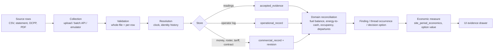

# Source integration and canonical evidence-to-decision mechanics (Layer 4, Deliverable 3)

Companion to the Layer 4 design pack. Owner of coherence: AssetOps Architect (Claude). Status: **design only**. Nothing in this document exists in the repository unless it is labelled [code-observed] or [test-confirmed].

- Repository state: `fe2392899` on `task/product-direction-layer4-design` (code identical to the baseline commit `9b4d9bd15`).
- Binding vocabulary: design positions D1–D10 (Architect memo). This document uses D2 `commercial_record`, D3 `site_period_economics` and D8 entitlements exactly as named there.
- Figures: every record, date and amount comes from `demo-site-scenario-manifest.yaml` (same folder). Where a source row needs a value the manifest does not give (for example how the 140 kWh splits across the six Mto customers), the split is marked [assumption] and always sums to the manifest total.
- Paths: code is relative to `backend/assetops_backend/` unless it starts with `field/`, `gateway/`, `simulator/`, `contracts/` or `backend/migrations/versions/` (shortened to `00NN:line`).

**Labels.** [code-observed] read in code at HEAD with `sed -n`; [test-confirmed] pinned by a named test (cited from the reuse matrix where I did not re-run it); [implementation-report] reported by an earlier build log or review; [proposed] a design element that does not exist; [research] external fact (law, protocol); [assumption] a value or behaviour that a pilot must confirm. **Provenance classes:** demo-simulated (simulator pack), source-emulated (a source-shaped emulator or generated export), bench-tested (real device or export on a bench), field-integrated (live operator source), observed-financial (an operator's actual ledger, bill or statement).

**What this document does not promise.** No provider API access is assumed for any vendor. No contract clause is interpreted as a legal conclusion. AssetEcon does not become a billing system, a contract-lifecycle tool or a claims administrator (brief L2.7); it reads their outputs.

---

## 1. Why each decision needs particular facts

A decision option in D5 is only as defensible as the facts that qualify it, test its feasibility, check its safeguards and value it. Each vertical's decisions need a different mix of four kinds of fact: **physical** (what the plant did), **commercial** (what was charged, paid and settled), **contractual** (what a counterparty owes or excludes) and **financial** (what the operator planned and spent). A missing kind does not make the decision impossible; it changes the option's disposition to INSUFFICIENT_EVIDENCE or CONDITIONAL, and it names the record that would close the gap.

### 1.1 Mini-grid (Lakeside Power: Kobo, Kisiwa, Mto)

**Kobo, "generator runs after dawn while solar could carry the load".** The physical facts already exist: generator state and power, PV available power, converter capability and SOC are bound roles (`sites/binding_roles.py:90-146`) [code-observed], and dispatch-3.2 classifies Candidate time from them (baseline §3.3). That gives only the upper bound (fuel-cost-1, 0 to 412.50 for 11 of 31 days). To recommend KOB-STOPSOC at a net 250.50/month the decision also needs: the actual litres consumed in October (opening dip 220 + deliveries 1,200 − closing dip 240 = 1,180 L), the price paid for them (1.25/L), and the plan line (700 L, 875.00). The litres come from operational records (`FUEL_DELIVERY`, `TANK_DIP`), the price from the supplier invoice, and the plan from the budget spreadsheet. Without the deliveries the 120 L unexplained residual (MG-L5) cannot be stated, and without the plan there is no variance (−562.00) to bridge.

**Kisiwa, "GEN-KS-01 failed; GEN-KS-02 carries the evening alone".** The physical facts make it the negative control (every generator interval Necessary). The decision KIS-REPAIR versus KIS-REPLACE needs a repair quote (1,800) and a capex quote (9,500), which are EXPENSE/quote documents, and the entitlement check needs the Kestrel Gensets warranty (term ended 2026-06-30; condition "1,000-hour service") plus the maintenance log showing the 1,000-hour service is MISSING at 1,240 run hours. The O&M SLA review needs the Island Power Services contract (48 h response, 10% of 700 credit, weather exclusion), the service ticket times (reported 30 Oct 19:10, responded 3 Nov 19:30 = 96 h), and the port authority weather bulletin. The October O&M invoice has not arrived, so the O&M line is ESTIMATED (GAP-1).

**Mto, energy-to-cash and the rice huller.** MTO-BILLING (restore 56.00/month of charges) is impossible to see from telemetry alone. It needs the billing export (who was charged for how many kWh), the meter register with effective dates (which meter belonged to which customer when), and the feeder energy. Only by joining them does "140 kWh not billed because six meters were swapped on 3 Oct and the billing system still pointed at the old meter IDs" appear as an unbilled mapping, not as a loss. The cash side needs the mobile-money settlement statement, because 150 paid on 30–31 Oct settled on 2 Nov. MTO-HULLER needs the cooperative's signed letter of intent (15 kW, 10:00–15:00, lapses 30 Nov), which is a contract document, and the inverter dependency needs the INV-MT-02 warranty.

### 1.2 Cold chain (Harvest Cold: Mwea, Thika, Kirinyaga)

Cold rooms earn per crate-day, so the revenue denominator is **paid occupancy**, not energy. Mwea's high cost per crate-day (0.1221 kWh/crate-day vs Kirinyaga's 0.1008) looks like an equipment problem until the storage ledger shows 4,340 crate-days against a plan of 7,440, and the energy model (1,550 + 0.25 × crate-days, 5% tolerance) shows Mwea's 2,650 kWh within 0.6% of model. Kirinyaga runs the same occupancy as plan but uses 970 kWh above model: that is the efficiency root cause. Both conclusions need the storage ledger (check-in/out per batch) and the energy meter or bill.

Thika's batch exposure needs four sources to line up on one clock: grid and backup events (telemetry), chamber temperature (telemetry, 1-min in the evidence window), which batches were physically present (storage ledger), and what happened to them (QA note on 15 Oct, credit note CN-0412). The customer contract supplies the liability rule ("operator compensates QA-confirmed damage when an operator-equipment excursion exceeds 120 min"). Without the ledger, the excursion can be stated but no batch can be named; without QA, exposure (2,160) cannot be separated from damage (108).

### 1.3 EV depot (Metro Bus: Embakasi, Kasarani, Ruiru)

The fleet is captive: charging is a cost centre and the service unit is "required departure met". EMB-DEADLINE versus EMB-CHEAPEST cannot be decided from charger sessions alone. It needs the roster (20 buses, returns 17:30–19:30, departure 05:30, 140 kWh each), the utility tariff (C-114: peak 18:00–22:00 at 0.24, off-peak 0.12, demand 12.00/kW-month) and the October utility invoice that confirms the tariff applies (manifest marks applicability as an [assumption] to confirm from the invoice). The OCPP log supplies energy per session and per connector; the roster turns "2,500 kWh deliverable in 00:00–05:00 against 2,800 required" into "3 buses leave short every night". Kasarani's CH-K2 priority needs the OEM warranty and SLA (Ampere Charge Co), the service ticket timestamps, and the penalty rule (120 per missed block). Ruiru's +6/+10 test needs the roster proposal and the import limit.

### 1.4 Entitlements across verticals (S12, MG-C6, CC-C6, EV-C6)

An entitlement-aware option compares an operator-funded path with a supplier-supported path. That needs: asset identity (serial, commissioning date, ownership), the applicable contract and its terms (coverage, conditions, exclusions, notice period, remedy, lead time), the occurrence (fault time and code from telemetry or ticket), evidence that conditions were met (installer certificate, ambient log, firmware, test logs), and the claim's own history (notified, acknowledged, accepted). The contrast the brief demands (C3 "Entitlement contrast") is carried by three manifest cases: INV-MT-02 POTENTIALLY_COVERED, GEN-KS-01 EXPIRED_AND_EXCLUDED, BAT-001 INSUFFICIENT_EVIDENCE. None of them is ever a financial actual until a credit note or cash receipt arrives as a D2 record.

---

## 2. The four clocks

Every fact in this design carries one or more of four clocks. Mixing them is the single most common way a reconciliation goes wrong, so the canonical records keep them in separate fields and the readers state which clock they bucket by.

| Clock | What it answers | Where it comes from | Field in canonical records |
|---|---|---|---|
| Operational time | When did the physical thing happen? | Device or controller timestamp (`source_time`), or the occurrence time typed on an operational record (`occurred_at`) | `accepted_evidence.source_time` (0005:178) [code-observed]; `operational_record.occurred_at` (0027:179) [code-observed]; `commercial_record.occurred_at` [proposed] |
| Commercial effective period | Which service period does a charge, tariff or mapping apply to? | Bill period, tariff validity, meter-register `valid_from/valid_to`, roster day | `effective_from`, `effective_to` (half-open) [proposed]; same half-open rule as declared prices (`financials/assumptions.py:149-153`) [code-observed] |
| Recognition period | Which accounting period carries the revenue or cost? | The operator's accounting policy; usually the service period for usage charges, the invoice period for purchases | `recognition_period` (e.g. `2026-10`) [proposed] |
| Settlement time | When did cash actually move? | Payment provider statement `settled_at`, bank value date | `settled_at` [proposed] |

Two more instants are bookkeeping, not business clocks: `recorded_at` (when AssetEcon first stored a version) and `received_at` (when the batch arrived). They answer "as known when?" and drive revision, never period membership. The repo already separates these for operational records: the fuel read selects by `recorded_at <= known_at` but buckets by the head's `occurred_at`, and keeps `root_recorded_at` so it can flag `DELIVERY_RECORDED_LATE` (`work/fuel_records.py:3-7`, `:28-30`; `fuel_balance/rules.py:258-259`) [code-observed].

### 2.1 Worked example: Mto late settlement (LATE-SETTLE-1)

Three Mto customers pay by mobile money on 30 and 31 Oct; the provider settles the batch to the operator's account on 2 Nov. Amounts are an [assumption] split of the manifest's 150.

| txn_id | paid_at (operational) | recognition_period | settled_at | amount |
|---|---|---|---|---|
| MM-7F31 | 2026-10-30T18:42+03:00 | 2026-10 (pays October charges) | 2026-11-02 | 60.00 |
| MM-7F58 | 2026-10-31T09:15+03:00 | 2026-10 | 2026-11-02 | 50.00 |
| MM-7F77 | 2026-10-31T20:03+03:00 | 2026-10 | 2026-11-02 | 40.00 |

Revenue is recognised on the charge, not the payment, so October revenue stays 2,160.00 whatever the settlement date. The receivable chain for October reads: collected (settled within October) 1,890.00 + in transit (paid in October, settled after 31 Oct) 150.00 + outstanding 120.00 = 2,160.00. Read as of 31 Oct, the three receipts are `IN_TRANSIT`; read as of 6 Nov they show "settled 2 Nov" in the evidence drawer. The October period does not reopen, because no October amount changed; only the status of three receipts moved. [proposed]

### 2.2 Worked example: Kobo late fuel note (OOO-1)

A delivery of 400 L [assumption: the manifest fixes only the month total 1,200 L and the dates] arrived at Kobo on 26 Oct but the delivery note was entered on 4 Nov. Before the note, the October balance reads: 220 + 800 − 240 = 780 L consumed against 1,060 L model-implied. That is physically impossible (the generator burned less than the model of its own kWh), so the monthly balance state is EXCESS and no residual is attributed. When the note is recorded, the fuel read moves it to its true night because membership uses `occurred_at` (`work/fuel_records.py:5-6`) [code-observed], and the delivery is flagged `DELIVERY_RECORDED_LATE` because its `root_recorded_at` is after the window end (`fuel_balance/rules.py:258-259`) [code-observed].

At period level [proposed], the stored October fuel and cost **lines** for Kobo gain a new revision, and `site_period_economics` (a sibling read contract, not a stored-total table) recomputes the figures below from them. Totals such as contribution are never stored: the existing period-read contract refuses stored totals (`chain/period_read.py:138-139`, D-MONEY.3) [code-observed]. The table shows what the read returns before and after:

| | revision 1 (as of 3 Nov) | revision 2 (as of 4 Nov, after note) |
|---|---|---|
| deliveries_l | 800 | 1,200 |
| consumed_l | 780 | 1,180 |
| diesel_cost (consumed × 1.25) | 975.00 | 1,475.00 |
| contribution | 1,383.00 | 883.00 |
| residual_l vs model 1,060 | −280 (EXCESS, not attributed) | 120 (10.2%, above 2% tolerance → UNEXPLAINED_FUEL) |
| bridge | not computable | sums to −562.00 |

### 2.3 How a period closes and reopens

A period is **soft-closed** when the operator's own books close it (for the demo: October closed by 6 Nov). Closing writes nothing new; it is a statement on the latest `site_period_economics` revision ("as of"). A late record whose `recognition_period` is a closed period does not overwrite anything. It creates a new `commercial_record_revision` (or a new operational-record version), the line builder detects a changed input fingerprint, and it appends a new revision of the period's stored lines exactly as `site_period_read` does today: one append-only row per (Site, kind, period, revision) with `input_fp`, `computed_at` and `builder_version`, refused UPDATE/DELETE by `ledger_append_only()` (`0059:3-6`, `:31-51`) [code-observed]. `site_period_economics` is the sibling read that recomputes revenue, cost, contribution and variance from the selected line revisions on every read, so "revision 2" of the economics is simply the read over revision 2 of the lines. The UI shows the latest revision with a "revised 4 Nov: late delivery note REC-…" line, and the drawer lists the prior revision. Decisions that cited the earlier revision keep that citation; D5 re-evaluates the open decision against the new revision and records the change in disposition, if any. [proposed]

```mermaid
sequenceDiagram
  participant Src as Operator source
  participant CR as commercial_record_revision
  participant OR as operational_record (FUEL_DELIVERY)
  participant SPE as site_period_economics
  participant D as decision (D5)
  Src->>OR: 4 Nov: delivery note, occurred 26 Oct
  OR-->>SPE: input fingerprint changed for Kobo x 2026-10
  SPE->>SPE: append revision 2 (rev 1 kept)
  SPE-->>D: KOB thread re-evaluated; disposition unchanged, evidence cites rev 2
  Src->>CR: 5 Nov: fuel supplier invoice for 26 Oct delivery
  CR-->>SPE: matches ticket; cost basis RECORDED_PURCHASE; no money change
```

---

## 3. Worked traces

Each trace follows the same nine stages: source rows → collection → validation → time/identity resolution → canonical record → domain reconciliation → finding/opportunity/decision option → economic measure → UI evidence drawer. Stages that already exist in code are labelled; the rest is [proposed].



### 3.1 Trace A: Mto billing CSV and the meter swap (MAP-1, DUP-1)

**Source rows.** The billing export (`customer_id, meter_id, period, kwh, tariff_code, amount, adjustment_code`, manifest `sources.mini_grid`) and the meter register (`meter_id, customer_id, valid_from, valid_to`). Customer IDs are shown pseudonymised; they remain personal data (§6.8).

```text
# mto_billing_2026-10.csv (excerpt; 6 swapped customers shown)
customer_id,meter_id,period,kwh,tariff_code,amount,adjustment_code
C-MTO-0412,MT-OLD-1187,2026-10,0,RES-040,0.00,
C-MTO-0413,MT-OLD-1188,2026-10,0,RES-040,0.00,
...
C-MTO-0099,MT-0099,2026-10,40,CLINIC,0.00,ADJ-CLINIC-ALLOW
# meter_register.csv (excerpt)
meter_id,customer_id,valid_from,valid_to
MT-OLD-1187,C-MTO-0412,2023-05-01,2026-10-03
MT-2201,C-MTO-0412,2026-10-03,
MT-OLD-1188,C-MTO-0413,2023-05-01,2026-10-03
MT-2202,C-MTO-0413,2026-10-03,
```

**Collection.** CSV upload to a commercial intake route modelled on reading uploads: raw body, `text/csv`, ≤ 2 MB, `dry_run=true` preview first (`reading_upload_api.py:3-6`, `reading_upload/service.py:25`) [code-observed pattern; route proposed]. Unlike reading uploads, the raw file bytes are kept (§4).

**Validation.** Whole-file rules (header, encoding, duplicate rows, value syntax) as `reading_upload/service.py:27-28` `CSV_CODES` [code-observed pattern]; row rules: `amount = kwh × tariff` unless an `adjustment_code` is present; `period` parses; tenant key equals the uploader's tenant (TENANT-1).

**Resolution.** Each billed meter is resolved through the meter register **at the reading's effective time**. The customer meter reads (CUSTOMER_METER_READ) show MT-2201..MT-2206 accumulating energy from 3 Oct, but no billing row names them; the billing rows name MT-OLD-1187..1192 with 0 kWh after 3 Oct.

**Canonical records.** One `CHARGE` per billing row; one `CUSTOMER_METER_READ` per meter-period; the register becomes identity history (`meter_customer_assignment`, effective-dated) [proposed].

| customer (pseudonymised) | new meter | kWh read 3–31 Oct | kWh billed | unbilled kWh |
|---|---|---|---|---|
| C-MTO-0412 | MT-2201 | 31 | 0 | 31 |
| C-MTO-0413 | MT-2202 | 27 | 0 | 27 |
| C-MTO-0414 | MT-2203 | 22 | 0 | 22 |
| C-MTO-0415 | MT-2204 | 25 | 0 | 25 |
| C-MTO-0416 | MT-2205 | 18 | 0 | 18 |
| C-MTO-0417 | MT-2206 | 17 | 0 | 17 |
| **total** | | **140** | **0** | **140** (manifest) |

The per-customer split is [assumption]; only the total is manifest.

**Domain reconciliation (energy-to-cash).** Delivered 6,000 (feeder telemetry) → expected technical loss 300 (declared band) → metered 5,580 + 120 unexplained → billed 5,400 = metered 5,580 − 140 unmapped − 40 authorised clinic allowance. The 140 is classed `METER_MAPPING_UNBILLED` because every unbilled kWh sits on a meter that the register assigns to an active customer; it is not loss.

**Decision option.** Thread "Mto energy-to-cash" (origin FINDING) gains MTO-BILLING (COMMERCIAL_CORRECTION, crew visits 0, RECOMMENDED: restores 56.00/month of charges, 672.00 over 12 months, October back-bill potential 56.00) and MTO-METER-AUDIT (60.00, for the 120 kWh unexplained, no money attached).

**Economic measure.** Bridge line `METER_MAPPING_UNBILLED`, overlap group `MTO-2026-10-REV`, −56.00 = 140 × 0.40, class ECONOMIC_ACTUAL. The 672.00 is listed, never summed with collected cash (manifest `listed_not_summed`).

**Evidence drawer.** "140 kWh were read on six new meters installed on 3 Oct but billed to the old meter numbers. Billing file mto_billing_2026-10.csv (sha256 …, uploaded 4 Nov), meter register revision 2 (swap rows valid from 3 Oct). Charges this would restore: 56.00 per month. Collection is a separate step." The six customer IDs are not shown to roles without customer-data permission (§6.8).

**DUP-1.** Re-uploading the identical file produces the same file hash and the same idempotency key per row (tenant, source_system, source_record_id, source_version). Every row resolves to an existing revision with identical payload digest: 0 new revisions, upload receipt state `ALREADY_RECORDED_IDENTICAL`. This mirrors the evidence ledger rule "same message id with the same content is a duplicate (counted, not stored again)" (`evidence/service.py:24-26`, `:479-486`) [code-observed].

### 3.2 Trace B: Mto mobile-money settlement (LATE-SETTLE-1)

**Source rows.** Provider settlement statement (`txn_id, paid_at, settled_at, amount, customer_ref`), as in §2.1. Collection: CSV upload; there is no provider API assumption [proposed]. Validation: `settled_at >= paid_at`; amount positive; currency equals the statement currency; `customer_ref` resolves to a customer account.

**Resolution.** `customer_ref` → customer via the account register (not via meter). The payment is matched to open CHARGE rows of that customer, oldest first, exact amount within a ±0.01 rounding tolerance [assumption].

**Canonical.** One `RECEIPT` per transaction (`occurred_at = paid_at`), and one `SETTLEMENT` for the provider batch (`settled_at = 2026-11-02`, total 150.00) that references the three receipts.

**Reconciliation.** Receivable status per charge: OPEN → PAID_IN_TRANSIT (receipt, no settlement yet) → COLLECTED (settlement covers the receipt). Status as of 31 Oct: 150.00 IN_TRANSIT; as of 6 Nov: COLLECTED on 2 Nov.

**Use.** No finding: the chain balances (1,890 + 150 + 120 = 2,160). The S1 portfolio card's "collected" figure for October is 1,890.00 with "150.00 paid in October, settled 2 Nov" as a footnote; revenue stays 2,160.00.

### 3.3 Trace C: Kobo fuel delivery, late and out of order (OOO-1)

**Source rows.** Paper delivery note, entered by the site admin on 4 Nov through the existing operational-entry screen:

```json
{"entry": "FUEL_DELIVERY", "value": "400", "taken_at_local": "2026-10-26T10:30",
 "ticket_reference": "DN-KB-2610", "idempotency_key": "oprec-entry-5d0c…"}
```

**Collection and validation (existing).** `validate_entry` requires exactly the five keys, a positive value, a ticket reference for a delivery and an `oprec-entry-` idempotency key (`work/operational_entry.py:29`, `:50-83`) [code-observed]. `compose_entry` converts the Site-local minute to UTC, hashes the ticket text into `source_document_sha256` and names the single active tank (`:86-89`, `:108-131`) [code-observed]. The record lands in `operational_record` with `occurred_at` (26 Oct) and `recorded_at` (4 Nov) and is unique per `(tenant, site, idempotency_key)` (`0027:179`, `:188`) [code-observed].

**Resolution.** Tank identity is the Site's single active tank (`OPREC_ENTRY_NO_TANK` otherwise, `work/operational_entry.py:113-114`) [code-observed]. The fuel supplier's invoice, if uploaded, becomes a D2 `EXPENSE` carrying `ticket_reference = DN-KB-2610`; the join is ticket reference + litres ± 1% (the existing per-ticket tolerance, `fuel_balance/rules.py:49`) [code-observed tolerance; join proposed].

**Reconciliation.** Night level: the fuel balance for the night of 25–26 Oct is recomputed with the delivery and carries `DELIVERY_RECORDED_LATE` (information only, never changes state, `fuel_balance/rules.py:243-259`) [code-observed]. Month level [proposed]: the October fuel lines get revision 2, and the `site_period_economics` read recomputes from them (§2.2).

**Finding and option.** UNEXPLAINED_FUEL (120 L, above the 2% monthly tolerance) opens an investigation occurrence on the Kobo thread; no recovery money is claimed. KOB-STOPSOC is unaffected in value (it is valued on forward-feasible litres), but its evidence now cites revision 2.

**Drawer.** "October fuel: 1,180 L used (dips 220 → 240, deliveries 1,200). Revised 4 Nov: delivery DN-KB-2610 (400 L, 26 Oct) was entered 9 days late. 120 L more than the generator's output explains; investigate. Previous figure kept (rev 1)."

### 3.4 Trace D: Thika storage ledger + chamber temperature + QA → batch exposure

**Source rows.**

```text
# storage_ledger_thika.csv
batch_id,customer,commodity,crates,in_at,out_at,rate
B-1029,<customer>,cabbage,60,2026-10-09T08:10+03:00,2026-10-13T16:00+03:00,0.20
B-1031,Kamau Cooperative,tomato,120,2026-10-12T15:30+03:00,2026-10-16T07:40+03:00,0.20
B-1034,<customer>,avocado,80,2026-10-11T11:00+03:00,,0.20
# qa_notes_thika.csv
batch_id,inspected_at,crates_downgraded,inspector
B-1031,2026-10-15T09:00+03:00,6,QA-03
```

In/out times other than B-1029's check-out (13 Oct 16:00, manifest) are [assumption]; they only need to bracket 14 Oct. Commodity limits (tomato 8 °C, avocado 12 °C) come from the commodity table on the customer contract.

**Collection.** Storage ledger and QA notes by CSV upload; chamber temperature, grid and backup events by the existing batch ingestion (`cold-roles-1`: `chamber_temperature`, `grid_power_event`, `backup_start_event`, `transfer_result`, `sites/binding_roles.py:151-193`) [code-observed]. Cold telemetry is demo-simulated (manifest).

**Resolution.** A batch is **present** at instant t iff `in_at <= t < out_at` (out_at null = still present). Batch → customer → contract via the customer account. Chamber identity: the ledger names the room; the room maps to the chamber asset.

**Canonical.** `STORAGE_MOVEMENT` rows (one IN, one OUT per batch), a QA note as an operational record of kind `QA_INSPECTION` [proposed widening; see §4.2 for why this one is operational, not commercial], `CHARGE` rows (crate-days × 0.20) and the credit note CN-0412 as `ADJUSTMENT` (−108.00).

**Reconciliation.** The existing cold analysis gives the excursion (above 8 °C 02:50–05:05, 135 min, peak 9.8 °C; `analytics/cold.py` `cold-excursion/1`, "no spoilage claim") [code-observed per reuse matrix]. Joining presence and commodity limit:

| batch | present 02:50–05:05? | limit | exposed? | exposed value (EXPOSURE) | QA damage | liability rule (>120 min, operator equipment) |
|---|---|---|---|---|---|---|
| B-1031 tomato 120 | yes | 8 °C | yes | 2,160.00 | 6 crates = 108.00 | 108.00 |
| B-1034 avocado 80 | yes | 12 °C | no (peak 9.8) | – | – | – |
| B-1029 cabbage 60 | no (out 13 Oct 16:00) | – | excluded | – | – | – |

**Option and measure.** Thread "Thika backup start failure" carries THIKA-EPC-STOPGAP (residual 100.00, RECOMMENDED). The bridge line CUSTOMER_COMPENSATION −108.00 (overlap group THIKA-2026-10-LIAB) is ECONOMIC_ACTUAL because a credit note exists; 2,160.00 is EXPOSURE and is never summed. Insurance: goods-in-custody policy, deductible 500, loss 108 below it, claim NOT_FILED, reimbursement 0.00.

**Drawer.** Timeline of grid loss 02:10 → backup start request → transfer controller fault → manual start 04:05 → compressor 04:07, temperature curve with the 8 °C line, the three batches with present/limit/exposed, the QA note, CN-0412.

### 3.5 Trace E: Embakasi OCPP + roster + utility invoice → departure feasibility and tariff cost (CLOCK-1)

**Source rows.** OCPP 1.6J messages from the CPMS log export [research: OCPP 1.6J defines StartTransaction (connectorId, idTag, meterStart, timestamp), MeterValues and StatusNotification (connectorId, status, errorCode, timestamp)]:

```json
[2,"a1","StatusNotification",{"connectorId":1,"status":"Charging","errorCode":"NoError","timestamp":"2026-10-14T19:04:00Z"}]
[2,"a2","StartTransaction",{"connectorId":1,"idTag":"RF-0417","meterStart":1834200,"timestamp":"2026-10-14T19:04:10Z"}]
[2,"a3","MeterValues",{"connectorId":1,"transactionId":88121,"meterValue":[{"timestamp":"2026-10-14T19:08:00Z","sampledValue":[{"value":"1834480","measurand":"Energy.Active.Import.Register","unit":"Wh"}]}]}]
```

```text
# fleet_roster_embakasi_2026-10.csv
service_day,bus_id,rfid_tag,route_block,return_at,departure_at,required_kwh
2026-10-14,BUS-E07,RF-0417,B-22,18:40,05:30,140
```

```text
# utility invoice C-114, October (lines)
line,quantity,unit,rate,amount
peak energy 18:00-22:00,47740,kWh,0.24,11457.60
off-peak energy,39060,kWh,0.12,4687.20
demand charge (max 500 kW),500,kW,12.00,6000.00
total,,,,22144.80
```

**Collection.** OCPP log export by file (CSV/JSON) [proposed]; there is no OCPP emulator today (baseline §8.8) [code-observed]. Roster and invoice by CSV upload. Pilot: a CPMS export per night, not a live OCPP connection.

**Validation and CLOCK-1.** The charger's StatusNotification `Charging` is paired with the CPMS server's receive time for the same message; a consistent offset (here the charger clock runs 4 min fast) is estimated per charger-day and applied to MeterValues timestamps, the corrected readings are marked `SUSPECT` with reason `CLOCK_OFFSET_CORRECTED` and the offset is stored. The existing quality vocabulary already has `SUSPECT` for v4 measurements (`contracts/assetops_contracts/source_envelope_v4.py:65-66`) [code-observed]; the pairing rule is [proposed]. An offset above 15 min [assumption] refuses the charger-day as `CLOCK_UNRESOLVED`.

**Resolution.** `idTag RF-0417` → `BUS-E07` through the roster's effective-dated tag assignment; connector → charger asset through the Site's bindings. Note: `ev-roles-1` carries session events, state and energy per connector but no vehicle identity (`sites/binding_roles.py:195-215`) [code-observed]. Vehicle identity therefore lives on a D2 session-attribution row, not in `accepted_evidence`.

**Canonical.** `FLEET_ROSTER` (one row per bus × service day), `TARIFF_SCHEDULE` (C-114 bands), `CHARGE` lines from the utility invoice (recognition 2026-10, effective 1–31 Oct), and session energy from accepted readings.

**Reconciliation.** Two checks. (1) Invoice vs meter: invoice kWh 86,800 equals the site import meter total within 1% [assumption tolerance]; the peak share 55% versus plan 30% is computed from interval data bucketed by the tariff bands, and must equal the invoice's peak line within the same tolerance before the tariff is treated as confirmed. (2) Departure feasibility per night: required 20 × 140 = 2,800 kWh; candidate window deliverable is computed from charger count, power and import limit.

**Option and measure.** EMB-CHEAPEST (00:00–05:00, deliverable 2,500 < 2,800, 3 buses short) fails EV1_DEPARTURE_READINESS (HARD_CONSTRAINT) → REJECTED. EMB-DEADLINE (22:00–05:15 staggered, 2,900 deliverable, max 400 kW, 31 of 31 nights feasible) passes EV1 and EV5_IMPORT_LIMIT → RECOMMENDED, energy cost 15,216.00/month, saving 6,928.80/month (MODELLED), condition "tariff applicability confirmed from invoice". Bridge lines PEAK_ENERGY_SHARE −2,604.00 and DEMAND_CHARGE −600.00 are ECONOMIC_ACTUAL because they come from the invoice.

**Drawer.** Night-by-night departure table, the invoice lines with page reference, "charger CH-E03 clock 4 min fast on 14 Oct, corrected and flagged".

### 3.6 Trace F: INV-MT-02 warranty → AI-assisted extraction → entitlement-aware option

**Source.** `Sunfield_INV_warranty.pdf`, uploaded as a `CONTRACT_DOCUMENT` (raw bytes kept, sha256 recorded). Page numbers below are [assumption].

**Extraction (bounded, AI-assisted).** A language model proposes candidate rows, each with a verbatim quote and page reference, into a **review queue**; nothing is usable until a named human reviewer accepts, edits or rejects each row. The model never fills a field without a quote, never infers acceptance or enforceability, and never sets `eligibility`. Rows the reviewer rejects are kept with the reason. [proposed]

| row | kind | normalised content | quote ref | review |
|---|---|---|---|---|
| E1 | obligation | Supplier replaces a defective unit during term | p.2 §3.1 | ACCEPTED (reviewer U-17, 1 Nov) |
| E2 | condition | Installed by a certified installer | p.3 §4.2 | ACCEPTED |
| E3 | condition | Operated within ambient spec (≤ 45 °C) | p.3 §4.3 | ACCEPTED |
| E4 | condition | Firmware kept current | p.3 §4.4 | ACCEPTED |
| E5 | exception | Opening the unit by unauthorised persons voids cover | p.4 §5.1 | ACCEPTED |
| E6 | notice | Written notice within 30 days of failure | p.4 §6.1 | ACCEPTED |
| E7 | remedy | Replacement unit; shipping at owner cost; lead time 21 days | p.5 §7.1–7.2 | ACCEPTED (lead time edited from "approx. 3 weeks") |
| E8 | term | Valid until 2029-03-14 | p.1 | ACCEPTED |

**Occurrence.** Fault log: 2026-10-28, "IGBT overcurrent trip, latched" (telemetry/fault event). Notice deadline = 28 Oct + 30 days = 27 Nov.

**Condition evidence.** Installer certificate ON_FILE (document), ambient max 38 °C (telemetry, spec 45 °C), firmware CURRENT (service ticket), fault log ON_FILE. Each condition row links to its evidence record; eligibility = POTENTIALLY_COVERED (a product state, explicitly not a legal finding).

**Options (D5).** MTO-INV-CLAIM (residual 360.00 = shipping 150 + install 80 + extra fuel 130 during 21 days, restore by 28 Nov, RECOMMENDED), MTO-INV-BUYNOW (residual 2,910.00, restore 12 Nov, CONDITIONAL on budget ≥ 6,430 or the cooperative not extending), MTO-INV-LOCAL (450.00, REJECTED: triggers exception E5), MTO-INV-NOACT (REJECTED: notice deadline lost 27 Nov). Claim state EVIDENCE_ASSEMBLED; the work case SUPPLIER_CLAIM holds the claim events (D8).

**Measure.** The covered remedy (a replacement unit) is never shown as money. The option value is the operator-funded residual. Only a later supplier credit note or cash receipt becomes a D2 `ADJUSTMENT` or `RECEIPT`.

**Drawer.** Each accepted term with its quote and page, who reviewed it and when, the evidence link per condition, the deadline countdown, and the words "Potentially covered. This is not a legal assessment."

---

## 4. Preserving raw payloads without a universal schema

The design rule: **each fact lives in the store whose shape and rules already fit it**, and D2 adds one new family only for facts no existing store can hold. There is no universal "event" table that replaces `accepted_evidence` or `operational_record`.

### 4.1 What stays in `accepted_evidence` (telemetry)

Readings of bound roles: values with a role, unit, quality, measurement kind, source time and optional interval (`0005:161-216`) [code-observed]. The ledger is first-write-wins: a second envelope with the same message id and other content is a `Conflict` and the original stays (`evidence/service.py:24-26`, `:487-492`) [code-observed]. Each accepted row keeps its full `envelope_text` and `envelope_sha256`, and each batch keeps `batch_text` and `payload_sha256` (`0005:121-128`, `:190-191`) [code-observed]. That is already an immutable raw payload with provenance (foundation and binding revisions, `source_mode`). Chamber temperature, OCPP-derived meter values, feeder and inverter readings all stay here. Money does not: the table has no currency, no effective period and no versioning.

### 4.2 What stays in `operational_record`

Operator-entered facts about the physical site: fuel deliveries and dips, manual readings, shift notes, site visits (`0027:168` kinds; widened by `0054` to fuel kinds) [code-observed]. This store already has the right lifecycle for corrections: a version chain (`supersedes_record_id`, `canonical_record_id`, one successor), `occurred_at` versus `recorded_at`, an idempotency key and a payload digest (`0027:175-190`) [code-observed]. A QA inspection note is the same kind of fact (an observation of physical state by a person), so it belongs here as a new kind [proposed], not in D2. Fuel litres stay here; the fuel **invoice** (money) goes to D2.

### 4.3 What is new in `commercial_record` (D2)

Money-denominated, effective-dated or contract-shaped facts whose source is an operator's commercial system: CHARGE, RECEIPT, SETTLEMENT, ADJUSTMENT, EXPENSE, PLAN_LINE, STORAGE_MOVEMENT, CUSTOMER_METER_READ, FLEET_ROSTER, TARIFF_SCHEDULE, CONTRACT_DOCUMENT. Why these are not operational records: they arrive in bulk from exports (hundreds of rows), they are corrected by the **source** issuing a new version (a re-issued invoice), not by an operator superseding a typed entry, and they carry currency and effective periods. Why not `accepted_evidence`: they are not readings of bound roles. Why CUSTOMER_METER_READ is here and not a telemetry role: it comes from the billing/vending system's export keyed by meter and period, it is the basis of a charge, and its identity resolves through the customer register, not through Site bindings. STORAGE_MOVEMENT is here because check-in/out is a commercial service event (it starts and stops a chargeable crate-day clock), even though it also tells the cold analysis which batches are present.

Revision semantics differ deliberately from telemetry: a commercial source **is allowed to correct itself**. The same `(tenant, source_system, source_record_id)` with a new `source_version` creates a new revision; the same key and version with different content is refused as `SOURCE_VERSION_CONFLICT`, mirroring the evidence ledger's conflict rule; the same key, version and content is a duplicate.

### 4.4 Shared provenance pattern

| Concern | Existing pattern (reuse) | D2 application [proposed] |
|---|---|---|
| Batch receipt | `ingestion_batch` with `external_batch_id` unique per site, counts that must add up, immutable bytes (`0005:116-158`) [code-observed] | `commercial_intake` receipt per upload/batch: file name, `file_sha256`, raw bytes, profile id, counts accepted/duplicate/revised/rejected/conflict |
| Dry run | `reading_upload` dry run writes nothing (`0061:9-10`) [code-observed] | Same |
| Raw payload | Envelope and batch text stored (`0005:128`, `:191`) [code-observed]. `reading_upload` stores only `file_sha256`, not the file (`0061:29-55`) [code-observed] | Store raw bytes per intake (object store or bytea) and the raw row text per revision; the hash alone is not enough to re-derive a correction |
| Append-only | `ledger_append_only()` trigger (`0059:13`, `0061:11`) [code-observed] | Same trigger on `commercial_record`, `commercial_record_revision`, intake and extraction tables |
| Transformation provenance | `revision_provenance` block per assessment revision and builder version (`0059:53-62`) [code-observed]; `site_period_read.input_fp` (`0059:40`) | Each revision stores `parser_id@version`, `profile_sha256`; the period line builder fingerprints the set of revision ids it read, and the D3 read cites that fingerprint |
| Per-row refusal | `evidence_rejection` keeps the row ordinal, kind and digest (`0005:218-242`) [code-observed] | `commercial_rejection` with the same fields; a refused row never sinks its siblings |

---

## 5. Source-to-canonical-to-use recipes

Each block names sources, the minimum fields, the canonical kind, processing, consumer, failure policy and the pilot path. "Pilot path" assumes no provider API: CSV/upload or manual contractual evidence first, an emulator that emits the same files for the demo, and a validation plan. Time-to-fit figures are in §6.11.

**MG-C1 Defensible fuel/dispatch intervention.** Sources: EMS/inverter telemetry (GX-shaped profile), tank dips and deliveries, fuel invoice, plan. Minimum: the required roles of `minigrid-roles-*` (generator state/power, feeder demand, SOC, PV available, PCS capability; baseline §3.2), reserve and stop/start policy, diesel price. Canonical: `accepted_evidence`; `operational_record` FUEL_DELIVERY/TANK_DIP; D2 EXPENSE (fuel invoice), PLAN_LINE. Processing: dispatch-3.2 → D7 forward replay (host-side simulator kernel, outside the backend, per the Architect) → monthly fuel balance (2%). Consumer: Kobo thread, KOB-STOPSOC/KOB-RESERVE. Failure: no PV-available or PCS role → Candidate refused (existing limitation); no dips → fuel balance NOT_ASSESSED, option CONDITIONAL. Pilot: Modbus poller on a bench GX or the operator's VRM CSV export through the generic interval profile (`field/profiles/generic-interval-csv-illustrative-1.json`) [code-observed profile]; dips via the operational-entry screen; validation = 14-day supervised trial (manifest verification plan).

**MG-C2 Profitable productive-use activation.** Sources: supply headroom (telemetry), candidate customer LOI/contract, productive tariff, marginal fuel. Minimum: load kW, window, days/month, tariff, LOI expiry. Canonical: CONTRACT_DOCUMENT (LOI) with extracted terms; TARIFF_SCHEDULE. Processing: D7 replay of the added load → days without headroom (3), extra fuel (68 L). Consumer: MTO-HULLER (net 395/month), MTO-WELDING (−8.25, rejected). Failure: no signed demand evidence → DEFERRED ("no demand evidence"), never a revenue line. Pilot: LOI uploaded as PDF, terms entered by reviewer.

**MG-C3 Energy-to-cash investigation.** Sources: feeder meter, customer meter reads, meter register, billing export, payment/settlement statement. Minimum: as in Trace A/B. Canonical: CUSTOMER_METER_READ, CHARGE, ADJUSTMENT, RECEIPT, SETTLEMENT; identity history. Processing: chain delivered → loss band → metered → billed → collected. Consumer: Mto thread; MTO-BILLING, MTO-METER-AUDIT. Failure: customer-meter coverage below 95% of connections [assumption] → unexplained kWh reported as a range, no mapping finding. Pilot: billing/vending CSV export (most vending platforms export CSV [assumption]); data-processing agreement first (§6.8).

**MG-C4 Fuel procurement/materiality assurance.** Sources: delivery notes, supplier invoices, dips, tank-level telemetry, generator fuel model. Canonical: FUEL_DELIVERY/TANK_DIP (existing), EXPENSE. Processing: night balance (existing, 40 L materiality, `fuel_balance/rules.py:39-41`, `:52`) [code-observed] plus monthly balance (2%) [proposed]. Consumer: UNEXPLAINED_FUEL. Failure: no closing dip → month NOT_ASSESSED. Pilot: paper notes entered daily; validation by a reconciled month against the operator's own fuel register.

**MG-C5 Portfolio investment comparator.** Sources: options from C1–C3/C6, capex quotes, budget and crew constraints. Canonical: EXPENSE (quotes, status QUOTE), PLAN_LINE (budget). Consumer: D9 allocation (spend 3,880 of 5,000, 3 visits). Failure: quote missing → option INSUFFICIENT_EVIDENCE, listed. Pilot: quotes uploaded as PDFs; budget as spreadsheet lines.

**MG-C6 Supplier remedy.** Sources: asset register (serial, commissioning), warranty/O&M documents, fault events, service tickets, maintenance log. Canonical: CONTRACT_DOCUMENT + entitlement rows; claim events. Consumer: INV-MT-02, GEN-KS-01, BAT-001 options. Failure: missing condition evidence → INSUFFICIENT_EVIDENCE with the evidence option (BAT-EVIDENCE, 430). Pilot: contract PDFs + reviewer extraction; tickets as vendor-portal CSV.

**CC-C1 Paid occupancy-to-contribution.** Sources: storage ledger, rate card/customer contracts, invoices, energy bill. Canonical: STORAGE_MOVEMENT, CHARGE, EXPENSE. Processing: occupied crate-days = Σ over batches of crates × days present in the period (half-open, Site-local midnight); chargeable crate-days = occupied crate-days on a paying contract; revenue check = chargeable × rate vs invoiced CHARGE total (tolerance 0.5% [assumption]). Consumer: Mwea thread (4,340 vs 7,440). Failure: ledger rows without out_at older than 60 days [assumption] → SUSPECT, excluded from occupancy, coverage shown. Pilot: WMS or spreadsheet export.

**CC-C2 Temperature exposure.** Trace D. Failure: no ledger → excursion shown, "batches unknown"; no QA → damage MISSING, never 0. Pilot: QA notes on a form; chamber logger CSV via the generic interval profile.

**CC-C3 Normalised refrigeration cost.** Sources: energy meter/bill, ambient, occupancy. Processing: model 1,550 + 0.25 × crate-days (+2.5%/°C above 24 °C), tolerance 5%. Consumer: Kirinyaga (+24%), Mwea (+0.6%). Failure: fewer than 60 days of meter + occupancy → coefficients DECLARED (manifest) and labelled, not fitted. Pilot: monthly bill + ledger; fit in pilot.

**CC-C4 Commodity/market occupancy scenarios.** Sources: draft customer contract (Mwea Horticulture Aggregators, 150 crates Dec–Mar at 0.18), compatibility table. Canonical: CONTRACT_DOCUMENT. Consumer: MWEA-AGG, CONDITIONAL on signature. Failure: forecast is a scenario, never booked revenue.

**CC-C5 Facility capital allocation.** As MG-C5 (spend 720 of 2,500, 2 visits).

**CC-C6 Entitlement assurance.** Sources: EPC workmanship warranty (CoolBuild), quarterly backup test logs (3 of 3), event log, insurance policy (deductible 500, notice 14 days). Consumer: THIKA-EPC-STOPGAP; insurance NOT_FILED. Failure: test log missing → condition unmet, eligibility REVIEW_REQUIRED.

**EV-C1 Fleet-ready cost/charging.** Trace E. Failure: no roster → departure feasibility unknown, every schedule option INSUFFICIENT_EVIDENCE (never "feasible"); tariff unconfirmed → EMB-DEADLINE CONDITIONAL.

**EV-C2 Critical service repair priority.** Sources: fault events (`ev_connector_fault`), roster, penalty clause, tickets. Processing: deliverable vs required after fault (1,050 vs 1,200 → 1 bus short). Consumer: CH-K2 outranks CH-R7 connector 2. Failure: no roster → priority by downtime only, labelled.

**EV-C3 Capacity utilisation and expansion.** Sources: roster proposal (+6 / +10), import limit, charger count. Consumer: RUI-ABSORB6 feasible, RUI-ABSORB10 infeasible. Failure: connector compatibility unknown → CONDITIONAL.

**EV-C4 Commercial charge/settlement assurance.** Not applicable for a captive fleet: explicit N/A, no fabricated charging revenue (brief EV-C4). For a commercial depot the recipe is MG-C3's with session → CHARGE → RECEIPT; the CPMS payment export is the source. **Blocking condition:** card/PSP settlement data is held by the payment processor; operator-assisted export only.

**EV-C5 Depot capital/operations choice.** As MG-C5 (spend 1,590 of 5,000).

**EV-C6 SLA enforcement.** Sources: Ampere warranty + SLA (48 h response, 5 business-day restore, 5% of 400 per business day late), ticket times. Processing: SLA clock from notified (2 Nov 07:10) → acknowledged (3 Nov 15:00, 31 h) → restore due 8 Nov; status RUNNING. Consumer: KAS-OEM-STOPGAP. Failure: no ticket timestamps → SLA clock UNKNOWN, no credit computed.

**S12 Entitlement-aware decisions (cross-vertical).** Union of MG-C6, CC-C6, EV-C6. **Blocking conditions:** (a) the operator does not hold the contract document (e.g. an EPC contract held by a funder) → operator-assisted: request a copy or record terms as "declared by operator, document not on file", eligibility capped at REVIEW_REQUIRED; (b) insurer claim decisions are held by the insurer/broker → out of scope to administer; AssetEcon records only the operator's own notice and the insurer's written decision as documents.

---

## 6. Contracts

### 6.1 `commercial_record` and `commercial_record_revision` (logical schema) [proposed]

The repo justifies a new table pair (reuse matrix §B row 1): no existing store has currency, effective dating and source-version idempotency. The physical DDL is the Architect's migration 0062; this is the logical contract.

```text
commercial_record                       -- identity, one per source record
  id, tenant_id, site_id (nullable for portfolio-level PLAN_LINE), kind
  source_system        -- e.g. "mto-vending-export", "kcb-mm-statement", "cpms-ocpp-log"
  source_record_id     -- the source's own key (invoice line id, txn_id, batch_id)
  first_recorded_at
  UNIQUE (tenant_id, source_system, source_record_id)

commercial_record_revision              -- append-only
  id, record_id, revision_no (1..n), source_version
  intake_id            -- the upload/batch receipt that carried it
  raw_row_text, raw_row_sha256          -- exact source bytes for this row
  parser               -- "<parser_id>@<version>", profile_sha256
  occurred_at, effective_from, effective_to, recognition_period, settled_at   -- the four clocks (nullable per kind)
  amount (exact decimal text), currency (ISO 4217), quantity, unit
  subject_kind, subject_ref    -- CUSTOMER | METER | BATCH | VEHICLE | ASSET | SITE (pseudonymised refs)
  quality              -- GOOD | SUSPECT | REFUSED (REFUSED rows go to commercial_rejection, never here)
  quality_reasons[]
  status               -- kind-specific (e.g. RECEIPT: PAID_IN_TRANSIT|COLLECTED; EXPENSE: QUOTE|INVOICED|PAID)
  body                 -- kind-specific typed fields (below)
  provenance_class     -- demo-simulated | source-emulated | bench-tested | field-integrated | observed-financial
  supersedes_revision_id, recorded_at
  UNIQUE (record_id, source_version)
```

Kind-specific fields (`body`):

| kind | required fields | clocks used | example (manifest) |
|---|---|---|---|
| CHARGE | customer/account ref, service quantity + unit, tariff_code, amount, line_type (USAGE, FIXED, DEMAND, STORAGE) | effective, recognition | Mto billing row; Embakasi peak line 47,740 kWh × 0.24 = 11,457.60 |
| RECEIPT | payer ref, method, amount, applied_to[] (charge ids) | occurred (paid_at), recognition | MM-7F31 60.00 |
| SETTLEMENT | provider, batch ref, total, receipts[] | settled | 150.00 on 2 Nov |
| ADJUSTMENT | reason code, authorised_by, amount or quantity, applies_to | effective, recognition | clinic allowance 40 kWh (16.00); CN-0412 −108.00 |
| EXPENSE | counterparty, category (FUEL, OM, STAFF, REPAIR, CAPEX_QUOTE, ENERGY), amount, status, document ref | occurred, recognition | Kisiwa repair quote 1,800; Kisiwa O&M (missing → GAP-1) |
| PLAN_LINE | line (revenue, diesel, om, staff…), amount, plan version | recognition | Kobo plan contribution 1,445.00 |
| STORAGE_MOVEMENT | batch_id, direction IN/OUT, crates, commodity, customer ref, rate | occurred | B-1031 IN 120 tomato |
| CUSTOMER_METER_READ | meter_id, register start/end or kWh, read type (ACTUAL/ESTIMATED) | effective | MT-2201 31 kWh 3–31 Oct |
| FLEET_ROSTER | bus_id, service_day, return_at, departure_at, required_kwh, rfid_tag, route_block | effective (service day) | BUS-E07 140 kWh 05:30 |
| TARIFF_SCHEDULE | contract id, bands [{from, to, rate}], demand rate, currency, applicability evidence | effective | C-114 peak 0.24 / off 0.12 / 12.00 per kW |
| CONTRACT_DOCUMENT | document sha256, counterparty, contract type, parties, term, page count, review state | effective (term) | Sunfield warranty to 2029-03-14 |

### 6.2 Entitlement canonical rows (D8) [proposed]

Extracted terms are separate rows because they have their own review lifecycle and are referenced individually by options and claims.

```text
entitlement_term            -- one reviewed term, append-only revisions
  id, tenant_id, contract_document_id, kind  -- OBLIGATION | CONDITION | EXCEPTION | NOTICE | REMEDY | TERM
  covered_assets[] (asset ids, serials), normalised (typed: e.g. NOTICE{days:30, from:"FAILURE"};
                                              REMEDY{type:REPLACEMENT, owner_costs:["SHIPPING"], lead_time_days:21})
  quote_text, page_ref, extraction_method (MANUAL | AI_ASSISTED@model-version)
  review_state (PROPOSED | ACCEPTED | EDITED | REJECTED), reviewer_id, reviewed_at, review_note
entitlement_occurrence      -- links an event to a contract
  id, asset_id, occurred_at, source_ref (fault event / ticket / thread occurrence), description
condition_evidence          -- per (occurrence, condition term)
  term_id, state (MET | NOT_MET | MISSING | NOT_APPLICABLE), evidence_refs[]
entitlement_assessment      -- computed, append-only
  occurrence_id, eligibility (POTENTIALLY_COVERED | EXPIRED_AND_EXCLUDED | INSUFFICIENT_EVIDENCE | REVIEW_REQUIRED | NOT_COVERED),
  notice_deadline, inputs_fp, statement ("not a legal assessment")
claim_event                 -- on the SUPPLIER_CLAIM work case
  case_id, state (POTENTIAL | EVIDENCE_ASSEMBLED | NOTIFIED | ACKNOWLEDGED | ACCEPTED | DENIED | DISPUTED
                  | REMEDY_DELIVERED | CREDIT_BOOKED | CASH_RECEIVED), at, actor, document_ref
```

`CREDIT_BOOKED` must reference a D2 ADJUSTMENT and `CASH_RECEIVED` a D2 RECEIPT; without them the state cannot be entered. That is what keeps a remedy from becoming a fake financial actual.

### 6.3 Sample source → canonical mappings

| source field (Mto vending export) | canonical | rule |
|---|---|---|
| `customer_id` | `subject_ref` (CUSTOMER) | pseudonymised at intake with a per-tenant keyed hash |
| `meter_id` | `body.meter_ref` | resolved via meter register at `effective_from` |
| `period` (YYYY-MM) | `effective_from/to` = Site-local month bounds; `recognition_period` = period | half-open |
| `kwh` | `quantity`, `unit=kWh` | exact decimal |
| `tariff_code` | `body.tariff_code` → TARIFF_SCHEDULE lookup | unknown code → SUSPECT `TARIFF_UNKNOWN` |
| `amount` | `amount`, `currency` from profile | ≠ kwh × rate and no adjustment code → SUSPECT `AMOUNT_MISMATCH` |
| `adjustment_code` | separate ADJUSTMENT revision | must be in the operator's declared code list |

| source field (OCPP log) | canonical | rule |
|---|---|---|
| `StartTransaction.idTag` | session attribution → VEHICLE via roster tag | unmapped tag → session counted for energy, not for departures |
| `MeterValues.Energy.Active.Import.Register` (Wh) | `accepted_evidence` `ev_connector_energy` (kWh, INTERVAL_DELTA) | existing kWh conversion rules (`sites/binding_roles.py:322-347`) [code-observed] |
| `StatusNotification.timestamp` vs receive time | clock offset per charger-day | CLOCK-1 |

| source field (utility invoice C-114) | canonical | rule |
|---|---|---|
| peak/off-peak lines | CHARGE line_type USAGE with band | Σ lines = invoice total exactly |
| demand line | CHARGE line_type DEMAND, quantity kW | max kW cross-checked with `ev_site_import` max within 2% [assumption] |
| billing period | `effective_from/to`; `recognition_period` = 2026-10 | |

### 6.4 Keys, tenant and source permissions

- **Idempotency key:** `(tenant_id, source_system, source_record_id, source_version)` (D2). Where a source has no version (most CSV exports), `source_version` = sha256 of the normalised row; a changed row becomes a new revision only when the profile declares the source mutable (billing exports: yes; settlement statements: no, a change there is a CONFLICT).
- **Tenant from credential, never from the row.** The authenticated batch path binds the principal to site and gateway and refuses mismatches (`evidence/ledger_service.py:195-210` `SCOPE_MISMATCH`) [code-observed]. The commercial intake takes tenant and site from the session/credential; a row carrying another tenant key (TENANT-1) is refused as a row, and a file whose rows mostly do is refused whole. Note: the V1 batch route accepts unauthenticated V1 documents and checks only that the Site resolves (`evidence_api.py:319-352`) [code-observed]; commercial intake must not copy that path.
- **Source registration:** each `source_system` is registered per tenant with its profile (columns, currency, timezone, mutability, personal-data fields). An unregistered source is refused.

### 6.5 Identity history

Effective-dated assignment tables [proposed], all half-open `[valid_from, valid_to)`, no overlaps per subject (same rule as declared prices, `financials/assumptions.py:10-17`) [code-observed rule]:

| assignment | example |
|---|---|
| meter → customer | MT-OLD-1187 → C-MTO-0412 until 2026-10-03; MT-2201 → C-MTO-0412 from 2026-10-03 |
| meter → Site/feeder | MT-2201 → MTO-001 feeder 2 |
| RFID tag → bus | RF-0417 → BUS-E07 |
| serial → asset | INV serial (from installer certificate) → INV-MT-02 |
| batch → customer → contract | B-1031 → Kamau Cooperative → storage contract |

A correction that changes an assignment's past validity is a CORRECTION with a reason (same succession/correction semantics as `financials/assumptions.py:10-17`) and triggers recomputation of every period it touches.

### 6.6 Duplicate, out-of-order, missing values

- **Duplicate:** same key + same content → counted, not stored (DUP-1).
- **Out of order:** records are bucketed by their business clock, never by arrival. A late record for a closed period appends revisions (§2.3). Unlike reading uploads, which refuse intervals ending at or before the latest accepted reading (`reading_upload/service.py:244-248` `ALREADY_RECORDED`) [code-observed], commercial intake must accept late records; late arrival is the normal case for invoices.
- **Missing:** a missing expected record is `status: MISSING`, never zero (manifest R4). The D3 coverage field reports the share of each line that is RECORDED versus ESTIMATED (Kisiwa O&M, GAP-1).

### 6.7 Data-quality semantics

Aligned with the existing envelope vocabulary: telemetry `GOOD | SUSPECT | UNAVAILABLE` for v4 measurements (`contracts/assetops_contracts/source_envelope_v4.py:65`) [code-observed], and refusals as typed rejections (`0005:218-242`) [code-observed].

| state | meaning for a commercial row | effect |
|---|---|---|
| GOOD | parsed, resolved, internally consistent | counted |
| SUSPECT | parsed but a check failed (AMOUNT_MISMATCH, TARIFF_UNKNOWN, CLOCK_OFFSET_CORRECTED, IDENTITY_UNRESOLVED) | counted in its own line with the reason; excluded from ECONOMIC_ACTUAL bridge lines until resolved; shown in coverage |
| REFUSED | unparsable, wrong tenant, unregistered source, version conflict | stored as `commercial_rejection` only |
| (absent) MISSING | expected and not received | coverage gap, never 0 |

### 6.8 Retention, minimisation and personal data

Customer IDs, meter IDs linked to customers, payer phone references and RFID tags linked to drivers are personal data. Pseudonymised meter IDs remain personal data under Kenya's Data Protection Act 2019 and Nigeria's Data Protection Act 2023, and cross-border transfer rules apply if data leaves the country (Kenya DPA ss.48–49; Nigeria DPA ss.41–43) (`.agent/convertion_potential.html` §10a) [research, as cited there]. Design consequences [proposed]:

- A signed data-processing agreement naming the hosting location precedes any per-customer intake.
- Pseudonymise at intake with a per-tenant keyed hash; drop names, phone numbers and addresses before storage; keep the raw file in an access-restricted store with its own retention (24 months [assumption], operator-configurable).
- Prefer aggregates by customer class where the capability allows (MG-C3 needs per-meter only for mapping checks; the portfolio needs only class totals).
- Customer-level rows are visible only to roles granted customer-data access; the evidence drawer shows counts and amounts to others.
- Contract documents may contain personal data of signatories; stored but not shown beyond the reviewer role.

### 6.9 Reconciliation tolerance policy [proposed; values from the manifest unless marked]

| reconciliation | tolerance | outside tolerance |
|---|---|---|
| Monthly fuel balance (consumed vs model-implied) | 2% of consumed (manifest) | UNEXPLAINED_FUEL; within tolerance → "reported, not investigated" (Kisiwa 20 L) |
| Night fuel balance (existing) | 40 L materiality, 2 × sensor accuracy, ±1% per ticket (`fuel_balance/rules.py:39-41`, `:48-52`) [code-observed] | unchanged |
| Energy-to-cash expected technical loss | declared per Site; Mto 300 of 6,000 (5%) (manifest) | excess → unexplained kWh, unpriced (Mto 120) |
| Billing amount vs kWh × tariff | ±0.01 per row [assumption] | SUSPECT AMOUNT_MISMATCH |
| Receipt to charge match | exact ±0.01 [assumption]; date ≤ 60 days [assumption] | UNMATCHED receipt line |
| Cold energy vs model | 5% (manifest) | ENERGY_EFFICIENCY driver |
| Invoice kWh vs import meter | 1% [assumption] | tariff stays unconfirmed; schedule option CONDITIONAL |
| Charger clock offset | correct ≤ 15 min [assumption]; above → refuse | CLOCK_UNRESOLVED |

Tolerance is not the only guard against counting money twice. Every money line that D2 records feed carries an `overlap_group` (manifest R3), and overlap control extends the existing estate comparison (`estate/financials.py:361` `_overlaps`, `:379` `compare`) and the existing `overlap_group` columns in migrations 0011, 0023 and 0026 [code-observed]. It does not add a second mechanism. For example, the Mto METER_MAPPING_UNBILLED line (−56.00) and the MTO-BILLING forward charges (672.00) share `MTO-2026-10-REV` and its successors, so the restored charges can never be added on top of the variance they explain. [proposed]

### 6.10 From source emulator to pilot adapter

An adapter is three parts: **transport** (how bytes arrive), **parser** (bytes → typed rows, pure), and **profile** (columns, units, timezone, mutability, personal-data fields). The field package already separates these: profiles are data files declaring interface, rows and status ILLUSTRATIVE/UNPINNED (`field/profiles/generic-interval-csv-illustrative-1.json`, `gx-system-illustrative-2.json`) [code-observed]; the Modbus poller reads, aggregates and admits, and the gateway uploads (`field/assetops_field/modbus_poller.py:1-17`; `gateway/assetops_gateway/uploader.py:66`) [code-observed]. The same split applies to commercial sources [proposed]:

| stage | demo (source-emulated) | pilot (field-integrated / observed-financial) | what changes |
|---|---|---|---|
| Transport | ledger generator writes CSV files into the intake route | operator uploads the real export, or a scheduled SFTP/e-mail drop | transport only |
| Parser | `parser_id@1` | same `parser_id@1` | nothing |
| Profile | `<source>-illustrative-1` (status ILLUSTRATIVE) | `<operator-source>-1` pinned against a real export sample (status PINNED) | column names, date format, currency, mutability |
| Provenance | source-emulated | observed-financial | label only |

Pilot validation: one closed month reconciled against the operator's own management accounts to the cent on revenue and fuel cost before any ECONOMIC_ACTUAL is shown.

### 6.11 Minimum pilot adapters and operator data asks

| vertical | minimum adapters | operator data ask | time-to-fit [assumption] |
|---|---|---|---|
| Mini-grid | billing/vending CSV; mobile-money statement CSV; meter register CSV; plan spreadsheet; operational entry (existing); GX/VRM interval CSV | 3 months of billing + payments + meter register (with DPA), monthly budget, fuel notes, warranty PDFs for inverters/batteries/gensets | 2–3 weeks per operator after DPA, mostly profile pinning and register cleanup |
| Cold chain | storage ledger CSV; invoice/receipt CSV; QA form; energy bill; chamber logger CSV | 60 days ledger + meter for model fitting, rate card, EPC and insurance documents | 2 weeks; 60 days of data before the energy model is fitted |
| EV depot | CPMS/OCPP log export; roster CSV; utility invoice (PDF + lines); vendor ticket export | one month of OCPP log, rosters, the utility invoice, charger warranty/SLA | 2–3 weeks; tariff confirmation needs one full invoice |
| Entitlements | document upload + review queue | contract PDFs for the top assets by replacement value, maintenance logs | 1–2 days reviewer time per 10 contracts |

---

## 7. Disorder and isolation tests

Each manifest disorder test, plus extensions this design needs. Every test runs on the source-emulated fixture and must pass before the pilot adapter is pinned. [proposed]

| id | input | expected behaviour | asserts |
|---|---|---|---|
| DUP-1 | Mto billing CSV re-uploaded, identical rows | 0 new revisions; receipt `ALREADY_RECORDED_IDENTICAL`; period revision unchanged | revision count, `input_fp` unchanged |
| OOO-1 | Kobo delivery recorded 2026-11-04 for 2026-10-26 | October D3 revision 2 appended (contribution 1,383.00 → 883.00), revision 1 kept; night flagged DELIVERY_RECORDED_LATE; bridge sums to −562.00 | two revisions; bridge identity |
| LATE-SETTLE-1 | Mto mobile money 150 settled 2 Nov for 30–31 Oct payments | as of 31 Oct: 150 IN_TRANSIT; as of 6 Nov: COLLECTED (2 Nov); revenue 2,160.00 unchanged; no new period revision | revenue constant; status change only |
| MAP-1 | Meter swap 3 Oct, 6 meters re-pointed with valid_from | 140 kWh appear as METER_MAPPING_UNBILLED (−56.00), not as loss; unexplained stays 120 | driver class; loss unchanged |
| FX-1 | Kisiwa expense invoiced in KES | converted at the declared October rate with the basis shown on the line; never summed unconverted (existing rule `chain/vocabulary.py:300`, `estate/financials.py:441`) [code-observed] | converted line carries rate id; raw KES kept |
| GAP-1 | Kisiwa O&M invoice missing | O&M line ESTIMATED at plan 700.00; cost coverage 7,545 / 8,245 = 91.51% at portfolio; never 0 | coverage share |
| TENANT-1 | Harvest Cold billing row with a Lakeside tenant key | row refused `TENANT_MISMATCH`; nothing written for that row; no cross-tenant read possible from either tenant | rejection row; OR-TEN-1 |
| CLOCK-1 | OCPP MeterValues with charger clock 4 min fast | offset estimated from StatusNotification pairing, corrected, readings SUSPECT `CLOCK_OFFSET_CORRECTED`; departure feasibility unchanged | offset stored; flag shown |
| VER-1 (ext.) | Re-issued Embakasi invoice with a corrected demand line | new revision; D3 revision appended; earlier option evaluation keeps its citation | revision chain |
| CONF-1 (ext.) | Settlement statement row changed under the same txn_id | `SOURCE_VERSION_CONFLICT`; original kept | conflict row |
| EXT-1 (ext.) | AI extraction proposes a notice period with no quote | row cannot be ACCEPTED; eligibility not computed until a reviewed NOTICE row exists | review gate |
| REM-1 (ext.) | THIKA claim ACCEPTED with no credit note | claim state ACCEPTED; no money line; CREDIT_BOOKED refused without an ADJUSTMENT | no remedy money |
| PII-1 (ext.) | Billing export with a phone-number column | column dropped at intake per profile; raw file in restricted store; drawer shows counts only to non-privileged roles | stored fields |

---

## Appendix: repository facts that constrain this design

1. `reading_upload` keeps only a file hash, not the file (`0061:29-55`), and refuses any interval ending at or before the latest accepted reading (`reading_upload/service.py:244-248`). D2 can copy its dry run, size limit and receipt, but must add raw-byte storage and must not copy the overlap refusal.
2. The evidence ledger is first-write-wins: a changed payload under the same message id is a Conflict (`evidence/service.py:487-492`). Commercial sources need versioned revisions instead.
3. The existing fuel balance is per night, with 40 L materiality and 1% per-ticket tolerance (`fuel_balance/rules.py:30-52`). The manifest's 2% monthly tolerance is a new period-level policy.
4. `ev-roles-1` has no vehicle identity (`sites/binding_roles.py:195-215`). The roster join needs a D2 session-attribution row keyed by idTag.
5. `accepted_evidence.source_mode` allows only LIVE or SIMULATED (`0005:184`), and `SOURCE_CLASSES` has only AUTHORED_DEMONSTRATION and REGISTERED_SIMULATION (`evidence/source_provenance.py:44`). The five provenance labels need a derived read, not the existing column. field-integrated (and source-emulated, bench-tested, observed-financial) are new classes [proposed].
6. The finding-thread occurrence already has `subject_kind IN ('SITE','ASSET','CONNECTION','CUSTOMER')` and `evidence_class IN ('MEASURED','RECORDED','DECLARED','MODELLED','EXTERNAL')` (`0042:33`, `:50`). That evidence_class vocabulary differs from D4's effect evidence classes.
7. The ingestion route constant is `evidence_api.py:158` and the handler is `:319`; the baseline's `:157` has drifted by one line. V1 batches on `POST /api/ingestion/batches` are accepted without a credential (`evidence_api.py:319-352`). Only V2 binds a principal to a scope (`evidence/ledger_service.py:195-210`).
