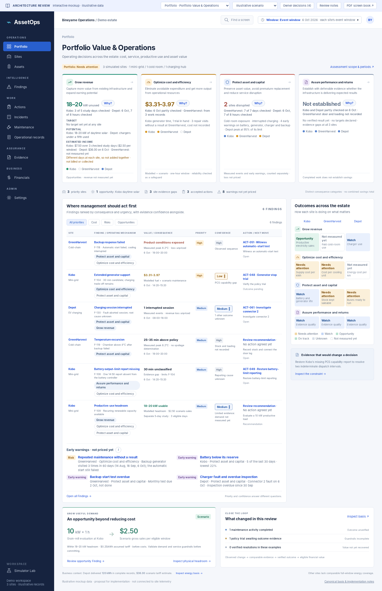
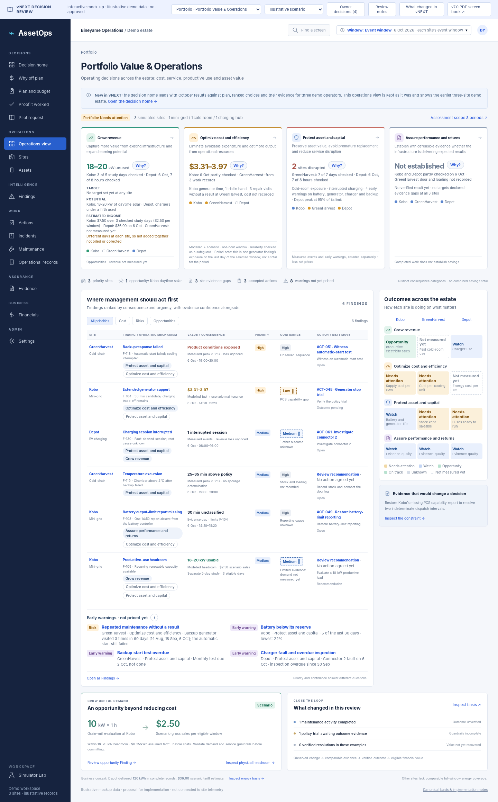

# Screenshot index

Captured by `tools/audit.mjs --shots` (headless Chromium, full page, 1440 px wide unless noted). Screenshots are supporting comparison only; the product artifact is the clickable `index.html`.

## Changed screen: before (v7.0) and after (vNEXT)

| Screen | v7.0 (before) | vNEXT (after) | What changed |
|---|---|---|---|
| Operations view (`#/portfolio`) |  |  | Decision-home banner; Optimize card basis gains the period note; menu gains the Decisions group and shows “Operations view”. |

The other 109 v7.0 screens are Preserved: same content, with only the shared menu and review bar changes listed in CHANGE-REGISTER §1 (visible in every vNEXT capture).

## Added screens (1440 px)

| Route | Title | Capture |
|---|---|---|
| `#/decide-lakeside` | Decision home | [decide-lakeside-1440.png](vnext/decide-lakeside-1440.png) |
| `#/bridge-lakeside` | Why we are off plan | [bridge-lakeside-1440.png](vnext/bridge-lakeside-1440.png) |
| `#/decide-harvest` | Decision home | [decide-harvest-1440.png](vnext/decide-harvest-1440.png) |
| `#/bridge-harvest` | Why we are off plan | [bridge-harvest-1440.png](vnext/bridge-harvest-1440.png) |
| `#/decide-metro` | Decision home | [decide-metro-1440.png](vnext/decide-metro-1440.png) |
| `#/bridge-metro` | Why we are off plan | [bridge-metro-1440.png](vnext/bridge-metro-1440.png) |
| `#/econ-kobo` | Kobo · site economics | [econ-kobo-1440.png](vnext/econ-kobo-1440.png) |
| `#/econ-kisiwa` | Kisiwa · site economics | [econ-kisiwa-1440.png](vnext/econ-kisiwa-1440.png) |
| `#/econ-mto` | Mto · site economics | [econ-mto-1440.png](vnext/econ-mto-1440.png) |
| `#/econ-mwea` | Room A · Mwea · site economics | [econ-mwea-1440.png](vnext/econ-mwea-1440.png) |
| `#/econ-thika` | Room B · Thika · site economics | [econ-thika-1440.png](vnext/econ-thika-1440.png) |
| `#/econ-kirinyaga` | Room C · Kirinyaga · site economics | [econ-kirinyaga-1440.png](vnext/econ-kirinyaga-1440.png) |
| `#/econ-embakasi` | Embakasi · site economics | [econ-embakasi-1440.png](vnext/econ-embakasi-1440.png) |
| `#/econ-kasarani` | Kasarani · site economics | [econ-kasarani-1440.png](vnext/econ-kasarani-1440.png) |
| `#/econ-ruiru` | Ruiru · site economics | [econ-ruiru-1440.png](vnext/econ-ruiru-1440.png) |
| `#/choice-kobo-generator` | Change when Kobo’s generator stops | [choice-kobo-generator-1440.png](vnext/choice-kobo-generator-1440.png) |
| `#/choice-kobo-battery` | Protect Kobo’s battery warranty | [choice-kobo-battery-1440.png](vnext/choice-kobo-battery-1440.png) |
| `#/choice-kisiwa-generator` | Restore Kisiwa’s backup generator | [choice-kisiwa-generator-1440.png](vnext/choice-kisiwa-generator-1440.png) |
| `#/choice-mto-inverter` | Restore Mto’s failed inverter | [choice-mto-inverter-1440.png](vnext/choice-mto-inverter-1440.png) |
| `#/choice-mto-demand` | Sell Mto’s spare daytime solar | [choice-mto-demand-1440.png](vnext/choice-mto-demand-1440.png) |
| `#/choice-mto-billing` | Bill the Mto customers missed after the meter swap | [choice-mto-billing-1440.png](vnext/choice-mto-billing-1440.png) |
| `#/choice-mwea-demand` | Fill Mwea’s empty space | [choice-mwea-demand-1440.png](vnext/choice-mwea-demand-1440.png) |
| `#/choice-thika-backup` | Protect Thika’s stock until the switch is fixed | [choice-thika-backup-1440.png](vnext/choice-thika-backup-1440.png) |
| `#/choice-kirinyaga-energy` | Bring Kirinyaga’s energy use back to normal | [choice-kirinyaga-energy-1440.png](vnext/choice-kirinyaga-energy-1440.png) |
| `#/choice-embakasi-schedule` | Charge Embakasi’s buses outside peak hours | [choice-embakasi-schedule-1440.png](vnext/choice-embakasi-schedule-1440.png) |
| `#/choice-kasarani-charger` | Keep Kasarani’s buses running while charger 2 is repaired | [choice-kasarani-charger-1440.png](vnext/choice-kasarani-charger-1440.png) |
| `#/choice-ruiru-expansion` | Can Ruiru take the city’s extra buses? | [choice-ruiru-expansion-1440.png](vnext/choice-ruiru-expansion-1440.png) |
| `#/plan-lakeside` | Plan and budget | [plan-lakeside-1440.png](vnext/plan-lakeside-1440.png) |
| `#/verify-lakeside` | Proof it worked | [verify-lakeside-1440.png](vnext/verify-lakeside-1440.png) |
| `#/pilot-lakeside` | Pilot request | [pilot-lakeside-1440.png](vnext/pilot-lakeside-1440.png) |
| `#/plan-harvest` | Plan and budget | [plan-harvest-1440.png](vnext/plan-harvest-1440.png) |
| `#/verify-harvest` | Proof it worked | [verify-harvest-1440.png](vnext/verify-harvest-1440.png) |
| `#/pilot-harvest` | Pilot request | [pilot-harvest-1440.png](vnext/pilot-harvest-1440.png) |
| `#/plan-metro` | Plan and budget | [plan-metro-1440.png](vnext/plan-metro-1440.png) |
| `#/verify-metro` | Proof it worked | [verify-metro-1440.png](vnext/verify-metro-1440.png) |
| `#/pilot-metro` | Pilot request | [pilot-metro-1440.png](vnext/pilot-metro-1440.png) |

## Interaction states (1440 px)

| State | Capture |
|---|---|
| Evidence drawer opened from the plan contribution figure | [evidence-drawer-1440.png](vnext/evidence-drawer-1440.png) |
| Plan and budget, $5,000 + letter of intent extended | [plan-lakeside-base-yes-1440.png](vnext/plan-lakeside-base-yes-1440.png) |
| Plan and budget, $5,000 + not extended | [plan-lakeside-base-no-1440.png](vnext/plan-lakeside-base-no-1440.png) |
| Plan and budget, $6,500 + letter of intent extended | [plan-lakeside-high-yes-1440.png](vnext/plan-lakeside-high-yes-1440.png) |
| Plan and budget, $6,500 + not extended | [plan-lakeside-high-no-1440.png](vnext/plan-lakeside-high-no-1440.png) |

## Phone width (390 px)

| Screen | Capture |
|---|---|
| `#/choice-embakasi-schedule` | [choice-embakasi-schedule-390.png](vnext/choice-embakasi-schedule-390.png) |
| `#/choice-kobo-generator` | [choice-kobo-generator-390.png](vnext/choice-kobo-generator-390.png) |
| `#/choice-mto-inverter` | [choice-mto-inverter-390.png](vnext/choice-mto-inverter-390.png) |
| `#/decide-harvest` | [decide-harvest-390.png](vnext/decide-harvest-390.png) |
| `#/decide-lakeside` | [decide-lakeside-390.png](vnext/decide-lakeside-390.png) |
| `#/decide-metro` | [decide-metro-390.png](vnext/decide-metro-390.png) |

All 48 vNEXT captures and 1 v7.0 capture are in this folder.

## Rev 2 refresh

Recaptured after the rev 2 fix round (all captures above are from the rev 2 build): plan-lakeside in four cases, choice-embakasi-schedule, choice-mto-inverter, choice-kasarani-charger, decide-harvest, decide-metro, econ-embakasi, econ-ruiru, econ-kasarani, and every other added screen.
