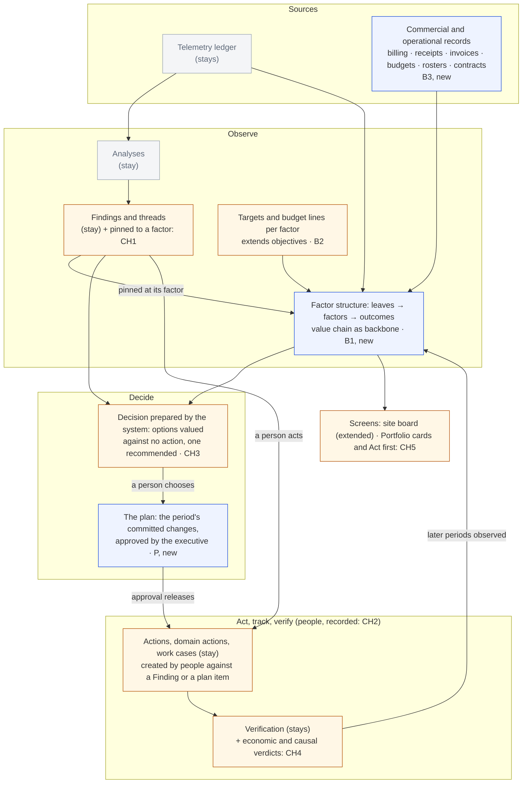
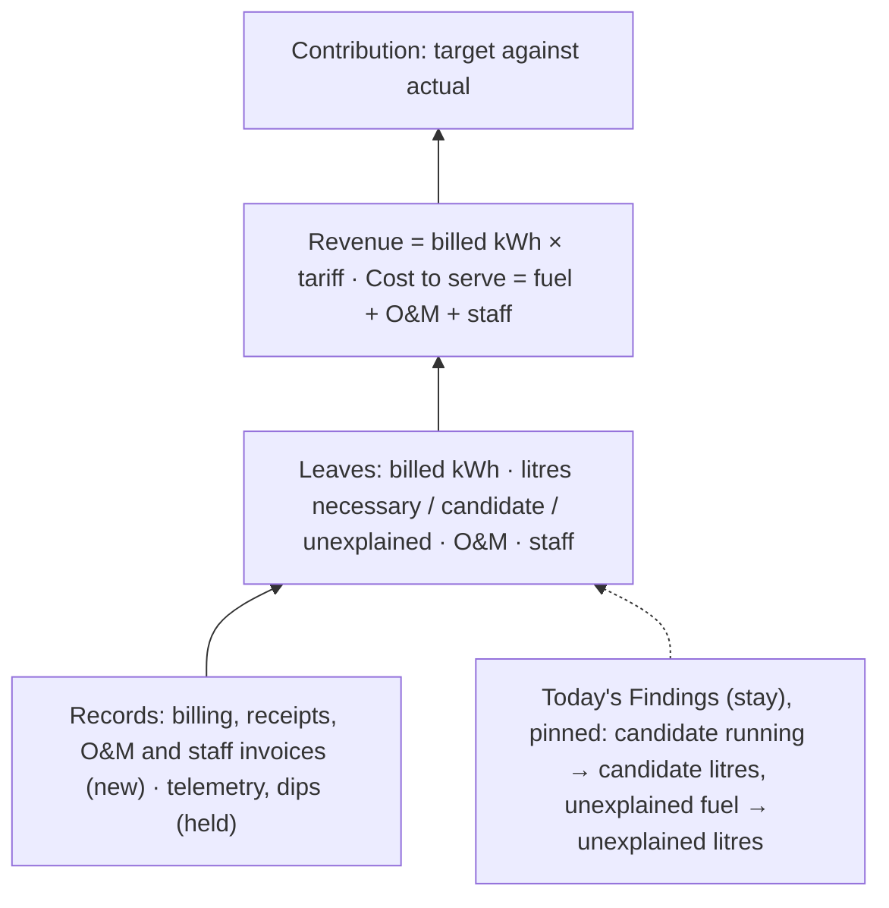
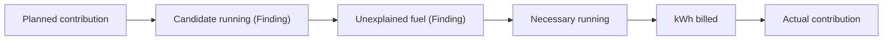
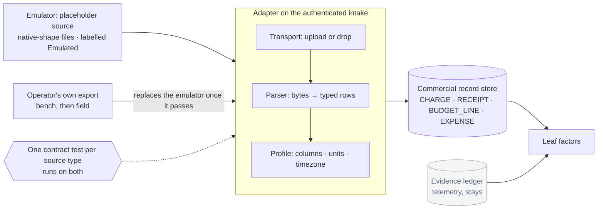
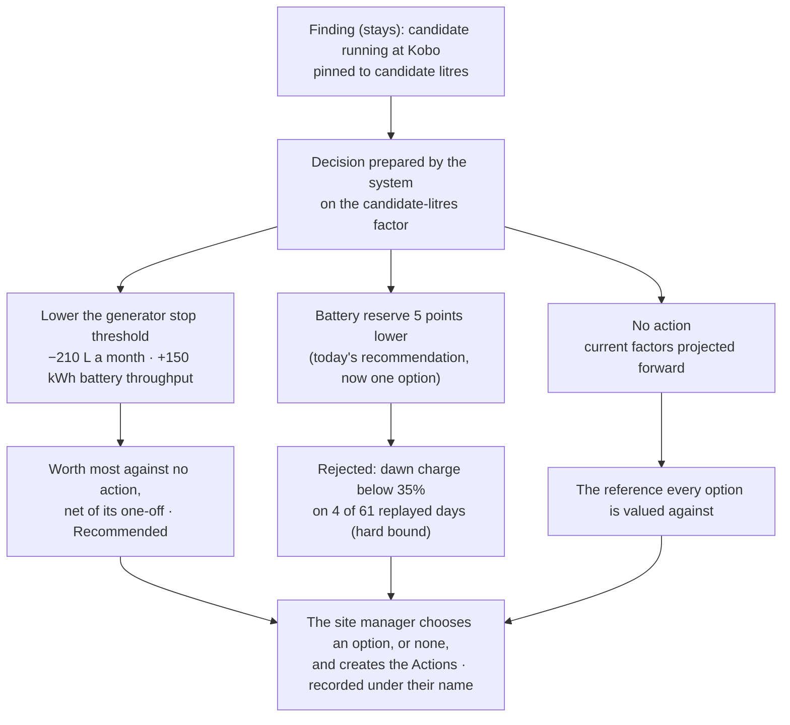
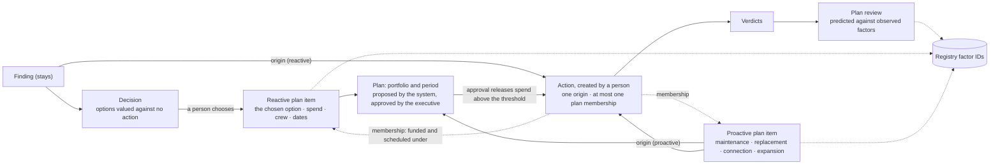
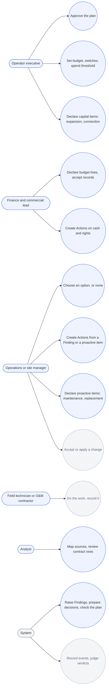
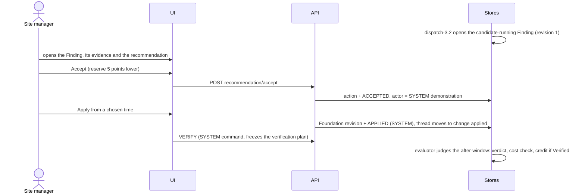
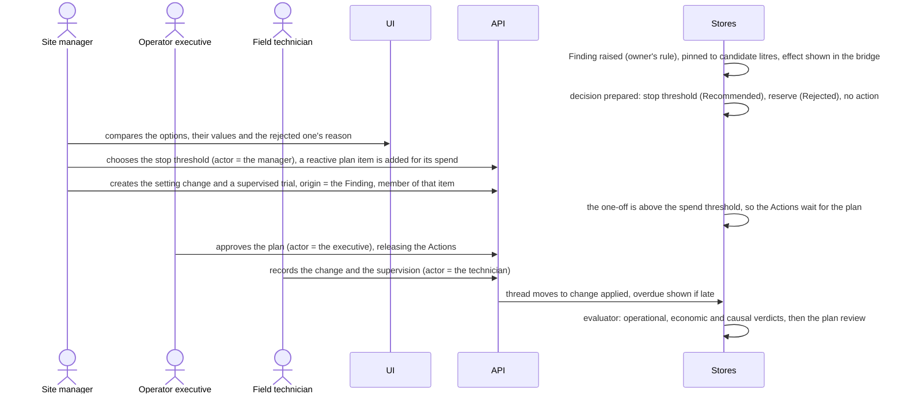
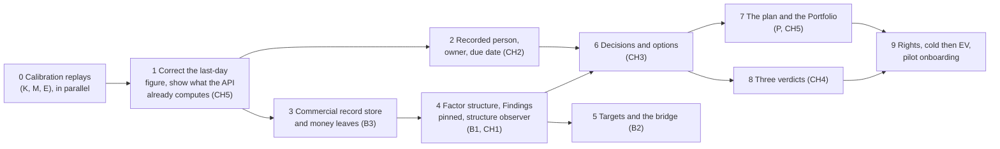

# AssetEcon Layer 4 design: more value on top of a solid core

**AssetEcon · Layer 4 architecture and demonstrator design · rev 16.2 · AssetOps Architect (Claude) · 19 Nov 2026**

**Status.** This is a design for owner review, regenerated at the owner's order and in the structure the owner set (`.agent/owner-design-regeneration-request-2026-11-19.md`). No code, test or database was changed. The revision history, the audit that drove it and the reviews are in `design-appendix.md` §4.

**Labels.**
- **[code-observed]**: read in code on this branch. Paths are under `backend/assetops_backend/`, or `backend/migrations/versions/` for migrations.
- **Default, awaiting the owner**: applied until the owner answers.
- **Money**: every money figure is illustrative. It comes from `demo-site-scenario-manifest.yaml` and is checked to the cent by `check_manifest.py`.

## Introduction

*Approved by the owner, 18 Nov 2026* (`.agent/owner-design-intro-and-motivation-request-2026-11-18.md`).

In short: **the brief exists to turn AssetEcon from a tool that tells operators what their assets did into one that tells them what it did to their money, what's worth doing about it, and whether it paid off. Every screen should earn its place by answering that.**

**The motivation:**
- **Operators already have monitoring.** Mini-grid, cold-chain and EV executives can see telemetry, alarms and dashboards. What they lack is economic judgement across their systems. Operational, commercial and contract facts sit in separate places, so no one can say with confidence why the month came in below plan, which lever moves it, and what it's worth.
- **The product had drifted towards "interesting signals with economic hints".** It showed findings and exposure figures, but not intentionally organised around the movers of the business. The brief corrects that.
- **Credibility is the differentiator.** Executives act only on figures they trust. So the brief insists on honest evidence: every figure says how it is known, figures of different kinds are never added together (inside the structure, a node built from mixed evidence takes its weakest class and names every source beneath it, and a benefit total admits only field records), savings are claimed only after proof, and the no-action baseline is always shown.

**The evolution it wants to inspire:**
1. **Outcomes defined structurally.** Each business outcome, such as contribution, cost to serve or service obligations, is declared as a structure of factors down to source records.
2. **Observed bottom-up.** Where the business stands, including any shortfall, is read upward through those factors, not detected at the top and explained afterwards.
3. **Choices, not just findings.** Options are valued as changes to factors against doing nothing. One plan fits the operator's budget, crews and contract rights.
4. **Proof.** The same factors are observed after the change: it happened, the money followed, and the action caused it.
5. **General, then particular.** One set of mechanics serves all three verticals. Kobo illustrates the design; it never defines it.
6. **Built on what exists.** Findings, threads, actions and what-ifs are extended and re-grounded on the structure rather than replaced, so the visible product becomes useful quickly.

**What it's ultimately for:** differentiation and usefulness that convert operator executives. They see their own money explained, their decisions compared, and results proven, which their monitoring tools can't do. The commercial path follows from that: demo, then a paid diagnostic on their records, then a proven change.

*Since revised by the owner (D1, 18 Nov): the engagement path is an initial call, a deep-dive, an integration pack, a pilot and then SaaS (`product-transition-and-roadmap.md` §2).*

## How to read this document

- **Part 1** describes today's product as the code runs it: the value it delivers, how an operator meets it, and its honest limits.
- **Part 2** describes what is added on top. For each construct it says what the construct brings, where it fits, and why it should help convert a client.
- **Changes to existing constructs.** Every change is named, with its shortfall against the objective and the code evidence (owner, 19 Nov: change "for merit and intentional clearly exposing the issue against the objective"). §2.9 is the single register of those changes.
- **Worked example.** The worked example is Kobo, a solar, battery and diesel mini-grid owned by the demonstration operator Lakeside Power. The design still covers the whole business: all Sites, all three verticals, the full value chain, O&M, contracts and capital.
- **Diagrams** appear only where something changes. Today's parts are greyed context. Full three-operator examples are in `worked-portfolios.md`.

**Words used here.**
- **Claim ceiling.** The most a Finding may claim, given its evidence.
- **Factor.** A measured quantity an outcome is built from, such as litres or kWh billed. A **leaf** is a factor evidenced directly by a source record.
- **Observer.** An analysis that measures a factor. A **structure observer** watches the computed structure itself, for example a factor running above target.
- **Bound.** A service or contract limit an option must respect, such as dawn battery charge of at least 35%. A *hard* bound rejects the option if broken; a *costed* one prices the breach into its value; an *advisory* one is shown, never decisive.
- **Disposition.** The system's verdict on an option: Recommended, Conditional, Acceptable, Deferred or Rejected. It is a recommendation, never a choice.
- **Switch.** An assumption a person can change, such as the budget, after which the proposal is recomputed.
- **Σ/Σ.** A portfolio ratio taken as the sum of numerators over the sum of denominators.
- **Parity test.** A check that the new structure reproduces today's outcome map before the map is removed.
- **Replay K.** A planned re-run of Kobo's recorded data under the new setting.
- **D-numbers.** Owner decisions (roadmap §6).

**Rules every figure follows** (unchanged from rev 15):
1. Every figure states how it is known, in words: *Recorded*, *Emulated*, *Measured*, *Calculated*, *Estimated*, *Quoted*, *Modelled*, *At stake, not money*, *Verified*, *Not available yet*.
2. Figures of different kinds are never added together. A node built from mixed evidence takes its weakest class. A benefit total admits only field records.
3. Unknown is never zero, and a missing record is named.
4. A factor appears once, so the same litre never carries money twice.
5. Savings are claimed only after proof. The no-action baseline is always shown.
6. No legal or insurance conclusion is drawn: "Coverage is decided by the supplier or insurer."

---

## Part 1. Today's architecture: the value it delivers and how

### 1.1 The value today's product delivers

Today's product turns raw Site evidence into **honest, bounded operational judgement that a person can act on and later verify**. For a mini-grid it answers five questions:
- *What happened, and how sure are we?* For example, Kobo's generator ran while the solar and battery could have carried the load. The product classifies this interval by interval and claims only what the evidence supports.
- *Is fuel missing?* Night by night, fuel is balanced against what the generator model explains.
- *What might it be worth?* A modelled range, labelled as such and never summed.
- *What should be looked at first, and what can be done?* A next step and, where the rule allows, a recommended setting change.
- *Was it done, and did it work?* The response is tracked, and a verification family judges it. Money is credited only after a Verified verdict.

Every Site and the Portfolio show four economic categories (Grow, Optimize, Protect, Assure). Each says plainly which records are still missing.

### 1.2 The mechanics, layer by layer

| Layer | What it does | Done well | Evidence [code-observed] |
|---|---|---|---|
| **Evidence** | Append-only ledger of every reading, with its source, unit, quality, live or simulated flag and an envelope hash | Provenance on every reading | `0005_evidence_ledger.py:161-197` |
| **Analyses** | Dispatch classification (necessary, candidate or indeterminate running); fuel balance per tank night; mini-grid depth reads; cold excursions and backup starts; EV sessions and availability | Deterministic and versioned; withholds rather than over-claims | `analytics/dispatch_v3.py:290-316`; `fuel_balance/rules.py:216-237`; `mini_depth/rules.py:285-384`; `analytics/cold.py:355-653`; `analytics/ev.py:540-713` |
| **Findings** | The stored, revised result of each evaluation (§1.3), with next-step text. Mini-grid dispatch Findings also carry a claim ceiling and rival explanations | Identity stable across re-evaluation; full history | `0009_finding_store.py:33-106`; `analytics/claim_limit_read.py:1-19`; `mini_decisions/alternatives.py:45-48` |
| **Act** | Accept a recommended trial; raise a domain action or a work case linked to a Finding; raise the mill-shift domain action from a headroom study (§1.4) | Event-sourced, idempotent, typed refusals | `action_api.py:152-232`; `work/domain_action.py:24-136`; `work/model.py:107-151`; `0051_action_opportunity_origin.py:1-12` |
| **Track** | Action and work events. The Finding's thread moves to action in hand, change applied, resolved and monitoring, or recurred. The Actions rail | The thread joins a Finding to what was done about it | `0042_chain_threads.py:64-71`; `chain/lifecycle.py:46-58`; `frontend/src/estate/actionIndex.tsx:38-160` |
| **Verify** | Three mini-grid families (reserve trial, midday mill shift, fuel residual) with frozen plans, comparability and guardrails. Verdicts are Verified, Ineffective or Inconclusive | Proof before credit; unknown families fail closed | `actions/verification_rules.py:675-815`; `actions/verification_families.py:502-516`; `actions/fuel_verification.py:146-164` |
| **Money** | Estimated (observed kWh × typed price) and Modelled (possible extra fuel cost, from 0 up to a bound). A post-trial cost check is credited only when Verified | Labelled; never summed across kinds | `financials/fuel_cost.py:22`; `financials/trial_fuel_comparison.py:1-44`; `outcomes/credit.py:57-73` |
| **Targets** | Six operational objectives, judged Met, Missed, On pace or Behind pace. They drive the outcome's state | Performance against target exists, in operational form | `outcomes/objectives.py:57-143`; `outcomes/status.py:55-104` |
| **Present** | The Site outcome board: per outcome, "What drives it", "Issues", "What can be done", "Already in hand", "Earlier interventions" and "Must not harm". The Portfolio: six tabs and four category cards. Act first groups Findings by placement, "never a value ranking" | The board's columns already run outcome → driver → issue → lever → action → result | `frontend/src/sites/OutcomeBoard.tsx:42-48`, `:262-330`; `site_outcomes/read.py:926-977`; `estate/placement.py:1-8` |

### 1.3 What a Finding is

**A Finding is the stored result of an analysis evaluating a declared condition over evidence, kept alive as the evaluation is re-run.** It is the output of the condition, not the condition itself [code-observed]:
- *Identity.* A Finding is unique per Site by its key. It names its analytic, mechanism and asset, and the Finding it recurs after (`0009_finding_store.py:33-60`).
- *Living history.* Each re-run appends a revision with a typed transition: opened, support changed, re-evaluated, split, merged, unconfirmed, no longer supported, reopened. Each revision carries a claim, limitations and evidence digests (`0009:62-106`).
- *Thread.* The thread is its recurrence history. Its states record the response: action in hand, change applied, resolved and monitoring, recurred, withdrawn (`0042_chain_threads.py:64-71`).
- *What it does not carry.* No money: that sits in separate consequence tables. No owner, and no link to an outcome except a fixed mechanism-to-outcome row (`outcomes/outcome_map.py:17-23`).

**When a Finding is raised: the owner's rule** (19 Nov, verbatim): "a finding should have impact on the bottomline or is a risk or an opportunity - which means it needs to be acted on and the user likely reate one more action against it". I read this as follows. A Finding is raised only for one of three things:
- an adverse **bottom-line impact**: cost above target, revenue or cash below target, or unexplained fuel;
- a **risk** to an obligation, asset or right;
- an **opportunity** someone can act on, such as customer demand with evidence.

**The owner decided (19 Nov) that a configurable tolerance per factor decides** whether a small adverse deviation is raised. A favourable or neutral movement with nothing to act on stays in the figures and is not a Finding.

Today's five mechanisms all pass this rule:
- candidate running and unexplained fuel are bottom-line impacts;
- cold excursion, backup start failure and EV interruption are risks.

Dispatch also marks *indeterminate* running as raising a Finding (`analytics/dispatch.py:40`, `:1070`). Where it does, it is a risk of unknown size, to investigate.

### 1.4 The user's workflow today

| Who | Sees | Does | How it is recorded today |
|---|---|---|---|
| Operator executive | Portfolio cards, Act first, Outcomes by site, What changed | Decides where to look first | Nothing is recorded |
| Site or operations manager | The Finding, its evidence, alternatives and next step; the recommendation (Kobo: battery reserve 5 points lower) | **Accepts** the trial, then **applies** it from a chosen time. Applying publishes a Site configuration revision, not a device command | ACCEPTED and APPLIED events, **recorded as a "SYSTEM demonstration" actor**, "no operator approval is recorded" (`actions/lifecycle.py:43-58`; `0016_action_store.py:131-132`) |
| Site manager or technician | Site Work: domain actions (cold, EV, mill shift, fuel-balance work) and work cases | Raises a domain action (with an optional owner label and due date) or a work case (a title, plus an assignee once assigned); assigns, completes, closes | Events with actor and time. A user actor is refused and a server service principal is required (`work/model.py:284-285`). No UI control creates them yet |
| Site manager | A five-day headroom study, with demand and collection "unverified" | Raises the mill-shift domain action from the study | Same limits as the row above: a service principal and no UI control. The mill plan is frozen once, at story time, with no route (`actions/verification_families.py:7-9`). The Action carries its opportunity origin (`0051_action_opportunity_origin.py:1-12`), and the study sits on its own thread with no Finding (`0042_chain_threads.py:43-62`) |
| System | — | A VERIFY command freezes the verification plan; the evaluator then judges the after-window | The command never supplies a verdict (`actions/lifecycle.py:26-28`). The evaluator appends it (`:24-25`) |

**Kobo, end to end, today:**
1. Dispatch opens a candidate-running Finding for October.
2. The manager reads it with its possible extra fuel cost (a modelled range for one day), then accepts and applies the reserve trial.
3. The thread moves to *action in hand*, then *change applied*.
4. The reserve-trial family compares two matched hours and returns a verdict.
5. If the verdict is Verified and the modelled fuel cost per kWh fell, the result is credited, listed and never summed.

The headroom study takes a separate path, with no Finding: study → mill-shift Action → midday-shift verification (`mini_decisions/projection.py:29`; `actions/verification_families.py:12-22`). It shows headroom, not a customer (`mini_decisions/opportunities.py:366-401`).

**The system never acts on its own.** It writes no device command and sends no notification. "No telemetry creates an Action or a case link" (`work/domain_intent.py:17`).

### 1.5 The whole business today, and its limits

| Stage of the business | Mini-grid | Cold room | EV depot |
|---|---|---|---|
| Service delivered | **Held**: telemetry; dispatch, service and backup reads | **Held**: temperatures, backup starts | **Held**: sessions, kWh, availability |
| Billing and collection | Not held ("billing and payment records are not connected yet") | Not held (occupancy, storage contracts) | Not held. A captive fleet earns no charging revenue, which today's model cannot express |
| Cost to serve | Fuel litres held; diesel price typed; O&M and staff not held | Cooling energy not held | Tariff typed; utility invoices not held |
| O&M and work | Work cases, maintenance plans and operational records held, for all three verticals | Same | Same |
| Contracts and capital | Warranty only as withheld fields (`sites/battery_boundary.py:26`); no capital view | None | None |
| Targets | Operational objectives only | Backup-start objective; chamber policy | Interrupted-session objective; a cost-per-km target, never judged |

Sources: `outcomes/catalogue.py:43-68`; `chain/strategies/recorded_amount.py:1-10` ("returns no money with NO_RECORDS, always") [code-observed].

| # | Limit, measured against the objective | Evidence [code-observed] |
|---|---|---|
| L1 | **Outcomes are flagged, not computed.** A fixed map links signals to outcomes, and drivers are named only in words. So no one can say how far below plan the month is, or which factor moved it | `outcomes/outcome_map.py:17-37`, `:149-180`; `site_outcomes/mini.py:1156-1177` |
| L2 | **No value chain and no recorded money.** Revenue, cash, cost to serve and contribution cannot be stated (the table above) | `chain/strategies/recorded_amount.py:1-10` |
| L3 | **Targets are operational and system-declared** ("not a customer target"). There are no money targets and no budget, so there is no plan-against-actual bridge | `objectives/model.py:23-24`; `site_outcomes/ev.py:109` |
| L4 | **Few inputs beyond telemetry.** Inputs are the field gateway, reading upload, operational entries and typed prices. No client calls any external system | `reading_upload_api.py:113`; `work/operational_entry.py:25-30`; `financials/assumptions.py:32-58` |
| L5 | **One fixed option, never compared with doing nothing.** The only option is reserve − 5 points, which "does not predict … any saving", and the what-ifs are gross figures only | `actions/reserve_trial.py:37`, `:42-45`; `mini_decisions/scenario_rules.py:191-228` |
| **G1** | **No recorded person.** Trial commands are a SYSTEM demonstration, work writes refuse a user actor, and trials have no owner or due date. Acting and tracking hold on screen but not in the records | `actions/lifecycle.py:43-58`; `work/model.py:284-285`; `estate/coverage.py:530`; `main.py:640-661` |
| L6 | **Verification is operational only.** It covers mini-grid only, fixes the change's cost at 0, and admits positive evidence only if simulated or authored | `actions/verification.py:1167`; `actions/verification_rules.py:688` |
| L7 | **The mini-grid Optimize card shows one day over a period range**, so it can read as the period's cost | `site_outcomes/read.py:676-682` |

---

## Part 2. The proposed architecture: more value on top

### 2.0 What is added, and where it fits

**What stays.** Part 1's core stays as it is: evidence, analyses, Findings and threads, the act-and-track carriers, verification, the honesty rules and the screens' frame.

**What is added.**
- Three **boosters** the owner named (B1–B3).
- The **plan**, a new construct the owner confirmed (P).
- Five named **changes to the core** (CH1–CH5).

The aim is to convert operator executives by showing them their own money explained, their choices compared and results proven. That this beats their monitoring tools is the hypothesis the pilots must confirm.

| ID | Construct | What it brings | Fills |
|---|---|---|---|
| **B1** | Factor structure, from leaves up to outcomes, with the value chain as its backbone | Every outcome computed; every driver a quantity | L1, L2 |
| **B2** | Targets and budget lines at factor level, extending today's objectives | Performance against target in money and service; the bridge | L3 |
| **B3** | Commercial and operational integrations through one canonical contract | The data B1 and B2 need | L4 |
| **P** | The plan: a portfolio's committed changes for a period, approved by the executive | Cross-Site trade-offs and spend approval, with no other home today | L5, G1 |
| **CH1** | Findings pinned to the factor they observe | Findings enter the bridge, unchanged in nature | L1 |
| **CH2** | A recorded person: creator, chooser, approver, owner and due date | Decisions and accountability a client can see | G1 |
| **CH3** | Options valued against doing nothing | Choices compared in money, net of their cost | L5 |
| **CH4** | Economic and causal verdicts; field evidence; the option's cost | Proof that the money followed | L6 |
| **CH5** | Portfolio cards read from the structure; the last-day figure corrected | Screens that answer the money question | L7 |

<!--Figure 1: where the new constructs fit-->

*Figure 1. Where the new constructs fit. Grey stays as it is; blue is new; amber is existing, with a named change. A verified change comes back only as observed factors of later periods.*

### 2.1 B1: the factor structure, discipline from drivers to outcomes

**What it brings.** Each outcome is declared as a structure of factors down to leaves that a source record evidences, and outcomes are computed upward, never typed in. Four relations are used, all from the brief:
- identities: contribution = revenue − cost to serve;
- products: fuel cost = litres × price; revenue = billed kWh × tariff;
- value-chain stages: delivered → metered → billed → collected, with losses and adjustments as named leaks;
- physical splits: generator litres = necessary + candidate + unexplained, as dispatch and the fuel balance already observe.

Each leaf carries a shared factor ID, a period, a unit, a target, an evidence class and its provenance, so it carries money once. **Why it should convert:** monitoring shows that the generator ran; this is meant to show what that did to contribution.

**Where it fits.**
- It sits above the evidence ledger. The analyses (which stay) become the observers of its physical leaves.
- **Named change (L1):** today's outcome map, a fixed list of signal-to-outcome rows, becomes rows of this structure. It keeps its code-registry form and start-up check, and the old literal is removed only after a parity test passes.
- The site board's driver lines, written per vertical today, are generated from the structure.
- **The same shape serves every vertical.** A cold room's contribution is chargeable crate-days × rate − cost to serve. A captive EV depot is judged on cost per required departure met, with revenue *not applicable*, never zero. Protect is a structure of measured factors too (unserved critical kWh, crate-minutes above limit, departures missed). Capital choices are options over a longer horizon. The three-vertical table is in `worked-portfolios.md` §1.0.

**CH1: Findings pinned to their factors.**
- *Stays:* everything that makes a Finding a living artifact: its identity, revisions, thread, claim ceiling and next step.
- *Changes:* each mechanism gains the factor it observes through one row of the registry, derived at read time, so no column is added. Candidate running maps to candidate litres, unexplained fuel to unexplained litres, a cold excursion to crate-minutes above limit, and an EV interruption to chargers in service. Merit: today a Finding's only link to an outcome is a fixed row (`outcomes/outcome_map.py:17-23`), so it cannot enter a bridge.
- *Deviations found in the structure:* a **structure observer** stores these as Findings, with the same identity, revisions and thread, but only under the owner's rule and outside the factor's tolerance (§1.3).
- *What a Finding may claim:* its condition, in its factor's unit and period, within its claim ceiling. It never claims an outcome value of its own, or the value of acting.

**Kobo in October, under the owner's rule:**
- **Necessary running above target (−37.50)** is a bottom-line impact, so it is raised if it is outside its tolerance.
- **Outstanding bills (278.00<!--fig:sites.lakeside-power/Kobo.actual.nodes.outstanding-->)** are a cash risk, raised for the finance lead.
- **kWh billed above target (+38.00)** is favourable, so it is **not** a Finding.
- **Headroom with no customer** is a capacity factor. It becomes an opportunity Finding only once there is a signed letter of intent.

<!--diagram:factor-structure-->

*Figure 2 (drawn in the HTML twin). Kobo's October contribution, read upward: 1,445<!--fig:sites.lakeside-power/Kobo.plan.nodes.contribution--> planned and 883<!--fig:sites.lakeside-power/Kobo.actual.nodes.contribution--> actual. Today's two Findings are pinned to the candidate litres (330<!--fig:sites.lakeside-power/Kobo.actual.nodes.candidate_l--> L) and the unexplained litres (120<!--fig:sites.lakeside-power/Kobo.actual.nodes.unexplained_l--> L). Of 3,458.00<!--fig:sites.lakeside-power/Kobo.actual.nodes.revenue--> billed, 3,180.00<!--fig:sites.lakeside-power/Kobo.actual.nodes.collected--> was collected.*

### 2.2 B2: performance against target, from objectives to a bridge

**What it brings.** Targets and budget lines are declared at factor level. The targeted outcome is then the same structure evaluated on the targeted factors. The gap between target and actual is attributed to the factors that caused it:
- exactly, for sums;
- by a declared rule, for products;
- with an explicit residual only where a leaf is unobserved.

**Why it should convert:** it is meant to answer the question the brief puts first, *why did the month come in below plan, and by how much from each cause?*

**Where it fits.** Today's objectives stay, and each becomes the target of the factor it measures. **Named change (L3):** today a SYSTEM declarer sets them, "for the demonstration; not a customer target" (`objectives/model.py:23-24`). Under B2 the operator declares targets and budget lines, and the declarer is recorded (CH2). The "N of M objectives met" line stays beside the bridge.

<!--diagram:plan-against-actual-->

*Figure 3 (drawn in the HTML twin). Kobo, October: −562.00<!--figx:{sites.lakeside-power/Kobo.actual.nodes.contribution}-{sites.lakeside-power/Kobo.plan.nodes.contribution}--> in all. Candidate running −412.50<!--figx:-({sites.lakeside-power/Kobo.actual.nodes.candidate_l}-{sites.lakeside-power/Kobo.plan.nodes.candidate_l})*{sites.lakeside-power/Kobo.actual.nodes.diesel_price}-->, unexplained fuel −150.00<!--figx:-({sites.lakeside-power/Kobo.actual.nodes.unexplained_l}-{sites.lakeside-power/Kobo.plan.nodes.unexplained_l})*{sites.lakeside-power/Kobo.actual.nodes.diesel_price}-->, necessary running −37.50<!--figx:-({sites.lakeside-power/Kobo.actual.nodes.necessary_l}-{sites.lakeside-power/Kobo.plan.nodes.necessary_l})*{sites.lakeside-power/Kobo.actual.nodes.diesel_price}-->, kWh billed +38.00<!--figx:({sites.lakeside-power/Kobo.actual.nodes.billed_kwh}-{sites.lakeside-power/Kobo.plan.nodes.billed_kwh})*{sites.lakeside-power/Kobo.actual.nodes.tariff}-->. Two of the four effects already have a Finding today. A month with no Finding still shows its bridge.*

**At Portfolio level.** Portfolio outcomes compose Site factors as Σ amounts and Σ/Σ ratios. Lakeside in October:
- **Volume:** metered 21,700<!--fig:portfolio.lakeside-power.actual.sums.metered_kwh--> kWh; billed 21,445<!--fig:portfolio.lakeside-power.actual.sums.billed_kwh--> against a target of 21,650<!--fig:portfolio.lakeside-power.plan.sums.billed_kwh-->.
- **Revenue and cash:** revenue 9,688.00<!--fig:portfolio.lakeside-power.actual.sums.revenue-->, of which 8,870.00<!--fig:portfolio.lakeside-power.actual.sums.collected--> was collected.
- **Cost to serve:** 8,245.00<!--fig:portfolio.lakeside-power.actual.sums.cost_to_serve--> against 7,490.00<!--fig:portfolio.lakeside-power.plan.sums.cost_to_serve-->.
- **Contribution:** **1,443.00<!--fig:portfolio.lakeside-power.actual.sums.contribution--> against 2,295.00<!--fig:portfolio.lakeside-power.plan.sums.contribution-->**.

### 2.3 B3: commercial and operational integrations fill the data gap

**What it brings.** Each leaf needs one family of source records, which sets the integration scope. **Why it should convert:** during the deep-dive (D1), the operator's own exports pass through the canonical contract, so their plan against actual appears in the product within weeks.

| Value-chain stage | Mini-grid source | Cold-room source | EV depot source | Held today? |
|---|---|---|---|---|
| Service delivered | EMS, inverter, BMS and genset telemetry | chamber controller, energy meter | CPMS / OCPP log, site meter | telemetry **yes** |
| Chargeable service | meter register (meter ↔ customer) | storage ledger | fleet roster; session ↔ bus | new |
| Revenue and cash | billing or vending export; receipts, mobile-money settlements | invoices, receipts | not applicable (captive) | new |
| Cost to serve, O&M | fuel notes and dips; O&M and staff invoices | electricity bills, service invoices | utility invoice with time-of-use lines | fuel **yes** |
| Budget | monthly budget lines by Site | same | same | new |
| Contracts and rights | warranty, EPC, O&M/SLA, insurance documents; notices | same | same | new |

**Where it fits.**
- Telemetry and today's operational records stay where they are.
- Money records get **one new commercial record store**, with an immutable raw payload and source-versioned revisions. A late record revises closed periods.
- **Named change:** this store is separate because today's intake is first-write-wins and refuses late intervals (`evidence/service.py:484-492`; `reading_upload/service.py:244-248`). That suits telemetry and does not suit bills.
- Contract rows are extracted with AI assistance, and a person approves each one. The pilot asks per vertical are in `design-appendix.md` §5.

<!--Figure 4: one contract for every source-->

*Figure 4. An emulator and the operator's own export feed the same adapter and pass the same contract test. Emulated figures are never shown as Recorded, and never counted as benefit (D14).*

### 2.4 CH3: choices valued against doing nothing, and who acts

**Named change (L5).** Today a candidate-running Finding gets one recommendation, reserve − 5 points, which "does not predict … any saving" (`actions/reserve_trial.py:42-45`). Nothing weighs it against another option or against doing nothing.
- *What stays:* the reserve rule, which becomes one option generator; the what-if records, which become an option's calculation record; and the possible extra fuel cost, which stays an *at-stake* bound and is never an option's value.
- *What it brings:* when a Finding sits on a factor with a declared lever, the system **prepares a decision**. Options are factor changes over a horizon and always include **no action**. Each option is valued by one rule:

> value(option) = Σ over the horizon [ outcome(structure | the option's factor changes) − outcome(structure | no action) ] − ( the operator's one-off cost under the option − under no action )

Each option is checked against the bounds and given a disposition. **Why it should convert:** the contrast is meant to persuade. The highest diesel user may have nothing worth changing, and the obvious setting may fail a service rule.

<!--Figure 5: a decision at Kobo-->

*Figure 5. A decision at Kobo. The stop-threshold change cuts candidate running by 210<!--fig:options.KOB-STOPSOC.params.avoided_candidate_l--> L a month and adds 150<!--fig:options.KOB-STOPSOC.params.added_throughput_kwh--> kWh of battery throughput. It is worth +250.50<!--fig:options.KOB-STOPSOC.monthly_or_horizon_change--> a month against no action, and 2,916.00<!--fig:options.KOB-STOPSOC.value--> over twelve months after its 90.00<!--fig:options.KOB-STOPSOC.operator_one_off--> one-off. These are design values until replay K runs. The reserve change fails the dawn bound on 4<!--fig:options.KOB-RESERVE.params.dawn_days_below_35pct--> of 61 replayed days.*

**Who chooses, and who creates the Action.** The owner said a Finding "needs to be acted on and the user likely reate one more action against it", and asked first about "users to act on the bases of context given to them, then tracked". So the system evaluates and proposes, and people choose and act:
1. **The system raises the Finding and proposes.** It values the options and marks one Recommended. It picks nothing.
2. **The accountable role chooses** an option, or none: the site or operations manager for operations and O&M, the finance and commercial lead for billing, collection, claims and notices, and the executive for capital choices.
3. **That role creates one or more Actions**, against the Finding or against a plan item (§2.5). Each records its creator, owner and due date.
4. **Release.** Every Action's spend and crew visits count in the period's plan. An Action is released when it is created if its one-off spend is at or below the **spend threshold**, a Site or portfolio setting (owner, 19 Nov), and the plan still fits its budget and crew visits. Otherwise it waits for the plan's approval. Kobo's stop-threshold change spends 90.00<!--fig:options.KOB-STOPSOC.operator_one_off--> and no crew visit. Under a threshold of at least that amount it goes ahead at once, still counted in the plan. Under a lower threshold, or none set, it waits.

### 2.5 P: the plan, a first-class construct (new)

**The owner's decision (19 Nov):** "a plan is a legitmate new construct and need to be added as such and integrated with the existing constructs. e.g an action be raised against a plan or a finding."

**What it is.** The plan is one portfolio's committed changes for one period, together with the budget and crew visits they use. It records:
- its **items**: each a chosen option from a decision, or a change declared straight into the plan (scheduled maintenance, a capital project, a collection drive);
- each item's Site, target factors, frozen prediction, spend, crew visits, dates and dependencies;
- the items left out, each with its reason;
- the switches set, the approver and the version.

Its states are draft, proposed, approved, revised and closed.

**Why it is needed, on merit.** The objective asks which Sites and investments earn most from existing capital, and where limited crews should work (brief L1.3). Choices made Site by Site can each be right while the set breaks the budget, overruns the crew visits, or misses a dated dependency. For example, the Mto huller needs the inverter restored first. No budget, crew or cross-Site construct exists in today's backend or schema (the only "budget" hits are frontend layout code).

**Who owns it.** The **operator executive** owns the plan, because it commits the budget and crews and trades one Site against another. If the cooperative does not extend its letter of intent, keeping the Mto huller means buying the inverter now and dropping the Kisiwa repair. That leaves 125 evening hours without backup instead of 15 (`worked-portfolios.md` §1.1). Only the budget holder can make that trade.

**How it connects to the existing constructs.**

| Construct | Connection |
|---|---|
| Finding | A chosen option from a decision on the Finding becomes a **reactive** plan item if it spends shared budget or crew. The Finding stays its trigger and evidence |
| Decision | Supplies the options and their values. Only a person's choice turns an option into an item |
| Action | Two separate links (coordinator's refinement, adopted): **Origin**, exactly one, saying why the work exists. It is a **Finding** (reactive) or a **plan item** (proactive work no Finding triggered: scheduled maintenance, a budgeted replacement, a new connection, an expansion). Today's opportunity study stays a third, legacy origin; see the note below. **Plan membership**, at most one, saying what the work is funded and scheduled under. It is the plan item that counts its spend and crew visits. A Finding-origin Action that spends shared budget or crew joins the period's plan through the reactive item for its chosen option. A proactive item's Actions are members of that same item. So the same work is never counted twice: spend and crew are counted once, on the item. An Action may also name the decision option it carries |
| Verdict | Each item's Actions are verified as today, plus the economic and causal verdicts (§2.7). At the period's end the plan's predicted factor changes are set against what the bridge observed. The plan's realised value comes only from economic verdicts |
| Registry | Items key to the factor IDs their options change, so the next period's bridge shows each planned change beside the observed one |

**The system's part.** The system assembles the chosen items. It checks them against the budget, crew visits and dates. Where they do not fit, it proposes the nearest set that does: fewest service-rule breaches first, then the highest value, then the lowest spend, with a reason for every item left out. That is a proposal; the executive approves the plan or sends it back. An Action whose item the approved plan leaves out is not released. It returns to its creator with the reason, and the creator revises it, defers it to the next plan, or withdraws it (**default, awaiting the owner, Q-B1**). In Lakeside's demonstration the managers take the Recommended options, and the full proposal is in `worked-portfolios.md` §1.1.

<!--Figure 6: the plan among the constructs-->

*Figure 6. The plan among the constructs. Each Action has one origin: a Finding (reactive) or a proactive plan item. It also has at most one plan membership, which says what funds and schedules it. Spend is counted once, on the item. The plan releases what needs approval and is reviewed against observed factors.*

**Architect's note to the owner: where I agree, and two refinements you asked me to raise.**
- **Agreed.** The plan is a first-class construct. It is the only home for the cross-Site trade-off and its approval, and an Action may be raised against a plan item or a Finding.
- **The coordinator's refinement, adopted on merit.** It separates an Action's *origin* (why the work exists) from its *plan membership* (what funds and schedules it). Merit: without the split, a Finding-origin Action that spends budget would need either a second origin or a plan item standing in for its Finding. Either way its spend could be counted under both. With the split, spend and crew are counted once, on the item, and the Finding stays the reason.
- **One refinement to it: keep a third, legacy origin.** Today's mill-shift Actions originate from an opportunity study (`0051_action_opportunity_origin.py:1-12`). They stay valid and keep that origin. New demand work comes through an opportunity Finding (a Finding origin) or a proactive item, so no new Action takes the legacy origin. Separately, the rule says a Finding-origin Action "joins the plan so the executive approves it". With your spend threshold, it always *joins* the plan, so it is always counted, but it waits for approval only above the threshold.
- **Refinement 1: an item must name what it moves.** An item declared straight into the plan, with no Finding or decision behind it, should still name the factor or Protect measure it is meant to move. Otherwise it should be marked "no factor (upkeep or compliance)" and carry no value. Without this, the plan's value would include claims that cannot be verified.
- **Refinement 2: one name, one meaning.** "Plan" already meant targets and budget in rev 16. This revision calls those **targets and budget lines** (B2) and keeps **plan** for this construct only. If you prefer another screen name, such as "action plan", it is a label change.

The plan's own state is derived from its items and Actions. It is not a second execution workflow.

### 2.6 CH2: the person in the loop, recorded

**Named change (G1).** Today the act-and-track path is built for a person, but no person is recorded:
- trial commands are a "SYSTEM demonstration" (`actions/lifecycle.py:43-58`);
- work writes refuse a user actor (`work/model.py:284-285`);
- trials have no owner or due date (`estate/coverage.py:530`).

**What stays:** the carriers, their events and commands, idempotency, the thread link and the Actions rail.

**What changes:**
- An authenticated user is recorded on every command. The schema already has the pattern: a HUMAN actor needs an author, though the API refuses one today (`0010_financial_assumptions.py:57-78`; `financial_api.py:209`).
- Every Action records its creator, owner, due date and origin.
- The UI gains the controls that exist today only as API routes.
- Overdue is computed for Actions, as it already is for maintenance plans (`outcomes/plan_due.py:1-33`).

**Roles** (owner, Q-A2: "a few sensible roles"). Roles govern who may decide and what is recorded. They are not views: every role sees the same screens (owner, 17 Nov). Everything a role does is recorded under the person's name, with the time.

| Role | Decides | Does |
|---|---|---|
| **Operator executive** | Approves the plan; sets the budget, the switches and the spend threshold; makes capital choices and declares capital items (expansion, new connections) | Approves or sends back the plan, with a trade-off |
| **Finance and commercial lead** | Declares budget lines; accepts imported records; chooses claims, notices and collection actions; sets money tolerances | Creates Actions against money and rights Findings; files rights events |
| **Operations or site manager** | Chooses options within operational decisions; declares proactive items (maintenance, replacements); sets operational tolerances | Creates Actions from Findings or proactive items; applies setting changes; assigns work |
| **Field technician or O&M contractor** | — | Does the work; records readings, dips and completion |
| **Analyst** | Maps sources to factors; places data-quality holds | Onboards sources; reviews extracted contract rows |

The system raises Findings, prepares and values decisions, recommends, rejects options that break a hard bound, checks that the plan fits, and records. **It never chooses, approves or creates an Action.**

<!--Figure 7: who decides, acts and is recorded-->

*Figure 7. Use cases, drawn as a flowchart (Mermaid has no use-case type). Blue is new and grey stays. Every use case is recorded under the person who performed it.*

**Kobo's Finding through decide, act, track and verify, before and after.**

<!--Figure 8a: today (context)-->

<!--Figure 8b: with the boosters-->

*Figure 8. Before: one option, and the manager's acts are recorded as SYSTEM. After: the system proposes; the manager chooses, which adds a reactive plan item; the manager creates the Actions (origin: the Finding; membership: that item); and the executive's approval releases them. The approval step applies because the change's 90.00<!--fig:options.KOB-STOPSOC.operator_one_off--> one-off is above this example's spend threshold; under a higher threshold the Actions would be released at once. Each act carries its person.*

### 2.7 CH4: proof that the money followed

**Named change (L6).** Today's verdict is operational and mini-grid only. The change's cost is fixed at 0 (`actions/verification.py:1167`), and positive evidence must be simulated or authored (`actions/verification_rules.py:688`), so money cannot be proven on a customer's Site.
- *Stays:* the plan freeze, comparability, guardrails, fail-closed families and the operational verdict. The post-trial cost check and its credit rule seed the economic verdict.
- *Brings:* the frozen prediction becomes the target, and its bounds become the guardrails. Three verdicts are given on the same factors: **operational** (did the factor move, with the bounds held?), **economic** (did money move, in recorded records?) and **causal** (comparable days and untreated Sites as controls). Field evidence is admitted with its label. The option's cost replaces 0. "Not proven yet" is a verdict, not a pass.

<!--Figure 9: proof-->

*Figure 9. Proof for Kobo's stop-threshold change. A prediction is never relabelled as realised. A late record can withdraw a verdict, but never silently.*

### 2.8 CH5: what the client sees

The frame stays: the rail with no new menu items, the six Portfolio tabs, the range bar, the coverage line, the drill-down pages and "not available yet".

| Screen | Today | Change |
|---|---|---|
| Overview cards | Estimated income; a cost claim per Site; counts | Each card read from its factors against target, with its evidence class (L1, L2) |
| Optimize (mini-grid) | The window's last day over a period range | Corrected first, then the period's cost factors (L7, `site_outcomes/read.py:676-682`) |
| Act first | Findings in placement groups | The Finding triage stays first, with the plan beside it |
| Outcomes by site and the site board | Statuses; drivers in words | Drivers become factor rows. "Issues" shows Findings on their factors; "What can be done" opens the decision; "Already in hand" shows Actions and plan items |
| Opportunity | A headroom study | Renamed *Demand and capacity*: headroom stays capacity, and demand needs evidence |
| What changed | Accepted actions, verifications | Actions with owners, the plan's review and the three verdicts |

### 2.9 Change register and delivery order

A construct stays unless a row below names its shortfall. Dispositions at function level are in `repo-reuse-and-gap-matrix.md`.

| Construct | Stays or changes | Shortfall, with evidence | Change |
|---|---|---|---|
| Evidence ledger, gateway, analyses, placement, never-sum rules | Stay | — | Analyses also observe leaves |
| Findings, revisions, threads, alternatives | Stay, plus CH1 | No factor link: `outcome_map.py:17-23` | Pinned to a factor; structure observer, under the owner's rule and tolerance |
| Outcome map | Changes (B1) | No quantity between signal and outcome: `outcome_map.py:149-180` | Becomes structure rows, behind a parity test |
| Objectives | Extended (B2) | System-declared: `objectives/model.py:23-24` | The target of a factor, declared by the operator |
| Reserve recommendation, what-ifs | Change (CH3) | Sole option, gross only: `reserve_trial.py:42-45`; `scenario_rules.py:191-228` | One option generator; an option's calculation record |
| Possible extra fuel cost | Stays | — | An at-stake bound, never an option's value |
| Opportunity study → thread → mill Action | Stays, extended | Headroom with demand "unverified": `opportunities.py:366-401` | Stays as capacity evidence and an Action origin. With customer evidence, an opportunity Finding on the demand factor carries new Actions |
| Actions, domain actions, work cases, rail | Stay, plus CH2 and P | No recorded person: `lifecycle.py:43-58`; `work/model.py:284` | Recorded creator, owner and due date; one origin (a Finding or a proactive plan item; legacy: the opportunity study) and at most one plan membership; released by the plan above the threshold |
| Verification | Stays, plus CH4 | Cost 0; simulated evidence only: `verification.py:1167`; `verification_rules.py:688` | Economic and causal verdicts; field evidence |
| Portfolio cards, Optimize figure, site board | Change (CH5) | Counts; one day over a period: `read.py:676-682` | Read from factors |

<!--Figure 10: delivery order-->

*Figure 10. The delivery order follows which client screen becomes useful first (D13), within the dependencies. Each primitive is proven first on mini-grid, with a cold and an EV case in its tests. The recorded person comes before decisions, because a choice with no chooser cannot be shown to a client.*

## Decisions

**Owner decisions carried over:**
- D1, the engagement path;
- D11, the workflow;
- D13, the visible-first path;
- D14, emulators as placeholder sources.

D15 is pending.

**Owner decisions of 19 Nov, applied in this revision:**

| # | Decision (owner's words in `.agent/owner-design-regeneration-request-2026-11-19.md`) | Where applied |
|---|---|---|
| Q-A1 | A Finding has a bottom-line impact, or is a risk or an opportunity, and is to be acted on with one or more Actions | §1.3, §2.1 |
| Q-A2 | A few sensible roles | §2.6 |
| OD-1 | The plan is a legitimate new construct, integrated with the existing ones; an Action can be raised against a plan or a Finding | §2.5. The coordinator's refinement (owner-approved to pass on) is adopted: one origin (Finding or proactive plan item) and at most one plan membership. The Architect's refinements are for the owner |
| OD-2 | The spend threshold is configurable, as a Site or portfolio setting | §2.4 step 4; §2.6 |
| OD-3 | A configurable tolerance per factor decides whether an adverse deviation raises a Finding | §1.3, §2.1 |

**Default, awaiting the owner:**
- **Q-B1.** An Action whose item the approved plan leaves out is not released. It returns to its creator with the reason (§2.5).
- **Refinements 1 and 2** of the note in §2.5, and the legacy opportunity origin and threshold reading added to the coordinator's refinement.

## Appendix. Where the detail lives

| Topic | File |
|---|---|
| The worked portfolios (three operators); the three-vertical structure table; the demonstration world | `worked-portfolios.md` |
| Baseline reconciliation, self-check, research basis, change log, pilot asks | `design-appendix.md` |
| The evidence for Part 1 and the audit of rev 15; the reviews | `regeneration/` |
| Structures, valuation identities, evidence classes | `economic-metric-and-effect-contracts.md` |
| Sources → canonical records → leaves | `integration-source-to-canonical-design.md` |
| Algorithms and refusal policies | `domain-and-decision-models.md` |
| Dispositions; slices; roadmap | `repo-reuse-and-gap-matrix.md`; `phase-plan-and-acceptance.md`; `product-transition-and-roadmap.md` |
| The figures | `demo-site-scenario-manifest.yaml` → `evaluate_structure.py` → `derived-values.json`, checked by `check_manifest.py` |
