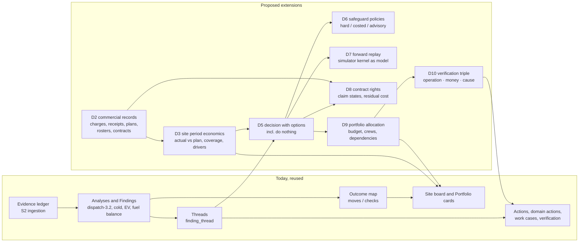
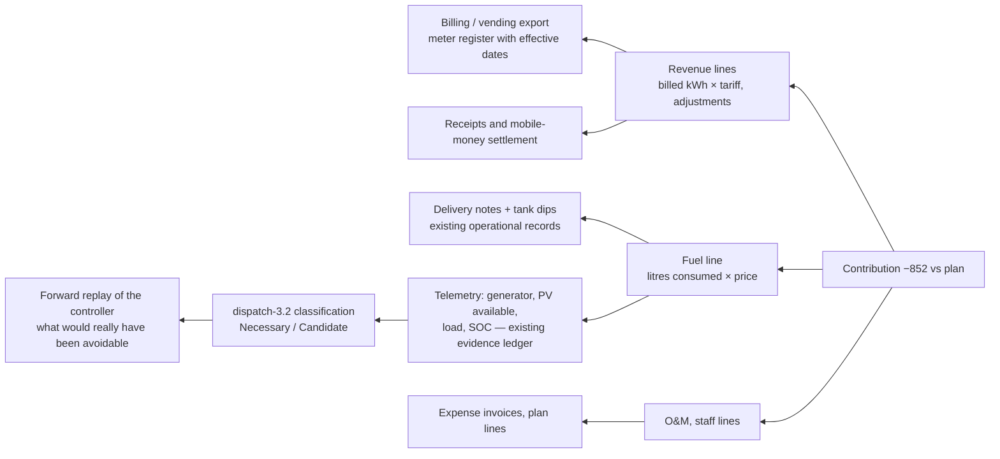
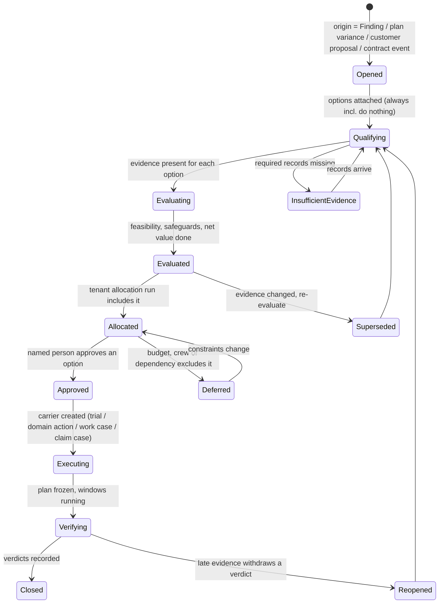
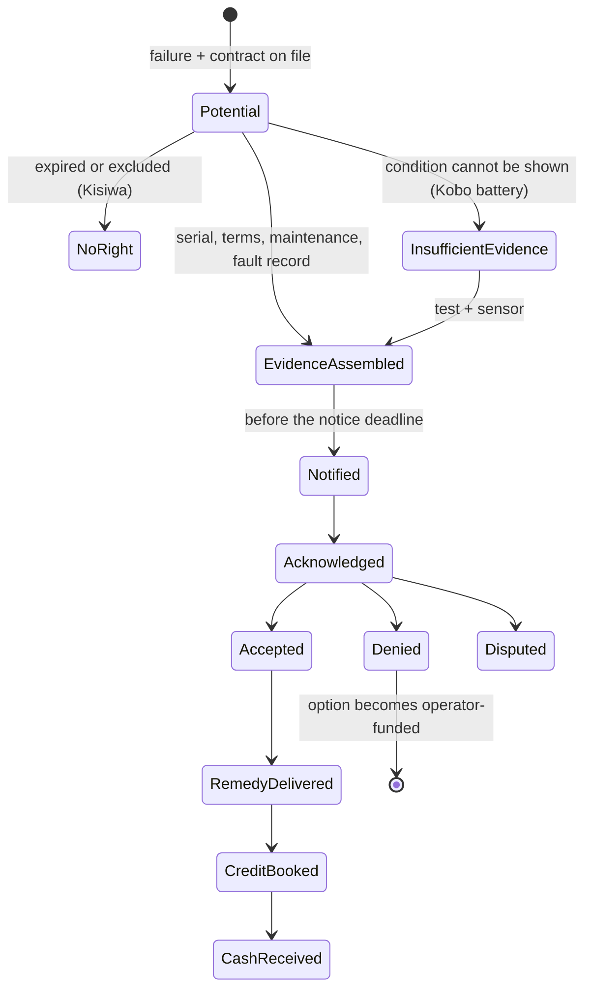

# From evidence to economic decisions: the Layer 4 transformation design

**AssetEcon · Layer 4 architecture and demonstrator design · AssetOps Architect (Claude) · 16 Nov 2026**
**Status:** design for owner review. No code, test, database or existing mock-up was changed. Repository state: `task/product-direction-layer4-design` at `fe2392899`; the backend, frontend, simulator and tools are byte-identical to `bf6014e02`, the commit the reviewed baseline (`.agent/decision-intelligence-mechanism-2026-11-14.html`, rev 3.2) cites, so its path:line citations hold. Key ones were re-read for this document.
**Product contract:** owner brief v1.1, Parts I–V (`.agent/AssetEcon_Product_Direction_Layers_1_to_3_and_Claude_Brief_REVISED.md`). This document answers Part VI.

> **Labels.** **[code-observed]** read in code · **[test-confirmed]** pinned by a named test · **[implementation-report]** stated only by the reviewed baseline document · **[proposed]** this design · **[research]** industry source cited in the brief · **[assumption]** to validate with a prospect or pilot. Data provenance is always one of *demo-simulated, source-emulated, bench-tested, field-integrated, observed-financial*. Every money figure in this pack is **illustrative**, comes from `demo-site-scenario-manifest.yaml`, and reconciles to the cent (`python3 check_manifest.py` → 73 checks pass).

## The design pack

| File | What it is |
|---|---|
| `layer4-transformation-design.md` (this file) + `layer4-transformation-design.html` (rendered) | The narrative: the decision process, the mechanisms that realise it, and how today's system becomes the product |
| `outcome-lever-capability-traceability.csv` | 335 many-to-many links: objective ↔ lever ↔ capability ↔ executive question ↔ mechanism ↔ demo option |
| `repo-reuse-and-gap-matrix.md` | Appendix: module / function / table / API / test dispositions |
| `economic-metric-and-effect-contracts.md` | Economic truth model, worked reconciliations, formulas, contract-rights states, typed contracts, negative accounting tests |
| `integration-source-to-canonical-design.md` | Source → canonical → domain → decision traces, schemas, quality, security, pilot adapters |
| `domain-and-decision-models.md` | Algorithms, time series, counterfactuals, safeguards, remedy conditionality, allocation, verification, C3 scenario table |
| `demo-site-scenario-manifest.yaml` + `check_manifest.py` + `demo-build-cost-plan.md` | The three demonstration portfolios, private oracle, disorder tests, and the regeneration/cost design |
| `phase-plan-and-acceptance.md` | PR-sized slices, dependencies, gates and end-to-end tests |
| `interactive-mockup-vNEXT/` | New runnable version of the v7.0 interactive mock-up, with change register, screenshots, audit and owner checklist |
| `design-questions-and-decisions.md` | Material conflicts and the owner decisions this design needs |

---

## 1. The short answer

**What the product must do.** An executive of a mini-grid, cold-chain or EV-depot operator opens one consistent three-site portfolio and, within minutes, sees which business outcome is off plan, which lever matters at which site, which alternatives win or lose and why, how the value is calculated, who pays given any contract rights, what is observed versus modelled, what to do, how it will be verified, and what a pilot needs (brief, final acceptance test).

**What exists.** The chain from a reading to a Portfolio card works end to end for one mechanism, the generator-support Finding, as "a relay of separate deterministic rules … none of them weighs one outcome against another" (baseline, short answer) [implementation-report]. Detection is careful and honest about limits. The gaps are economic and decisional, not perceptual:

1. **No money truth.** No billing, receipt, expense or plan record exists; `recorded_amount@1` returns `NO_RECORDS` always (`chain/strategies/recorded_amount.py:1`) [code-observed].
2. **No choice.** One intervention rule per Finding type (`reserve-trial-1`, reserve r → r − 5), no competing options, no do-nothing option; authored alternatives and scenarios "only read" the Finding (`mini_decisions/alternatives.py:12-13`) [code-observed].
3. **Checks do not check.** The outcome map's CHECKED role produces only sentences and counts (baseline §2) [implementation-report]; the real reliability protections are hard-coded and post-hoc for constraints the dispatch analysis cannot see (Case B4).
4. **Value is gross.** Fuel exposure is 0 … 1.10 × Σ P·h·SFC × price, with intervention cost fixed at 0 (`actions/verification.py:1167`) [code-observed].
5. **The Portfolio aggregates but cannot compare or allocate.** No normalised per-site comparison, no ranking, no budget or crew model; the 7- or 30-day Optimize figure is one Finding's exposure on the last day (baseline §5.2) [implementation-report].
6. **Verification is narrow.** VERIFIED is reachable only from simulated or authored evidence and only for mini-grid trials; cold and EV fixes can never verify (baseline §7.5) [implementation-report].

**What the design does.** It keeps every existing stage and adds the **smallest set of extensions that turn the relay into a decision**:



The ten positions D1–D10 are defined in §3. The rest of this document explains the economic decision process first (§2), then how each existing structure is reused or extended (§3), then the economic, integration, model and decision mechanics (§4–§7), the four worked traces (§8), the experience and demo world (§9–§10), delivery (§11) and a reconciliation of every behaviour the brief reported (§12).

---

## 2. The economic decision, walked end to end (Lakeside Power, October 2026)

The design starts from what the executive must decide, works backwards to the facts that decision needs, and then forwards through choice and verification. The worked portfolio is **Lakeside Power**, three village mini-grids (illustrative, manifest tenant `lakeside-power`).

### 2.1 Backwards: from the business result to the source facts

**The result.** October contribution was **1,443.00 against a plan of 2,295.00, −852.00** (−37%). The executive's first question is *why*, and the second is *what to do with 5,000 of budget and three crew visits in November*.

**The bridge** (economic contracts §3.2): Kobo −562.00, Kisiwa −185.00, Mto −105.00. Most of the gap is fuel. The superficial reading is "Kisiwa burns the most diesel (2,400 L), so act there". The reconstruction says otherwise:

| Site | Diesel | What the analysis finds | What it means |
|---|---:|---|---|
| Kisiwa | 2,400 L | every generator interval is **Necessary**: evening load exceeds solar plus battery converter capability | no fuel lever; the highest diesel user is the negative control |
| Kobo | 1,180 L | 330 L of generator running while solar could carry the load (dispatch-3.2 Candidate); forward replay says 210 L of it was avoidable, 120 L was not (design values held in the manifest; the slice 3 replay adapter must reproduce them from real series before they are relied on) | a policy lever worth ~250 per month net |
| Mto | 320 L | small; but 140 kWh metered and not billed after a meter swap, 120 kWh unexplained after expected losses, and a paying daytime customer waiting | commercial levers, not fuel |

Each line of that table needs a **different kind of fact**, and that is what the integration design is for:



### 2.2 Forwards: from causes to a choice

Each cause becomes a **decision with options**, and every decision includes **doing nothing**:

| Decision (site) | Options | Outcome of evaluation |
|---|---|---|
| Kobo: generator runs after dawn | do nothing · lower reserve 30 → 25 (today's only rule) · lower stop threshold 90 → 70 · add 100 kWh battery (28,000) | stop threshold **recommended** (12-month net 2,916.00, modelled); reserve change **rejected**: it removes only 20 L and leaves dawn charge below 35% on 4 of 61 replayed days (hard safeguard); battery **deferred** |
| Kisiwa: one of two gensets failed | repair (1,800) · replace (9,500) · add battery (14,000) · do nothing | repair **must-do** (single genset cannot carry the evening); battery deferred (payback ~6 years) |
| Mto: daytime headroom and two customer requests | rice huller (signed letter of intent) · evening welder (verbal) · fix billing mapping · audit meters | huller **recommended** (395.00/month net, 3,540.00 over 12 months, after 1,200 connection), welder **rejected** (−8.25/month; every evening kWh is diesel), billing fix **recommended**, audit combined with a visit |
| Mto: inverter INV-MT-02 failed 28 Oct | claim under warranty and wait · buy now and claim the failed unit · open it locally · do nothing | at budget 5,000: **claim and wait** (residual 360.00); buy now wins only if the budget is at least 6,430 **and** the cooperative will not extend its letter of intent: then claim-and-wait loses the huller (+2,556 over 12 months) and buy-now keeps it (+3,546). If the letter of intent is extended, claim-and-wait wins at any budget (+6,096). More budget never lowers the result; the letter-of-intent assumption changes it |

The **allocation** then picks a set under budget, crews and dependencies (§7.3): Kisiwa repair, Kobo stop-setting trial (remote, no crew), Mto inverter claim, Mto huller (after the inverter), Mto billing fix, Kobo battery evidence. Spend 3,880.00 of 5,000; crews 3 of 3. Modelled 12-month change of the set: 2,916.00 + 3,540.00 − 360.00 = **6,096.00, not realised**; the billing correction (672.00 of charges), the Kisiwa O&M response credit (70.00, review required) and the Kobo battery cover at risk (64,000.00) are **listed, not summed**.

**The surprise** that sells the demo: the site with the highest diesel use has nothing to save; the fix with the most money is a controller setting, not a battery; and a 2,600 inverter purchase can be worth more than a free warranty replacement when a paying customer's deadline is at stake.

### 2.3 Where composition stops today, and what resumes it

| Step | Today | Stops because | Resumed by |
|---|---|---|---|
| Readings → classification → Finding | works for generator support [test-confirmed] | — | reused as is |
| Finding → money | gross exposure of the **lead Finding of one day** [code-observed: `chain/read.py:190-212`] | no net value, no period sum | D3 period economics, D7 forward replay, D4 overlap groups |
| Money → choice | one fixed proposal or a refusal [code-observed: `actions/reserve_trial.py:234`] | no option set, no do-nothing, money not an input | D5 decision with options |
| Checks → choice | text and counts only [implementation-report §2] | CHECKED has no executable meaning | D6 safeguard policies |
| Site → portfolio | counts, one income sum, per-site lists [code-observed: `site_outcomes/read.py:901-977`] | no comparison basis, no constraints | D3 + D9 allocation |
| Plan vs actual in money | absent | no commercial or plan records | D2 + D3 |
| Action → verified money | modelled credit on simulated trials only [code-observed: `actions/verification_rules.py:708-735`] | one verdict mixes operation and money | D10 verification triple |

### 2.4 One observation, several outcomes, one money

The Kobo stop-threshold change touches four outcomes: MG-2 supply cost (moved), MG-5 reliable service and MG-4 battery life (checked), and through BAT-001's warranty conditions, P4 entitlement protection. Under the design:
- **MG-2** carries the money: one overlap group `GEN_POLICY_RUNNING:KOBO:2026-10:FUEL`.
- **MG-5** is a **hard constraint** (dawn adequacy ≥ 35% SOC on every replayed day); it decides admissibility, it has no money.
- **MG-4** is a **costed trade-off** (12.00/month wear); the cost is subtracted inside the option's net, not shown as a separate loss.
- **P4** is a hard constraint (lowest SOC ≥ warranty floor 10%).
The executive sees one number for the option (2,916.00 over 12 months, modelled) with three safeguard results beside it — never four numbers.

### 2.5 Portfolio finding → site investigation

The portfolio bridge can start an investigation. Kobo's **unexplained fuel residual** (120 L, 150.00, above the 2% tolerance) appears first as a portfolio bridge line. Clicking it opens a decision on Kobo's thread whose origin is `PLAN_VARIANCE` (D1), with options *investigate fuel records* and *do nothing*. Today the same residual is detected bottom-up by the fuel-balance Finding (`UNEXPLAINED_FUEL`, migration 0056) [code-observed]; the design makes both paths land on the same thread, so the residual is never investigated twice.

---

## 3. Transforming today's architecture — reuse first

The brief names seven structures to reuse or extend. Each subsection states what the structure does today, what it becomes, and what is deliberately not done.

### 3.1 `moves` → affected outcomes and display state (reuse, small extension)

**Today.** The first moved outcome is primary; an open, unapplied primary Finding turns it Needs attention, an applied or secondary one Watch (`outcomes/status.py:75-83`, `site_outcomes/board.py:692-695`) [code-observed; test-confirmed `test_out_b1_status.py::test_rule4_open_primary_finding_without_applied_action`].
**Becomes.** Unchanged for Findings. Two new signal kinds use the same map: `DECISION:<kind>` (an open decision with a recommended option moves its outcome to "Decision ready") and `VARIANCE:<driver>` (a period driver moves its outcome). The map stays a lookup table; ordering still decides primary.
**Not done.** No weights, no scores; rows "are never combined into a score" (`status.py:4-6`) remains true.

### 3.2 `checks` → explicit safeguards only where operationally meaningful (extend through D6)

**Today.** CHECKED drives text and two counts. None of the ten `CONTRIBUTIONS` records has the CHECKED role (`outcomes/outcome_map.py:150-180`) [code-observed]. The real protections are three hard-coded rules (`dispatch_v3.py:290-293`, `reserve_trial.py:249-256`, `verification_rules.py:787-800`) [code-observed], and the mill trial has none (`verification_families.py:175`) [code-observed].
**Becomes (D6).** A `SAFEGUARD_POLICIES` registry in code, shaped like `CONTRIBUTIONS`: one row per (option kind, checked outcome) with a check function, a **mode** (HARD_CONSTRAINT, COSTED_TRADEOFF, ADVISORY) and an **unknown policy** (REFUSE or CONDITIONAL). Option evaluation runs the rows **before** recommendation; verification guardrails are generated from the same rows, so the "Must not harm" sentence finally describes something enforced. The map's CHECKED entries remain declarations; a start-up integrity check (like `chain/graph.py`'s consistency check) fails if a CHECKED pair used by an option kind has no policy row, or if a policy row names an outcome the map does not check.
**Not done.** A checked outcome is not a financial veto by default. A reliability, temperature, departure or contract condition may be a hard constraint, a costed trade-off, or unknown; the policy row says which and records why.

### 3.3 `CONTRIBUTIONS`, strategies and objectives → typed evidence and money (extend through D3, D4)

**Today.** Ten node records, all MOVES; six strategies; "no strategy computes new money" (`chain/strategies/base.py:1-6`) [code-observed]. Objectives are operational targets (minutes, kWh, sessions) with verdicts (`outcomes/objectives.py:57-73`, `:112-143`) [code-observed].
**Becomes.** Three changes. (a) `recorded_amount@2` reads `commercial_record` revisions so MG-6, MG-3, EV-6, CC-2 can leave "not connected yet". (b) Every `Effect` gains `money_class`, `overlap_group`, `horizon`, `beneficiary` (contracts §6.2; named `money_class` because `evidence_class` already exists in the chain layer as a source basis, see §5); the composer refuses a second money contribution to one overlap group. (c) Objectives gain **financial plan lines** (from `PLAN_LINE` records) beside the operational ones, so "off plan" can mean money.

**Two repository constraints shape this.** The period read contract refuses stored totals (`chain/period_read.py:139-140`, "no stored totals (D-MONEY.3)") [code-observed], so `site_period_economics` is designed as a **sibling read contract** whose totals are recomputed from stored lines on every read, not stored; reusing the period read itself would need an Architect ruling against D-MONEY.3 (logged in `design-questions-and-decisions.md`). And overlap control already has a seed: `estate/financials.py` `_overlaps` and `compare` mark overlapping money lines CONFLICT, and `overlap_group` columns exist in migrations 0011, 0023 and 0026 [code-observed]. D4 extends that mechanism to strategy effects instead of inventing a second one.
**Not done.** Strategies still never invent money. A modelled option value is computed by the decision's option evaluation (D5), not by a node strategy.

### 3.4 Findings, independently originated opportunities, hypotheses and scenarios stay distinct

| Concept | What it is | Today | Design |
|---|---|---|---|
| Finding | evidence-supported claim about what happened | `finding`, `finding_revision` (0009) [code-observed] | unchanged |
| Opportunity | site-level possibility not caused by a fault | `mini_opportunity` headroom study (0030) [code-observed] | generalised by **origin** on the thread (D1): CUSTOMER_PROPOSAL, PLAN_VARIANCE, CONTRACT_EVENT |
| Alternative explanation (hypothesis) | a person's competing cause for a Finding | `mini_alternative_revision`, disposition PLAUSIBLE … RULED_OUT [code-observed] | becomes an input to QUALIFY: a PLAUSIBLE "policy" alternative on a dispatch Finding makes options that assume avoidability CONDITIONAL |
| Scenario | stored what-if calculation | `mini_scenario` kinds STOP_SOC, PRODUCTIVE_LOAD, TARIFF_ONLY, OTHER; only PRODUCTIVE_LOAD calculates (`mini_decisions/scenario_rules.py:194-200`) [code-observed] | becomes the **carrier** of a modelled option's calculation; STOP_SOC gets its calculation from forward replay (D7) |
| Option | an evaluated course of action in a decision | absent | new `decision_option` (D5), always referencing one of the carriers above or below |

Physical findings are one entry point among four. Mto's huller decision starts from a customer proposal; Mwea's from a plan variance; Kasarani's SLA clock from a contract event.

### 3.5 Lifecycle carriers: threads, cases, domain actions, trial actions

**Today.** Four lifecycles exist: the thread (OPEN → ACTION_IN_HAND → CHANGE_APPLIED → RESOLVED_MONITORING → CLOSED, with REOPENED, RECURRED, WITHDRAWN; `chain/lifecycle.py:47-58`), the reserve-trial Action (ACCEPTED → APPLIED → RESOLVED), the domain action (cold, EV, mini work intents with `owner_label`, `due_at`; 0033, 0051) and the work case (OPEN … VERIFICATION_WINDOW … CLOSED, ASSIGN events; 0027) [code-observed].
**Becomes.** The **thread is the decision anchor (D1)**: a decision belongs to one thread; the chosen option hands execution to the carrier that already exists for its kind — a trial Action for controller settings, a domain action for operational intents, a work case for repairs and supplier claims (new case kind `SUPPLIER_CLAIM` with typed claim events, D8). No new lifecycle is introduced for execution. Human approval replaces the `SYSTEM_DEMO` actor (`actions/lifecycle.py:49-58`) [code-observed] for option selection; assignment uses the existing work-case ASSIGN event.
**Not done.** The `action` table's `rule_id = 'reserve-trial-1'` constraint (0016:60, :72) [implementation-report] is not loosened into a generic action engine; new controller trials get their own rule rows (e.g. `stop-soc-trial-1`). Nothing in the code can apply a stop-threshold change today — `action` allows only reserve-trial-1, the STOP_SOC scenario never calculates, dispatch-3.2 does not read the stop setting — so slice 3 builds a domain-Action APPLY path for the `stop-soc-threshold` CONTROL property (`sites/models.py:167`) [code-observed], and verification guardrails become per option kind (today's `terminal_soc` guardrail would fail a stop-setting trial by design, because the trial lowers morning SOC on purpose).

### 3.6 Verification and portfolio readers as building blocks

The plan-freeze and verdict path (`actions/verification.py:193-363`, `verification_rules.py:739-815`) [code-observed] stays the operational verdict. D10 adds two separate verdicts beside it (economic realisation from commercial records, causal strength from comparability and controls) and admits field-integrated sources with their label instead of refusing everything that is not simulated or authored (`verification_rules.py:688`, `:718`) [code-observed]. Portfolio readers (`site_outcomes/read.py:926` portfolio_cards, `chain/claims.py`, `estate/portfolio.py`) keep their never-sum rules; the new decision home reads `site_period_economics`, decisions and the allocation run, and the backend fields that are computed but never rendered (baseline §5.6: per-site headline money, nodes, threads, outcome reasons) are exposed first (§11, slice 1).

### 3.7 Simulator and emulated sources as first-class inputs

The demo already pushes simulated readings through the real gateway, S2 ingestion, S3 analysis and S4 matching (`tools/demo_combined_kobo.py:6-9`) [code-observed]. The design adds source-shaped **commercial emulators** (billing CSV, settlement statement, storage ledger, OCPP log, roster, utility invoice, contract documents) that use the same upload/batch path real pilots will use, and a second, separate use of the simulator: as the **counterfactual model** for forward replay (D7). The backend cannot import the simulator — the dependency is blocked by design (`runs/execution_ports.py`, enforced by `tools/checks/dependency-direction.ps1`) [code-observed] — so the forward-replay adapter lives in `host/` beside the existing `host/execution_adapter.py:869` `run_to_end`, and returns a neutral projection (feasible litres, SOC trajectory summary, safeguard facts) across the existing port, never simulator types. The provenance label separates the two: emulator output is *source-emulated* or *demo-simulated* evidence; forward replay output is a MODELLED effect and never evidence.

### 3.8 Events, control points and invariants

| Event | Triggers | Control point |
|---|---|---|
| New evidence or commercial record revision | recompute of affected (site, period) economics and affected analyses | idempotency key; tenant check; revision kept |
| Finding opened / support changed | thread occurrence; decision created or re-qualified | lifecycle rules unchanged |
| Plan variance driver crosses threshold | decision with origin PLAN_VARIANCE | threshold declared per tenant |
| Customer proposal / contract event recorded | decision with origin CUSTOMER_PROPOSAL / CONTRACT_EVENT | person records it; source document attached |
| Option evaluation completes | dispositions; allocation re-run for the tenant | allocation is a stored run, never implicit |
| Option approved | carrier created (trial, domain action, work case, claim case) | named human principal |
| Verification windows close | operational verdict; economic and causal verdicts follow when records arrive | plan frozen before the change |
| Late evidence | affected decisions flagged "evidence changed"; resolutions can be withdrawn (existing RESOLUTION_WITHDRAWN) | never silent overwrite |

**Decision invariants** [proposed]: every decision has exactly one NO_ACTION option; no option is RECOMMENDED with a failed or unknown HARD safeguard whose unknown policy is REFUSE; every money effect has a money class and overlap group; a modelled effect never appears under "realised"; a remedy never appears as money before a credit or receipt is recorded; UNKNOWN is never zero.

**Conflict and unknown semantics.** Two Findings that disagree (the baseline's mixed Candidate/Necessary run, §2.4 Q6) produce one decision whose QUALIFY step shows both; options that depend on the contested interval become CONDITIONAL. Missing inputs make a safeguard UNKNOWN; its policy decides REFUSE or CONDITIONAL; the UI says which record would resolve it.

### 3.9 How a second engine is avoided

There is no new finding engine (Findings remain the only "what happened" claims), no new workflow engine (execution goes to the four existing carriers), no generic rules engine (safeguards are code rows like `CONTRIBUTIONS`), and no universal data schema (telemetry stays in `accepted_evidence`, fuel dips in operational records; only money-denominated, effective-dated records get a new store, because nothing in the repository holds them — see `repo-reuse-and-gap-matrix.md` §B). New code concentrates in one package, `decisions/` (decision, options, evaluation, allocation), plus `financials/period_economics`, an entitlement module and the forward-replay adapter in `host/`. Two schema checks must be rewritten rather than worked around: the thread occurrence's `occurrence_one_source` either/or check (0042:53), following the 0051 precedent, for D1's new origins; and the `work_case` / `work_event` kind checks (0027) for the SUPPLIER_CLAIM case kind.

---

## 4. Economic truth, measurement and composition

The full treatment, with formulas, typed contracts and twelve negative accounting tests, is `economic-metric-and-effect-contracts.md`. The mechanism in brief:

1. **Phases are kept apart:** physical service → chargeable service → recognised revenue → settlement; attributable cost; contribution; plan. A captive EV fleet has no revenue phase (NOT_APPLICABLE, never zero); its executive measure is cost per required departure met (Metro Bus Depots October: 41,705.12 / 1,302 = 32.03, energy, demand and maintenance included at every depot).
2. **Four clocks per record:** service period, effective period, recognition period, settlement instant. Late records create revisions of closed periods, never overwrites.
3. **Composition:** site × period × currency; portfolio Σ eligible numerators / Σ eligible denominators; mixed currency listed, not summed; unknown sites excluded and named.
4. **Variance bridge:** non-overlapping drivers by overlap group, explicit residual; the recorded line total and the modelled split are labelled separately (Kobo fuel: −600.00 recorded, split −262.50 / −150.00 / −37.50 modelled and −150.00 unexplained).
5. **Six money classes** that never sum across each other (ECONOMIC_ACTUAL, OPERATIONAL_ACTUAL, DERIVED, MODELLED, EXPOSURE, VERIFIED).
6. **One option identity** against no-action on a common horizon; gross exposure stays visible as "fuel at stake", not as value.
7. **Contract rights** enter as residual operator cost per remedy path, and as money only once a credit note or receipt is recorded.

Worked bridges for all three portfolios: Lakeside −852.00, Harvest Cold −770.00, Metro Bus −3,184.32 (manifest; contracts §3). `check_manifest.py` (126 checks) proves these, the option economics, the remedy residuals and the allocation.

---

## 5. Source integration: from records to decisions

The full design is `integration-source-to-canonical-design.md`. Its central decision: **keep stores by nature of the fact.**

| Fact | Where it lives | Why |
|---|---|---|
| Interval telemetry (generator, PV, SOC, chamber, connector) | existing `accepted_evidence` via S2 batches, reading uploads (0061) or the field gateway | already role-bound, cohort-selected, quality-graded [code-observed] |
| Operational records (fuel delivery, tank dip, visits) | existing operational records (`work/fuel_records.py`) | already effective-timed with `root_recorded_at` for lateness [code-observed] |
| Charges, receipts, settlements, expenses, plan lines, storage movements, customer meter reads, rosters, tariff schedules, contract documents | **new `commercial_record` + revisions (D2)** | no existing store holds money-denominated, effective-dated source transactions; immutable raw payload kept; idempotency key tenant + source system + source record id + version |
| Contract obligations, conditions, exceptions, notices, remedies | rows derived from a CONTRACT_DOCUMENT record by AI-assisted extraction **with mandatory human review** | extraction is evidence for a person, never a coverage decision |

The worked traces in that document follow real-looking rows through collection, validation, identity resolution (effective-dated meter → customer, serial → asset), canonicalisation, reconciliation, decision and evidence drawer — including the Mto meter swap, the 2 Nov settlement, Kobo's late delivery note, Thika's batch exposure and Embakasi's OCPP log against the roster and the utility invoice.

**What D2 must not copy from existing intake** [code-observed, via the integration document's appendix]: the reading upload keeps only a file hash, not the file (0061), and refuses any interval ending at or before the latest accepted reading (`reading_upload/service.py:244-248`) — commercial records arrive late by nature, so D2 copies the dry-run and receipt pattern but stores raw bytes and accepts late records as revisions. The evidence ledger is first-write-wins (a changed payload under the same message id is a Conflict, `evidence/service.py:487-492`); D2 needs source-versioned revisions instead. Unauthenticated V1 batches (`evidence_api.py:319-352`) are not a model for commercial intake; only the V2 site-bound credential path is. EV telemetry has no vehicle identity (`sites/binding_roles.py:195-215`), so roster joins need a session-attribution record keyed by the OCPP idTag.

Note on vocabularies: thread occurrences already carry a column named **`evidence_class`** (MEASURED, RECORDED, DECLARED, MODELLED, EXTERNAL; 0042:50; also read in `chain/ports.py`, `chain/builder.py`, `chain/outcomes.py`, `chain/threads.py`), used as a source basis, and `Effect` already has a `basis` field [code-observed]. D4's new axis (actual, derived, modelled, exposure, verified) is therefore named **`money_class`**, so the two never share a name in the layer that reads both.

**Pilot transfer.** Each emulator emits exactly the file or message shape a pilot source sends, through the same upload or batch endpoint; a pilot swaps the transport, not the parser. Where no provider API is available, CSV export or manual upload of the same shape is the admissible path, validated in the pilot. Integration rights, data protection (customer identifiers are personal data under the Kenya and Nigeria data-protection acts) and customer permission are hard constraints.

---

## 6. Domain algorithms (summary)

The full models, with equations, pseudocode, sequence diagrams, error modes, calibration needs, refusal policy and test vectors, are in `domain-and-decision-models.md`. The positions:

- **Deterministic first.** Every first-demo decision is decidable with rules, balances and a forward replay. No machine learning is needed for the first demo, and none is added for decoration.
- **Mini-grid (D7).** The simulator's exact controller kernel (`simulator/assetops_simulator/packs/mini_grid.py`, `minigrid.py`) [code-observed] replays observed PV-available and load under the baseline policy and the candidate policy, giving feasible fuel reduction, the SOC trajectory and dawn adequacy. This closes the baseline's B4 gap for the constraints the kernel can represent (evening energy, battery kWh behind the kW rating) and makes the others explicit refusals. It also explains why today's fixed five-point reserve change is not the recommendation at Kobo.
- **Cold.** A per-room normalised energy model (kWh = base + k × crate-days, ambient-corrected) separates "low occupancy" (Mwea, within 0.6% of model) from "inefficient equipment" (Kirinyaga, +24%). Batch exposure is presence interval × chamber temperature × commodity limit; damage needs a QA record; liability needs the contract clause.
- **EV.** Deadline feasibility is a capacity-and-deadline check per night (Embakasi: the cheapest bill puts every kWh in the 00:00–05:00 tier at 0.09 and the 500 kW import limit — 12,975 a month — but delivers 2,500 kWh against 2,800 required, so 3 buses leave short and it is rejected; 22:00–05:15 at 400 kW delivers 2,900 and costs 13,356 a month, 381 more). A linear program is warranted only when connector compatibility, partial charging and multiple tariffs interact at scale.
- **Contract-aware remedies (D8).** Residual operator cost per path, with notice deadlines, exclusions, warranty-preserving behaviour, downtime and deductibles; outcomes are possible rights and options, never legal conclusions.

---

## 7. Decision orchestration, safeguards, allocation and verification

### 7.1 The decision lifecycle (D5)



Each option runs **QUALIFY → FEASIBILITY → SAFEGUARDS → NET_VALUE**, then the tenant's allocation decides **ALLOCATE**, and a person **APPROVES**. Three kinds of ordering are kept distinct: **triage** (what to look at first: today's placement groups, `estate/placement.py:5`, "never a value ranking") [code-observed], **comparable ranking** (options on one horizon and basis) and **constrained allocation** (a set under budget, crews and dependencies).

### 7.2 Safeguards as policy (D6)

| Policy | Option kinds | Mode | Unknown | Source of truth today |
|---|---|---|---|---|
| MG5_DAWN_ADEQUACY | controller trials, demand connections | HARD | REFUSE | none (B4 gap); trial guardrail `unserved_critical_energy` only after the fact |
| MG4_BATTERY_WEAR | controller trials, demand connections | COSTED | CONDITIONAL | "Needs a tested battery wear model" (`outcomes/warnings.py:45`) |
| WARRANTY_OPERATING_LIMITS | any option changing how an asset runs | HARD | CONDITIONAL | none |
| P1_SERVICE_REDUNDANCY | no-action and deferral on single-point failures | HARD | REFUSE | none |
| CC1_TEMPERATURE_LIMIT | cold energy options, setpoint changes | HARD | REFUSE | excursion analysis only (`analytics/cold.py`) |
| EV1_DEPARTURE_READINESS | schedules, capacity use | HARD | REFUSE | none (no roster) |
| EV5_IMPORT_LIMIT | schedules, capacity use | HARD | REFUSE | peak warning only (`analytics/ev_depth.py:134-158`) |

### 7.3 Allocation (D9)

The simplest justified allocator for a three-site portfolio is **transparent**: must-do options first (hard service obligations), then every subset of the remaining evaluated options (≤ 2¹⁵ subsets, trivial to enumerate) under budget, crew visits, dependencies (huller after inverter), mutual exclusion (claim-and-wait vs buy-now) and deadlines (notice by 27 Nov, letter of intent to 30 Nov); highest 12-month modelled net wins, ties broken by smaller downside. Every excluded option carries its reason. Investigation or doing nothing wins when no option clears its safeguards or when the evidence to value it is missing (Mto meter audit has no money; it is chosen because it is cheap and combined with a visit, not because of a number).

Lakeside at 5,000: recommended spend 3,880.00, 3 crews. The budget and the letter-of-intent assumption are separate controls (mock-up, allocation page), and the checker enumerates all four cases by brute force: 5,000 or 6,500 with the letter of intent extended → claim-and-wait, +6,096; 5,000 without extension → claim-and-wait without the huller, +2,556 (buy-now unaffordable); 6,500 without extension → buy-now, +3,546 against +2,556, spend 6,430. Each view shows the competing inverter path's result beside the chosen one.

### 7.4 Verification (D10)

| Verdict | Question | Source | Values |
|---|---|---|---|
| Operational | did the operation change as intended, with safeguards held? | existing plan freeze and verdict | VERIFIED / INEFFECTIVE / INCONCLUSIVE |
| Economic realisation | did the money show up in the books? | commercial records in the after window (fuel invoices and dips, bills, credit notes, receipts) | NOT_YET / PARTIAL / REALISED / NOT_REALISED |
| Causal strength | how sure are we the change caused it? | comparability bands, matched days, untreated control sites, known confounders | WEAK / MODERATE / STRONG |

Contract rights verify by **state**, not by verdict: notice sent, acknowledged, accepted, service restored, remedy performed, credit booked, funds received — each a separate recorded event; a supplier-funded repair and an insurance payment for the same expense can never both be recorded (contracts N5).

---

## 8. Four worked traces

Each trace states the entry condition, the evidence path, the calculation, the options with no-action, accepted and rejected alternatives, the executive decision on screen, and the verification path. Detailed models and test vectors: `domain-and-decision-models.md`.

### 8.1 Mini-grid: diesel versus profitable demand versus commercial discrepancy (Lakeside)

```mermaid
sequenceDiagram
  participant Src as Sources (GX emulator, billing CSV, delivery notes)
  participant Ev as Evidence + commercial records
  participant An as dispatch-3.2 / fuel balance / energy-to-cash
  participant Pe as Site period economics
  participant De as Decisions (Kobo, Mto)
  participant Al as Allocation
  participant UI as Decision home
  Src->>Ev: readings (5-min), bills, receipts, dips, meter register
  Ev->>An: Candidate 330 L at Kobo; Kisiwa all Necessary; Mto 140 kWh unmapped
  An->>Pe: drivers by overlap group
  Pe->>UI: −852.00 bridge, 91.5% cost coverage
  An->>De: Kobo thread (Finding); Mto thread (customer proposal)
  De->>De: forward replay: stop 90→70 avoids 210 L, dawn SOC ok; reserve 30→25 fails dawn on 4 days
  De->>Al: options with net, safeguards, crews, dependencies
  Al->>UI: recommended set 3,880.00 of 5,000; excluded with reasons
```

| | Do nothing | Accepted | Rejected |
|---|---|---|---|
| Kobo | 262.50/month of avoidable fuel keeps being spent | stop threshold 90 → 70: 2,916.00 / 12 months (modelled), remote, trial first | reserve 30 → 25 (fails dawn adequacy); 100 kWh battery (not needed) |
| Mto demand | headroom unused | huller: 395.00/month net, 1,200 connection, after inverter | welder: −8.25/month; break-even tariff 0.42 |
| Mto commercial | 56.00/month of charges lost | fix mapping (charges, not cash) | — |
| Kisiwa | single genset carries evenings | repair 1,800 (must-do) | replace 9,500; battery 14,000 (deferred) |

**Executive screen.** CEO: the allocation and why the battery waits. COO: three crew visits and what each does. CFO: the bridge, coverage (Kisiwa O&M estimated) and the energy-to-cash chain. CCO: huller yes, welder no, and the tariff that would change it.
**Verification.** Kobo: 14 matched days before and after; operational target Candidate minutes −50% with dawn SOC ≥ 35% every day; economic realisation from November dips and delivery notes per delivered kWh, weather-normalised; causal strength from comparability bands and Kisiwa/Mto as untreated controls. Mto huller: metered huller kWh → billed → collected.

### 8.2 Cold room: occupancy versus cooling repair versus product protection (Harvest Cold)

October: plan 1,716.00, actual 946.00, −770.00. Mwea −468.00 (occupancy), Thika −108.00 (customer compensation), Kirinyaga −194.00 (energy inefficiency).

| Room | Superficial reading | Reconstruction | Decision |
|---|---|---|---|
| Mwea | worst energy cost per crate-day (0.1221): "fix the compressor" | energy within 0.6% of the occupancy model; occupancy 35% vs 60% plan | sign the off-season aggregator contract (net 1,670.00 over 4 months, needs an ethylene curtain); compressor **rejected** |
| Kirinyaga | cost per crate-day 0.1008, "fine" | 24% above model at 80% occupancy | repair 350 (1,512.40 over 12 months) over replace 4,800 (−1,988.40) |
| Thika | "an alarm" | 135 min above 8 °C; B-1031 tomatoes exposed (2,160.00 of customer stock, EXPOSURE), 6 crates downgraded (108.00 damage = liability by contract); B-1034 avocados within their limit; B-1029 already out | EPC-accepted transfer-switch remedy + night stopgap (100.00); self-repair rejected (voids cover); insurance not claimed (108 < 500 deductible) |

**Verification.** Kirinyaga: normalised kWh after repair vs model over 30 days (≥ 60% recovery or the replacement decision reopens). Thika: witnessed automatic start test after the EPC remedy (the v70 ACT-051 pattern). Mwea: crate-days and invoices under the contract.

### 8.3 EV depot: schedule versus critical repair versus capacity (Metro Bus Depots, captive)

October cost (energy, demand and maintenance at every depot): plan 38,520.80, actual 41,705.12, −3,184.32; all 1,302 required departures met; 32.03 per departure.

| Depot | Decision | Accepted | Rejected |
|---|---|---|---|
| Embakasi | stop paying peak prices | deadline-aware schedule 22:00–05:15, 400 kW peak: 13,356/month, saving 8,788.80/month against October (modelled; tariff applicability to confirm) | cheapest 00:00–05:00 at the import limit: the lowest bill (12,975/month) but 3 buses below departure charge every night (hard safeguard) |
| Kasarani | charger CH-K2 fault since 1 Nov; one bus short each night | warranty + SLA remedy, one bus charged at Ruiru on each of the 3 nights to the 9 Nov restore (90.00 in total) | wait (≈240.00 more penalties); local repair (voids cover); scheduling (flat tariff: nothing to save) |
| Ruiru | city offers 6 more buses | absorb with existing chargers (2,800 ≤ 3,200 kWh); avoids a 60,000 charger purchase | 10 more buses (3,360 > 3,200, import limit); buying 4 chargers |

The idle connector at Ruiru (CH-R7 connector 2) ranks **below** Kasarani's fault although both are "a charger down": it affects no departure.

### 8.4 Contract-entitlement-aware repair: covered, excluded, incomplete

The same physical event — a failed asset — produces three different choices because of the contract and the evidence:

| Asset | Contract position | Evidence | Best path | Operator residual |
|---|---|---|---|---|
| Mto inverter INV-MT-02 | warranty to 2029, replacement, shipping at owner cost, notice within 30 days | installer certificate, ambient log, firmware, fault log all on file | claim and wait (budget 5,000) — or buy now and claim the failed unit when a customer deadline is worth more (budget ≥ 6,430) | 360.00 / 2,910.00 |
| Kisiwa genset GEN-KS-01 | warranty ended 30 Jun 2026; 1,000-hour service missed | run hours 1,240 | operator-funded repair, now | 1,800.00 |
| Kobo battery BAT-001 | warranty to 2034 with temperature and capacity conditions | no temperature sensor, no commissioning capacity test | assemble evidence first (430.00); a claim now would fail | 430.00 (protects 64,000.00 of cover, EXPOSURE) |



Every state is set from a recorded document or event by a person; the system flags deadlines and computes residual cost. The screen always says: *This is not a legal decision. Coverage is decided by the supplier or insurer.*

---

## 9. Experience architecture and the new mock-up

**One economically consistent portfolio answers all four executive questions.** The role toggle (CEO, COO, CFO, CCO) changes the headline question and the order of panels, never the numbers. Every role navigates portfolio → site → decision → source evidence and returns to the portfolio with a changed prioritisation after evaluating a hypothetical (the budget switch).

| Surface | Answers | Built from |
|---|---|---|
| Decision home | what is off plan, the counter-intuitive contrast, what to do first | site period economics, allocation run |
| Variance bridge | which sites and drivers explain the gap, with an explicit residual | drivers by overlap group |
| Site economics | the site's chain (energy → cash; occupancy → energy; departures → cost) | period economics + vertical reconciliation |
| Decision comparator | options incl. do nothing, why not, safeguards, sensitivity, proof plan, data needed | decision options |
| Contract rights panel | claim stage, deadline, cost to us per path | entitlement records + claim case |
| Allocation | budget and crews, recommended set, exclusions | allocation run |
| Verification | operation · money · cause, separately | verification triple |
| Evidence drawer | source rows, transformation, coverage, provenance label | commercial records + evidence ledger |
| Pilot request | the paid diagnostic for this operator | manifest sources |

The runnable mock-up is `interactive-mockup-vNEXT/` (README for launch). It is a **new version of the v7.0 mock-up** (`frontend/mockups/v70/`, the latest complete interactive version; v71 holds four single-page studies, and v72 is the **v7.2 design foundation** — tokens, Inter, light and dark modes — with hi-fi Portfolio and Site Overview pages, which the current UI pass (UQ-FI) builds on. vNEXT keeps the v7.0 shell and has **not yet adopted v7.2**; moving it onto v7.2 is owner question Q4), keeps all 110 v70 screens, adds the decision experience as a new top rail group, and records every change in its change register. Its figures are the manifest's. **It is not approved until the owner inspects it.** The client-facing screens use plain words (no option codes, no internal vocabulary) and show *Recorded*, *Estimated*, *Modelled* and *At stake, not money* as visible text, not colour alone.

---

## 10. The demonstration world and its cost

`demo-site-scenario-manifest.yaml` defines three tenants with three sites each. It was built backwards from each portfolio's executive choice: every site exists to carry one contrast and one negative control, and the contract-rights contrast is **embedded in repair decisions** rather than added as extra sites. Four existing demo sites are reused (Kobo, Kisiwa, the cold lab as Mwea, the EV lab as an Embakasi seed); five are new.

Three time scales keep it cheap (`demo-build-cost-plan.md`): **ledger history** (four monthly periods of commercial records, generated directly from a coherent ledger with no physics), **sparse operational context** (cached day-types, reused by manifest hash), and **short high-fidelity evidence windows** (5-minute dispatch and verification slots, 1-minute chamber minutes, event-level OCPP) only where a claim needs them. Ground truth lives only in the manifest's private `oracle:`; every product figure must be computed through the real ingest and analytics path and compared against it.

The current build costs about 62 s per built Kobo site-day for ingest, assessment and matching alone and ≈147 s per site-day for the whole build, with per-run cost rising with history (baseline §8.9–8.10, measured on the walk1113 build) [implementation-report]. The cost plan proposes site- and window-scoped regeneration keyed by manifest hash, parallel site builds with per-site claims, an O(D) matcher, and per-hero minimum build budgets; it states which numbers must be **re-measured** before they can be relied on (this commission was not authorised to run a build).

---

## 11. Delivery: what to build first and why

Full plan with gates: `phase-plan-and-acceptance.md`. The dependency reasoning:

1. **Stop misleading, expose what exists** (slice 1). The Optimize card's last-day figure is relabelled honestly; per-site money, nodes, threads and outcome reasons already returned by the API are shown. Cheap, immediately useful, no new data.
2. **Commercial and plan facts** (slice 2). Without D2/D3 no CFO question can be answered and no option can be valued against a real baseline. This is the critical path.
3. **One complete mini-grid decision** (slice 3): Kobo with forward replay, safeguards, no-action, the stop-threshold trial and its negative control (Kisiwa). Mini-grid goes first because it has the deepest existing analysis, so the decision layer is proven where evidence is richest.
4. **Portfolio variance, alternatives and allocation** (slice 4): Lakeside end to end.
5. **Contract rights in repair and capital choices** (slice 5).
6. **Cold, then EV** (slice 6): reuse D2–D10 with new reconciliations (storage ledger; roster and tariff) — the cross-vertical primitives pay off here.
7. **Pilot onboarding and field validation; optional AI explanation** (slice 7).

Order changes from the brief's suggestion: none in sequence; one split — slice 2 lands commercial records before the period economics read, so slice 1's honest relabelling can ship without waiting for either.

---

## 12. Reconciling the brief's reported baseline (C2)

| Reported behaviour (brief C2) | Validated? | Transformation |
|---|---|---|
| Role-bound readings, dispatch classes, episodes, fuel exposure, generator trial path operate | yes [test-confirmed, baseline §3.11] | keep; add forward replay (D7) and net value (D5) so the trial is chosen on feasible net value, not gross Candidate exposure |
| MOVES affects state; CHECKED is text/counting; 10 CONTRIBUTIONS are MOVES | yes [code-observed `outcome_map.py:150-180`] | MOVES unchanged; CHECKED becomes executable only through SAFEGUARD_POLICIES (D6), keeping status meaning clean |
| Portfolio Grow = estimated income; Optimize = last-day lead Finding exposure; Protect/Assure = counts | yes [implementation-report §5.2–5.3] | relabel (slice 1); period-correct finance via site period economics (D3); separate actual / potential / verified (D4) while reusing the readers' never-sum rules |
| `recorded_amount@1` has no billing source | yes [code-observed] | commercial records (D2) + `recorded_amount@2` |
| Mini-grid alternatives/scenarios exist without a comparison bridge; reserve trial is a fixed −5 | yes [code-observed `reserve_trial.py`, `mini_decisions/`] | decision with options (D5) whose carriers are the existing scenario, trial and case records |
| Verification selective, simulated/authored; mill lacks guardrails | yes [code-observed `verification_rules.py:688`, `verification_families.py:175`] | guardrails generated from safeguard policies; verification triple; field sources admitted with labels (D10) |
| Cold lacks paid occupancy/finance; EV lacks roster and utility cost | yes [implementation-report §7] | storage-movement, roster, tariff-schedule records (D2) + normalisation and feasibility models |
| No warranty/EPC/O&M/SLA/insurance evaluation | yes; warranty exists only in the v70 mock (`assets-warranty`, `asset-warranty`) and as withheld fields (`sites/battery_boundary.py:26`) [code-observed] | entitlement records + SUPPLIER_CLAIM case (D8), no contract lifecycle management |
| ~62 s/site-day partial, ~147 s whole build; full regeneration for any change | yes, as historical measurements [implementation-report §8.9] | scoped replay, cached baselines, parallel sites, O(D) matching; re-benchmark |
| Portfolio API computes headline/money/node fields the UI does not render | yes [implementation-report §5.6] | expose first (slice 1); the new decision home uses them |

---

## 13. Self-check against the final acceptance test

| The executive must understand… | Where the design delivers it |
|---|---|
| which business outcome is underperforming | decision home + bridge (§2.1, §4) |
| which researched lever is relevant | decision comparator; traceability CSV lever ids |
| whether AssetEcon can meaningfully improve the choice | influence column in the CSV; options marked CONDITIONAL where influence is conditional (demand, tariff) |
| which alternatives win or lose and why | options with do-nothing and "why not" (§2.2, §8) |
| how the value is calculated | evidence drawer + contracts §4.4 identity |
| who bears the cost given any contractual remedies | contract rights panel, residual cost (§8.4) |
| what is observed versus modelled | money classes, visible labels (§4) |
| what intervention can be undertaken | allocation + approval + carrier (§7) |
| how it will be verified | verification triple (§7.4) |
| what pilot data / engagement is needed | pilot request page; integration minimum asks (§5) |

What this design does **not** establish: that any prospect's figures resemble the manifest, that the forward replay is calibrated on a real site, that a tariff or contract clause applies to a given operator, or that any supplier will accept a claim. Those are pilot questions, listed in `design-questions-and-decisions.md`.

---

## Appendix A. Cross-references

| Topic | Detail |
|---|---|
| Module / function / table / API / test dispositions | `repo-reuse-and-gap-matrix.md` |
| Every formula, typed field and negative accounting test | `economic-metric-and-effect-contracts.md` |
| Source schemas, identity, idempotency, quality, retention, adapters | `integration-source-to-canonical-design.md` |
| Model I/O, calibration, refusal policy, the 14 C3 scenarios | `domain-and-decision-models.md` |
| Fixtures, oracle, disorder tests | `demo-site-scenario-manifest.yaml` |
| Build DAG, cache keys, benchmark plan | `demo-build-cost-plan.md` |
| Slices, gates, end-to-end tests | `phase-plan-and-acceptance.md` |
| Mock-up change register and audit | `interactive-mockup-vNEXT/CHANGE-REGISTER.md`, `browser-audit.md` |

## Appendix B. Research basis

Industry claims in this pack rest on the brief's ledger [R1]–[R12] (AMDA benchmarking, ESMAP productive use, World Bank mini-grids, Efficiency for Access / IIR cold rooms, three EV depot scheduling papers, NREL O&M, DOE FEMP, Solar Best Practices, ABB E-mobility SLAs). They support the existence and materiality of lever families. They do not support any site-specific magnitude, any conversion rate, or AssetEcon's differentiation, which remains a hypothesis to validate with prospects and pilots.
