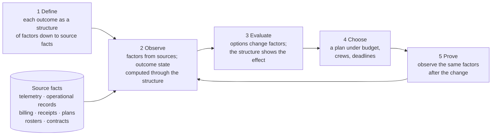
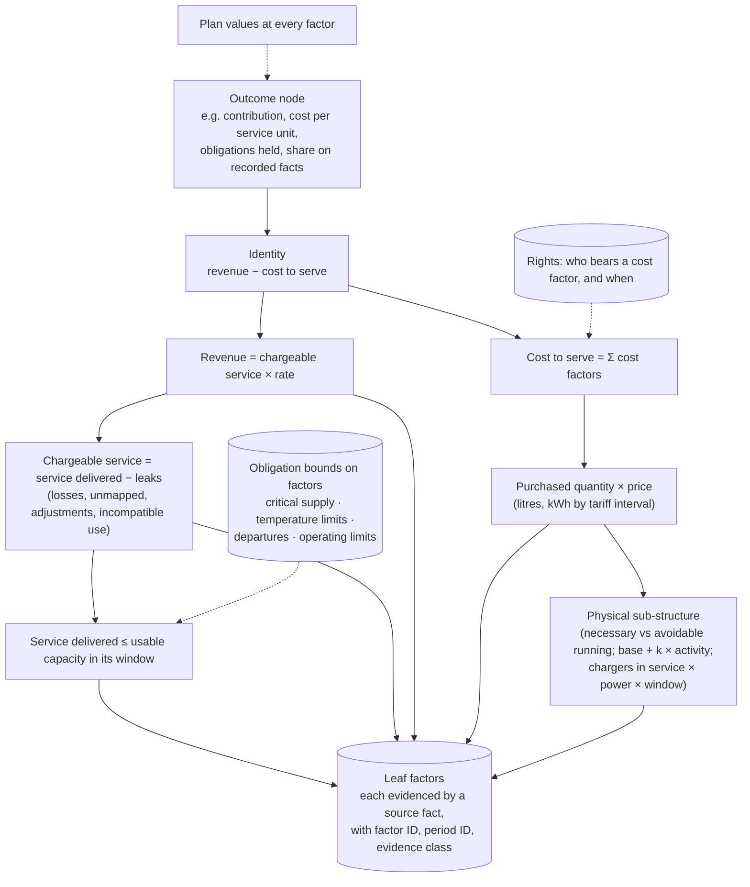

# AssetEcon Layer 4 design: the economic decision loop

**AssetEcon · Layer 4 architecture and demonstrator design · rev 4 (redesign) · AssetOps Architect (Claude) · 17 Nov 2026**
**Status:** design for owner review. No application code, test, database or existing mock-up version was changed. Repository: branch `task/product-direction-layer4-design`; backend, frontend, simulator and tools are unchanged since `bf6014e02`, so every code citation below was read against current code.
**Product contract:** owner brief v1.1, Parts I–V (`.agent/AssetEcon_Product_Direction_Layers_1_to_3_and_Claude_Brief_REVISED.md`). This document answers Part VI as the owner clarified it on 17 Nov 2026 (`.agent/owner-layer4-direction-feedback-2026-11-17.md`).

> **Labels.** **[code-observed]** read in code · **[test-confirmed]** pinned by a named product test · **[implementation-report]** stated only by the reviewed baseline document (`.agent/decision-intelligence-mechanism-2026-11-14.html`) · **[proposed]** this design · **[research]** industry source cited in the brief ([R1]–[R12]) · **[assumption]** to validate with a prospect or pilot. Data provenance is always one of *demo-simulated, source-emulated, bench-tested, field-integrated, observed-financial*. Every money figure is **illustrative**, comes from `demo-site-scenario-manifest.yaml`, and reconciles to the cent (`python3 check_manifest.py` → 167 checks pass). Simulated and observed values are never mixed: nothing in this pack is an observed financial result.

## Why this revision exists

The owner judged rev 3 "narrow stitched ideas" rather than a fundamental design, and asked that the fundamental mechanics be defined first and the specifics derived from them; that reuse be judged on merit; that the mock-up restructure the overall Portfolio experience without role filters or new menu items; that integrations, new and changed algorithms, and the UI strategy be stated explicitly; and that an outcome be understood as "observed by the underlying factors which are structurally defined" (owner, 17 Nov 2026, verbatim in `.agent/owner-layer4-direction-feedback-2026-11-17.md`). The owner also explained that reuse was never the problem; rev 3's reuse was narrow because it did not first establish the core future mechanics and then decide what to reuse, rebuild or create, and because it often followed one specific path (Kobo, one mini-grid) rather than an overarching logic.

Read against the brief, rev 3's main document was organised around today's repository structures (its §3 walked `moves`, `checks`, `CONTRIBUTIONS`, threads and cases and added extensions D1–D10), although the brief asks that the primary document not be organised by inventory (C0); it decided reuse before establishing the mechanics, treating the brief's "smallest coherent extension" (C0) as a design principle, and its extensions were shaped around one path (the Kobo generator Finding, the reserve trial, the mini-grid thread); and its mock-up added a decision menu group and a CEO/COO/CFO/CCO toggle to v7.0, although the brief treats the four questions as experience requirements, not views (L1.3).

This revision builds its mechanics from the structure the brief itself defines in Parts I–V (§1, with the source of every mechanic in §2.7): each outcome is defined by measured factors, the factors are observed independently from source facts, and outcome states, including shortfalls, are computed through that structure. The mechanics are general: they are defined once for every outcome, asset type and lever class, and the three verticals are instances of them, not their source. The worked sites (Kobo and the others) illustrate the mechanics; they do not define them. Everything else is derived from the mechanics: outcomes, levers and capabilities (§3), the integrations needed (§4), the algorithms new and changed (§5), the UI strategy and restructured Portfolio (§6), the worked portfolios (§7), the judgement of today's code on merit (§8) and the delivery order (§9). One departure from the brief is deliberate: C0's "smallest coherent extension" is applied as the owner clarified it — reuse where a part serves a mechanic well, rework or replace it where it does not, and never build a parallel engine (§8).

## The design pack

| File | What it is |
|---|---|
| `layer4-transformation-design.md` (this file) + `.html` (rendered) | The mechanics and everything derived from them |
| `economic-metric-and-effect-contracts.md` | The outcome structures in money: factors and the value chain per vertical, composition, attribution and valuation identities, evidence classes, rights in money terms, typed contracts, negative accounting tests |
| `integration-source-to-canonical-design.md` | Which source facts evidence which leaf factor, per vertical; worked record traces; canonical records, keys, quality, security; pilot adapters |
| `domain-and-decision-models.md` | The algorithms of each mechanic: structure evaluation and attribution, factor observers, counterfactual models per lever, obligation bounds, allocation, verification; equations, refusal policies, test vectors |
| `demo-site-scenario-manifest.yaml` + `check_manifest.py` | The three demonstration portfolios as factor structures (value chains), with attributions, options, rights, private oracle, disorder tests |
| `demo-build-cost-plan.md` | How the demonstration world is generated cheaply and regenerated by scope |
| `phase-plan-and-acceptance.md` | Delivery slices derived from the mechanics, with gates and end-to-end tests |
| `outcome-lever-capability-traceability.csv` | Objective ↔ lever ↔ capability ↔ executive question ↔ mechanic ↔ factor ↔ demo option |
| `repo-reuse-and-gap-matrix.md` | Appendix: module / function / table / API / test dispositions, organised by mechanic |
| `interactive-mockup-vNEXT/` | Runnable restructured mock-up (from v7.0), change register, audit, walkthroughs, owner checklist |
| `design-questions-and-decisions.md` | Owner decisions and material conflicts |
| `REVIEW.md`, `REVIEW-response.md` | History of rev 1–3 reviews; kept unchanged |

---

## 1. What the product must do, and where its mechanics come from

An executive of a mini-grid, cold-room or EV-depot operator opens one consistent three-site portfolio and, within minutes, sees which business outcome is underperforming, which lever matters at which site, whether AssetEcon can improve that choice, which alternatives win or lose and why, how the value is calculated, who bears the cost given any contract rights, what is observed versus modelled, what to do, how it will be verified, and what a pilot needs (brief, final acceptance test).

**The brief already defines the structure that answers this.** Its Parts I–V do not describe outcomes as free-standing scores. They define each outcome by the quantities that make it up, and they define those quantities by the source facts that evidence them:

- **Outcomes are measured objectives with units, numerators, denominators and periods** (L1.1 table, column "What counts, units and time"), translated per vertical into specific economic quantities (L1.2: e.g. O1 is "diesel/fuel, battery wear, maintenance, network cost per paid kWh"; O3 is "metered delivery → bills/vending → receipts/settlement").
- **The unit hierarchy** (L1.1, "The financial and operational unit hierarchy") says how they are built: *economic actuals* (recognised revenue, expense, paid invoices, settlement facts) and *operational actuals* (delivered kWh, crate-days, sessions, outages, SOC, temperatures, faults) are observed; *derived metrics* are "numerator and denominator computed from eligible actuals, with coverage and compatible scope"; *estimated/modelled*, *exposure* and *verified effect* are separate classes on top.
- **Shared driver IDs and period IDs** (L1.1, line 130) identify each underlying quantity once, so "the same fuel, bill adjustment or recovered payment" cannot appear "as several independent gains".
- **Every displayed metric must carry** its business-model applicability, recognised numerator/denominator, scope and window, conversion basis, coverage, evidence type, plan provenance, beneficiary, limitations and drill-through; unobserved sites are unknown or excluded; portfolio ratios are Σ numerator / Σ denominator (L1.2, "Outcome decision invariants").
- **The economic anatomy of each vertical** (R1–R3) and the commission's phases (C1 Deliverable 2: "physical service delivered and contractual obligations → chargeable service → charges/recognised revenue → receipts/settlement → attributable costs → site contribution and plan → portfolio actual/plan bridge") give the order in which those quantities depend on each other.
- **Levers act on these quantities through stated causal pathways** (L2.2–L2.4, column "Real-world action and causal pathway"), and the **outcome × lever map** (L2.5) states each lever's role per outcome — *primary, trade-off, constraint, enabler, conditional, delivery, evidence* — and warns that the map is "many-to-many and causal, not additive accounting".
- **The variance bridge explains a gap with "independently identified drivers"** plus an explicit unexplained residual (L3.2, S2), from "plan assumptions; service volumes; tariffs/contract rates; purchased energy/fuel; repairs/adjustments".
- **Verification separates** operational effect, economic benefit and causal attribution ("verified effect: observed change under explicit comparison and guardrails; economic benefit and causal attribution require separate evidence", L1.1), and rights move through explicit states (R3a).

So, in the brief, **an outcome's state is not discovered by starting from a shortfall and searching for its cause. It is observed through the factors that structurally define it**: the factors are identified and evidenced independently, the outcome is computed from them, and a shortfall is what that computation shows. Rev 3 and this revision's first draft ran the other way (variance first, causes second). This revision follows the brief's direction.

**What exists today, in that light.** The repository observes physical factors well: generator energy split into necessary and candidate running (dispatch-3.2), fuel balance, cold excursions, EV faults [code-observed; dispatch-3.2 test-confirmed, baseline §3.11]. It has no economic actuals at all (`chain/strategies/recorded_amount.py:1`: "no billing source exists … returns no money with `NO_RECORDS`, always") [code-observed], so no outcome with money in it can be computed. Its outcome map relates signals to outcomes without the structure between them (ten rows, all `MOVES`, `outcomes/outcome_map.py:150-180`) [code-observed]. It values its one intervention (reserve r → r − 5, `actions/reserve_trial.py:37`) as gross exposure with intervention cost 0 (`actions/verification.py:1167`) [code-observed], and the Portfolio's placement "says where to look first, never a value ranking" (`estate/placement.py:1-6`) [code-observed].

---

## 2. The five mechanics

AssetEcon runs one loop for every portfolio, at site grain and portfolio grain:

Each mechanic has one job, one identity that must always hold, and one refusal rule, and each comes from the brief. The rest of the product is these five, instantiated per vertical.

### 2.1 Mechanic 1 — Define: every outcome is a declared structure of factors

*From the brief:* L1.1 (objectives with "what counts, units and time"), L1.2 (vertical translation; outcome decision invariants), the unit hierarchy, shared driver and period IDs, R1–R3 economic anatomy, C1 Deliverable 2 phases.

**Job.** For each outcome the operator manages, declare the structure that defines it, from the outcome down to **leaf factors** that a source fact can evidence. Nothing at an outcome is ever entered directly; it is always computed from its factors.

The structure uses four kinds of relation, all named in the brief:
- **identities**: contribution = recognised revenue − attributable cost to serve (R1, "economic anatomy");
- **products**: fuel cost = litres × price; revenue = billed kWh × tariff; storage charges = chargeable crate-days × rate;
- **stage relations** of the value chain (C1 D2 phases; L1.2 O3): metered = delivered − losses; billed = metered − unmapped meters − authorised adjustments; cash = collected + in transit + outstanding;
- **physical sub-structures** where an operational factor is itself made of parts (L2 causal pathways): generator energy = necessary + avoidable + not-avoidable candidate running; refrigeration kWh = base + k × crate-days, ambient-corrected; deliverable charging energy = f(chargers in service, import limit, charging window).

The **value chain** is the economic backbone of every structure: usable capacity → service delivered → chargeable service → recognised revenue → cash, with cost-to-serve lines and contribution (or, for a captive EV fleet, cost per required departure met; revenue is NOT_APPLICABLE, never zero, R3).

*The same shape is filled in by each asset type with its own factors, levers and limits (§3.1a). In the mini-grid instance, for example, the physical sub-structure splits litres into necessary running, avoidable candidate running and not-avoidable candidate running, and the bound "dawn battery charge ≥ 35%" sits on the avoidable part.*

Three further elements sit on the structure, each from the brief:
- **Plans are declared at factor level** (S2's "plan assumptions; service volumes; tariffs/contract rates; purchased energy/fuel"), so the planned outcome is the same structure evaluated on planned factors.
- **Obligations are bounds on factors** (P1's unserved critical energy, eligible excursions, failed departures; S5): dawn battery charge ≥ 35%, batch temperature ≤ its commodity limit, departures met = required, import ≤ limit.
- **Rights are factors on who bears a cost** (R3a, P4, A5): the same repair cost line, borne by the operator or a supplier depending on coverage, notice and evidence.

Each factor carries a **shared factor ID and period ID** (the brief's "shared driver IDs and period IDs"), its unit, its evidence class from the unit hierarchy, and the per-metric requirements of the outcome decision invariants. A factor appears once in the structure; every outcome that depends on it references the same factor.

**The four outcome categories are outcomes defined over this one structure** (L1.1; owner decision 2026-10-29): Grow reads the capacity → service → chargeable → revenue factors; Optimize reads the cost and leak factors per service unit; Protect reads the obligation bounds, asset factors and rights; Assure reads the evidence class, coverage and verification state of every factor. That is why they are not additive (brief: "Assure should not be added on top of the same cash benefits"), and why one lever can serve several.

**Identity M1.** Every outcome node equals the declared function of its factors, for actual, plan and every counterfactual alike. Portfolio outcomes are compositions of eligible site factors: Σ amounts; ratios as Σ numerator / Σ denominator; never an average of site percentages.

**Refusal M1.** An outcome whose structure is not declared for a business model is not shown (e.g. charging revenue for a captive fleet is NOT_APPLICABLE).

### 2.2 Mechanic 2 — Observe: outcome state is computed from observed factors through the structure

*From the brief:* the unit hierarchy (actuals observed; derived metrics computed), L1.2 invariants (coverage, unknown ≠ zero, Σ/Σ), S1 (portfolio economics and coverage), S2 (bridge from "independently identified drivers" + residual), S3, S7, line 130 (shared IDs prevent double counting).

**Job.** Source facts populate leaf factors; every higher node is computed bottom-up; the outcome's state — on plan, short of plan, a bound at risk — is **read off the structure**. Nothing is inferred backwards from the outcome.

- **Leaf factors are observed independently**, each from its own evidence: litres from delivery notes and tank dips; billed kWh from the billing export; necessary vs candidate running from dispatch classification of telemetry; occupied crate-days from the storage ledger; departures met from the roster and the charging log. This is S2's "independently identified drivers".
- **Existing analyses are factor observers.** Dispatch-3.2 observes the split of generator energy into necessary and candidate running; the fuel balance observes litres beyond what the generator model explains; the cold excursion analysis observes chamber temperature against each batch's limit; EV fault Findings observe chargers in service. A Finding is a statement about a factor, not an explanation searched for after a variance.
- **Deviations propagate upward.** Each node's deviation from plan is the propagation of its factors' deviations, so the bridge — the attribution of an outcome's deviation to its factors — is a reading of the structure. For sums the attribution is exact; for products a declared rule is used and shown (volume effect at plan price, then price effect at actual volume).
- **An unexplained residual exists only where a leaf is not observed or the structure is incomplete**, and it is shown as a factor in its own right ("litres consumed beyond what the generator model explains"), with a tolerance that decides whether it is investigated (S2: "explicitly unexplained residual").
- **Coverage is a property of the structure.** If a leaf has no source record, every node above it is partially observed; the share of the outcome resting on Recorded leaves is its coverage (A1, S1). Missing is never zero.
- **Factors are visible before money closes.** Telemetry and operational factors are observed daily; money factors close with the books. A factor that deviates from plan or approaches a bound is visible at once, before the outcome shows it. Kasarani was on plan in October; its chargers-in-service factor fell on 1 Nov when CH-K2 failed, and the departures factor came under its bound days before any penalty or invoice.

**Attention therefore arises at the factor where something happens**, in three ways: a factor deviates from its plan; a factor approaches or breaches an obligation bound; or a new latent factor appears — a customer's demand (Mto's signed letter of intent for daytime milling), a contract deadline (Mto's inverter warranty notice by 27 Nov). Headroom without a customer stays a capacity factor, never an opportunity value (Kobo's 18–20 kW daytime headroom, v7.0 Finding F-109).

**Identity M2.** For every site and period: Σ factor attributions + unexplained-residual factor = actual outcome − planned outcome. Because each factor appears once with a shared ID, an observation that affects several outcomes carries money once (line 130): Kobo's avoidable candidate running moves the fuel factor once; its effect on battery life and the clinic's supply are bounds checked against options (§2.3), not further money.

**Refusal M2.** A factor without evidence is shown as *not available yet*, with the record that would fill it; its share stays in the residual and lowers coverage. Energy is never turned into revenue, nor revenue into cash, without the charge or receipt record.

**Lakeside Power, October 2026** (illustrative), read off the structure: delivered 23,050 kWh → metered 21,700 → billed 21,445 (plan 21,650) → revenue 9,688.00 (plan 9,785.00) → collected 8,870.00, in transit 150.00, outstanding 668.00. Cost to serve 8,245.00 (plan 7,490.00), 91.5% from Recorded leaves (Kisiwa's O&M invoice is missing, carried as Estimated). Contribution **1,443.00 against plan 2,295.00, −852.00**, of which revenue factors −97.00 and cost factors −755.00 (§7.1 gives the attribution by factor).

**Portfolio ↔ site.** Portfolio outcomes compose site factors, so every portfolio figure opens onto the site factors that produce it, and a site factor's deviation is visible in the portfolio outcome it feeds.

### 2.3 Mechanic 3 — Evaluate: options change factors; the structure shows the effect

*From the brief:* L2 lever rows ("real-world action and causal pathway"; "boundary / disqualifier"), the outcome × lever map's roles (L2.5), S3, S4, S5, S12, R3a, L3.6 experience invariant.

**Job.** An **option** is a lever applied at a site: a change to one or more factors over a horizon (lower the generator stop threshold → avoidable candidate running; sign an aggregator contract → occupied crate-days; reschedule charging → peak share and peak kW; claim under warranty → who bears the repair cost, and when it is restored). Every decision contains **no action**, which projects the current factors forward under the same prices and contracts.

**Identity M3 (the one valuation rule).**
> value(option) = Σ over horizon [ outcome(structure | factors changed by the option) − outcome(structure | no action) ] − one-off cost borne by the operator

on contribution for service businesses, and on cost to serve with every required departure met for captive fleets. Both evaluations use the same structure, horizon, prices, tariff and accounting basis. Consequences:

- **Gross exposure is never value.** Fuel "at stake" is a cost factor; the option's value is the feasible change in the avoidable factor computed by a model, net of wear and the cost of the change.
- **No-action windfalls are not credited to options.** Embakasi's November tariff adds a 00:00–05:00 tier; the no-action evaluation gets that saving (706.80 a month) too, so the schedule option is worth 8,082.00 a month, not the 8,788.80 a comparison with October's bill would claim.
- **Overlap is structural.** Two options that change the same factor are mutually exclusive or evaluated together; a ratio that improves because its denominator grew (cost per crate-day falling as occupancy rises) is not added to the contribution it comes from (L2.5).

**The outcome × lever map's roles are how the structure treats each outcome an option touches** (L2.5): a *primary* outcome carries the option's value; a *trade-off* is a costed factor inside the value (battery wear); a *constraint* is an obligation bound checked on the counterfactual factors — **hard** (fail → rejected), **costed** or **advisory**; *conditional* and *enabler* roles become stated conditions; *evidence* is the Assure state. A bound the model cannot evaluate is **unknown**, and its declared policy decides: refuse or conditional. Examples: dawn battery charge at Kobo (hard), every required departure at Embakasi (hard), battery wear (costed), warranty operating limits (hard).

**Rights change the cost-bearer factor and its timing.** A right enters an option as the operator's **residual cost** under each remedy path (claim and wait, buy now and claim later, repair locally and lose cover), with notice deadlines, exclusions, downtime and transport. A right is never money until a credit note or receipt is recorded (R3a).

**Each option ends in one disposition with its reason** — Recommended, Conditional, Acceptable, Deferred, Rejected — answering the experience invariant (L3.6): what is possible, why it matters economically, why this lever rather than alternatives, what prevents action, how success is proved, which records are needed. No action is always shown with its consequence.

**Refusal M3.** No option is recommended when a hard bound fails or is unknown under a refuse policy, or when its value depends on a missing factor; the screen names the record or test that would resolve it.

### 2.4 Mechanic 4 — Choose: a plan under shared resources

*From the brief:* S6, L1.3 (CEO and COO answers), L2.5 X5 and X8, C1 Deliverable 5 ("transparent comparator and constrained subset for three sites, not an opaque global optimizer").

**Job.** At portfolio grain, options from all sites compete for the same **budget, crew visits, deadlines and dependencies**. The plan is the set of options that maximises modelled value over the horizon subject to those constraints, after **must-do** options that hard bounds require.

**Identity M4.** Spend ≤ budget; crew visits ≤ crews; dependencies and exclusions hold; every excluded option carries its reason; the plan's modelled value is the sum of its options' values only because each changes distinct factors (identity M3).

Three orderings are kept apart, as the commission requires: **triage** (what to look at first: today's placement groups) [code-observed: `estate/placement.py`], **comparison** (options of one decision on one horizon and basis), and **allocation** (a set across sites under constraints).

**Simplest justified allocator.** For a three-site portfolio (≤ 15 money options), enumerate every subset: transparent, exact and explainable. An assumption that changes the answer is a visible switch (budget; whether the cooperative extends its letter of intent). Investigation or doing nothing wins when no option clears its bounds or when a factor needed to value it is missing.

**Refusal M4.** The plan never sums different evidence classes; restored charges, potential credits and covered asset value are listed beside the plan, not added to it.

### 2.5 Mechanic 5 — Prove: observe the same factors after the change

*From the brief:* S8, A3, the unit hierarchy's verified effect, R3a states, C1 Deliverable 5 verification.

**Job.** A chosen option becomes a **commitment**: a frozen prediction (which factors should move, by how much, which bounds must hold, over which windows) handed to the work carrier that executes it (a controller trial, a domain action, a work case, a supplier claim). After the change the **same factors are observed** through the same structure, giving three separate verdicts:

| Verdict | Question | Evidence |
|---|---|---|
| Operational | did the targeted factor move as predicted, with bounds held? | telemetry, operational records, frozen plan |
| Economic | did the money factors move? | fuel invoices and dips, bills, credit notes, receipts in the after-window |
| Causal | how sure are we the change caused it? | comparable days, untreated sites as controls, known confounders |

Rights verify by **state**, each a recorded event set by a person: potential → evidence assembled → notified → acknowledged → accepted / denied / disputed → remedy delivered → credit booked → cash received. A supplier-funded repair and an insurance payment for the same expense can never both be recorded.

**Identity M5.** A verified effect appears in the structure only as observed factors of later periods; a prediction is never relabelled as realised. Late facts recompute the structure and can withdraw a verdict, never silently.

**Refusal M5.** Insufficient evidence is a verdict ("not proven yet"), not a pass.

### 2.6 Cross-cutting invariants (brief L1.2 invariants, made general)

1. Every number on screen is a node of a declared structure with period, evidence class in words, coverage and lineage (source within two interactions).
2. Unknown is never zero; an unobserved site is excluded and named.
3. Different evidence classes are never summed: Recorded, Modelled, At stake and Verified sit side by side.
4. A factor appears once (shared factor and period IDs); every outcome that depends on it references it.
5. The system evaluates and recommends; a named person decides, approves and records rights events.
6. No legal or insurance conclusion is drawn: "Coverage is decided by the supplier or insurer."
7. One reality per operator: every role, page and question reads the same structures, factors, options and plan.

### 2.7 Where this design follows the brief, and where it adds or departs

| Mechanic element | Source in the brief | Follows / adds / departs, and why |
|---|---|---|
| Outcome = declared structure of factors down to source facts | L1.1 objective definitions; L1.2 vertical translation; unit hierarchy; R1–R3; C1 D2 phases | **Follows.** Adds one thing: the structure is an explicit, machine-evaluated registry, because the brief's acceptance tests (S1 reconciliation, S2 identity) need the same definition used for actual, plan and counterfactual |
| Observed leaves, computed outcomes, unknown ≠ zero, Σ/Σ | unit hierarchy; L1.2 invariants; S1 | **Follows** |
| Factor IDs and period IDs, one money per factor | line 130 ("shared driver IDs and period IDs") | **Follows**; the brief's "driver" is named *factor* here because it covers non-money factors (temperatures, departures) as well |
| Bridge from independently identified factors + residual | S2 | **Follows**; **adds** a declared attribution rule for products (volume at plan price, then price at actual volume), which the brief leaves open, so the bridge is reproducible |
| Early visibility of factors before money closes; attention from factor deviation, bound threat or latent factor | implied by P1/A1 and the continuous evidence of R1–R3 | **Adds**: makes explicit that observation runs at the factor's own cadence |
| Options as factor changes, valuation against no action | L2 causal pathways; S4 ("net impact and common horizon"); C1 D2 | **Follows**; **adds** the rule that no-action receives tariff or price changes too (the Embakasi case) |
| Lever roles per outcome (primary, trade-off, constraint, …) | L2.5 outcome × lever map | **Follows**: the roles become how an option's effect on each outcome is treated (value, costed, bound, condition, evidence) |
| Hard / costed / advisory bounds; unknown policy | S5; C1 D5 ("hard constraint, a costed trade-off or unknown") | **Follows** |
| Rights as cost-bearer factors with states | R3a; P4; A5; S12 | **Follows** |
| Exhaustive-subset allocator with switches | S6; C1 D5 ("simplest justified allocator") | **Follows** |
| Three verdicts | unit hierarchy (verified effect; economic benefit and causal attribution separate); S8 | **Follows** |
| Executive questions answered by sections of one loop, not role views | L1.3 ("experience constraints, not silos"; "the same financial records … underpin all views"); owner, 17 Nov | **Follows**; **departs from rev 3**, which added a role toggle |

---

## 3. Deriving the product contract from the mechanics

### 3.1 Outcomes and their factors (what M1 declares)

| Category | Objectives | Outcome measure | Defining factors (leaves in bold) |
|---|---|---|---|
| **Grow revenue** | G1, G2, G3 | recognised revenue and incremental contribution; chargeable service per usable capacity | **delivered service**, losses, **unmapped / adjusted service**, **tariff or rate**, **usable capacity by window**, latent **customer demand** with its evidence |
| **Optimize cost and efficiency** | O1, O2, O3 | cost to serve per paid service unit (Σ/Σ); realisation billed → recognised → collected | **litres or kWh purchased**, **price**, generator energy split (**necessary / candidate**), **normalised energy**, **O&M**, **staff**, **collections**, **settlement timing** |
| **Protect asset and capital** | P1, P2, P3, P4 | obligations held; asset integrity; exposure; rights preserved | obligation bounds on **critical load supplied**, **batch temperature vs limit**, **departures met**, **SOC and operating limits**; **asset condition**; **value at stake**; **coverage, notice deadlines, evidence held** |
| **Assure performance and returns** | A1–A5 | share of each outcome on Recorded leaves; unexplained residual; verified effects; rights states | evidence class and coverage of every factor; residual factors; verdicts; rights events |

The vertical instances are the brief's L1.2 rows; `economic-metric-and-effect-contracts.md` gives each vertical's full structure.

### 3.1a How each asset type fills in the shared structure

The structure is shared; each vertical declares its own factors, levers and limits within it (brief R1–R3, L1.2, L2.2–L2.4, L3.3–L3.5). The business model decides which nodes exist at all.

| | Mini-grid (metered, billed electricity) | Cold room (pay-as-you-store) | EV depot (captive fleet) |
|---|---|---|---|
| Outcome backbone | contribution = billed kWh × tariff − (fuel + O&M + staff) | contribution = chargeable crate-days × rate − (energy + staff + maintenance + customer compensation) | cost per required departure met = (energy + demand charge + maintenance + penalties for missed departures) ÷ departures met; revenue NOT_APPLICABLE |
| Service factors | usable supply by window → delivered → metered (− technical loss, − losses beyond expected) → billed (− unmapped meters, − authorised adjustments) → collected / in transit / outstanding | crate-days available → occupied → chargeable (compatible commodity) → invoiced → received | deliverable kWh per night (chargers in service × power, import limit, window) → delivered kWh → departures readied vs required |
| Cost factors | litres = generator energy × SFC, generator energy = necessary + avoidable candidate + not-avoidable candidate; litres beyond the model; diesel price | kWh = base + k × crate-days, ambient-corrected, + excess over model; electricity price | kWh by tariff interval (peak, off-peak, 00:00–05:00), monthly peak kW × demand rate |
| Bounds (limits) | clinic critical load; dawn battery charge ≥ 35%; battery warranty operating limits; evening supply redundancy | batch temperature ≤ commodity limit; commodity compatibility; backup start | every required departure; import limit; connector compatibility |
| Rights factors | inverter, battery, genset warranties; O&M response SLA | EPC workmanship warranty on backup start; goods-in-custody insurance | charger parts warranty and service SLA |
| Latent factors | customer demand with evidence (signed letter of intent); headroom stays capacity | aggregator contract for off-season crate-days | fleet expansion offered by the city |
| Levers acting on them | MG-L1–L10 (e.g. stop threshold on avoidable candidate running; meter mapping on unmapped kWh; demand connection on delivered daytime kWh; warranty claim on who pays) | CC-L1–L9 (contract on occupied crate-days; repair on excess energy; stopgap and EPC remedy on backup start) | EV-L1–L9 (schedule on peak share and peak kW; repair and SLA on chargers in service; absorption on spare deliverable kWh) |
| Not applicable | — | — | charging revenue, energy-to-cash (EV-C4) unless the depot sells charging |

### 3.2 Levers are changes to factors

Every researched lever (brief L2) changes specific factors through its stated causal pathway, is valued by a specific model, and is bounded by specific obligations; its role per outcome is the L2.5 map.

| Lever class | Factors it changes | Model that evaluates the change (§5) | Bounds usually checked |
|---|---|---|---|
| X1 Profitable capacity activation | usable capacity → delivered and chargeable service (latent demand factor) | demand-on-headroom replay (MG), occupancy ledger + compatibility (CC), roster capacity (EV) | service adequacy, temperature and compatibility, import limit |
| X2 Controllable operating cost | litres or kWh, peak share and peak kW, normalised energy | forward dispatch replay (MG), normalised energy (CC), deadline-aware schedule (EV) | dawn adequacy, battery wear, temperature, departures |
| X3 Physical-to-commercial realisation | losses, unmapped meters, adjustments, collections | reconciliation with effective-dated identity | none physical; collection is a separate step |
| X4 Reliability / value protection | obligation factors; liability | consequence model (unserved load, batch exposure, missed departures) | the obligation itself |
| X5 Capital allocation and deferral | capacity and cost factors over a longer horizon | lifecycle comparison on the same identity | all of the above |
| X6 Market / demand creation | latent demand factor | qualification only (customer evidence) | — (partner-dependent) |
| X7 Tariff, subsidy, financing | price and rate factors | sensitivity on the identity | — |
| X8 Workforce / execution | crew visits (a constraint of M4) and commitments (M5) | allocator; work carriers | — |
| X9 Contractual entitlements | cost-bearer and timing factors | residual-cost-per-path model | warranty operating limits; notice deadlines |

Vertical levers MG-L1…L10, CC-L1…L9 and EV-L1…L9 map onto these rows in `outcome-lever-capability-traceability.csv`.

### 3.3 Capabilities are the mechanics made visible

| Capability (brief L3.2) | Mechanic |
|---|---|
| S1 Portfolio economics and coverage | M1 + M2 |
| S2 Variance driver bridge | M2 (attribution through the structure) |
| S3 Qualified opportunities and controllability | M2 (factor evidence) + M3 (refusal) |
| S4 Competing interventions | M3 |
| S5 Cross-outcome safeguards | M3 bounds |
| S6 Resource and capital prioritisation | M4 |
| S7 Evidence drill-through and confidence | invariant 1 over M1–M5 |
| S8 Action and verification | M5 |
| S9 Pilot onboarding | the sources of leaf factors (§4) |
| S10 Exploration assistant | a reader of stored results of M1–M5; never a source of numbers |
| S11 External opportunity intelligence | evidence for latent factors, labelled hypothesis |
| S12 Entitlement-aware decisions | rights factors in M3, rights states in M5 |

Vertical capabilities (MG-C1…C6, CC-C1…C6, EV-C1…C6) are the vertical structures and models of §5 running inside M1–M5.

### 3.4 The four executive questions are readings of the same loop

The questions are experience requirements (L1.3), not silos, and the brief's L2.6 crosswalk already lists, per question, the levers whose factors it must consider. Each is answered by one or two mechanics over the same structures, so no role filter is needed: the Portfolio is organised by the loop and each question lands on its section.

| Question | Mechanics | Portfolio answer (§6) | Drill-down |
|---|---|---|---|
| **CFO** — why off plan; actual vs estimated; what may be recoverable | M1 + M2 (+ rights in M3) | *Overview* outcomes with their factors and coverage; *Outcomes by site*: each outcome's factor structure by site, plan vs actual at every factor, attribution and residual | outcome → factor → source records |
| **CEO** — which sites and investments earn best from existing capital | M3 + M4 | *Act first*: the plan under budget, with excluded and deferred options and the switches that change it | decision → counterfactual structure → sensitivity → why another site waits |
| **COO** — where should limited crews work; what is feasible | M2 attention (factors at bounds) + M4 crews + M5 | *Act first*: crew visits and remote changes; factors at or near obligation bounds; *What changed*: commitments and verification | decision → bounds → work carrier → verification plan |
| **CCO** — which demand can be sold profitably; what limits it | M2 latent factors + M3 on X1/X6 levers | *Opportunity*: qualified demand ranked by net contribution, with rejected demand and capacity without customers | decision → customer evidence → capacity window → incremental cost factors |

Every role walks portfolio → site → decision → source evidence, and the plan changes when a hypothetical (budget, letter of intent) changes.

---

## 4. Integrations needed (derived from the leaf factors)

The structures of §2.1 end in leaf factors, and each leaf factor needs one family of source facts: that is the integration scope, no more and no less. Telemetry-backed leaves are observed continuously; money-backed leaves close with the books (§2.2). The table lists the leaves by their place in the value chain; `integration-source-to-canonical-design.md` gives formats, worked record traces, keys, identity, quality and security.

| Leaf factors (place in the structure) | Mini-grid source | Cold-room source | EV depot source | Exists today? |
|---|---|---|---|---|
| Usable capacity, service delivered | EMS / inverter / BMS / genset telemetry (Modbus GX-shaped, existing gateway) | chamber controller, energy meter | CPMS / OCPP 1.6J log (StartTransaction, MeterValues, StatusNotification), site meter | **yes** for telemetry via the evidence ledger and field gateway [code-observed]; OCPP log **new** |
| Chargeable service | customer meter register with effective dates (meter ↔ customer) | storage ledger: batch check-in/out, commodity, crates, rate | fleet roster: bus, block, return, departure, required kWh; session ↔ bus attribution (OCPP idTag) | **new** |
| Revenue | billing / prepaid vending export | invoices | NOT_APPLICABLE (captive); session fees (commercial) | **new** |
| Cash | receipts, mobile-money settlement statements | receipts | NOT_APPLICABLE / receipts | **new** |
| Cost lines | fuel delivery notes, tank dips (**exist** as operational records), O&M and staff invoices | electricity bills, service invoices, credit notes | utility invoice with time-of-use and demand lines, service invoices | fuel **yes**; the rest **new** |
| Plan | monthly plan / budget lines by site and line | same | same | **new** |
| Obligations | critical loads, reserve policy, warranty operating limits (site configuration) | batch limits by commodity, customer contract clauses | departure obligations (roster), import limit | partly as site configuration [code-observed: `sites/models.py:513` critical-load priority]; contract clauses **new** |
| Rights | asset serials and commissioning; warranty, EPC, O&M/SLA, insurance documents; service tickets; notices | same | same | **new** (warranty fields exist only as withheld fields, `sites/battery_boundary.py:26`) |
| Option inputs | candidate customer evidence (letter of intent, contract), quotes, tariff schedules | aggregator contract drafts, repair and replacement quotes, QA notes | tariff contract, fleet expansion offers, charger quotes | **new** |

**Integration design decisions.**
1. **Keep stores by the nature of the fact.** Interval telemetry stays in the evidence ledger; operational records stay where they are; money-denominated, effective-dated source transactions (bills, receipts, plans, rosters, tariffs, contract documents, QA notes) get one new **commercial record** store with immutable raw payload and source-versioned revisions, because nothing in the repository holds them and the existing intake is first-write-wins (`evidence/service.py:487-492`) and refuses late intervals (`reading_upload/service.py:244-248`) [code-observed] — the opposite of what commercial records need. No universal schema replaces existing stores.
2. **Pilot-first intake.** Every source enters through file export or upload of its native shape (CSV, statement, PDF) on the authenticated site-bound path; APIs replace transport, not parsers. Demonstration emulators emit the same shapes through the same path, labelled *source-emulated*.
3. **Contract documents** are read by AI-assisted extraction into obligation, condition, exception, notice and remedy rows, each with a page reference and **mandatory human review**; extraction is evidence for a person, never a coverage decision.
4. **Identity is effective-dated**: meter → customer, serial → asset, idTag → bus, batch → customer; late records revise closed periods.
5. **Rights and permissions are hard constraints**: tenant isolation at ingestion, customer data minimisation (customer identifiers are personal data), no provider API assumed without contractual access.

**Minimum pilot asks per vertical** (five to seven source categories, stated in the pilot request on screen): mini-grid — EMS export, meter register, billing export, settlement statements, fuel records, plan, one asset's contract set; cold — storage ledger, energy bills, chamber log, invoices/receipts, QA notes, plan, refrigeration contract; EV — CPMS log, roster, utility invoice, service tickets, plan, charger warranty/SLA.

---

## 5. Algorithms: new, modified and kept (derived from the mechanics)

Each mechanic needs specific computations. Deterministic first: every first-demo decision is decidable with balances, rules and a forward replay; no machine learning is added for decoration. `domain-and-decision-models.md` gives equations, pseudocode, error modes, calibration, refusal policies and test vectors for each.

| Mechanic | Algorithm | Status | Basis in today's code | What it does / what changes |
|---|---|---|---|---|
| M1 | **Structure registry and bottom-up evaluation** (outcome → factors → leaves per vertical; plan, actual and counterfactual on one definition; site × period × currency; Σ/Σ; exclusion with names) | **new** | period read refuses stored totals (`chain/period_read.py:138-139`, D-MONEY.3) [code-observed] | recomputed from stored lines on every read, consistent with D-MONEY.3 |
| M2 | **Recorded amounts** from commercial records (money leaves) | **modified** | `recorded_amount@1` returns NO_RECORDS always [code-observed] | `@2` reads commercial record revisions by recognition period |
| M2 | **Energy-to-cash observer** (delivered → metered → billed → collected; effective-dated meter identity) | **new** | — | separates expected loss, unexplained residual, unmapped meters, authorised adjustments, in transit, outstanding |
| M2 | **Fuel balance** (deliveries, dips, model-implied use) | **kept** | fuel-balance Finding `UNEXPLAINED_FUEL` (migration 0056) [code-observed] | observes the "litres beyond the generator model" residual factor |
| M2 | **Occupancy ledger observer** (crate-days from check-in/out, compatibility) | **new** | — | chargeable crate-days, idle capacity |
| M2 | **Tariff pricing of energy** (time-of-use, demand charge, effective-dated contract terms) | **new** | peak warning only (`analytics/ev_depth.py:134-158`) [code-observed] | prices every kWh by its interval; used for actuals and counterfactuals alike |
| M2 | **Attribution through the structure** (each outcome deviation attributed to factor deviations; declared rule for products; residual factor; tolerance) | **new** | overlap marking seed: `estate/financials.py:361` `_overlaps`, CONFLICT [code-observed] | shared factor IDs replace overlap groups; Σ attributions + residual = deviation enforced |
| M1 | **Outcome map → structure definitions** | **modified** | outcome map `CONTRIBUTIONS`: 10 rows, all MOVES, signal → outcome (`outcomes/outcome_map.py:150-180`) [code-observed] | same code-registry form and start-up integrity check, now declaring outcome → factor relations; each signal row names the factor it observes; MOVES/CHECKED become the L2.5 roles (primary, trade-off, constraint) |
| M2 | **Dispatch classification** (Necessary / Candidate) | **kept** | dispatch-3.2 [test-confirmed, baseline §3.11] | observer of the necessary / candidate split of generator energy; no longer the value |
| M2 | **Normalised refrigeration energy observer** (kWh = base + k × crate-days, ambient-corrected) | **new** | excursion analysis only (`analytics/cold.py`) [code-observed] | separates low occupancy from inefficiency (Mwea +0.6% vs Kirinyaga +24%) |
| M2 | **Batch exposure observer** (presence interval × chamber temperature × commodity limit) | **new** | excursion Finding (kept) | exposure ≠ damage (needs QA record) ≠ liability (needs contract clause) |
| M2 | **Fault consequence** (chargers in service → deliverable energy → departures met, under roster) | **new**; replaces downtime counts as priority | EV fault Findings (kept) | a critical fault outranks an idle connector on consequence |
| M2 | **Headroom qualification** | **modified** | productive-use headroom signal (MG-1) and PRODUCTIVE_LOAD scenario (`mini_decisions/scenario_rules.py:194-200`) [code-observed] | headroom stays a capacity factor; only customer evidence makes a latent demand factor |
| M3 | **Option evaluation on the valuation identity** (the structure re-evaluated with changed factors vs no action) | **new** | alternatives and scenarios "only read" the Finding (`mini_decisions/alternatives.py:10-14`) [code-observed] | every option vs no action, same horizon, net of one-off cost |
| M3 | **Forward dispatch replay** (observed PV-available and load replayed under baseline and candidate controller settings) | **new adapter around existing kernel** | simulator controller kernel; `host/execution_adapter.py:869` `run_to_end` [code-observed]; backend may not import the simulator (`runs/execution_ports.py`, dependency check) | feasible avoidable litres, SOC path, dawn adequacy; returns a neutral projection across the port |
| M3 | **Reserve trial** | **modified** | fixed step r → r − 5 (`actions/reserve_trial.py:37`) [code-observed] | becomes one option generator among several; the fixed step is no longer the recommendation (it fails dawn adequacy at Kobo) |
| M3 | **Deadline-aware charging feasibility** (per night: required kWh by departure under connector and import limits) | **new** | — | rule/capacity check; LP only if compatibility and partial charging interact at scale |
| M3 | **Demand-on-headroom replay** (customer load profile against supply by hour; marginal fuel) | **new** | PRODUCTIVE_LOAD scenario arithmetic (modified into it) | huller +395.00/month net vs welder −8.25/month |
| M3 | **Obligation bounds** (hard / costed / advisory; unknown → refuse / conditional) on counterfactual factors | **new**, replacing text-only CHECKED | CHECKED produces sentences and counts [implementation-report §2]; the only enforced protections are a classification rule that marks running necessary near reserve (`dispatch_v3.py:290-293`) and post-hoc verification guardrails (`verification_rules.py:787-800`) [code-observed] | run before recommendation; verification guardrails generated from the same rows |
| M3 | **Residual-cost-per-remedy-path** (rights) | **new** | — | operator cost under claim-and-wait, buy-now-and-claim, local repair, no action; deadlines, exclusions, downtime |
| M4 | **Allocator** (must-do, exhaustive subsets, constraints, reasons, switches) | **new** | placement (`estate/placement.py`) kept for triage only | transparent plan with exclusions and sensitivity |
| M5 | **Verification** | **modified** | plan freeze and operational verdict (`actions/verification.py:193-363`, `verification_rules.py:739-815`) [code-observed]; only simulated or authored evidence admitted (`verification_rules.py:688`, `:718`) | operational verdict kept; economic and causal verdicts added; field sources admitted with their label |
| M5 | **Rights state machine** | **new** | — | recorded events only; duplicate-recovery guard |
| M5 | **Late-data revision** | **modified** | thread `RESOLUTION_WITHDRAWN` (`chain/lifecycle.py:47-58`) [code-observed] | a late fact recomputes the structure and flags affected decisions and verdicts |

**Time objects are kept distinct** (brief D4): historical observation (the structure on actual factors), normalisation (weather, occupancy), plan projection (the structure on planned factors), and counterfactuals (the structure on option factors). Minimum samples: 14 matched days before and after for dispatch and schedule changes; 60 days of meter and occupancy per room for the energy model; one full roster cycle for EV feasibility. Sparse data narrows or withholds a claim.

---

## 6. UI strategy and the restructured Portfolio

### 6.1 Strategy, derived from the mechanics

1. **The loop is the information architecture, and outcomes are always shown with their factors.** The Portfolio's sections follow Observe → Evaluate/Choose → Prove, with coverage beside them; no outcome appears without a route to the factors that define it and the source facts behind them. Executive questions are answered by sections, not by role filters; every role sees the same numbers.
2. **Keep the product's navigation.** No new menu items. The left rail is unchanged (Portfolio, Sites, Assets, Findings, Actions, Incidents, Maintenance, Operational records, Evidence, Financials, Settings). The Portfolio keeps its six tabs and their owner-approved names, with their content re-based on the mechanics (§6.2). Decisions open as drill-down pages from factor rows, site pages and the plan — like Finding and Action details today — not as a menu.
3. **Lead with the business result, read through its factors, and the choice**: the first screen states each outcome against plan with the factors that produce it, which factors are off plan or near a bound, what the plan is and what it is expected to change. Attention comes from factors (off plan, at a bound, a new latent factor), so a risk is visible before the books close.
4. **Evidence class in words, everywhere.** *Recorded*, *Estimated*, *Modelled*, *At stake, not money*, *Verified*, *Not available yet* are visible text next to every number, not colour alone. Different classes are placed side by side, never totalled.
5. **Two interactions to source.** Any number opens the evidence drawer: definition, formula with values, source rows, clocks, coverage, provenance label.
6. **Comparison always includes no action and the rejected options**, with the reason in one plain sentence; the counter-intuitive contrast ("the highest diesel user has nothing to save") is surfaced on the Overview, because that is what sells.
7. **Switches, not scenarios menus.** Assumptions that change the plan are switches next to the plan (budget, letter of intent), and the plan visibly re-computes.
8. **Plain language and honest gaps.** No internal vocabulary, option codes, or system terms on client screens (owner guidance 2026-10-04 and 2026-10-25); missing records are stated as "not available yet" with the record that would fill them.
9. **Modern, accessible execution**: WCAG 2.2 AA contrast and focus, keyboard-operable tabs and drawer, no horizontal scroll at 390 px, tables that collapse to labelled rows, charts with text equivalents.
10. **Visual direction.** The mock-up keeps the v7.0 shell so the restructure can be judged on its own; the product build should apply the v7.2 foundation (tokens, Inter, light and dark modes, `frontend/mockups/v72/`), which the current UI pass already uses (owner question Q4).

### 6.2 The restructured Portfolio (mock-up `interactive-mockup-vNEXT/`)

The base is the current Portfolio experience: the live product's six tabs (Overview, Act first, Outcomes by site, Opportunity, What changed, Scope & coverage; `frontend/src/estate/portfolioWords.ts:30-35`) [code-observed] and the v7.0 mock-up's Portfolio page. Its problem, read against the mechanics: its outcomes are not computed from declared factors (there is no money position at all), it ranks Findings rather than choices, its outcome cards are counts and estimates of different kinds, and its opportunity tab shows headroom without a customer. The restructure keeps the frame and replaces the substance:

| Tab | Before (live / v7.0) | After | Mechanic | Question it answers |
|---|---|---|---|---|
| **Overview** | context badge, coverage line, four outcome cards (counts and estimates), pulse counts, top three Findings | headline outcome (contribution vs plan, % on recorded facts, plan spend, modelled 12-month change); portfolio value chain strip (its factors, with leaks); four outcome cards, each with the factors that define it and their state; factors needing attention (off plan, at a bound, new latent factor); "why look-alike sites need different levers"; first moves | M1, M2, M4 summary | all four, at summary level |
| **Act first** | Findings ranked by placement group, with lenses | the plan: recommended set under budget and crew visits, field work and remote changes, excluded and deferred options with reasons, switches (budget, letter of intent) that re-compute it, values listed beside the plan but not added | M3, M4 | CEO, COO |
| **Outcomes by site** | site × outcome status matrix | each outcome's factor structure by site: outcome → factors → leaves, plan vs actual at every factor with evidence class, attribution of the deviation to factors (shown also as a waterfall), residual only where a leaf is unobserved, links to decisions and sources | M1, M2 | CFO |
| **Opportunity** | one productive-use headroom study | qualified demand ranked by net contribution and feasibility; rejected demand with break-even; capacity without customers; for captive fleets, more service from the same chargers | M2 latent factors, M3 | CCO |
| **What changed** | counts of accepted actions and verifications | commitments with frozen predictions and the three verdicts; rights tracker with states, deadlines and operator cost | M5 | COO, CFO |
| **Scope & coverage** | assessment scope and periods | coverage by site and leaf factor (Recorded, Estimated, Missing), connected sources, what each missing record blocks, and the pilot request | M2 sources, S9 | all; conversion |

Below the Portfolio, the same loop at site grain: the **site overview** shows the site's outcomes with their factor structure (the value chain is its backbone), factors needing attention, the decisions at the site, and its obligations and rights; the site's *Financials* section becomes the site's economics (every factor against plan, with evidence classes), absorbing v7.0's separate Financials, Assumptions and Scenarios pages. A **decision page** compares options (including no action) with value, cost and who pays, obligations, condition and disposition, the reasoning in plain words, sensitivity, the verification plan and the records behind it. The global *Financials* root becomes the operator's economic statement (every site's money factors against plan, with evidence classes). A decision page is anchored on the factor the options change and shows each option's counterfactual structure. The demo needs three operators. The product screens show one operator's portfolio, as a real tenant sees it; the mock-up's review bar (review tooling, not product UI) selects which demo operator is shown: Lakeside Power, Harvest Cold Network or Metro Bus Depots. No role switch, extra filter or menu is added to the product (owner, 17 Nov). Site selection is by navigation, and the brief's request to demonstrate "filters … role emphasis" (C1 D6) is deliberately met by the structure itself, not by filter controls.

The v7.0 drill-down pages are preserved and re-based so the world is one: v7.0's GreenHarvest cold room is Harvest Cold's **Thika** room (same incident INC-203 on 6 Oct, same generator GEN-CR-01, same work WR-019 and test ACT-051), and v7.0's Depot Charging Hub is Metro's **Ruiru** depot (same connector 2 interruption F-130, ACT-061). Kobo is already Lakeside's Kobo. The change register (`interactive-mockup-vNEXT/CHANGE-REGISTER.md`) records every screen as Preserved, Changed, Merged, Added or Retired, with reasons.

### 6.3 What the product UI changes to (for the build, not done here)

The live Portfolio (`frontend/src/estate/EstatePortfolio.tsx`, tabs from `portfolioWords.ts`) keeps its tab frame, range bar and coverage line; each tab body is replaced by the reading of the corresponding mechanic. The first slice exposes what the API already computes but does not render (per-site headline money, nodes, threads, outcome reasons; baseline §5.6) [implementation-report] and relabels the Optimize card's last-day figure honestly (§9).

---

## 7. The worked portfolios: the loop, run three times

Each trace runs the loop: observe the factors and read the outcomes through them, evaluate options as factor changes (with no action, accepted and rejected options), choose, prove. Full models and test vectors are in `domain-and-decision-models.md`; every figure is in the manifest.

### 7.1 Mini-grid — Lakeside Power (Kobo, Kisiwa, Mto)

**Observe.** Contribution 1,443.00 vs plan 2,295.00 (−852.00): revenue factors −97.00, cost factors −755.00; 91.5% of cost on recorded facts. Attribution of each site's deviation to its factors:

| Site | Deviation | Factors (class) |
|---|---:|---|
| Kobo | −562.00 | litres: candidate running after dawn, feasibly avoidable −262.50 (Modelled split of a Recorded line) and not avoidable −150.00 (Modelled); necessary running for evening load growth −37.50 (Modelled); litres beyond the generator model −150.00 (Derived; 120 L, above 2% tolerance: investigate); billed kWh +38.00 (Recorded) |
| Kisiwa | −185.00 | litres: necessary running in a rainy month −104.00 (Modelled; every interval Necessary); litres beyond the model −26.00 within tolerance; billed kWh −55.00 (Recorded) |
| Mto | −105.00 | unmapped meters, 140 kWh after a meter swap −56.00 (Recorded); authorised adjustment (clinic allowance) −16.00 (Recorded); billed kWh −8.00; necessary evening running −25.00 (Modelled). Losses beyond expected: 120 kWh, unpriced, investigated, not called theft |

**The surprise.** Kisiwa burns the most diesel (2,400 L) and has nothing to save: every generator interval is necessary. Kobo, with half the diesel, has a 250-a-month policy lever.

**Evaluate.**
| Decision | No action | Accepted | Rejected / deferred |
|---|---|---|---|
| Kobo generator after dawn | 262.50/month of avoidable fuel continues | lower the generator stop threshold 90% → 70%: forward replay avoids 210 L/month, dawn charge ≥ 35% on all 61 replayed days, wear 12.00/month: **2,916.00 over 12 months, Modelled**, supervised 14-day trial | reserve 30% → 25% (today's rule): avoids 20 L and breaks dawn adequacy on 4 days (hard obligation); 100 kWh battery (28,000): not needed for policy fuel |
| Kisiwa genset GEN-KS-01 failed 30 Oct | evening supply on one genset at 95% load: **fails** the evening obligation | repair 1,800, must-do | replace 9,500 (repair restores redundancy); battery 14,000 deferred (payback ~6 years) |
| Mto daytime demand | headroom unused | rice huller (signed letter of intent): **+395.00/month net, 3,540.00 over 12 months after 1,200 connection**, after the inverter is restored | evening welder (verbal only): −8.25/month, every evening kWh is diesel; break-even tariff 0.42 |
| Mto billing | 56.00/month of charges lost | fix meter mapping: restores charges (Recorded going forward; collection is a separate step) | — |

The forward-replay figures (210 L, 20 L, 68 L) are **design values** held in the manifest; the replay adapter must reproduce them from real series before they are relied on.

**Choose.** Budget 5,000, three crew visits. Plan: Kisiwa repair (must-do), Kobo stop-setting trial (remote), Mto inverter warranty claim, Mto huller connection (contractor), Mto billing fix, Kobo battery evidence. Spend **3,880.00**; crews 3 of 3; modelled 12-month change **+6,096.00** (2,916.00 + 3,540.00 − 360.00), not realised. Listed beside, not added: 672.00 of restored charges over 12 months; a potential 70.00 O&M service credit (review required); 64,000.00 of battery cover at stake. Switches: with budget 6,500 and a cooperative that will **not** extend its letter of intent, buying a replacement inverter now (+3,546.00) beats claiming and waiting (+2,556.00, the huller is lost); if the letter of intent is extended, claiming wins at any budget (+6,096.00).

**Prove.** Kobo: 14 matched days before and after; operational target generator time after dawn −50% with dawn charge ≥ 35% every day; economic verdict from November dips and delivery notes per delivered kWh, weather-normalised; causal strength with Kisiwa and Mto as untreated sites. Mto huller: metered huller kWh → billed → collected.

### 7.2 Cold rooms — Harvest Cold Network (Mwea, Thika, Kirinyaga)

**Observe.** Contribution 946.00 vs plan 1,716.00 (−770.00): revenue factors −620.00 (all Mwea occupied crate-days), cost factors −150.00. Occupied 22,940 of 37,200 crate-days (plan 26,040). Cost recorded 97.8% (Thika's October service invoice missing).

**What the factors show, and the surprise.** Mwea has the *worst* energy cost per crate-day (0.1221) and nothing wrong with its equipment: its energy is within 0.6% of the occupancy model; it is 35% occupied against a 60% plan. Kirinyaga looks fine at 0.1008 per crate-day but uses 24% more energy than its 80% occupancy explains (−194.00, Derived). Thika lost 108.00 to customer compensation after its backup generator failed to start on 6 Oct (v7.0 INC-203): the chamber was above its 2–4 °C band for 25–35 minutes, peak 8.2 °C at 19:19; batch B-1031 (French beans, export grade, limit 5 °C) was exposed (2,160.00 **at stake, not money**), QA downgraded 6 crates (108.00 confirmed damage), and the customer contract makes that a liability; avocados (limit 12 °C) were not exposed; the cabbage batch had left on 5 Oct.

**Evaluate and choose.**
| Decision | Accepted | Rejected |
|---|---|---|
| Mwea low occupancy | sign the aggregator's off-season contract (150 crates Dec–Mar at 0.18; ethylene curtain needed for avocado with cabbage): **+1,670.00 over the contract, Modelled**, conditional on signature | compressor replacement 4,800: no equipment fault to fix |
| Kirinyaga excess energy | condenser clean and leak repair 350: **+1,512.40 over 12 months** (80% recovery, range 60–90%) | replacement 4,800: −1,988.40 over 12 months, deferred unless verified recovery after repair is below 60% |
| Thika backup start controller | EPC workmanship warranty accepted 17 Oct; controller replacement 8 Nov; meanwhile a night manual-start rota and SMS alarm relay (100.00) | wait with no stopgap (stock unprotected until 8 Nov); self-funded controller 710 (voids the EPC cover); goods-in-custody insurance not claimed (108 is below the 500 deductible) |

Plan: spend **720.00** of 2,500; 2 of 2 technician visits.

**Prove.** Kirinyaga: normalised kWh after repair vs model over 30 days (≥ 60% recovery, or the replacement decision reopens). Thika: witnessed automatic-start test (v7.0 ACT-051) after the controller replacement. Mwea: crate-days and invoices under the contract.

### 7.3 EV depots — Metro Bus Depots, captive fleet (Embakasi, Kasarani, Ruiru)

**Observe.** Charging is a cost centre; revenue is not applicable. October cost 41,705.12 vs plan 38,520.80 (−3,184.32), energy, demand and maintenance at every depot; all 1,302 required departures met; **32.03 per departure** (plan 29.59). Cost recorded 99.3%.

**Factors.** Embakasi −3,204.00: 55% of energy charged at peak price against 30% planned (−2,604.00, Recorded) and a 500 kW monthly peak against 450 kW (−600.00). Ruiru +19.68. Kasarani on plan in October; its chargers-in-service factor fell when CH-K2 failed on 1 Nov, putting the departures factor under its bound at once — visible before any invoice; two departures have since been missed (240.00 of penalties, Recorded).

**Evaluate.**
| Decision | No action | Accepted | Rejected |
|---|---|---|---|
| Embakasi charging cost (November tariff adds a 00:00–05:00 tier at 0.09) | October's pattern under the November tariff: 21,438.00/month (706.80 lower than October's bill with no action; never credited to an option) | deadline-aware schedule 22:00–05:15 at 400 kW: 13,356.00/month, **8,082.00/month less than no action; 95,484.00 over 12 months after 1,500**, Modelled; tariff applicability to confirm from the invoice | the cheapest bill, 00:00–05:00 at the 500 kW limit: 12,975.00/month, but it delivers 2,500 of 2,800 kWh a night, so 3 buses leave short every night (hard obligation) |
| Kasarani CH-K2 (warranty + SLA, restore due 9 Nov) | ≈240.00 more penalties and two more broken departures | supplier remedy plus one bus charged at Ruiru on each of the 3 nights to restore: 90.00 in total | local repair 380 (voids power-stage cover); scheduling (flat tariff: nothing to save) |
| Ruiru, city offers 6 more buses | — | absorb with existing chargers (2,800 ≤ 3,200 kWh a night): avoids a 60,000 purchase (Modelled) | 10 more buses (exceeds the 400 kW import limit); buying 4 chargers |

The idle connector at Ruiru (CH-R7 connector 2, one interrupted session on 6 Oct, v7.0 F-130) ranks **below** Kasarani's fault: no departure depends on it. Plan: spend **1,590.00** of 5,000, no technician visits; order: Kasarani stopgap (departures at risk now), Embakasi schedule (largest money), Ruiru contract (decision), CH-R7 claim at the next routine visit.

**Prove.** Embakasi: peak share near 0%, about 62,000 kWh a month in 00:00–05:00, every departure met, on 14 supervised nights; economic verdict from the next utility invoice. Kasarani: SLA clock (31 h response, restore due 9 Nov), departures, service credit only when a credit note is received.

### 7.4 The rights contrast inside repair decisions

The same physical event, a failed asset, produces different choices because of the contract and the evidence:

| Asset | Contract position | Evidence | Best path | Operator cost |
|---|---|---|---|---|
| Mto inverter INV-MT-02 | warranty to 2029; replacement unit, shipping at owner cost; notice within 30 days (by 27 Nov) | installer certificate, ambient log, firmware, fault log on file | claim and wait — or buy now and claim the failed unit when the huller deadline is worth more (switches above) | 360.00 / 2,910.00 |
| Kisiwa genset GEN-KS-01 | warranty ended 30 Jun 2026; 1,000-hour service missed | run hours 1,240 | operator-funded repair, now | 1,800.00 |
| Kobo battery BAT-001 | warranty to 2034 with temperature and capacity conditions | no temperature sensor, no commissioning capacity test | assemble evidence first (430.00); a claim now would fail | 430.00; 64,000.00 of cover at stake |
| Thika GEN-CR-01 start controller | EPC workmanship warranty to 2027; quarterly tests 3 of 3 logged | event log, WR-019 inspection | supplier remedy + stopgap | 100.00 |
| Kasarani CH-K2 | parts warranty + SLA (48 h response, 5 business days restore) | fault log, ticket | supplier remedy + stopgap | 90.00 |
| Kisiwa O&M contract | 48 h response; 10% fee credit when late; weather exclusion | 96 h response; calm weather bulletin | flag for human review | potential 70.00, never booked until a credit note |

Every state is set by a person from a recorded document or event. The screen always says: *This is not a legal decision. Coverage is decided by the supplier or insurer.*

---

## 8. Today's system, judged on merit against the mechanics

Many existing parts remain right for where the product is going; some do not. Each is placed by what it contributes to a mechanic. Exact module, function, table, API and test references are in `repo-reuse-and-gap-matrix.md`.

### 8.1 Kept as they are (they already serve a mechanic well)

| Part | Serves | Why it fits |
|---|---|---|
| Evidence ledger, S2 ingestion, field gateway, role-bound readings | M2 telemetry leaves | first-write-wins with conflict detection is right for telemetry; quality grading and cohorts are already there |
| Dispatch-3.2, cold excursion, EV fault and fuel-balance analyses and their Findings | M2 factor observers | careful, test-pinned, honest about limits; they observe factors of the structure rather than value them |
| Finding threads and their lifecycle (REOPENED, RECURRED, RESOLUTION_WITHDRAWN) | M2 recurrence; M5 late-data withdrawal | a recurring physical issue is one evidence thread on a factor |
| Work cases, domain actions, the trial Action | M5 execution carriers | four working lifecycles with owners and due dates; no new workflow engine is needed |
| Plan freeze and the operational verdict | M5 operational verdict | correct for the operational question; it only lacked the economic and causal verdicts |
| Placement groups | triage | they honestly order *where to look*; kept for the Findings root, no longer the Portfolio's spine |
| D-MONEY.3 (no stored totals) and the never-sum rules | M1 composition | exactly the composition rule the chain needs |
| Overlap marking in `estate/financials.py` | M2 overlap keys | the seed of "one line carries money once" |

### 8.2 Reworked (the idea fits; its form must change)

| Part | Today | Becomes | Why |
|---|---|---|---|
| Outcome map `CONTRIBUTIONS` and `MOVES` | signal → outcome rows, all MOVES | the **structure registry**: outcome → factor relations down to leaves, each signal naming the factor it observes; MOVES and CHECKED become the L2.5 roles | an outcome must be computed from its factors (§2.1); a signal → outcome row without the structure between cannot compute state or carry money once |
| `CHECKED` | text and counts only | **obligation bounds** (hard / costed / advisory; unknown policy) evaluated on counterfactual factors; CHECKED declarations must each have a policy (start-up integrity check) | safeguards must act before recommendation, not after a failed action |
| Contribution strategies | six strategies; "no strategy computes new money" | leaf-factor computations (recorded, measured, derived); modelled values live only in options | keeps the honest rule while giving lines real money |
| Objectives | operational targets with verdicts | plan values at factor level (money and service), so the planned outcome is the structure on planned factors | the CFO question needs money plans |
| Mini-grid alternatives and scenarios | stored what-ifs that only read the Finding; one of four kinds calculates | competing explanations become evidence on a factor; scenarios become the calculation record of an option | they had no bridge to a choice |
| Reserve trial | the only intervention, fixed −5 points | one option generator among several, chosen only if it wins on the identity and obligations | a fixed step is not an economic recommendation |
| Productive-use headroom | an opportunity in its own right | a capacity factor; a latent demand factor only with customer evidence | headroom is not demand (brief R1) |
| Verification admission | simulated or authored only | field sources admitted with their provenance label | pilots need real evidence |
| Portfolio readers | counts, one estimated income, last-day exposure | read the structures, attributions, decisions and plan | §6 |

### 8.3 Replaced or retired (no longer aligned with where the product is going)

| Part | Why it does not fit | Replacement |
|---|---|---|
| Optimize card's 7- or 30-day figure from one Finding's last-day exposure (`chain/read.py:190-212` `lead_finding`) [code-observed] | a single day's gross exposure presented over a period misleads (brief C2) | the period cost factors and their attribution; relabelled honestly in slice 1 until then |
| Portfolio spine as "Findings ranked by placement" | ranks evidence, not choices | the plan (Act first) |
| The thread as the decision anchor (rev 3) | a decision is about a factor, which may have no physical Finding (occupancy, a customer's demand, a contract deadline) | the decision anchors on a **factor key** (site, factor, cause); threads attach as evidence |
| Rev 3's role toggle and 36 decision screens in a new menu group | the owner rejected role filters and new menu items; four role views of one portfolio duplicated content | the six Portfolio tabs and drill-down decision pages |
| Rev 3's D1–D10 extension list as the frame | it described additions to code rather than the product | the five mechanics and the components of §8.4 |
| v7.0 Portfolio's context footer (one depot's tariff-estimated revenue) and Kobo-only opportunity panel | a revenue estimate for a captive fleet, and headroom shown as opportunity | outcomes with their factors and the qualified-demand Opportunity tab |
| Two demonstration estates side by side (v7.0 Kobo/GreenHarvest/Depot vs the three operators) | a prospect would see two companies' numbers | re-based names; one world |

### 8.4 New (no existing part can serve the mechanic)

| Component | Mechanic | Smallest sound form |
|---|---|---|
| Commercial record store (raw payload, source-versioned revisions, four clocks, idempotency key tenant + source system + source record id + version) | M2 (money leaves) | one store for money-denominated, effective-dated source transactions |
| Structure registry (outcome → factors → leaves per vertical and business model; plans and bounds at factor level) | M1 | declared in code like the outcome map today, with a start-up integrity check |
| Structure read (bottom-up evaluation, attribution, coverage; site × period; portfolio composition) | M2 | recomputed from stored leaves on every read (D-MONEY.3 consistent) |
| Decision, option and evaluation records | M3 | persisted per factor key; options reference their calculation record and carrier |
| Forward replay adapter in `host/` | M3 | neutral projection across the existing execution port; never simulator types in the backend |
| Rights register (obligation, condition, exception, notice, remedy rows from reviewed extraction) and supplier-claim work case | M3, M5 | a new work-case kind with typed claim events; no contract lifecycle management |
| Allocation run | M4 | a stored, re-runnable result with reasons and switches |
| Economic and causal verdicts | M5 | beside the operational verdict |

**How a second engine is avoided.** Findings remain the only "what happened" claims; execution goes to existing carriers; obligation bounds are code rows like the outcome map, not a rules engine; telemetry stays in the evidence ledger. New code concentrates in a `decisions/` package (decision, options, evaluation, allocation), the structure registry and read, the commercial record intake, the rights register and the replay adapter.

---

## 9. Delivery order, derived from the mechanics

The loop has a dependency order: no outcome can be observed before its structure is declared and its money leaves have sources; nothing can be valued before the structure can be re-evaluated on changed factors; nothing allocated before options are valued. Each slice builds a **general primitive** of a mechanic — for every asset type and lever class — and proves it first on the vertical where evidence is richest (mini-grid), with a cold or EV fixture case in its acceptance tests so the primitive is not shaped by one path. Cold and EV then add only their own structures, observers and lever models. Full slices, gates and tests: `phase-plan-and-acceptance.md`.

| Slice | Mechanic unlocked | Why here |
|---|---|---|
| 1 Stop misleading, expose what exists | — | relabel the last-day Optimize figure; render per-site money, nodes, threads and outcome reasons the API already returns; no new data |
| 2 Commercial record store and money leaves (general; first sources: mini-grid billing, receipts, plan) | M2 sources | every outcome with money in it needs these leaves; critical path |
| 3 Structure registry, bottom-up evaluation and attribution (general; mini-grid structure first, one cold and one captive-EV structure in the tests) | M1 + M2 | outcomes computed from factors, with attribution and coverage; CFO answer |
| 4 Option evaluation, obligation bounds and the valuation identity (general), with the first lever models: forward dispatch replay and demand-on-headroom (mini-grid) | M3 | the general evaluator, proven where analysis is deepest, including a negative control |
| 5 Allocator and the restructured Portfolio (general; first full demo vertical: mini-grid) | M4 + UI | the CEO/COO answer; the full mini-grid plan gate (including the inverter switch) closes at the end of slice 6, because its decisive options are rights options |
| 6 Rights register, cost-bearer factors and claim states (general, all four contract types) | M3 rights, M5 states | entitlement contrast inside repair decisions |
| 7 Verification triple | M5 | closes the loop with economic and causal verdicts |
| 8 Cold, then EV: their structures, factor observers (occupancy ledger, normalised energy, batch exposure; roster, tariff pricing, charging capacity and fault consequence) and lever models (deadline-aware schedule) | M1–M3 instances | the general primitives pay off; only vertical content is new |
| 9 Pilot onboarding, field validation, optional explanation assistant | M2 sources | conversion to paid diagnostic |

---

## 10. The demonstration world and its cost

`demo-site-scenario-manifest.yaml` defines three operators with three sites each, built backwards from each portfolio's executive choice: every site carries one contrast and one negative control, and the rights contrast is embedded in repair decisions rather than added as extra sites. Rev 4 re-expresses every site period as a factor structure with the value chain as backbone, re-bases Thika and Ruiru on the v7.0 incidents so the preserved drill-down pages and the figures describe one world, and values Embakasi's schedule against November no-action. Ground truth lives only in the manifest's private `oracle:`; every product figure must be computed through the real ingest and analytics path and compared against it.

Three time scales keep it cheap (`demo-build-cost-plan.md`): monthly ledger history generated directly from coherent ledgers (no physics), sparse cached operational context, and short high-fidelity evidence windows only where a claim needs them (5-minute dispatch and verification slots, 5-minute chamber readings around an incident, event-level OCPP). The historical cost (≈62 s per built site-day for ingest, assessment and matching; ≈147 s for the whole build) is [implementation-report] and must be re-measured; this commission was not authorised to run a build.

---

## 11. Reconciling the brief's reported baseline (C2)

| Reported behaviour | Validated? | Transformation |
|---|---|---|
| Readings, dispatch classes, episodes, fuel exposure and the generator trial path operate | yes [test-confirmed, baseline §3.11] | kept as factor observers; value comes from forward replay and the valuation identity, not gross Candidate exposure |
| MOVES affects state; CHECKED is text/counts; 10 CONTRIBUTIONS are MOVES | yes [code-observed `outcome_map.py:150-180`] | MOVES rows become structure definitions (factor relations); CHECKED becomes obligation bounds |
| Portfolio Grow = estimated income; Optimize = last-day lead Finding exposure; Protect/Assure = counts | yes [implementation-report §5.2–5.3; code-observed `chain/read.py:190`] | outcomes computed through the structure read; slice 1 relabels meanwhile |
| `recorded_amount@1` has no billing source | yes [code-observed] | commercial records + `@2` |
| Alternatives/scenarios without a comparison bridge; reserve trial fixed −5 | yes [code-observed] | options on the valuation identity; the reserve trial becomes one generator |
| Verification selective, simulated/authored; mill lacks guardrails | yes [code-observed `verification_rules.py:688`, `verification_families.py:175` `"guardrails": {}`] | guardrails generated from obligation bounds; verification triple; field sources admitted |
| Cold lacks paid occupancy/finance; EV lacks roster and utility cost | yes [implementation-report §7] | occupancy ledger; roster, tariff pricing, deadline feasibility |
| No warranty/EPC/O&M/SLA/insurance evaluation | yes; warranty exists only in the v7.0 mock and as withheld fields [code-observed] | rights register + supplier-claim case; no contract lifecycle management |
| ~62 s/site-day partial, ~147 s whole build | historical [implementation-report §8.9] | scoped regeneration; re-benchmark |
| Portfolio API computes fields the UI does not render | yes [implementation-report §5.6] | exposed in slice 1 |

---

## 12. Self-check against the final acceptance test

| The executive must understand… | Where |
|---|---|
| which business outcome is underperforming | Overview outcomes read through their factors (M1, M2) |
| which researched lever is relevant | factor → levers that change it (§3.2) |
| whether AssetEcon can meaningfully improve the choice | option dispositions; Conditional where influence is conditional (demand, tariff) |
| which alternatives win or lose and why | decision pages with no action and reasons (M3) |
| how the value is calculated | the valuation identity; evidence drawer |
| who bears the cost given contract rights | residual cost per remedy path; rights tracker |
| what is observed versus modelled | evidence classes in words on every number |
| what intervention can be undertaken | the plan under budget and crews (M4) |
| how it will be verified | three verdicts and rights states (M5) |
| what pilot data and engagement is needed | Scope & coverage → pilot request (§4 minimum asks) |

**What this design does not establish:** that any prospect's figures resemble the manifest; that the forward replay is calibrated on a real site; that a tariff or contract clause applies to a given operator; that any supplier will accept a claim; or that AssetEcon's differentiation holds. Those are pilot questions (`design-questions-and-decisions.md`).

---

## Appendix A. Cross-references

| Topic | Detail |
|---|---|
| Outcome structures, composition, attribution and valuation identities, evidence classes, rights in money, typed contracts, negative tests | `economic-metric-and-effect-contracts.md` |
| Source → canonical → leaf factor, traces, keys, quality, security, pilot adapters | `integration-source-to-canonical-design.md` |
| Algorithms per mechanic, time series, refusal, test vectors, C3 scenarios | `domain-and-decision-models.md` |
| Module / function / table / API / test dispositions | `repo-reuse-and-gap-matrix.md` |
| Traceability | `outcome-lever-capability-traceability.csv` |
| Fixtures, oracle, disorder tests | `demo-site-scenario-manifest.yaml`, `check_manifest.py` |
| Build DAG, cache keys, benchmark plan | `demo-build-cost-plan.md` |
| Slices, gates, end-to-end tests | `phase-plan-and-acceptance.md` |
| Mock-up, change register, audit, walkthroughs | `interactive-mockup-vNEXT/` |

## Appendix B. Research basis

Industry claims rest on the brief's ledger [R1]–[R12] (AMDA benchmarking; ESMAP productive use; World Bank mini-grids; Efficiency for Access / IIR cold rooms; three EV depot scheduling papers; NREL O&M; DOE FEMP; Solar Best Practices; ABB E-mobility SLAs). They support the existence and materiality of lever families. They do not support any site-specific magnitude, conversion rate or AssetEcon's differentiation, which remains a hypothesis to validate with prospects and pilots.
