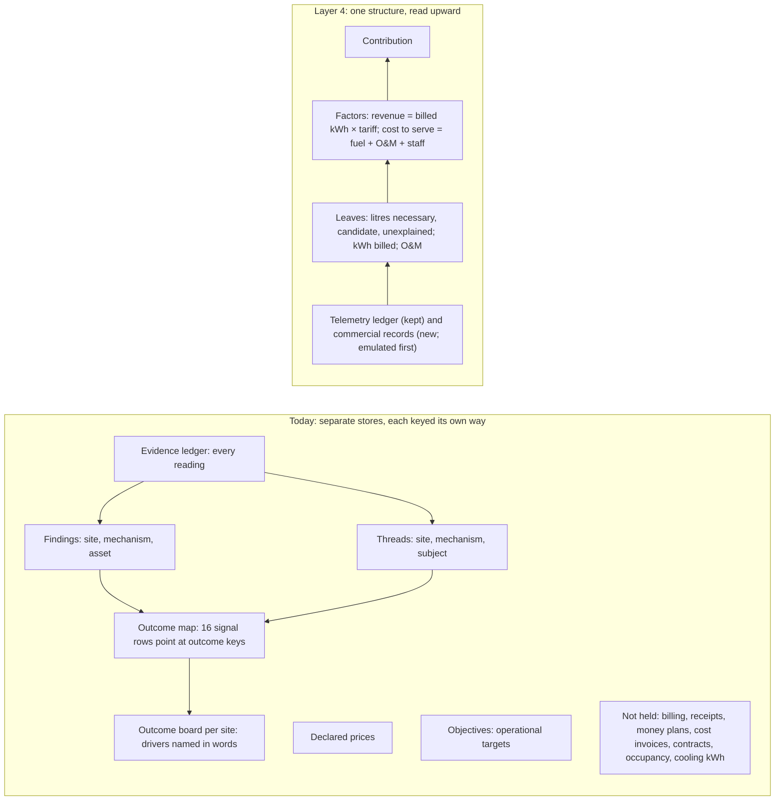
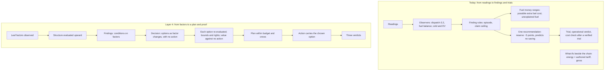
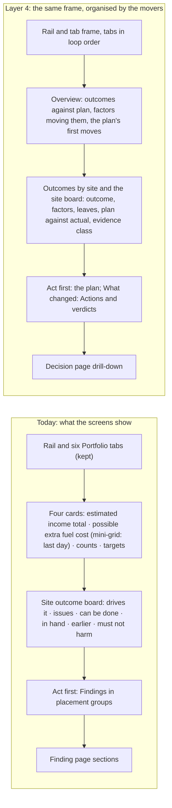
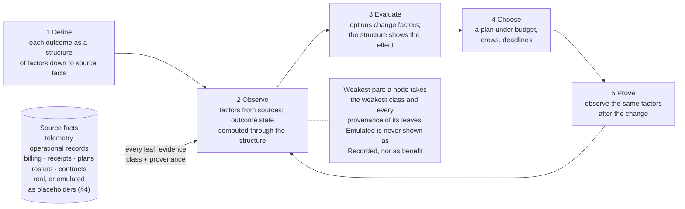
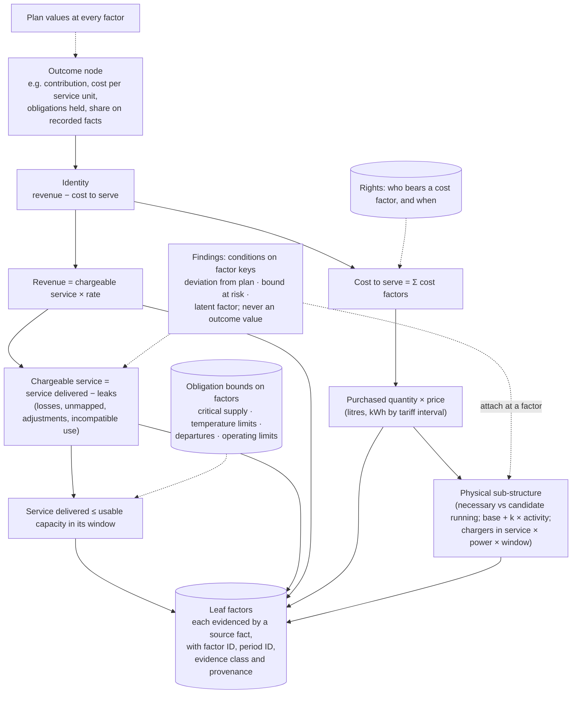
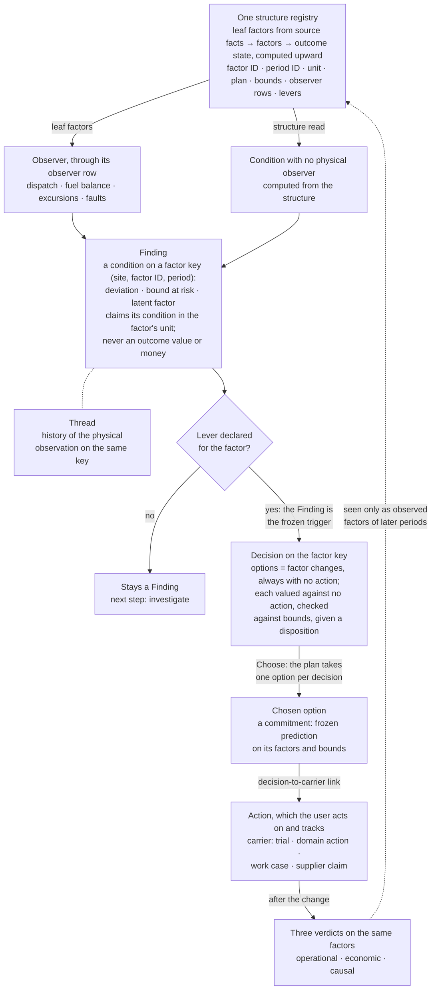
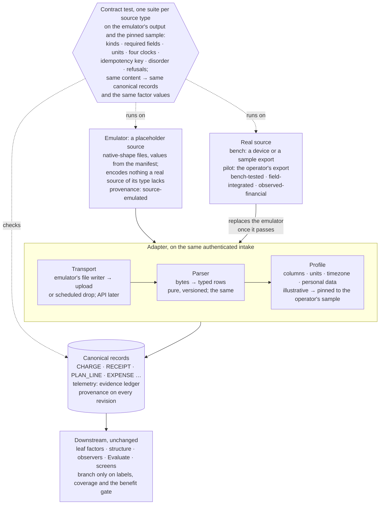

# AssetEcon Layer 4 design: the economic decision loop

**AssetEcon · Layer 4 architecture and demonstrator design · rev 13 (redesign, after twelve review rounds) · AssetOps Architect (Claude) · 17 Nov 2026 · rev 14 update 18 Nov 2026 (grounded path) · rev 15 update 18 Nov 2026 (introduction and §0)**
**Rev 14 update.** At the owner's request (`.agent/owner-grounded-transition-request-2026-11-18.md`), the design states how today's chain is re-grounded on the mechanics and becomes the delivery vehicle, ordered by what the client's screens show: what a Finding means and may claim, how Evaluate acts on it (§2.2, §2.3), the Action as the user's carrier (§2.5), emulators as placeholders for the canonical contract (§4), the parity rule for the outcome map (§5), every existing construct placed on the mechanics (§8.5) and the visible-first delivery order (§9). The mechanics and figures are unchanged. Full mapping and the compromise register: `product-transition-and-roadmap.md` §3.6–§3.9.
**Rev 15 update.** At the owner's request (`.agent/owner-design-intro-and-motivation-request-2026-11-18.md`), the owner-approved description opens the document as its introduction, and a new §0 shows, dimension by dimension (data, processing, presentation), how far today's mechanics reach and what is missing, repurposable or must change. The mechanics and figures are unchanged. Rev 15.1 (18 Nov): the owner revised D1 (engagement path: initial call → deep-dive → integration pack and pilot timeline → pilot → SaaS); the introduction carries a dated note, §9 and the pack follow (`product-transition-and-roadmap.md` §2).
**Status:** design for owner review. No application code, test, database or existing mock-up version was changed. Repository: branch `task/product-direction-layer4-design`; backend, frontend, simulator and tools are unchanged since `bf6014e02`, so every code citation below was read against current code.
**Product contract:** owner brief v1.1, Parts I–V (`.agent/AssetEcon_Product_Direction_Layers_1_to_3_and_Claude_Brief_REVISED.md`). This document answers Part VI as the owner clarified it on 17 Nov 2026 (`.agent/owner-layer4-direction-feedback-2026-11-17.md`).

> **Labels.** **[code-observed]** read in code · **[test-confirmed]** pinned by a named product test · **[implementation-report]** stated only by the reviewed baseline document (`.agent/decision-intelligence-mechanism-2026-11-14.html`) · **[proposed]** this design · **[research]** industry source cited in the brief ([R1]–[R12]) · **[assumption]** to validate with a prospect or pilot. Data provenance is always one of *demo-simulated, source-emulated, bench-tested, field-integrated, observed-financial*. Every money figure is **illustrative**, comes from `demo-site-scenario-manifest.yaml`, and reconciles to the cent (`python3 evaluate_structure.py` produces them; `python3 check_manifest.py` asserts them, 0 failures). Simulated and observed values are never mixed: nothing in this pack is an observed financial result.

## Introduction

*Approved by the owner, 18 Nov 2026* (`.agent/owner-design-intro-and-motivation-request-2026-11-18.md`).

In short: **the brief exists to turn AssetEcon from a tool that tells operators what their assets did into one that tells them what it did to their money, what's worth doing about it, and whether it paid off. Every screen should earn its place by answering that.**

**The motivation:**
- **Operators already have monitoring.** Mini-grid, cold-chain and EV executives can see telemetry, alarms and dashboards. What they lack is economic judgement across their systems. Operational, commercial and contract facts sit in separate places, so no one can say with confidence why the month came in below plan, which lever moves it, and what it's worth.
- **The product had drifted towards "interesting signals with economic hints".** It showed findings and exposure figures, but not intentionally organised around the movers of the business. The brief corrects that.
- **Credibility is the differentiator.** Executives act only on figures they trust. So the brief insists on honest evidence: every figure says how it is known, figures of different kinds are never added together (inside the structure, a node built from mixed evidence takes its weakest class and names every source beneath it, and a benefit total admits only field records), savings are claimed only after proof, and the no-action baseline is always shown.

**The evolution it wants to inspire:**
1. **Outcomes defined structurally.** Each business outcome, such as contribution, cost to serve or service obligations, is declared as a structure of factors down to source records.
2. **Observed bottom-up.** Where the business stands, including any shortfall, is read upward through those factors, not detected at the top and explained afterwards.
3. **Choices, not just findings.** Options are valued as changes to factors against doing nothing. One plan fits the operator's budget, crews and contract rights.
4. **Proof.** The same factors are observed after the change: it happened, the money followed, and the action caused it.
5. **General, then particular.** One set of mechanics serves all three verticals. Kobo illustrates the design; it never defines it.
6. **Built on what exists.** Findings, threads, actions and what-ifs are extended and re-grounded on the structure rather than replaced, so the visible product becomes useful quickly.

**What it's ultimately for:** differentiation and usefulness that convert operator executives. They see their own money explained, their decisions compared, and results proven, which their monitoring tools can't do. The commercial path follows from that: demo, then a paid diagnostic on their records, then a proven change.

*Since revised by the owner (18 Nov, D1; `/opt/assetecon/AssetOpsV1/owner/owner-d1-engagement-path-2026-11-18.md`):* the commercial path is now an initial call (data privacy, processes, integrations), a deep-dive with process owners, an integration pack and pilot timeline, the pilot with monitoring, then the product as a SaaS offering; the operator's own exports go through the canonical contract early, as the pilot's baseline, and the pilot carries a fee, credited against the first SaaS year (`product-transition-and-roadmap.md` §2.2–§2.3). The approved wording above is kept as approved.

## 0. Why Layer 4: how far today's mechanics reach, and what has to change

**Why this section sits here.** It is the evidence behind the introduction's motivation, so it comes straight after it and before the design. It does not define the mechanics: §1–§2 derive them from the brief, and nothing in this section shapes them. It reads today's product against them, so it uses their words before §2 defines them in full: a *factor* is a measured quantity that an outcome is built from (litres, kWh billed, crate-days), and a *leaf* is a factor that a source record evidences directly. The owner asked that this reading stay honest about what is missing, what can be repurposed and what should change, and not argue a point (owner, 18 Nov, same file).

**How it is read.** Three dimensions: how data is organised (§0.1), how it is processed (§0.2) and how it is presented (§0.3). Each states what today does well and which questions it answers, then one operator question it cannot answer and the exact reason: the **data** is not held, the **processing** does not do it, or the **presentation** hides it. Each ends with three sorted lists: **missing** (does not exist), **repurposable** (exists and can be extended or re-grounded; dispositions from `repo-reuse-and-gap-matrix.md`) and **must change** (exists, but misleads a reader or blocks a later step), each item with its reason. In Figures 0.1–0.3, each of today's elements carries one italic tag (kept, extended, re-keyed, reworked or must change, the same word as in the lists), a dashed box means "not held today", and blue boxes are Layer 4. Code references are under `backend/assetops_backend/` unless they start with `frontend/` or a migration number (`backend/migrations/versions/`); all were read on this branch, whose application code is unchanged since `bf6014e02`.

**The running example** is Kobo's October in the demonstration world (`derived-values.json`, demo values, never a customer result): contribution 1,445<!--fig:sites.lakeside-power/Kobo.plan.nodes.contribution--> planned and 883<!--fig:sites.lakeside-power/Kobo.actual.nodes.contribution--> actual, −562.00<!--figx:{sites.lakeside-power/Kobo.actual.nodes.contribution}-{sites.lakeside-power/Kobo.plan.nodes.contribution}--> in all. The factor-by-factor table is in `product-transition-and-roadmap.md` §1.3 and the derivation in §7.1 here. One cold-room or EV line per dimension shows that the case is general.

**Testing the introduction's own claim.** The introduction says the product had drifted towards "interesting signals with economic hints". Against the code, this holds for money and not for intent:
- *Money.* Every money figure today is either Estimated from a declared price (productive-use income and EV charging income, `outcomes/outcome_map.py:153-156`, `:173-176`) or Modelled as a range (possible extra fuel cost, from 0 up to an upper bound, `financials/fuel_cost.py:22`, `:41-42`; the unexplained-fuel range, `site_outcomes/mini.py:200-203`). No recorded commercial money exists: the recorded-amount strategy "returns no money with `NO_RECORDS`, always" (`chain/strategies/recorded_amount.py:1`).
- *Intent.* The outcome catalogue is already organised by the four economic categories (`outcomes/catalogue.py:9`). It already names Site profitability and Cash collected as outcomes, and it says plainly that their records "are not connected yet" (`outcomes/catalogue.py:45-46`).

So the gap is one of means, not of direction.

### 0.1 How data is organised

**Today.** Today's data is organised around evidence, around what the analyses find, and around a per-site board of outcomes and their drivers:
- *The evidence ledger.* It holds every reading with its source, unit before and after conversion, quality, a live-or-simulated flag and an envelope hash, append-only (`0005_evidence_ledger.py:161-197`).
- *Period reads.* These store each page fragment once per site, kind and period, with revisions, so a figure can be read "as known at" a past moment (`0059_site_period_read.py:1-20`; `chain/period_read.py:1-20`).
- *Findings and threads.* Findings are stored episodes per site, mechanism and asset, each with a lifecycle and a claim ceiling (`0009_finding_store.py:33-64`; `analytics/declaration.py:41`). Threads keep a Finding's recurrence history (`0042_chain_threads.py:29`).
- *The outcome map.* It links 16 signals to outcome keys, as the outcomes each signal *moves* and those it is *checked* against (`outcomes/outcome_map.py:17-37`). Ten node records attach a measure and, for four of them, a price (`:150-180`).
- *The outcome board's drivers.* For every outcome row of every site, in all three verticals, the server builds the row's drivers, each with a status text, a confidence chip and a link (`site_outcomes/board.py:276` `Contributor`). For a mini-grid's cost row, the drivers are generator use in avoidable and unclear minutes, fuel, and the fuel price (`site_outcomes/mini.py:1156-1177`). A driver without a source says so: "Not available yet · no cooling energy meter" (`site_outcomes/cold.py:72`, `:382`). These drivers are the nearest thing today to factors: named per outcome, but held as words, not as quantities that compose.
- *Objectives and prices.* Objectives hold operational targets, for example at most so many minutes a day of generator running that was not needed (`outcomes/objectives.py:58-60`). Prices are declared and published (`publish_assumption.py:1`).

**What it can answer today.**
- How long did Kobo's generator run when solar and battery could have carried the load? (dispatch classification, `analytics/dispatch_v3.py:290-302`)
- Is fuel missing beyond the tolerance band, and what might it be worth at the declared price? (`fuel_balance/rules.py:216`; the priced range, `site_outcomes/mini.py:200-203`)
- Which drivers bear on each of a site's outcomes, and which have no source yet? (the board's drivers)
- Which readings is a figure built from, and were they live or simulated? (`0005_evidence_ledger.py:196`)

<!--diagram:motivation-data-->

*Figure 0.1 (in the HTML twin, with Kobo's demo values on every node): today's stores beside one structure registry.*

**The ceiling.** *Operator question:* "Kobo's contribution in October: how far below plan is it, and how much of the gap is fuel and how much is billing?" In the demo, the answer is −562.00<!--figx:{sites.lakeside-power/Kobo.actual.nodes.contribution}-{sites.lakeside-power/Kobo.plan.nodes.contribution}-->. Of that, candidate running is −412.50<!--figx:-({sites.lakeside-power/Kobo.actual.nodes.candidate_l}-{sites.lakeside-power/Kobo.plan.nodes.candidate_l})*{sites.lakeside-power/Kobo.actual.nodes.diesel_price}-->, unexplained fuel −150.00<!--figx:-({sites.lakeside-power/Kobo.actual.nodes.unexplained_l}-{sites.lakeside-power/Kobo.plan.nodes.unexplained_l})*{sites.lakeside-power/Kobo.actual.nodes.diesel_price}-->, necessary running above plan −37.50<!--figx:-({sites.lakeside-power/Kobo.actual.nodes.necessary_l}-{sites.lakeside-power/Kobo.plan.nodes.necessary_l})*{sites.lakeside-power/Kobo.actual.nodes.diesel_price}--> and extra kWh billed +38.00<!--figx:({sites.lakeside-power/Kobo.actual.nodes.billed_kwh}-{sites.lakeside-power/Kobo.plan.nodes.billed_kwh})*{sites.lakeside-power/Kobo.actual.nodes.tariff}-->. Of the 3,458.00<!--fig:sites.lakeside-power/Kobo.actual.nodes.revenue--> billed, 3,180.00<!--fig:sites.lakeside-power/Kobo.actual.nodes.collected--> was collected.

*Why today cannot answer it: the data is not held.*
- No billing, receipt, money-plan or cost-invoice record exists (`chain/strategies/recorded_amount.py:1`; `outcomes/catalogue.py:45-46`). That includes the O&M and staff costs that Figure 0.1's structure needs.
- The only plans are operational targets (`outcomes/objectives.py:58-60`), so there is no planned contribution to compare against.

*A second reason, in the organisation itself.* Billing records alone would not produce the answer. The board names an outcome's drivers in words, but no record composes an outcome numerically from them. Nothing states that contribution is revenue minus cost to serve, or that fuel cost is litres times price:
- The node records attach a measure and a price to one outcome each (`outcomes/outcome_map.py:150-180`), and none composes one outcome from others.
- Findings are keyed by site, mechanism and asset (`0009_finding_store.py:33-64`), and threads by site, mechanism and subject (`0042_chain_threads.py:29`). Neither shares a key with any quantity an outcome is built from.

*What today answers in part.* The fuel side, partly in money:
- Candidate running carries the possible extra fuel cost.
- Unexplained fuel carries its own priced range per night (`fuel-residual-1`; `site_outcomes/mini.py:200-203`, `:918-936`), listed on the Protect card (`site_outcomes/read.py:957-960`).

Both are modelled ranges, per Finding or per night. They are never summed and not set against a plan, but they rest on the same facts as the 330<!--fig:sites.lakeside-power/Kobo.actual.nodes.candidate_l--> L and 120<!--fig:sites.lakeside-power/Kobo.actual.nodes.unexplained_l--> L leaves.

*The general case (cold room).* In the demo, Kirinyaga's room has occupancy on plan. Yet 5,000<!--fig:sites.harvest-cold/Room C · Kirinyaga.actual.nodes.kwh--> kWh were metered against the 4,030<!--fig:sites.harvest-cold/Room C · Kirinyaga.actual.nodes.kwh_model--> kWh that its occupancy explains (+24%<!--figx:round({sites.harvest-cold/Room C · Kirinyaga.actual.nodes.excess_kwh}/{sites.harvest-cold/Room C · Kirinyaga.actual.nodes.kwh_model}*100, 0)-->), and contribution falls from 698<!--fig:sites.harvest-cold/Room C · Kirinyaga.plan.nodes.contribution--> to 504<!--fig:sites.harvest-cold/Room C · Kirinyaga.actual.nodes.contribution-->. Today's product holds none of the records this needs:
- no occupancy or storage-contract record (`outcomes/catalogue.py:61`);
- no cooling energy meter, so the 5,000 kWh itself is not held (`site_outcomes/cold.py:72`, `:382`);
- no repair or call-out cost (`:71`, `:379-381`).

It does observe excursions and backup-start failures (`outcomes/outcome_map.py:20-21`), and its board states each missing driver in words.

| Missing (does not exist) | Repurposable: kept, extended or reworked (matrix disposition) | Must change (misleads or blocks) |
|---|---|---|
| Commercial records: billing, receipts, money plans, cost invoices (fuel, O&M, staff, repairs), contracts. Reason: no money figure can be Recorded without them (`chain/strategies/recorded_amount.py:1`) | *Kept.* The evidence ledger, as the telemetry source of leaves; it already carries provenance per reading (matrix B1). Also the period reads' append-only revision pattern, for stored structure reads | The outcome map, if it is kept as a model of outcomes of its own. Reason: it blocks one registry, because two models of outcomes would diverge. Its wire stays until a parity test passes (compromise C1 in `product-transition-and-roadmap.md` §3.9) |
| A declared composition (outcome = function of factors) with plan values per factor. Reason: without it, records cannot add up to a contribution or a bridge | *Re-keyed.* Findings and threads, keyed to factors through one observer row each, with no column added (§8.5; transition Appendix A.1) | |
| Shared factor and period IDs across constructs. Reason: the brief requires that the same fuel never counts twice (L1.1) | *Reworked.* The board's drivers become factor rows generated from the registry, with value, unit, plan and evidence class. Today each vertical writes its own (`site_outcomes/mini.py`, `cold.py`, `ev.py`) | |
| Rights as data: warranty, EPC, O&M and insurance terms with their states. Reason: who bears a repair cost cannot be computed; today the battery warranty exists only as withheld fields (`sites/battery_boundary.py:26`) | *Reworked.* The outcome catalogue and map become registry rows, with *moves* derived. Headroom becomes a capacity factor: today it is priced "per hour of use" under Grow (`outcomes/outcome_map.py:157-160`), but it is shown apart as Potential and never added to income (`frontend/src/sites/OutcomeBoard.tsx:118`), so only its category changes | |
| Occupancy and a cooling energy meter for cold rooms (`outcomes/catalogue.py:61`; `site_outcomes/cold.py:72`); odometer and roster records for EV (`outcomes/catalogue.py:55-56`). Reason: cost per service unit needs them | *Kept or re-keyed.* Objectives, as factor plans. Declared prices, as Estimated price leaves. The unexplained-fuel priced range (`fuel-residual-1`), as the priced unexplained-litres leaf | |
| A declared business model per site, so that revenue can be *not applicable* (a fleet operator charging its own buses). Reason: no such notion exists today | | |

### 0.2 How it is processed

**Today.** Today's processing turns readings into bounded observations, checks one kind of change after the fact, and puts a modelled money figure on the result:
- *Dispatch classification.* It splits generator running into necessary and candidate running, with the reason for each (`analytics/dispatch_v3.py:290-302`). It already protects service: running near the battery reserve is kept "necessary" (`:290-291`).
- *The fuel balance.* It tests fuel against a tolerance band (`fuel_balance/rules.py:216`).
- *Fuel money ranges.* The possible extra fuel cost is labelled Modelled and conditional, running from 0 up to an upper bound (`financials/fuel_cost.py:22`, `:41-42`), and it is recomputed when late data arrives (`recompute_consequences.py:1`). Unexplained fuel has its own priced range, shown on its own (`site_outcomes/mini.py:200-203`).
- *The reserve trial.* It states its own limits: it "tests whether the reserve setting matters … and does not predict less generator running time, any saving or any safety effect" (`actions/reserve_trial.py:42-45`). It is offered only when the battery sat more than 10 points above the reserve (`:1-8`).
- *Verification.* It freezes a plan, checks comparability and, where the family has them, guardrails. It returns Verified, Ineffective or Inconclusive (`actions/verification.py:193`; `actions/verification_rules.py:684`, `:739`). An unknown family fails closed (`actions/verification_families.py:505-510`).
- *The cost check after a verified trial.* It computes the modelled change in fuel cost per kWh of demand before and after the trial, labelled "Modelled change after the trial · not realised savings" (`financials/trial_fuel_comparison.py:1-13`, `:34`). The change's own cost is stated beside it and never subtracted (`:6-7`). The credit rule credits money only when that check shows an improvement with a priced positive total *and* the verdict is Verified (`outcomes/credit.py:1-3`). The Portfolio lists such results and never sums them (`estate/portfolio.py:679-682`).

**What it can answer today.**
- Did the reserve trial, the midday mill shift or the fuel-balance work action change generator running or unexplained fuel as planned? This applies to mini-grid only (`actions/verification_families.py:502`, `:516`). The reserve trial also checks guardrails; the midday mill shift has none (`:175`).
- After a verified trial, did the modelled fuel cost per kWh fall, and is that credited? (the cost check and the credit rule)

<!--diagram:motivation-processing-->

*Figure 0.2 (in the HTML twin, with Kobo's demo values): from readings to proof, today and in Layer 4.*

**The ceiling.** *Operator question:* "Should Kobo lower the generator stop threshold or lower the battery reserve, and what is each worth over a year, net of its cost, against doing nothing?" In the demo (the design world, not today's product):
- Lowering the stop threshold cuts candidate running by 210<!--fig:options.KOB-STOPSOC.params.avoided_candidate_l--> L a month and adds 150<!--fig:options.KOB-STOPSOC.params.added_throughput_kwh--> kWh of battery throughput. That is worth +250.50<!--fig:options.KOB-STOPSOC.monthly_or_horizon_change--> a month against no action, and 2,916.00<!--fig:options.KOB-STOPSOC.value--> over twelve months after its 90.00<!--fig:options.KOB-STOPSOC.operator_one_off--> one-off. This is a design value until replay K has run.
- Lowering the reserve is rejected: on 4<!--fig:options.KOB-RESERVE.params.dawn_days_below_35pct--> of 61 replayed days, the dawn battery charge falls below 35%.

*Why today cannot answer it: the processing does not do it.*
- There is one recommendation per Finding, a fixed reserve step of −5 points (`actions/service.py:300`; `actions/reserve_trial.py:37`). It says itself that it predicts no saving. No second option is generated, and nothing is compared with doing nothing.
- An operator can record a stop-setting what-if (kind `STOP_SOC`, `mini_decisions/scenario_rules.py:24`), but it is not calculated. The only kind that calculates is the productive load: energy times an authored tariff, as gross sales, with no cost (`:186`, `:191-197`).
- The possible extra fuel cost bounds what was at stake, from 0 to the fuel burned during candidate running (`financials/fuel_cost.py:22`). It is not the change a feasible option makes.
- Alternatives are authored explanations of a Finding, not options (`mini_decisions/alternatives.py:1`).
- No step re-computes an outcome under a choice.

*What today answers in part.* After the reserve trial has run, today can say three things:
- whether generator running fell without breaking a guardrail;
- what the modelled fuel cost per kWh did;
- whether that result is credited.

What it cannot state is the net money:
- the change's cost is set to 0 (`actions/verification.py:1167`) and kept beside the result, never subtracted;
- a positive verdict admits only simulated or authored evidence (`actions/verification_rules.py:688`);
- no operator approval is recorded, because every trial command is a SYSTEM demonstration (`actions/lifecycle.py:44-55`).

*The general case (cold room).* In the demo, repairing Kirinyaga's condenser and leak is worth +1,512.40<!--fig:options.KIRI-REPAIR.value--> over twelve months after its 350.00<!--fig:options.KIRI-REPAIR.operator_one_off--> cost, and replacing the compressor would be −1,988.40<!--fig:options.KIRI-REPLACE.value_if_admissible-->. Today a cold what-if is an authored stock-value context with no computed amount (`cold_scenarios/rules.py:26-27`), and the cooling energy and repair costs are not held (§0.1). So neither option can be valued.

| Missing (does not exist) | Repurposable: kept, extended or reworked (matrix disposition) | Must change (misleads or blocks) |
|---|---|---|
| Structure evaluation for the actual, the plan and every option. Reason: an outcome cannot be computed under a choice without it | *Kept.* The observers (dispatch-3.2, fuel balance, cold and EV depth reads), as observers of leaf factors; 12 of the matrix's 15 observer rows are reuse as-is (matrix B2). Also the Finding rules and claim ceilings | One fixed option per Finding: the −5-point reserve step is the only recommendation (`actions/reserve_trial.py:37`). Reason: it blocks a comparison, because nothing is weighed against it, not even no action. It does not mislead, since it says it predicts no saving (`:42-45`). Only its role as the sole recommendation changes; its qualification checks are reused (next column) |
| Options as factor changes, always with no action, valued against it net of their own cost. Reason: the brief's valuation rule | *Reworked.* The reserve recommendation's qualification checks, inside one option generator. The productive-load and stop-setting what-ifs, as option calculation records. Tariff contexts, as sensitivities | The change's cost set to 0 in verification (`actions/verification.py:1167`). Reason: it blocks a net economic verdict |
| Obligation bounds with a policy, checked before an option is recommended. Reason: today only the dispatch reserve rule and post-trial guardrails act (`analytics/dispatch_v3.py:290-291`; `actions/verification_rules.py:739`) | *Kept.* Plan freeze, comparability and the operational verdict; the late-data recompute pattern | Positive evidence limited to simulated or authored sources (`actions/verification_rules.py:688`). Reason: it blocks verifying a change on a customer's site. Field evidence is admitted with its label |
| An allocator under budget and crew visits; a forward replay; the causal verdict | *Reworked.* The cost check after a verified trial and the credit rule, as the seed of the economic verdict; the option's own cost and frozen prediction replace the constant 0 (matrix E) | |
| A named operator approval of a chosen option or plan. Reason: "One plan fits the operator's budget" needs someone who approves it; today no approver is recorded (`actions/lifecycle.py:44-55`; matrix E, rework) | *Kept.* Possible extra fuel cost and the unexplained-fuel range, as at-stake bounds labelled as today, never an option's value and never summed. The bound's internal strategy name, `avoided_cost@1` (`chain/strategies/avoided_cost.py:1`), suggests a saving and is renamed with the registry work | |

### 0.3 How it is presented

**Today.** Today's screens are careful about what a figure is, and the site Overview already lays each outcome out by drivers and levers:
- *The site outcome board.* Every outcome row on a site's Overview, in all three verticals, has five columns: "What drives it", "Issues", "What can be done", "Already in hand" and "Earlier interventions" (`frontend/src/sites/OutcomeBoard.tsx:42-48`, `:262-330`). Each row also has a "Must not harm" line (`:265-272`). The options link to the what-if, the trial and the Foundation change (`site_outcomes/mini.py:632-639`). This is the outcome → drivers → issues → lever → in hand → earlier result layout, in words.
- *Honest gaps.* Missing records are stated, naming the record (`outcomes/catalogue.py:45-46`, `:72-78`).
- *Never-sum rules.* Possible extra fuel cost is listed per site and never summed (`site_outcomes/read.py:903`), and credited results are never summed (`estate/portfolio.py:681`).
- *Placement says what it is.* Placement states that it says "where to look first, never a value ranking" (`estate/placement.py:5`).
- *Findings open into their evidence.* A Finding opens on Overview, Analysis, Evidence, Alternatives, Recommendation and History sections (`frontend/src/shell/SiteAnalyticsFrames.tsx:1004-1020`).
- *Navigation is stable.* The rail lists Portfolio, Sites, Findings, Actions, Incidents, Maintenance, Operational records, Evidence and Financials (`frontend/src/shell/OperatorShellLayout.tsx:61-71`). The Portfolio has six tabs (`frontend/src/estate/portfolioWords.ts:30-36`). A site has Overview, Foundation, Health, Performance, Findings, Work, Financials and Evidence (`frontend/src/shell/operatorSiteTabs.tsx:72-83`).

**What it can answer today.**
- Per site, which drivers bear on each outcome, what is open, what can be done, what is in hand and what was tried before? (the outcome board)
- Which sites need a look first, and why? (placement with reasons)
- What evidence stands behind this Finding, and how sure is it? (the Finding's sections and its claim ceiling)
- Which outcomes cannot be judged yet, for want of which records?

<!--diagram:motivation-presentation-->

*Figure 0.3 (in the HTML twin, with Kobo's factor rows): today's screens and Layer 4's, in the same frame.*

**The ceiling.** *Operator question:* "What did generator running that was not needed cost Kobo over these 30 days?" Today computes the pieces of the answer, but the presentation does not assemble them:
- *The pieces exist.* Each candidate-running Finding has its possible extra fuel cost, and the site's Financials page lists every stored revision of those figures (`consequence_history_api.py:1`).
- *The card shows one day.* For a mini-grid, the Portfolio's Optimize figure and the board's cost claim read only the window's last day (`site_outcomes/read.py:676-682`; the day rule `chain/read.py:136-146`). So a 30-day range shows one Finding's figure for one day, which can read as the period's cost.
- *Nothing states the period's figure.* No screen gives that figure as a range over the 30 days, labelled at stake.
- *The board shows drivers, not amounts.* "What drives it" names generator use in minutes, fuel and the fuel price (`site_outcomes/mini.py:1156-1177`). Their amounts and the row's nodes are computed for every row (`site_outcomes/board.py:367-407`) but rendered for Grow only (`frontend/src/sites/OutcomeBoard.tsx:238`, `:263`). Matrix F3 lists seven such computed-but-hidden fields.

*What today answers in part.* The avoidable minutes and the history of each Finding's possible extra fuel cost, read Finding by Finding.

*Context.* The Overview's four cards show four different kinds of figure side by side:
- Grow: an estimated income total, summed across sites that share a currency (`chain/vocabulary.py:459`, called from `site_outcomes/read.py:777`);
- Optimize: a possible extra fuel cost per site (`site_outcomes/read.py:901-903`);
- Protect and Assure: counts and per-site lines (`site_outcomes/read.py:926-960`).

Act first orders Findings by placement, which by its own policy is not a value ranking (`estate/placement.py:5`).

*The general case (EV depot).* Today's EV depot outcome "Charger use" (`outcomes/catalogue.py:53`) carries an estimated charging income from a declared tariff (`outcomes/outcome_map.py:173-176`), and that income enters the Grow total (`chain/vocabulary.py:323`). Today's product has no notion of a site's business model, so it cannot show that a fleet operator charging its own buses earns no charging revenue. In the demo, Embakasi is such a depot: Layer 4 shows revenue as *not applicable* and leads with cost per departure met.

**The board as Layer 4's first factor view (assessed on merit, after review H1).** It holds, with one condition.
- *Why it holds.* The board's columns already have the order the mechanics need: drivers, then issues, then levers, then what is in hand, then the earlier result, with bounds in "Must not harm". It exists for all three verticals and both grains: the Portfolio's *Outcomes by site* reads the same per-site rows. So the site factor view (V2, step 3e in the transition document) is cheaper to deliver by extending the board than by building a new view:
  - drivers become factor rows with value, unit, plan, evidence class and coverage;
  - "Issues" shows each Finding on its factor (V1);
  - "What can be done" opens the decision (V3);
  - "Must not harm" shows the bounds;
  - "Already in hand" and "Earlier interventions" carry the Actions and verdicts.
- *The condition.* The drivers are written per vertical today (`site_outcomes/mini.py`, `cold.py`, `ev.py`). If they stayed hand-written beside the registry, there would be two models of a site's factors. So the rows must be generated from the registry's factor and observer rows (3a, 3a′) and filled from the structure read (3b).
- *What it does not change.* It removes neither dependency, and it does not give the Portfolio's plan-against-actual money view, which still waits for records (V4).
- *Where it is recorded.* `product-transition-and-roadmap.md` §3.6 (V1–V3 and Figure 7), §3.7 and Appendix A.2, `phase-plan-and-acceptance.md` PR 3e, and the reuse matrix F2.

| Missing (does not exist) | Repurposable: kept, extended or reworked (matrix disposition) | Must change (misleads or blocks) |
|---|---|---|
| Amounts against plan per factor, on the Portfolio and site pages. Reason: it is the view that answers "which factor moved the outcome, by how much" | *Extended.* The site outcome board, as the first factor view: drivers become factor rows, and its other columns carry Findings, decisions, bounds, Actions and verdicts (matrix F2). Also the values the API computes but does not render (matrix F3, seven rows) | The mini-grid Optimize card's and cost claim's last-day figure on a period range (`site_outcomes/read.py:676-682`). Reason: it reads as a period cost |
| A decision page with options, no action, value, who pays, and the rule that rejected an option | *Kept.* The rail, the six-tab frame, the range bar and the coverage line, with no new menu (§6.1, §6.2). Also the Finding and Action detail pages, as drill-downs, and the "not available yet" pattern | Estimated charging income for a depot whose operator charges its own fleet (`outcomes/outcome_map.py:173-176`). Reason: that revenue is not applicable, not an estimate. Its root is in §0.1's missing list: no business model per site |
| The plan view within budget and crew visits; the three-verdict view | *Reworked.* The four Portfolio cards, computed from their factors. *Act first*, as the plan, with placement kept as triage on Findings. *Outcomes by site*, as the factor view. The *Opportunity* tab, renamed *Demand and capacity*: headroom is labelled apart today, and only its category changes. The "Why?" trace, as the evidence drawer | |
| An evidence class in words on every figure (Recorded, Emulated, Estimated, Modelled, …), beyond today's basis labels | | |

### 0.4 So the transition is…

The lists above, read together, give the transition's shape.

**Missing.** Most of what is missing is records:
- commercial records and cost invoices;
- occupancy and cooling energy;
- contracts;
- a business model per site.

The rest is the processing that uses them:
- evaluating the structure for the actual, the plan and each option;
- the plan and its approval;
- the causal verdict, and the economic verdict built from today's cost check.

**Repurposable.** Most of what exists stays, but not all of it stays unchanged. Of the reuse matrix's 116 rows (`repo-reuse-and-gap-matrix.md` §K):
- 62 are kept or extended: 40 reuse as-is and 22 extend. Observation and execution are largely in this group: 13 of 15 observer rows and 9 of 13 proof rows.
- 23 are reworked. They sit where the product's meaning changes:
  - 7 of 13 Evaluate rows: the outcome map and evaluator, the strategies, the checked role, the what-ifs and alternatives, and the reserve path;
  - 7 of 23 UI rows: the Portfolio cards, pulse counts, Act first, Outcomes by site, What changed, the Opportunity tab and the board's driver rows.
- 14 are integrations, 7 are computed fields to expose, 7 are new, and 3 are retired, plus 2 retirements inside other rows.

**Must change.** The must-change column names only what misleads a reader or blocks a later step. Two items mislead:
- a single day shown on a period range;
- an income estimate for a fleet that earns none.

Five items block:
- a second model of outcomes;
- a single fixed option;
- a zero change cost;
- field evidence refused;
- no recorded approver.

That column is short. The change is larger than it suggests, because the 23 reworked rows are where most of the work lies.

**Where today goes further than its first screens suggest.**
- Its site board already lays outcomes out by drivers, issues, levers and earlier results.
- It already puts modelled money ranges on both fuel components.
- It already checks the modelled fuel cost after a verified trial, and credits it only when verified.
- It already names the economic outcomes it cannot yet measure.
- Its API already computes more than its screens show.

So the transition is three things:
1. Add the missing records and the one structure that composes them.
2. Re-ground today's Findings, board, what-ifs, Actions and verification on that structure. Keep and extend where they fit, and rework the evaluation and the Portfolio tab bodies where their meaning changes.
3. Correct the two figures that read as something they are not.

The order follows which client screen becomes useful first, starting from the site board. That is the grounded, visible-first path in `product-transition-and-roadmap.md` §3.6–§3.7. The mechanics it builds towards are defined next, from the brief (§1–§2).

## Why this revision exists

The owner judged rev 3 "narrow stitched ideas" rather than a fundamental design, and asked that the fundamental mechanics be defined first and the specifics derived from them; that reuse be judged on merit; that the mock-up restructure the overall Portfolio experience without role filters or new menu items; that integrations, new and changed algorithms, and the UI strategy be stated explicitly; and that an outcome be understood as "observed by the underlying factors which are structurally defined" (owner, 17 Nov 2026, verbatim in `.agent/owner-layer4-direction-feedback-2026-11-17.md`). The owner also explained that reuse was never the problem; rev 3's reuse was narrow because it did not first establish the core future mechanics and then decide what to reuse, rebuild or create, and because it often followed one specific path (Kobo, one mini-grid) rather than an overarching logic.

Read against the brief, rev 3's main document was organised around today's repository structures (its §3 walked `moves`, `checks`, `CONTRIBUTIONS`, threads and cases and added extensions D1–D10), although the brief asks that the primary document not be organised by inventory (C0); it decided reuse before establishing the mechanics, treating the brief's "smallest coherent extension" (C0) as a design principle, and its extensions were shaped around one path (the Kobo generator Finding, the reserve trial, the mini-grid thread); and its mock-up added a decision menu group and a CEO/COO/CFO/CCO toggle to v7.0, although the brief treats the four questions as experience requirements, not views (L1.3).

This revision builds its mechanics from the structure the brief itself defines in Parts I–V (§1, with the source of every mechanic in §2.7): each outcome is defined by measured factors, the factors are observed independently from source facts, and outcome states, including shortfalls, are computed through that structure. The mechanics are general: they are defined once for every outcome, asset type and lever class, and the three verticals are instances of them, not their source. The worked sites (Kobo and the others) illustrate the mechanics; they do not define them. Everything else is derived from the mechanics: outcomes, levers and capabilities (§3), the integrations needed (§4), the algorithms new and changed (§5), the UI strategy and restructured Portfolio (§6), the worked portfolios (§7), the judgement of today's code on merit (§8) and the delivery order (§9). One departure from the brief is deliberate: C0's "smallest coherent extension" is applied as the owner clarified it — reuse where a part serves a mechanic well, rework or replace it where it does not, and never build a parallel engine (§8).

**Rev 14 and today's constructs.** Rev 3 was organised around today's structures and rejected for it. Rev 14 does not return to that: the mechanics stay first, and today's Findings, threads, what-ifs, Actions and verification are placed on them afterwards, each with what it becomes (§8.5). Placing them keeps what already serves the mechanics and lets the product reach useful, differentiated screens sooner, which is the owner's governing criterion (18 Nov).

## Owner review in 30 minutes

Start with `interactive-mockup-vNEXT/owner-inspection-checklist.md`, section "Owner review in 30 minutes": the five mechanics in five paragraphs (§2 here), the owner decisions with the one screen to open for each, one operator walk (Lakeside) and one cross-vertical contrast.

## The design pack

| File | What it is |
|---|---|
| `layer4-transformation-design.md` (this file) + `.html` (rendered) | The mechanics and everything derived from them |
| `economic-metric-and-effect-contracts.md` | The outcome structures in money: factors and the value chain per vertical, composition, attribution and valuation identities, evidence classes, rights in money terms, typed contracts, negative accounting tests |
| `integration-source-to-canonical-design.md` | Which source facts evidence which leaf factor, per vertical; worked record traces; canonical records, keys, quality, security; pilot adapters |
| `domain-and-decision-models.md` | The algorithms of each mechanic: structure evaluation and attribution, factor observers, counterfactual models per lever, obligation bounds, allocation, verification; equations, refusal policies, test vectors |
| `demo-site-scenario-manifest.yaml` + `evaluate_structure.py` (→ `derived-values.json`) + `check_manifest.py` | The three demonstration portfolios as factor structures (value chains), with attributions, options, rights, private oracle, disorder tests |
| `demo-build-cost-plan.md` | How the demonstration world is generated cheaply and regenerated by scope |
| `phase-plan-and-acceptance.md` | Delivery slices derived from the mechanics, with gates and end-to-end tests |
| `outcome-lever-capability-traceability.csv` | Objective ↔ lever ↔ capability ↔ executive question ↔ mechanic ↔ factor ↔ demo option |
| `repo-reuse-and-gap-matrix.md` | Appendix: module / function / table / API / test dispositions, organised by mechanic |
| `interactive-mockup-vNEXT/` | Runnable restructured mock-up (from v7.0), change register, audit, walkthroughs, owner checklist |
| `design-questions-and-decisions.md` | Owner decisions and material conflicts |
| `product-transition-and-roadmap.md` + `.html` (rendered) | From today's product to Layer 4: the transition strategy, the technical steps to get there, the product roadmap and the owner decisions it needs |
| `REVIEW.md`, `REVIEW-response.md` | Review history, rev 1–9, and the author responses through rev 10 |

---

## 1. What the product must do, and where its mechanics come from

An executive of a mini-grid, cold-room or EV-depot operator opens one consistent three-site portfolio and, within minutes, sees which business outcome is underperforming, which lever matters at which site, whether AssetEcon can improve that choice, which alternatives win or lose and why, how the value is calculated, who bears the cost given any contract rights, what is observed versus modelled, what to do, how it will be verified, and what a pilot needs (brief, final acceptance test).

**The brief already defines the structure that answers this.** Its Parts I–V do not describe outcomes as free-standing scores. They define each outcome by the quantities that make it up, and they define those quantities by the source facts that evidence them:

- **Outcomes are measured objectives with units, numerators, denominators and periods** (L1.1 table, column "What counts, units and time"), translated per vertical into specific economic quantities (L1.2: e.g. O1 is "diesel/fuel, battery wear, maintenance, network cost per paid kWh"; O3 is "metered delivery → bills/vending → receipts/settlement").
- **The unit hierarchy** (L1.1, "The financial and operational unit hierarchy") says how they are built: *economic actuals* (recognised revenue, expense, paid invoices, settlement facts) and *operational actuals* (delivered kWh, crate-days, sessions, outages, SOC, temperatures, faults) are observed; *derived metrics* are "numerator and denominator computed from eligible actuals, with coverage and compatible scope"; *estimated/modelled*, *exposure* and *verified effect* are separate classes on top.
- **Shared driver IDs and period IDs** (L1.1, line 130) identify each underlying quantity once, so "the same fuel, bill adjustment or recovered payment" cannot appear "as several independent gains".
- **Every displayed metric must carry** its business-model applicability, recognised numerator/denominator, scope and window, conversion basis, coverage, evidence type, plan provenance, beneficiary, limitations and drill-through; unobserved sites are unknown or excluded; portfolio ratios are Σ numerator / Σ denominator (L1.2, "Outcome decision invariants").
- **The economic anatomy of each vertical** (R1–R3) and the commission's phases (C1 Deliverable 2: "physical service delivered and contractual obligations → chargeable service → charges/recognised revenue → receipts/settlement → attributable costs → site contribution and plan → portfolio actual/plan bridge") give the order in which those quantities depend on each other.
- **Levers act on these quantities through stated causal pathways** (L2.2–L2.4, column "Real-world action and causal pathway"), and the **outcome × lever map** (L2.5) states each lever's role per outcome — *primary, trade-off, constraint, enabler, conditional, delivery, evidence* — and warns that the map is "many-to-many and causal, not additive accounting".
- **The variance bridge explains a gap with "independently identified drivers"** plus an explicit unexplained residual (L3.2, S2), from "plan assumptions; service volumes; tariffs/contract rates; purchased energy/fuel; repairs/adjustments".
- **Verification separates** operational effect, economic benefit and causal attribution ("verified effect: observed change under explicit comparison and guardrails; economic benefit and causal attribution require separate evidence", L1.1), and rights move through explicit states (R3a).

So, in the brief, **an outcome's state is not discovered by starting from a shortfall and searching for its cause. It is observed through the factors that structurally define it**: the factors are identified and evidenced independently, the outcome is computed from them, and a shortfall is what that computation shows. Rev 3 and this revision's first draft ran the other way (variance first, causes second). This revision follows the brief's direction.

**What exists today, in that light.** The repository observes physical factors well: generator energy split into necessary and candidate running (dispatch-3.2), fuel balance, cold excursions, EV faults [code-observed; dispatch-3.2 test-confirmed, baseline §3.11]. It has no economic actuals at all (`chain/strategies/recorded_amount.py:1`: "no billing source exists … returns no money with `NO_RECORDS`, always") [code-observed], so no outcome with money in it can be computed. Its outcome map relates signals to outcomes without the structure between them (ten rows, all `MOVES`, `outcomes/outcome_map.py:149-180`) [code-observed]. It values its one intervention (reserve r → r − 5, `actions/reserve_trial.py:37`) as gross exposure with intervention cost 0 (`actions/verification.py:1167`) [code-observed], and the Portfolio's placement "says where to look first, never a value ranking" (`estate/placement.py:1-6`) [code-observed].

---

## 2. The five mechanics

AssetEcon runs one loop for every portfolio, at site grain and portfolio grain:

Each mechanic has one job, one identity that must always hold, and one refusal rule, and each comes from the brief. The rest of the product is these five, instantiated per vertical.

### 2.1 Mechanic 1 — Define: every outcome is a declared structure of factors

*From the brief:* L1.1 (objectives with "what counts, units and time"), L1.2 (vertical translation; outcome decision invariants), the unit hierarchy, shared driver and period IDs, R1–R3 economic anatomy, C1 Deliverable 2 phases.

**Job.** For each outcome the operator manages, declare the structure that defines it, from the outcome down to **leaf factors** that a source fact can evidence. Nothing at an outcome is ever entered directly; it is always computed from its factors.

The structure uses four kinds of relation, all named in the brief:
- **identities**: contribution = recognised revenue − attributable cost to serve (R1, "economic anatomy");
- **products**: fuel cost = litres × price; revenue = billed kWh × tariff; storage charges = chargeable crate-days × rate;
- **stage relations** of the value chain (C1 D2 phases; L1.2 O3): metered = delivered − losses; billed = metered − unmapped meters − authorised adjustments; cash = collected + in transit + outstanding;
- **physical sub-structures** where an operational factor is itself made of parts (L2 causal pathways): generator energy = necessary running + candidate running (solar and battery could have carried the load), as dispatch classification observes it; refrigeration kWh = base + k × crate-days, ambient-corrected; deliverable charging energy = f(chargers in service, import limit, charging window).

The **value chain** is the economic backbone of every structure: usable capacity → service delivered → chargeable service → recognised revenue → cash, with cost-to-serve lines and contribution (or, for a captive EV fleet, cost per required departure met; revenue is NOT_APPLICABLE, never zero, R3).

*Findings, obligation bounds and rights all attach at factors, never at the outcome node (§2.2, §2.3). The same shape is filled in by each asset type with its own factors, levers and limits (§3.1a). In the mini-grid instance, for example, the physical sub-structure splits litres into necessary running, candidate running and litres not explained by the generator model. How much of the candidate running an option could avoid is not a node of this observed structure: it is that option's effect, computed in Evaluate (§2.3), and it differs by option.*

Three further elements sit on the structure, each from the brief:
- **Plans are declared at factor level** (S2's "plan assumptions; service volumes; tariffs/contract rates; purchased energy/fuel"), so the planned outcome is the same structure evaluated on planned factors.
- **Protect is a structure of measured factors too** (L1.1 P1–P4: "unserved critical energy; eligible temperature excursions; failed fleet departures; material outages; physical assets at risk, verified damage …"). Its measures have units, a period, a target, coverage and Σ composition across sites: unserved critical kWh, obligation-hours without redundancy, crate-minutes above a batch's limit, departures missed and nights with deliverable energy below required, asset-days out of service, liability and penalties (money: the *same* factor as in cost to serve, referenced, never added twice), and value at stake under rights (listed, never summed).
- **Obligations are bounds derived from the Protect measures** (S5): an option fails a bound when its counterfactual would push a Protect measure above its target — dawn battery charge ≥ 35% keeps unserved critical kWh at 0; batch temperature ≤ its commodity limit keeps crate-minutes above limit at 0; departures met = required keeps missed departures at 0; import ≤ limit.
- **Rights are factors on who bears a cost** (R3a, P4, A5): the same repair cost line, borne by the operator or a supplier depending on coverage, notice and evidence.

Each factor carries a **shared factor ID and period ID** (the brief's "shared driver IDs and period IDs"), its unit, its evidence class from the unit hierarchy, and the per-metric requirements of the outcome decision invariants. A factor appears once in the structure; every outcome that depends on it references the same factor.

**The four outcome categories are outcomes defined over this one structure** (L1.1; owner decision 2026-10-29): Grow reads the capacity → service → chargeable → revenue factors; Optimize reads the cost and leak factors per service unit; Protect reads its own measured factors (service shortfalls, redundancy, asset days out of service, liability, value at stake under rights), with the bounds derived from them; Assure reads the evidence class, coverage and verification state of every factor. That is why they are not additive (brief: "Assure should not be added on top of the same cash benefits"), and why one lever can serve several.

**Identity M1.** Every outcome node equals the declared function of its factors, for actual, plan and every counterfactual alike. Portfolio outcomes are compositions of eligible site factors: Σ amounts; ratios as Σ numerator / Σ denominator; never an average of site percentages.

**Refusal M1.** An outcome whose structure is not declared for a business model is not shown (e.g. charging revenue for a captive fleet is NOT_APPLICABLE).

### 2.2 Mechanic 2 — Observe: outcome state is computed from observed factors through the structure

*From the brief:* the unit hierarchy (actuals observed; derived metrics computed), L1.2 invariants (coverage, unknown ≠ zero, Σ/Σ), S1 (portfolio economics and coverage), S2 (bridge from "independently identified drivers" + residual), S3, S7, line 130 (shared IDs prevent double counting).

**Job.** Source facts populate leaf factors; every higher node is computed bottom-up; the outcome's state — on plan, short of plan, a bound at risk — is **read off the structure**. Nothing is inferred backwards from the outcome.

- **Leaf factors are observed independently**, each from its own evidence: litres from delivery notes and tank dips; billed kWh from the billing export; necessary vs candidate running from dispatch classification of telemetry; occupied crate-days from the storage ledger; departures met from the roster and the charging log. This is S2's "independently identified drivers".
- **Existing analyses are factor observers.** Dispatch-3.2 observes the split of generator energy into necessary and candidate running; the fuel balance observes litres beyond what the generator model explains; the cold excursion analysis observes chamber temperature against each batch's limit; EV fault Findings observe chargers in service. A Finding is a statement about a factor, not an explanation searched for after a variance.
- **What a Finding means.** A Finding is an observation of a **condition on a factor key** (site, factor ID, period): the factor deviates from plan, approaches or breaches a bound, or a latent factor appears (the three kinds of attention below). Each stored Finding mechanism names its factor and condition through one observer row of the registry; a condition with no physical observer (necessary running above plan, kWh billed below plan, a customer's letter of intent) is shown as a Finding computed from the structure. A Finding **may claim** its condition, in the factor's unit and period, within its observer's claim ceiling, and cite the structure's attribution of that factor. It **may not claim** an outcome value, money of its own, a saving or the value of acting; the outcome is always read upward through the structure.
- **Deviations propagate upward.** Each node's deviation from plan is the propagation of its factors' deviations, so the bridge — the attribution of an outcome's deviation to its factors — is a reading of the structure. For sums the attribution is exact; for products a declared rule is used and shown (volume effect at plan price, then price effect at actual volume).
- **An unexplained residual exists only where a leaf is not observed or the structure is incomplete**, and it is shown as a factor in its own right ("litres consumed beyond what the generator model explains"), with a tolerance that decides whether it is investigated (S2: "explicitly unexplained residual").
- **Coverage is a property of the structure.** If a leaf has no source record, every node above it is partially observed; the share of the outcome resting on Recorded leaves is its coverage (A1, S1). Missing is never zero.
- **Factors are visible before money closes.** Telemetry and operational factors are observed daily; money factors close with the books. A factor that deviates from plan or approaches a bound is visible at once, before the outcome shows it. Kasarani was on plan in October; its chargers-in-service factor fell on 1 Nov when CH-K2 failed, and the departures factor came under its bound days before any penalty or invoice.

**Attention therefore arises at the factor where something happens**, in three ways: a factor deviates from its plan; a factor approaches or breaches an obligation bound; or a new latent factor appears — a customer's demand (Mto's signed letter of intent for daytime milling), a contract deadline (Mto's inverter warranty notice by 27 Nov). Headroom without a customer stays a capacity factor, never an opportunity value (Kobo's 18–20 kW daytime headroom, v7.0 Finding F-109).

**Identity M2.** For every site and period: Σ factor attributions + unexplained-residual factor = actual outcome − planned outcome. Because each factor appears once with a shared ID, an observation that affects several outcomes carries money once (line 130): Kobo's candidate running moves the fuel factor once; the battery-life and clinic-supply consequences of changing it are Protect measures and bounds checked against options (§2.3), not further money. The same holds across outcomes: Thika's 108.00 compensation is one factor, read by the money outcome (a cost) and by Protect (liability), never counted twice.

**Refusal M2.** A factor without evidence is shown as *not available yet*, with the record that would fill it; its share stays in the residual and lowers coverage. Energy is never turned into revenue, nor revenue into cash, without the charge or receipt record.

**Lakeside Power, October 2026** (illustrative), read off the structure: delivered 23,050 kWh → metered 21,700 → billed 21,445 (plan 21,650) → revenue 9,688.00 (plan 9,785.00) → collected 8,870.00, in transit 150.00<!--rec-->, outstanding 668.00. Cost to serve 8,245.00 (plan 7,490.00), 91.5% from Recorded leaves (Kisiwa's O&M invoice is missing, carried as Estimated). Contribution **1,443.00 against plan 2,295.00, −852.00**, of which revenue factors −97.00 and cost factors −755.00 (§7.1 gives the attribution by factor).

**Portfolio ↔ site.** Portfolio outcomes compose site factors, so every portfolio figure opens onto the site factors that produce it, and a site factor's deviation is visible in the portfolio outcome it feeds.

### 2.3 Mechanic 3 — Evaluate: options change factors; the structure shows the effect

*From the brief:* L2 lever rows ("real-world action and causal pathway"; "boundary / disqualifier"), the outcome × lever map's roles (L2.5), S3, S4, S5, S12, R3a, L3.6 experience invariant.

**Job.** An **option** is a lever applied at a site: a change to one or more factors over a horizon (lower the generator stop threshold → candidate running; sign an aggregator contract → occupied crate-days; reschedule charging → peak share and peak kW; claim under warranty → who bears the repair cost, and when it is restored). Every decision contains **no action**, which projects the current factors forward under the same prices and contracts.

**Identity M3 (the one valuation rule).**
> value(option) = Σ over horizon [ outcome(structure | factors changed by the option) − outcome(structure | reference) ] − ( one-off cost borne by the operator under the option − under the reference path )

The reference is no action unless the decision names another path (waiting for a supplier, for example); a cost line both paths carry cancels, so a rights flip that moves a line onto the operator on both paths leaves the increment unchanged (rev 12: under a denied Kasarani claim both paths pay the 380 contactor and the stopgap is still worth +150.00<!--fig:options.KAS-OEM-STOPGAP.value-->).

on contribution for service businesses, and on cost to serve with every required departure met for captive fleets. Both evaluations use the same structure, horizon, prices, tariff and accounting basis. Consequences:

- **Gross exposure is never value.** Fuel "at stake" is a cost factor; the option's value is the feasible change in the candidate-running factor that a model computes for that option, net of wear and the cost of the change.
- **No-action windfalls are not credited to options.** Embakasi's November tariff adds a 00:00–05:00 tier; the no-action evaluation gets that saving (706.80 a month) too, so the schedule option is worth 8,082.00<!--fig:options.EMB-DEADLINE.monthly_or_horizon_change--> a month, not the 8,788.80 a comparison with October's bill would claim.
- **Overlap is structural.** Two options that change the same factor are mutually exclusive or evaluated together; a ratio that improves because its denominator grew (cost per crate-day falling as occupancy rises) is not added to the contribution it comes from (L2.5).

**The outcome × lever map's roles are how the structure treats each outcome an option touches** (L2.5): a *primary* outcome carries the option's value; a *trade-off* is a costed factor inside the value (battery wear); a *constraint* is an obligation bound checked on the counterfactual factors — **hard** (fail → rejected), **costed** or **advisory**; *conditional* and *enabler* roles become stated conditions; *evidence* is the Assure state. A bound the model cannot evaluate is **unknown**, and its declared policy decides: refuse or conditional. Examples: dawn battery charge at Kobo (hard), every required departure at Embakasi (hard), battery wear (costed), warranty operating limits (hard).

**Protect measures are evaluated per option too.** An option's counterfactual gives its effect on each Protect measure over a stated horizon (e.g. Kasarani: departures missed 2 under waiting, 0 under the stopgap; Thika: nights without backup cover 2 or 0; Mto inverter: hours without redundancy 110 if claiming and waiting, 30 if buying now — shown beside the plan's claim-versus-buy switch, which is decided on money because the generator backs the daytime shortfall on every path, so no path leaves obligation hours with no backup supply; owner question Q15), so must-do and protective options show the measure they move, computed, not asserted. Options look forward from the decision date: the period's observed state (October's reduced days, for example) is reset to a declared forward baseline before an option's changes apply.

**Rights change the cost-bearer factor and its timing.** A right enters an option as the operator's **residual cost** under each remedy path (claim and wait, buy now and claim later, repair locally and lose cover), with notice deadlines, exclusions, downtime and transport. These are structural, not narrated: a right with an open notice deadline **lapses** for any path that files no notice by it (Mto's no action loses the 2,600 inverter cover on 27 Nov); an unauthorised repair **voids** cover (Kasarani's local repair, Thika's self-funded controller); a supplier restores only while the right is covered, so a denied claim moves the restore date; and the lost or unclaimable cover is a node that a declared bound tests. A right is never money until a credit note or receipt is recorded (R3a).

**Evaluate acts on Findings.** A Finding on a factor key opens a decision when a lever is declared for that factor; the Finding is the decision's trigger, frozen into it, and its evidence (threads, records) attaches to the same key. A Finding with no lever stays a Finding whose next step is to investigate. A decision is a choice between options about one factor, never "the fix for this Finding", so gross exposure never becomes an option's value.

**Each option ends in one disposition with its reason** — Recommended, Conditional, Acceptable, Deferred, Rejected — answering the experience invariant (L3.6): what is possible, why it matters economically, why this lever rather than alternatives, what prevents action, how success is proved, which records are needed. No action is always shown with its consequence.

**Refusal M3.** No option is recommended when a hard bound fails or is unknown under a refuse policy, or when its value depends on a missing factor; the screen names the record or test that would resolve it. Every rejection is a declared bound measured on the option's own nodes; none is typed (Kobo's reserve change fails dawn adequacy on the replay's 4 of 61 days; Mto's no action fails the cover bound).

### 2.4 Mechanic 4 — Choose: a plan under shared resources

*From the brief:* S6, L1.3 (CEO and COO answers), L2.5 X5 and X8, C1 Deliverable 5 ("transparent comparator and constrained subset for three sites, not an opaque global optimizer").

**Job.** At portfolio grain, options from all sites compete for the same **budget, crew visits, deadlines and dependencies**. The plan is found by one search over all the decisions together. It takes one option per decision (a money-valued decision may also take none, unless it is declared required); it leaves out an option that breaks its decision's hard bounds, unless no option of that decision can keep them; it keeps only combinations that fit those constraints; and it ranks them by the least rule-breaking, then the highest modelled value over the horizon, then the lowest spend. A decision is **must-do** when no action fails a hard bound: that is a property of the decision, shown on the plan, not a step taken before the search.

**Identity M4.** Spend ≤ budget; crew visits ≤ crews (both enforced by the allocator); dependencies and exclusions hold; every excluded option carries its reason; the plan's modelled value is the sum of its options' values only because each changes distinct factors (identity M3). Spend = one-off costs of valued options (netted inside the value) + spend on options valued only on Protect measures (shown separately, never omitted). **An option is valued in money exactly when it changes a money node of the structure**; must-do and protective items whose effect reaches only Protect measures or rights are shown with that effect instead.

Three orderings are kept apart, as the commission requires: **triage** (what to look at first: today's placement groups) [code-observed: `estate/placement.py`], **comparison** (options of one decision on one horizon and basis), and **allocation** (a set across sites under constraints).

**Simplest justified allocator.** For a three-site portfolio (≤ 15 money options), enumerate every combination of one option per decision: transparent, exact and explainable. Protective and valued decisions are enumerated **together**, so the budget and the crew visits are judged for the whole plan, never one choice at a time: a combination is feasible when it fits the budget and the visit limit, when every switch an option needs is set, and when every dated dependency holds; the plan is the feasible combination with the least total violation of the decisions on their least-violation fallback, then the highest value, then the lowest spend. A protective decision offers the options meeting its hard bounds, or, when none can and it declares the fallback, all of them; the trade-off is stated when a smaller violation could not fit the plan. **Dependencies are dated, not ruled:** the rice huller needs the inverter restored by whichever path the plan takes, plus the contractor's 5 working days, before the cooperative's letter lapses (30 Nov, or the extended date when the "letter extended" switch is on); no restore means no connection. **Two horizons, both declared:** Protect effects are stated to 30 Nov (the reporting horizon); money runs to the restore date or, if an asset is never restored, through the tenant's 12-month horizon, so a no-action path is never cheap merely because the count stops at month end. The full rules are in `structure-specification.md`; everything that is not derived under them is listed, with its disposition, in `derivation-register.md`. An assumption that changes the answer is a visible switch (budget; whether the cooperative extends its letter of intent). Investigation or doing nothing wins when no option clears its bounds or when a factor needed to value it is missing.

**Different defensible allocations** (brief EV-C5: "COO/CFO/CEO see same evidence but different defensible allocations") are produced by the switches, set by a person — a different budget, a stricter crew limit, a different assumption such as whether a tariff applies — over one evidence base. They are never role views, and each setting's plan shows its reasons.

**Refusal M4.** The plan never sums figures of different kinds (modelled, at stake, verified); restored charges, potential credits and covered asset value are listed beside the plan, not added to it.

### 2.5 Mechanic 5 — Prove: observe the same factors after the change

*From the brief:* S8, A3, the unit hierarchy's verified effect, R3a states, C1 Deliverable 5 verification.

**Job.** A chosen option becomes a **commitment**: a frozen prediction (which factors should move, by how much, which bounds must hold, over which windows) handed to the work carrier that executes it (a controller trial, a domain action, a work case, a supplier claim). The user acts on it and tracks it as an **Action**, through today's carriers; the decision links its chosen option to the carrier, so the Action, its frozen prediction and its verdicts refer to the same factors. After the change the **same factors are observed** through the same structure, giving three separate verdicts:

| Verdict | Question | Evidence |
|---|---|---|
| Operational | did the targeted factor move as predicted, with bounds held? | telemetry, operational records, frozen plan |
| Economic | did the money factors move? | fuel invoices and dips, bills, credit notes, receipts in the after-window |
| Causal | how sure are we the change caused it? | comparable days, untreated sites as controls, known confounders |

Rights verify by **state**, each a recorded event set by a person: potential → evidence assembled → notified → acknowledged → accepted / denied / disputed → remedy delivered → credit booked → cash received. A supplier-funded repair and an insurance payment for the same expense can never both be recorded.

**Identity M5.** A verified effect appears in the structure only as observed factors of later periods; a prediction is never relabelled as realised. Late facts recompute the structure and can withdraw a verdict, never silently.

**Refusal M5.** Insufficient evidence is a verdict ("not proven yet"), not a pass.

**The grounded chain, on the structure.** Observe, Evaluate, Choose and Prove, as the user meets them, from a Finding to its verdicts. Every element is keyed to the factor IDs of one structure registry: a Finding through its observer row, a decision through its factor key, options through the factors they change, bounds through the factors they limit, an Action through its chosen option, verdicts through the factors of the frozen prediction. How today's constructs take these places is §8.5.

*Nothing in the chain carries an outcome value of its own: the Finding states a condition on a factor, the decision values factor changes against no action, the Action carries the chosen option and its frozen prediction, and the verdicts observe the same factors afterwards. Gross exposure stays an at-stake bound on its factor (§2.3).*

### 2.6 Cross-cutting invariants (brief L1.2 invariants, made general)

1. Every number on screen is a node of a declared structure with period, evidence class in words, coverage and lineage (source within two interactions).
2. Unknown is never zero; an unobserved site is excluded and named.
3. Figures of different kinds are never summed: Recorded, Modelled, At stake and Verified sit side by side. Inside the structure a node composed from mixed leaves takes the weakest class and carries every provenance beneath it; a benefit total admits only field records.
4. A factor appears once (shared factor and period IDs); every outcome that depends on it references it.
5. The system evaluates and recommends; a named person decides, approves and records rights events.
6. No legal or insurance conclusion is drawn: "Coverage is decided by the supplier or insurer."
7. One reality per operator: every role, page and question reads the same structures, factors, options and plan.

### 2.7 Where this design follows the brief, and where it adds or departs

| Mechanic element | Source in the brief | Follows / adds / departs, and why |
|---|---|---|
| Outcome = declared structure of factors down to source facts | L1.1 objective definitions; L1.2 vertical translation; unit hierarchy; R1–R3; C1 D2 phases | **Follows.** Adds one thing: the structure is an explicit, machine-evaluated registry, because the brief's acceptance tests (S1 reconciliation, S2 identity) need the same definition used for actual, plan and counterfactual |
| Observed leaves, computed outcomes, unknown ≠ zero, Σ/Σ | unit hierarchy; L1.2 invariants; S1 | **Follows** |
| Factor IDs and period IDs, one money per factor | line 130 ("shared driver IDs and period IDs") | **Follows**; the brief's "driver" is named *factor* here because it covers non-money factors (temperatures, departures) as well |
| Bridge from independently identified factors + residual | S2 | **Follows**; **adds** a declared attribution rule for products (volume at plan price, then price at actual volume), which the brief leaves open, so the bridge is reproducible |
| Early visibility of factors before money closes; attention from factor deviation, bound threat or latent factor | implied by P1/A1 and the continuous evidence of R1–R3 | **Adds**: makes explicit that observation runs at the factor's own cadence |
| Options as factor changes, valuation against no action | L2 causal pathways; S4 ("net impact and common horizon"); C1 D2 | **Follows**; **adds** the rule that no-action receives tariff or price changes too (the Embakasi case) |
| Lever roles per outcome (primary, trade-off, constraint, …) | L2.5 outcome × lever map | **Follows**: the roles become how an option's effect on each outcome is treated (value, costed, bound, condition, evidence) |
| Hard / costed / advisory bounds; unknown policy | S5; C1 D5 ("hard constraint, a costed trade-off or unknown") | **Follows** |
| Rights as cost-bearer factors with states | R3a; P4; A5; S12 | **Follows** |
| Exhaustive joint-search allocator with switches | S6; C1 D5 ("simplest justified allocator") | **Follows** |
| Three verdicts | unit hierarchy (verified effect; economic benefit and causal attribution separate); S8 | **Follows** |
| Executive questions answered by sections of one loop, not role views | L1.3 ("experience constraints, not silos"; "the same financial records … underpin all views"); owner, 17 Nov | **Follows**; **departs from rev 3**, which added a role toggle |

---

## 3. Deriving the product contract from the mechanics

### 3.1 Outcomes and their factors (what M1 declares)

| Category | Objectives | Outcome measure | Defining factors (leaves in bold) |
|---|---|---|---|
| **Grow revenue** | G1, G2, G3 | recognised revenue and incremental contribution; chargeable service per usable capacity | **delivered service**, losses, **unmapped / adjusted service**, **tariff or rate**, **usable capacity by window**, latent **customer demand** with its evidence |
| **Optimize cost and efficiency** | O1, O2, O3 | O1 cost to serve per paid service unit (Σ/Σ); O2 operational productivity — asset availability and field visits (mini-grid), cooling availability and crate-days without excursion (cold), deliverable energy used (import-limited) and departures per installed charger (EV); O3 realisation chargeable → billed → collected (all three service businesses) | **litres or kWh purchased**, **price**, generator energy split (**necessary / candidate**), **normalised energy**, **O&M**, **staff**, **collections**, **settlement timing** |
| **Protect asset and capital** | P1, P2, P3, P4 | each measure against its target, Σ over sites: unserved critical kWh; obligation-hours without redundancy; crate-minutes above limit; departures missed; asset-days out of service; liability and penalties (shared money factors); value at stake under rights (listed) | **critical load supplied vs demanded**, **asset status by interval × obligation window**, **batch presence × chamber temperature × commodity limit**, **roster departures × charge at departure**, **fault logs**, **QA notes and credit notes**, **contract terms, notice deadlines, evidence held** |
| **Assure performance and returns** | A1–A5 | share of each outcome on Recorded leaves; unexplained residual; verified effects; rights by contract and period (complete contract evidence, open deadlines, remedy days, residual expense, credits); A4 is the evidence pack — A1–A3 with lineage, exported per period for an investor or lender — not a further measure | evidence class and coverage of every factor; residual factors; verdicts; rights events |

The vertical instances are the brief's L1.2 rows; `economic-metric-and-effect-contracts.md` gives each vertical's full structure.

### 3.1a How each asset type fills in the shared structure

The structure is shared; each vertical declares its own factors, levers and limits within it (brief R1–R3, L1.2, L2.2–L2.4, L3.3–L3.5). The business model decides which nodes exist at all.

| | Mini-grid (metered, billed electricity) | Cold room (pay-as-you-store) | EV depot (captive fleet) |
|---|---|---|---|
| Outcome backbone | contribution = billed kWh × tariff − (fuel + O&M + staff) | contribution = chargeable crate-days × rate − (energy + staff + maintenance + customer compensation) | cost per required departure met = (energy + demand charge + maintenance + penalties for missed departures) ÷ departures met; revenue NOT_APPLICABLE |
| Service factors | usable supply by window → delivered → metered (− technical loss, − losses beyond expected) → billed (− unmapped meters, − authorised adjustments) → collected / in transit / outstanding | crate-days available → occupied → chargeable (compatible commodity) → invoiced → received | deliverable kWh per night (chargers in service × power, import limit, window) → delivered kWh → departures readied vs required |
| Cost factors | litres = generator energy × SFC, generator energy = necessary + candidate running; litres beyond the model; diesel price | kWh = base + k × crate-days, ambient-corrected, + excess over model; electricity price | kWh by tariff interval (peak, off-peak, 00:00–05:00), monthly peak kW × demand rate |
| Bounds (limits) | clinic critical load; dawn battery charge ≥ 35%; battery warranty operating limits; evening supply redundancy | batch temperature ≤ commodity limit; commodity compatibility; backup start | every required departure; import limit; connector compatibility |
| Operations measures (O2, October) | asset availability 98.62%<!--fig:operations.lakeside-power.asset_availability.portfolio--> (428 of 434 asset-days; plan 100%); field visits 3 (plan 3); 7,683.33 delivered kWh per visit | cooling availability 99.997% (4 minutes lost at Thika); crate-days without excursion 22,820 (plan 26,040) | deliverable energy used (import-limited) 56.23%<!--fig:operations.metro-bus.deliverable_energy_used.portfolio--> Σ/Σ (Embakasi 46.67%<!--fig:operations.metro-bus.deliverable_energy_used.sites.Embakasi-->, Kasarani 85.71%<!--fig:operations.metro-bus.deliverable_energy_used.sites.Kasarani-->, Ruiru 61.25%<!--fig:operations.metro-bus.deliverable_energy_used.sites.Ruiru-->); 50.08 departures per installed charger |
| Realisation stages (O3) | metered → billed → collected | occupied → chargeable → invoiced → received (storage-ledger to invoice reconciliation; no October discrepancy) | NOT_APPLICABLE (captive) |
| Protect measures (October, target 0) | unserved critical kWh 0; customer-hours interrupted 0; obligation-hours without redundancy 30 (Kisiwa 10, Mto 20); asset-days out of service 6; liability 0; at stake: battery cover 64,000, inverter warranty 2,600 (notice by 27 Nov); asset value at risk not available yet (needs a failure-likelihood basis) | batches exposed 1; crate-minutes above limit 2,400–3,600 (Thika); days with backup start unproven 26; liability 108 (same factor as customer compensation); stock exposed 2,160 at stake | departures missed 0 of 1,302 (November to 6 Nov: 2); nights below required 0 (November: 5); charger-days out of service 26 (Ruiru connector, no departure affected); penalties 0 (November: 240) |
| Rights factors | inverter, battery, genset warranties; O&M response SLA | EPC workmanship warranty on backup start; goods-in-custody insurance | charger parts warranty and service SLA |
| Latent factors | customer demand with evidence (signed letter of intent); headroom stays capacity | aggregator contract for off-season crate-days | fleet expansion offered by the city |
| Levers acting on them | MG-L1–L10 (e.g. stop threshold on candidate running; meter mapping on unmapped kWh; demand connection on delivered daytime kWh; warranty claim on who pays) | CC-L1–L9 (contract on occupied crate-days; repair on excess energy; stopgap and EPC remedy on backup start) | EV-L1–L9 (schedule on peak share and peak kW; repair and SLA on chargers in service; absorption on spare deliverable kWh) |
| Not applicable | — | — | charging revenue, energy-to-cash (EV-C4) unless the depot sells charging |

### 3.2 Levers are changes to factors

Every researched lever (brief L2) changes specific factors through its stated causal pathway, is valued by a specific model, and is bounded by specific obligations; its role per outcome is the L2.5 map.

| Lever class | Factors it changes | Model that evaluates the change (§5) | Bounds usually checked |
|---|---|---|---|
| X1 Profitable capacity activation | usable capacity → delivered and chargeable service (latent demand factor) | demand-on-headroom replay (MG), occupancy ledger + compatibility (CC), roster capacity (EV) | service adequacy, temperature and compatibility, import limit |
| X2 Controllable operating cost | litres or kWh, peak share and peak kW, normalised energy | forward dispatch replay (MG), normalised energy (CC), deadline-aware schedule (EV) | dawn adequacy, battery wear, temperature, departures |
| X3 Physical-to-commercial realisation | losses, unmapped meters, adjustments, collections | reconciliation with effective-dated identity | none physical; collection is a separate step |
| X4 Reliability / value protection | obligation factors; liability | consequence model (unserved load, batch exposure, missed departures) | the obligation itself |
| X5 Capital allocation and deferral | capacity and cost factors over a longer horizon | lifecycle comparison on the same identity | all of the above |
| X6 Market / demand creation | latent demand factor | qualification only (customer evidence) | — (partner-dependent) |
| X7 Tariff, subsidy, financing | price and rate factors | sensitivity on the identity | — |
| X8 Workforce / execution | crew visits (a constraint of M4) and commitments (M5) | allocator; work carriers | — |
| X9 Contractual entitlements | cost-bearer and timing factors | residual-cost-per-path model | warranty operating limits; notice deadlines |

Vertical levers MG-L1…L10, CC-L1…L9 and EV-L1…L9 map onto these rows in `outcome-lever-capability-traceability.csv`.

### 3.3 Capabilities are the mechanics made visible

| Capability (brief L3.2) | Mechanic |
|---|---|
| S1 Portfolio economics and coverage | M1 + M2 |
| S2 Variance driver bridge | M2 (attribution through the structure) |
| S3 Qualified opportunities and controllability | M2 (factor evidence) + M3 (refusal) |
| S4 Competing interventions | M3 |
| S5 Cross-outcome safeguards | M3 bounds |
| S6 Resource and capital prioritisation | M4 |
| S7 Evidence drill-through and confidence | invariant 1 over M1–M5 |
| S8 Action and verification | M5 |
| S9 Pilot onboarding | the sources of leaf factors (§4) |
| S10 Exploration assistant | a reader of stored results of M1–M5; never a source of numbers |
| S11 External opportunity intelligence | evidence for latent factors, labelled hypothesis |
| S12 Entitlement-aware decisions | rights factors in M3, rights states in M5 |

Vertical capabilities (MG-C1…C6, CC-C1…C6, EV-C1…C6) are the vertical structures and models of §5 running inside M1–M5.

### 3.4 The four executive questions are readings of the same loop

The questions are experience requirements (L1.3), not silos, and the brief's L2.6 crosswalk already lists, per question, the levers whose factors it must consider. Each is answered by one or two mechanics over the same structures, so no role filter is needed: the Portfolio is organised by the loop and each question lands on its section. The questions stay in this document as acceptance tests the design must pass; on screen they are invisible. No title, label, subheading, tab name or caption states a question or names a role (owner, 17 Nov). They emerge from how the Portfolio is organised: what comes first, how things are grouped, how one view leads to the next, and what each number breaks down into — the CEO's from an Overview showing which outcomes are moving and why, the CFO's from each outcome breaking down through its factors to plan against actual, the COO's from the plan and its constraints sitting where action is decided, the CCO's from demand ranked by the contribution it adds.

| Question | Mechanics | Portfolio answer (§6) | Drill-down |
|---|---|---|---|
| **CFO** — why off plan; actual vs estimated; what may be recoverable | M1 + M2 (+ rights in M3) | *Overview* outcomes with their factors and coverage; *Outcomes by site*: each outcome's factor structure by site, plan vs actual at every factor, attribution and residual | outcome → factor → source records |
| **CEO** — which sites and investments earn best from existing capital | M3 + M4 | *Act first*: the plan under budget, with excluded and deferred options and the switches that change it | decision → counterfactual structure → sensitivity → why another site waits |
| **COO** — where should limited crews work; what is feasible | M2 attention (factors at bounds) + M4 crews + M5 | *Act first*: crew visits and remote changes; factors at or near obligation bounds; *What changed*: commitments and verification | decision → bounds → work carrier → verification plan |
| **CCO** — which demand can be sold profitably; what limits it | M2 latent factors + M3 on X1/X6 levers | *Demand and capacity*: qualified demand ranked by net contribution, with rejected demand and capacity without customers | decision → customer evidence → capacity window → incremental cost factors |

Every role walks portfolio → site → decision → source evidence, and the plan changes when a hypothetical (budget, letter of intent) changes.

---

## 4. Integrations needed (derived from the leaf factors)

The structures of §2.1 end in leaf factors, and each leaf factor needs one family of source facts: that is the integration scope, no more and no less. Telemetry-backed leaves are observed continuously; money-backed leaves close with the books (§2.2). The table lists the leaves by their place in the value chain; `integration-source-to-canonical-design.md` gives formats, worked record traces, keys, identity, quality and security.

| Leaf factors (place in the structure) | Mini-grid source | Cold-room source | EV depot source | Exists today? |
|---|---|---|---|---|
| Usable capacity, service delivered | EMS / inverter / BMS / genset telemetry (Modbus GX-shaped, existing gateway) | chamber controller, energy meter | CPMS / OCPP 1.6J log (StartTransaction, MeterValues, StatusNotification), site meter | **yes** for telemetry via the evidence ledger and field gateway [code-observed]; OCPP log **new** |
| Chargeable service | customer meter register with effective dates (meter ↔ customer) | storage ledger: batch check-in/out, commodity, crates, rate | fleet roster: bus, block, return, departure, required kWh; session ↔ bus attribution (OCPP idTag) | **new** |
| Revenue | billing / prepaid vending export | invoices | NOT_APPLICABLE (captive); session fees (commercial) | **new** |
| Cash | receipts, mobile-money settlement statements | receipts | NOT_APPLICABLE / receipts | **new** |
| Cost lines | fuel delivery notes, tank dips (**exist** as operational records), O&M and staff invoices | electricity bills, service invoices, credit notes | utility invoice with time-of-use and demand lines, service invoices | fuel **yes**; the rest **new** |
| Plan | monthly plan / budget lines by site and line | same | same | **new** |
| Obligations | critical loads, reserve policy, warranty operating limits (site configuration) | batch limits by commodity, customer contract clauses | departure obligations (roster), import limit | partly as site configuration [code-observed: `sites/models.py:513` critical-load priority]; contract clauses **new** |
| Rights | asset serials and commissioning; warranty, EPC, O&M/SLA, insurance documents; service tickets; notices | same | same | **new** (warranty fields exist only as withheld fields, `sites/battery_boundary.py:26`) |
| Option inputs | candidate customer evidence (letter of intent, contract), quotes, tariff schedules | aggregator contract drafts, repair and replacement quotes, QA notes | tariff contract, fleet expansion offers, charger quotes | **new** |

**Integration design decisions.**
1. **Keep stores by the nature of the fact.** Interval telemetry stays in the evidence ledger; operational records stay where they are; money-denominated, effective-dated source transactions (bills, receipts, plans, rosters, tariffs, contract documents, QA notes) get one new **commercial record** store with immutable raw payload and source-versioned revisions, because nothing in the repository holds them and the existing intake is first-write-wins (`evidence/service.py:484-492`) and refuses late intervals (`reading_upload/service.py:244-248`) [code-observed] — the opposite of what commercial records need. No universal schema replaces existing stores.
2. **Pilot-first intake.** Every source enters through file export or upload of its native shape (CSV, statement, PDF) on the authenticated site-bound path; APIs replace transport, not parsers. Demonstration emulators emit the same shapes through the same path, labelled *source-emulated*. An emulator is a **placeholder source**: it defines and exercises the canonical records everything downstream uses, encodes nothing a real source of its type would not provide, and labels its outputs Emulated; a real adapter replaces it by passing the same contract test, and nothing downstream changes (`integration-source-to-canonical-design.md` §7.3).
3. **Contract documents** are read by AI-assisted extraction into obligation, condition, exception, notice and remedy rows, each with a page reference and **mandatory human review**; extraction is evidence for a person, never a coverage decision.
4. **Identity is effective-dated**: meter → customer, serial → asset, idTag → bus, batch → customer; late records revise closed periods.
5. **Rights and permissions are hard constraints**: tenant isolation at ingestion, customer data minimisation (customer identifiers are personal data), no provider API assumed without contractual access.

**Emulator, canonical contract, downstream** (decision 2; `integration-source-to-canonical-design.md` §7.2–§7.3). The emulator and the real source of a type feed the same adapter and the same canonical records; one contract test runs on both.

*From emulator to real source only transport and profile change; the parser, the canonical records, the observers and the structure stay. A real adapter is admitted only when it passes; the replaced emulator stays only as the contract test's fixture.*

**Minimum pilot asks per vertical** (five to seven source categories, stated in the pilot request on screen): mini-grid — EMS export, meter register, billing export, settlement statements, fuel records, plan, one asset's contract set; cold — storage ledger, energy bills, chamber log, invoices/receipts, QA notes, plan, refrigeration contract; EV — CPMS log, roster, utility invoice, service tickets, plan, charger warranty/SLA.

---

## 5. Algorithms: new, modified and kept (derived from the mechanics)

Each mechanic needs specific computations. Deterministic first: every first-demo decision is decidable with balances, rules and a forward replay; no machine learning is added for decoration. `domain-and-decision-models.md` gives equations, pseudocode, error modes, calibration, refusal policies and test vectors for each.

| Mechanic | Algorithm | Status | Basis in today's code | What it does / what changes |
|---|---|---|---|---|
| M1 | **Structure registry and bottom-up evaluation** (outcome → factors → leaves per vertical; plan, actual and counterfactual on one definition; site × period × currency; Σ/Σ; exclusion with names) | **new** | period read refuses stored totals (`chain/period_read.py:138-139`, D-MONEY.3) [code-observed] | recomputed from stored lines on every read, consistent with D-MONEY.3 |
| M2 | **Recorded amounts** from commercial records (money leaves) | **modified** | `recorded_amount@1` returns NO_RECORDS always [code-observed] | `@2` reads commercial record revisions by recognition period |
| M2 | **Energy-to-cash observer** (delivered → metered → billed → collected; effective-dated meter identity) | **new** | — | separates expected loss, unexplained residual, unmapped meters, authorised adjustments, in transit, outstanding |
| M2 | **Fuel balance** (deliveries, dips, model-implied use) | **kept** | fuel-balance Finding `UNEXPLAINED_FUEL` (migration 0056) [code-observed] | observes the "litres beyond the generator model" residual factor |
| M2 | **Occupancy ledger observer** (crate-days from check-in/out, compatibility) | **new** | — | chargeable crate-days, idle capacity |
| M2 | **Tariff pricing of energy** (time-of-use, demand charge, effective-dated contract terms) | **new** | peak warning only (`analytics/ev_depth.py:134-158`) [code-observed] | prices every kWh by its interval; used for actuals and counterfactuals alike |
| M2 | **Attribution through the structure** (each outcome deviation attributed to factor deviations; declared rule for products; residual factor; tolerance) | **new** | overlap marking seed: `estate/financials.py:361` `_overlaps`, CONFLICT [code-observed] | shared factor IDs replace overlap groups; Σ attributions + residual = deviation enforced |
| M1 | **Outcome map → structure definitions** | **modified** | outcome map `CONTRIBUTIONS`: 10 rows, all MOVES, signal → outcome (`outcomes/outcome_map.py:149-180`) [code-observed] | same code-registry form and start-up integrity check, now declaring outcome → factor relations; each signal row names the factor it observes; the outcomes a factor moves are derived by walking the structure upward, and CHECKED becomes obligation bounds and the other L2.5 roles. Migration: until the screens read the structure, each observer row also declares what today's wire needs (the primary outcome, the order, the domain aliases and, until bounds land, the checked roles); `outcome_roles` and `categories_for` are computed from those rows; parity is tested over every signal × domain × linked input and the not-mapped cases, every difference ruled, then the literal is removed |
| M2 | **Dispatch classification** (Necessary / Candidate) | **kept** | dispatch-3.2 [test-confirmed, baseline §3.11] | observer of the necessary / candidate split of generator energy; no longer the value |
| M2 | **Normalised refrigeration energy observer** (kWh = base + k × crate-days, ambient-corrected) | **new** | excursion analysis only (`analytics/cold.py`) [code-observed] | separates low occupancy from inefficiency (Mwea +0.6% vs Kirinyaga +24%) |
| M2 | **Batch exposure observer** (presence interval × chamber temperature × commodity limit) | **new** | excursion Finding (kept) | exposure ≠ damage (needs QA record) ≠ liability (needs contract clause) |
| M2 | **Fault consequence** (chargers in service → deliverable energy → departures met, under roster) | **new**; replaces downtime counts as priority | EV fault Findings (kept) | a critical fault outranks an idle connector on consequence |
| M2 | **Headroom qualification** | **modified** | productive-use headroom signal (MG-1) and PRODUCTIVE_LOAD scenario (`mini_decisions/scenario_rules.py:194-200`) [code-observed] | headroom stays a capacity factor; only customer evidence makes a latent demand factor |
| M3 | **Option evaluation on the valuation identity** (the structure re-evaluated with changed factors vs no action) | **new** | alternatives and scenarios "only read" the Finding (`mini_decisions/alternatives.py:10-14`) [code-observed] | every option vs no action, same horizon, net of one-off cost |
| M3 | **Forward dispatch replay** (observed PV-available and load replayed under baseline and candidate controller settings) | **new adapter around existing kernel** | simulator controller kernel; `host/execution_adapter.py:869` `run_to_end` [code-observed]; backend may not import the simulator (`runs/execution_ports.py`, dependency check) | feasible avoidable litres, SOC path, dawn adequacy; returns a neutral projection across the port |
| M3 | **Reserve trial** | **modified** | fixed step r → r − 5 (`actions/reserve_trial.py:37`) [code-observed] | becomes one option generator among several; the fixed step is no longer the recommendation (it fails dawn adequacy at Kobo) |
| M3 | **Deadline-aware charging feasibility** (per night: required kWh by departure under connector and import limits) | **new** | — | rule/capacity check; LP only if compatibility and partial charging interact at scale |
| M3 | **Demand-on-headroom replay** (customer load profile against supply by hour; marginal fuel) | **new** | PRODUCTIVE_LOAD scenario arithmetic (modified into it) | huller +395.00<!--fig:options.MTO-HULLER.monthly_or_horizon_change-->/month net vs welder −8.25/month |
| M3 | **Obligation bounds** (hard / costed / advisory; unknown → refuse / conditional) on counterfactual factors | **new**, replacing text-only CHECKED | CHECKED produces sentences and counts [implementation-report §2]; the only enforced protections are a classification rule that marks running necessary near reserve (`dispatch_v3.py:290-293`) and post-hoc verification guardrails (`verification_rules.py:787-800`) [code-observed] | run before recommendation; verification guardrails generated from the same rows |
| M3 | **Residual-cost-per-remedy-path** (rights) | **new** | — | operator cost under claim-and-wait, buy-now-and-claim, local repair, no action; deadlines, exclusions, downtime |
| M4 | **Allocator** (one joint search over all decisions: bounds, budget, crew visits, dated dependencies; reasons, switches) | **new** | placement (`estate/placement.py`) kept for triage only | transparent plan with exclusions and sensitivity |
| M5 | **Verification** | **modified** | plan freeze and operational verdict (`actions/verification.py:193-363`, `verification_rules.py:739-815`) [code-observed]; only simulated or authored evidence admitted (`verification_rules.py:688`, `:718`) | operational verdict kept; economic and causal verdicts added; field sources admitted with their label |
| M5 | **Rights state machine** | **new** | — | recorded events only; duplicate-recovery guard |
| M5 | **Late-data revision** | **modified** | thread `RESOLUTION_WITHDRAWN` (`chain/lifecycle.py:47-58`) [code-observed] | a late fact recomputes the structure and flags affected decisions and verdicts |

**Time objects are kept distinct** (brief D4): historical observation (the structure on actual factors), normalisation (weather, occupancy), plan projection (the structure on planned factors), and counterfactuals (the structure on option factors). Minimum samples: 14 matched days before and after for dispatch and schedule changes; 60 days of meter and occupancy per room for the energy model; one full roster cycle for EV feasibility. Sparse data narrows or withholds a claim.

---

## 6. UI strategy and the restructured Portfolio

### 6.1 Strategy, derived from the mechanics

1. **The loop is the information architecture, and outcomes are always shown with their factors.** The Portfolio's sections follow Observe → Evaluate/Choose → Prove, with coverage beside them; no outcome appears without a route to the factors that define it and the source facts behind them. The executive questions are answered by how the information is organised, not by role filters, and they are **never printed on screen**: headings name the business content ("Contribution by site, plan against actual", "The plan for November", "Crew visits and remote changes", "Demand that adds contribution"), and each question emerges from the section that holds its answer (owner, 17 Nov). The same applies to tab and section names and to the demo walkthrough script: the presenter may talk through an executive's concerns; the screens never spell them out. Every role sees the same numbers.
2. **Keep the product's navigation.** No new menu items. The left rail is unchanged (Portfolio, Sites, Assets, Findings, Actions, Incidents, Maintenance, Operational records, Evidence, Financials, Settings). The Portfolio keeps six tabs, judged one by one against the loop: ordered Observe → Evaluate/Choose → Prove, five owner-approved names kept and one renamed because its old name no longer describes its content (§6.2). Decisions open as drill-down pages from factor rows, site pages and the plan — like Finding and Action details today — not as a menu.
3. **Lead with the business result, read through its factors, and the choice**: the first screen states each outcome against plan with the factors that produce it, which factors are off plan or near a bound, what the plan is and what it is expected to change. Attention comes from factors (off plan, at a bound, a new latent factor), so a risk is visible before the books close.
4. **Evidence class in words, everywhere.** *Recorded*, *Emulated*, *Measured*, *Calculated from records*, *Estimated*, *Quoted*, *Modelled*, *At stake, not money*, *Verified*, *Not available yet* are visible text next to every number, with its provenance, not colour alone. Figures of different kinds (observed, modelled, at stake, verified) are placed side by side, never totalled; a node composed from mixed leaves shows its weakest class.
5. **Two interactions to source.** Any number opens the evidence drawer: definition, formula with values, source rows, clocks, coverage, provenance label.
6. **Comparison always includes no action and the rejected options**, with the reason in one plain sentence; the counter-intuitive contrast ("the highest diesel user has nothing to save") is surfaced on the Overview, because that is what sells.
7. **Switches, not scenarios menus.** Assumptions that change the plan are switches next to the plan (budget, letter of intent), and the plan visibly re-computes.
8. **Plain language and honest gaps.** No internal vocabulary, option codes, or system terms on client screens (owner guidance 2026-10-04 and 2026-10-25); missing records are stated as "not available yet" with the record that would fill them.
9. **Modern, accessible execution**: WCAG 2.2 AA contrast and focus, keyboard-operable tabs and drawer, no horizontal scroll at 390 px, tables that collapse to labelled rows, charts with text equivalents.
10. **Visual direction.** The mock-up keeps the v7.0 shell so the restructure can be judged on its own; the product build should apply the v7.2 foundation (tokens, Inter, light and dark modes, `frontend/mockups/v72/`), which the current UI pass already uses (owner question Q4).

### 6.2 The restructured Portfolio (mock-up `interactive-mockup-vNEXT/`)

The base is the current Portfolio experience: the live product's six tabs (Overview, Act first, Outcomes by site, Opportunity, What changed, Scope & coverage; `frontend/src/estate/portfolioWords.ts:30-35`) [code-observed] and the v7.0 mock-up's Portfolio page. Its problem, read against the mechanics: its outcomes are not computed from declared factors (there is no money position at all), it ranks Findings rather than choices, its outcome cards are counts and estimates of different kinds, and its opportunity tab shows headroom without a customer. The restructure re-judges the frame and replaces the substance.

**Three frames were weighed against the loop, the four executive concerns and the demo flow** (re-review CP-1):

| Frame | For | Against | Judgement |
|---|---|---|---|
| (a) Six parallel tabs, each a section of the loop | stable addresses for deep views; the live product already has the frame; each concern can jump to its section | read as peers, tabs hide the loop's order; a first-time viewer may never reach Prove | not chosen on its own |
| (b) One sequential Portfolio page: what is happening → why → the plan → proof, coverage alongside | the loop is literally the page; nothing is skipped in a demo | very long: the Overview alone is about 2,000 px at desktop and 4,300 px on a phone, so all six sections on one page would be several times that; deep views lose stable addresses; drill-downs return to the top | not chosen |
| (c) **Staged Overview that reads the loop in sequence, with the other tabs as drill-downs in loop order** | the first fold already reads Observe → Choose (headline, four figures, the plan's first three moves); each tab deepens one stage and keeps a stable address; works at phone width; no new menu | the drill-down tabs still look like peers unless their order follows the loop | **chosen** — the tabs are ordered by the loop and named by their content |

Within (c), each tab was judged on merit — keep, rename, merge or reorder — rather than kept because it exists (owner, 17 Nov, messages 2 and 6). Q2 uses the same letters: (a), (b) and (c) as in this table.

| Order | Tab | Before (live / v7.0) | After | Mechanic | Judgement |
|---|---|---|---|---|---|
| 1 | **Overview** | context badge, coverage line, four outcome cards (counts and estimates), pulse counts, top three Findings | first fold: headline outcome (contribution or cost per departure against plan, share on recorded facts), four figures (including the plan's value from valued options and its spend), and the plan's first three moves; below: the value chain (collapsed on a phone), four outcome cards each with the factors that define it, factors needing attention, sites that look alike but need different levers | M1–M4 summary | **Keep, first.** Results and choices together lead the demo (brief C1 D6) |
| 2 | **Outcomes by site** | site × outcome status matrix | every outcome — money, Protect, operations (O2), Assure — with its factor structure by site: outcome → factors → leaves, plan or target against actual at every factor with evidence class, attribution (also as a waterfall), residual only where the model does not explain an observed total, "not attributed" where the plan is declared only as a total | M1, M2 | **Keep name, move to second.** Observing the factors comes before choosing; the owner-approved name fits the content |
| 3 | **Demand and capacity** (renamed from *Opportunity*) | one productive-use headroom study | latent demand factors ranked by the contribution they add, rejected demand with break-even, capacity without a customer; for captive fleets, more service from the same chargers | M2 latent factors, M3 | **Rename and move to third.** In the loop every option is an opportunity (stop setting, repair, schedule), so *Opportunity* misdescribes a tab that holds demand and capacity; latent factors are observed before the plan uses them |
| 4 | **Act first** | Findings ranked by placement group, with lens chips | the plan: recommended set under budget and crew visits, must-do and protective items, field work and remote changes, excluded and deferred options with reasons, switches that re-compute it, the plan's value **and its downside**, values listed beside it but not added | M3, M4 | **Keep name, move to fourth.** The name says where action is decided; after the outcomes and demand it draws on |
| 5 | **What changed** | counts of accepted actions and verifications | commitments with frozen predictions and the three verdicts; rights by contract and period (states, open deadlines, remedy days, residual expense, credits) | M5 | **Keep.** Prove follows Choose |
| 6 | **Scope & coverage** | assessment scope and periods | coverage by site and leaf factor (Recorded, Estimated, not available yet), connected sources, what each missing record blocks, and the pilot request | M2 sources, S9 | **Keep, last.** The evidence state of everything above, ending in the conversion step |

**How the executive concerns are met (acceptance tests, never shown on screen).** Each concern spans sections; no tab belongs to one role:

| Concern (brief L1.3) | Where its answer is found |
|---|---|
| Capital and returns | Overview (which outcomes move and why) → Outcomes by site (site economics) → Act first (the plan, its downside, excluded options) → decision pages (sensitivity, why another site waits) |
| Crews and feasible work | Act first (crew visits, remote changes, must-do items) → Outcomes by site (Protect and operations measures, factors at bounds) → What changed (commitments, verification) |
| Financial cause and recoverability | Outcomes by site (each outcome to its factors, plan against actual, evidence classes) → What changed (rights, credits recognised) → Scope & coverage (what is recorded, estimated, missing) |
| Profitable monetisation | Demand and capacity (qualified and rejected demand, capacity windows) → decision pages (customer evidence, incremental cost) → Outcomes by site (Grow factors) |

Below the Portfolio, the same loop at site grain: the **site overview** shows the site's outcomes with their factor structure (the value chain is its backbone), factors needing attention, the decisions at the site, and its obligations and rights. It is built by extending today's outcome board, whose columns already run drivers → issues → what can be done → in hand → earlier, with a *Must not harm* line (§0.3); the site's *Financials* section becomes the site's economics (every factor against plan, with evidence classes), absorbing v7.0's separate Financials, Assumptions and Scenarios pages. A **decision page** compares options (including no action) with value, cost and who pays, obligations, condition and disposition, the reasoning in plain words, sensitivity, the verification plan and the records behind it. The global *Financials* root becomes the operator's economic statement (every site's money factors against plan, with evidence classes). A decision page is anchored on the factor the options change and shows each option's counterfactual structure. The demo needs three operators. The product screens show one operator's portfolio, as a real tenant sees it; the mock-up's review bar (review tooling, not product UI) selects which demo operator is shown: Lakeside Power, Harvest Cold Network or Metro Bus Depots. No role switch, extra filter or menu is added to the product (owner, 17 Nov). Site selection is by navigation, and the brief's request to demonstrate "filters … role emphasis" (C1 D6) is deliberately met by the structure itself, not by filter controls.

The v7.0 drill-down pages are preserved and re-based so the world is one: v7.0's GreenHarvest cold room is Harvest Cold's **Thika** room (same incident INC-203 on 6 Oct, same generator GEN-CR-01, same work WR-019 and test ACT-051), and v7.0's Depot Charging Hub is Metro's **Ruiru** depot (same connector 2 interruption F-130, ACT-061). Kobo is already Lakeside's Kobo. The change register (`interactive-mockup-vNEXT/CHANGE-REGISTER.md`) records every screen as Preserved, Changed, Merged, Added or Retired, with reasons.

### 6.3 What the product UI changes to (for the build, not done here)

The live Portfolio (`frontend/src/estate/EstatePortfolio.tsx`, tabs from `portfolioWords.ts`) keeps its tab frame, range bar and coverage line; each tab body is replaced by the reading of the corresponding mechanic. The first slice exposes what the API already computes but does not render (per-site headline money, nodes, threads, outcome reasons; baseline §5.6) [implementation-report] and relabels the Optimize card's last-day figure honestly (§9). The site's first factor view extends today's outcome board (`frontend/src/sites/OutcomeBoard.tsx:42-48`): its drivers become factor rows generated from the registry (§0.3; transition §3.6).

---

## 7. The worked portfolios: the loop, run three times

Each portfolio runs the same loop. **Observe** reads each Site's outcome up from its factors, plan against actual. **Evaluate** writes every option as a change to factors and lets the structure give its value. **Choose** searches all the options together for the plan, under the budget, the crew visits and each decision's rules. **Prove** names what will be measured afterwards. The tables below give every input a reader needs to follow each figure without opening the data file. Every decision is taken on 6 Nov, the demo's today (Declared input), and Protect effects are counted to 30 Nov, the reporting horizon (Plan limit). Full models and test vectors are in `domain-and-decision-models.md`.

**How each figure is known.** Every table says where its figures come from, in one of these words:

| Word | Meaning |
|---|---|
| Plan | the operator's monthly plan line, from its plan spreadsheet: a target the operator declares, not a record |
| Record | read from a meter, dip, invoice, log, roster or contract |
| Estimate | an actual cost whose invoice has not arrived; the plan amount is carried until it does, and it is left out of the recorded share |
| Calculated | computed by the structure from records and declared inputs (in this pack by `evaluate_structure.py`, rechecked by `independent_model.py`) |
| Declared input | typed into the demo data. Where marked *stands in for a calculation*, the product will compute it from records; the demo types it. Where marked *source not recorded*, the demo data holds the figure without saying whether it is a quote, a record or an assumption |
| Design value | a figure that re-running the Site's recorded data through the new setting (a replay) must reproduce before it is relied on |
| Quote / Assumption | a supplier or contractor price, lead time or duration / a value with no record or quote |
| Plan limit | the budget, crew visits, horizon and service rules the operator sets |

In every factor table the Plan column is a Plan figure, and "How it is known" describes the Actual column. The money effect of a factor is always *(actual − plan) × its price*. The checker confirms that each Site's effects add up to its deviation.

### 7.1 Mini-grid — Lakeside Power (Kobo, Kisiwa, Mto)

#### Observe

A mini-grid Site's contribution is revenue minus cost to serve. Revenue is billed kWh × tariff (plus productive-use kWh × the productive tariff, none in October). Cost to serve is fuel + O&M + staff (+ collection cost and battery wear, none in October). Fuel is litres × diesel price, and litres split into **necessary** running (load the solar and battery could not carry), **candidate** running (generator on while solar could have carried the load), **unexplained** litres (consumed but not accounted for by the generator's energy) and extra running caused by an option (none in October).

**Prices.**

| Site | Diesel per litre | Tariff per kWh | Generator consumption rate | How it is known |
|---|---:|---:|---:|---|
| Kobo | 1.25<!--fig:sites.lakeside-power/Kobo.actual.nodes.diesel_price--> | 0.40<!--fig:sites.lakeside-power/Kobo.actual.nodes.tariff--> | 0.30<!--rec:tenants[lakeside-power].sites[Kobo].physical.sfc_l_per_kwh--> L/kWh | Record |
| Kisiwa | 1.30<!--fig:sites.lakeside-power/Kisiwa.actual.nodes.diesel_price--> | 0.55<!--fig:sites.lakeside-power/Kisiwa.actual.nodes.tariff--> | 0.31<!--rec:tenants[lakeside-power].sites[Kisiwa].physical.sfc_l_per_kwh--> L/kWh | Record |
| Mto | 1.25<!--fig:sites.lakeside-power/Mto.actual.nodes.diesel_price--> | 0.40<!--fig:sites.lakeside-power/Mto.actual.nodes.tariff--> | 0.33<!--rec:tenants[lakeside-power].sites[Mto].physical.sfc_l_per_kwh--> L/kWh | Record |
| All three Sites | productive-use tariff 0.30<!--rec:tenants[lakeside-power].prices.productive_tariff_usd_per_kwh--> per kWh | | | Record (tariff schedule) |
| All three Sites | battery wear 0.08<!--rec:tenants[lakeside-power].prices.battery_wear_usd_per_kwh_throughput--> per kWh of battery throughput | | | Assumption, to be checked against the battery warranty's throughput terms |

The productive-use tariff and battery wear are not used in October (no productive-use load, no costed battery wear); they enter the options under Evaluate.

##### Kobo

**How the October litres are obtained.**

| Step | Figure | How it is known |
|---|---|---|
| Fuel balance: opening dip + deliveries − closing dip = litres consumed | 220<!--rec:tenants[lakeside-power].sites[Kobo].period.fuel_balance.opening_dip_l--> + 1,200<!--rec:tenants[lakeside-power].sites[Kobo].period.fuel_balance.deliveries_l--> − 240<!--rec:tenants[lakeside-power].sites[Kobo].period.fuel_balance.closing_dip_l--> = **1,180<!--fig:sites.lakeside-power/Kobo.actual.nodes.diesel_l--> L** | Record (dips and delivery notes) |
| What the generator should have used: metered generator energy × 0.30 L/kWh | 1,060<!--rec:tenants[lakeside-power].sites[Kobo].period.fuel_balance.model_implied_l--> L | Declared input. The generator-energy reading behind it is not in the demo data, so it cannot be shown |
| Classifying each generator interval splits the modelled litres | necessary 730<!--fig:sites.lakeside-power/Kobo.actual.nodes.necessary_l--> L + candidate 330<!--fig:sites.lakeside-power/Kobo.actual.nodes.candidate_l--> L = 1,060 L | Declared input, *stands in for a calculation*: the product classifies each generator interval; the demo types the result |
| Unexplained = consumed − modelled | 1,180 − 1,060 = 120<!--fig:sites.lakeside-power/Kobo.actual.nodes.unexplained_l--> L | Declared input, *stands in for a calculation*. Tolerance 2% (Declared input): about 24 L of 1,180 L, so 120 L is far above it: investigate |

**Plan against actual, per factor.**

| Factor | Plan | Actual | Change | Price | Money effect | How it is known |
|---|---:|---:|---:|---:|---:|---|
| Necessary running (L) | 700<!--fig:sites.lakeside-power/Kobo.plan.nodes.necessary_l--> | 730 | +30 | 1.25 | −37.50<!--rec--> | Declared input, *stands in for a calculation* |
| Candidate running (L) | 0<!--fig:sites.lakeside-power/Kobo.plan.nodes.candidate_l--> | 330 | +330 | 1.25 | −412.50<!--rec--> | Declared input, *stands in for a calculation* |
| Unexplained litres (L) | 0 | 120 | +120 | 1.25 | −150.00<!--rec--> | Declared input, *stands in for a calculation* |
| *Diesel, all litres* | *700* | *1,180* | *+480* | | *fuel 875.00<!--fig:sites.lakeside-power/Kobo.plan.nodes.fuel_cost--> → 1,475.00<!--fig:sites.lakeside-power/Kobo.actual.nodes.fuel_cost-->* | Calculated |
| Billed kWh | 8,550<!--fig:sites.lakeside-power/Kobo.plan.nodes.billed_kwh--> | 8,645<!--fig:sites.lakeside-power/Kobo.actual.nodes.billed_kwh--> | +95 | 0.40 | +38.00<!--rec--> | Record |
| O&M | 600.00<!--fig:sites.lakeside-power/Kobo.plan.nodes.om--> | 600.00<!--fig:sites.lakeside-power/Kobo.actual.nodes.om--> | 0 | | 0.00 | Record |
| Staff | 500.00<!--fig:sites.lakeside-power/Kobo.plan.nodes.staff--> | 500.00<!--fig:sites.lakeside-power/Kobo.actual.nodes.staff--> | 0 | | 0.00 | Record |
| **Contribution** | **1,445.00<!--fig:sites.lakeside-power/Kobo.plan.nodes.contribution-->** | **883.00<!--fig:sites.lakeside-power/Kobo.actual.nodes.contribution-->** | | | **−562.00** | Calculated |

Sum of the effects: −412.50 − 37.50 − 150.00<!--rec--> + 38.00 = **−562.00**, which is 883.00 − 1,445.00. Revenue is 3,420.00<!--fig:sites.lakeside-power/Kobo.plan.nodes.revenue--> → 3,458.00<!--fig:sites.lakeside-power/Kobo.actual.nodes.revenue-->; cost to serve 1,975.00<!--fig:sites.lakeside-power/Kobo.plan.nodes.cost_to_serve--> → 2,575.00<!--fig:sites.lakeside-power/Kobo.actual.nodes.cost_to_serve-->.

**Energy to cash (Record, then Calculated).** Delivered 9,100<!--fig:sites.lakeside-power/Kobo.actual.nodes.delivered_kwh--> kWh − technical losses 410<!--fig:sites.lakeside-power/Kobo.actual.nodes.technical_loss_kwh--> = metered 8,690<!--fig:sites.lakeside-power/Kobo.actual.nodes.metered_kwh--> − authorised adjustments 45<!--fig:sites.lakeside-power/Kobo.actual.nodes.adjustments_kwh--> = billed 8,645 kWh → revenue 3,458.00 − outstanding 278.00<!--fig:sites.lakeside-power/Kobo.actual.nodes.outstanding--> = collected 3,180.00<!--fig:sites.lakeside-power/Kobo.actual.nodes.collected-->.

##### Kisiwa

**How the October litres are obtained.** The fuel balance holds litres consumed 2,400<!--rec:tenants[lakeside-power].sites[Kisiwa].period.fuel_balance.consumed_l--> L (Record; the dips and deliveries behind it are not itemised in the demo data) and modelled litres 2,380<!--rec:tenants[lakeside-power].sites[Kisiwa].period.fuel_balance.model_implied_l--> L (Declared input; as at Kobo, the generator-energy reading behind it is not in the demo data). Every generator interval is classified necessary, because evening load exceeds what the solar and battery can carry: necessary 2,380<!--fig:sites.lakeside-power/Kisiwa.actual.nodes.necessary_l--> L, candidate 0 L (Declared input, *stands in for a calculation*). Unexplained 2,400 − 2,380 = 20<!--fig:sites.lakeside-power/Kisiwa.actual.nodes.unexplained_l--> L, inside the 2% tolerance (about 48 L): reported, not investigated.

| Factor | Plan | Actual | Change | Price | Money effect | How it is known |
|---|---:|---:|---:|---:|---:|---|
| Necessary running (L), a rainy month | 2,300<!--fig:sites.lakeside-power/Kisiwa.plan.nodes.necessary_l--> | 2,380 | +80 | 1.30 | −104.00<!--rec--> | Declared input, *stands in for a calculation* |
| Unexplained litres (L) | 0 | 20 | +20 | 1.30 | −26.00<!--rec--> | Declared input, *stands in for a calculation* |
| *Diesel, all litres* | *2,300* | *2,400<!--fig:sites.lakeside-power/Kisiwa.actual.nodes.diesel_l-->* | *+100* | | *fuel 2,990.00<!--fig:sites.lakeside-power/Kisiwa.plan.nodes.fuel_cost--> → 3,120.00<!--fig:sites.lakeside-power/Kisiwa.actual.nodes.fuel_cost-->* | Calculated |
| Billed kWh | 7,500<!--fig:sites.lakeside-power/Kisiwa.plan.nodes.billed_kwh--> | 7,400<!--fig:sites.lakeside-power/Kisiwa.actual.nodes.billed_kwh--> | −100 | 0.55 | −55.00<!--rec--> | Record |
| O&M | 700.00<!--fig:sites.lakeside-power/Kisiwa.plan.nodes.om--> | 700.00<!--fig:sites.lakeside-power/Kisiwa.actual.nodes.om--> | 0 | | 0.00 | Estimate (the October invoice has not arrived) |
| Staff | 500.00 | 500.00 | 0 | | 0.00 | Record |
| **Contribution** | **−65.00<!--fig:sites.lakeside-power/Kisiwa.plan.nodes.contribution-->** | **−250.00<!--fig:sites.lakeside-power/Kisiwa.actual.nodes.contribution-->** | | | **−185.00** | Calculated |

Sum: −104.00 − 26.00 − 55.00 = **−185.00**, which is −250.00 − (−65.00). Energy to cash: delivered 7,950<!--fig:sites.lakeside-power/Kisiwa.actual.nodes.delivered_kwh--> − losses 520<!--fig:sites.lakeside-power/Kisiwa.actual.nodes.technical_loss_kwh--> = metered 7,430<!--fig:sites.lakeside-power/Kisiwa.actual.nodes.metered_kwh--> − adjustments 30 = billed 7,400 → revenue 4,070.00<!--fig:sites.lakeside-power/Kisiwa.actual.nodes.revenue--> (plan 4,125.00<!--fig:sites.lakeside-power/Kisiwa.plan.nodes.revenue-->) → collected 3,800.00<!--fig:sites.lakeside-power/Kisiwa.actual.nodes.collected-->.

Protect, observed: generator GEN-KS-01 failed on 30 Oct, so the evening supply (18:00–23:00, Record: service obligation) ran on GEN-KS-02 alone on 30 and 31 Oct: 2 days × 5 hours = 10<!--fig:sites.lakeside-power/Kisiwa.actual.nodes.obligation_hours_without_redundancy--> evening hours with no backup (Calculated from the fault log).

##### Mto

**How the October litres are obtained.** Mto has no fuel balance record; its litres are the recorded 320<!--fig:sites.lakeside-power/Mto.actual.nodes.diesel_l--> L, all classified necessary evening running (the split is a Declared input, *stands in for a calculation*), against a plan of 300<!--fig:sites.lakeside-power/Mto.plan.nodes.necessary_l--> L.

**Energy to cash, where Mto's revenue leaks (Record, then Calculated).**

| Stage | kWh | Note |
|---|---:|---|
| Delivered | 6,000<!--fig:sites.lakeside-power/Mto.actual.nodes.delivered_kwh--> | |
| − expected technical losses | 300<!--fig:sites.lakeside-power/Mto.actual.nodes.technical_loss_kwh--> | |
| − losses beyond expected | 120<!--fig:sites.lakeside-power/Mto.actual.nodes.unexplained_loss_kwh--> | not priced: investigated, not called theft |
| = Metered | 5,580<!--fig:sites.lakeside-power/Mto.actual.nodes.metered_kwh--> | |
| − unmapped meters (6 customers, meter swap on 3 Oct not applied) | 140<!--fig:sites.lakeside-power/Mto.actual.nodes.unmapped_kwh--> | |
| − authorised adjustment (clinic allowance) | 40<!--fig:sites.lakeside-power/Mto.actual.nodes.adjustments_kwh--> | |
| = Billed | 5,400<!--fig:sites.lakeside-power/Mto.actual.nodes.billed_kwh--> | plan 5,600<!--fig:sites.lakeside-power/Mto.plan.nodes.billed_kwh--> |

The plan states only billed kWh, so the comparison starts at the meter: plan 5,600 kWh against metered 5,580 kWh, then the two billing leaks.

| Factor | Plan | Actual | Change | Price | Money effect | How it is known |
|---|---:|---:|---:|---:|---:|---|
| Metered kWh | 5,600 | 5,580 | −20 | 0.40 | −8.00<!--rec--> | Record |
| Unmapped meters (kWh) | 0 | 140 | +140 not billed | 0.40 | −56.00<!--rec--> | Record |
| Authorised adjustment (kWh) | 0 | 40 | +40 not billed | 0.40 | −16.00<!--rec--> | Record |
| *Billed kWh* | *5,600* | *5,400* | *−200* | | *revenue 2,240.00<!--fig:sites.lakeside-power/Mto.plan.nodes.revenue--> → 2,160.00<!--fig:sites.lakeside-power/Mto.actual.nodes.revenue-->* | Calculated |
| Necessary running (L) | 300 | 320 | +20 | 1.25 | −25.00<!--rec--> | Declared input, *stands in for a calculation* |
| O&M | 500.00<!--fig:sites.lakeside-power/Mto.plan.nodes.om--> | 500.00 | 0 | | 0.00 | Record |
| Staff | 450.00<!--fig:sites.lakeside-power/Mto.plan.nodes.staff--> | 450.00<!--fig:sites.lakeside-power/Mto.actual.nodes.staff--> | 0 | | 0.00 | Record |
| **Contribution** | **915.00<!--fig:sites.lakeside-power/Mto.plan.nodes.contribution-->** | **810.00<!--fig:sites.lakeside-power/Mto.actual.nodes.contribution-->** | | | **−105.00** | Calculated |

Sum: −8.00 − 56.00 − 16.00 − 25.00 = **−105.00**, which is 810.00 − 915.00. Revenue of 2,160.00 splits into collected 1,890.00<!--fig:sites.lakeside-power/Mto.actual.nodes.collected-->, in transit 150.00<!--fig:sites.lakeside-power/Mto.actual.nodes.in_transit--> and outstanding 120.00<!--fig:sites.lakeside-power/Mto.actual.nodes.outstanding-->.

Protect, observed: inverter INV-MT-02 failed on 28 Oct, so the daytime supply (10:00–15:00, Record: service obligation) had 4 days × 5 hours = 20<!--fig:sites.lakeside-power/Mto.actual.nodes.obligation_hours_without_redundancy--> daytime hours at half inverter capacity (Calculated from the fault log); the idle generator backed the shortfall, so no hour was without backup.

##### The portfolio

| Site | Plan contribution | Actual | Deviation | Of which revenue | Of which cost |
|---|---:|---:|---:|---:|---:|
| Kobo | 1,445.00 | 883.00 | −562.00 | +38.00 | −600.00 |
| Kisiwa | −65.00 | −250.00 | −185.00 | −55.00 | −130.00 |
| Mto | 915.00 | 810.00 | −105.00 | −80.00 | −25.00 |
| **Lakeside Power** | **2,295.00<!--fig:portfolio.lakeside-power.plan.sums.contribution-->** | **1,443.00<!--fig:portfolio.lakeside-power.actual.sums.contribution-->** | **−852.00** | **−97.00** | **−755.00** |

Each "of which" is the Site's change in revenue or in cost to serve from its table above: Kobo's cost is fuel 875.00 → 1,475.00 (−600.00), Kisiwa's fuel 2,990.00 → 3,120.00 (−130.00), Mto's revenue 2,240.00 → 2,160.00 (−80.00) and its fuel 300 L → 320 L (−25.00). Revenue 9,785.00<!--fig:portfolio.lakeside-power.plan.sums.revenue--> → 9,688.00<!--fig:portfolio.lakeside-power.actual.sums.revenue--> (−97.00); cost to serve 7,490.00<!--fig:portfolio.lakeside-power.plan.sums.cost_to_serve--> → 8,245.00<!--fig:portfolio.lakeside-power.actual.sums.cost_to_serve--> (−755.00). Of the 8,245.00, everything except Kisiwa's O&M (700.00, an Estimate) is recorded: 8,245.00 − 700.00 = 7,545.00<!--rec-->, or 91.5%.

**The surprise.** Kisiwa burns the most diesel (2,400 L) and has nothing to save: every generator interval is necessary. Kobo, with half the diesel, has 330 L of candidate running a month, which is what the next step acts on.

#### Evaluate

Each option is a change to factors. The structure re-evaluates the Site with the change and compares it with no action (or with the comparison stated for that decision): value = (change in monthly contribution × months) − the one-off. "One-off" always means the one-off cost the operator bears. An option is valued in money only when it changes a money factor; otherwise its effect is read on the Protect measures.

**Kobo: generator running after dawn** (no action: the 330 L of candidate running continues, 412.50<!--rec--> a month).

| Input | Figure | How it is known |
|---|---|---|
| Stop threshold 90% → 70%: candidate running avoided; added battery throughput; days with dawn charge below 35% | 210 L a month; 150 kWh a month; 0 of 61 replayed days | Design value |
| Battery reserve 30% → 25%: candidate running avoided; days with dawn charge below 35% | 20 L a month; 4 of 61 replayed days | Design value |
| Stop-threshold trial: vendor reconfiguration; trial supervision | 60.00<!--fig:options.KOB-STOPSOC.cost_lines.vendor_remote_reconfiguration.amount-->; 30.00<!--fig:options.KOB-STOPSOC.cost_lines.trial_supervision.amount--> | Declared input, source not recorded |
| 100 kWh battery | 28,000.00<!--rec:tenants[lakeside-power].sites[Kobo].decision.options[KOB-BATT100].capex--> | Declared input, source not recorded |
| No day with dawn charge below 35% (at 05:00) | service rule | Plan limit |

| Option | Factor changes | How the value follows | Result |
|---|---|---|---|
| Lower the generator stop threshold 90% → 70% (remote, 14-day supervised trial) | candidate running −210<!--fig:-options.KOB-STOPSOC.params.avoided_candidate_l--> L a month; battery throughput +150<!--fig:options.KOB-STOPSOC.params.added_throughput_kwh--> kWh; dawn charge below 35% on 0<!--fig:options.KOB-STOPSOC.protect.replayed_dawn_days_below_safeguard--> of 61 replayed days | fuel 210 L × 1.25 = +262.50; battery wear 150 kWh × 0.08 = −12.00; monthly **+250.50<!--fig:options.KOB-STOPSOC.monthly_or_horizon_change-->**; 12 × 250.50<!--fig:options.KOB-STOPSOC.monthly_or_horizon_change--> − one-off 90.00<!--fig:options.KOB-STOPSOC.operator_one_off--> (60 + 30) | **+2,916.00<!--fig:options.KOB-STOPSOC.value--> over 12 months. Chosen** |
| Lower the battery reserve 30% → 25% (today's rule) | candidate running −20<!--fig:-options.KOB-RESERVE.params.avoided_candidate_l--> L; dawn charge below 35% on 4<!--fig:options.KOB-RESERVE.protect.replayed_dawn_days_below_safeguard--> replayed days | 20 L × 1.25 = +25.00 a month; 12 months, no one-off: +300.00<!--fig:options.KOB-RESERVE.value--> | **Rejected**: 4 days with dawn charge below 35%, and the service rule allows none |
| 100 kWh battery (28,000) | not valued | the candidate running is a setting problem; storage adds nothing the threshold change does not | Deferred |

The stop-threshold change leaves 330 − 210 = 120 L a month of candidate running that no setting the replay found feasible can avoid. That 120 L is a different quantity from the 120 L of unexplained litres in Observe.

**Kisiwa: generator GEN-KS-01 failed on 30 Oct.** From 6 Nov to 30 Nov there are 25<!--fig:options.KIS-NOACT.params.days_to_restore--> evenings of 5 hours. The evenings of 1–5 Nov (25 hours) were on one generator under every option and are observed, not an option's effect.

| Input | Figure | How it is known |
|---|---|---|
| Evening supply | 18:00–23:00, 5 hours a day | Record (service obligation) |
| What backs the evening load while GEN-KS-01 is out | nothing: GEN-KS-02 carries it, the battery is at reserve and there is no solar in the evening | Record (dispatch configuration) |
| GEN-KS-01 warranty; 1,000-hour service | ended 30 Jun; missed (1,240 run hours at failure), so the operator pays | Record (warranty contract; run-hours log) |
| Alternator repair: crew visit; repair time; cost | 8 Nov; 1 day; 1,800.00<!--fig:options.KIS-REPAIR.operator_one_off--> | visit date Declared input; repair time Quote (workshop estimate); cost Declared input, source not recorded |
| Generator replacement: lead time; cost | 21 days; 9,500.00<!--fig:options.KIS-REPLACE.operator_one_off--> | Declared input, source not recorded |

| Option | Factor changes | How the value follows | Evening hours with no backup, 6–30 Nov | Result |
|---|---|---|---:|---|
| No action | the unit stays out | no money factor changes | 25 days × 5 h = 125<!--fig:options.KIS-NOACT.protect.obligation_hours_without_backup--> | Rejected |
| Repair the alternator (crew visit 8 Nov + 1 repair day: restored 9 Nov) | days out: 3<!--fig:options.KIS-REPAIR.params.days_to_restore--> (6–8 Nov) | not valued in money; one-off 1,800.00<!--fig:options.KIS-REPAIR.operator_one_off--> | 3 × 5 = 15<!--fig:options.KIS-REPAIR.protect.obligation_hours_without_backup--> | **Chosen** |
| Replace the generator (21-day lead time: restored 27 Nov) | days out: 21<!--fig:options.KIS-REPLACE.params.days_to_restore--> | not valued in money; one-off 9,500.00<!--fig:options.KIS-REPLACE.operator_one_off--> | 21 × 5 = 105<!--fig:options.KIS-REPLACE.protect.obligation_hours_without_backup--> | Rejected |

No option restores a backup at once, so every option breaks the rule and all three stay in the plan search; the search breaks the service rules as little as possible before it weighs money, so it takes the repair.

**Kisiwa: evening storage.** A separate decision, not an alternative to the repair: it looks forward from the repair with both generators in service and is compared with Kisiwa's October running (contribution −250.00). Its hours column does not compare with the 125, 15 and 105 above, which count 6–30 Nov while GEN-KS-01 is out.

| Input | Figure | How it is known |
|---|---|---|
| 60 kWh battery: necessary running moved to the battery | 150 L a month | Assumption (no Kisiwa replay exists) |
| 60 kWh battery: cost | 14,000.00<!--fig:options.KIS-BATT60.operator_one_off--> | Declared input, no quote held |

| Option | Factor changes | How the value follows | Evening hours with no backup | Result |
|---|---|---|---:|---|
| 60 kWh battery | necessary running −150<!--fig:-options.KIS-BATT60.params.shifted_fuel_l--> L a month | 150 L × 1.30 = +195.00<!--fig:options.KIS-BATT60.monthly_or_horizon_change--> a month (contribution −250.00 + 195.00<!--fig:options.KIS-BATT60.monthly_or_horizon_change--> = −55.00); 12 × 195.00<!--fig:options.KIS-BATT60.monthly_or_horizon_change--> − 14,000.00<!--fig:-options.KIS-BATT60.operator_one_off--> = −11,660.00<!--fig:options.KIS-BATT60.value--> | n/a: measured after the repair, when there are no such hours to remove | **Deferred**: over budget (a 14,000.00<!--fig:options.KIS-BATT60.operator_one_off--> one-off against the 5,000 budget for November and December) and negative over 12 months; it pays back in 14,000<!--fig:options.KIS-BATT60.operator_one_off--> ÷ 195<!--fig:options.KIS-BATT60.monthly_or_horizon_change--> ≈ 72 months, about 6 years |

**Mto: inverter INV-MT-02 failed on 28 Oct.** Money is compared with an immediate restore at no cost.

| Input | Figure | How it is known |
|---|---|---|
| Extra diesel while at half inverter capacity | 5<!--fig:options.MTO-INV-CLAIM.params.extra_l_per_day--> L a day | Design value |
| What backs the daytime shortfall while INV-MT-02 is out | the generator, idle 10:00–15:00 | Record (dispatch log) |
| Warranty: term; notice period; replacement lead time; cover | to 2029; 30 days (by 27 Nov); 21 days; the 2,600.00<!--fig:options.MTO-INV-CLAIM.cost_lines.replacement_unit.amount--> replacement unit at the supplier's cost, shipping at the owner's | Record (warranty contract) |
| Installation time; local supply time for a unit bought now | 1 day; 5 days | Quote (installer; local distributor) |
| Shipping the failed unit; installation; installing the returned unit as a spare | 150.00<!--fig:options.MTO-INV-CLAIM.cost_lines.shipping_failed_unit.amount-->; 80.00<!--fig:options.MTO-INV-CLAIM.cost_lines.install.amount-->; 80.00<!--fig:options.MTO-INV-BUYNOW.cost_lines.install_returned_unit_as_spare.amount--> | Declared input, source not recorded |
| Unit bought now | 2,600.00<!--fig:options.MTO-INV-BUYNOW.cost_lines.replacement_unit_bought.amount--> | Declared input, source not recorded |
| Local repair: time; cost | 2 days; 450.00<!--fig:options.MTO-INV-LOCAL.operator_one_off--> | time Assumption (no quote held); cost Declared input, source not recorded |

| Option | Restore date and factor changes | One-off | How the value follows | Rights | Result |
|---|---|---|---|---|---|
| Claim and wait | 6 Nov + 21 days + 1 installation day = 28 Nov; 22<!--fig:options.MTO-INV-CLAIM.params.days_to_restore--> days × 5 L = 110 L extra | shipping 150 + installation 80 = 230.00<!--fig:options.MTO-INV-CLAIM.operator_one_off-->; the 2,600.00<!--fig:options.MTO-INV-CLAIM.rights.claimable_cover--> unit is borne by the supplier | 110 L × 1.25 = −137.50<!--fig:options.MTO-INV-CLAIM.monthly_or_horizon_change-->; − 230.00<!--fig:-options.MTO-INV-CLAIM.operator_one_off--> | notice filed now; cover kept | **−367.50<!--fig:options.MTO-INV-CLAIM.value-->. Chosen** |
| Buy a unit now, claim the failed one as a spare | 6 Nov + 5 supply days + 1 install day = 12 Nov; 6<!--fig:options.MTO-INV-BUYNOW.params.days_to_restore--> days × 5 L = 30 L extra | unit 2,600 + installation 80 + shipping 150 + installing the returned spare 80 = 2,910.00<!--fig:options.MTO-INV-BUYNOW.operator_one_off--> | 30 L × 1.25 = −37.50<!--fig:options.MTO-INV-BUYNOW.monthly_or_horizon_change-->; − 2,910.00<!--fig:-options.MTO-INV-BUYNOW.operator_one_off--> | cover kept | −2,947.50<!--fig:options.MTO-INV-BUYNOW.value-->. Chosen only in the switch case below |
| Local repair | 6 Nov + 2 repair days = 8 Nov; 2 days × 5 L = 10 L extra | 450.00<!--fig:options.MTO-INV-LOCAL.operator_one_off--> | 10 L × 1.25 = −12.50<!--fig:options.MTO-INV-LOCAL.monthly_or_horizon_change-->; − 450.00<!--fig:-options.MTO-INV-LOCAL.operator_one_off--> = −462.50<!--fig:options.MTO-INV-LOCAL.value--> | opening the unit voids the warranty: 2,600.00<!--fig:options.MTO-INV-LOCAL.rights.cover_lost--> lost | Rejected: the warranty cover would be lost |
| No action | never restored; extra fuel over the 12-month horizon | none | 365 days × 5 L × 1.25 = −2,281.25<!--fig:options.MTO-INV-NOACT.value--> | no notice is filed, so the warranty lapses on 27 Nov: 2,600.00<!--fig:options.MTO-INV-NOACT.rights.cover_lost--> lost | Rejected: the warranty cover would be lost |

On every path the idle generator backs the daytime shortfall, so no hour is without backup; the daytime hours at half inverter capacity, 6–30 Nov, are 22 × 5 = 110<!--fig:options.MTO-INV-CLAIM.protect.obligation_hours_without_redundancy--> (claim), 6 × 5 = 30<!--fig:options.MTO-INV-BUYNOW.protect.obligation_hours_without_redundancy--> (buy now), 2 × 5 = 10<!--fig:options.MTO-INV-LOCAL.protect.obligation_hours_without_redundancy--> (local repair) and 25 × 5 = 125<!--fig:options.MTO-INV-NOACT.protect.obligation_hours_without_redundancy--> (no action).

**Mto: daytime demand** (no action: the daytime solar headroom stays unused).

| Input | Figure | How it is known |
|---|---|---|
| Huller load | 15 kW, 10:00–15:00 (5 hours), 22 days a month | Declared input (the cooperative's signed letter of intent) |
| Huller extra diesel on days without solar headroom | 68 L a month | Design value |
| Huller collection cost | 15.00 a month | Declared input, source not recorded |
| Huller connection: cost; lead time after the inverter is restored | 1,200.00<!--fig:options.MTO-HULLER.operator_one_off-->; 5 working days | Quote (connection contractor) |
| Huller letter of intent: lapses; extended to | 30 Nov; 31 Dec | lapse date Record; extension Assumption until signed (a condition a person sets) |
| Welding load | 10 kW, 18:00–21:00 (3 hours), 22 days a month | Declared input (verbal enquiry only) |
| Evening load is carried by the generator (no solar in the evening; battery at reserve) | the model's change rule: every evening kWh is generator energy | Assumption |

| Option | Factor changes | How the value follows | Result |
|---|---|---|---|
| Rice huller, Mto Farmers Cooperative | productive kWh +15<!--fig:options.MTO-HULLER.params.load_kw--> kW × 5 h × 22<!--fig:options.MTO-HULLER.params.days--> days = +1,650 kWh; extra fuel +68<!--fig:options.MTO-HULLER.params.added_fuel_l--> L; collection cost +15.00 | 1,650 kWh × 0.30 = +495.00<!--rec-->; fuel 68 L × 1.25 = −85.00<!--rec-->; collection −15.00; monthly **+395.00<!--fig:options.MTO-HULLER.monthly_or_horizon_change-->**; 12 × 395.00<!--fig:options.MTO-HULLER.monthly_or_horizon_change--> − one-off 1,200.00<!--fig:options.MTO-HULLER.operator_one_off--> | **+3,540.00<!--fig:options.MTO-HULLER.value--> over 12 months. Chosen**, if the inverter is restored and the meter connected (5 working days) before the letter lapses |
| Evening welding workshop | delivered and billed kWh +10<!--fig:options.MTO-WELDING.params.load_kw--> kW × 3 h × 22 days = +660 kWh; every evening kWh is generator energy (Assumption): 660 × 0.33 = 217.8 L | 660 × 0.40 = +264.00<!--rec-->; fuel 217.8 L × 1.25 = −272.25<!--rec-->; monthly −8.25<!--fig:options.MTO-WELDING.monthly_or_horizon_change-->; × 12 = −99.00<!--fig:options.MTO-WELDING.value--> | Rejected: negative margin; it breaks even only at a tariff of 272.25 ÷ 660 = 0.4125 per kWh, above the 0.40 charged |

**Mto billing.** Fixing the meter mapping restores 140 kWh × 0.40 = 56.00 a month of charges from the corrected billing run onward (12 × 56.00 = 672.00<!--rec--> over 12 months). It is not an evaluated option: the restored charges are listed beside the plan, because collecting them is a separate step. The meter audit (60, Declared input, paid from the routine O&M visit budget) looks for the 120 kWh lost beyond expected.

**Kobo battery BAT-001 warranty evidence.** There is no temperature record and no commissioning capacity test, so 64,000.00<!--fig:options.BAT-NOACT.rights.unclaimable_cover--> of cover cannot be claimed today.

| Input | Figure | How it is known |
|---|---|---|
| Warranty: term; cover | to 2034; 64,000.00<!--fig:options.BAT-EVIDENCE.rights.claimable_cover--> | Record (warranty contract) |
| Capacity test; temperature sensor | 250.00<!--fig:options.BAT-EVIDENCE.cost_lines.capacity_test.amount-->; 180.00<!--fig:options.BAT-EVIDENCE.cost_lines.temperature_sensor.amount--> | Declared input, source not recorded |

| Option | Factor changes | One-off | Result |
|---|---|---|---|
| No action | evidence stays incomplete | none | Rejected: 64,000.00 of cover stays unclaimable |
| Claim now | none | none | Rejected: a contested claim without evidence fails |
| Assemble evidence: capacity test and temperature sensor | the warranty cover becomes claimable | 250.00 + 180.00 = 430.00<!--fig:options.BAT-EVIDENCE.operator_one_off--> | **Chosen**; not valued in money |

#### Choose

**1. The plan and its limits.** Budget 5,000<!--rec:tenants[lakeside-power].portfolio_constraints.budget_usd_nov_dec--> for November and December; 3<!--fig:plans.lakeside-power.default.crew_visits_limit--> crew visits in November; 12-month horizon (all Plan limits). **How the plan is found:** one search over all the decisions together. It tries every combination that takes one option per decision (a money-valued decision may take none, except the Mto inverter, which must be restored). An option that breaks one of its decision's rules (a service rule, or keeping warranty cover) is left out, unless no option of that decision can keep the rule, as at Kisiwa. A combination must fit the budget and the crew visits and meet the dates one option depends on (the huller needs the inverter first). The plan is the combination that breaks the rules least, then is worth most, then spends least.

| Item | One-off | Crew visits (Declared input) |
|---|---:|---|
| Kisiwa alternator repair | 1,800.00<!--fig:options.KIS-REPAIR.net_one_off--> | 1 |
| Kobo battery evidence | 430.00<!--fig:options.BAT-EVIDENCE.net_one_off--> | 1 |
| Kobo stop-threshold trial | 90.00<!--fig:options.KOB-STOPSOC.net_one_off--> | 0 (remote) |
| Mto inverter warranty claim | 230.00<!--fig:options.MTO-INV-CLAIM.net_one_off--> | 1 |
| Mto huller connection | 1,200.00<!--fig:options.MTO-HULLER.net_one_off--> | 0 (contractor) |
| **Spend** | **3,750.00<!--fig:plans.lakeside-power.default.spend-->** | **3<!--fig:plans.lakeside-power.default.crew_visits_used--> of 3** |

The Mto billing fix and meter audit go ahead beside the plan at no cost to this budget.

**2. What is valued in money, and how the total is composed.**

| Valued option | 12-month value | One-off inside it |
|---|---:|---:|
| Kobo stop threshold | +2,916.00<!--fig:options.KOB-STOPSOC.value--> | 90.00<!--fig:options.KOB-STOPSOC.operator_one_off--> |
| Mto huller | +3,540.00<!--fig:options.MTO-HULLER.value--> | 1,200.00<!--fig:options.MTO-HULLER.operator_one_off--> |
| Mto inverter claim | −367.50<!--fig:options.MTO-INV-CLAIM.value--> | 230.00<!--fig:options.MTO-INV-CLAIM.operator_one_off--> |
| **The plan** | **+6,088.50<!--fig:plans.lakeside-power.default.value-->** | **1,520.00<!--fig:plans.lakeside-power.default.valued_option_costs-->** |

Each value is already net of its own one-off. It is a modelled change, not a realised one.

**3. Spend not valued in money, and what it protects.** 2,230.00<!--fig:plans.lakeside-power.default.not_valued_in_money--> of the spend changes no money factor; its effect is on the Protect measures, evaluated per option. The plan never shows a money figure that leaves part of its spend out.

| Item | One-off | Protect measure | No action | With the item |
|---|---:|---|---:|---:|
| Kisiwa repair (fewest evening hours with no backup) | 1,800.00<!--fig:options.KIS-REPAIR.operator_one_off--> | evening hours with no backup, 6–30 Nov | 125 | 15 |
| Kobo battery evidence (keeps the cover claimable) | 430.00<!--fig:options.BAT-EVIDENCE.operator_one_off--> | battery cover that can be claimed | 0 | 64,000.00 (at stake, never added to money) |
| | | tracked assets with complete contract evidence (Record count) | 1 of 3 | 2 of 3 |

**4. Downside and sensitivities.** Each case re-evaluates the plan with one factor or one item changed; one row per option it moves.

| Case | Option | How its value follows | 12-month value |
|---|---|---|---:|
| The plan as chosen | | | +6,088.50<!--fig:plans.lakeside-power.default.value--> |
| Diesel 20% cheaper: 1.00 a litre at Kobo and Mto | Kobo stop threshold | 12 × (210 × 1.00 − 12.00) − 90.00<!--fig:-options.KOB-STOPSOC.operator_one_off--> | +2,286.00<!--fig:options.KOB-STOPSOC.sensitivities.diesel_minus_20pct--> |
| | Mto huller | 12 × (495.00 − 68 × 1.00 − 15.00) − 1,200.00<!--fig:-options.MTO-HULLER.operator_one_off--> | +3,744.00<!--fig:options.MTO-HULLER.sensitivities.diesel_minus_20pct--> |
| | Mto inverter claim | −110 × 1.00 − 230.00<!--fig:-options.MTO-INV-CLAIM.operator_one_off--> | −340.00<!--fig:options.MTO-INV-CLAIM.sensitivities.diesel_minus_20pct--> |
| | *The plan* | sum of the three | *+5,690.00<!--fig:plans.lakeside-power.sensitivity_values.diesel_minus_20pct.value-->* |
| The stop-threshold change avoids 160 L, not 210 L | Kobo stop threshold | 12 × (160 × 1.25 − 12.00) − 90.00<!--fig:-options.KOB-STOPSOC.operator_one_off--> | +2,166.00<!--fig:options.KOB-STOPSOC.sensitivities.feasible_fuel_160l--> |
| | *The plan* | huller +3,540.00<!--fig:options.MTO-HULLER.value--> and inverter claim −367.50<!--fig:options.MTO-INV-CLAIM.value--> unchanged | *+5,338.50<!--fig:plans.lakeside-power.sensitivity_values.feasible_fuel_160l.value-->* |
| **Downside: the cooperative does not sign a supply contract** | Mto huller drops | 6,088.50<!--fig:plans.lakeside-power.default.value--> − 3,540.00<!--fig:-options.MTO-HULLER.value--> | **+2,548.50<!--fig:plans.lakeside-power.downside-->** |

The stop-threshold and huller values rest on Design values, and the screen says so until the replays have been run on the Sites' recorded data.

**5. Listed beside the plan, not added.**

| Item | Amount | Why it is not added |
|---|---:|---|
| Mto restored charges over 12 months | 672.00 | billed, not yet collected |
| Kisiwa O&M late-response credit: 10% of the 700.00 monthly fee (Record: O&M contract) | 70.00 | potential; review required; booked only on a credit note |
| Kobo battery cover | 64,000.00 | at stake, not money gained |

**6. When a condition changes (the switches).** Two conditions are set by a person, not computed: the budget, and whether the cooperative extends its letter of intent. The huller needs the inverter restored plus 5 working days for the connection, before the letter lapses on 30 Nov (or 31 Dec if extended). The claim restores on 28 Nov, which gives 4 Dec: too late unless the letter is extended. Buying now restores on 12 Nov, which gives 19 Nov.

| Budget | Letter extended | Inverter path | Huller | Spend | 12-month value |
|---:|---|---|---|---:|---:|
| 5,000 | yes (default) | claim | connected | 3,750.00<!--fig:plans.lakeside-power.switch_cases.5000/True.spend--> | +6,088.50<!--fig:plans.lakeside-power.switch_cases.5000/True.value--> |
| 5,000 | no | claim (buying now would need 6,430.00<!--fig:plans.lakeside-power.switch_cases.6500/False.spend-->) | lost | 2,550.00<!--fig:plans.lakeside-power.switch_cases.5000/False.spend--> | +2,548.50<!--fig:plans.lakeside-power.switch_cases.5000/False.value--> |
| 6,500 | yes | claim | connected | 3,750.00<!--fig:plans.lakeside-power.switch_cases.6500/True.spend--> | +6,088.50<!--fig:plans.lakeside-power.switch_cases.6500/True.value--> |
| 6,500 | no | **buy now** (only 6 days at half inverter capacity) | connected | 6,430.00<!--fig:plans.lakeside-power.switch_cases.6500/False.spend--> | +3,508.50<!--fig:plans.lakeside-power.switch_cases.6500/False.value--> |

Every figure in this table is Calculated: the plan is searched again under each pair of conditions. The spends and values follow from the items above: without the huller, 3,750.00<!--fig:plans.lakeside-power.default.spend--> − 1,200.00<!--fig:-options.MTO-HULLER.operator_one_off--> = 2,550.00<!--fig:plans.lakeside-power.switch_cases.5000/False.spend--> and 6,088.50<!--fig:plans.lakeside-power.default.value--> − 3,540.00<!--fig:-options.MTO-HULLER.value--> = 2,548.50<!--fig:plans.lakeside-power.switch_cases.5000/False.value-->; buying now instead of claiming, 3,750.00<!--fig:plans.lakeside-power.default.spend--> − 230.00<!--fig:-options.MTO-INV-CLAIM.operator_one_off--> + 2,910.00<!--fig:options.MTO-INV-BUYNOW.operator_one_off--> = 6,430.00<!--fig:plans.lakeside-power.switch_cases.6500/False.spend--> and 2,916.00<!--fig:options.KOB-STOPSOC.value--> + 3,540.00<!--fig:options.MTO-HULLER.value--> − 2,947.50<!--fig:options.MTO-INV-BUYNOW.value--> = 3,508.50<!--fig:plans.lakeside-power.switch_cases.6500/False.value-->. In the second row, dropping the Kisiwa repair would free enough to buy the inverter now and keep the huller, worth more, but would leave 125 evening hours with no backup instead of 15; least rule-breaking comes first, so the repair stays.

#### Prove

- **Kobo stop threshold.** 14 matched days before and after. Operational target: generator time after dawn down by 50% or more, with dawn charge at or above 35% every day. Money verdict from November dips and delivery notes per delivered kWh, weather-normalised. Kisiwa and Mto serve as untreated comparison Sites.
- **Mto huller.** Metered huller kWh → billed → collected.
- **Kisiwa repair.** Evening hours with no backup return to 0 from 9 Nov.

### 7.2 Cold rooms — Harvest Cold Network (Mwea, Thika, Kirinyaga)

#### Observe

A cold room's contribution is revenue minus cost to serve. Revenue is occupied crate-days × the storage rate. Energy is what the occupancy model expects plus any excess above it; the model is **base 1,550 kWh + 0.25 kWh per crate-day** a month (Declared input, to be fitted per room in a pilot). Cost to serve is energy × price + staff + maintenance + customer compensation (liability).

**Prices (Record).** Storage 0.20<!--fig:sites.harvest-cold/Room A · Mwea.actual.nodes.rate--> per crate-day; electricity 0.20<!--fig:sites.harvest-cold/Room A · Mwea.actual.nodes.elec_price--> per kWh. Room capacity 400 crates × 31 days = 12,400<!--fig:sites.harvest-cold/Room A · Mwea.actual.nodes.capacity_crate_days--> crate-days.

##### Mwea

| Factor | Plan | Actual | Change | Price | Money effect | How it is known |
|---|---:|---:|---:|---:|---:|---|
| Occupied crate-days (60% planned, 35% actual) | 7,440<!--fig:sites.harvest-cold/Room A · Mwea.plan.nodes.crate_days--> | 4,340<!--fig:sites.harvest-cold/Room A · Mwea.actual.nodes.crate_days--> | −3,100 | 0.20 | −620.00<!--rec--> | Record |
| Energy the model expects (kWh): 1,550 + 0.25 × crate-days | 3,410<!--fig:sites.harvest-cold/Room A · Mwea.plan.nodes.kwh_model--> | 2,635<!--fig:sites.harvest-cold/Room A · Mwea.actual.nodes.kwh_model--> | −775 | 0.20 | +155.00<!--rec--> (less energy at lower occupancy, not a saving) | Calculated |
| Energy above the model (kWh) | 0 | 15<!--fig:sites.harvest-cold/Room A · Mwea.actual.nodes.excess_kwh--> | +15 | 0.20 | −3.00<!--rec--> | Calculated from the meter: 2,650 kWh metered |
| Staff | 300.00<!--fig:sites.harvest-cold/Room A · Mwea.plan.nodes.staff--> | 300.00<!--fig:sites.harvest-cold/Room A · Mwea.actual.nodes.staff--> | 0 | | 0.00 | Record |
| Maintenance | 50.00 | 50.00 | 0 | | 0.00 | Record |
| **Contribution** | **456.00<!--fig:sites.harvest-cold/Room A · Mwea.plan.nodes.contribution-->** | **−12.00<!--fig:sites.harvest-cold/Room A · Mwea.actual.nodes.contribution-->** | | | **−468.00** | Calculated |

Sum: −620.00<!--rec--> + 155.00 − 3.00 = **−468.00**. Its 15 kWh above the model is 15 ÷ 2,635 = 0.6% of it, inside the 5% tolerance (Declared input): the equipment is fine; the room is under-occupied.

##### Thika

| Factor | Plan | Actual | Change | Price | Money effect | How it is known |
|---|---:|---:|---:|---:|---:|---|
| Occupied crate-days (70%) | 8,680<!--fig:sites.harvest-cold/Room B · Thika.plan.nodes.crate_days--> | 8,680 | 0 | 0.20 | 0.00 | Record |
| Energy (kWh), on the model | 3,720<!--fig:sites.harvest-cold/Room B · Thika.plan.nodes.kwh--> | 3,720<!--fig:sites.harvest-cold/Room B · Thika.actual.nodes.kwh--> | 0 | 0.20 | 0.00 | Record |
| Customer compensation | 0.00 | 108.00<!--fig:sites.harvest-cold/Room B · Thika.actual.nodes.liability--> | +108.00 | | −108.00<!--rec--> | Record (credit note CN-0412) |
| Staff, maintenance | 350.00<!--fig:sites.harvest-cold/Room B · Thika.plan.nodes.staff-->, 80.00 | 350.00<!--fig:sites.harvest-cold/Room B · Thika.actual.nodes.staff-->, 80.00 | 0 | | 0.00 | staff Record; maintenance Estimate (the October service invoice has not arrived) |
| **Contribution** | **562.00<!--fig:sites.harvest-cold/Room B · Thika.plan.nodes.contribution-->** | **454.00<!--fig:sites.harvest-cold/Room B · Thika.actual.nodes.contribution-->** | | | **−108.00** | Calculated |

**Where the 108.00 comes from (Record).** On 6 Oct the grid failed at 19:11 and backup generator GEN-CR-01 did not start automatically (start-controller fault); it was started by hand at 19:14. The chamber was above its 2–4 °C band for 25–35 minutes, peaking at 8.2 °C at 19:19. Batch B-1031 (French beans, export grade, limit 5 °C) had 120<!--fig:sites.harvest-cold/Room B · Thika.actual.nodes.excursion_crates--> crates exposed, declared at 18.00<!--rec:tenants[harvest-cold].sites[Room B · Thika].incident.batches[B-1031].declared_value_per_crate--> a crate: 2,160.00<!--rec--> **at stake, not money**. QA downgraded 6 crates; 6 × 18.00 = 108.00 confirmed damage, which the customer contract makes the operator's liability. Avocados (limit 12 °C) were not exposed; the cabbage batch had left on 5 Oct.

Protect, observed: from 6 Oct the backup start was unproven and stock was present every night with no manual-start rota, so October had 26<!--fig:sites.harvest-cold/Room B · Thika.actual.nodes.nights_without_backup_cover--> nights with stock and no backup cover (Calculated from the stock register and the incident record).

##### Kirinyaga

| Factor | Plan | Actual | Change | Price | Money effect | How it is known |
|---|---:|---:|---:|---:|---:|---|
| Occupied crate-days (80%) | 9,920<!--fig:sites.harvest-cold/Room C · Kirinyaga.plan.nodes.crate_days--> | 9,920 | 0 | 0.20 | 0.00 | Record |
| Energy the model expects (kWh) | 4,030<!--fig:sites.harvest-cold/Room C · Kirinyaga.plan.nodes.kwh_model--> | 4,030<!--fig:sites.harvest-cold/Room C · Kirinyaga.actual.nodes.kwh_model--> | 0 | 0.20 | 0.00 | Calculated |
| Energy above the model (kWh) | 0 | 970<!--fig:sites.harvest-cold/Room C · Kirinyaga.actual.nodes.excess_kwh--> | +970 | 0.20 | −194.00<!--rec--> | Calculated from the meter: 5,000<!--fig:sites.harvest-cold/Room C · Kirinyaga.actual.nodes.kwh--> kWh metered |
| Staff, maintenance | 400.00, 80.00 | 400.00, 80.00 | 0 | | 0.00 | Record |
| **Contribution** | **698.00<!--fig:sites.harvest-cold/Room C · Kirinyaga.plan.nodes.contribution-->** | **504.00<!--fig:sites.harvest-cold/Room C · Kirinyaga.actual.nodes.contribution-->** | | | **−194.00** | Calculated |

##### The portfolio

| Room | Plan contribution | Actual | Deviation | Of which revenue | Of which cost |
|---|---:|---:|---:|---:|---:|
| Mwea | 456.00 | −12.00 | −468.00 | −620.00<!--rec--> | +155.00 − 3.00 |
| Thika | 562.00 | 454.00 | −108.00 | 0.00 | −108.00 |
| Kirinyaga | 698.00 | 504.00 | −194.00 | 0.00 | −194.00 |
| **Harvest Cold** | **1,716.00<!--fig:portfolio.harvest-cold.plan.sums.contribution-->** | **946.00<!--fig:portfolio.harvest-cold.actual.sums.contribution-->** | **−770.00** | **−620.00<!--rec-->** | **−150.00<!--rec-->** |

Occupied 22,940<!--fig:portfolio.harvest-cold.actual.sums.occupied_total_crate_days--> of 3 × 12,400 = 37,200 crate-days (plan 26,040<!--fig:portfolio.harvest-cold.plan.sums.occupied_total_crate_days-->). Cost to serve 3,492.00<!--fig:portfolio.harvest-cold.plan.sums.cost_to_serve--> → 3,642.00<!--fig:portfolio.harvest-cold.actual.sums.cost_to_serve--> (+155.00 − 3.00 − 108.00 − 194.00 = −150.00<!--rec--> against plan). Everything except Thika's maintenance (80.00, an Estimate) is recorded: (3,642.00 − 80.00) ÷ 3,642.00 = 97.8%.

**The surprise.** Mwea has the *highest* energy cost per crate-day (2,650 kWh × 0.20 = 530.00, ÷ 4,340 crate-days = 0.1221<!--rec:tenants[harvest-cold].sites[Room A · Mwea].period.energy_per_crate_day-->) and nothing wrong with its equipment. Kirinyaga looks efficient (5,000 kWh × 0.20 = 1,000.00, ÷ 9,920 = 0.1008<!--rec:tenants[harvest-cold].sites[Room C · Kirinyaga].period.energy_per_crate_day-->) but uses 970 ÷ 4,030 = 24% more energy than its occupancy explains.

#### Evaluate

**Mwea: low occupancy** (no action: contribution stays near −12.00 a month; acceptable but leaves the room 65% empty).

| Input | Figure | How it is known |
|---|---|---|
| Off-season contract: crates; days a month; months; rate | 150 crates; 30 days; December to March (4 months); 0.18 per crate-day | Quote (draft contract) |
| Contract handling | 100.00<!--fig:options.MWEA-AGG.params.handling--> a month | Assumption (a handling estimate; no quote) |
| Contract one-off: sales; ethylene curtain | 150.00<!--fig:options.MWEA-AGG.cost_lines.sales.amount-->; 120.00<!--fig:options.MWEA-AGG.cost_lines.ethylene_curtain.amount--> | Declared input, source not recorded |
| Compressor replacement | 4,800.00<!--fig:options.KIRI-REPLACE.operator_one_off--> | Declared input, source not recorded |

| Option | Factor changes | How the value follows | Result |
|---|---|---|---|
| Sign the aggregator's off-season contract | contract crate-days +150<!--fig:options.MWEA-AGG.params.crates--> crates × 30 days = +4,500 a month, December to March, at 0.18<!--fig:options.MWEA-AGG.params.contract_rate-->; model energy +0.25 kWh × 4,500; handling +100.00<!--fig:options.MWEA-AGG.params.handling--> a month | revenue 4,500 × 0.18 = +810.00<!--rec-->; energy 4,500 × 0.25 kWh × 0.20 = −225.00<!--rec-->; handling −100.00<!--fig:-options.MWEA-AGG.params.handling-->; monthly **+485.00<!--fig:options.MWEA-AGG.monthly_or_horizon_change-->**; 4 months × 485.00<!--fig:options.MWEA-AGG.monthly_or_horizon_change--> − one-off 270.00<!--fig:options.MWEA-AGG.operator_one_off--> (sales 150 + ethylene curtain 120, so avocado can share with cabbage) | **+1,670.00<!--fig:options.MWEA-AGG.value-->. Chosen** if the aggregator signs; on October's occupancy, 4,340 + 4,500 crate-days fit within the room's 12,400 |
| Replace the compressor | none: energy matches the model | 4,800<!--rec:tenants[harvest-cold].sites[Room A · Mwea].decision.options[MWEA-COMPRESSOR].capex--> for no factor change | Rejected: no equipment fault to fix |

**Kirinyaga: energy above the model** (no action: 194.00<!--rec--> a month continues).

| Input | Figure | How it is known |
|---|---|---|
| Condenser clean and leak repair: share of the excess recovered; cost | 0.80 (range 0.60–0.90); 350.00<!--fig:options.KIRI-REPAIR.operator_one_off--> | share Assumption; cost Declared input, source not recorded |
| A new compressor's energy, as a share of the model; its cost | 0.95; 4,800.00<!--fig:options.KIRI-REPLACE.operator_one_off--> | share Assumption (vendor datasheet); cost Declared input, source not recorded |

| Option | Factor changes | How the value follows | Result |
|---|---|---|---|
| Condenser clean and leak repair | excess × (1 − 0.80): 970 → 194 kWh, so 776 kWh less a month | 776 kWh × 0.20 = +155.20<!--fig:options.KIRI-REPAIR.monthly_or_horizon_change--> a month; 12 × 155.20<!--fig:options.KIRI-REPAIR.monthly_or_horizon_change--> − 350.00<!--fig:-options.KIRI-REPAIR.operator_one_off--> | **+1,512.40<!--fig:options.KIRI-REPAIR.value-->. Chosen** |
| Replace the compressor | excess → 0, and a new unit runs at 0.95<!--fig:options.KIRI-REPLACE.params.new_unit_factor--> of the model: 970 + (1 − 0.95) × 4,030 = 970 + 201.5 kWh less a month | (970 + 201.5) kWh × 0.20 = +234.30<!--fig:options.KIRI-REPLACE.monthly_or_horizon_change--> a month; 12 × 234.30<!--fig:options.KIRI-REPLACE.monthly_or_horizon_change--> − 4,800.00<!--fig:-options.KIRI-REPLACE.operator_one_off--> | −1,988.40<!--fig:options.KIRI-REPLACE.value_if_admissible-->. Deferred unless verified recovery after the repair is below 60% |

**Thika: backup start controller.**

| Input | Figure | How it is known |
|---|---|---|
| EPC workmanship warranty: term; claim; supplier's replacement date; cover | to 2027; accepted 17 Oct; 8 Nov; 710.00<!--fig:options.THIKA-EPC-WAIT.rights.claimable_cover--> | Record (EPC warranty claim) |
| Stopgap: SMS alarm relay; night rota labour | 40.00; 60.00 | Declared input, source not recorded |
| Goods-in-custody insurance deductible | 500.00 | Record (policy) |
| No night with stock and no backup cover | service rule | Plan limit |

| Option | Factor changes | One-off | Nights with stock and no backup cover | Rights | Result |
|---|---|---|---:|---|---|
| Wait for the supplier | unproven until 8 Nov: 2<!--fig:options.THIKA-EPC-WAIT.params.days_to_restore--> nights | none | 2<!--fig:options.THIKA-EPC-WAIT.protect.nights_without_backup_cover--> | cover kept | Rejected: breaks the backup-cover rule on 2 nights |
| Stopgap: night manual-start rota and SMS alarm relay, then the supplier's replacement | covered from tonight | relay 40.00 + rota labour 60.00 = 100.00<!--fig:options.THIKA-EPC-STOPGAP.operator_one_off--> | 0<!--fig:options.THIKA-EPC-STOPGAP.protect.nights_without_backup_cover--> | cover kept | **Chosen**: the only option that keeps both the backup-cover rule and the warranty cover; not valued in money |
| Buy and fit a controller ourselves | covered from tonight | 710.00<!--fig:options.THIKA-SELF.operator_one_off--> | 0 | voids the EPC cover: 710.00<!--fig:options.THIKA-SELF.rights.cover_lost--> lost | Rejected: the warranty cover would be lost |

Goods-in-custody insurance is not claimed: the 108.00 loss is below the 500.00 deductible.

#### Choose

**1. The plan and its limits.** Budget 2,500<!--rec:tenants[harvest-cold].portfolio_constraints.budget_usd_nov_dec-->; 2<!--fig:plans.harvest-cold.default.crew_visits_limit--> crew visits in November; 12-month horizon (all Plan limits). The plan is found as at Lakeside: one search over all the decisions together, keeping the combination that breaks the rules least, then is worth most, then spends least.

| Item | One-off | Crew visits (Declared input) |
|---|---:|---|
| Thika stopgap | 100.00<!--fig:options.THIKA-EPC-STOPGAP.net_one_off--> | 0 |
| Kirinyaga repair | 350.00<!--fig:options.KIRI-REPAIR.net_one_off--> | 1 |
| Mwea contract | 270.00<!--fig:options.MWEA-AGG.net_one_off--> | 1 |
| **Spend** | **720.00<!--fig:plans.harvest-cold.default.spend-->** | **2<!--fig:plans.harvest-cold.default.crew_visits_used--> of 2** |

**2. What is valued in money.**

| Valued option | 12-month value | One-off inside it |
|---|---:|---:|
| Kirinyaga repair | +1,512.40<!--fig:options.KIRI-REPAIR.value--> | 350.00<!--fig:options.KIRI-REPAIR.operator_one_off--> |
| Mwea contract (its 4 months fall inside the horizon) | +1,670.00<!--fig:options.MWEA-AGG.value--> | 270.00<!--fig:options.MWEA-AGG.operator_one_off--> |
| **The plan** | **+3,182.40<!--fig:plans.harvest-cold.default.value-->** | **620.00<!--fig:plans.harvest-cold.default.valued_option_costs-->** |

**3. Spend not valued in money.** The Thika stopgap, 100.00<!--fig:plans.harvest-cold.default.not_valued_in_money-->: nights with stock and no backup cover from 6 Nov go from 2 (no action) to 0.

**4. Downside and sensitivities.**

| Case | Option | How its value follows | 12-month value |
|---|---|---|---:|
| The plan as chosen | | | +3,182.40<!--fig:plans.harvest-cold.default.value--> |
| Kirinyaga repair recovers 60%, not 80% | Kirinyaga repair | 12 × (970 × 0.60 × 0.20) − 350.00<!--fig:-options.KIRI-REPAIR.operator_one_off--> | +1,046.80<!--fig:options.KIRI-REPAIR.sensitivities.kirinyaga_recovery_60pct--> |
| | *The plan* | Mwea +1,670.00<!--fig:options.MWEA-AGG.value--> unchanged | *+2,716.80<!--fig:plans.harvest-cold.sensitivity_values.kirinyaga_recovery_60pct.value-->* |
| **Downside: the aggregator does not sign** | Mwea contract drops | 3,182.40<!--fig:plans.harvest-cold.default.value--> − 1,670.00<!--fig:-options.MWEA-AGG.value--> | **+1,512.40<!--fig:plans.harvest-cold.downside-->** |

**5. Listed beside, not added.** Thika's exposed batch, 2,160.00 at stake (customer-owned stock, not money); the 710.00<!--fig:options.THIKA-EPC-STOPGAP.rights.claimable_cover--> controller cover, kept.

**6. When a condition changes (the switch).** Whether the aggregator signs is set by a person. If it does not, the Mwea contract drops: spend 720.00<!--fig:plans.harvest-cold.default.spend--> − 270.00<!--fig:-options.MWEA-AGG.operator_one_off--> = 450.00<!--fig:plans.harvest-cold.switch_cases.False.spend-->, value +1,512.40<!--fig:plans.harvest-cold.switch_cases.False.value-->, 1<!--fig:plans.harvest-cold.switch_cases.False.crew_visits_used--> crew visit.

#### Prove

- **Kirinyaga.** Normalised kWh after the repair against the model over 30 days: at least 60% of the excess recovered, or the replacement decision reopens.
- **Thika.** A witnessed automatic-start test after the controller is replaced.
- **Mwea.** Crate-days and invoices under the contract.

### 7.3 EV depots — Metro Bus Depots, captive fleet (Embakasi, Kasarani, Ruiru)

#### Observe

Charging is a cost centre; there is no charging revenue. The outcome is **cost per departure met**: cost to serve ÷ departures met. Cost to serve is the energy bill (peak kWh × peak price + off-peak kWh × off-peak price + after-midnight kWh × night price + highest monthly kW × demand rate) + maintenance + penalties for missed departures. Departures depend on capacity: energy deliverable a night = min(chargers in service × charger kW, import limit) × charging window; a night is short when the buses need more than that.

##### Embakasi

**Inputs (Record).** Tariff C-114: peak (18:00–22:00) 0.24<!--fig:sites.metro-bus/Embakasi.actual.nodes.peak_price-->, off-peak 0.12<!--fig:sites.metro-bus/Embakasi.actual.nodes.offpeak_price-->, demand 12.00<!--fig:sites.metro-bus/Embakasi.actual.nodes.demand_rate--> per kW a month. A new 00:00–05:00 tier at 0.09<!--rec:tenants[metro-bus].sites[Embakasi].tariff.prices.night_from_1_nov--> starts on 1 Nov, so October's after-midnight energy was billed at 0.12. 20<!--fig:sites.metro-bus/Embakasi.actual.nodes.buses--> buses × 140 kWh = 2,800<!--fig:sites.metro-bus/Embakasi.actual.nodes.required_kwh_night--> kWh needed a night; the lower of 10 chargers × 60 kW = 600 kW and the import limit of 500<!--fig:sites.metro-bus/Embakasi.actual.nodes.import_limit_kw--> kW, over a 12-hour window: 500 × 12 = 6,000<!--fig:sites.metro-bus/Embakasi.actual.nodes.deliverable_kwh_night--> kWh deliverable.

| Factor | Plan | Actual | Change | Price | Money effect | How it is known |
|---|---:|---:|---:|---:|---:|---|
| Energy, all hours (kWh) | 86,800 | 86,800 | 0 | | | Record |
| of which at peak (30% planned, 55% actual) | 26,040<!--fig:sites.metro-bus/Embakasi.plan.nodes.peak_kwh--> | 47,740<!--fig:sites.metro-bus/Embakasi.actual.nodes.peak_kwh--> | +21,700 moved from 0.12 to 0.24 | +0.12 | −2,604.00<!--rec--> | Record (meter intervals) |
| Highest monthly kW | 450<!--fig:sites.metro-bus/Embakasi.plan.nodes.max_kw--> | 500<!--fig:sites.metro-bus/Embakasi.actual.nodes.max_kw--> | +50 | 12.00 | −600.00<!--rec--> | Record |
| Maintenance | 600.00 | 600.00 | 0 | | 0.00 | Record |
| *Bill lines* | *peak 26,040 × 0.24 = 6,249.60<!--fig:sites.metro-bus/Embakasi.plan.nodes.peak_cost-->, off-peak 60,760<!--fig:sites.metro-bus/Embakasi.plan.nodes.kwh_2200_2400--> × 0.12 = 7,291.20<!--fig:sites.metro-bus/Embakasi.plan.nodes.offpeak_cost-->, demand 450 × 12.00 = 5,400.00<!--fig:sites.metro-bus/Embakasi.plan.nodes.demand_cost-->* | *peak 47,740 × 0.24 = 11,457.60<!--fig:sites.metro-bus/Embakasi.actual.nodes.peak_cost-->, 22:00–24:00 15,500<!--fig:sites.metro-bus/Embakasi.actual.nodes.kwh_2200_2400--> × 0.12 = 1,860.00<!--fig:sites.metro-bus/Embakasi.actual.nodes.offpeak_cost-->, 00:00–05:00 23,560<!--fig:sites.metro-bus/Embakasi.actual.nodes.kwh_0000_0500--> × 0.12 = 2,827.20<!--fig:sites.metro-bus/Embakasi.actual.nodes.night_cost-->, demand 500 × 12.00 = 6,000.00<!--fig:sites.metro-bus/Embakasi.actual.nodes.demand_cost-->* | | | | Calculated |
| **Cost to serve** | **19,540.80<!--fig:sites.metro-bus/Embakasi.plan.nodes.cost_to_serve-->** | **22,744.80<!--fig:sites.metro-bus/Embakasi.actual.nodes.cost_to_serve-->** | | | **−3,204.00** | Calculated |

Sum: −2,604.00 − 600.00 = **−3,204.00**. All 620 departures met (Record); 22,744.80 ÷ 620 = 36.69<!--fig:sites.metro-bus/Embakasi.actual.nodes.cost_per_departure_met--> per departure (plan 19,540.80 ÷ 620 = 31.52<!--fig:sites.metro-bus/Embakasi.plan.nodes.cost_per_departure_met-->).

##### Kasarani

**Inputs (Record).** Flat tariff 0.15<!--fig:sites.metro-bus/Kasarani.actual.nodes.offpeak_price--> per kWh, no demand charge. 8<!--fig:sites.metro-bus/Kasarani.actual.nodes.buses--> buses × 150 kWh = 1,200<!--fig:sites.metro-bus/Kasarani.actual.nodes.required_kwh_night--> kWh needed a night; the lower of 4 chargers × 50 kW = 200 kW and the import limit of 250 kW, over a 7-hour window: 200 × 7 = 1,400<!--fig:sites.metro-bus/Kasarani.actual.nodes.deliverable_kwh_night--> kWh deliverable. Penalty 120.00<!--fig:sites.metro-bus/Kasarani.november_to_date.nodes.penalty_rate--> per missed departure (service contract). One spare bus.

**October: on plan.** Energy 1,200<!--fig:sites.metro-bus/Kasarani.actual.nodes.required_kwh_night--> kWh × 31 nights = 37,200 kWh × 0.15 = 5,580.00<!--fig:sites.metro-bus/Kasarani.actual.nodes.energy_cost--> + maintenance 300.00<!--fig:sites.metro-bus/Kasarani.actual.nodes.maintenance--> (Estimate: the invoice has not arrived) = 5,880.00<!--fig:sites.metro-bus/Kasarani.actual.nodes.cost_to_serve-->, the same as plan; all 248 departures met (Record).

**November to date (1–5 Nov).** Charger CH-K2 failed at 23:40 on 1 Nov. The structure reads the consequence from the chargers-in-service factor before any invoice:

| Factor | October | November to date | How it is known |
|---|---:|---:|---|
| Chargers in service | 4 | 3<!--fig:sites.metro-bus/Kasarani.november_to_date.nodes.chargers_in_service--> | Record (fault log) |
| Energy deliverable a night (kWh) | 1,400 | 1,050<!--fig:sites.metro-bus/Kasarani.november_to_date.nodes.deliverable_kwh_night--> (3 × 50 kW × 7 h) | Calculated |
| Buses short a night | 0 | 1<!--fig:sites.metro-bus/Kasarani.november_to_date.nodes.buses_short_per_night--> (1,200<!--fig:sites.metro-bus/Kasarani.november_to_date.nodes.required_kwh_night--> needed − 1,050 = 150 kWh short, one bus's charge) | Calculated |
| Nights short | 0 | 5<!--fig:sites.metro-bus/Kasarani.november_to_date.nodes.short_nights--> | Calculated |
| Nights the spare bus covered | | 3<!--fig:sites.metro-bus/Kasarani.november_to_date.nodes.spare_bus_nights--> | Record (roster) |
| Departures missed | 0 | 5 − 3 = 2<!--fig:sites.metro-bus/Kasarani.november_to_date.nodes.departures_missed--> | Calculated |
| Penalties | 0.00 | 2 × 120.00<!--fig:sites.metro-bus/Kasarani.november_to_date.nodes.penalty_rate--> = 240.00<!--fig:sites.metro-bus/Kasarani.november_to_date.nodes.penalties--> | Calculated |

##### Ruiru

**Inputs (Record).** Tariff C-117 (no after-midnight tier): peak 0.24, off-peak 0.12, demand 12.00 per kW. 14 buses × 140 kWh = 1,960<!--fig:sites.metro-bus/Ruiru.actual.nodes.required_kwh_night--> kWh needed a night; the lower of 12 chargers × 60 kW = 720 kW and the import limit of 400<!--fig:sites.metro-bus/Ruiru.actual.nodes.import_limit_kw--> kW, over an 8-hour window: 400 × 8 = 3,200<!--fig:sites.metro-bus/Ruiru.actual.nodes.deliverable_kwh_night--> kWh deliverable. The import limit, not the chargers, binds.

**October, actual by factor (Calculated).** Peak 6,076<!--fig:sites.metro-bus/Ruiru.actual.nodes.peak_kwh--> kWh × 0.24 = 1,458.24<!--fig:sites.metro-bus/Ruiru.actual.nodes.peak_cost-->; off-peak 54,684<!--fig:sites.metro-bus/Ruiru.actual.nodes.kwh_2200_2400--> kWh × 0.12 = 6,562.08<!--fig:sites.metro-bus/Ruiru.actual.nodes.offpeak_cost-->; demand 380<!--fig:sites.metro-bus/Ruiru.actual.nodes.max_kw--> kW × 12.00 = 4,560.00<!--fig:sites.metro-bus/Ruiru.actual.nodes.demand_cost-->; maintenance 500.00; cost to serve 1,458.24 + 6,562.08 + 4,560.00 + 500.00 = 13,080.32<!--fig:sites.metro-bus/Ruiru.actual.nodes.cost_to_serve-->; all 434 departures met (Record).

**Plan: a stated total only.** Ruiru's plan is 13,100.00<!--fig:sites.metro-bus/Ruiru.plan.stated_total--> (energy 12,600 + maintenance 500), with no kWh, peak share or kW behind it. So the plan cannot be split into factors, and the deviation, 13,100.00 − 13,080.32 = +19.68, **cannot be attributed to factors**. This is an honest gap in the plan record, not a calculation.

Connector 2 of charger CH-R7 has been out since 6 Oct (26<!--fig:sites.metro-bus/Ruiru.actual.nodes.charger_days_out_of_service--> charger-days in October); no departure depended on it.

##### The portfolio

| Depot | Plan cost to serve | Actual cost to serve | Deviation | Departures met |
|---|---:|---:|---:|---:|
| Embakasi | 19,540.80 | 22,744.80 | −3,204.00 | 620 of 620 |
| Kasarani | 5,880.00<!--fig:sites.metro-bus/Kasarani.plan.nodes.cost_to_serve--> | 5,880.00 | 0.00 | 248 of 248 |
| Ruiru | 13,100.00 (stated total) | 13,080.32 | +19.68 (not attributable) | 434 of 434 |
| **Metro Bus** | **38,520.80<!--fig:portfolio.metro-bus.plan.sums.outcome_total_with_stated_totals-->** | **41,705.12<!--fig:portfolio.metro-bus.actual.sums.cost_to_serve-->** | **−3,184.32** | **1,302<!--fig:portfolio.metro-bus.actual.sums.departures_met--> of 1,302** |

The deviation is −3,204.00 + 0.00 + 19.68 = −3,184.32. Cost per departure met: 41,705.12 ÷ 1,302 = **32.03<!--fig:portfolio.metro-bus.actual.sums.cost_per_departure_met-->** (plan 38,520.80 ÷ 1,302 = 29.59<!--fig:portfolio.metro-bus.plan.sums.cost_per_departure_required-->). Everything except Kasarani's maintenance (300.00<!--fig:sites.metro-bus/Kasarani.actual.nodes.maintenance-->, an Estimate) is recorded: (41,705.12 − 300.00<!--fig:-sites.metro-bus/Kasarani.actual.nodes.maintenance-->) ÷ 41,705.12 = 99.3%.

#### Evaluate

**Embakasi: charging schedule.** No action is October's charging pattern billed under the November tariff. It is 23,560 kWh × (0.12 − 0.09) = 706.80 lower than October's energy bill of 22,144.80<!--fig:sites.metro-bus/Embakasi.actual.nodes.energy_cost--> because of the new tier; that drop is never credited to an option.

| Input | Figure | How it is known |
|---|---|---|
| Deadline-aware schedule: charging power; hours charged | 400 kW; 2 hours (22:00–24:00) + 5 hours (00:00–05:00), with 05:00–05:15 kept as slack | Declared input (the schedule's design) |
| Schedule: nights it would have met every departure | 31 of 31 replayed October nights | Design value |
| Schedule set-up and supervision | 1,500.00<!--fig:options.EMB-DEADLINE.operator_one_off--> | Declared input, source not recorded |
| Every required departure is met | service rule | Plan limit |

| Option | Factor changes (a month) | Bill a month | How the value follows | Result |
|---|---|---:|---|---|
| No action | peak 47,740 kWh × 0.24 = 11,457.60; 22:00–24:00 15,500 kWh × 0.12 = 1,860.00; 00:00–05:00 23,560 kWh × 0.09 = 2,120.40; demand 500 kW × 12.00 = 6,000.00 | 21,438.00<!--fig:options.EMB-DEADLINE.energy_bill_reference--> | reference | |
| Deadline-aware schedule, 22:00–05:15 at 400<!--fig:options.EMB-DEADLINE.params.max_kw_option--> kW | billed hours 2 + 5 at 400 kW = 2,800 kWh a night, exactly the requirement (05:00–05:15 is slack for a late bus and is not billed); peak 0; 400 kW × 2 h × 31 = 24,800 kWh × 0.12 = 2,976.00; 400 kW × 5 h × 31 = 62,000 kWh × 0.09 = 5,580.00; demand 400 kW × 12.00 = 4,800.00<!--rec-->; meets every departure on 31<!--fig:options.EMB-DEADLINE.params.feasible_nights--> of 31 replayed nights | 13,356.00<!--fig:options.EMB-DEADLINE.energy_bill_option--> | 21,438.00 − 13,356.00 = **8,082.00<!--fig:options.EMB-DEADLINE.monthly_or_horizon_change-->** a month; 12 × 8,082.00<!--fig:options.EMB-DEADLINE.monthly_or_horizon_change--> − one-off 1,500.00<!--fig:options.EMB-DEADLINE.operator_one_off--> | **+95,484.00<!--fig:options.EMB-DEADLINE.value-->. Chosen**, once the tariff is confirmed from the invoice |
| Cheapest bill: 00:00–05:00 at the 500 kW limit | 500 kW × 5 h = 2,500<!--fig:options.EMB-CHEAPEST.bound.supplied_kwh_night--> kWh a night against 2,800 needed | 12,975.00<!--fig:options.EMB-CHEAPEST.energy_bill_option--> | 2,500 kWh × 31 nights × 0.09 + 500 kW × 12.00 = 12,975.00: cheaper only because it buys less energy | **Rejected**: 300 kWh short a night is 3<!--fig:options.EMB-CHEAPEST.bound.buses_short_per_night--> buses at 140 kWh, so 3 × 31 = 93<!--fig:options.EMB-CHEAPEST.protect.departures_missed--> departures missed a month; every departure must be met |

**Kasarani: charger CH-K2.** From 6 Nov there are 3<!--fig:options.KAS-OEM-WAIT.params.days_to_restore--> nights to the restore, one bus short each night, and the roster frees the spare bus on 1<!--fig:options.KAS-OEM-WAIT.params.spare_cover--> of them.

| Input | Figure | How it is known |
|---|---|---|
| Restore under the service agreement | notice 2 Nov + 5 business days = 9 Nov | Record (service agreement) |
| Contactor repair under the parts warranty | 380.00<!--fig:options.KAS-OEM-WAIT.rights.claimable_cover--> at the supplier's cost | Record (parts warranty) |
| Nights the roster frees the spare bus, 6–8 Nov | 1 | Record (roster) |
| Cover: charging an uncovered bus at Ruiru | 45.00<!--fig:options.KAS-OEM-STOPGAP.params.cost_per_bus_night--> a bus-night (driver overtime 35 + energy 10) | Quote |
| Local repair: time; cost | 1 day; 380.00<!--fig:options.KAS-LOCAL.operator_one_off--> | time Quote (local electrician); cost Declared input, source not recorded |
| Every required departure is met | service rule | Plan limit |

| Option | Factor changes | One-off | Departures missed | How the value follows | Result |
|---|---|---:|---:|---|---|
| Wait for the supplier | 3 short nights − 1 spare-bus night | none | 2<!--fig:options.KAS-OEM-WAIT.protect.departures_missed--> | penalties 2 × 120.00<!--fig:sites.metro-bus/Kasarani.november_to_date.nodes.penalty_rate--> = 240.00<!--fig:-options.KAS-OEM-WAIT.monthly_or_horizon_change--> | Rejected: 2 departures missed; every departure must be met |
| Supplier remedy plus cover: the 2 uncovered buses charge at Ruiru | the 2 bus-nights covered | 2 × 45.00 = 90.00<!--fig:options.KAS-OEM-STOPGAP.operator_one_off--> | 0<!--fig:options.KAS-OEM-STOPGAP.protect.departures_missed--> | penalties avoided +240.00<!--fig:options.KAS-OEM-STOPGAP.monthly_or_horizon_change--> − 90.00<!--fig:-options.KAS-OEM-STOPGAP.operator_one_off--> | **+150.00<!--fig:options.KAS-OEM-STOPGAP.value-->. Chosen**: the only option that misses no departure and keeps the cover; valued in money because it changes the penalties factor |
| Local repair (restores 7 Nov) | 1 short night, no spare | 380.00<!--fig:options.KAS-LOCAL.operator_one_off--> | 1<!--fig:options.KAS-LOCAL.protect.departures_missed--> | 1 penalty fewer than waiting, +120.00<!--fig:options.KAS-LOCAL.monthly_or_horizon_change-->, − 380.00<!--fig:-options.KAS-LOCAL.operator_one_off--> = −260.00<!--fig:options.KAS-LOCAL.value--> | Rejected: voids the power-stage cover (380.00<!--fig:options.KAS-LOCAL.rights.cover_lost--> lost) and still misses a departure |
| Reschedule charging | none: the tariff is flat | | | nothing to save | Rejected |

**Ruiru: the city offers more buses.** These are compared with the import limit; their cost is a service expansion, so they are listed beside the plan, not valued.

| Input | Figure | How it is known |
|---|---|---|
| City offer | 6 or 10 more buses | Record (city route offer) |
| Charger purchase | 4 chargers × 15,000<!--fig:options.RUI-4CHARGERS.params.unit_cost--> | Quote (vendor proposal) |
| Added buses charge off-peak; the highest kW stays at 380 kW | the model's change rule | Assumption |

| Option | Factor changes | Energy needed vs deliverable a night | Departures missed a month | Result |
|---|---|---:|---:|---|
| Absorb 6 more buses on existing chargers | buses 14 → 20 | 2,800<!--fig:options.RUI-ABSORB6.bound.required_kwh_night--> vs 3,200 | 0<!--fig:options.RUI-ABSORB6.protect.departures_missed--> | **Recommended**; the bill rises 6 buses × 140 kWh × 31 nights = 26,040 kWh × 0.12 = 3,124.80<!--fig:-options.RUI-ABSORB6.monthly_or_horizon_change--> a month for the added service |
| Absorb 10 more buses | buses 14 → 24 | 3,360<!--fig:options.RUI-ABSORB10.bound.required_kwh_night--> vs 3,200 | 3,360 − 3,200 = 160 kWh short a night is 2 buses at 140 kWh, so 2 × 31 = 62<!--fig:options.RUI-ABSORB10.protect.departures_missed--> | Rejected: beyond the 400 kW import limit |
| Buy 4 chargers | chargers 12 → 16 | deliverable stays 3,200<!--fig:options.RUI-4CHARGERS.bound.deliverable_kwh_night--> (the import limit binds) | | Rejected: 4 × 15,000 = 60,000.00<!--fig:options.RUI-4CHARGERS.operator_one_off--> for no capacity gain |

The idle connector at Ruiru (CH-R7 connector 2, one interrupted session on 6 Oct) ranks **below** Kasarani's fault: no departure depends on it. It is claimed at the next routine visit.

#### Choose

**1. The plan and its limits.** Budget 5,000<!--rec:tenants[metro-bus].portfolio_constraints.budget_usd_nov_dec-->; 2<!--fig:plans.metro-bus.default.crew_visits_limit--> crew visits in November; 12-month horizon (all Plan limits). The plan is found as at Lakeside: one search over the Kasarani and Embakasi decisions together, keeping the combination that breaks the rules least, then is worth most, then spends least. Once chosen, the items are acted on in this order (Declared input): Kasarani cover (departures at risk now), Embakasi schedule (largest money), Ruiru contract (a decision), CH-R7 claim (no consequence).

| Item | One-off | Crew visits (Declared input) |
|---|---:|---|
| Kasarani cover | 90.00<!--fig:options.KAS-OEM-STOPGAP.operator_one_off--> | 0 |
| Embakasi schedule | 1,500.00<!--fig:options.EMB-DEADLINE.operator_one_off--> | 0 (remote) |
| **Spend** | **1,590.00<!--fig:plans.metro-bus.default.spend-->** | **0<!--fig:plans.metro-bus.default.crew_visits_used--> of 2** |

**2. What is valued in money.**

| Valued option | 12-month value | One-off inside it |
|---|---:|---:|
| Embakasi schedule | +95,484.00<!--fig:options.EMB-DEADLINE.value--> | 1,500.00<!--fig:options.EMB-DEADLINE.operator_one_off--> |
| Kasarani cover | +150.00<!--fig:options.KAS-OEM-STOPGAP.value--> | 90.00<!--fig:options.KAS-OEM-STOPGAP.operator_one_off--> |
| **The plan** | **+95,634.00<!--fig:plans.metro-bus.default.value-->** | **1,590.00<!--fig:plans.metro-bus.default.valued_option_costs-->** |

**3. Spend not valued in money.** None (0.00<!--fig:plans.metro-bus.default.not_valued_in_money-->). Unlike the protective items in the other two portfolios, the Kasarani cover changes a money factor (penalties), so it is valued; its Protect effect is departures missed to 9 Nov, 2 → 0.

**4. Downside.** If Embakasi's time-of-use and demand-charge tariff does not apply (flat tariff), the schedule saves nothing: the plan is worth 95,634.00<!--fig:plans.metro-bus.default.value--> − 95,484.00<!--fig:-options.EMB-DEADLINE.value--> = +150.00<!--fig:plans.metro-bus.downside-->, the Kasarani cover only.

**5. Listed beside, not added.** Absorbing 6 buses at Ruiru avoids a 60,000.00<!--fig:options.RUI-4CHARGERS.operator_one_off--> charger purchase; a different comparison, so it is not added.

**6. When a condition changes (the switch).** Whether the tariff is confirmed from the invoice is set by a person: yes (default) gives the plan above; no gives spend 1,590.00<!--fig:plans.metro-bus.default.spend--> − 1,500.00<!--fig:-options.EMB-DEADLINE.operator_one_off--> = 90.00<!--fig:plans.metro-bus.switch_cases.False.spend--> and value +150.00<!--fig:plans.metro-bus.switch_cases.False.value-->.

#### Prove

- **Embakasi.** Peak share near 0%, about 62,000 kWh a month in 00:00–05:00, every departure met, on 14 supervised nights; money verdict from the next utility invoice.
- **Kasarani.** The service-agreement clock (responded in 31 h; restore due 9 Nov), departures met, and a service credit only when a credit note arrives.

### 7.4 The rights contrast inside repair decisions

The same physical event, a failed asset, leads to different choices because of the contract and the evidence:

| Asset | Contract position | Evidence | Best path | Operator cost |
|---|---|---|---|---|
| Mto inverter INV-MT-02 | warranty to 2029; replacement unit at supplier cost, shipping at owner cost; notice within 30 days (by 27 Nov) | installer certificate, ambient log, firmware, fault log on file | claim and wait — or buy now and claim the failed unit when the huller deadline is worth more (see "When a condition changes" in 7.1) | 367.50<!--fig:-options.MTO-INV-CLAIM.value--> / 2,947.50<!--fig:-options.MTO-INV-BUYNOW.value--> (one-off lines borne by the operator plus extra fuel to each path's restore date) |
| Kisiwa genset GEN-KS-01 | warranty ended 30 Jun 2026; 1,000-hour service missed | run hours 1,240 | operator-funded repair, now | 1,800.00<!--fig:options.KIS-REPAIR.operator_one_off--> |
| Kobo battery BAT-001 | warranty to 2034 with temperature and capacity conditions | no temperature sensor, no commissioning capacity test | assemble evidence first; a claim now would fail | 430.00<!--fig:options.BAT-EVIDENCE.operator_one_off-->; 64,000.00 of cover at stake |
| Thika GEN-CR-01 start controller | EPC workmanship warranty to 2027; quarterly tests 3 of 3 logged | event log, recorded inspection | supplier remedy + stopgap | 100.00<!--fig:options.THIKA-EPC-STOPGAP.operator_one_off--> |
| Kasarani CH-K2 | parts warranty + service agreement (48 h response, 5 business days to restore) | fault log, ticket | supplier remedy + cover | 90.00<!--fig:options.KAS-OEM-STOPGAP.operator_one_off--> |
| Kisiwa O&M contract | 48 h response; 10% fee credit when late; weather exclusion | 96 h response; calm weather bulletin | flag for human review | potential 70.00, never booked until a credit note |

Every state is set by a person from a recorded document or event. The screen always says: *This is not a legal decision. Coverage is decided by the supplier or insurer.*

---

## 8. Today's system, judged on merit against the mechanics

Many existing parts remain right for where the product is going; some do not. Each is placed by what it contributes to a mechanic. Exact module, function, table, API and test references are in `repo-reuse-and-gap-matrix.md`.

### 8.1 Kept as they are (they already serve a mechanic well)

| Part | Serves | Why it fits |
|---|---|---|
| Evidence ledger, S2 ingestion, field gateway, role-bound readings | M2 telemetry leaves | first-write-wins with conflict detection is right for telemetry; quality grading and cohorts are already there |
| Dispatch-3.2, cold excursion, EV fault and fuel-balance analyses and their Findings | M2 factor observers | careful, test-pinned, honest about limits; they observe factors of the structure rather than value them |
| Finding threads and their lifecycle (REOPENED, RECURRED, RESOLUTION_WITHDRAWN) | M2 recurrence; M5 late-data withdrawal | a recurring physical issue is one evidence thread on a factor |
| Work cases, domain actions, the trial Action | M5 execution carriers | four working lifecycles with owners and due dates; no new workflow engine is needed. They carry the chosen option, and the user acts on and tracks it as an Action |
| Plan freeze and the operational verdict | M5 operational verdict | correct for the operational question; it only lacked the economic and causal verdicts |
| Placement groups | triage | they honestly order *where to look*; kept for the Findings root, no longer the Portfolio's spine |
| D-MONEY.3 (no stored totals) and the never-sum rules | M1 composition | exactly the composition rule the chain needs |
| Overlap marking in `estate/financials.py` | M2 overlap keys | the seed of "one line carries money once" |

### 8.2 Reworked (the idea fits; its form must change)

| Part | Today | Becomes | Why |
|---|---|---|---|
| Outcome map `CONTRIBUTIONS` and `MOVES` | signal → outcome rows, all MOVES | the **structure registry**: outcome → factor relations down to leaves, each signal naming the factor it observes; MOVES and CHECKED become the L2.5 roles | an outcome must be computed from its factors (§2.1); a signal → outcome row without the structure between cannot compute state or carry money once |
| `CHECKED` | text and counts only | **obligation bounds** (hard / costed / advisory; unknown policy) evaluated on counterfactual factors; CHECKED declarations must each have a policy (start-up integrity check) | safeguards must act before recommendation, not after a failed action |
| Contribution strategies | six strategies; "no strategy computes new money" | leaf-factor computations (recorded, measured, derived); modelled values live only in options | keeps the honest rule while giving lines real money |
| Objectives | operational targets with verdicts | plan values at factor level (money and service), so the planned outcome is the structure on planned factors | the CFO question needs money plans |
| Mini-grid alternatives and scenarios | stored what-ifs that only read the Finding; one of four kinds calculates | competing explanations become evidence on a factor; scenarios become the calculation record of an option | they had no bridge to a choice |
| Reserve trial | the only intervention, fixed −5 points | one option generator among several, chosen only if it wins on the identity and obligations | a fixed step is not an economic recommendation |
| Productive-use headroom | an opportunity in its own right | a capacity factor; a latent demand factor only with customer evidence | headroom is not demand (brief R1) |
| Verification admission | simulated or authored only | field sources admitted with their provenance label | pilots need real evidence |
| Portfolio readers | counts, one estimated income, last-day exposure | read the structures, attributions, decisions and plan | §6 |

### 8.3 Replaced or retired (no longer aligned with where the product is going)

| Part | Why it does not fit | Replacement |
|---|---|---|
| Optimize card's 7- or 30-day figure from one Finding's last-day exposure (`chain/read.py:190-212` `lead_finding`) [code-observed] | a single day's gross exposure presented over a period misleads (brief C2) | the period cost factors and their attribution; relabelled honestly in slice 1 until then |
| Portfolio spine as "Findings ranked by placement" | ranks evidence, not choices | the plan (Act first) |
| The thread as the decision anchor (rev 3) | a decision is about a factor, which may have no physical Finding (occupancy, a customer's demand, a contract deadline) | the decision anchors on a **factor key** (site, factor, cause); threads attach as evidence |
| Rev 3's role toggle and 36 decision screens in a new menu group | the owner rejected role filters and new menu items; four role views of one portfolio duplicated content | the six Portfolio tabs and drill-down decision pages |
| Rev 3's D1–D10 extension list as the frame | it described additions to code rather than the product | the five mechanics and the components of §8.4 |
| v7.0 Portfolio's context footer (one depot's tariff-estimated revenue) and Kobo-only opportunity panel | a revenue estimate for a captive fleet, and headroom shown as opportunity | outcomes with their factors and the qualified-demand Opportunity tab |
| Two demonstration estates side by side (v7.0 Kobo/GreenHarvest/Depot vs the three operators) | a prospect would see two companies' numbers | re-based names; one world |

### 8.4 New (no existing part can serve the mechanic)

| Component | Mechanic | Smallest sound form |
|---|---|---|
| Commercial record store (raw payload, source-versioned revisions, four clocks, idempotency key tenant + source system + source record id + version) | M2 (money leaves) | one store for money-denominated, effective-dated source transactions |
| Structure registry (outcome → factors → leaves per vertical and business model; plans and bounds at factor level) | M1 | declared in code like the outcome map today, with a start-up integrity check |
| Structure read (bottom-up evaluation, attribution, coverage; site × period; portfolio composition) | M2 | recomputed from stored leaves on every read (D-MONEY.3 consistent) |
| Decision, option and evaluation records | M3 | persisted per factor key; options reference their calculation record and carrier |
| Forward replay adapter in `host/` | M3 | neutral projection across the existing execution port; never simulator types in the backend |
| Rights register (obligation, condition, exception, notice, remedy rows from reviewed extraction) and supplier-claim work case | M3, M5 | a new work-case kind with typed claim events; no contract lifecycle management |
| Allocation run | M4 | a stored, re-runnable result with reasons and switches |
| Economic and causal verdicts | M5 | beside the operational verdict |

**How a second engine is avoided.** Findings remain the only "what happened" claims (stored by observers, or computed from the structure for conditions with no physical observer), and every one is keyed to a factor of the one registry; execution goes to existing carriers; obligation bounds are code rows like the outcome map, not a rules engine; telemetry stays in the evidence ledger. New code concentrates in a `decisions/` package (decision, options, evaluation, allocation), the structure registry and read, the commercial record intake, the rights register and the replay adapter.

### 8.5 Every existing construct, placed on the mechanics (rev 14)

The default is keep, extend or update; a part is retired only where it misleads or contradicts the mechanics (§8.3). The full table with code references and migration rules is `product-transition-and-roadmap.md` §3.7; in brief:

| Construct | Becomes | Note |
|---|---|---|
| Findings | conditions on factor keys; decision triggers (§2.2, §2.3) | stores and lifecycle kept; observer rows added |
| Threads | the history of one physical observation on a factor key | not the decision anchor; history of non-physical conditions is read from stored inputs |
| What-ifs | STOP_SOC and PRODUCTIVE_LOAD: an option's calculation record; tariff contexts: sensitivities; the cold stock value: value at stake beside a bound | no authored amount is carried over |
| Scenario definitions | the demonstration world's simulated intervals | not what-ifs; they stay on the simulator side |
| Cold and EV replays | lineage reads of a simulated run (Assure) | not the forward replay, which stays new (§5) |
| Objectives | plan values of operational factors | money plans come from plan lines; bounds from Protect measures |
| Claim limits | a Finding's claim ceiling | kept |
| Document bounds | parser safety limits | not an honesty bound; reused by the commercial parsers |
| Possible extra fuel cost and its history | the at-stake bound of the candidate factor | never an option value; listed, never summed |
| Depth reads, fuel balance, source health | factor observers, drill-downs, coverage per leaf | kept |
| Actions, domain actions, work cases | the chosen option's carrier, tracked by the user | a decision origin on domain actions and a decision-to-carrier link (one migration in the 0051 pattern); a verification family per new carrier rule |
| Verification | the operational verdict, beside the economic and causal verdicts | outcome values never widened; the cost check after a verified trial and its credit rule seed the economic verdict |
| Site outcome board | the site's factor view: drivers as factor rows; Issues, What can be done, Must not harm, In hand and Earlier carry Findings, decisions, bounds, Actions and verdicts | drivers generated from the registry, not written per vertical (§0.3) |

---

## 9. Delivery order, derived from the mechanics

The loop has a dependency order: no outcome can be observed before its structure is declared and its money leaves have sources; nothing can be valued before the structure can be re-evaluated on changed factors; nothing allocated before options are valued. Each slice builds a **general primitive** of a mechanic — for every asset type and lever class — and proves it first on the vertical where evidence is richest (mini-grid), with a cold or EV fixture case in its acceptance tests so the primitive is not shaped by one path. Cold and EV then add only their own structures, observers and lever models. Full slices, gates and tests: `phase-plan-and-acceptance.md`.

**Within that order, work runs visible first (rev 14).** Work is ordered by how soon a screen the client sees (Portfolio, Site, the decision views) becomes economically useful and differentiated, within the dependencies above and the honest-figure rules. The critical path stays records → plan against actual (slices 2–3). Beside it, in the second lane, run the parts that need no commercial records: findings shown on their factors (with slice 1), the registry, observer rows, structure read and factor views on observed factors (3a, 3a′, 3b, 3e), and the first cost-side decision (the Kobo setting change) with its carrier, its Action and a verification family for its rule (4a, 4a′, 4c, 4d, 4f, 4g). All of it starts after the owner approves the structure (W1). Proof (7) comes before rights (6), because the first customer change is agreed at the end of the deep-dive (D15, pending; `product-transition-and-roadmap.md` §3.6, §4.4).

| Slice | Mechanic unlocked | Why here |
|---|---|---|
| 0 Calibration lane, first and in parallel with slice 1: spikes K (Kobo forward replay), M (Mto headroom replay), E (Embakasi schedule replay), read-only | M3 models | every replay-derived figure the demo leads with is a design value until its own spike passes; none depends on slices 1–3. Client-exposure rule: no client sees such a figure unless its spike passed, or it is labelled and the presenter says so (Q13) |
| 1 Stop misleading, expose what exists | — | relabel the last-day Optimize figure; render per-site money, nodes, threads and outcome reasons the API already returns; no new data |
| 2 Commercial record store and money leaves (general; first sources: mini-grid billing, receipts, plan) | M2 sources | every outcome with money in it needs these leaves; critical path |
| 3 Structure registry, bottom-up evaluation and attribution (general; mini-grid structure first, one cold and one captive-EV structure in the tests) | M1 + M2 | outcomes computed from factors, with attribution and coverage; CFO answer |
| 4 Option evaluation, obligation bounds and the valuation identity (general), with the first lever models: forward dispatch replay and demand-on-headroom (mini-grid) | M3 | the general evaluator, proven where analysis is deepest, including a negative control |
| 5 Allocator and the restructured Portfolio (general; first full demo vertical: mini-grid) | M4 + UI | the CEO/COO answer; the full mini-grid plan gate (including the inverter switch) closes at the end of slice 6, because its decisive options are rights options |
| 6 Rights register, cost-bearer factors and claim states (general, all four contract types) | M3 rights, M5 states | entitlement contrast inside repair decisions; built after slice 7 in the second lane (rev 14) |
| 7 Verification triple | M5 | closes the loop with economic and causal verdicts; before slice 6, so the first customer change's money verdict can be given (rev 14) |
| 8 Cold, then EV: their structures, factor observers (occupancy ledger, normalised energy, batch exposure; roster, tariff pricing, charging capacity and fault consequence) and lever models (deadline-aware schedule) | M1–M3 instances | the general primitives pay off; only vertical content is new |
| 9 Pilot onboarding, field validation, investor and lender evidence pack (A4), optional explanation assistant | M2 sources | conversion to a pilot, then SaaS (D1 as revised by the owner) |

---

## 10. The demonstration world and its cost

`demo-site-scenario-manifest.yaml` defines three operators with three sites each, built backwards from each portfolio's executive choice: every site carries one contrast and one negative control, and the rights contrast is embedded in repair decisions rather than added as extra sites. Rev 4 re-expresses every site period as a factor structure with the value chain as backbone, re-bases Thika and Ruiru on the v7.0 incidents so the preserved drill-down pages and the figures describe one world, and values Embakasi's schedule against November no-action. Ground truth lives only in the manifest's private `oracle:`; every product figure must be computed through the real ingest and analytics path and compared against it.

**The illustration is itself evaluated, all the way down** (owner, 17 Nov, ninth to eleventh messages). The manifest holds only inputs. `structures:` declares every layer of each vertical: value-chain stages and leaks; physical splits and capacity (necessary and candidate running, normalised energy, chargers in service against the import limit, crate-days against room capacity); cost to serve and the outcome; and the Protect and O2 measures. `factor_map:` turns each site's source records into leaf factors, including dated records (a generator failed on 30 Oct, an inverter on 28 Oct, a backup start unproven since 6 Oct, a connector out since 6 Oct), so the period's own Protect measures — obligation hours without redundancy at Kisiwa 10<!--fig:sites.lakeside-power/Kisiwa.actual.nodes.obligation_hours_without_redundancy--> and Mto 20<!--fig:sites.lakeside-power/Mto.actual.nodes.obligation_hours_without_redundancy-->, 26<!--fig:sites.harvest-cold/Room B · Thika.actual.nodes.nights_without_backup_cover--> nights without backup cover at Thika (unproven, stock present and no rota, each a record), 6 asset-days out; and for November to date at Kasarani 2<!--fig:sites.metro-bus/Kasarani.november_to_date.nodes.departures_missed--> departures missed and 240.00<!--fig:sites.metro-bus/Kasarani.november_to_date.nodes.penalties--> of penalties — are evaluated, not typed. `evaluation:` gives each option's parameters with provenance, its factor changes as expressions, its cost lines with the right that could bear each (eligibility and claim progress kept apart), the rights it sets or voids, and restore dates derived from what drives them; it also declares the obligation bounds of each vertical with their reasons. `plans:` lists each portfolio's decisions with their bound policy: protective and valued decisions are searched together under the budget, the crew-visit limit and the dated dependencies; an option that breaks its decision's hard bounds is left out unless no option of that decision can keep them, and the plan breaks the bounds least, then is worth most, then spends least (Kisiwa: no option restores a backup at once, so all three stay in the search and the 15-hour repair is chosen over the 105-hour replacement). One redundancy rule applies to every Lakeside decision: obligation hours with no backup supply (owner question Q15). No option carries a typed admissibility: rights lapse at their notice deadlines, unauthorised repairs void cover, and the cover bound tests what is lost. `evaluate_structure.py` produces every figure in `derived-values.json`; the mock-up takes them from it; `check_manifest.py` asserts every stated figure in the manifest against the evaluation, every figure tagged in the documents (`<!--fig:path-->`) against its evaluated value with its sign, that the headline figures (spend, value and visits per plan; the period's Protect statement) are tagged, that no evaluated plan or option money figure appears untagged in a figure-bearing document (record figures carry a record tag, checked against the manifest), the absence of superseded figures, and that untagged money figures are evaluated values or declared inputs. **Inputs by design, and flagged where shown:** the calibration-spike design values (Kobo avoided litres and dawn days, the huller's added fuel, fuel at half inverter capacity, Embakasi's feasible nights); quotes (repair, installation, the 45 per bus charged away from Kasarani, a 1-day local repair); the depot roster (the spare bus is free on 1 of the nights to a restore); one procurement assumption (Thika's self-funded controller fitted the same day); the batch-exposure observer's output (crate-minutes above the limit) and the battery-evidence record count; one assumption with no model (Kisiwa's 60 kWh battery saving, Q14). Ruiru's October plan is a bill total and is labelled "not decomposed", never counted as evaluated.

**Documented limits of the illustration** (rev 13 final review, class ii; full list in `derivation-register.md` §9):
- **Unchecked rendered copies (F3).** Some manifest copies the screen renders are not checked against anything. These include listed-beside amounts, billing charges, the huller's revenue and fuel lines, replay-record copies, the budget copy, coverage shares, site variances and bridge amounts. All are correct today.
- **Plan-facing value fields (F4).** The plan-facing option value fields the screens read are neither defined in the specification nor compared by the checker.
- **Typed narrative counts (F6).** A few narrative counts restate evaluated figures.
- **Scan coverage (L1).** The influence scan left out the `oracle` and `checks` blocks, which are illustration expectations nothing enforces.
- **Summed violations (L2).** Violations of different bounds add when two decisions fall back at once (reachable, not binding here).
- **Static fallback (L3).** A decision falls back only when none of its options can meet its bound; this is owner question Q16.
- **Specification authority (L4).** The specification governs the independent model by review, not by a mechanical check.
- **Untagged figures (L5).** A wrong untagged figure that equals no key figure is not caught outside main §2–§10.
- **Wording (L6).** Two wording defects remain on screen.

Three time scales keep it cheap (`demo-build-cost-plan.md`): monthly ledger history generated directly from coherent ledgers (no physics), sparse cached operational context, and short high-fidelity evidence windows only where a claim needs them (5-minute dispatch and verification slots, 5-minute chamber readings around an incident, event-level OCPP). The historical cost (≈62 s per built site-day for ingest, assessment and matching; ≈147 s for the whole build) is [implementation-report] and must be re-measured; this commission was not authorised to run a build.

---

## 11. Reconciling the brief's reported baseline (C2)

| Reported behaviour | Validated? | Transformation |
|---|---|---|
| Readings, dispatch classes, episodes, fuel exposure and the generator trial path operate | yes [test-confirmed, baseline §3.11] | kept as factor observers; value comes from forward replay and the valuation identity, not gross Candidate exposure |
| MOVES affects state; CHECKED is text/counts; 10 CONTRIBUTIONS are MOVES | yes [code-observed `outcome_map.py:149-180`] | MOVES rows become structure definitions (factor relations); CHECKED becomes obligation bounds |
| Portfolio Grow = estimated income; Optimize = last-day lead Finding exposure; Protect/Assure = counts | yes [implementation-report §5.2–5.3; code-observed `chain/read.py:190`] | outcomes computed through the structure read; slice 1 relabels meanwhile |
| `recorded_amount@1` has no billing source | yes [code-observed] | commercial records + `@2` |
| Alternatives/scenarios without a comparison bridge; reserve trial fixed −5 | yes [code-observed] | options on the valuation identity; the reserve trial becomes one generator |
| Verification selective, simulated/authored; mill lacks guardrails | yes [code-observed `verification_rules.py:688`, `verification_families.py:175` `"guardrails": {}`] | guardrails generated from obligation bounds; verification triple; field sources admitted |
| Cold lacks paid occupancy/finance; EV lacks roster and utility cost | yes [implementation-report §7] | occupancy ledger; roster, tariff pricing, deadline feasibility |
| No warranty/EPC/O&M/SLA/insurance evaluation | yes; warranty exists only in the v7.0 mock and as withheld fields [code-observed] | rights register + supplier-claim case; no contract lifecycle management |
| ~62 s/site-day partial, ~147 s whole build | historical [implementation-report §8.9] | scoped regeneration; re-benchmark |
| Portfolio API computes fields the UI does not render | yes [implementation-report §5.6] | exposed in slice 1 |

---

## 12. Self-check against the final acceptance test

| The executive must understand… | Where |
|---|---|
| which business outcome is underperforming | Overview outcomes read through their factors (M1, M2) |
| which researched lever is relevant | factor → levers that change it (§3.2) |
| whether AssetEcon can meaningfully improve the choice | option dispositions; Conditional where influence is conditional (demand, tariff) |
| which alternatives win or lose and why | decision pages with no action and reasons (M3) |
| how the value is calculated | the valuation identity; evidence drawer |
| who bears the cost given contract rights | residual cost per remedy path; rights tracker |
| what is observed versus modelled | evidence classes in words on every number |
| what intervention can be undertaken | the plan under budget and crews (M4) |
| how it will be verified | three verdicts and rights states (M5) |
| what pilot data and engagement is needed | Scope & coverage → pilot request (§4 minimum asks) |

**What this design does not establish:** that any prospect's figures resemble the manifest; that the forward replay is calibrated on a real site; that a tariff or contract clause applies to a given operator; that any supplier will accept a claim; or that AssetEcon's differentiation holds. Those are pilot questions (`design-questions-and-decisions.md`).

---

## Appendix A. Cross-references

| Topic | Detail |
|---|---|
| Outcome structures, composition, attribution and valuation identities, evidence classes, rights in money, typed contracts, negative tests | `economic-metric-and-effect-contracts.md` |
| Source → canonical → leaf factor, traces, keys, quality, security, pilot adapters | `integration-source-to-canonical-design.md` |
| Algorithms per mechanic, time series, refusal, test vectors, C3 scenarios | `domain-and-decision-models.md` |
| Module / function / table / API / test dispositions | `repo-reuse-and-gap-matrix.md` |
| Traceability | `outcome-lever-capability-traceability.csv` |
| Fixtures, oracle, disorder tests | `demo-site-scenario-manifest.yaml`, `check_manifest.py` |
| Build DAG, cache keys, benchmark plan | `demo-build-cost-plan.md` |
| Slices, gates, end-to-end tests | `phase-plan-and-acceptance.md` |
| Mock-up, change register, audit, walkthroughs | `interactive-mockup-vNEXT/` |

## Appendix B. Research basis

Industry claims rest on the brief's ledger [R1]–[R12] (AMDA benchmarking; ESMAP productive use; World Bank mini-grids; Efficiency for Access / IIR cold rooms; three EV depot scheduling papers; NREL O&M; DOE FEMP; Solar Best Practices; ABB E-mobility SLAs). They support the existence and materiality of lever families. They do not support any site-specific magnitude, conversion rate or AssetEcon's differentiation, which remains a hypothesis to validate with prospects and pilots.
