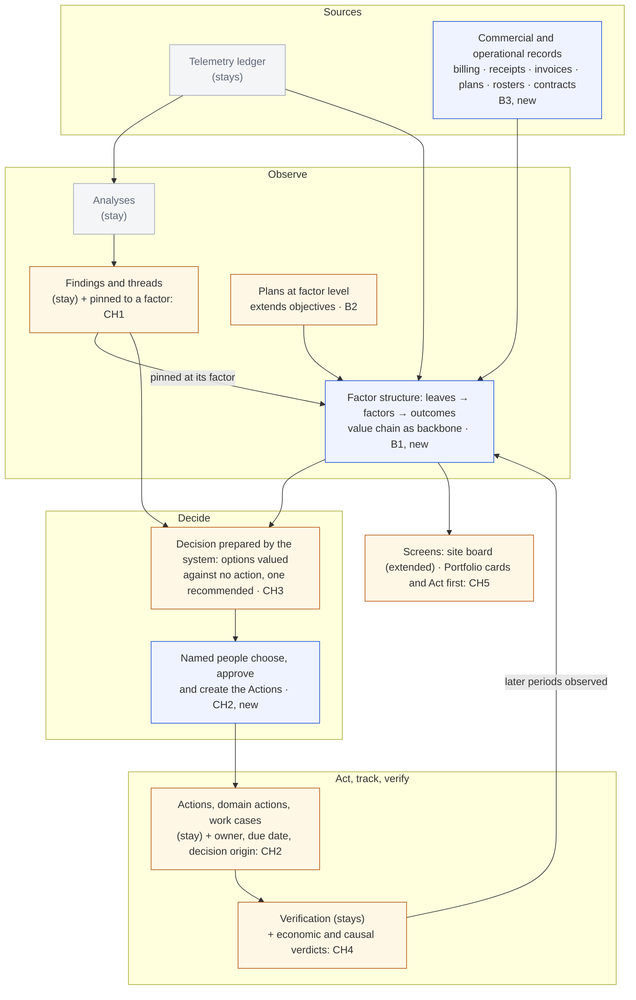
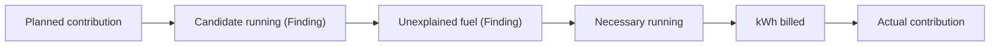
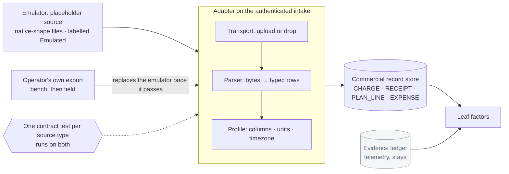
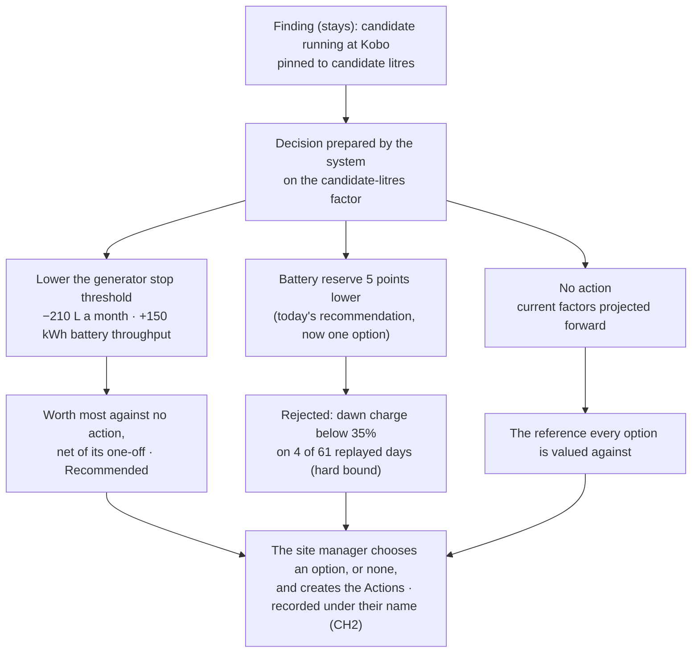
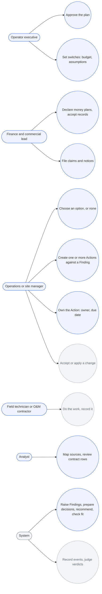
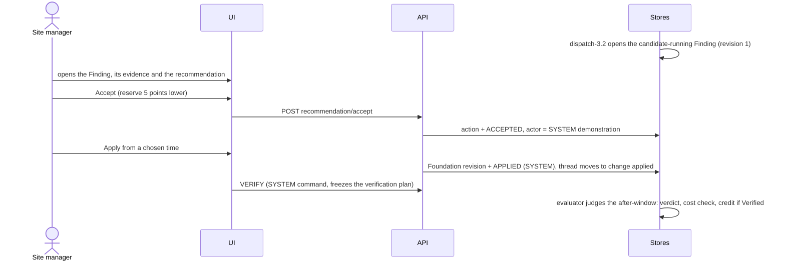
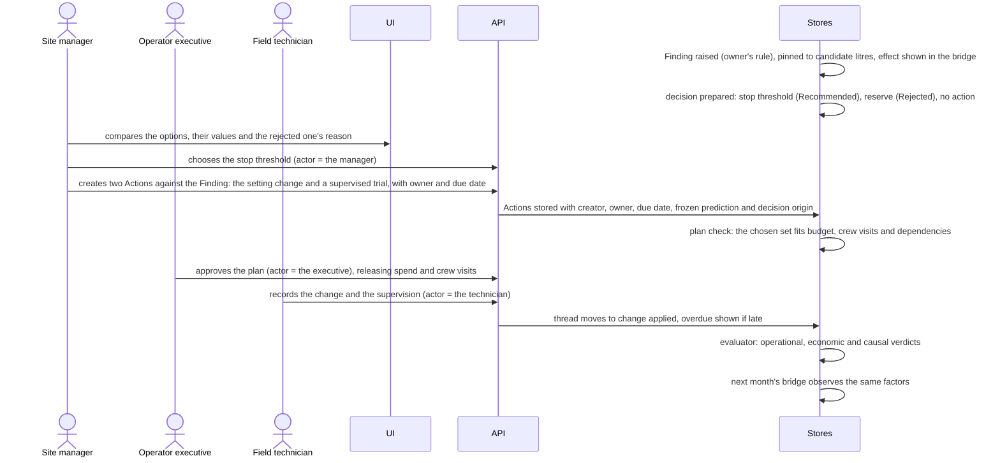
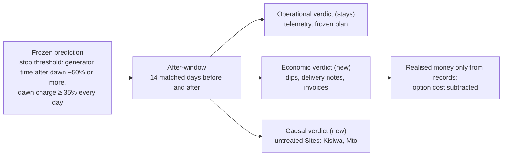
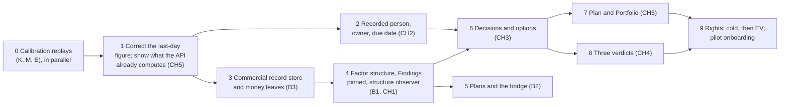

# AssetEcon Layer 4 design: more value on top of a solid core

**AssetEcon · Layer 4 architecture and demonstrator design · rev 16.1 (regenerated; review fixes) · AssetOps Architect (Claude) · 19 Nov 2026**

**Rev 16.1.** Fixes the independent review of rev 16 (`regeneration/B-review.md`: H1, M1–M3, L1–L12, I2, I3). The most important fix (M1): the system evaluates and proposes; a named person chooses and creates the Actions.

**Why rev 16 exists.** The owner ordered this document thoroughly checked and regenerated, and set its structure: first today's architecture, with the value it delivers and the mechanics it uses; then the proposed architecture, "changes that deliver even better value on top of the existing one". The owner's words are verbatim in `.agent/owner-design-regeneration-request-2026-11-19.md`.

**What it corrects.** The check (`regeneration/A-current-mechanics-and-design-audit.md`, Phase A) found 50 errors in rev 15, in five classes:
- a Finding treated as a condition rather than the living result it is;
- the person who decides, acts and tracks left implicit;
- today's mechanics understated;
- replacement framing;
- the owner's boosters not recognised as boosters.

Rev 16 was written from that audit and from the code. It is not an edit of rev 15.

**Status:** design for owner review. No application code, test or database was changed. Branch: `task/layer4-design-regeneration`.

**Labels.**
- **[code-observed]**: read in code on this branch. Backend paths are under `backend/assetops_backend/` and migrations under `backend/migrations/versions/`.
- **[proposed]**: this design.
- **Default, awaiting the owner**: an Architect default (W3), applied until the owner answers.

**Demo figures.** Every money figure is illustrative, comes from `demo-site-scenario-manifest.yaml` and is checked to the cent by `python3 check_manifest.py`. Nothing in this document is an observed financial result.

## Introduction

*Approved by the owner, 18 Nov 2026* (`.agent/owner-design-intro-and-motivation-request-2026-11-18.md`).

In short: **the brief exists to turn AssetEcon from a tool that tells operators what their assets did into one that tells them what it did to their money, what's worth doing about it, and whether it paid off. Every screen should earn its place by answering that.**

**The motivation:**
- **Operators already have monitoring.** Mini-grid, cold-chain and EV executives can see telemetry, alarms and dashboards. What they lack is economic judgement across their systems. Operational, commercial and contract facts sit in separate places, so no one can say with confidence why the month came in below plan, which lever moves it, and what it's worth.
- **The product had drifted towards "interesting signals with economic hints".** It showed findings and exposure figures, but not intentionally organised around the movers of the business. The brief corrects that.
- **Credibility is the differentiator.** Executives act only on figures they trust. So the brief insists on honest evidence: every figure says how it is known, figures of different kinds are never added together (inside the structure, a node built from mixed evidence takes its weakest class and names every source beneath it, and a benefit total admits only field records), savings are claimed only after proof, and the no-action baseline is always shown.

**The evolution it wants to inspire:**
1. **Outcomes defined structurally.** Each business outcome, such as contribution, cost to serve or service obligations, is declared as a structure of factors down to source records.
2. **Observed bottom-up.** Where the business stands, including any shortfall, is read upward through those factors, not detected at the top and explained afterwards.
3. **Choices, not just findings.** Options are valued as changes to factors against doing nothing. One plan fits the operator's budget, crews and contract rights.
4. **Proof.** The same factors are observed after the change: it happened, the money followed, and the action caused it.
5. **General, then particular.** One set of mechanics serves all three verticals. Kobo illustrates the design; it never defines it.
6. **Built on what exists.** Findings, threads, actions and what-ifs are extended and re-grounded on the structure rather than replaced, so the visible product becomes useful quickly.

**What it's ultimately for:** differentiation and usefulness that convert operator executives. They see their own money explained, their decisions compared, and results proven, which their monitoring tools can't do. The commercial path follows from that: demo, then a paid diagnostic on their records, then a proven change.

*Since revised by the owner (18 Nov, D1; `/opt/assetecon/AssetOpsV1/owner/owner-d1-engagement-path-2026-11-18.md`).* The commercial path is now:
1. an initial call (data privacy, processes, integrations);
2. a deep-dive with process owners;
3. an integration pack and pilot timeline;
4. the pilot, with monitoring;
5. the product as a SaaS offering.

The operator's own exports go through the canonical contract early, as the pilot's baseline. The pilot carries a fee, modest or credited against the first SaaS year (which form is C2, an open default). The approved wording above is kept as approved.

## How to read this document

- **Part 1** is today's product as the code runs it: the value it delivers, the mechanics behind that value as an operator meets them, and its honest limits.
- **Part 2** adds the proposed constructs on top. For each one it says what it brings, where it fits in today's architecture, and why it helps convert a client.
- **Every change to an existing construct is named.** Each one states its shortfall against the objective, with code evidence, and what stays (owner, 19 Nov: change "for merit and intentional clearly exposing the issue against the objective").
- **Worked example: Kobo,** a solar-battery-diesel mini-grid in the demonstration operator Lakeside Power. The design covers the operator's whole business: all three Sites and all three verticals, and the value chain from service delivered through billing and collection, cost to serve, O&M, contracts and capital. Kobo never narrows it to one slice.
- **Diagrams** appear only where something changes (owner, 19 Nov). Today's parts appear in them only as greyed context.
- **Companion files:** `worked-portfolios.md` holds the full three-operator worked examples and the demonstration world; `design-appendix.md` holds the reconciliation with the brief's baseline, the self-check and the research basis.

**Words used in this document, in plain terms** (L11):
- **Claim ceiling.** The most a Finding may claim, given how complete its evidence is.
- **Factor** and **leaf factor.** A measured quantity an outcome is built from, such as litres or kWh billed. A leaf is one that a source record evidences directly.
- **Observer.** An analysis that measures a factor, such as dispatch classification measuring candidate litres. A **structure observer** watches the computed structure itself, for example for a factor running above plan.
- **Bound.** A service or contract limit an option must respect, such as dawn battery charge of at least 35%. A bound is *hard* (break it and the option is rejected), *costed* (the breach is priced into the option's value) or *advisory* (shown, never decisive).
- **Disposition.** The system's verdict on an option, with its reason: Recommended, Conditional, Acceptable, Deferred or Rejected. It is a recommendation, never a choice.
- **Switch.** An assumption a person can change, such as the budget or whether a customer extends a letter of intent, after which the proposal is recomputed.
- **Σ/Σ.** A portfolio ratio computed as the sum of numerators over the sum of denominators, never an average of Site percentages.
- **Parity test.** A test that the new structure gives exactly what today's outcome map gives before the old map is removed.
- **Replay K.** A planned check that re-runs Kobo's recorded data under the new setting. Until it passes, the stop-threshold figures are design values.
- **D-numbers and W-numbers.** Owner decisions (roadmap §6) and workflow rules (`.ai/RULES.md`). W3 means a default applies until the owner answers.

**Rules every figure follows** (carried over from rev 15, unchanged):
1. Every figure states how it is known, in words: *Recorded*, *Emulated*, *Measured*, *Calculated*, *Estimated*, *Quoted*, *Modelled*, *At stake, not money*, *Verified*, *Not available yet*.
2. Figures of different kinds are never added together. A node built from mixed evidence takes its weakest class and names every source beneath it. A benefit total admits only field records.
3. Unknown is never zero, and a missing record is named.
4. A factor appears once, so the same litre or kilowatt-hour never carries money twice.
5. Savings are claimed only after proof. The no-action baseline is always shown.
6. No legal or insurance conclusion: "Coverage is decided by the supplier or insurer."

---

## Part 1. Today's architecture: the value it delivers and how

### 1.1 The value today's product delivers

Today's product turns raw Site evidence into **honest, bounded operational judgement that a person can act on and later verify**. For a mini-grid operator, it answers these questions:
- *What happened, and how sure are we?* For example, Kobo's generator ran while the solar and battery could have carried the load. The run is classified interval by interval, with the reason, and claimed only up to what the evidence supports.
- *Is fuel missing?* Night by night, fuel is balanced against what the generator model explains, with a tolerance band.
- *What might it be worth?* A modelled range is put on each, labelled as such and never summed.
- *What should someone look at first, and what can be done?* A next step and, where the rule allows, a recommended setting change.
- *Was it done, and did it work?* The response is tracked as events, and a verification family judges the result. Money is credited only after a Verified verdict.

Executives get four economic categories (Grow, Optimize, Protect, Assure) on every Site and on the Portfolio. Each states plainly which records are still missing.

### 1.2 The mechanics, layer by layer

| Layer | What it does | Done well | Evidence [code-observed] |
|---|---|---|---|
| **Evidence** | Append-only ledger of every reading: source, unit before and after conversion, quality, live or simulated, envelope hash | Provenance on every reading | `0005_evidence_ledger.py:161-197` |
| **Analyses** | Dispatch classification (necessary, candidate or indeterminate running); fuel balance per tank night; mini-grid depth reads (headroom, unserved kWh, backup chain); cold excursions and backup starts; EV sessions and availability | Deterministic, versioned; withholds rather than over-claims | `analytics/dispatch_v3.py:290-316`; `fuel_balance/rules.py:216-237`; `mini_depth/rules.py:285-384`; `analytics/cold.py:355-653`; `analytics/ev.py:540-713` |
| **Findings** | The stored, revised result of each evaluation (§1.3), with next-step text; mini-grid dispatch Findings also carry a claim ceiling and rival explanations | Identity stable across re-evaluation; full history | `0009_finding_store.py:33-106`; `analytics/claim_limit_read.py:1-19`; `mini_decisions/alternatives.py:45-48` |
| **Act** | Accept a recommended trial; raise a domain action or a work case linked to the Finding; raise the mill-shift domain action from a headroom (opportunity) study (§1.4) | Event-sourced, idempotent, typed refusals | `action_api.py:152-232`; `work/domain_action.py:24-136`; `work/model.py:107-151`; `0051_action_opportunity_origin.py:1-12` |
| **Track** | Action events; work events; the Finding's thread moves to "action in hand", "change applied", "resolved, monitoring" or "recurred"; the Actions rail | The thread joins the Finding to what was done about it | `0042_chain_threads.py:64-71`; `chain/lifecycle.py:46-58`; `frontend/src/estate/actionIndex.tsx:38-160` |
| **Verify** | Three mini-grid families (reserve trial, midday mill shift, fuel residual) with frozen plans, comparability and guardrails. Verdicts: Verified, Ineffective, Inconclusive. Unknown families fail closed | Proof before credit | `actions/verification_rules.py:675-815`; `actions/verification_families.py:502-516`; `actions/fuel_verification.py:146-164` |
| **Money** | Estimated (observed kWh × typed price) and Modelled (possible extra fuel cost, from 0 up to an upper bound). A post-trial modelled cost check is credited only when Verified | Labelled, never summed across kinds | `financials/fuel_cost.py:22`; `financials/trial_fuel_comparison.py:1-44`; `outcomes/credit.py:57-73` |
| **Targets** | Six operational objectives, judged Met, Missed, On pace or Behind pace, which drive the outcome's state | Performance against target exists, in operational form | `outcomes/objectives.py:57-143`; `outcomes/status.py:55-104` |
| **Present** | Site outcome board: per outcome, "What drives it", "Issues", "What can be done", "Already in hand", "Earlier interventions" and "Must not harm". Portfolio: six tabs and four category cards; Act first groups Findings by placement, "never a value ranking" | The board's columns already run outcome → driver → issue → lever → action → result | `frontend/src/sites/OutcomeBoard.tsx:42-48`, `:262-330`; `site_outcomes/read.py:926-977`; `estate/placement.py:1-8` |

### 1.3 What a Finding is

**A Finding is the stored result of an analysis evaluating a declared condition over evidence, kept alive as the evaluation is re-run.** It is the output of the condition, not the condition itself [code-observed]:
- *Identity.* Each Finding is unique per Site by its key. It names its analytic, mechanism and asset, and the Finding it recurs after (`0009_finding_store.py:33-60`).
- *Living history.* Each re-run appends a revision with a typed transition: opened, support changed, model re-evaluated, split, merged, unconfirmed, no longer supported, basis refreshed, reopened. Each revision has a claim, limitations, episode bounds and evidence digests. The current state is the latest revision (`0009:62-106`).
- *Thread.* The thread is the Finding's recurrence history across episodes. Its states record the response: action in hand, change applied, resolved and monitoring, recurred, withdrawn (`0042_chain_threads.py:64-71`).
- *What it does not carry.* No money: consequence money sits in separate revisioned tables. No owner or due date. No link to an outcome except a fixed mechanism → outcome row (`outcomes/outcome_map.py:17-23`).

**When a Finding is raised: the owner's rule** (19 Nov, answer to Q-A1, verbatim): "a finding should have impact on the bottomline or is a risk or an opportunity - which means it needs to be acted on and the user likely reate one more action against it".

My reading: a Finding is raised only when an evaluated condition shows one of three things:
- **a bottom-line impact**: an adverse effect on money, such as cost above plan, revenue or cash below plan, or fuel that cannot be explained;
- **a risk**: an obligation, asset or right at risk, such as a service bound, a temperature limit, a departure, or a warranty notice deadline;
- **an opportunity**: a favourable change that someone can act on, such as customer demand backed by evidence.

In every case it is something a person should act on, with one or more Actions. A favourable or neutral movement with nothing to act on is shown in the figures, but it is not a Finding.

Today's five Finding mechanisms all pass this rule:
- candidate running and unexplained fuel are bottom-line impacts;
- a cold excursion, a backup start failure and an EV interruption are risks.

The dispatch output also marks *indeterminate* running as raising a Finding (`analytics/dispatch.py:40`, `:1070`). Wherever that reaches a stored Finding, it stays as a **risk of unknown size**, and its next step is to investigate.

### 1.4 The user's workflow today

| Who | Sees | Decides or does | How it is recorded today |
|---|---|---|---|
| Operator executive | Portfolio: four category cards, Act first, Outcomes by site, What changed | Where to look first | Nothing is recorded (reads only) |
| Site or operations manager | The Finding with its evidence, claim limit, alternatives and next step; the recommendation (Kobo: battery reserve 5 points lower) | **Accepts** the trial, then **applies** it from a chosen time (a new Site configuration revision, not a device command) | Action events ACCEPTED and APPLIED, **recorded as a "SYSTEM demonstration" actor**, "no operator approval is recorded" (`actions/lifecycle.py:43-58`; `0016_action_store.py:131-132`) |
| Site manager or technician | Site Work: domain actions (cold, EV, the mill shift, the fuel-balance work), work cases | Raises a domain action (with an optional owner label and due date) or a work case (title; an assignee when assigned); assigns, completes, closes | Domain and work events with actor and time. A user actor is refused and a server service principal is required (`work/model.py:284-285`). No UI control creates them yet |
| Site manager | The opportunity study: midday headroom over five days, with demand and collection "unverified" | Raises the mill-shift domain action from the study | The domain action with its opportunity origin (`0051_action_opportunity_origin.py:1-12`); the study is an occurrence on its own thread (`0042_chain_threads.py:43-62`), with no Finding involved |
| System | — | A VERIFY command freezes the verification plan; the evaluator then judges the after-window | The VERIFY command never supplies a verdict (`actions/lifecycle.py:26-28`); the verdict is appended by the evaluator (`:24-25`) |

**Kobo, today, end to end.**
1. Dispatch classifies October's generator running and opens a candidate-running Finding.
2. The manager reads it and its possible extra fuel cost (a modelled range for one day), then accepts the reserve trial and applies it.
3. The thread moves to *action in hand*, then *change applied*.
4. The reserve-trial family compares two matched hours and returns Verified, Ineffective or Inconclusive.
5. If Verified and the modelled fuel cost per kWh fell, the result is credited on the Portfolio, listed and never summed.

**Opportunities today travel a separate path, with no Finding.** A five-day headroom study measures spare midday solar. It sits on its own thread, and the site manager can raise the mill-shift domain action from it, which the midday-shift family later verifies (`mini_decisions/projection.py:29`; `0051_action_opportunity_origin.py:1-12`; `actions/verification_families.py:12-22`). The study's demand and collection stay "unverified" (`mini_decisions/opportunities.py:366-401`): it shows headroom, not a customer.

**The system never acts on its own.** It writes no device command and sends no notification. "No telemetry creates an Action or a case link" (`work/domain_intent.py:17`) [code-observed].

### 1.5 The whole business, today

| Stage of the operator's business | Mini-grid | Cold room | EV depot |
|---|---|---|---|
| Service delivered | **Held**: telemetry; dispatch, service and backup reads | **Held**: chamber temperatures, backup starts | **Held**: sessions, kWh, availability |
| Billing and collection | Not held ("billing and payment records are not connected yet") | Not held (occupancy and storage contracts) | Not held (energy billed); captive fleets earn no charging revenue, but today's model cannot express that |
| Cost to serve | Fuel litres held (deliveries, dips); diesel price typed; O&M and staff not held | Cooling energy not held | Utility invoice and tariff not held (only a typed tariff) |
| O&M and work | Work cases, maintenance plans, operational records held | Same | Same |
| Contracts and capital | Warranty only as withheld fields (`sites/battery_boundary.py:26`); no capital view | None | None |
| Plan and target | Operational objectives only | Backup-start objective; chamber policy | Interrupted-session objective; cost-per-km target, never judged |

Sources: `outcomes/catalogue.py:43-68`; `chain/strategies/recorded_amount.py:1-10` ("returns no money with NO_RECORDS, always") [code-observed].

### 1.6 Honest limits, measured against the objective

| # | Limit | Why it matters for the objective | Evidence [code-observed] |
|---|---|---|---|
| L1 | Outcomes are **flagged, not computed**: a fixed map links signals to outcomes, and drivers are named in words | No one can say how far below plan the month is, or which factor moved it | `outcomes/outcome_map.py:17-37`, `:149-180`; `site_outcomes/mini.py:1156-1177` |
| L2 | **No value chain and no recorded money**: only gross kWh × typed price exists | Revenue, cash, cost to serve and contribution cannot be stated | `chain/strategies/recorded_amount.py:1-10`; `outcomes/catalogue.py:45-46` |
| L3 | **Targets are operational and system-declared** ("not a customer target"); there are no money plans | No plan against actual, so no bridge | `objectives/model.py:17-22`; `site_outcomes/ev.py:109` |
| L4 | **Few integrations beyond telemetry**: no billing, receipts, invoices, plans, rosters, meter register or contracts | L1–L3 cannot be closed without them | Inputs today are the field gateway, reading upload, operational entries and typed prices (`gateway_api.py`, `reading_upload_api.py:113`, `work/operational_entry.py:25-30`, `financials/assumptions.py:32-58`); no client calls any external system |
| L5 | **One fixed option, never compared with doing nothing**: reserve − 5 points, which "does not predict … any saving"; what-ifs compute gross figures only | A choice is not valued, so it cannot be weighed against another | `actions/reserve_trial.py:37`, `:42-45`; `mini_decisions/scenario_rules.py:191-228` |
| **G1** | **No recorded person.** Every trial command is a SYSTEM demonstration; work and domain writes refuse a user actor; trials have no owner or due date | "A person acts and it is tracked" holds on screen but not in the records, so no decision, approval or accountability can be shown to a client | `actions/lifecycle.py:43-58`; `work/model.py:284-285`; `estate/coverage.py:530`; `main.py:640-661` |
| L6 | **Verification is operational only**: mini-grid only, the change's own cost fixed at 0, positive evidence only simulated or authored | No economic or causal verdict; no proof on a customer's Site | `actions/verification.py:1167`; `actions/verification_rules.py:688` |
| L7 | **Presentation**: the mini-grid Optimize card shows the window's last day over a period range | It can read as the period's cost | `site_outcomes/read.py:676-682` |

---

## Part 2. The proposed architecture: more value on top

### 2.0 What is added, and where it fits

The core of Part 1 stays: evidence, analyses, Findings and threads, the act-and-track carriers, verification, the honesty rules and the screens' frame. Part 2 adds three **boosters** that the owner named, and five deliberate **changes to the core** that the boosters need or that the audit found. Each is grounded in what converts an operator executive: *their own money explained, their choices compared, and results proven.* That this beats their monitoring tools is the differentiation hypothesis the pilots must confirm.

| ID | Construct | What it brings | Fills limit |
|---|---|---|---|
| **B1** | Factor structure, from leaf factors up to outcomes, with the value chain as its backbone | Discipline from drivers to outcomes: every outcome computed, every driver a quantity | L1, L2 |
| **B2** | Plans at factor level, extending today's objectives | Performance against target in money and service, and the plan-against-actual bridge | L3 |
| **B3** | Commercial and operational integrations through one canonical contract | The data that B1 and B2 need | L4 |
| **CH1** | Findings pinned to the factor they observe | Findings enter the bridge, unchanged in nature | L1 |
| **CH2** | A recorded person: chooser, approver, owner and due date on every carrier | Decisions and accountability a client can see | G1 |
| **CH3** | Options valued against doing nothing; the reserve trial becomes one option | Choices compared in money, net of their cost | L5 |
| **CH4** | Verification adds economic and causal verdicts, field evidence and the option's cost | Proof that the money followed | L6 |
| **CH5** | Portfolio cards read from the structure; the last-day figure corrected; the plan beside Act first's triage | Screens that answer the money question | L7 |

<!--Figure 1: where the new constructs fit-->

*Figure 1. Where the new constructs fit. Grey stays as it is; blue is new; amber is an existing construct with a named change. The loop closes through the factor structure: a verified change is seen only as observed factors of later periods.*

### 2.1 B1: the factor structure, discipline from drivers to outcomes

**What it brings.** Each outcome is declared as a structure of factors down to **leaf factors** that a source record evidences. Outcomes are then computed upward, never typed in. Four relations, all from the brief:
- **identities**: contribution = revenue − cost to serve;
- **products**: fuel cost = litres × price; revenue = billed kWh × tariff;
- **value-chain stages**: delivered → metered → billed → collected, with losses, unmapped meters and adjustments as named leaks;
- **physical splits**: generator litres = necessary + candidate + unexplained, as dispatch and the fuel balance already observe them.

Every leaf carries a shared factor ID, a period, a unit, a plan, an evidence class and its provenance, so a factor appears once and carries money once. **Why it should convert** (a hypothesis to test with prospects, `design-appendix.md` §3): the executive sees their money explained by the movers of the business. Monitoring shows the generator ran; this is meant to show what that did to contribution.

**Where it fits.**
- It sits above the evidence ledger and beside the analyses, which become the observers of its physical leaves (they stay).
- Today's outcome map is a fixed list of signal → outcome rows with no quantity between them. It **changes** into rows of this structure (named change, merit: L1). It keeps its code-registry form and start-up integrity check, behind a parity test before the old literal goes.
- The board's driver lines (written per vertical today) are generated from it, so a Site never has two models of its factors.

**CH1: Findings pinned to their factors.**
- *What stays:* everything that makes a Finding a living artifact: identity, revisions, thread, claim ceiling, alternatives, next step.
- *What changes:* each Finding mechanism gains the factor it observes, through one observer row of the registry. The factor key is derived at read time, so no column is added to `finding`.
- *Merit:* today a Finding's only link to an outcome is a fixed mechanism → outcome row (`outcomes/outcome_map.py:17-23`), so it cannot take its place in a bridge.
- *Mapping:* candidate running → candidate litres; unexplained fuel → unexplained litres; cold excursion → crate-minutes above limit; backup start failure → backup cover; EV interruption → chargers in service.
- *Deviations the structure finds* (a condition with no physical observer) are produced by a **structure observer**, which stores them as Findings with the same identity, revisions and thread, **only when the owner's rule is met** (§1.3; owner, Q-A1).
- **Kobo, October, under that rule:**
- *Kobo:* necessary running above plan (−37.50) is a bottom-line impact, so it is raised: investigate load growth or the plan;
- *Kobo:* collection is a risk to cash: 278.00<!--fig:sites.lakeside-power/Kobo.actual.nodes.outstanding--> of the month's bills is outstanding, so it is raised, for the commercial lead;
- *Kobo:* kWh billed above plan (+38.00) is favourable with nothing to act on, so it is **not a Finding**; it shows in the bridge only;
- *Kobo:* daytime headroom with no customer is a capacity factor, not a Finding; the same headroom with a signed letter of intent is an opportunity Finding (how this relates to today's opportunity study: §2.8).
- **Where this changes rev 15:** rev 15 would have shown "kWh billed below plan" and any deviation as a Finding. Under the owner's rule, a deviation is a Finding only when it is adverse to the bottom line, a risk or an actionable opportunity. A small adverse deviation inside the factor's declared tolerance stays in the bridge without a Finding.
- *What a Finding may claim:* its condition, in its factor's unit and period, within its claim ceiling, citing the structure's attribution. It never claims an outcome value of its own or the value of acting.

<!--diagram:factor-structure-->

*Figure 2 (drawn in the HTML twin from `derived-values.json`): Kobo's October contribution, 1,445<!--fig:sites.lakeside-power/Kobo.plan.nodes.contribution--> planned and 883<!--fig:sites.lakeside-power/Kobo.actual.nodes.contribution--> actual, read upward. Today's two Findings are pinned to the candidate (330<!--fig:sites.lakeside-power/Kobo.actual.nodes.candidate_l--> L) and unexplained (120<!--fig:sites.lakeside-power/Kobo.actual.nodes.unexplained_l--> L) litres. Of the 3,458.00<!--fig:sites.lakeside-power/Kobo.actual.nodes.revenue--> billed, 3,180.00<!--fig:sites.lakeside-power/Kobo.actual.nodes.collected--> was collected.*

**The whole business, one shared structure.** The same shape is filled in by each vertical with its own factors, bounds and levers. The business model decides which nodes exist at all: a fleet operator that charges its own buses has revenue *not applicable*, never zero.

| | Mini-grid (metered, billed electricity) | Cold room (pay-as-you-store) | EV depot (captive fleet) |
|---|---|---|---|
| Outcome backbone | contribution = billed kWh × tariff − (fuel + O&M + staff) | contribution = chargeable crate-days × rate − (energy + staff + maintenance + customer compensation) | cost per required departure met = (energy + demand charge + maintenance + penalties) ÷ departures met; revenue NOT_APPLICABLE |
| Value chain | usable supply → delivered → metered → billed → collected / in transit / outstanding | crate-days available → occupied → chargeable → invoiced → received | deliverable kWh per night → delivered kWh → departures readied against required |
| Cost to serve | litres split necessary / candidate / unexplained × diesel price; O&M; staff | kWh = base + k × crate-days, ambient-corrected, + excess; electricity price | kWh by tariff interval; monthly peak kW × demand rate |
| Operations (O2, October) | asset availability 98.62%<!--fig:operations.lakeside-power.asset_availability.portfolio--> (428 of 434 asset-days; plan 100%) | cooling availability 99.997%<!--fig:operations.harvest-cold.cooling_availability.portfolio--> (4 minutes lost at Thika) | deliverable energy used (import-limited) 56.23%<!--fig:operations.metro-bus.deliverable_energy_used.portfolio--> Σ/Σ (Embakasi 46.67%<!--fig:operations.metro-bus.deliverable_energy_used.sites.Embakasi-->, Kasarani 85.71%<!--fig:operations.metro-bus.deliverable_energy_used.sites.Kasarani-->, Ruiru 61.25%<!--fig:operations.metro-bus.deliverable_energy_used.sites.Ruiru-->) |
| Protect and bounds | clinic critical load; dawn battery charge ≥ 35%; evening redundancy | batch temperature ≤ commodity limit; backup start | every required departure; import limit |
| Contracts and capital | inverter, battery and genset warranties; O&M response SLA; replace-or-repair as a lifecycle comparison | EPC workmanship warranty; goods-in-custody insurance | charger parts warranty and service SLA |

Protect is a structure of measured factors too: unserved critical kWh, obligation-hours without redundancy, crate-minutes above limit, departures missed. Assure reads the evidence class, coverage and verification state of every factor. That is why the four categories are never added together. Capital decisions (replace or repair, new capacity) are options over a longer horizon on the same structure (§2.4).

### 2.2 B2: performance against target, from objectives to a bridge

**What it brings.** Plans are declared at factor level: plan lines from the operator's budget, and service targets. The planned outcome is then the same structure evaluated on planned factors. The difference between plan and actual is attributed to the factors that caused it:
- exactly, for sums;
- for products, by a declared rule (volume effect at plan price, then price effect at actual volume);
- with an explicit unexplained residual only where a leaf is not observed.

**Why it should convert:** it is meant to answer the question the brief puts first for executives: *why did the month come in below plan, and by how much from each cause?* Monitoring dashboards show readings; this shows the money effect of each factor.

**Where it fits.** Today's objectives already carry targets, are judged for pace and drive the outcome's state (§1.2). They **stay**, and each becomes the plan of the factor its measure observes. The change is named, with its merit (L3): today a SYSTEM declarer sets them, "for the demonstration; not a customer target" (`objectives/model.py:17-22`), and no money target is ever judged (`site_outcomes/ev.py:109`). Under B2:
- the operator declares plans, recorded with the declarer (CH2);
- money plans come from plan lines (B3);
- the "N of M objectives met" line stays as the operational summary beside the bridge.

<!--diagram:plan-against-actual-->

*Figure 3 (drawn in the HTML twin). Kobo, October: −562.00<!--figx:{sites.lakeside-power/Kobo.actual.nodes.contribution}-{sites.lakeside-power/Kobo.plan.nodes.contribution}--> in all, of which:*
- *candidate running −412.50<!--figx:-({sites.lakeside-power/Kobo.actual.nodes.candidate_l}-{sites.lakeside-power/Kobo.plan.nodes.candidate_l})*{sites.lakeside-power/Kobo.actual.nodes.diesel_price}-->;*
- *unexplained fuel −150.00<!--figx:-({sites.lakeside-power/Kobo.actual.nodes.unexplained_l}-{sites.lakeside-power/Kobo.plan.nodes.unexplained_l})*{sites.lakeside-power/Kobo.actual.nodes.diesel_price}-->;*
- *necessary running above plan −37.50<!--figx:-({sites.lakeside-power/Kobo.actual.nodes.necessary_l}-{sites.lakeside-power/Kobo.plan.nodes.necessary_l})*{sites.lakeside-power/Kobo.actual.nodes.diesel_price}-->;*
- *extra kWh billed +38.00<!--figx:({sites.lakeside-power/Kobo.actual.nodes.billed_kwh}-{sites.lakeside-power/Kobo.plan.nodes.billed_kwh})*{sites.lakeside-power/Kobo.actual.nodes.tariff}-->.*

*Two of the four effects already have a Finding today. The bridge reads the shortfall through the factors, and the Findings are two of them. A month with no Finding still shows its bridge.*

**The Portfolio grain.** Portfolio outcomes compose Site factors: Σ amounts, and ratios as Σ numerator ÷ Σ denominator, never an average of percentages. Lakeside Power in October, along the whole value chain:
- delivered 23,050 kWh → metered 21,700<!--fig:portfolio.lakeside-power.actual.sums.metered_kwh--> → billed 21,445<!--fig:portfolio.lakeside-power.actual.sums.billed_kwh--> (plan 21,650<!--fig:portfolio.lakeside-power.plan.sums.billed_kwh-->);
- revenue 9,688.00<!--fig:portfolio.lakeside-power.actual.sums.revenue-->, of which 8,870.00<!--fig:portfolio.lakeside-power.actual.sums.collected--> collected, 150.00<!--rec--> in transit and 668.00 outstanding;
- cost to serve 8,245.00<!--fig:portfolio.lakeside-power.actual.sums.cost_to_serve--> against 7,490.00<!--fig:portfolio.lakeside-power.plan.sums.cost_to_serve--> planned;
- contribution **1,443.00<!--fig:portfolio.lakeside-power.actual.sums.contribution--> against 2,295.00<!--fig:portfolio.lakeside-power.plan.sums.contribution-->**.

Every Portfolio figure opens onto the Site factors that produce it. The full three-Site and three-vertical readings are in `worked-portfolios.md` §1.

### 2.3 B3: commercial and operational integrations fill the data gap

**What it brings.** B1 and B2 need records that today's product does not hold (L4). Each leaf factor needs one family of source facts. That defines the integration scope, no more and no less.

**Why it should convert:** the engagement path (D1) runs the operator's own exports through the canonical contract during the deep-dive. So their plan against actual appears in the product within weeks, as the pilot's baseline.

| Value-chain stage | Mini-grid source | Cold-room source | EV depot source | Held today? |
|---|---|---|---|---|
| Service delivered | EMS, inverter, BMS and genset telemetry | chamber controller, energy meter | CPMS / OCPP log, site meter | telemetry **yes**; OCPP log new |
| Chargeable service | meter register (meter ↔ customer, effective-dated) | storage ledger: batches, crates, rate | fleet roster; session ↔ bus | new |
| Revenue and cash | billing or prepaid vending export; receipts, mobile-money settlements | invoices, receipts | not applicable (captive) | new |
| Cost to serve, O&M | fuel delivery notes and dips; O&M and staff invoices | electricity bills, service invoices | utility invoice with time-of-use and demand lines | fuel **yes**; rest new |
| Plan | monthly plan or budget lines by Site and line | same | same | new |
| Contracts and rights | warranty, EPC, O&M/SLA, insurance documents; tickets; notices | same | same | new |

**Where it fits.**
- Telemetry stays in the evidence ledger, and today's operational records (fuel deliveries, dips, meter readings) stay where they are.
- Money-denominated, effective-dated records get **one new commercial record store**: immutable raw payload, source-versioned revisions, and late records that revise closed periods. The merit for a separate store: today's intake is first-write-wins and refuses late intervals (`evidence/service.py:484-492`; `reading_upload/service.py:244-248`) [code-observed], which is right for telemetry and wrong for bills.
- Contract documents are read by AI-assisted extraction, with a person approving every row.

<!--Figure 4: one contract for every source-->

*Figure 4. An emulator and the operator's real export feed the same adapter and pass the same contract test. Only the transport and the profile change when the real source arrives. Emulated figures are never shown as Recorded, and never as benefit (D14).*

**Minimum pilot asks per vertical:**
- **Mini-grid:** EMS export, meter register, billing export, settlement statements, fuel records, plan, and one asset's contract set.
- **Cold:** storage ledger, energy bills, chamber log, invoices and receipts, QA notes, plan, and the refrigeration contract.
- **EV:** CPMS log, roster, utility invoice, service tickets, plan, and the charger warranty or SLA.

### 2.4 CH3: choices valued against doing nothing

**The change and its merit.** Today a candidate-running Finding has one recommendation: reserve − 5 points, which the rule itself says "does not predict … any saving" (`actions/reserve_trial.py:37`, `:42-45`) [code-observed]. Nothing weighs it against another option or against doing nothing, and the what-ifs compute gross figures with no cost (`mini_decisions/scenario_rules.py:191-228`). An executive cannot compare choices in money (L5).

**What stays:**
- the reserve rule's qualification checks, which become one option generator;
- the what-if records, which become an option's calculation record;
- the possible extra fuel cost, which stays an *at-stake* bound labelled as today, never an option's value.

**What it brings.** A Finding on a factor with a declared lever lets the system **prepare a decision** about that factor. The decision holds options as factor changes over a horizon, always including **no action**. Each option is valued by one rule:

> value(option) = Σ over the horizon [ outcome(structure | factors changed by the option) − outcome(structure | no action) ] − ( one-off cost borne by the operator under the option − under no action )

Each option is checked against **bounds** derived from the Protect measures (hard, costed or advisory) and given a disposition with its reason: Recommended, Conditional, Acceptable, Deferred or Rejected. A Finding with no declared lever keeps "investigate" as its next step.

**Why it should convert:** the contrast is meant to persuade. The highest diesel user may have nothing worth changing, and the obvious setting change may fail a service rule.

<!--Figure 5: a decision at Kobo-->

*Figure 5. A decision at Kobo. Lowering the stop threshold cuts candidate running by 210<!--fig:options.KOB-STOPSOC.params.avoided_candidate_l--> L a month and adds 150<!--fig:options.KOB-STOPSOC.params.added_throughput_kwh--> kWh of battery throughput. That is worth +250.50<!--fig:options.KOB-STOPSOC.monthly_or_horizon_change--> a month against no action, and 2,916.00<!--fig:options.KOB-STOPSOC.value--> over twelve months after its 90.00<!--fig:options.KOB-STOPSOC.operator_one_off--> one-off. It is a design value until replay K has run. The reserve change fails the dawn bound on 4<!--fig:options.KOB-RESERVE.params.dawn_days_below_35pct--> of 61 replayed days.*

**Who chooses, and who creates the Action** (M1; owner, 19 Nov: a Finding "needs to be acted on and the user likely reate one more action against it"; the owner's first question was about "users to act on the bases of context given to them, then tracked"). The system evaluates and proposes. People choose and act:
1. **The system evaluates and proposes.** It raises the Finding under the owner's rule, prepares the decision, values each option against no action, applies the bounds, and marks one option *Recommended*. It picks nothing.
2. **The site or operations manager chooses** an option within the decision. That may be the recommended one, another admissible one, or none.
3. **The manager then creates one or more Actions against the Finding.** Examples are the setting change, a supervised trial, or a work case to inspect the generator. The manager may also create Actions straight from a Finding that has no decision (for example "investigate"). Each Action records its creator, owner and due date (§2.5).
4. **Actions that spend budget or crew visits enter the period's plan.** Actions that spend neither (a remote setting change, an investigation) go ahead without it.

**Across the portfolio: the plan.** Choices made Site by Site can each be right while together they break the budget, use more crew visits than exist, or miss a dated dependency.
- *The system checks the managers' chosen set* against the budget, the crew visits and the dated dependencies. Where the set does not fit, it shows the nearest combinations that do, ranked by fewest service-rule breaches, then highest value, then lowest spend, with the reason for every option left out. This is a proposal. It changes no one's choice.
- *The operator executive approves the plan*, or sends it back to the managers with a trade-off to make. Approval releases the spend and crew visits of the Actions in it. Switches such as the budget or a customer's letter of intent recompute the proposal for the people to weigh; they never replace a choice or the approval.
- *Lakeside's proposal for November and December:* spend 3,750.00<!--fig:plans.lakeside-power.default.spend--> within a 5,000<!--rec:tenants[lakeside-power].portfolio_constraints.budget_usd_nov_dec--> budget, using 3<!--fig:plans.lakeside-power.default.crew_visits_used--> of 3 crew visits, worth +6,088.50<!--fig:plans.lakeside-power.default.value--> over twelve months (modelled, not realised). It covers five items: a generator repair, battery evidence, the stop-threshold change, an inverter warranty claim and a rice-huller connection. Contract rights decide who bears each repair cost (`worked-portfolios.md` §1.1, §1.4).
- *Three orderings stay separate:* triage (where to look first: today's placement groups), comparison (options within one decision) and allocation (a set across Sites).

**Is the plan different from an Action? Who owns it, and why is it needed?** (The owner's question on Q-A3.)

*Two meanings of "plan".* §2.2's plan *values* are targets: the budget and the planned figures per factor. The plan discussed here is a *selection of choices*. The two share a word and nothing else.

| | The plan | An Action |
|---|---|---|
| What it is | The set of options the managers chose across all of the operator's Sites for a period, with the spend, crew visits and dependencies they commit, and any trade-off the executive made | The execution of one chosen option at one Site: a setting change, field work or a supplier claim |
| Grain | Portfolio and period (Lakeside, November–December) | Site and task (Kobo, the stop-threshold change) |
| Owned by | The **operator executive**, who holds the budget | The **site or operations manager**, who answers for doing it |
| Who creates it | The system assembles the managers' choices and proposes a fitting set; the executive approves it | **The site or operations manager creates it** against the Finding: one or more per Finding |
| Its life | Assembled → proposed → approved (or sent back) → revised when a switch or a fact changes | Created by the manager → released by the plan if it spends budget or crew → applied → tracked → verified, as today |
| What it claims | A modelled value for the set, its spend and its downside | What was chosen, by whom, its frozen prediction and its state; never the result |
| Where it is recorded | A versioned plan record: options in and out, switches, approver, time | Today's carriers, plus owner, due date and the decision it came from (CH2) |

*Why the plan is owned by the executive.* It commits resources that no single Site owns: the operator's budget and its crews. It also trades one Site against another. At Lakeside, if the cooperative does not extend its letter of intent, buying the Mto inverter now would keep the huller connection only if the Kisiwa repair were dropped, which would leave 125 evening hours with no backup instead of 15 (`worked-portfolios.md` §1.1). A site manager can choose well inside a decision but cannot make that trade across Sites. Only the budget holder can.

*Why it is necessary, on merit.* The objective asks which Sites and investments earn most from existing capital, and where limited crews should work (brief L1.3; §2.4). The plan answers that question, and nothing in today's product can:
- no budget, crew or cross-Site constraint exists in today's backend or schema (the only "budget" hits are layout code in the frontend);
- every Action is created and judged inside one Site (§1.3, §1.4).

If each decision were approved on its own, each choice could be right while the set breaks the budget, runs out of crew visits, or misses a dated dependency. The huller needs the inverter restored first.

*Where it does not earn a separate step.* When only one decision is open, or the choices fit the budget and crews with room to spare, the plan is just the managers' choices. It needs no separate approval, unless the spend threshold option (§2.5) applies. So the plan is a **thin record**, not a second workflow: execution always runs through Actions. My recommendation is to keep it as that thin record and not fold it into Actions, because the cross-Site trade-off and its approval have no other home. **Awaiting the owner (Q-A3).**

### 2.5 CH2: the person in the loop, recorded

**The change and its merit.** Today the act-and-track path is built for a person and shown on screen, but **no person is ever recorded** (G1):
- trial commands are a "SYSTEM demonstration" with "no operator approval is recorded" (`actions/lifecycle.py:43-58`);
- work and domain writes refuse a user actor (`work/model.py:284-285`);
- trials have no owner or due date (`estate/coverage.py:530`) [code-observed].

A client cannot be shown who decided, who approved or who is accountable, and the plan of §2.4 needs an approver.

**What stays:** the carriers, their events and commands, idempotency, the thread link and the Actions rail.

**What changes:**
- an authenticated user principal is recorded on every command. The schema already has the pattern: a financial assumption requires an author when the actor is HUMAN, though the API refuses one today with `HUMAN_PRINCIPAL_REQUIRED` (`0010_financial_assumptions.py:57-78`; `financial_api.py:209`);
- each carrier records its creator, owner and due date, and an Action records the decision and option it came from (one migration, in the pattern of `0051_action_opportunity_origin.py`);
- the UI gains the controls that today exist only as API routes: the manager creates one or more Actions (a case or a domain action) against a Finding, and assigns them;
- overdue is computed for Actions as it already is for maintenance plans (`outcomes/plan_due.py:1-33`).

**Roles** (owner, Q-A2: "a few sensible roles"). Roles govern who may decide and what is recorded. They are not views: every role reads the same screens, with no role toggle or filter (owner, 17 Nov). The five roles cover the whole business, from the generation or service delivered through billing, collection, cost to serve, O&M and contracts, to capital.

| Role | Sees | Decides | Does | Recorded |
|---|---|---|---|---|
| **Operator executive** (CEO or managing director) | The Portfolio: outcomes against plan, the bridge, the proposed plan and its downside, verdicts | Approves the plan, which releases the budget and crew visits of the Actions in it; sets the budget and assumptions (switches); approves capital choices (replace or repair, new capacity) | Approves or sends back with a trade-off | Plan approval with its version, switches and time |
| **Finance and commercial lead** | Billing, collection, cost to serve, contracts and rights, money Findings (Kobo's outstanding bills) | Declares money plans; accepts imported commercial records; decides to file a claim or notice; acts on collection | Approves plan lines and records; files rights events | Declarer of each plan line; approver of each record and extracted contract row; each rights event |
| **Operations or site manager** | Site boards, Findings, decisions and their options, Actions | Chooses the option within each decision (or none) | Creates one or more Actions against each Finding; accepts or applies setting changes; assigns work | Chooser; creator, owner and due date of each Action; each command |
| **Field technician or O&M contractor** | Their assigned Actions and work | — | Does the work; records readings, dips and completion | Work events and operational records under their name |
| **Analyst** (the operator's, or AssetEcon's during onboarding) | Evidence, coverage, source health, mappings | Mappings from source to factor; data-quality holds | Onboards sources; reviews AI-extracted contract rows | Each mapping and review |

The system raises Findings, prepares decisions, values options, recommends one, rejects options that break a hard bound, checks that the chosen set fits, and records events and verdicts. **It never chooses, approves or creates an Action.**

*Option, not decided by the owner:* a spend threshold above which a single choice also needs the executive's approval.
<!--Figure 6: who decides, acts and is recorded-->

*Figure 6. Use cases (drawn as a flowchart, since Mermaid has no use-case type). Blue use cases are new; grey ones exist today and stay. With CH2, every use case is recorded under the person who performed it.*

**Kobo's Finding through decide, act, track and verify: before and after.**

<!--Figure 7a: today (context)-->

<!--Figure 7b: with the boosters-->

*Figure 7. Before: the manager's acts are recorded under a SYSTEM actor, and there is one option. After: the system proposes, the manager chooses and creates the Actions, the executive approves the plan that releases their spend, and the technician records the work. Each act carries its person, and the result returns as observed factors. The stop-threshold change needs no crew visit, so its Actions would also proceed without the plan. It is shown inside the plan here only to show the approval step.*

### 2.6 CH4: proof that the money followed

**The change and its merit.** Today's verdict is operational only (L6):
- it covers mini-grid only;
- the change's own cost is fixed at 0 (`actions/verification.py:1167`);
- a positive verdict admits only simulated or authored evidence (`actions/verification_rules.py:688`) [code-observed].

So no one can prove on a customer's Site that money followed.

**What stays:** the plan freeze, comparability, guardrails, the fail-closed families, and the operational verdict and its values. The post-trial cost check and its credit rule become the seed of the economic verdict.

**What it brings.** A chosen option's frozen prediction becomes the verification target, and its bounds become the guardrails. Three verdicts on the same factors:
- **Operational:** did the factor move, with bounds held?
- **Economic:** did the money factors move, on recorded records in the after-window?
- **Causal:** how sure are we the change caused it, using comparable days and untreated Sites as controls?

Field evidence is admitted with its label. The option's cost replaces 0. Insufficient evidence is a verdict ("not proven yet"), not a pass. **Why it should convert:** a proven change on the client's own Site is the pilot's purpose and the SaaS case.

<!--Figure 8: proof-->

*Figure 8. Proof for Kobo's stop-threshold change. A prediction is never relabelled as realised. Late records recompute and can withdraw a verdict, never silently.*

### 2.7 CH5: what the client sees

The frame stays: the rail with no new menu items, the six Portfolio tabs, the range bar, the coverage line, the Finding and Action pages as drill-downs, and the "not available yet" pattern. These change, each with its merit:

| Screen | Today | Change | Merit (Part 1) |
|---|---|---|---|
| Overview cards | Grow: estimated income; Optimize: a cost claim per Site; Protect and Assure: counts | Each card is read from its factors against plan, with its evidence class | L1, L2 |
| Optimize (mini-grid) | The window's last day over a period range | Corrected first: labelled honestly, then the period's cost factors | L7 (`site_outcomes/read.py:676-682`) |
| Act first | Findings in placement groups | The Finding triage stays first; the proposed plan sits beside it (§2.4 explains the plan) | L5 |
| Outcomes by site and the site board | Statuses; drivers in words | Drivers become factor rows with value, plan and evidence class. "Issues" shows Findings on their factors; "What can be done" opens the decision; "Already in hand" and "Earlier" carry Actions and verdicts | L1 |
| Opportunity | A headroom study | Renamed *Demand and capacity*: headroom stays a capacity factor; demand needs customer evidence | L5 |
| What changed | Accepted actions and verifications | Actions with owners, frozen predictions and the three verdicts | G1, L6 |

### 2.8 Change register: every core construct

The default is that a construct stays. A change is listed only with its shortfall against the objective. Dispositions at function level are in `repo-reuse-and-gap-matrix.md`.

| Construct | Stays or changes | Shortfall against the objective, with evidence | Change |
|---|---|---|---|
| Evidence ledger, gateway, reading upload | Stays | — | — |
| Analyses (dispatch, fuel balance, depth, cold, EV) | Stays | — | They also observe leaf factors |
| Findings, revisions, threads, claim ceilings, alternatives | Stays, plus CH1 | No factor link: `outcome_map.py:17-23` | Pinned to a factor; a structure observer stores a Finding only under the owner's rule (§1.3) |
| Outcome map | Changes (B1) | Flat rows with no quantity between signal and outcome: `outcome_map.py:149-180` | Becomes structure rows, behind a parity test |
| Objectives | Stays, extended (B2) | System-declared; no money target judged: `objectives/model.py:17-22` | Plan of a factor, declared by the operator |
| Reserve-trial recommendation | Changes (CH3) | Sole option, no saving predicted: `reserve_trial.py:42-45` | One option generator |
| What-ifs | Changes (CH3) | Gross only, no cost, no comparison: `scenario_rules.py:191-228` | An option's calculation record |
| Possible extra fuel cost | Stays | — | Labelled at stake, never an option's value |
| Actions, domain actions, work cases, rail | Stays, plus CH2 | No recorded person: `lifecycle.py:43-58`; `work/model.py:284` | User principal; created by the manager, one or more per Finding; owner, due date, decision origin |
| Verification | Stays, plus CH4 | Cost 0; simulated evidence only: `verification.py:1167`; `verification_rules.py:688` | Economic and causal verdicts; field evidence |
| Placement and the never-sum rules | Stays | — | Placement stays for triage |
| Opportunity study (headroom) → its thread → the mill-shift Action | Stays, extended | It shows headroom with demand and collection "unverified" (`mini_decisions/opportunities.py:366-401`), so it cannot tell capacity from a customer | Stays as the evidence of capacity, on its thread, and as an Action origin (`0051`). When customer evidence exists (a signed letter of intent), the structure observer raises an **opportunity Finding** on the demand factor, with the study as its evidence. New Actions on that demand originate from the Finding. Existing opportunity-origin Actions stay valid. This gives one carrier per thing: capacity on the study, demand on the Finding |
| Portfolio cards; Optimize figure | Changes (CH5) | Counts and estimates; last day over a period: `read.py:676-682` | Read from factors |
| Site outcome board | Stays, extended | Drivers in words: `site_outcomes/mini.py:1156-1177` | Drivers generated from the structure |

### 2.9 Delivery order

<!--Figure 9: delivery order-->

*Figure 9. The order follows which client screen becomes useful first (D13, adopted), within the dependencies. Slices 2 and 3 run in two lanes. Every primitive is general and proven first on mini-grid, with a cold and an EV case in its tests. The person in the loop (2) is placed before decisions (6), because a decision without a recorded chooser cannot be shown to a client. That placement is proposed here and is not yet in `phase-plan-and-acceptance.md`.*

## Decisions

**Already taken by the owner, carried over:**
- D1, the engagement path, as revised;
- D11, the workflow W1–W9;
- D13, the grounded, visible-first path;
- D14, emulators as placeholder sources, with benefit only on field provenance.

D15 (the first change agreed at the end of the deep-dive) is pending.

**Answered by the owner on 19 Nov and applied in this revision:**

| # | Question | Owner's answer, and how it is applied |
|---|---|---|
| Q-A1 | What is a Finding, and is a deviation found from the structure one? | A Finding has a bottom-line impact, or is a risk or an opportunity, and is to be acted on. Applied in §1.3 and §2.1: structure-found deviations are stored Findings only when that holds. Kobo's favourable kWh-billed deviation is not one |
| Q-A2 | Roles | "A few sensible roles": the five roles of §2.5 |
| Q-A3 | Is the plan different from an Action? Who owns it, and why is it needed? | Explained in §2.4: managers choose and create the Actions; the plan is a thin, executive-owned record of those choices across Sites, which releases the Actions that spend budget or crew. **Awaiting the owner's confirmation** (default applied), with Act first's triage kept first |

**Open for the owner:** the spend threshold (§2.5), an option, not decided.

## Appendix. Where the detail lives

| Topic | File |
|---|---|
| The three worked portfolios (Lakeside, Harvest Cold, Metro Bus): factor tables, decisions, plans, switches, proof; the rights contrast; the demonstration world and its documented limits | `worked-portfolios.md` |
| Reconciliation with the brief's reported baseline; the self-check against the final acceptance test; the research basis | `design-appendix.md` |
| The evidence for Part 1 and the audit of rev 15 | `regeneration/A-current-mechanics-and-design-audit.md` |
| Outcome structures, composition, attribution, valuation identities, evidence classes, rights in money | `economic-metric-and-effect-contracts.md` |
| Sources → canonical records → leaf factors | `integration-source-to-canonical-design.md` |
| Algorithms per construct, refusal policies, test vectors | `domain-and-decision-models.md` |
| Module, table and API dispositions | `repo-reuse-and-gap-matrix.md` |
| Slices, gates, end-to-end tests | `phase-plan-and-acceptance.md` |
| From today to Layer 4, and the roadmap | `product-transition-and-roadmap.md` |
| The figures | `demo-site-scenario-manifest.yaml` → `evaluate_structure.py` → `derived-values.json`, checked by `check_manifest.py` against `independent_model.py` |
