# AssetEcon Layer 4 design: more value on top of a solid core

**AssetEcon · Layer 4 architecture and demonstrator design · rev 16.16 · AssetOps Architect (Claude) · 20 Nov 2026**

**Status.** This is a design for owner review, regenerated at the owner's order and in the structure the owner set (`.agent/owner-design-regeneration-request-2026-11-19.md`). No code, test or database was changed. The revision history, the audit that drove it and the reviews are in `design-appendix.md` §4.

**Labels.**
- **[code-observed]**: read in code on this branch. Paths are under `backend/assetops_backend/`, or `backend/migrations/versions/` for migrations.
- **Architect's call**: a choice the owner has not settled, marked where it is made.
- **Money**: every money figure is illustrative. It comes from `demo-site-scenario-manifest.yaml` and is checked to the cent by `check_manifest.py`.

## Introduction

*Approved by the owner, 18 Nov 2026* (`.agent/owner-design-intro-and-motivation-request-2026-11-18.md`).

In short: **the brief exists to turn AssetEcon from a tool that tells operators what their assets did into one that tells them what it did to their money, what's worth doing about it, and whether it paid off. Every screen should earn its place by answering that.**

**The motivation:**
- **Operators already have monitoring.** Mini-grid, cold-chain and EV executives can see telemetry, alarms and dashboards. What they lack is economic judgement across their systems. Operational, commercial and contract facts sit in separate places, so no one can say with confidence why the month came in below target, which lever moves it, and what it's worth.
- **The product had drifted towards "interesting signals with economic hints".** It showed findings and exposure figures, but not intentionally organised around the movers of the business. The brief corrects that.
- **Credibility is the differentiator.** Executives act only on figures they trust. So the brief insists on honest evidence: every figure says how it is known, figures of different kinds are never added together (inside the structure, a node built from mixed evidence takes its weakest class and names every source beneath it, and a benefit total admits only field records), savings are claimed only after proof, and the no-action baseline is always shown.

**The evolution it wants to inspire:**
1. **Outcomes defined structurally.** Each business outcome, such as contribution, cost to serve or service obligations, is declared as a structure of factors down to source records.
2. **Observed bottom-up.** Where the business stands, including any shortfall, is read upward through those factors, not detected at the top and explained afterwards.
3. **Choices, not just findings.** Options are valued as changes to factors against doing nothing. One plan fits the operator's budget, crews and contract rights.
4. **Proof.** The same factors are observed after the change: it happened, the money followed, and the action caused it.
5. **General, then particular.** One set of mechanics serves all three verticals. Kobo illustrates the design; it never defines it.
6. **Built on what exists.** Findings, threads, actions and what-ifs are extended and re-grounded on the structure rather than replaced, so the visible product becomes useful quickly.

**What it's ultimately for:** differentiation and usefulness that convert operator executives. They see their own money explained, their decisions compared, and results proven, which their monitoring tools can't do. The commercial path follows from that: demo, then a paid diagnostic on their records, then a proven change.

*Since revised by the owner (D1, 18 Nov): the engagement path is an initial call, a deep-dive, an integration pack, a pilot and then SaaS (D1 in `decisions-register.md`; the path in detail in `commercial-plan.md`).*

## How to read this document

- **The overall objective governs every part:** operator executives adopt the product for economic value beyond their monitoring tools, across their whole business. Each section says how it serves that objective, in a line marked *Serves the objective*.
- **Part 1** describes today's product as the code runs it: the value it delivers, how an operator meets it, and its honest limits.
- **Part 2** describes what is added on top. For each construct it says what the construct brings and where it fits.
- **Changes to existing constructs.** Every change is named, with its shortfall against the objective and the code evidence (owner, 19 Nov: change "for merit and intentional clearly exposing the issue against the objective"). §2.9 is the single register of those changes.
- **Worked example.** The worked example is Kobo, a solar, battery and diesel mini-grid owned by the demonstration operator Lakeside Power. The design still covers the whole business: all Sites, all three verticals, the full value chain, O&M, contracts and capital.
- **Diagrams** appear only where something changes. Today's parts are greyed context. Full three-operator examples are in `worked-portfolios.md`.

**Words used here.**
- **Claim ceiling.** The most a Finding may claim, given its evidence.
- **Factor.** A measured quantity an outcome is built from, such as litres or kWh billed. A **leaf** is a factor evidenced directly by a source record.
- **Observer.** An analysis that measures a factor. A **structure observer** watches the computed structure itself, for example a factor running above target.
- **Bound.** A service or contract limit an option must respect, such as dawn battery charge of at least 35%. A *hard* bound rejects the option if broken; a *costed* one prices the breach into its value; an *advisory* one is shown, never decisive.
- **Disposition.** The system's verdict on an option: Recommended, Conditional, Acceptable, Deferred or Rejected. It is a recommendation, never a choice.
- **Switch.** An assumption a person can change, such as the budget, after which the proposal is recomputed.
- **Σ/Σ.** A portfolio ratio taken as the sum of numerators over the sum of denominators.
- **Parity test.** A check that the new structure reproduces today's outcome map before the map is removed.
- **Action.** One unit of tracked work. Today three record types carry it: the trial action (Finding origin; recorded today with a SYSTEM actor, `0016_action_store.py:131`), the domain action (exactly one origin, a Finding or an opportunity study) and the work case (no origin of its own; it links to Findings and Actions). In this design a person creates every Action, and every carrier, work cases included, records one origin and at most one plan membership (§2.5). A work case's origin is the Finding or plan item it was opened from; its other links stay links (Architect's call).
- **Lever.** A change that a decision may make to a factor, such as the generator stop threshold acting on candidate litres.
- **Outcome category.** One of the four executive headings: Grow revenue, Optimize cost and efficiency, Protect asset and capital, Assure performance and returns. A heading over the structure, never a second outcome model (§2.0, OD-21).
- **Replays K, M, E.** Re-runs of a declared season under a new setting: Kobo's stop threshold and reserve (K), Mto's headroom load (M), Embakasi's charging schedule (E). K8 and M8 have run (0K4d) and their figures are labelled SIMULATED with the study's assumptions; a figure no replay of the site's own month yet gives reads "Not available yet" with the record it needs (Kobo's two settings; Embakasi's per-bus timing, replay E not run).
- **D-numbers.** Owner decisions, recorded in `decisions-register.md` (pack file set approved by the owner, 19 Nov: `regeneration/F-pack-recreation-plan.md`).
- **Manifest key `plan`.** In the demonstration data, a Site's target side is the machine path `plan`, kept as a machine-only exception to OD-6 (Architect's call) because renaming it would touch the manifest, evaluator, independent model and fixtures with no gain for a reader. Prose says "target".

**Rules every figure follows** (unchanged from rev 15):
1. Every figure states how it is known, in words: *Recorded*, *Emulated*, *Measured*, *Calculated*, *Estimated*, *Quoted*, *Modelled*, *At stake, not money*, *Verified*, *Not available yet*.
2. Figures of different kinds are never added together. A node built from mixed evidence takes its weakest class. A benefit total admits only field records.
3. Unknown is never zero, and a missing record is named.
4. A factor appears once, so the same litre never carries money twice.
5. Savings are claimed only after proof. The no-action baseline is always shown.
6. No legal or insurance conclusion is drawn: "Coverage is decided by the supplier or insurer."

These evidence words replace the earlier four-level claim ladder (owner, OD-24: "evidence class is also fine"). The ladder's one hard rule stays, in Rules 1 and 5 and D14: a simulated or emulated result is never shown as Verified or as realised money.

---

## Part 1. Today's architecture: the value it delivers and how

### 1.1 The value today's product delivers

Today's product turns raw Site evidence into **honest, bounded operational judgement that a person can act on and later verify**. For a mini-grid it answers five questions:
- *What happened, and how sure are we?* For example, Kobo's generator ran while the solar and battery could have carried the load. The product classifies this interval by interval and claims only what the evidence supports.
- *Is fuel missing?* Night by night, fuel is balanced against what the generator model explains.
- *What might it be worth?* A modelled range, labelled as such and never summed.
- *What should be looked at first, and what can be done?* A next step and, where the rule allows, a recommended setting change.
- *Was it done, and did it work?* The response is tracked, and a verification family judges it. Money is credited only after a Verified verdict.

Every Site and the Portfolio show four economic categories (Grow, Optimize, Protect, Assure), over 22 outcome rows across the three verticals (`outcomes/catalogue.py:43-68`). Each says plainly which records are still missing.

*Serves the objective:* this honesty is the credibility executives need before they trust a money figure. Part 2 adds the money on top of it.

### 1.2 The mechanics, layer by layer

*Serves the objective:* this is the trusted evidence chain that every money figure in Part 2 builds on. It already answers the operational half of the executive's question.

| Layer | What it does | Done well | Evidence [code-observed] |
|---|---|---|---|
| **Evidence** | Append-only ledger of every reading, with its source, unit, quality, live or simulated flag and an envelope hash | Provenance on every reading | `0005_evidence_ledger.py:161-197` |
| **Analyses** | Dispatch classification (necessary, candidate or indeterminate running); fuel balance per tank night; mini-grid depth reads; cold excursions and backup starts; EV sessions and availability | Deterministic and versioned; withholds rather than over-claims | `analytics/dispatch_v3.py:290-316`; `fuel_balance/rules.py:216-237`; `mini_depth/rules.py:285-384`; `analytics/cold.py:355-653`; `analytics/ev.py:540-713` |
| **Findings** | The stored, revised result of each evaluation (§1.3), with next-step text. Mini-grid dispatch Findings also carry a claim ceiling and rival explanations | Identity stable across re-evaluation; full history | `0009_finding_store.py:33-106`; `analytics/claim_limit_read.py:1-19`; `mini_decisions/alternatives.py:45-48` |
| **Act** | Accept a recommended trial; raise a domain action or a work case linked to a Finding; raise the mill-shift domain action from a headroom study (§1.4) | Event-sourced, idempotent, typed refusals | `action_api.py:152-232`; `work/domain_action.py:24-136`; `work/model.py:107-151`; `0051_action_opportunity_origin.py:1-12` |
| **Track** | Action and work events. The Finding's thread moves to action in hand, change applied, resolved and monitoring, or recurred. The Actions rail | The thread joins a Finding to what was done about it | `0042_chain_threads.py:64-71`; `chain/lifecycle.py:46-58`; `frontend/src/estate/actionIndex.tsx:38-160` |
| **Verify** | Three mini-grid families (reserve trial, midday mill shift, fuel residual) with frozen verification baselines, comparability and guardrails. Verdicts are Verified, Ineffective or Inconclusive | Proof before credit; unknown families fail closed | `actions/verification_rules.py:675-815`; `actions/verification_families.py:502-516`; `actions/fuel_verification.py:146-164` |
| **Money** | Estimated (observed kWh × typed price) and Modelled (possible extra fuel cost, from 0 up to a bound). A post-trial cost check is credited only when Verified | Labelled; never summed across kinds | `financials/fuel_cost.py:22`; `financials/trial_fuel_comparison.py:1-44`; `outcomes/credit.py:57-73` |
| **Targets** | Six objectives, judged Met, Missed, On pace or Behind pace, which drive the outcome's state. Five are operational; one, EV energy cost per km, is a money target that can be declared but is never judged | Performance against target exists, in operational form | `outcomes/objectives.py:57-143`; `outcomes/status.py:55-104` |
| **Present** | The Site outcome board: per outcome, "What drives it", "Issues", "What can be done", "Already in hand", "Earlier interventions" and "Must not harm". The Portfolio: six tabs and four category cards. Act first groups Findings by placement, "never a value ranking" | The board's columns already run outcome → driver → issue → lever → action → result | `frontend/src/sites/OutcomeBoard.tsx:42-48`, `:262-330`; `site_outcomes/read.py:926-977`; `estate/placement.py:1-8` |

### 1.3 What a Finding is

*Serves the objective:* Findings are the operator's reasons to act. The owner's rule below keeps them about money, risk and opportunity, not about signals.

**A Finding is the stored result of an analysis evaluating a declared condition over evidence, kept alive as the evaluation is re-run.** It is the output of the condition, not the condition itself [code-observed]:
- *Identity.* A Finding is unique per Site by its key. It names its analytic, mechanism and asset, and the Finding it recurs after (`0009_finding_store.py:33-60`).
- *Living history.* Each re-run appends a revision with a typed transition: opened, support changed, re-evaluated, split, merged, merged into, unconfirmed, no longer supported, basis refreshed, reopened. Each revision carries a claim, limitations and evidence digests (`0009:62-106`).
- *Thread.* The thread is its recurrence history. Its states record the response: open, action in hand, change applied, resolved and monitoring, closed, recurred, reopened, withdrawn (`0042_chain_threads.py:64-71`).
- *What it does not carry.* No money: that sits in separate consequence tables. No owner, and no link to an outcome except a fixed mechanism-to-outcome row (`outcomes/outcome_map.py:17-23`).

**When a Finding is raised: the owner's rule** (19 Nov, verbatim): "a finding should have impact on the bottomline or is a risk or an opportunity - which means it needs to be acted on and the user likely reate one more action against it". I read this as follows. A Finding is raised only for one of three things:
- an adverse **bottom-line impact**: cost above target, revenue or cash below target, or unexplained fuel;
- a **risk** to an obligation, asset or right;
- an **opportunity** someone can act on, such as customer demand with evidence.

**The owner decided (19 Nov) that a configurable tolerance per factor decides** whether a small adverse deviation is raised. Until a tolerance is set, every adverse deviation is raised (Architect's call). A favourable or neutral movement with nothing to act on stays in the figures and is not a Finding.

Today's five mechanisms all pass this rule:
- candidate running and unexplained fuel are bottom-line impacts;
- cold excursion, backup start failure and EV interruption are risks.

Dispatch also marks *indeterminate* running as raising a Finding (`analytics/dispatch.py:40`, `:1070`). Where it does, it is a risk of unknown size, to investigate.

### 1.4 The user's workflow today

*Serves the objective:* acting and tracking are what turn insight into value. G1, the missing recorded person, is why that cannot yet be shown to an executive.

| Who | Sees | Does | How it is recorded today |
|---|---|---|---|
| Operator executive | Portfolio cards, Act first, Outcomes by site, What changed | Decides where to look first | Nothing is recorded |
| Site or operations manager | The Finding, its evidence, alternatives and next step; the recommendation (Kobo: battery reserve 5 points lower) | **Accepts** the trial, then **applies** it from a chosen time. Applying publishes a Site configuration revision, not a device command | ACCEPTED and APPLIED events, **recorded as a "SYSTEM demonstration" actor**, "no operator approval is recorded" (`actions/lifecycle.py:43-58`; `0016_action_store.py:131-132`) |
| Site manager or technician | Site Work: domain actions (cold, EV, mill shift, fuel-balance work) and work cases | Raises a domain action (with an optional owner label and due date) or a work case (a title, plus an assignee once assigned); assigns, completes, closes | Events with actor and time. A user actor is refused and a server service principal is required (`work/model.py:284-285`). No UI control creates them yet |
| Site manager | A five-day headroom study, with demand and collection "unverified" | Raises the mill-shift domain action from the study | Same limits as the row above: a service principal and no UI control. The mill verification baseline is frozen once, at story time, with no route (`actions/verification_families.py:7-9`). The domain action already has exactly one origin, a Finding or an opportunity study, and a mini-grid domain action must take the opportunity origin (`0051_action_opportunity_origin.py:73-79`), and the study sits on its own thread with no Finding (`0042_chain_threads.py:43-62`) |
| System | — | A VERIFY call freezes the verification baseline; the evaluator then judges the after-window | The command never supplies a verdict (`actions/lifecycle.py:26-28`). The evaluator appends it (`:24-25`) |

**Kobo, end to end, today:**
1. Dispatch opens a candidate-running Finding for October.
2. The manager reads it with its possible extra fuel cost (a modelled range for one day), then accepts and applies the reserve trial.
3. The thread moves to *action in hand*, then *change applied*.
4. The reserve-trial family compares two matched hours and returns a verdict.
5. If the verdict is Verified and the modelled fuel cost per kWh fell, the result is credited, listed and never summed.

The headroom study takes a separate path, with no Finding: study → mill-shift Action → midday-shift verification (`mini_decisions/projection.py:29`; `actions/verification_families.py:12-22`). It shows headroom, not a customer (`mini_decisions/opportunities.py:366-401`).

**The system never acts on its own.** It writes no device command and sends no notification. "No telemetry creates an Action or a case link" (`work/domain_intent.py:17`).

### 1.5 The whole business today, and its limits

*Serves the objective:* the executive's question spans this whole table. Today answers its first row; Part 2 is built to answer the rest.

| Stage of the business | Mini-grid | Cold room | EV depot |
|---|---|---|---|
| Service delivered | **Held**: telemetry; dispatch, service and backup reads | **Held**: temperatures, backup starts | **Held**: sessions, kWh, availability |
| Billing and collection | Not held ("billing and payment records are not connected yet") | Not held (occupancy, storage contracts) | Not held. A captive fleet earns no charging revenue, which today's model cannot express |
| Cost to serve | Fuel litres held; diesel price typed; O&M and staff not held | Cooling energy not held | Tariff typed; utility invoices not held |
| O&M and work | Work cases, maintenance schedules (named `plan` in the code) and operational records held, for all three verticals | Same | Same |
| Contracts and capital | Warranty only as withheld fields (`sites/battery_boundary.py:26`); no capital view | None | None |
| Targets | Operational objectives only | Backup-start objective; chamber policy | Interrupted-session objective; a cost-per-km target, never judged |

Sources: `outcomes/catalogue.py:43-68`; `chain/strategies/recorded_amount.py:1-10` ("returns no money with NO_RECORDS, always") [code-observed].

| # | Limit, measured against the objective | Evidence [code-observed] |
|---|---|---|
| L1 | **Outcomes are flagged, not computed.** A fixed map links signals to outcomes, and drivers are named only in words. So no one can say how far below target the month is, or which factor moved it | `outcomes/outcome_map.py:17-37`, `:149-180`; `site_outcomes/mini.py:1156-1177` |
| L2 | **No value chain and no recorded money.** Revenue, cash, cost to serve and contribution cannot be stated (the table above) | `chain/strategies/recorded_amount.py:1-10` |
| L3 | **Targets are operational and system-declared** ("not a customer target"). The one money objective (EV energy cost per km) is never judged, and there is no budget, so there is no target-against-actual bridge | `objectives/model.py:23-24`; `site_outcomes/ev.py:109` |
| L4 | **Few inputs beyond telemetry.** Inputs are the field gateway, reading upload, operational entries and typed prices. No client calls any external system | `reading_upload_api.py:113`; `work/operational_entry.py:25-30`; `financials/assumptions.py:32-58` |
| L5 | **One fixed option, never compared with doing nothing.** The only option is reserve − 5 points, which "does not predict … any saving", and the what-ifs are gross figures only | `actions/reserve_trial.py:37`, `:42-45`; `mini_decisions/scenario_rules.py:191-228` |
| **G1** | **No recorded person.** Trial commands are a SYSTEM demonstration, work writes refuse a user actor, and trials have no owner or due date. Acting and tracking hold on screen but not in the records | `actions/lifecycle.py:43-58`; `work/model.py:284-285`; `estate/coverage.py:530`; `main.py:640-661` |
| L6 | **Verification is operational only.** It covers mini-grid only, fixes the change's cost at 0, and admits positive evidence only if simulated or authored | `actions/verification.py:1167`; `actions/verification_rules.py:688` |
| L7 | **The mini-grid Optimize card shows one day over a period range**, so it can read as the period's cost | `site_outcomes/read.py:676-682` |

---

## Part 2. The proposed architecture: more value on top

### 2.0 What is added, and where it fits

**What stays.** Part 1's core stays as it is: evidence, analyses, Findings and threads, the act-and-track carriers, verification, the honesty rules and the screens' frame.

**What is added.**
- Three **boosters** the owner named (B1–B3).
- The **plan**, a new construct the owner confirmed (P).
- Five named **changes to the core** (CH1–CH5).

*Serves the objective:* together these show operator executives their own money explained, their choices compared and results proven, across the whole business. That this beats their monitoring tools is the hypothesis the pilots must confirm.

| ID | Construct | What it brings | Fills |
|---|---|---|---|
| **B1** | Factor structure, from leaves up to outcomes, with the value chain as its backbone | Every outcome computed; every driver a quantity | L1, L2 |
| **B2** | Targets and budget lines at factor level, extending today's objectives | Performance against target in money and service; the bridge | L3 |
| **B3** | Commercial and operational integrations through one canonical contract | The data B1 and B2 need | L4 |
| **P** | The plan: a portfolio's committed changes for a period, approved by the executive | Cross-Site trade-offs and spend approval, with no other home today | L5, G1 |
| **CH1** | Findings pinned to the factor they observe | Findings enter the bridge, unchanged in nature | L1 |
| **CH2** | A recorded person: creator, chooser, approver, owner and due date | Decisions and accountability a client can see | G1 |
| **CH3** | Options valued against doing nothing | Choices compared in money, net of their cost | L5 |
| **CH4** | Economic and causal verdicts; field evidence; the option's cost | Proof that the money followed | L6 |
| **CH5** | Portfolio cards read from the structure; the last-day figure corrected | Screens that answer the money question | L7 |

<!--Figure 1: where the new constructs fit-->

*Figure 1. Where the new constructs fit. Grey stays as it is; blue is new; amber is existing, with a named change. A verified change comes back only as observed factors of later periods.*

**The four outcome categories: the executive's headings over the structure** (owner, OD-21: "building from factors doesn't mean these categories are irrelevant, things tie back to them"; Assure and collections as the brief defines them, owner-approved, `.agent/owner-assure-per-brief-2026-11-19.md`).

*What exists today, and stays.* Every Site and the Portfolio show the four categories, each a card with its rows and its plain "not connected yet" text (§1.1). An executive finds their concern under its heading at once. What the rows lack is a quantity: each is flagged from signals, not computed (L1).

*What a category is in the model.* A category is a **heading, not a second outcome model** (the brief: "category lenses", not "four underlying financial truths"). Every node of the factor structure, whether a leaf, a factor, a Protect measure or an Assure measure, carries exactly one **home category** on its registry row (§2.1). A category computes nothing the structure does not already compute; its figures are the structure's nodes under it, read as they are. Three placement rules keep this exact (Architect's calls, `rev 16.11`):
- **Named, never inherited.** Every node's row names its heading. A node takes no heading from its parent, because a part can sit under a different heading from its whole: billed kWh is Grow, but the unmapped meters below it are Optimize. A node with no row is a gap and fails the check. The outcome sits above the headings, and a period constant (days, minutes) is not a factor, so it has none.
- **A measure takes its objective's heading.** P1 to P4 are Protect, O1 to O3 Optimize, G1 to G3 Grow and A1 to A5 Assure.
- **Money never sits under Protect or Assure**, except a value *At stake, not money*. Money that a service failure has already cost, such as Thika's customer compensation or Kasarani's penalties, is a cost-to-serve factor under Optimize. Protect shows the failure in its own unit (the batch above its limit, the departures missed) and links to the cost without counting it, as it does for the fuel-loss Finding. Each heading follows the brief's objectives (L1.1):
- **Grow revenue** (the brief's G1 to G3): contribution-positive service sold from existing assets, more useful use of available capacity, and returns on new commercial demand. Its nodes are what is sold: metered and billed kWh, tariff, chargeable crate-days, productive-use demand, new connections. For a captive EV depot, whose revenue is *not applicable*, Grow is the useful use of chargers already in place, such as routes absorbed; an expansion such as Ruiru's added buses is listed beside the plan, not valued; the capital a rejected alternative would have spent (four more chargers) is context beside it, never its result, because doing nothing spends no capital either (`rev 16.14`, D-RECON.5). The money of returns sits here and in Optimize, never in Assure. *Never assumed:* that more kWh always means more margin, or that headroom is sellable.
- **Optimize cost and efficiency** (O1 to O3): controllable cost per unit of service (litres necessary, candidate and unexplained at their price, O&M, staff, energy and demand charges, customer compensation and penalties); throughput and productivity without service loss, which are the operations measures (O2: asset and cooling availability, field visits and kWh per visit, deliverable energy used, technical losses), shown as measures and never as money; and **service-to-charge and settlement discrepancies (O3)**: delivered against metered beyond the expected losses (not priced), metered against billed (unmapped meters, authorised adjustments), billed against collected, in transit and outstanding. *Never assumed:* that gross fuel exposure is money saved, or that an unexplained metering residual is theft or collectible.
- **Protect asset and capital** (P1 to P4): service obligations (evening hours without backup, nights without backup cover, departures missed, charging energy deliverable a night against what the roster needs, unserved critical load, dawn charge); equipment deterioration and assets out of service (battery and compressor life, charger-days out of service); substantiated exposure (stock at risk); and preserved entitlement rights (warranty cover that stays claimable). Each is measured in its own unit; money appears only as *At stake, not money*.
- **Assure performance and returns** (A1 to A5): the governed, evidenced view of everything above. It carries **no money of its own**: the brief says it "should not be added on top of the same cash benefits as a fifth savings stream". It presents:
  - **A1** actual against target with its sources and coverage, including contribution's bridge (§2.2);
  - **A2** why each option is feasible and valuable: its value against no action, its bounds and the rejected options' reasons (§2.4);
  - **A3** Actions tracked and benefit established, through the three verdicts (§2.6, §2.7);
  - **A4** investor, lender and audit-ready evidence: the provenance, evidence class, records and verdicts the product already keeps. A packaged lender or financier report is out of scope for now (OD-19); A4 stays an objective, met by that evidence;
  - **A5** contract performance, notices and remedies: deadlines, supplier response against its terms, and credits only when a credit note arrives.

  *Never assumed* (the brief): a verified operational change does not establish a realised saving, causation or an audit certification. Each needs its own verdict or its own auditor (§2.7).

*How the categories relate to the outcomes.* Contribution (revenue − cost to serve) is the outcome the two money headings explain. This is substance, not screen placement: every money effect in its bridge sits on one leaf, so under one of Grow or Optimize, and those effects, plus any explicit residual, equal its gap to the cent. Its governed presentation, the bridge with sources and coverage, is Assure's A1. Optimize holds two kinds of money figure that are never added together: cost and service-to-charge effects, which are inside the contribution gap; and collection of what was billed, which is cash and leaves contribution unchanged. Protect's measures are bounds on decisions, never summed with money. So the four headings are never added together, and no figure is counted under two of them (Rules 2 and 4).

*How the statement and the headings reconcile* (Architect's call, `rev 16.14`, 20 Nov; UX audit C2; rulings D-RECON.1 to D-RECON.4 in `specs/RECON-1/rulings.md`). The contribution gap is cut two ways, and both cuts are right. The **statement** cuts it by line, as finance reads it: revenue against target and cost to serve against target. The **headings** cut it by what the executive can act on: Grow and Optimize. Each bridge row sits on one leaf, so it has one line, the statement line its leaf sits under (a leaf under both lines, such as a cold room's crate-days, which drive both revenue and electricity, is read on the line of its own heading), and one heading, its leaf's home. The two cuts are the rows and the columns of one table, line by heading, and they differ only by **crossing rows**: rows on one line whose heading is the other line's. Today the only crossing rows are the service-to-charge rows on revenue under Optimize (O3), meters not yet mapped to a customer and authorised adjustments, which the screens call **unbilled energy**, the industry's term for energy metered but not billed (OD-28; basis in `decisions-register.md` call 29). Losses before the meter carry no price, and no cost row sits under Grow.
- *Lakeside, October.* Revenue −97.00<!--figx:{portfolio.lakeside-power.actual.sums.revenue}-{portfolio.lakeside-power.plan.sums.revenue}--> is Grow −25.00<!--figx:{portfolio.lakeside-power.actual.sums.revenue}-{portfolio.lakeside-power.plan.sums.revenue}+({sites.lakeside-power/Mto.actual.nodes.unmapped_kwh}-{sites.lakeside-power/Mto.plan.nodes.unmapped_kwh})*{sites.lakeside-power/Mto.actual.nodes.tariff}+({sites.lakeside-power/Mto.actual.nodes.adjustments_kwh}-{sites.lakeside-power/Mto.plan.nodes.adjustments_kwh})*{sites.lakeside-power/Mto.actual.nodes.tariff}--> plus unbilled energy −72.00<!--figx:-({sites.lakeside-power/Mto.actual.nodes.unmapped_kwh}-{sites.lakeside-power/Mto.plan.nodes.unmapped_kwh})*{sites.lakeside-power/Mto.actual.nodes.tariff}-({sites.lakeside-power/Mto.actual.nodes.adjustments_kwh}-{sites.lakeside-power/Mto.plan.nodes.adjustments_kwh})*{sites.lakeside-power/Mto.actual.nodes.tariff}--> (Mto: unmapped meters −56.00<!--figx:-({sites.lakeside-power/Mto.actual.nodes.unmapped_kwh}-{sites.lakeside-power/Mto.plan.nodes.unmapped_kwh})*{sites.lakeside-power/Mto.actual.nodes.tariff}-->, adjustments −16.00<!--figx:-({sites.lakeside-power/Mto.actual.nodes.adjustments_kwh}-{sites.lakeside-power/Mto.plan.nodes.adjustments_kwh})*{sites.lakeside-power/Mto.actual.nodes.tariff}-->). Optimize −175.65<!--figx:-({portfolio.lakeside-power.actual.sums.cost_to_serve}-{portfolio.lakeside-power.plan.sums.cost_to_serve})-({sites.lakeside-power/Mto.actual.nodes.unmapped_kwh}-{sites.lakeside-power/Mto.plan.nodes.unmapped_kwh})*{sites.lakeside-power/Mto.actual.nodes.tariff}-({sites.lakeside-power/Mto.actual.nodes.adjustments_kwh}-{sites.lakeside-power/Mto.plan.nodes.adjustments_kwh})*{sites.lakeside-power/Mto.actual.nodes.tariff}--> is cost to serve −103.65<!--figx:-({portfolio.lakeside-power.actual.sums.cost_to_serve}-{portfolio.lakeside-power.plan.sums.cost_to_serve})--> plus the same −72.00<!--figx:-({sites.lakeside-power/Mto.actual.nodes.unmapped_kwh}-{sites.lakeside-power/Mto.plan.nodes.unmapped_kwh})*{sites.lakeside-power/Mto.actual.nodes.tariff}-({sites.lakeside-power/Mto.actual.nodes.adjustments_kwh}-{sites.lakeside-power/Mto.plan.nodes.adjustments_kwh})*{sites.lakeside-power/Mto.actual.nodes.tariff}-->. Both cuts add to the gap of −200.65<!--figx:{portfolio.lakeside-power.actual.sums.contribution}-{portfolio.lakeside-power.plan.sums.contribution}-->.
- *Harvest Cold.* No crossing row: revenue and Grow are both −620.00<!--figx:{portfolio.harvest-cold.actual.sums.revenue}-{portfolio.harvest-cold.plan.sums.revenue}-->, and cost to serve and Optimize both −129.25<!--figx:-({portfolio.harvest-cold.actual.sums.cost_to_serve}-{portfolio.harvest-cold.plan.sums.cost_to_serve})-->.
- *Metro Bus.* No revenue line at a captive depot: the whole gap is Optimize, Ruiru's unattributed residual included, so nothing crosses.

Neither cut is bent to match the other. Moving the crossing rows under Grow would undo the owner-approved O3 placement (OD-21); taking them out of revenue would misstate the operator's own statement. So the screens follow four rules:
1. A heading figure is named by its heading and a statement figure by its line. "Revenue explains" never labels a Grow figure.
2. One figure, one value. A headline figure shown on more than one screen reads one term of the table (manifest `home_categories.reconciliation.shared_figures`).
3. Where a screen shows a line's figure and its own heading's figure for one scope, and they differ, the difference is a labelled line on that screen, in the same words everywhere: "of which unbilled energy", naming its rows.
4. Financials shows the table, from the statement to the headings, for every operator; a crossing cell of zero reads "none this month".

`check_manifest.py` `reconciliation()` builds the table from the bridge, checks each line against the evaluator's change in that line, and checks every tie for every portfolio and Site; a new crossing row fails until it is named.

*How everything else ties back.*
- A **Finding** takes the home category of the factor it is pinned to (CH1). It is pinned to the factor it observes: the most specific node whose deviation, limit, right or opportunity it reports, never a parent total whose change its children already explain (Architect's call, `rev 16.12`). So the meter-swap Finding at Mto is on unmapped meters (Optimize), not on billed kWh (Grow), and Kisiwa's generator failure is on evening hours without backup (Protect), not on necessary litres.
- A **decision** takes the heading of its **Finding's factor**, because that is where the executive met the problem (owner, 19 Nov, `.agent/owner-decision-heading-rule-2026-11-19.md`; this replaces `rev 16.11`'s lever-first order). A decision has at most one triggering Finding, its origin; other Findings it answers are linked and keep their own headings. A linked Finding's heading is read from its own factor, exactly as an origin Finding's is, never from the decision it links to: at Embakasi the peak-share Finding (Optimize) opens the schedule decision, while the import-limit Finding beside it is pinned to the import limit (Protect) and the new night rate to the night price (Optimize). An at-limit Finding is pinned to the Protect measure whose limit it reports. Every Finding the screens show has its row (manifest `home_categories.findings`).
  1. *With a Finding behind it,* the heading is that Finding's factor's. Kisiwa's genset decision answers the at-limit Finding on evening hours without backup, so it is Protect, though litres also move. The Mto billing fix answers the unbilled-charges Finding on unmapped meters, so it is Optimize. Ruiru's extra buses answer the city's route offer, an opportunity Finding (§1.3) on spare deliverable energy, which is potential beside Grow, so they are Grow. The Mto meter audit answers the unexplained-loss Finding, on energy delivered but not explained after expected losses, so it is Optimize; it is its own decision, not an Action of the billing fix (`rev 16.14`, D-RECON.7).
  2. *With no Finding behind it,* such as a capital choice the executive declares, the heading is its **lever's**: the factor whose change is the decision's purpose.
  3. *The check.* For every decision with a Finding, the Finding's factor and the lever share a heading. A mismatch is never settled by picking one of the two: it fails the check, and the Architect rules it and tells the owner. In the demonstration all fifteen decisions have a Finding, and none mismatches (manifest `home_categories.decisions`, checked by `check_manifest.py`). One pin is a judgement, named here: Kisiwa's late repair response is contract performance, which Assure presents (A5) and which has no factor of its own, so its Finding is pinned to the O&M fee line its remedy would credit (Optimize).

  Each option still shows each effect under the category of the factor that effect is on, whatever the decision's heading, and each figure is counted once: the Mto huller adds billed kWh (Grow) and extra fuel (Optimize), each on its own leaf; the Kasarani cover's avoided penalties are Optimize; the Mto claim's extra fuel to the restore is Optimize, while its one-off stays the option's cost. Each valued option names the money factors it changes (manifest `home_categories.option_money_factors`). Its feasibility and value are presented under Assure as A2, and Assure holds no decision of its own.
- A **plan item** shows its option's effects the same way. A protective item sits under Protect. An item marked "no factor (upkeep or compliance)" sits under Protect as upkeep, with no value (Architect's call).
- A **verdict** is Assure (A3). An economic verdict's realised money is credited under the category of the factor it moved, and only from field records (§2.7).

*How the executive reads the Portfolio through them.* The four category cards stay as the Portfolio's headings (§2.8). Grow, Optimize and Protect each show their factors against target, the Findings on them, the options and plan items that would move them, and the verdicts on what was done. Assure shows A1 to A5 for the portfolio: coverage and the bridge's sources, the decisions' evidence, Actions and verdicts, and contract performance. Realised performance and potential are never mixed. Headroom with no customer is capacity, shown as potential beside Grow and never as Grow's actual (owner, 1 Nov: "why are we conflating KPI with potential ?"). Productive use is Grow revenue (owner, 1 Nov: "under grow revenue or elsewhere?").

<!--Figure 1b: the four headings over the structure-->

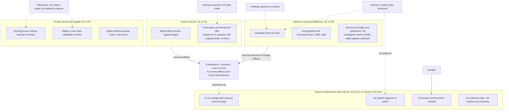

*Figure 1b. The four headings over the structure, at Lakeside, in October. Kobo: kWh billed +38.00<!--figx:({sites.lakeside-power/Kobo.actual.nodes.billed_kwh}-{sites.lakeside-power/Kobo.plan.nodes.billed_kwh})*{sites.lakeside-power/Kobo.actual.nodes.tariff}--> sits under Grow; candidate, unexplained and necessary running, −423.75<!--figx:-({sites.lakeside-power/Kobo.actual.nodes.candidate_l}-{sites.lakeside-power/Kobo.plan.nodes.candidate_l})*{sites.lakeside-power/Kobo.actual.nodes.diesel_price}-({sites.lakeside-power/Kobo.actual.nodes.unexplained_l}-{sites.lakeside-power/Kobo.plan.nodes.unexplained_l})*{sites.lakeside-power/Kobo.actual.nodes.diesel_price}-({sites.lakeside-power/Kobo.actual.nodes.necessary_l}-{sites.lakeside-power/Kobo.plan.nodes.necessary_l})*{sites.lakeside-power/Kobo.actual.nodes.diesel_price}--> together, sit under Optimize; the two add to Kobo's −385.75<!--figx:{sites.lakeside-power/Kobo.actual.nodes.contribution}-{sites.lakeside-power/Kobo.plan.nodes.contribution}--> contribution gap. Kobo's target is declared at billed kWh, so its bridge stops there (§2.2). Mto shows the service-to-charge part of Optimize (O3): meters not yet mapped to a customer −56.00<!--figx:-({sites.lakeside-power/Mto.actual.nodes.unmapped_kwh}-{sites.lakeside-power/Mto.plan.nodes.unmapped_kwh})*{sites.lakeside-power/Mto.actual.nodes.tariff}--> and authorised adjustments −16.00<!--figx:-({sites.lakeside-power/Mto.actual.nodes.adjustments_kwh}-{sites.lakeside-power/Mto.plan.nodes.adjustments_kwh})*{sites.lakeside-power/Mto.actual.nodes.tariff}-->, beside a Grow effect of −8.00<!--figx:({sites.lakeside-power/Mto.actual.nodes.metered_kwh}-{sites.lakeside-power/Mto.plan.nodes.metered_kwh})*{sites.lakeside-power/Mto.actual.nodes.tariff}--> in metered kWh. Collection is also O3, and is cash, outside contribution: Kobo's 278.00<!--fig:sites.lakeside-power/Kobo.actual.nodes.outstanding--> outstanding, and across Lakeside 8,870.00<!--fig:portfolio.lakeside-power.actual.sums.collected--> collected of 9,688.00<!--fig:portfolio.lakeside-power.actual.sums.revenue--> billed. Kisiwa's 10<!--fig:sites.lakeside-power/Kisiwa.actual.nodes.obligation_hours_without_redundancy--> evening hours without backup and Kobo's battery cover are Protect measures, never added to money. Assure adds no figure: it presents the bridge, the options' evidence, the verdicts and contract performance.*

<!--Figure 1c: one chain, from target to verdict, at Kobo-->

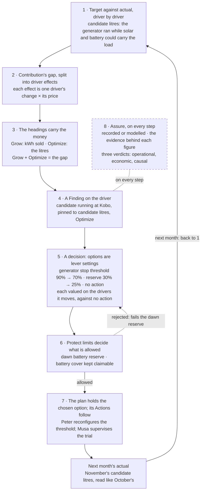

*Figure 1c. One chain, from target to verdict, at Kobo in October. This answers the owner's question (20 Nov): performance to target, contribution, the four headings and the levers are one chain, not four views. (1) Target against actual: Kobo's candidate litres were 25<!--fig:sites.lakeside-power/Kobo.actual.nodes.candidate_l--> against a target of 0<!--fig:sites.lakeside-power/Kobo.plan.nodes.candidate_l-->, as the simulated world records it (dispatch-3.2); dispatch-3.3 re-classifies it in 0K4f. (2) Each driver's change at its price is an effect on contribution: candidate running −31.25<!--figx:-({sites.lakeside-power/Kobo.actual.nodes.candidate_l}-{sites.lakeside-power/Kobo.plan.nodes.candidate_l})*{sites.lakeside-power/Kobo.actual.nodes.diesel_price}--> of Kobo's −385.75<!--figx:{sites.lakeside-power/Kobo.actual.nodes.contribution}-{sites.lakeside-power/Kobo.plan.nodes.contribution}--> gap, inside Lakeside's −200.65<!--figx:{portfolio.lakeside-power.actual.sums.contribution}-{portfolio.lakeside-power.plan.sums.contribution}-->. (3) The same effects, read under their headings, are the money of Grow and Optimize, and add to the gap exactly: at Lakeside, Grow −25.00<!--figx:{portfolio.lakeside-power.actual.sums.revenue}-{portfolio.lakeside-power.plan.sums.revenue}+({sites.lakeside-power/Mto.actual.nodes.unmapped_kwh}-{sites.lakeside-power/Mto.plan.nodes.unmapped_kwh})*{sites.lakeside-power/Mto.actual.nodes.tariff}+({sites.lakeside-power/Mto.actual.nodes.adjustments_kwh}-{sites.lakeside-power/Mto.plan.nodes.adjustments_kwh})*{sites.lakeside-power/Mto.actual.nodes.tariff}--> (kWh sold) and Optimize −175.65<!--figx:-({portfolio.lakeside-power.actual.sums.cost_to_serve}-{portfolio.lakeside-power.plan.sums.cost_to_serve})-({sites.lakeside-power/Mto.actual.nodes.unmapped_kwh}-{sites.lakeside-power/Mto.plan.nodes.unmapped_kwh})*{sites.lakeside-power/Mto.actual.nodes.tariff}-({sites.lakeside-power/Mto.actual.nodes.adjustments_kwh}-{sites.lakeside-power/Mto.plan.nodes.adjustments_kwh})*{sites.lakeside-power/Mto.actual.nodes.tariff}-->, including the effect of Kobo's candidate running. (4) The deviation on candidate litres raises a Finding, pinned to that driver, so it sits under Optimize, and it opens the generator-stop decision. (5) The options are settings of the lever, valued on the drivers they move against no action: lowering the stop threshold from 90% to 70%, or the reserve, would cut candidate running, but both settings' litres and value are Not available yet (a dispatch replay on Kobo's October as recorded; 0K4f), so neither is ranked by money; the stop threshold's one-off is 90.00<!--fig:options.KOB-STOPSOC.operator_one_off-->. (6) Protect limits decide which options are allowed, never their money: both settings pass the admission rule on K8's replayed days (energy served, reserve kept, starts within the maker's limit, regular full charge), and the dawn margin is information beside each, never a gate (below 35 % at 5 am on 4<!--fig:options.KOB-STOPSOC.information.dawn_days_below--> replayed days for the stop threshold and 11<!--fig:options.KOB-RESERVE.information.dawn_days_below--> for the reserve); the battery's 64,000.00<!--fig:options.BAT-EVIDENCE.rights.claimable_cover--> of cover stays claimable only with the evidence item the plan carries beside it. (7) The plan holds the options it can value (+2,213.33<!--fig:plans.lakeside-power.default.value--> for Lakeside, from Mto's huller connection, 2,213.33<!--fig:options.MTO-HULLER.value-->) and lists Kobo's two settings as not available, its Actions are created by the people who own them, and November's records come back as November's actual: the chain starts again at step 1. (8) Assure adds no money: on every step it says how sure the figure is (recorded or modelled), shows the evidence behind it, and, once November is in, gives the three verdicts on the change.*

*Named changes, on merit* (owner: "push back with reason is welcome").
1. **Contribution is the outcome the money headings explain, not a Grow row.** Today "Site profitability" is a Grow row (`outcomes/catalogue.py:46`). Its gap is the sum of Grow and Optimize effects, so it cannot sit inside one heading. Its bridge is presented under Assure (A1).
2. **Unexplained litres move to Optimize.** Today "Fuel accounted for" is a Protect row (`catalogue.py:51`). Unexplained litres carry money in cost to serve (O1), so their home is Optimize. The fuel-loss Finding stays a risk, and the Protect card links to it without counting it.
3. **Collection moves from Grow to Optimize (O3).** Today "Cash collected" is a Grow row (`catalogue.py:45`). The brief puts reconciled billed, recognised and collected value under Optimize's O3, so billed against collected, in transit and outstanding move there. Growing what is sold stays in Grow. This corrects rev 16.9, which kept collections under Grow by citing today's row.

### 2.1 B1: the factor structure, discipline from drivers to outcomes

**What it brings.** Each outcome is declared as a structure of factors down to leaves that a source record evidences, and outcomes are computed upward, never typed in. Four relations are used, all from the brief:
- identities: contribution = revenue − cost to serve;
- products: fuel cost = litres × price; revenue = billed kWh × tariff;
- value-chain stages: delivered → metered → billed → collected, with losses and adjustments as named leaks;
- physical splits: generator litres = necessary + candidate + unexplained, as dispatch and the fuel balance already observe.

Each leaf carries a shared factor ID, a period, a unit, a target, an evidence class, its provenance and its home category (OD-21, §2.0), so it carries money once and sits under one executive heading. *Serves the objective:* monitoring shows that the generator ran; this is meant to show what that did to contribution.

**Where it fits.**
- It sits above the evidence ledger. The analyses (which stay) become the observers of its physical leaves.
- **Named change (L1):** today's outcome map, a fixed list of signal-to-outcome rows, becomes rows of this structure. It keeps its code-registry form and start-up check, and the old literal is removed only after a parity test passes.
- The site board's driver lines, written per vertical today, are generated from the structure.
- **The evaluated structure is served from a calculated daily snapshot** (OD-23), recalculated for the Sites and periods a defined trigger marks, at the daily run or when a user asks (for now; owner, 20 Nov), never on a screen read (§2.8).
- **The same shape serves every vertical.** A cold room's contribution is chargeable crate-days × rate − cost to serve. A captive EV depot is judged on cost per required departure met, with revenue *not applicable*, never zero. Protect is a structure of measured factors too (unserved critical kWh, crate-minutes above limit, departures missed). Capital choices are options over a longer horizon. The three-vertical table is in `worked-portfolios.md` §1.0.

**CH1: Findings pinned to their factors.**
- *Stays:* everything that makes a Finding a living artifact: its identity, revisions, thread, claim ceiling and next step.
- *Changes:* each mechanism gains the factor it observes through one row of the registry, derived at read time, so no column is added. Candidate running maps to candidate litres, unexplained fuel to unexplained litres, a cold excursion to crate-minutes above limit, an EV interruption to chargers in service, and a backup start failure to nights without backup cover, a Protect measure (`worked-portfolios.md` §1.2, Thika). Merit: today a Finding's only link to an outcome is a fixed row (`outcomes/outcome_map.py:17-23`), so it cannot enter a bridge.
- *Deviations found in the structure:* a **structure observer** stores these as Findings, with the same identity, revisions and thread, but only under the owner's rule and outside the factor's tolerance (§1.3).
- *What a Finding may claim:* its condition, in its factor's unit and period, within its claim ceiling. It never claims an outcome value of its own, or the value of acting.

**Kobo in October, under the owner's rule:**
- **Necessary running above its fuel target (−242.50)** is a bottom-line impact, so it is raised if it is outside its tolerance.
- **Outstanding bills (278.00<!--fig:sites.lakeside-power/Kobo.actual.nodes.outstanding-->)** are a cash risk, raised for the finance lead.
- **kWh billed above target (+38.00)** is favourable, so it is **not** a Finding.
- **Headroom with no customer** is a capacity factor. It becomes an opportunity Finding only once there is a signed letter of intent.

<!--diagram:factor-structure-->

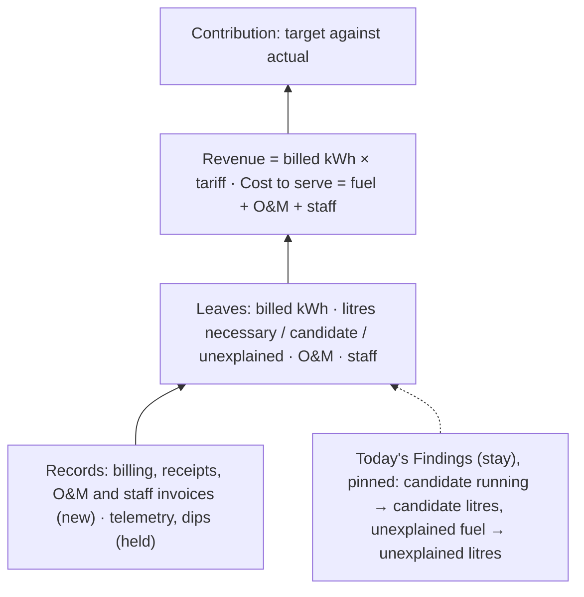

*Figure 2 (drawn in the HTML twin). Kobo's October contribution, read upward: 1,951.25<!--fig:sites.lakeside-power/Kobo.plan.nodes.contribution--> targeted and 1,565.50<!--fig:sites.lakeside-power/Kobo.actual.nodes.contribution--> actual. Today's two Findings are pinned to the candidate litres (25<!--fig:sites.lakeside-power/Kobo.actual.nodes.candidate_l--> L, as the simulated world records it (dispatch-3.2); dispatch-3.3 re-classifies it in 0K4f) and the unexplained litres (120<!--fig:sites.lakeside-power/Kobo.actual.nodes.unexplained_l--> L). Of 3,458.00<!--fig:sites.lakeside-power/Kobo.actual.nodes.revenue--> billed, 3,180.00<!--fig:sites.lakeside-power/Kobo.actual.nodes.collected--> was collected.*

### 2.2 B2: performance against target, from objectives to a bridge

**What it brings.** Targets and budget lines are declared at factor level. The targeted outcome is then the same structure evaluated on the targeted factors. The gap between target and actual is attributed to the factors that caused it:
- exactly, for sums;
- by a declared rule, for products;
- with an explicit residual only where a leaf is unobserved.

*Serves the objective:* it is meant to answer the question the brief puts first, *why did the month come in below target, and by how much from each cause?*

**Where it fits.** Today's objectives stay, and each becomes the target of the factor it measures. **Named change (L3):** today a SYSTEM declarer sets them, "for the demonstration; not a customer target" (`objectives/model.py:23-24`). Under B2 the operator declares targets and budget lines, and the declarer is recorded (CH2). The "N of M objectives met" line stays beside the bridge.

<!--diagram:plan-against-actual-->

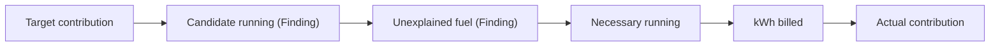

*Figure 3 (drawn in the HTML twin). Kobo, October: −385.75<!--figx:{sites.lakeside-power/Kobo.actual.nodes.contribution}-{sites.lakeside-power/Kobo.plan.nodes.contribution}--> in all. Candidate running (as the simulated world records it (dispatch-3.2); dispatch-3.3 re-classifies it in 0K4f) −31.25<!--figx:-({sites.lakeside-power/Kobo.actual.nodes.candidate_l}-{sites.lakeside-power/Kobo.plan.nodes.candidate_l})*{sites.lakeside-power/Kobo.actual.nodes.diesel_price}-->, unexplained fuel −150.00<!--figx:-({sites.lakeside-power/Kobo.actual.nodes.unexplained_l}-{sites.lakeside-power/Kobo.plan.nodes.unexplained_l})*{sites.lakeside-power/Kobo.actual.nodes.diesel_price}-->, necessary running −242.50<!--figx:-({sites.lakeside-power/Kobo.actual.nodes.necessary_l}-{sites.lakeside-power/Kobo.plan.nodes.necessary_l})*{sites.lakeside-power/Kobo.actual.nodes.diesel_price}-->, kWh billed +38.00<!--figx:({sites.lakeside-power/Kobo.actual.nodes.billed_kwh}-{sites.lakeside-power/Kobo.plan.nodes.billed_kwh})*{sites.lakeside-power/Kobo.actual.nodes.tariff}-->. Two of the four effects already have a Finding today. A month with no Finding still shows its bridge. Under the four headings (Figure 1b), kWh billed is Grow revenue and the three litre effects are Optimize cost.*

**At Portfolio level.** Portfolio outcomes compose Site factors as Σ amounts and Σ/Σ ratios. Lakeside in October:
- **Volume:** metered 21,700<!--fig:portfolio.lakeside-power.actual.sums.metered_kwh--> kWh; billed 21,445<!--fig:portfolio.lakeside-power.actual.sums.billed_kwh--> against a target of 21,650<!--fig:portfolio.lakeside-power.plan.sums.billed_kwh-->.
- **Revenue and cash:** revenue 9,688.00<!--fig:portfolio.lakeside-power.actual.sums.revenue-->, of which 8,870.00<!--fig:portfolio.lakeside-power.actual.sums.collected--> was collected.
- **Cost to serve:** 5,256.40<!--fig:portfolio.lakeside-power.actual.sums.cost_to_serve--> against 5,152.75<!--fig:portfolio.lakeside-power.plan.sums.cost_to_serve-->.
- **Contribution:** **4,431.60<!--fig:portfolio.lakeside-power.actual.sums.contribution--> against 4,632.25<!--fig:portfolio.lakeside-power.plan.sums.contribution-->**.

### 2.3 B3: commercial and operational integrations fill the data gap

**What it brings.** Each leaf needs one family of source records, which sets the integration scope. *Serves the objective:* during the deep-dive (D1), the operator's own exports pass through the canonical contract, so their target against actual appears in the product within weeks. That safeguard holds once steps 3A, 4 and 5 are live (Figure 10). A person in the Analyst role onboards the first deep-dive's exports through step 3A's intake and contract test (§2.9).

| Value-chain stage | Mini-grid source | Cold-room source | EV depot source | Held today? |
|---|---|---|---|---|
| Service delivered | EMS, inverter, BMS and genset telemetry | chamber controller, energy meter | CPMS / OCPP log, site meter | telemetry **yes** |
| Chargeable service | meter register (meter ↔ customer) | storage ledger | fleet roster; session ↔ bus | new |
| Revenue and cash | billing or vending export; receipts, mobile-money settlements | invoices, receipts | not applicable (captive) | new |
| Cost to serve, O&M | fuel notes and dips; O&M and staff invoices | electricity bills, service invoices | utility invoice with time-of-use lines | fuel **yes** |
| Budget | monthly budget lines by Site | same | same | new |
| Contracts and rights | warranty, EPC, O&M/SLA, insurance documents; notices | same | same | new |

**Where it fits.**
- Telemetry and today's operational records stay where they are.
- Money records get **one new commercial record store**, with an immutable raw payload and source-versioned revisions. A late record revises closed periods.
- **Named change:** this store is separate because today's intake is first-write-wins and refuses late intervals (`evidence/service.py:484-492`; `reading_upload/service.py:244-248`). That suits telemetry and does not suit bills.
- Imported records are accepted by the finance and commercial lead. The operator executive can also accept them, and that is recorded as the executive's acceptance (OD-15).
- Contract rows are extracted with AI assistance, and a person approves each one. The pilot asks per vertical are in `design-appendix.md` §5.

**The order of operational integrations** (owner, OD-22: "EMS data upload, api..first then edge gateway that talks to hardware via modbus").
1. **EMS data upload.** The operator's EMS exports arrive as files through today's reading upload (`reading_upload_api.py:113`) and the field package's CSV path (`field/assetops_field/csv_upload.py`). This is what the deep-dive uses.
2. **EMS API.** The same profile and parser, with a pull transport in place of the file. Only the transport changes (`integration-design.md` §6).
3. **The edge gateway, talking Modbus to the hardware.** Modbus is in the emulation scope, so the path is proven before any hardware exists. Today's Modbus TCP poller already runs end to end against a GX-shaped emulator through the real gateway (`field/assetops_field/modbus_poller.py`; `host/tests/test_field_modbus_tcp_proof.py`). The hardware test that follows is a BeagleBone Black running the edge gateway and talking to the backend gateway.

Each step passes the same contract test as the emulator before it replaces it (Figure 4).

<!--Figure 4: one contract for every source-->

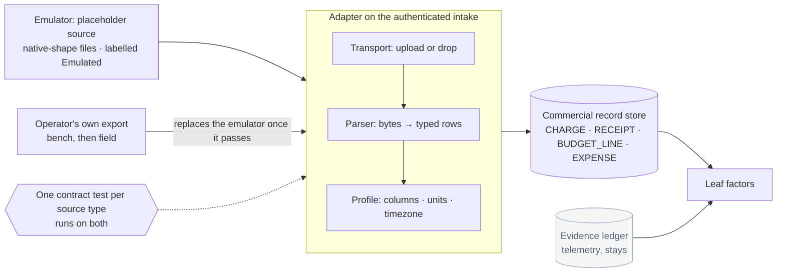

*Figure 4. An emulator and the operator's own export feed the same adapter and pass the same contract test. Emulated figures are never shown as Recorded, and never counted as benefit (D14).*

### 2.4 CH3: choices valued against doing nothing, and who acts

**Named change (L5).** Today a candidate-running Finding gets one recommendation, reserve − 5 points, which "does not predict … any saving" (`actions/reserve_trial.py:42-45`). Nothing weighs it against another option or against doing nothing.
- *What stays:* the reserve rule, which becomes one option generator; the what-if records, which become an option's calculation record; and the possible extra fuel cost, which stays an *at-stake* bound and is never an option's value.
- *What it brings:* when a Finding sits on a factor with a declared lever, the system **prepares a decision**. Options are factor changes over a horizon and always include **no action**. Each option is valued by one rule:

> value(option) = Σ over the horizon [ outcome(structure | the option's factor changes) − outcome(structure | no action) ] − ( the operator's one-off cost under the option − under no action )

**The reference, when no action never ends** (Architect's call, `rev 16.14`, D-RECON.6). Where no action leaves a failed asset never restored, as at Mto, where no notice is filed, the warranty lapses and the inverter stays down, its loss has no end but the horizon, and valuing a fix against it would book a repair as a gain. When such a decision is valued in money, its options are valued against an immediate restore at no operator cost, and the figure is called the *cost to restore*; no action stays on the page, rejected, with what it would lose (the cover, and the extra fuel running on). A protective decision, such as Kisiwa's generator, carries no money value to label: it is compared in its Protect measures against no action, whose never-ending loss is exactly what its bound rejects (D-RECON.8). Each option's data names its basis, against no action or cost to restore, and a plan total shows the two apart, each term with its own period (12 months, to the restore date, or the contract's months), under "Change within the next 12 months".

Each option is checked against the bounds and given a disposition. *Serves the objective:* executives see their choices compared in money for every Site and vertical. The highest diesel user may have nothing worth changing, and the obvious setting may fail a service rule.

<!--Figure 5: a decision at Kobo-->

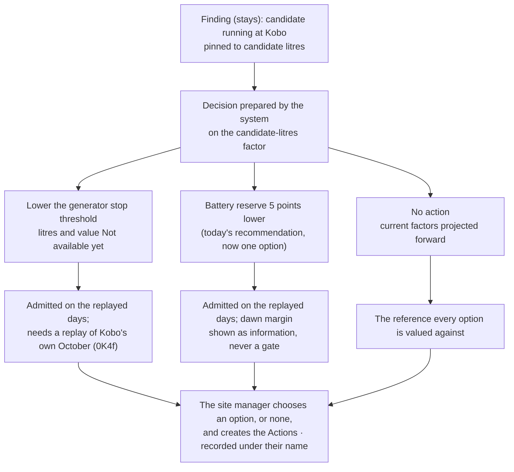

*Figure 5. A decision at Kobo. Both settings, the stop-threshold change and the reserve change, pass the owner's admission rule on K8's 61 replayed days (runs/admission.py). Their litres and value are Not available yet (a dispatch replay on Kobo's October as recorded; 0K4f), so neither is ranked or recommended, and the plan holds both as not available. The dawn margin is information beside each, never a gate: below 35 % at 5 am on 4<!--fig:options.KOB-STOPSOC.information.dawn_days_below--> replayed days for the stop threshold and 11<!--fig:options.KOB-RESERVE.information.dawn_days_below--> for the reserve, against 4<!--fig:options.KOB-STOPSOC.information.baseline_dawn_days_below--> with no action. The stop-threshold change's one-off is 90.00<!--fig:options.KOB-STOPSOC.operator_one_off-->.*

**Who chooses, and who creates the Action.** The owner said a Finding "needs to be acted on and the user likely reate one more action against it", and asked first about "users to act on the bases of context given to them, then tracked". So the system evaluates and proposes, and people choose and act:
1. **The system raises the Finding and proposes.** It values the options and marks one Recommended, found by one search across the period's decisions so that the recommended set fits. It picks nothing. A hard-bound rejection can be overridden only by a recorded change to the bound (Architect's call).
2. **The role accountable for what the decision concerns chooses** an option, or none (the Architect's ruling on OD-16, `rev 16.12`):
   - the site or operations manager for a Site's assets and operations, including the remedy path under an asset's warranty or service contract (at Mto, David, the site manager, chooses the inverter claim, OD-16; at Kobo, Peter chooses to assemble the battery evidence);
   - the finance and commercial lead for billing, collection and customer accounts (the Mto billing fix);
   - the executive for capital choices. A new customer connection is proposed by the site manager as a plan item and approved by the executive as capital; only then does the site manager create its Actions (OD-17).
3. **People create one or more Actions**, against the Finding or against a plan item (§2.5). The chooser creates the operational Actions. The finance and commercial lead creates every notice and claim Action, because filing a rights event is the lead's (at Mto, Joseph files the inverter warranty notice; at Kobo, he assembles the warranty evidence). Each Action records its creator, owner and due date.
4. **Release.** Every Action's spend and crew visits count in the period's plan, on its plan item. The **spend threshold**, a Site or portfolio setting (owner, OD-2; a Site setting wins over the portfolio's, and a change spanning Sites is judged against the portfolio's, OD-18), applies to the **whole chosen change**: the plan item's total one-off, summed over all its Actions, never one Action at a time. *Architect's reading of OD-2:* splitting a change into several small Actions must not slip it under the threshold. A change at or below both the spend threshold and the crew-visit threshold (OD-12) has its Actions released when they are created, provided the plan still fits its budget and crew visits. With the crew-visit threshold at its default of zero, a change that uses a crew visit waits for approval, whatever its spend (Architect's reading of OD-11 and OD-12). The system checks that fit at each creation, in order, so two changes created together cannot jointly overrun it. Otherwise the Actions wait for the plan's approval. Kobo's stop-threshold change totals 90.00<!--fig:options.KOB-STOPSOC.operator_one_off--> over its two Actions, with no crew visit. Under a threshold of at least that amount, once the change is chosen into a version, both are released at once and still counted in the plan. Under a lower threshold, or none set, both wait. The same rule releases the Actions of a proactive item.

### 2.5 P: the plan, a first-class construct (new)

**The owner's decision (19 Nov):** "a plan is a legitmate new construct and need to be added as such and integrated with the existing constructs. e.g an action be raised against a plan or a finding."

**What it is.** The plan is one portfolio's committed changes for one period, together with the budget and crew visits they use. It records:
- its **items**: each a chosen option from a decision, or a change declared straight into the plan (scheduled maintenance, a capital project, a collection drive);
- each item's Site, target factors, frozen prediction, spend, crew visits, dates and dependencies;
- the items left out, each with its reason;
- the switches set, the approver and the version.

Its states and versions are set out below, in *The plan's life in a period*.

*Serves the objective (why it is needed):* The objective asks which Sites and investments earn most from existing capital, and where limited crews should work. Choices made Site by Site can each be right while the set breaks the budget, overruns the crew visits, or misses a dated dependency. For example, the Mto huller needs the inverter restored first. No budget, crew or cross-Site construct exists in today's backend or schema (the only "budget" hits are frontend layout code).

**Who owns it.** The **operator executive** owns the plan, because it commits the budget and crews and trades one Site against another. If the cooperative does not extend its letter of intent, keeping the Mto huller means buying the inverter now and dropping the Kisiwa repair. That leaves 125 evening hours without backup instead of 15 (`worked-portfolios.md` §1.1). Only the budget holder can make that trade.

**How it connects to the existing constructs.**

| Construct | Connection |
|---|---|
| Finding | A chosen option from a decision on the Finding becomes a **reactive** plan item if it spends shared budget or crew. The Finding stays its trigger and evidence |
| Decision | Supplies the options and their values. Only a person's choice turns an option into an item |
| Action | Two separate links (coordinator's refinement, adopted): **Origin**, exactly one, saying why the work exists. It is a **Finding** (reactive) or a **plan item** (proactive work no Finding triggered: scheduled maintenance, a budgeted replacement, a new connection, an expansion). Today's opportunity study stays a third, legacy origin; see the note below. **Plan membership**, at most one, saying what the work is funded and scheduled under. It is the plan item that counts its spend and crew visits. A Finding-origin Action that spends shared budget or crew joins the period's plan through the reactive item for its chosen option. If no decision sits behind it, the Action creates its own reactive item, which records the Finding and the spend (Architect's call). A proactive item's Actions are members of that same item. So the same work is never counted twice: spend and crew are counted once, on the item. An Action may also name the decision option it carries |
| Verdict | Each item's Actions are verified as today, plus the economic and causal verdicts (§2.7). At the period's end the plan's predicted factor changes are set against what the bridge observed. The plan's realised value comes only from economic verdicts |
| Registry | Items key to the factor IDs their options change, so the next period's bridge shows each planned change beside the observed one |

**The system's part.** The system assembles the chosen items. It checks them against the budget, crew visits and dates. Where they do not fit, it proposes the nearest set that does: fewest service-rule breaches first, then the highest value, then the lowest spend, with a reason for every item left out. That is a proposal; the executive approves the plan or sends it back. An Action whose item the approved plan leaves out is not released. It returns to its creator with the reason, and the creator revises it, defers it into the next draft, or withdraws it (owner decision OD-4). If the Action was already released below the threshold, it stops at its next step: no further spend is released, it returns to its creator with the reason in the same way, and the spend already incurred stays recorded against the item (Architect's call, consistent with OD-4). In Lakeside's demonstration the managers take the Recommended options, and the full proposal is in `worked-portfolios.md` §1.1.

<!--Figure 6: the plan among the constructs-->

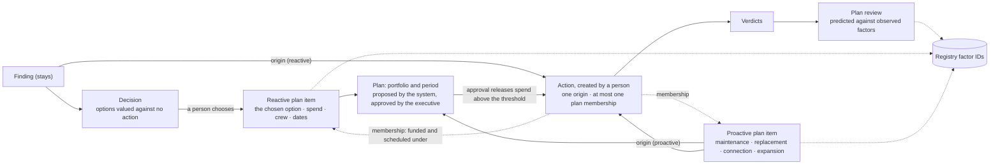

*Figure 6. The plan among the constructs. Each Action has one origin: a Finding (reactive) or a proactive plan item. It also has at most one plan membership, which says what funds and schedules it. Spend is counted once, on the item. The plan releases what needs approval and is reviewed against observed factors.*

**The plan's life in a period** (owner decisions OD-10 and OD-11, 19 Nov).
- *Period.* A plan covers one portfolio's budget period: a month, unless the executive sets another (Architect's call).
- *Opening (OD-10).* The system opens the period's draft plan automatically when the period starts, within the limits the executive has set: the budget, the crew visits, the spend and crew-visit thresholds (both Site or portfolio settings, a Site setting winning, OD-18; the crew-visit threshold defaults to zero, OD-12) and the switches. Opening chooses nothing. The draft carries forward the previous period's unfinished items with their approval, spend and owners, and a carried item is approved again only if its spend changes (Architect's call).
- *Proposing and approving.* The system assembles the chosen and declared items, checks the fit and proposes a version. The executive approves it or sends it back with a trade-off. A version sent back returns to draft, and each item it changes returns to its creator with the reason (OD-4).
- *Versions (OD-11).* An approved version stays in force until the next one is approved. A change that alters the total spend by more than the spend threshold, or the crew visits by more than the crew-visit threshold, creates a new version for the executive to approve. Smaller changes are recorded on the version in force, with the person and the time, and need no new approval. Changes are counted together since the last approved version, so a run of small changes cannot slip past a threshold (Architect's call, the same reading as OD-2). The crew-visit threshold is a Site or portfolio setting beside the spend threshold. Until it is set it is zero, so any added crew visit needs approval (OD-12). A change spanning Sites is judged against the portfolio's thresholds (OD-18).
- *Crew-visit limits by month.* When a period spans months, the executive sets the crew-visit limit for each month inside it, and each crew visit counts in the month it falls (Architect's call). Lakeside's November and December each allow 3 (`worked-portfolios.md` §1.1).
- *States.* **Draft**: open, collecting items. **Proposed**: awaiting the executive. **Approved**: a version in force. **Revised**: a version in force while its successor is proposed; the version in force governs, and the Actions of the change wait. **Closed**: the period has ended and been reviewed.
- *Money, counted once.* Each item's spend moves through three steps: *planned* (the chosen option's or declared item's one-off), *released* (what its released Actions may spend) and *incurred* (expense records linked to the item in the commercial record store). The budget in use counts each item once: its incurred spend where expense records exist, otherwise its released spend, otherwise its planned spend (Architect's call). Realised value still comes only from economic verdicts (§2.7).
- *Ownership (OD-16).* Each item's owner is the person who chose its option or declared it. At Mto, David, the site manager, chose the inverter claim and owns that item, although the finance and commercial lead files its notice. Each Action keeps its own creator and owner, with a due date; its owner may differ from its creator.
- *Capital items (OD-17).* The executive declares an expansion. A new customer connection is proposed by the site manager as a plan item and approved by the executive as capital. A capital item waits for the executive's approval of the version that holds it, whatever the thresholds (the Architect's reading of OD-17), and its Actions are created after that approval. The executive approves every version. A version awaiting approval appears beside the Finding triage on Act first. No notification is sent, as today (§1.4).
- *Closing.* At the period's end the system runs the plan review: each item's predicted factor changes against the observed ones. The executive closes the period's plan, and its unfinished items carry into the next draft.

<!--Figure 6b: the plan's states-->

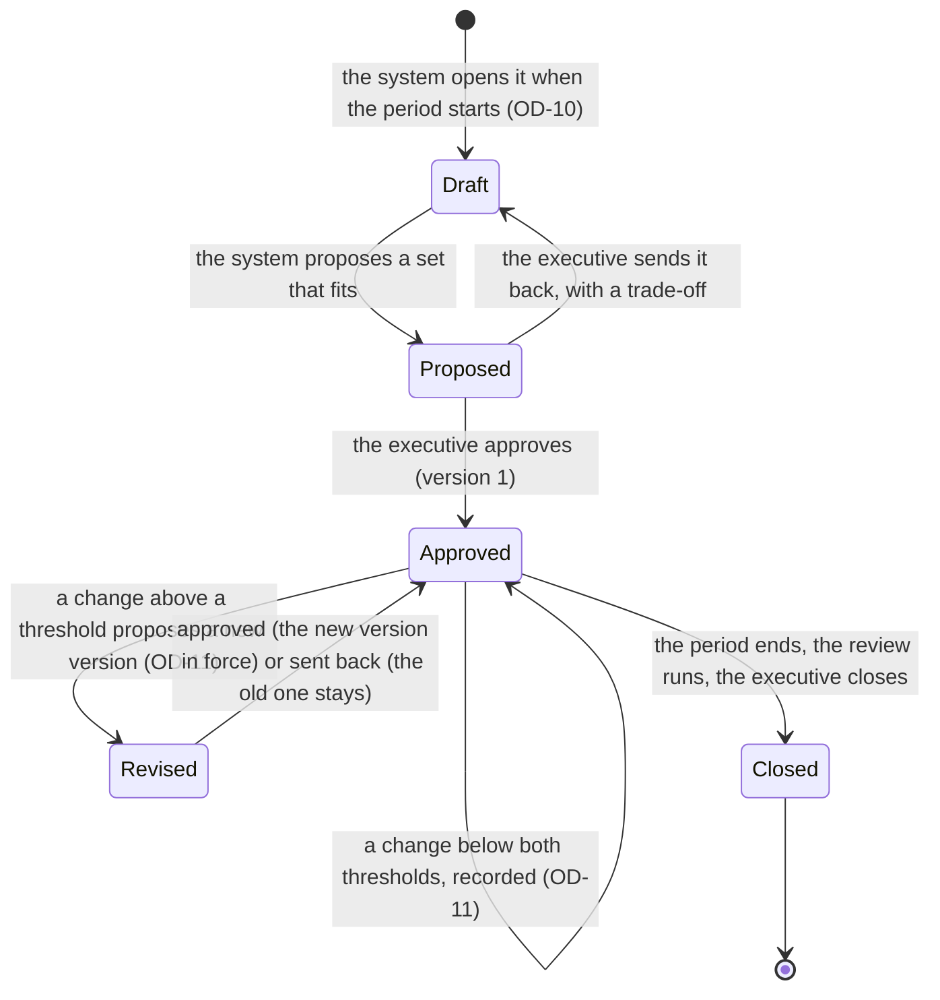

*Figure 6b. The plan's states. Each approval makes a version, and the version in force governs until the next one is approved. At Lakeside, if the cooperative does not extend its letter of intent mid-period, buying the Mto inverter now and dropping the Kisiwa repair is a revision. If it moves the total spend or crew visits by more than the thresholds, it proposes a new version for the executive. If not, it is recorded on the version in force.*

**A plan item's states** (Architect's call; like the plan's own state, derived from the item's Actions and the plan's versions, never a second workflow):
- **Chosen:** a person chose its option or declared it, and it sits in the draft or a proposed version. Its Actions wait.
- **Released:** its Actions may spend, either because its whole change is within both thresholds and the plan still fits, or because the version in force holds it. An Action created later under a released item is released at creation.
- **Left out:** an approved version leaves it out. It returns to its owner with the reason, to revise, defer to the next draft, or withdraw (OD-4).
- **Done:** every Action is closed and its spend is incurred. It waits for the plan review.
- **Withdrawn:** its owner withdrew it.

At the period's close an item that is not Done carries into the next draft with its state. Carrying over is an event, not a state.

<!--Figure 6c: a plan item's states-->

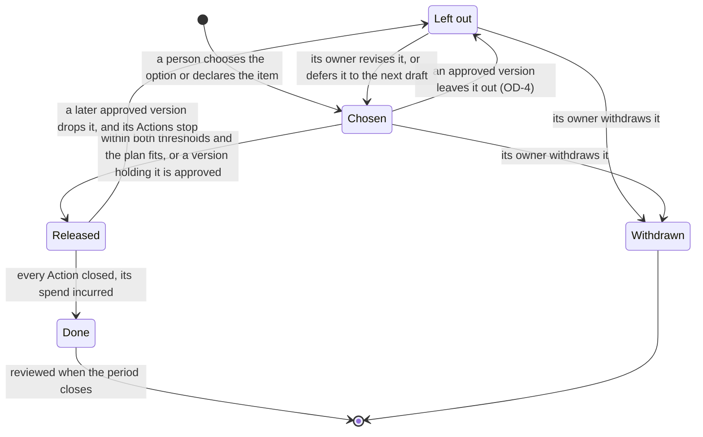

*Figure 6c. A plan item's states. On 6 Nov at Lakeside every item is Chosen, waiting for version 1's approval; the Kobo stop-threshold change is not an item of version 1, because its litres and value are Not available yet (a dispatch replay on Kobo's October as recorded; 0K4f). Once chosen, its whole change is within both thresholds, so it would be Released at once. The Mto huller connection is a capital item, so it waits whatever its spend, and its Action is created after the approval (OD-17).*

**An Action's release** (Architect's call, `rev 16.12`). This is the one release machine; `decision-loop-specification.md` §7 and `plan-and-action-workflow.md` §8 cite it and do not redraw it. Release concerns only an Action with a plan membership. An Action that spends nothing and uses no crew visit has none, and starts its carrier's lifecycle when it is created. An Action's release state follows its item's state (Figure 6c), with one difference: an Action added to an item already Released is a change to that item, and is checked by the same thresholds (OD-11).
- **Waiting:** its item is Chosen, or adding it takes the item's change above a threshold. Its carrier's lifecycle has not started.
- **Released:** its item is Released. Today's carrier lifecycle runs unchanged: accept, apply, assign, complete.
- **Returned:** its item is Left out, by a send-back or a later approved version (OD-4). A released Action stops at its next step, and spend already incurred stays recorded against the item. It is back with its creator, with the reason.
- **Withdrawn:** its creator withdrew it, or its item was withdrawn.

Deferral is not a state. An Action deferred with its item to the next draft is Waiting in that draft, because carrying over is an event (Figure 6c).

<!--Figure 6d: an Action's release-->

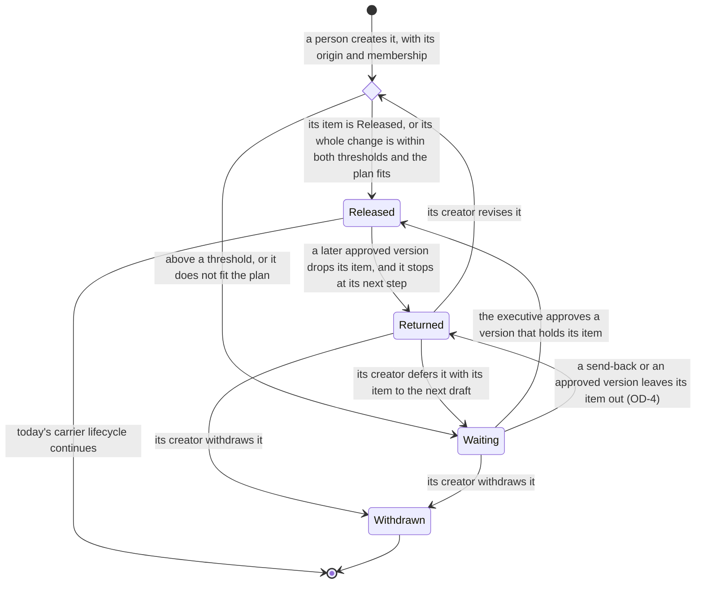

*Figure 6d. An Action's release. On 6 Nov at Lakeside, all four Lakeside Actions are Waiting for version 1's approval; Kobo's two stop-threshold Actions would be Released at creation once the change is chosen, since its whole change is within both thresholds. The Mto huller connection has no Action yet: a capital item's Actions are created after its approval, so they are Released when created (OD-17).*

**Settled with the owner (19 Nov):** OD-1, OD-4 to OD-8, OD-10, OD-11 and OD-16 to OD-18, listed under Decisions. The open Architect's calls are listed there too.

The plan's own state is derived from its items and Actions. It is not a second execution workflow. In code it needs a name that cannot collide with today's `plan` uses (`verification_plan`, `plan_due`, `actual_against_plan`); `portfolio_plan` is proposed.

### 2.6 CH2: the person in the loop, recorded

*Serves the objective:* an executive adopts what shows who decided, who approved and who is accountable, across every Site and role.

**Named change (G1).** Today the act-and-track path is built for a person, but no person is recorded:
- trial commands are a "SYSTEM demonstration" (`actions/lifecycle.py:43-58`);
- work writes refuse a user actor (`work/model.py:284-285`);
- trials have no owner or due date (`estate/coverage.py:530`).

**What stays:** the carriers, their events and commands, idempotency, the thread link and the Actions rail.

**What changes:**
- An authenticated user is recorded on every command. The schema already has the pattern: a HUMAN actor needs an author, though the API refuses one today (`0010_financial_assumptions.py:57-78`; `financial_api.py:209`).
- People sign in with email-and-password accounts, one set per operator; single sign-on comes later, for larger clients (OD-13). No sign-in exists in the backend today.
- The operator executive grants and removes each person's roles in Organisation settings, and every change is recorded (OD-14).
- Every Action records its creator, owner, due date and origin.
- The UI gains the controls that exist today only as API routes.
- Overdue is computed for Actions, as it already is for maintenance schedules (`outcomes/plan_due.py:1-33`).

**Roles** (owner, Q-A2: "a few sensible roles"). Roles govern who may decide and what is recorded. They are not views: every role sees the same screens (owner, 17 Nov). Everything a role does is recorded under the person's name, with the time.

| Role | Decides | Does |
|---|---|---|
| **Operator executive** | Approves each plan version; sets the budget, the switches, and the spend and crew-visit thresholds; makes capital choices, declares expansions and approves new connections as capital (OD-17); grants and removes roles (OD-14) | Approves or sends back the plan, with a trade-off; may accept imported records in the finance and commercial lead's place, recorded as the executive's acceptance (OD-15) |
| **Finance and commercial lead** | Declares budget lines and money targets; accepts imported records; chooses billing, collection and customer-account options; sets money tolerances | Creates Actions against money Findings, and every notice and claim Action; files rights events |
| **Operations or site manager** | Chooses options within decisions on the Site's assets and operations, including an asset's warranty or service remedy; declares operational targets (availability, dawn charge, departures) and proactive items (maintenance, replacements); proposes new connections as plan items (OD-17); sets operational tolerances | Creates Actions from Findings or proactive items; applies setting changes; assigns work |
| **Field technician or O&M contractor** | — | Does the work; records readings, dips and completion |
| **Analyst** | Maps sources to factors; places data-quality holds | Onboards sources; reviews extracted contract rows |

The system raises Findings, prepares and values decisions, recommends, rejects options that break a hard bound, checks that the plan fits, and records. **It never chooses, approves or creates an Action.**

**Who creates which Actions is a role setting** (OD-27). Once the executive approves an expansion, its operational Actions are created by the site manager and its notices by the finance and commercial lead. That assignment is a setting by role in Organisation settings, recorded when it changes, so an operator can move it later without a design change.

<!--Figure 7: who decides, acts and is recorded-->

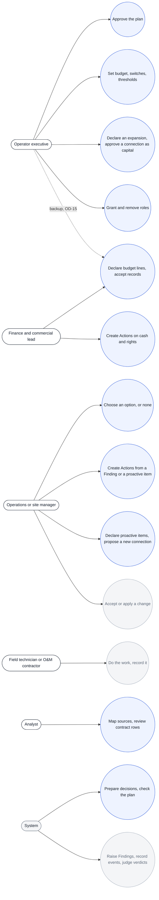

*Figure 7. Use cases, drawn as a flowchart (Mermaid has no use-case type). Blue is new and grey stays. Every use case is recorded under the person who performed it.*

**Kobo's Finding through decide, act, track and verify, before and after.**

<!--Figure 8a: today (context)-->

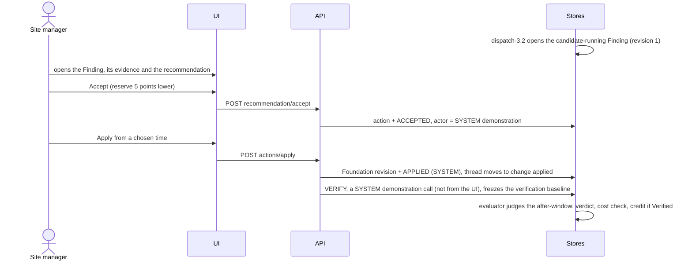

<!--Figure 8b: with the boosters-->

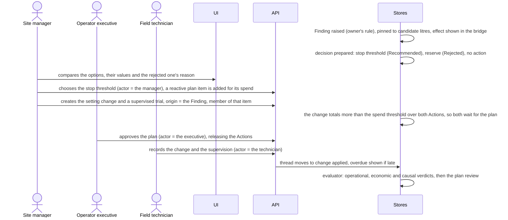

*Figure 8. Before: one option, and the manager's acts are recorded as SYSTEM. After: the system proposes; the manager chooses, which adds a reactive plan item; the manager creates the Actions (origin: the Finding; membership: that item); and the executive's approval releases them. The approval step applies because the change's total one-off of 90.00<!--fig:options.KOB-STOPSOC.operator_one_off-->, summed over both Actions, is above this example's spend threshold. Under a higher threshold, such as Lakeside's 250.00 in the demonstration (`worked-portfolios.md` §1.5), both would be released at once. Each act carries its person.*

### 2.7 CH4: proof that the money followed

*Serves the objective:* proof on the client's own Site is the pilot's purpose and the case for SaaS.

**Named change (L6).** Today's verdict is operational and mini-grid only. The change's cost is fixed at 0 (`actions/verification.py:1167`), and positive evidence must be simulated or authored (`actions/verification_rules.py:688`), so money cannot be proven on a customer's Site.
- *Stays:* the baseline freeze, comparability, guardrails, fail-closed families and the operational verdict. The post-trial cost check and its credit rule seed the economic verdict.
- *Brings:* the frozen prediction becomes the target, and its bounds become the guardrails. Three verdicts are given on the same factors: **operational** (did the factor move, with the bounds held?), **economic** (did money move, in recorded records?) and **causal** (comparable days and untreated Sites as controls). Field evidence is admitted with its label. The option's cost replaces 0. "Not proven yet" is a verdict, not a pass.

<!--Figure 9: proof-->

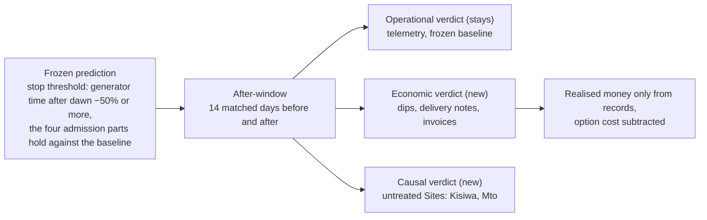

*Figure 9. Proof for Kobo's stop-threshold change. A prediction is never relabelled as realised. A late record can withdraw a verdict, but never silently.*

### 2.8 CH5: what the client sees

*Serves the objective:* the screens are where the executive meets the value. Each change below makes one answer the money question for the whole portfolio.

*Amended 20 Nov by the app-wide menu and page organization (owner-approved; rulings D-IA.1 to D-IA.14, `specs/IA-1-shape-rebuild/rulings.md`): the rail gains Decisions, Results and a home for the plan, and Evidence and Operational records merge (D-IA.1); the Portfolio has three tabs, Overview, Outcomes, and Demand & capacity, with Act first, What changed and Scope moved to their objects' home lists (D-IA.2). The rows below for those tabs and the rail now read through those rulings.* The frame stays: the rail with no new menu items (superseded by D-IA.1), the six Portfolio tabs (superseded by D-IA.2), the range bar, the coverage line, the drill-down pages and "not available yet".

| Screen | Today | Change |
|---|---|---|
| Overview cards | The four category cards: estimated income; a cost claim per Site; counts | The four cards stay as the executive's headings (OD-21). Grow, Optimize and Protect each read the structure nodes whose home category it is, against target, with their evidence class, Findings, options and verdicts; Assure presents A1 to A5 and adds no money (L1, L2; Figure 1b) |
| Optimize (mini-grid) | The window's last day over a period range | Corrected first, then the period's cost factors (L7, `site_outcomes/read.py:676-682`) |
| Act first | Findings in placement groups | The Finding triage stays first, with the plan beside it |
| Outcomes by site and the site board | Statuses; drivers in words | Drivers become factor rows. "Issues" shows Findings on their factors; "What can be done" opens the decision; "Already in hand" shows Actions and plan items |
| Opportunity | A headroom study | Renamed *Demand and capacity*: headroom stays capacity, and demand needs evidence |
| Assure row line "Actual against plan" | "N of M declared objectives met" (`site_outcomes/mini.py:692`) | Renamed "Actual against target" (OD-6), so that "plan" means only the new construct |
| What changed | Accepted actions, verifications | Actions with owners, the plan's review and the three verdicts |
| Site page tabs | Overview and Financials | An Operations tab between them, the same on all 9 Sites: assets and their state, what needs action, operations measures against target (§2.10) |
| Rail: the earlier Incidents, Maintenance, Assets, Operational records and Evidence lists | Five lists apart from the plan and the Findings | One Operations entry with four views, one row per Site opening to its items; Evidence's coverage is the Scope tab (§2.10) |

**A calculated daily snapshot** (owner, OD-23: "keep a calcualted daily snapshot that the UI would use, ofcourse with triggers to recalulate and udpate if things change").
- *What exists today.* Stored route responses: a read route's served bytes are kept under a watermark of its inputs, and every input table writes an input-change row through triggers, so a changed input invalidates the stored response (`0047_chain_response.py:1-14`). It answers the owner's concern that Site and Portfolio pages load slowly (1 Nov walkthrough).
- *What is required.* The structure read, the bridge and the Portfolio figures are served from a **calculated daily snapshot**: the evaluated structure for each Site and the portfolio, per day and per period. It is computed once and read by the UI, never recomputed on a screen read.
- *Its record.* Each portfolio's snapshot records when it was computed ("as of", a date and time) and whether a recalculation is pending. A pending recalculation names the trigger that fired, when, and the Sites and periods it affects. In the demonstration, Lakeside and Metro Bus are current as of 06:00 on 6 Nov; at Harvest Cold, Thika's October service invoice arrived at 09:40, so Thika and the portfolio show the 06:00 figures and say a recalculation is pending (manifest `snapshot`, Architect's demo choice).
- *Its recalculation triggers.* A trigger marks only the affected Sites and periods, and the portfolio above them, for recalculation. They are recalculated at the daily run, or earlier when a user asks (owner, 20 Nov: "once a day and on demand for now"). A trigger fires when:
  1. a new day of records becomes available (owner, 1 Nov: "when a new day is available, it should trigger a re-assessment");
  2. a record is added or corrected, including a late-arriving reading, a re-issued invoice or an accepted import (§2.3);
  3. a target or budget line changes (§2.2);
  4. a setting changes: a price, tariff, tolerance, threshold, switch or source mapping;
  5. a plan version is approved, or a plan change is recorded (§2.5);
  6. the structure or a rule takes a new version.
- *How it keeps the honest-figure rules.* Every node in the snapshot keeps its evidence class, its provenance (the record revisions it was computed from), its coverage and its parts, so the weakest-class and never-sum rules read the same as on a fresh evaluation (Rules 1 to 4). Unknown stays unknown. A snapshot is an output of the evaluation, never an input: no total is typed or edited, every snapshot can be rebuilt from its records, and a check compares it with a fresh evaluation. A screen shows the snapshot's "as of" time, and says so while a triggered recalculation is pending, rather than present an older figure as current.
- *Named change, on merit.* Today's period read computes outcome totals on read and stores none (`chain/period_read.py:46-47`). The snapshot replaces recompute-on-read with recompute-on-trigger, for load speed. The rule it served stays: no stored figure is ever a source.
- *Left open on purpose.* Storage, partitioning and incremental recalculation are inputs to the owner's coming strategy conversation on test data and the database build (`.agent/owner-build-start-and-spec-handshake-2026-11-19.md`). They are not set here.

**Not designed (OD-19).** No packaged lender or financier evidence report is designed. The brief's A4, investor, lender and audit-ready evidence, stays an Assure objective, and it is met by what the product already keeps: provenance and evidence class on every figure, the records, the verdicts, and who decided and approved. A packaged report drawing on that evidence is added to the design if a client asks.

### 2.9 Change register and delivery order

*Serves the objective:* the core changes only where it blocks that value. A construct stays unless a row below names its shortfall. Dispositions at function level are in `reuse-and-gap-matrix.md`.

| Construct | Stays or changes | Shortfall, with evidence | Change |
|---|---|---|---|
| Evidence ledger, gateway, analyses, placement, never-sum rules | Stay | — | Analyses also observe leaves |
| Findings, revisions, threads, alternatives | Stay, plus CH1 | No factor link: `outcome_map.py:17-23` | Pinned to a factor; structure observer, under the owner's rule and tolerance |
| Outcome map | Changes (B1) | No quantity between signal and outcome: `outcome_map.py:149-180` | Becomes structure rows, behind a parity test |
| Objectives | Extended (B2) | System-declared: `objectives/model.py:23-24` | The target of a factor, declared by the operator |
| Reserve recommendation, what-ifs | Change (CH3) | Sole option, gross only: `reserve_trial.py:42-45`; `scenario_rules.py:191-228` | One option generator; an option's calculation record |
| Possible extra fuel cost | Stays | — | An at-stake bound, never an option's value |
| Opportunity study → thread → mill Action | Stays, extended | Headroom with demand "unverified": `opportunities.py:366-401` | Stays as capacity evidence and an Action origin. With customer evidence, an opportunity Finding on the demand factor carries new Actions |
| Actions, domain actions, work cases, rail | Stay, plus CH2 and P | No recorded person: `lifecycle.py:43-58`; `work/model.py:284` | Recorded creator, owner and due date; one origin (a Finding or a proactive plan item; legacy: the opportunity study) and at most one plan membership; released by the plan above the threshold. Today's one-origin check (`0051_action_opportunity_origin.py:73-77`) stays and gains a plan-item arm. The forced mini-grid opportunity origin (`:78-79`) is replaced by a rule that admits no new opportunity origin (OD-7). Trial actions and work cases gain the same links. `chain_action_thread`'s one-origin check (`0051:87-88`), its target trigger `chain_action_thread_target()` (`:34-50`, which matches each link to its Action's origin pair) and the `chain_action` view (`:53-62`) must widen in the same migration |
| Verification | Stays, plus CH4 | Cost 0; simulated evidence only: `verification.py:1167`; `verification_rules.py:688` | Economic and causal verdicts; field evidence |
| Portfolio cards, Optimize figure, site board | Change (CH5) | Counts; one day over a period: `read.py:676-682` | Read from factors |
| The four categories (catalogue) | Stay, re-grounded (OD-21) | Rows flagged from signals, not computed: `catalogue.py:43-68` | Each structure node carries one home category; the cards read the nodes under them (§2.0) |
| Stored route responses, period read | Extended (OD-23) | Totals recomputed on read: `period_read.py:46-47`; slow pages (owner, 1 Nov) | A calculated daily snapshot, marked by named triggers and recalculated at the daily run or on demand, rebuildable and checked (§2.8) |
| Label "Actual against plan" | Changes (CH5, OD-6) | "Plan" would mean two things beside the new construct: `site_outcomes/mini.py:692` | Renamed "Actual against target" |
| Work cases (incidents, requests) and maintenance records | Stay, extended (OD-26) | No time out of service, failure mode, kind, visit or cost basis: `0027_w4_work_cases.py:12-34`, `:145-162` | Failure mode and out-of-service interval on incidents; kind (scheduled or responsive), visit and cost basis on records; repeats observed as Findings (§2.10) |
| Maintenance schedules | Stay, extended | A due state only; no plan item comes from it: `outcomes/plan_due.py:1-33` | An occurrence that uses a crew visit or spends becomes a proactive plan item (§2.10) |
| Asset registry | Stays, extended | No cover on the asset: `sites/battery_boundary.py:26` | Rights rows on the asset or Site, with their state, and what each asset serves (§2.10) |
| Operational records, evidence lists | Stay | — | Read as the records behind each factor (A1), on the Site's Operations tab and the Scope tab (§2.10) |

**Delivery order** (shape approved by the owner, 19 Nov: the source emulators are built "in parallel with work related factor structure"):
1. Correct the last-day figure (CH5).
2. Agree the canonical format and leaf factor IDs, a small step under W1.
3. Build lane A (sources: record store, emulators, contract test) and lane B (structure on today's operational leaves) in parallel, with the recorded person (CH2) beside them: sign-in and roles (OD-13, OD-14), then the person on every command.
4. Join the lanes at the money leaves.
5. Build targets and the bridge, then the rest, each proven first on mini-grid with a cold and an EV test case.

The recorded person still comes before decisions. Emulated figures are never Recorded and never benefit (D14).

**Structure approval (OD-20).** Approving the recreated pack also approves the structure of steps 1 and 3C, so their slices need no structure sitting. In the computed schedule step 1 starts on day 1, once the heavy-tool pool merges, and step 3C starts on day 5, after replay spike 0K on the same lane (`two-week-build-plan.md`, from `plan_model.py`). Step 3C needs nothing from step 1, so Figure 10 draws no edge between them (`rev 16.12`: the edge had no reason).

**The engagement path, tied to the steps** (owner-approved housekeeping, `.agent/owner-pack-questions-defaults-2026-11-19.md`):
- *The deep-dive safeguard.* The operator's own target against actual appears within weeks of the deep-dive only once steps 3A, 4 and 5 are live.
- *The first deep-dive's sources* are onboarded by a person in the Analyst role, through step 3A's intake and contract test. It needs no step-9 work.
- *Step 9's pilot onboarding* means onboarding at scale: real adapters for each source type, replacing the emulators source by source, for more than one operator.
- *Operational integrations, in the owner's order* (OD-22, §2.3). EMS file upload works today and serves the deep-dive. The EMS API transport and then the edge gateway on hardware are step-9 work, in that order. The Modbus emulation proof stays green throughout under the contract test. None of it is in the first fortnight: the deep-dive needs files, and no operator hardware exists yet.
- *The daily snapshot* (OD-23) is built beside the structure read in step 3B, and the bridge (step 5) and the Portfolio cards (step 7) read through it. Its slice is cut after the strategy conversation on the database build.

**Architect's note to the owner on this order.** I agree with the lanes. *Refinement, applied:* cost-side decisions start before the join. Kobo's stop threshold is valued from lane B's litres at the typed diesel price, so the first decision reaches a client sooner (D13). *Caution:* the step-2 format is version 1, to be revised under the contract test when the first operator sample is pinned (D1).

<!--Figure 10: delivery order-->

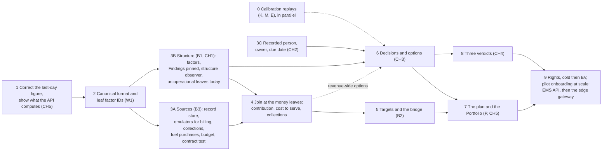

*Figure 10. Delivery order, at Kobo. While lane A builds the emulators, lane B already reads Kobo's actual diesel litres, 634<!--fig:sites.lakeside-power/Kobo.actual.nodes.diesel_l--> L, and their split by generator running, from today's telemetry and fuel records. Today's candidate-running (25<!--fig:sites.lakeside-power/Kobo.actual.nodes.candidate_l--> L, as the simulated world records it (dispatch-3.2); dispatch-3.3 re-classifies it in 0K4f) and unexplained-fuel (120<!--fig:sites.lakeside-power/Kobo.actual.nodes.unexplained_l--> L) Findings are pinned to those factors. At the join, once the billing and collection emulators pass the contract test, the money leaves appear, including the 278.00<!--fig:sites.lakeside-power/Kobo.actual.nodes.outstanding--> of collections outstanding. Targets and budget lines are lane A records too, such as 295<!--fig:sites.lakeside-power/Kobo.plan.nodes.diesel_l--> L of diesel. They take effect at step 5, where the contribution gap of −385.75<!--figx:{sites.lakeside-power/Kobo.actual.nodes.contribution}-{sites.lakeside-power/Kobo.plan.nodes.contribution}--> appears in the bridge. Everything stays labelled Emulated until the operator's own exports replace the emulators.*

### 2.10 Operations: assets, rights, incidents and maintenance inside the structure (OD-26)

*Serves the objective:* an operator executive judges "value beyond monitoring tools" against the maintenance and asset tools they already run. Failures cost money, repeated failures most; maintenance is where cost and risk are traded; rights decide who pays for a repair. So these constructs sit inside the chain of Figure 1c, as drivers and evidence, not beside it (owner, 20 Nov: "they should be seamlessly integrated through propoer design not just a patch").

**What exists today, and stays** [code-observed]. The core already records operations well; this section adds no second store.

| Construct | What it does today | Evidence |
|---|---|---|
| Incident and maintenance request | One append-only work case per event, kind incident or request, with an optional asset, revisions, links to Findings, Actions and evidence, and events from raise to close; a request may name its incident | `0027_w4_work_cases.py:12-114`; `work/model.py:27-30`, `:107-151` |
| Maintenance record | What was done on a case, and its outcome, append-only | `0027_w4_work_cases.py:145-162` |
| Maintenance schedule | Calendar or run-hours schedules per asset, with a due state (overdue, due soon) shared by the board and the global list | `0027_w4_work_cases.py:116-144`; `outcomes/plan_due.py:1-33` |
| Asset registry | The Foundation's assets: code, type, parent, commissioned and retired dates | `0001_foundation_identity.py:95-111` |
| Rights | Warranty fields withheld on the battery read; rights exist only as the manifest's entitlement rows, and slice `9a` would extract them from contracts | `sites/battery_boundary.py:26` |
| Operational records | Operator logs, manual readings, shift notes, site visits, tank dips and deliveries, each submitted then accepted or rejected | `0027_w4_work_cases.py:163-197`; `work/operational_entry.py:108-126` |
| Routes and screens | Site and global reads for incidents, maintenance, schedules and records; the global lists and the work-request pages | `work_api.py:154-218`; `global_work_api.py:81-103`; `frontend/src/work/` |

**Where it falls short, measured against the objective.**
- An incident carries no time out of service, no failure mode and no link to what it cost, so its effect on the bottom line cannot be stated, and nothing notices a repeat.
- A maintenance record carries no kind (scheduled or responsive), no visit and no cost basis, so maintenance spend cannot be reconciled to the O&M leaf, nor scheduled work weighed against breakdowns.
- An asset has no cover. Who pays for a repair is decided in the manifest, not on the asset.
- The lists stand apart from the plan and the Findings. In the mock-up they contradicted both and showed other operators' assets (review of 20 Nov, H3 and H4), and six Sites had none.

**The model.** The asset is the anchor. Every other construct names its asset (or its Site, for a Site-wide contract), and each reaches the outcome through a node the registry already has or that slice `OPS1` adds.

<!--Figure 11: operations inside the structure-->

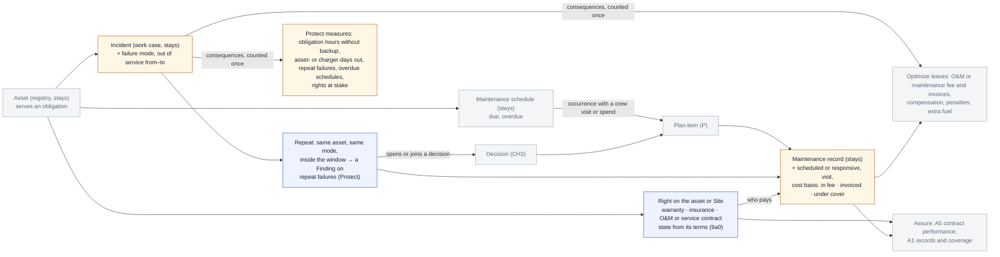

*Figure 11. Operations inside the structure, at Kisiwa. Generator 1 failed on 14 Aug and again on 30 Oct with the same alternator fault: a repeat inside the 90-day window, so a Finding on repeat failures (Protect) joins the genset decision as a linked Finding. Its October consequences are the 10 evening hours without backup and 2 asset-days out of service the Protect card already shows, now counted from the incident. The warranty has expired, so the repair is the operator's; the O&M contract's late response is contract performance under Assure (A5).*

- **Incident.** An event on an asset that takes it out of service or reduces it, with a failure mode and its out-of-service interval. Its consequences sit on the nodes they moved, under those nodes' headings, and are counted there once: obligation hours and asset-days under Protect; compensation, penalties, extra fuel and invoiced repair under Optimize. Its cost is a cut across those leaves, like the heading cut of §2.0, never a new leaf.
- **Repeat.** A second incident on the same asset with the same failure mode inside the operator's repeat window (default 90 days, a setting). Frequency becomes a Protect measure, *repeat failures*, target zero; under OD-3 its tolerance defaults to zero, so every repeat raises a Finding pinned to it. That Finding carries the repeat set's cost and links to the decision on the asset (repair, replace, claim, or a remedy under the O&M contract). It keeps its own heading (OD-25). It reuses the Finding's recurrence history; nothing new tracks threads.
- **Maintenance.** *Scheduled* work comes from a schedule. An occurrence that uses a crew visit or spends becomes a proactive plan item naming the right or Protect measure it keeps, or "no factor (upkeep or compliance)" (OD-5), so crew-visit limits and release apply to it as to any item. *Responsive* work is an Action on an incident's Finding, or on another Finding: a work case's origin stays the Finding or plan item it came from (call 4). Each record says whether it was a visit (the O2 field-visit measure) and its cost basis: inside a contract's fee, invoiced, or under a right's cover. The Site's O&M or maintenance leaf is the fees in force plus the invoices, checked to the cent every month. The scheduled share is an O2 measure, never money.
- **Asset registry and rights.** The registry is the home of cover. A right is a row on an asset or a Site: an equipment or workmanship warranty, an insurance policy, an O&M or service contract. It holds its counterparty, term, conditions, exclusions, notice period, remedy and fee. Its state follows from its terms and claims: in cover, conditions incomplete, notice due, claim open, or expired. It feeds P4 (cover kept claimable, open deadlines), A5 (supplier and contractor performance) and the cost basis of every repair. Slice `9a` keeps its document extraction; the register itself (`9a0`) comes first, so rights exist before extraction does.
- **Operational records and evidence.** Records are a source family that fills leaves (dips fill litres, visits fill field visits). On screen they are the Site's *records behind these figures*: what arrived, from which source, which factor it fills, its coverage. That is Assure's A1, and the Portfolio's Scope tab is its portfolio view.

**Person in the loop.** The field technician or O&M contractor records the incident and the work done. The site manager owns the responsive Actions and chooses a remedy path under a right (call 20). The finance and commercial lead files every notice and claim. The executive approves the plan items that use crew visits or spend. The system counts, derives states and proposes the repeat Finding and due maintenance; it never raises or closes work. Each act is recorded under the person (step 3C).

**Screens: one grammar** (`Docs/design-system/uiux-guide.md` §2.3, §8; the mock-up's Site Overview, "Operations measures at this site" and "obligations and rights").
- **The Site page gains an Operations tab**, between Overview and Financials, the same on all 9 Sites. Its glance line states the assets in service, open incidents with their repeats, and the nearest deadline on a right. Its queue lists what needs action: open incidents, repeat Findings, overdue or due-soon schedules and notice deadlines, each with its owner, due date and the Action or decision it opens. Below them are the operations measures against target (moved from the Overview, which keeps the four headings' strip within its budget) and the asset table, one row per asset: what it serves, its state since when, its cover, its last incident with a repeat mark, and its next maintenance. A missing source reads "not available yet" inside that structure, never as a stub tab.
- **The asset is a page** (an object with identity): state, rights, incidents and repeats on one timeline, maintenance done and due, and its measures. **An incident, a maintenance record and a right open in drawers** from any list, each linking to its asset page and to the Finding, Action or decision behind it.
- *(Superseded 20 Nov by D-IA.4 and D-IA.5: Incidents and Maintenance stay two Work items, Assets & cover holds the registry and cover, records and coverage go to Evidence & records. The text below is kept for the record.)* - **The Portfolio's five earlier lists become one rail entry, Operations**, with four views: incidents, maintenance, assets and cover, and records. Each shows one row per Site (counts, repeats, overdue, deadlines, capped with "Show all"), opening to its items. Rows are scoped by their Site key, never by their text. Evidence's coverage view is the Portfolio's Scope tab. *MOCK DEVIATION, improvement category (flag to the owner):* five rail items become one, and the Site page gains a tab the mock-up does not draw. OD-26 asks for this design, and the UI lane records the register row.

**Named change, on merit.** Today's lists stay as the data underneath. What changes is their place: they are read through the asset and the structure, so an incident, the Finding it raised, the decision and the plan item are one chain, and no list can contradict the plan's items again. The demonstration data now holds a registry, rights, schedules, incidents (two repeats) and maintenance for all 9 Sites (manifest `operations`, checked by `check_manifest.py` `operations()`, OP1 to OP9). Rulings: `specs/L4-OPS/rulings.md`.

## Decisions

**Owner decisions carried over:**
- D1, the engagement path;
- D11, the workflow;
- D13, the visible-first path;
- D14, emulators as placeholder sources.

D15 (the first change agreed at the end of the deep-dive) is pending; its context and default are in `decisions-register.md`.

**Owner decisions of 19 and 20 Nov, applied in this revision:**

| # | Decision (owner's words in `.agent/owner-design-regeneration-request-2026-11-19.md`; OD-10 to OD-12 in `.agent/owner-recreate-document-packs-2026-11-19.md`; OD-13 to OD-20 in `.agent/owner-pack-questions-defaults-2026-11-19.md`; OD-21 to OD-24 in `.agent/owner-summary-confirmations-2026-11-19.md`, OD-21 amended per `.agent/owner-assure-per-brief-2026-11-19.md`) | Where applied |
|---|---|---|
| Q-A1 | A Finding has a bottom-line impact, or is a risk or an opportunity, and is to be acted on with one or more Actions | §1.3, §2.1 |
| Q-A2 | A few sensible roles | §2.6 |
| OD-1 | The plan is a legitimate new construct, integrated with the existing ones; an Action can be raised against a plan or a Finding | §2.5. The coordinator's refinement (owner-approved to pass on) is adopted: one origin (Finding or proactive plan item) and at most one plan membership |
| OD-2 | The spend threshold is configurable, as a Site or portfolio setting | §2.4 step 4; §2.6 |
| OD-3 | A configurable tolerance per factor decides whether an adverse deviation raises a Finding | §1.3, §2.1 |
| OD-4 | An Action whose item the approved plan leaves out is not released. It returns to its creator with the reason, to revise, defer or withdraw ("Q-B1 yes") | §2.5 |
| OD-5 | A proactive plan item names the factor or Protect measure it moves, or is marked "no factor (upkeep or compliance)" with no value ("agree with the architect's pushbacks") | §2.5 |
| OD-6 | "Plan" means only the new construct; B2 uses "targets and budget lines" (same answer) | §2.2, §2.5, figures |
| OD-7 | Today's opportunity-study origin stays as a legacy third origin for existing mill-shift Actions only ("OD-7 and OD-8 yes", 19 Nov) | §2.5 |
| OD-8 | A Finding-origin Action that spends always joins the plan and waits for approval only above the spend threshold ("OD-7 and OD-8 yes", 19 Nov) | §2.4, §2.5 |
| OD-9 | Delivery order: agree the canonical format and leaf factor IDs first, then build the sources (lane A) and the factor structure (lane B) in parallel, joining at the money leaves (the owner's question and "yes, send it", 19 Nov). The Architect's refinement (cost-side decisions start before the join) and caution (the format is version 1) are in §2.9, for the owner | §2.9, Figure 10 |
| OD-10 | The system opens the period's draft plan automatically when the period starts, within the executive's limits ("i agree with the rest of the defaults", 19 Nov) | §2.5, Figure 6b |
| OD-11 | A change that alters total spend or crew use above the threshold creates a new plan version for the executive to approve; smaller changes are recorded without a new approval (same answer) | §2.5, Figure 6b |
| OD-12 | The crew-visit threshold defaults to zero and is configurable, a Site or portfolio setting like the spend threshold (owner, 19 Nov: "the crew-visit threshold default of zero is fine so long as it is configurable") | §2.5 |
| OD-13 | People sign in with email-and-password accounts, one set per operator; single sign-on comes later, for larger clients ("defaults for all 10, go ahead", 19 Nov) | §2.6; §2.9 step 3 |
| OD-14 | The operator executive grants and removes roles in Organisation settings, and every change is recorded (same answer) | §2.6, Figure 7 |
| OD-15 | The operator executive can also accept imported records, recorded as the executive's acceptance, as the finance and commercial lead's backup (same answer) | §2.3, §2.6, Figure 7 |
| OD-16 | A plan item's owner is the person who chose its option (at Mto, David, the site manager); each Action keeps its own creator and owner (same answer) | §2.5; `worked-portfolios.md` §1.5 |
| OD-17 | A new customer connection is proposed by the site manager as a plan item and approved by the executive as capital; the site manager then creates its Actions (same answer) | §2.4, §2.5, §2.6, Figure 6c; `worked-portfolios.md` §1.5 |
| OD-18 | As for spend, a Site's crew-visit threshold wins over the portfolio's; a change spanning Sites is judged against the portfolio's thresholds (same answer) | §2.4 step 4, §2.5 |
| OD-19 | A lender or financier evidence pack is out of scope for now; it is added to the design later if a client asks (same answer) | §2.8; §2.0, where the brief's A4 stays an Assure objective met by the evidence kept |
| OD-20 | Approving the recreated pack also approves the structure of build steps 1 and 3C (same answer) | §2.9 |
| OD-21 | The four outcome categories stay as the executive's headings over the factor-based outcomes: every structure node has one home category, and Findings, decisions, plan items and verdicts tie back through it ("a version of b basically", 19 Nov). As the brief defines them, Assure carries no money of its own and presents the governed, evidenced view (A1 to A5), and collection of billed value is Optimize (O3) (owner approval, 19 Nov: "yes, send it to the architect") | §2.0, Figure 1b; §2.1; §2.2; §2.8; §2.9 |
| OD-22 | Operational integrations come in this order: EMS data upload and API first, then the edge gateway talking Modbus to hardware; Modbus stays in the emulation scope so the path is proven before hardware, and a BeagleBone Black running the edge gateway against the backend gateway is the hardware test (same record) | §2.3; §2.9, Figure 10 |
| OD-23 | The UI reads a calculated daily snapshot of the structure, the bridge and the Portfolio figures, recalculated for the Sites and periods a defined trigger marks, at the daily run or when a user asks (for now; owner, 20 Nov), with evidence class and provenance kept on every node (same record) | §2.1; §2.8; §2.9 |
| OD-24 | Layer 4's evidence words replace the earlier four-level claim ladder; a simulated or emulated result is still never shown as Verified or realised (same record) | Rules |
| OD-25 | A decision takes the heading of its Finding's factor, because that is where the executive met the problem; with no Finding behind it, it takes its lever's heading; each option's effects show under their own factors' headings, money counted once; every Finding-backed decision is checked for a Finding factor and lever under one heading (the coordinator's proposal, owner-approved, with the Architect's refinements) | §2.0; manifest `home_categories.decisions` |
| OD-26 | The earlier operations lists (incidents, maintenance, the asset registry with warranties, operational records, evidence) are rebuilt from the same records the Findings and the plan read (option B) and integrated by design: incidents and their repeats, scheduled and responsive maintenance, and the rights on each asset are drivers and evidence inside the structure ("i'd go for option B", 20 Nov) | §2.10, Figure 11; §2.8; §2.9 |
| OD-27 | The people who create an approved expansion's Actions are set by role and can change later: by default the site manager for operational Actions and the finance and commercial lead for notices ("accept, it is configurable by role", 20 Nov) | §2.5; §2.6 |
| OD-28 | The crossing's screen words are the industry-standard term ("use whichever is the industry standard term", 20 Nov): unbilled energy | §2.0 |

**Other owner decisions, outside this design** (commercial and process; each with its owner record and status in `decisions-register.md`): D2, D3, D4, D5, D6, D7, D8, D9, D10 and D12. The owner's process answers of 19 Nov (Docker restarts allowed on this server as needed; the 10 Nov walkthrough asks superseded by the new direction) are recorded in the register only. The owner's commercial answers of 19 Nov (the pilot fee's form, the deep-dive's terms and their review, peak days and the product reserve: items C2, C12, C13, C14 and C15 of `commercial-plan.md`) are recorded in the register and `commercial-plan.md`, not here (P4 of regeneration F).

**Architect's calls, not settled by the owner:**
- the threshold applies to the whole chosen change, summed over its Actions (§2.4 step 4);
- release at creation needs the change at or below both the spend and the crew-visit thresholds, so with the crew-visit threshold at zero a change that uses a crew visit waits whatever its spend (§2.4 step 4; the Architect's reading of OD-11 and OD-12);
- a capital item, an expansion or a new connection, waits for the executive's approval whatever the thresholds, and its Actions are created after it (§2.5; the Architect's reading of OD-17);
- an Action already released stops and returns to its creator when the approved plan drops its item (§2.5);
- cost-side decisions start before the join; only revenue-side options wait for the money leaves (§2.9, Figure 10);
- a spending Action with no decision behind it creates its own reactive item; a work case's origin is the Finding or plan item it was opened from (§2.5, "Words used here");
- a plan covers the portfolio's budget period, a month by default; a carried-over item is approved again only if its spend changes (§2.5);
- changes are counted together since the last approved version (§2.5, OD-11);
- an item's budget in use is its incurred spend, else its released spend, else its planned spend (§2.5);
- a plan item has five states, Chosen, Released, Left out, Done and Withdrawn, derived from its Actions and the plan's versions (§2.5, Figure 6c);
- a crew-visit limit is set per month inside a longer period, and each crew visit counts in the month it falls (§2.5);
- every structure node has exactly one home category; contribution's money effects sit in Grow and Optimize and its bridge is presented under Assure (A1); unexplained litres are Optimize; an item with no factor sits under Protect as upkeep (§2.0, OD-21);
- the statement and the headings are the rows and columns of one table; a figure shown on two screens reads one term of it, and where a line's figure and its heading's figure differ the crossing is a labelled line, "unbilled energy" (§2.0, `rev 16.14`; the words by OD-28);
- a node's home is named on its row, never inherited from its parent; a measure takes its objective's heading; money never sits under Protect or Assure, so customer compensation and penalties are Optimize cost lines and Protect shows their failure in its own unit (§2.0, `rev 16.11`);
- a Finding is pinned to the most specific factor it observes, never a parent total its children explain (§2.0, `rev 16.12`); a decision takes the heading of its Finding's factor (owner, 19 Nov), or its lever's when no Finding stands behind it, and a Finding-backed decision whose lever sits under another heading fails the check and is ruled (§2.0, `rev 16.12`);
- the role accountable for what a decision concerns chooses its option: the site manager for a Site's assets, including their warranty claims; the finance and commercial lead for billing, collection and customer accounts, and for filing every notice and claim; the executive for capital (§2.4 step 2, the Architect's ruling on OD-16, `rev 16.12`);
- an Action's release has one machine, Waiting, Released, Returned and Withdrawn, following its item's state; deferral is an event, not a state (§2.5, Figure 6d, `rev 16.12`);
- the daily snapshot is an output, rebuildable from its records and checked against a fresh evaluation, and shows its "as of" time; each portfolio's snapshot records its as-of time and any pending recalculation with its trigger, Sites and periods (§2.8, OD-23);
- the EMS API and the edge gateway on hardware are step-9 work, outside the first fortnight (§2.9, OD-22);
- an unset tolerance raises every adverse deviation; a hard-bound rejection is overridden only by a recorded change to the bound (§1.3, §2.4);
- the manifest key `plan` stays as a machine-only exception to OD-6, and prose says "target" (G-F5, "Words used here").
- an incident's consequences sit on the nodes they moved and are counted there once; its cost is a cut across those leaves, never a leaf; a repeat is a second incident on one asset with one failure mode inside the operator's window (default 90 days), and it raises a Finding on repeat failures (Protect) under a default tolerance of zero (§2.10, OD-3);
- a schedule occurrence that uses a crew visit or spends becomes a proactive plan item; responsive work is an Action on a Finding; the O&M or maintenance leaf is the fees in force plus the invoices (§2.10);
- a right is a row on an asset or a Site, its state derived from its terms and claims, and the register (`9a0`) comes before document extraction (`9a`) (§2.10);
- the Site page gains an Operations tab, the same on all 9 Sites, and the five earlier rail lists become one Operations entry, one row per Site (§2.10).

## Appendix. Where the detail lives

The file set was approved by the owner on 19 Nov (`regeneration/F-pack-recreation-plan.md`, `.agent/owner-recreate-document-packs-2026-11-19.md`).

| Topic | File |
|---|---|
| The worked portfolios (three operators); the three-vertical structure table; the demonstration world | `worked-portfolios.md` |
| Baseline reconciliation, self-check, research basis, change log, pilot asks, documented limits | `design-appendix.md` |
| Owner decisions, Architect's calls, open queue | `decisions-register.md` |
| Records, rules, states and tests for each construct | `decision-loop-specification.md` |
| Sources → canonical records → leaves; emulators and the contract test | `integration-design.md` |
| The evaluation contract for the independent model | `structure-specification.md` |
| Function-level dispositions, by register row | `reuse-and-gap-matrix.md` |
| Delivery order, slices, gates and the demonstration build | `delivery-plan.md` |
| The first fortnight's build: scope, days, capacity | `two-week-build-plan.md` |
| The plan and Action workflow: roles, money, ownership, states, the system's part | `plan-and-action-workflow.md` |
| The brief's researched levers per vertical, mapped to registry factors, Sites and the portfolio | `vertical-factor-map.md` |
| The evidence for Part 1, the audit of rev 15 and the reviews | `regeneration/` |
| The figures | `demo-site-scenario-manifest.yaml` → `evaluate_structure.py` → `derived-values.json`, checked by `check_manifest.py` |
