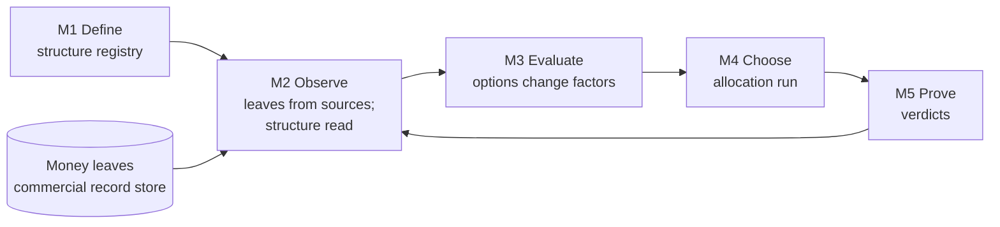
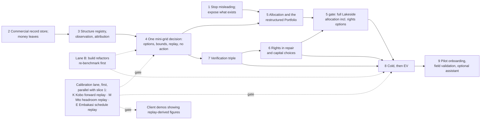

# Phase plan and acceptance: building the economic decision loop

**Layer 4 companion artifact · rev 4 · AssetOps Architect (Claude) · 17 Nov 2026 · rev 5 update 18 Nov 2026 (grounded, visible-first path) · design only**
**Rev 5 update.** The slices and their gates stand. What changes (`product-transition-and-roadmap.md` §3.6–§3.9, §4.4; D13–D15): work is ordered by how soon a client screen becomes economically useful; PRs 3a–3b and the cost-side part of slice 4 run in the second lane beside slice 2; slice 7 comes before slice 6; Findings open decisions and chosen options ride today's carriers as Actions; emulators are placeholder sources replaced by real adapters that pass one contract test; the first customer change is committed at the diagnostic's close.
Main narrative: `layer4-transformation-design.md` §2 (mechanics M1 Define, M2 Observe, M3 Evaluate, M4 Choose, M5 Prove) and §9 (delivery order). Code dispositions, verified references and migration order: `repo-reuse-and-gap-matrix.md`. Identities and negative tests: `economic-metric-and-effect-contracts.md` (E1–E10, N1–N17). Oracle and disorder cases: `demo-site-scenario-manifest.yaml` (OR-*, DUP-1 … CLOCK-1).
Labels: [code-observed] [test-confirmed] [implementation-report] [proposed] [assumption]. Everything in this plan is [proposed] unless labelled otherwise.

This is a sequencing design, not a task list. The Planner turns an approved slice into tasks; each slice below is sized as one to four reviewable pull requests.

**For readers of rev 3.** Rev 3 sequenced ten extensions (D1–D10). Its slice 2b "period economics and typed effects" is now slice 3 "structure registry, observation and attribution"; its slice 3 decision layer is slice 4; its slice 4 (portfolio, allocation, verification) is split into slice 5 (allocation and the Portfolio) and slice 7 (verification triple); its slice 5 (rights) is slice 6. The thread-origin migration of rev 3 is dropped: decisions anchor on a factor key.

---

## 1. Dependency reasoning, from the mechanics

The loop has an order that the code cannot shortcut:

1. **Nothing can be observed before it is defined.** An outcome's state is computed from its factors through its declared structure. Until the structure registry exists, the product can show factors (it already does: generator running, fuel balance, excursions, faults) but not outcomes with money in them.
2. **The structure cannot be evaluated without its money leaves.** Revenue, collections, O&M, staff and plan are leaves with no source today (`chain/strategies/recorded_amount.py:1`: "no billing source exists … NO_RECORDS, always") [code-observed]. The commercial record store is therefore the critical path; the registry can be built in parallel, but its money nodes stay "not available yet" until the store lands.
3. **Nothing can be valued before the structure can be re-evaluated on changed factors.** The valuation identity (main doc §2.3) evaluates the same structure with and without the option. Options therefore come after the structure read, not before.
4. **Nothing can be allocated before options are valued.** The allocation run sums option values only because each option changes distinct factors (identity M4).
5. **Nothing can be proved before a commitment exists.** Verdicts compare later observations of the same factors with a frozen prediction.

**The minimal evidence path to a credible executive decision** is therefore: the mini-grid structure declared → its money leaves sourced for one period → the structure read showing contribution against plan with attribution and coverage → one decision with no action, a rejected option and a recommended one, checked against a hard bound → a plan across three sites. That path is slices 2 to 5.

**What can be exposed immediately** (slice 1). The Portfolio API returns per-site headline money, nodes, earnings, thread lines and outcome reasons that the UI does not render [implementation-report §5.6; code-observed, matrix §F3]. Showing them and stating the true scope of the Optimize card's last-day figure needs no new data and removes the one misleading figure on the first screen.

**Why mini-grid first, end to end.** It has the deepest existing factor observers (dispatch-3.2, fuel balance, fuel exposure, reserve trial, verification families; matrix §B2, §E) and the only existing trial carrier. Proving the store, registry, structure read, decision records, bounds, allocator and verdicts where evidence is richest leaves only vertical structures and observers to add for cold and EV (slice 8). Cold and EV cannot reach VERIFIED today (`actions/verification_families.py:502`, `:516`) [code-observed], so starting there would put the loop's last step on the critical path.

**Cross-vertical requirements are designed in from slice 2, not retrofitted.** The commercial record store takes all record kinds of all three verticals from its first migration; the structure registry declares the three business models (mini-grid contribution, cold contribution, captive EV cost per departure with revenue NOT_APPLICABLE) in slice 3 even though only mini-grid is sourced; the decision records and allocator are vertical-neutral. Slice 3's gate includes a captive-EV fixture that must return NOT_APPLICABLE revenue (N13).

**No all-or-nothing build.** Each slice leaves the product more honest and more useful on its own: slice 1 removes a misreading; slice 3 gives the CFO answer; slice 4 gives one defensible decision; slice 5 gives the first full demo vertical.

---

## 2. Slice order and the change from the brief

| Brief's suggested order (C1 Deliverable 8) | This plan | Why it differs |
|---|---|---|
| (1) eliminate misleading UI and expose fields | slice 1 | same |
| (2) ingest commercial and plan facts into shared typed economic measures | slices 2 and 3 | split: the store (2) is a migration and intake contract; the structure registry and read (3) are code. Splitting lets the registry start before the store lands and keeps each PR reviewable |
| (3) complete mini-grid decision with negative control, counterfactual, no action | slice 4 | same content; the calibration lane runs first, read-only and in parallel with slice 1, because every replay-derived figure the demo leads with (210 L, 20 L, 68 L, 31 of 31 nights) is a design value until it passes |
| (4) portfolio variance, alternatives, resource allocation | variance moves to slice 3; allocation is slice 5; verification is slice 7 | the variance bridge is a reading of the structure (main doc §2.2), so it arrives with the structure, before decisions; verification is a separate mechanic (M5) with its own data dependency (after-window records) and is not on the demo's critical path; rev 5: it is on the first customer change's path (D15), so it is built before slice 6 |
| (5) entitlements in repair and capital choices | slice 6, run in parallel with slice 5 | Lakeside's full plan contains rights options (MTO-INV-CLAIM, BAT-EVIDENCE) and the plan's decisive switch is claim-versus-buy-now, so the full Lakeside allocation gate (OR-ALLOC-1) closes only after slice 6. Slice 5 builds and proves the allocator on the non-rights options |
| (6) cold then EV | slice 8 | same; cold first by default, or the first qualified prospect's vertical (design question Q10) |
| (7) pilot onboarding, field validation, optional AI | slice 9 | same; the intake path built in slice 2 is the pilot path, so slice 9 is mostly consent, mapping and validation |

**Disagreement with the main document §9, stated.** §9 lists "5 Allocation and the restructured Portfolio (Lakeside end to end)" before "6 Rights". Because Lakeside's recommended set and its switches depend on the rights options (manifest `allocation.recommended`, `switches`), Lakeside cannot be shown end to end until slice 6. This plan keeps the main document's order for building and moves the end-to-end Lakeside gate to the close of slice 6.

---

## 3. Slices, with gates

Each slice states purpose, scope by PR, touchpoints (verified in the matrix), tests written first, acceptance gate, and owner checkpoint. "Gate" means the slice does not merge until it passes; review rules are unchanged (fresh reviewer, High/Medium findings block).

### Slice 1 — Stop misleading; expose what exists (UI only)

- **Purpose.** No figure on the Portfolio or the site board may be read as a period total unless it is one; show computed fields that are hidden.
- **PR 1a (tests only).** Pin today's Optimize scope: a 30-day window's Optimize card is one lead Finding's exposure on the window's last day (`site_outcomes/read.py:602-606`, `:901-923`; `chain/read.py:190`) [code-observed]. Keep `test_ch5d1_optimize_card.py::test_two_priced_sites_list_each_and_never_sum` passing.
- **PR 1b.** Relabel the Optimize card face with its day and scope ("lead issue on 31 Oct, not the period's cost") (N12).
- **PR 1c.** Render the fields of matrix §F3: per-site headline money and nodes, `sites_needing_attention`, estate counts, outcome reasons, nodes on every board row, structured thread lines, warning detail, "Why?" nodes.
- **Gate.** N12 passes; every newly rendered value carries its existing evidence wording; mock fidelity rules apply (any departure labelled MOCK DEVIATION).
- **Owner checkpoint.** None blocking (copy review folded into the end-of-wave walkthrough).

### Slice 2 — Commercial record store and money leaves (mini-grid first; all kinds declared)

- **Purpose.** A source for every money leaf: revisable, effective-dated, money-denominated source facts.
- **PR 2a.** Migration 0062: commercial record + revision + intake receipt; raw payload immutable; idempotency key (tenant, source system, source record id, version); four clocks (service, effective, recognition, settlement); kinds charge, receipt, settlement, adjustment, expense, plan line, roster, tariff schedule, storage movement, contract document, QA note. Downgrade refuses while rows exist (0059 / 0061 precedent) [code-observed]. Pure validator module.
- **PR 2b.** CSV intake API on the authenticated site-bound path with dry run and whole-file plain-word refusal (pattern of `reading_upload/service.py:213`), without the late-interval refusal (`reading_upload/service.py:244-248`) that commercial revisions must not inherit [code-observed]. Source-emulator CSVs for Lakeside (billing, settlement statements, invoices, plan lines) labelled *source-emulated*: placeholder sources that define the canonical contract (`integration-source-to-canonical-design.md` §7.3), with the per-source contract test that every later real adapter must also pass.
- **PR 2c.** `recorded_amount@2` reads revisions by recognition period; `chain_input_change` triggers so a late record dirties cached reads.
- **Tests first.** DUP-1 / N16 (identical re-upload, 0 new revisions); LATE-SETTLE-1 / N3; FX-1 / N2; TENANT-1 / N17 (refused at ingestion); a corrected row becomes a revision and the prior one is kept (OOO-1 shape).
- **Gate.** Lakeside October billing, settlements, receipts, invoices and plan lines ingest from emulated CSV and read back to the cent; a Harvest Cold row with Lakeside's key is refused.

### Slice 3 — Structure registry, observation and attribution

- **Purpose.** Outcomes computed bottom-up from observed factors through declared structures, with attribution and coverage: the CFO answer.
- **PR 3a′ (rev 5, re-grounding).** One observer row per signal of today's outcome map (`outcomes/outcome_map.py:17-37`): each stored Finding mechanism names its factor and condition (deviation, bound, latent); `outcome_roles` and `categories_for` (`outcome_map.py:75`, `:97`) [code-observed] computed from the registry behind an unchanged wire; a parity test against today's 16 entries, every difference listed and ruled, then the literal removed. PRs 3a, 3a′, 3b and 3e run in the second lane beside slice 2, after the owner approves the structure (W1); 3c and 3d follow slice 2 in the first lane.
- **PR 3a.** Structure registry in code (reworking `CONTRIBUTIONS`, `outcomes/outcome_map.py:149-180`) with the start-up integrity check pattern of `chain/graph.py:177` [code-observed]: mini-grid structure in full (main doc §2.1 diagram), cold and captive-EV structures declared; plan values per factor read from plan lines; every factor has a shared factor ID and a unit (E10). The Protect outcome is declared the same way: measured factors with unit, target 0, evidence class and Σ over sites (manifest `portfolio.protect`: e.g. unserved critical kWh, obligation-hours without redundancy, crate-minutes above limit, departures missed, nights deliverable below required, asset-days and charger-days out of service); money-valued Protect measures (customer liability, QA-confirmed damage, service penalties) reference the cost-to-serve factor ID. Lakeside's Protect structure also declares customer-hours interrupted (Measured, 0 in October) and asset value at risk, which is shown as *not available yet* and deferred (brief L1.1: expected loss only with a defensible likelihood). Operational productivity (O2) is declared per vertical as measured factors (manifest `portfolio.operations`): mini-grid asset availability, field visits and delivered kWh per visit; cold cooling availability and crate-days without excursion; EV deliverable energy used (import-limited) and departures met per installed charger. Cold realisation stages are declared (occupied → chargeable → invoiced → received).
- **PR 3b.** Structure read: bottom-up evaluation, coverage as share of each node on Recorded leaves, composition Σ / Σ (pattern `chain/vocabulary.py:459-508`), exclusion with names; nothing stored as a total (`chain/period_read.py:139`, D-MONEY.3).
- **PR 3c.** Attribution: exact for sums, the declared product rules AR1–AR5 (e.g. volume at plan price, then price at actual volume), residual factors only beside an unobserved leaf, tolerance; existing observers attached as factor observers (dispatch-3.2's necessary / candidate split, the fuel-balance residual). The observed fuel structure is necessary + candidate running + unexplained litres (Kobo: candidate 330 L, −412.50, Derived; unexplained 120 L, −150.00<!--rec-->); litres a setting would avoid are an option effect (slice 4), never an observed node.
- **PR 3d.** Energy-to-cash observer for Mto (delivered → metered → billed → collected with effective-dated meter identity); the cold storage-ledger to invoice reconciliation follows the same pattern in slice 8a.
- **PR 3e (UI).** *Outcomes by site* tab body and the site economics section: each outcome's factor structure by site, plan vs actual per factor, evidence class in words, residual and coverage, drawer within two interactions.
- **Tests first.** E1–E5, E9, E10; N1, N4, N5, N13, N14; OR-MG-4 (Mto 140 unbilled mapping, 40 authorised, 120 unexplained unpriced; 2,160 = 1,890 + 150 + 120); OR-MG-5 (−852.00 with residuals explicit); MAP-1; GAP-1; **Protect composition**: for each tenant, every `portfolio.protect` measure equals Σ of its site values (Lakeside obligation-hours without redundancy 0 + 10 + 20 = 30, asset-days out of service 0 + 2 + 4 = 6), and each money-valued Protect measure (Thika QA-confirmed damage 108.00; Kasarani penalties 240.00<!--fig:sites.metro-bus/Kasarani.november_to_date.nodes.penalties-->) shares its factor ID with the cost factor and is counted once in contribution or cost; at-stake values (BAT-001 64,000.00; B-1031 2,160.00) are listed and never summed. **O2 composition**: ratio measures compose as Σ numerator / Σ denominator, never a mean of site ratios (Lakeside asset availability 98.62%<!--fig:operations.lakeside-power.asset_availability.portfolio--> = 428 of 434 asset-days; Metro deliverable energy used (import-limited) 56.23%<!--fig:operations.metro-bus.deliverable_energy_used.portfolio--> from Embakasi 46.67%<!--fig:operations.metro-bus.deliverable_energy_used.sites.Embakasi-->, Kasarani 85.71%<!--fig:operations.metro-bus.deliverable_energy_used.sites.Kasarani-->, Ruiru 61.25%<!--fig:operations.metro-bus.deliverable_energy_used.sites.Ruiru-->); counts compose as Σ (Lakeside field visits 3, plan 3).
- **Gate.** Lakeside October: contribution 1,443.00 against plan 2,295.00, −852.00 = −97.00 revenue factors + −755.00 cost factors, to the cent; cost 91.5% on Recorded leaves; Kisiwa O&M Estimated, never zero; a captive-EV fixture shows revenue NOT_APPLICABLE; Protect measures compose for all three tenants.
- **Owner checkpoint.** Walk the *Outcomes by site* tab on computed data (first screen with real money).

### Calibration lane — first, read-only, in parallel with slice 1 (rev 8, re-review CP-3)

The replays depend on none of slices 1–3: they read existing demo data through `host/execution_adapter.py:869` [code-observed] and write nothing. They therefore start on day one, in parallel with slice 1, and each has its own exit. Three spikes, one per replay the demo leads with:

The figures each spike replaces are enumerated in the manifest (`calibration_spikes`); `check_manifest.py` asserts that the set the screen labels equals that enumeration plus the plan values, so the table below and the screen cannot drift apart.

| Spike | Replays | Figures it replaces | Exit |
|---|---|---|---|
| **K — Kobo forward dispatch replay** | observed PV-available and load for Kobo under current settings, compared with observed generator and SOC series; refusals counted on inverter-clipped days (60 kW PV behind 50 kW AC) | Kobo only: 210 L and 20 L avoided, 150 kWh added battery throughput, 262.50 gross a month, 61 of 61 and 4 of 61 dawn days, 2,916.00<!--fig:options.KOB-STOPSOC.value--> and its sensitivities (2,286.00<!--fig:options.KOB-STOPSOC.sensitivities.diesel_minus_20pct-->, 2,166.00<!--fig:options.KOB-STOPSOC.sensitivities.feasible_fuel_160l-->), 250.50<!--fig:options.KOB-STOPSOC.monthly_or_horizon_change--> a month | replay within a stated tolerance on at least 14 admissible days → figures replaced by kernel output; otherwise the option is valued with a bounded proxy, labelled |
| **M — Mto demand-on-headroom replay** | the huller's 15 kW 10:00–15:00 profile against Mto's observed supply by hour (with inverter 2 restored) | Mto only: 68 L extra fuel, 225 kWh from battery or generator, 85.00 fuel a month, 3 days without headroom, 395.00<!--fig:options.MTO-HULLER.monthly_or_horizon_change--> a month, 3,540.00<!--fig:options.MTO-HULLER.value--> | same rule; if Mto has too little observed history, the headroom is taken from a declared PV model and labelled Modelled with its basis |
| **E — Embakasi deadline schedule replay** | October roster and charging log replayed under the 22:00–05:15 schedule and the cheapest schedule, at the 500 kW import limit | Embakasi only: 31 of 31 nights feasible, 2,900 kWh deliverable, 406 kW on a 21-bus night, 13,356.00<!--fig:options.EMB-DEADLINE.energy_bill_option--> a month, 93 missed departures under the cheapest schedule, 8,082.00<!--fig:options.EMB-DEADLINE.monthly_or_horizon_change--> a month and 95,484.00<!--fig:options.EMB-DEADLINE.value--> | same rule; until it passes, the schedule is presented as a design value |

Plan values, switch cases and downsides built from these figures lose their design-value label only when every spike they depend on has passed.

**Client-exposure rule** (design decision A21; owner decision Q13). No client sees a replay-derived figure unless its spike has passed, **or** the figure is shown with the visible design-value label **and** the presenter says so aloud at first sight. Whether "labelled and said" is enough for an early prospect demo, or whether replay-derived figures are hidden until their spike passes, is the owner's call (Q13).

### Slice 4 — One complete mini-grid decision

- **Purpose.** Prove M3 where evidence is deepest: options as factor changes, no action, bounds before recommendation, net value.
- **Lanes (rev 5).** PRs 4a, 4a′, 4c, 4d, 4f and 4g run in the second lane once PR 3b lands: the Kobo option changes cost factors priced by declared prices, so it needs no commercial records. PRs 4b and 4e run in the first lane. Spike K builds the replay adapter and its port method; PR 4c only wires the evaluator to it, so they are two changes.
- **PR 4a.** Migration 0063: decision, option and evaluation records anchored on a factor key (site, factor, cause), each with its trigger (the Finding that opened it, frozen); a link from the chosen option to its carrier, and one decision arm on the carriers' origin check (`0051_action_opportunity_origin.py:73`, `:78`) [code-observed]; options reference their calculation record and their carrier by id; approval rows with a USER principal (stored SYSTEM events untouched, `actions/lifecycle.py:53-55`) [code-observed].
- **PR 4b.** Obligation bounds as code rows (hard / costed / advisory; unknown → refuse or conditional); every former CHECKED declaration must have one (integrity check); verification guardrails generated from the same rows, byte-equal for today's reserve plan.
- **PR 4c.** The evaluator wired to the forward replay port. The adapter itself (in `host/`, behind a **new** port method returning a neutral projection) is built by spike K in the calibration lane, before this PR; 4c adds no adapter code. `run_to_end` → `LabProjection` stays untouched (protected seam; rev 3 review residual risk 2), and the backend never imports the simulator (`runs/execution_ports.py:20-23`) [code-observed].
- **PR 4d.** Stop-threshold carrier: today the `action` table admits only `reserve-trial-1` with `proposed_value = old_value - 5` (`0016:60`, `0016:72`) [code-observed], so a "lower the stop threshold" option cannot be applied by any existing path even though the site property exists (`sites/models.py:167`) [code-observed]. Add a carrier rule for the `stop-soc-threshold` property with its own CHECKs and generated guardrails; do not widen the reserve-trial CHECKs.
- **PR 4e.** Mto decisions: demand-on-headroom replay (huller vs welder) and the billing correction and meter audit options.
- **PR 4f (UI).** Decision page: the Finding that opened it, options incl. no action, value, cost and who pays, bounds, disposition and reason in plain words, sensitivity, records behind it.
- **Tests first.** E6, E8; N9, N11, N15; OR-MG-1 (KOB-RESERVE rejected by dawn adequacy; KOB-STOPSOC recommended), OR-MG-2 (Kisiwa: no fuel option qualifies), OR-MG-3 (huller +395.00<!--fig:options.MTO-HULLER.monthly_or_horizon_change-->/month, welder −8.25/month rejected); a pinned failing fixture for a constraint dispatch-3.2 cannot see (evening energy) which the replay must refuse; rule-3 PV-alone Candidate pinned (matrix §J). **Vertical-neutral fixtures** (the evaluator, bounds and decision records are general, so they are proved on cold and EV inputs now, with leaf values fed from the manifest; the vertical observers that will produce those leaves come in slice 8): cold — Kirinyaga repair vs replace valued on the identity against no action, KIRI-REPAIR +1,512.40<!--fig:options.KIRI-REPAIR.value--> over 12 months (recommended) and KIRI-REPLACE −1,988.40<!--fig:options.KIRI-REPLACE.value_if_admissible--> (deferred); EV — Embakasi EMB-CHEAPEST (12,975.00 a month, the lowest bill) rejected by the departures bound (3 buses short every night), and EMB-DEADLINE valued 8,082.00<!--fig:options.EMB-DEADLINE.monthly_or_horizon_change--> a month against November no-action 21,438.00<!--fig:options.EMB-DEADLINE.energy_bill_reference-->, never 8,788.80 (OR-EV-1, E7, N10).
- **PR 4a′ (rev 5).** The carrier-origin migration (`domain-and-decision-models.md` §1.5): decision origin columns on `domain_action`, its two origin checks, the thread link's column, check and trigger, the `chain_action` view, and a downgrade guard, as in 0051.
- **PR 4g (rev 5).** Verification family `stop-soc-trial-1`: verdicts are dispatched by rule id and an unknown rule fails closed (`actions/verification_families.py:505-510`) [code-observed]. On a customer site its positive verdict also needs PR 7b (field evidence), because today only simulated or authored evidence is admitted (`actions/verification_rules.py:688`).
- **Gate.** A Finding opens the Kobo decision, the chosen option becomes an Action and receives an operational verdict of today's kind from the new family; the C3 "candidate vs necessary diesel" and "paying daytime vs unsupported evening demand" scenarios pass end to end; gross exposure never appears as an option value; the cold and EV fixtures pass on the same evaluator with no vertical-specific code in it.
- **Owner checkpoint.** Walk the Kobo decision page.

### Slice 5 — Allocation and the restructured Portfolio

- **Purpose.** M4 and the Portfolio's tab bodies re-based on the loop.
- **PR 5a.** Migration 0064: allocation run: one joint search over all decisions, as `evaluate_structure.py` `best()` and `candidates()` do (one option per decision; an option breaking its decision's hard bounds is left out unless none can keep them; budget, crew visits, mutual exclusions and dated dependencies; ranked by least violation, then highest value, then lowest spend), with exclusions and their reasons, switches and sensitivity; stored and re-runnable. Build it as one search: must-do items are not funded in a separate first step.
- **PR 5b (UI).** Tab order follows the loop and one tab is renamed, subject to owner decision Q2: Overview · Outcomes by site · **Demand and capacity** (renamed from *Opportunity*; the old address redirects) · Act first · What changed · Scope & coverage. *Act first* = the plan, with its downside beside its value; *Overview* first fold = headline sentence, the four outcome figures and the plan's first three moves with "Open the plan"; *Demand and capacity* = qualified demand, rejected demand with break-even, capacity without customers; placement moves to triage on the Findings root.
- **PR 5c (UI).** Switches next to the plan that re-run allocation visibly (budget; letter-of-intent extension).
- **Tests first.** Allocator properties on synthetic fixtures (spend ≤ budget, crews ≤ crews, every exclusion has a reason, no different evidence classes summed); Lakeside allocation over the non-rights options with the inverter restore declared as a dependency of MTO-HULLER; **a non-mini-grid case**: Harvest Cold allocation with the aggregator switch — spend 720.00<!--fig:plans.harvest-cold.default.spend--> of 2,500 and 2<!--fig:plans.harvest-cold.default.crew_visits_used--> of 2<!--fig:plans.harvest-cold.default.crew_visits_limit--> technician visits when the aggregator signs (THIKA-EPC-STOPGAP 100.00<!--fig:options.THIKA-EPC-STOPGAP.operator_one_off-->, KIRI-REPAIR 350.00<!--fig:options.KIRI-REPAIR.operator_one_off-->, MWEA-AGG 270.00<!--fig:options.MWEA-AGG.operator_one_off-->), 450.00<!--fig:plans.harvest-cold.switch_cases.False.spend--> and 1 of 2 visits when it does not; excluded KIRI-REPLACE, MWEA-COMPRESSOR, THIKA-SELF with reasons.
- **Gate.** Allocator properties hold; the Portfolio frame (six tabs, range bar, coverage line) keeps its routes, with the order and the one rename decided at Q2; every tab body reads computed data; the Harvest Cold case passes on the same allocator. The full OR-ALLOC-1 gate closes at the end of slice 6.

### Slice 6 — Rights in repair and capital choices

*Rev 5: built after slice 7 in the second lane; contract documents enter first through a placeholder emulator, replaced by the first operator's contract set.*

- **Purpose.** Rights as cost-bearer factors inside existing decisions (brief S12, X9; P4, A5).
- **PR 6a.** Migration 0065: rights register (obligation, condition, exception, notice, remedy rows) from contract documents in the commercial record store; AI-assisted extraction proposes rows, a person approves each (review states pattern `0027:174`) [code-observed]; no coverage decision is automated.
- **PR 6b.** Migration 0066: supplier-claim work-case kind and typed claim events in a sibling table; rights state machine (recorded events only; duplicate-recovery guard).
- **PR 6c.** Residual-cost-per-remedy-path options (claim and wait, buy now and claim, local repair, no action) with notice deadlines; rights tracker on *What changed*. Rights measures by contract and period (manifest `portfolio.rights`): tracked assets with complete contract evidence (Lakeside 1 of 3, Harvest 1 of 1, Metro 2 of 2), rights with an open deadline, remedy completion days, operator-funded residual expense and recognised credits (credits only from credit notes).
- **Tests first.** OR-ENT-1 (INV-MT-02 potentially covered, GEN-KS-01 expired and excluded, BAT-001 insufficient evidence; no remedy booked as money), OR-ENT-2 (70.00 potential credit review-required, never booked), OR-ENT-3; N6, N7; notice-deadline flag.
- **Gate.** Same failure type, three different recommended actions; "This is not a legal decision. Coverage is decided by the supplier or insurer." on every rights screen; **OR-ALLOC-1** passes on the evaluated values (`derived-values.json`, produced by `evaluate_structure.py`), with the plan value worded as the identity requires: at 5,000, spend 3,750.00<!--fig:plans.lakeside-power.default.spend-->; *modelled 12-month change from the valued options, +6,088.50<!--fig:plans.lakeside-power.default.value--> (2,916.00<!--fig:options.KOB-STOPSOC.value--> + 3,540.00<!--fig:options.MTO-HULLER.value--> − 367.50<!--fig:options.MTO-INV-CLAIM.value-->), net of their own one-off costs (1,520.00<!--fig:plans.lakeside-power.default.valued_option_costs-->: KOB-STOPSOC 90, MTO-INV-CLAIM 230, MTO-HULLER 1,200<!--fig:options.MTO-HULLER.operator_one_off-->)*. The claim path's operator cost is 367.50<!--fig:-options.MTO-INV-CLAIM.value-->: 230.00<!--fig:options.MTO-INV-CLAIM.operator_one_off--> one-off (shipping 150 + install 80; the 2,600 replacement unit is borne by the supplier under the warranty) plus 137.50<!--fig:-options.MTO-INV-CLAIM.monthly_or_horizon_change--> of extra fuel while the inverter runs at reduced capacity until its derived restore date (110 L over 22 days × 1.25). Spend of 2,230.00<!--fig:plans.lakeside-power.default.not_valued_in_money--> that changes no money node (KIS-REPAIR 1,800<!--fig:options.KIS-REPAIR.operator_one_off-->, BAT-EVIDENCE 430) is not valued in money, and its effect is shown on Protect measures. Switch cases: 5,000 without LOI extension, spend 2,550.00<!--fig:plans.lakeside-power.switch_cases.5000/False.spend--> → +2,548.50<!--fig:plans.lakeside-power.downside-->; 6,500 without extension, MTO-INV-BUYNOW replaces MTO-INV-CLAIM (one-off 2,910.00<!--fig:options.MTO-INV-BUYNOW.operator_one_off-->, operator cost 2,947.50<!--fig:-options.MTO-INV-BUYNOW.value--> with 37.50 of extra fuel to its 12 Nov restore), spend 6,430.00<!--fig:plans.lakeside-power.switch_cases.6500/False.spend--> → +3,508.50<!--fig:plans.lakeside-power.switch_cases.6500/False.value-->, more than claiming; the cases with extension as at 5,000. Harvest Cold: +3,182.40<!--fig:plans.harvest-cold.default.value--> from KIRI-REPAIR and MWEA-AGG (valued costs 620.00<!--fig:plans.harvest-cold.default.valued_option_costs-->); the Thika stopgap (100.00<!--fig:options.THIKA-EPC-STOPGAP.operator_one_off-->) changes no money node and is not valued in money. Metro: +95,634.00<!--fig:plans.metro-bus.default.value--> = EMB-DEADLINE 95,484.00<!--fig:options.EMB-DEADLINE.value--> + KAS-OEM-STOPGAP +150.00<!--fig:options.KAS-OEM-STOPGAP.value--> (penalties avoided 240.00<!--fig:-options.KAS-OEM-WAIT.monthly_or_horizon_change--> − 90.00<!--fig:-options.KAS-OEM-STOPGAP.operator_one_off-->); valued costs 1,590.00<!--fig:plans.metro-bus.default.valued_option_costs-->; nothing unvalued. **The criterion is the valued-in-money rule**: an option is valued in money only when it changes a money node of the structure; otherwise its spend is shown as not valued in money, with its Protect effect. Must-do is a separate property (no action fails a hard bound): Kisiwa repair, Thika stopgap (days with backup start unproven) and Kasarani stopgap (departures missed) are must-do; Kobo battery evidence is protective.
- **Owner checkpoint.** Lakeside seven-minute walkthrough on computed data; entitlement copy and the legal boundary.

### Slice 7 — Verification triple

*Rev 5: built before slice 6, right after the cost-side part of slice 4, because the first customer change is committed at the diagnostic's close and its money verdict is due about one closed month later.*

- **Purpose.** Close the loop (M5): operational, economic and causal verdicts kept apart.
- **PR 7a.** Migration 0067: economic and causal verdicts beside the operational outcome (do not widen `0019:166`) [code-observed]; economic verdict from after-window commercial records; causal strength graded from comparability bands (`actions/verification_rules.py:36-41`) with untreated sites as controls.
- **PR 7b.** Admit field and upload sources with their provenance label (`evidence/source_provenance.py:40-44`, `actions/verification_rules.py:688`) [code-observed]; option one-off cost replaces the constant 0 (`actions/verification.py:1167`) [code-observed].
- **Tests first.** OR-VER-1; "not proven yet" before the after-window closes; late evidence withdraws a verdict (`chain/lifecycle.py:53`); non-zero intervention cost; unserved-critical FAIL branch pinned.
- **Gate.** Kobo commitment: operational target and dawn bound verified on the after-window; economic verdict only from later recorded litres and invoices; supplier repair, credit note and cash receipt are distinct events.

### Slice 8 — Cold, then EV

- **8a Cold.** Storage movement and QA records; occupancy ledger observer; storage-ledger to invoice reconciliation (negative test: a ledger row billed at a rate not in the rate card shows as a chargeable-to-invoiced leak, never as revenue lost; October has no discrepancy, so CC-L8 has no demo option); normalised refrigeration energy observer (per-room calibration on ≥ 60 days hourly); batch exposure observer (exposure ≠ damage ≠ liability); cold verification family (the first); Thika EPC claim through slice 6 components. Gates: OR-CC-1, OR-CC-2, N8; Harvest Cold allocation (spend 720.00<!--fig:plans.harvest-cold.default.spend--> of 2,500; 2 of 2 visits; aggregator switch).
- **8b EV.** Roster, tariff schedule and OCPP log intake; session ↔ bus attribution by idTag; CLOCK-1 correction; tariff pricing of energy; deadline-aware charging feasibility; fault consequence; EV verification family; captive revenue NOT_APPLICABLE. Gates: OR-EV-1 (cheapest rejected, 8,082.00<!--fig:options.EMB-DEADLINE.monthly_or_horizon_change-->/month vs November no-action, never 8,788.80; N10), OR-EV-2, OR-EV-3; Metro allocation (spend 1,590.00<!--fig:plans.metro-bus.default.spend-->, value +95,634.00<!--fig:plans.metro-bus.default.value-->; with the tariff switch off, spend 90.00<!--fig:plans.metro-bus.switch_cases.False.spend--> and value +150.00<!--fig:options.KAS-OEM-STOPGAP.value--> from the Kasarani stopgap alone).
- Only vertical structures and observers are new; store, registry, read, decisions, bounds, allocator and verdicts are reused.

### Slice 9 — Pilot onboarding, field validation, optional assistant

- One consented operator dataset through the slice 2 intake (S9); mapping and quality report per leaf factor; field-integrated provenance; field verification of one commitment; optional explanation assistant that only cites stored computations and refuses unsupported numbers (S10).
- **A4 evidence pack** (P1-P): the per-period export of A1–A3 (coverage, residuals, verdicts, rights states, lineage) for an investor or lender; no new measure. **MG-C4 fuel price-discrepancy check** (delivery-note vs invoice vs contracted price), P1-P, no demo case.
- **Gate.** Data protection and integration rights confirmed before any data is received; no provider API assumed without contractual access; every real adapter passes its source type's contract test before its emulator is retired (rev 5).

### Lane B — Build refactors (parallel, starts first)

Re-benchmark on an authorised `*_test` or `<prefix>_audit*` database (design question Q12) **before** any build budget is quoted; then scoped regeneration keyed by manifest hash, incremental match (`analytics/finding_service.py:44-60`), explicit story anchor for fixed-date worlds (`tools/demo_story_days.py`), EV nightly windows beyond the one weekly rule (`host/ev_publication.py:282`), grouped stages (`demo-build-cost-plan.md` §5.3). Gate: re-benchmark table published in the shape of `demo-build-cost-plan.md` §4.

---

## 4. Readiness by capability

"Today" is [code-observed] unless labelled; "ready after" is [proposed].

| Capability | Today | Ready after | Blocker to remove |
|---|---|---|---|
| S1 Portfolio economics and coverage | estimates and counts; no money position | 3 | money leaves (2), structure read (3) |
| S2 Variance driver bridge | none | 3 | attribution through the structure |
| S3 Qualified opportunities and controllability | one rule; headroom shown as opportunity | 4 | options with refusal; latent factor needs customer evidence |
| S4 Competing interventions | none; no no-action option | 4 | decision records, valuation identity |
| S5 Cross-outcome safeguards | text-only CHECKED; post-action guardrails | 4 | obligation bounds before recommendation |
| S6 Resource and capital prioritisation | placement triage only | 5 (full Lakeside after 6) | allocation run; rights options |
| S7 Evidence drill-through | "Why?" text; Finding evidence | 3 (money), 4 (options) | lineage from commercial records |
| S8 Action and verification | mini-grid trials, simulated or authored evidence only | 7 (mini-grid), 8 (cold, EV) | economic and causal verdicts; families |
| S9 Pilot onboarding | readings CSV only | 2 (path), 9 (real data) | consented dataset |
| S10 Exploration assistant | none | 9 (optional) | stored computations to cite |
| S11 External opportunity intelligence | none | after 9 (P2) | not a demo gate |
| S12 Entitlement-aware decisions | mock only | 6 | rights register, review step |
| MG-C1 Fuel/dispatch intervention | observer and trial exist; gross exposure | 4 | calibration spike K (first, parallel with slice 1) |
| MG-C2 Productive-use activation | headroom studies only | 4 | demand-on-headroom replay, customer evidence |
| MG-C3 Energy-to-cash | none | 3 | billing, meter register, settlements |
| MG-C4 Fuel procurement assurance | fuel balance exists [test-confirmed] | 3 (balance); 9 (price-discrepancy check, P1-P, no demo case) | delivery-note and invoice leaves; fuel contract prices |
| MG-C5 Portfolio investment comparator | none | 5 / 6 | allocation; rights options |
| MG-C6 Supplier remedy | none | 6 | rights register |
| CC-C1 Occupancy to contribution | none | 8a | storage ledger; storage-ledger to invoice reconciliation (CC-L8) |
| CC-C2 Temperature exposure | excursion observer; amounts null | 8a | batch and QA records |
| CC-C3 Normalised energy, repair vs replace | none | 8a | 60 days hourly per room |
| CC-C4 Commodity scenarios | none | 8a (scenario only) | customer commitments |
| CC-C5 Facility allocation | none | 8a | allocator reuse |
| CC-C6 Entitlement assurance | none | 8a | rights reuse |
| EV-C1 Fleet-ready schedule | sessions, peak observer | 8b | roster, tariff schedule |
| EV-C2 Critical repair priority | fault observers | 8b | roster, fault consequence |
| EV-C3 Capacity vs expansion | availability observer | 8b | roster, feasibility |
| EV-C4 Commercial settlement | gross tariff estimate | N/A for captive; later for commercial | business model declared |
| EV-C5 Depot allocation | none | 8b | allocator reuse; "different defensible allocations" are switch settings a person sets (budget, tariff assumption) on one evidence base, never role views |
| EV-C6 SLA enforcement | none | 8b | rights reuse |

---

## 5. Resource and generation-cost estimates [assumption]

Relative size only (the brief asks for product priorities, not engineer estimates). PR counts are the plan above.

| Slice | Size | PRs | Main risk |
|---|---|---|---|
| 1 | small | 3 | none |
| 2 | medium | 3 | intake contract and revision semantics |
| 3 | large | 5 | attribution rule for products; cache invalidation |
| Calibration lane (spikes K, M, E) | small each (time-boxed), read-only | from day 1, parallel with slice 1 | a replay may not reproduce its design values; then a labelled bounded proxy replaces it |
| 4 | large | 6 | protected port seam; new carrier rule |
| 5 | medium | 3 | allocator explanations in plain words |
| 6 | medium | 3 | review workflow for extracted rows |
| 7 | medium | 2 | after-window commercial data for the economic verdict |
| 8a / 8b | medium each | 3–4 each | normalisation calibration; roster and OCPP data |
| 9 | depends on the pilot | – | consent and access |

**Generation cost.** The only measurements are historical: about 62 s per built site-day for ingest, assessment and matching, about 147 s for the whole build [implementation-report §8.9]. Per-hero targets are in `demo-build-cost-plan.md` §6 (e.g. Kobo hero ≤ 15 min cold, ≤ 2 min per option change; whole three-tenant world ≤ 45 min cold) and stay labelled **targets** until lane B's re-benchmark replaces them. Ledger history (4 monthly periods × 9 sites) is generated directly from coherent ledgers with no physics, so its cost is dominated by intake, not simulation [assumption, to measure].

---

## 6. API and UI migration

- **Portfolio frame kept, order and one name changed on merit.** Route `/portfolio/:tab?`, six tabs, the range bar and the coverage line stay; old `?lens=` addresses keep redirecting (`frontend/src/estate/EstatePortfolio.tsx:1077-1080`) [code-observed]. Recommended for the live product (owner decision Q2): reorder `PORTFOLIO_TABS` (`frontend/src/estate/portfolioWords.ts:29-37`) to follow the loop — Overview · Outcomes by site · Demand and capacity · Act first · What changed · Scope & coverage — and rename *Opportunity* to *Demand and capacity*, with `/portfolio/opportunity` redirecting to the new segment. Each tab body is re-based on its mechanic in slices 3 (*Outcomes by site*), 5 (*Overview*, *Demand and capacity*, *Act first*), 6–7 (*What changed*) and 2/9 (*Scope & coverage*). Executive questions span sections; no tab belongs to one role.
- **No new menu items.** The rail (`frontend/src/shell/OperatorShellLayout.tsx:61-71`) is unchanged; decision and factor pages are drill-downs whose links are built by `chain/refs.py` `href_for` [code-observed].
- **Additive reads.** New reads for the structure (site × period, portfolio), decisions, allocation and verdicts [proposed]; existing Portfolio, board and chain payloads keep their shape until the tab that reads them is re-based, then the superseded fields are retired with their tests changed on purpose (e.g. the Optimize card in slice 5).
- **Caches.** Every new table that feeds a cached route registers `chain_input_change` triggers (`0047:61`) [code-observed]; response cache versions bump when a body changes shape.
- **Demo operators.** Three tenants; client demos use one login per operator (design question Q5 recommendation). The product UI has no operator switch (main document §6.2); the mock-up selects the demo operator from its review bar, which is review tooling, not product UI.

---

## 7. Test-first strategy

1. **Oracle before code.** Each slice starts by turning its OR-*, E* and N* cases into failing tests over the source-emulated fixtures; the private oracle in the manifest is compared with computed results and is never read by product code.
2. **Pure cores, thin stores.** Registry, structure evaluation, attribution, valuation, bounds, allocator and verdict rules are pure modules tested without a database (the existing pattern: `actions/reserve_trial.py`, `fuel_balance/rules.py`) [code-observed]; PostgreSQL tests cover migrations, idempotency, tenancy and triggers only.
3. **Pin before changing.** Behaviour that a slice deliberately changes is pinned first and the pin is changed in the same PR with a stated reason (Optimize scope; CHECKED changes nothing; mill `guardrails = {}`; registry replacing the exact `CONTRIBUTIONS` set).
4. **Negative controls are first-class tests.** Kisiwa (no fuel option), Mwea (no equipment fault), CH-R7 (no departure consequence), the welder (negative margin), the cheapest schedule (fails a bound), Kobo headroom (no customer).
5. **Suite policy.** Full suites run only as the project's test policy allows; slice gates name the targeted tests.

---

## 8. Snapshot reproducibility

**The demonstration world's figures are evaluated, not typed.** In this design pack, `evaluate_structure.py` runs the five mechanics over the manifest's declared inputs — `structures:` (every layer of each vertical's structure), `factor_map:` (source records → leaf factors), `evaluation:` (options as parameters and factor changes, cost lines with rights, restore dates from their drivers) and `plans:` (budget, fixed items, candidates, switches) — and writes `derived-values.json`; `check_manifest.py` asserts that every stated figure equals its evaluated value [proposed; design-pack tool, not product code]. The product's structure registry, structure read, option evaluator and allocator must reproduce those values from the source-emulated records through the real intake path; the OR-ALLOC gate and release tests R9 and R14 compare against `derived-values.json`. Figures resting on a calibration spike stay design values (R13) until the spike passes.

Every structure evaluation, option evaluation, allocation run and verdict stores an inputs digest: commercial record revision ids, Finding revision ids, registry version, bound-policy versions, replay projection hash, price and tariff revisions. A screen can always say "evaluated on <date> from these records"; re-evaluation creates a new revision and keeps the old one; a late record marks every dependent result as superseded, never silently changed (identity M5). Demo worlds are rebuilt from the manifest hash; a whole-database clone (`tools/chain_clone.py:64`) freezes a demo snapshot [code-observed].

---

## 9. End-to-end release tests

| Id | Covers | Pass condition |
|---|---|---|
| R1 Exact economic identities | E1–E10; Protect composition | every identity exact to the cent for all nine manifest sites; units compose at start-up; every Protect measure is Σ of its sites, and money-valued Protect measures share the cost factor ID |
| R2 Source coverage | N1, N14, GAP-1 | missing leaves shown as *not available yet* with the record that fills them; coverage = share on Recorded leaves; never zero |
| R3 True negative controls | OR-MG-2, OR-CC-1 (Mwea), OR-EV-2 (CH-R7), MTO-WELDING, N11 | no option, value or priority beyond the oracle |
| R4 Third-party remedy conditionality | OR-ENT-1, OR-ENT-2, OR-ENT-3, N6, N7 | potential rights never booked; three contrasting cases give three actions; no legal conclusion |
| R5 Obligation-protected recommendations | KOB-RESERVE, EMB-CHEAPEST, KIS-NOACT | rejected by a bound **before** recommendation, with the bound named |
| R6 Cross-tenant isolation | TENANT-1, OR-TEN-1, N17 | refused at ingestion; no read, cache or allocation crosses tenants |
| R7 Integration disorder | DUP-1, OOO-1, LATE-SETTLE-1, MAP-1, FX-1, CLOCK-1 | manifest behaviour; late records recompute the structure and flag dependent decisions |
| R8 Valuation integrity | E6, E8, N9, N10, N15 | every decision has no action; windfalls go to no action; modelled never shown as realised; gross never as net |
| R9 Allocation | OR-ALLOC-1 and the cold and EV allocations | spend, crews, exclusions with reasons; switches change the plan exactly as the evaluated values in `derived-values.json` state (Lakeside 3,750.00<!--fig:plans.lakeside-power.default.spend--> / +6,088.50<!--fig:plans.lakeside-power.default.value-->; Harvest 720.00<!--fig:plans.harvest-cold.default.spend--> / +3,182.40<!--fig:plans.harvest-cold.default.value-->; Metro 1,590.00<!--fig:plans.metro-bus.default.spend--> / +95,634.00<!--fig:plans.metro-bus.default.value-->); the plan value is labelled "modelled change from the valued options, net of their one-off costs" and spend not valued in money (it changes no money node) is stated beside it with its Protect effect, never netted |
| R10 Verification integrity | OR-VER-1 | three verdicts separate; supplier repair, credit and cash distinct; "not proven yet" is a verdict |
| R11 Front-end interaction | vNEXT walkthroughs per vertical | every click path works on computed data; source within two interactions; WCAG 2.2 AA spot checks; no horizontal scroll at 390 px; evidence class in words |
| R12 Mock-up change log | `interactive-mockup-vNEXT/CHANGE-REGISTER.md` | every screen Preserved / Changed / Merged / Added / Retired with a reason; approved by the owner before it is the layout spec |
| R13 Design-value disclosure | Kobo 210 L, 20 L, 4 of 61 and 61 of 61 days, 2,916.00<!--fig:options.KOB-STOPSOC.value-->; huller 68 L, 395.00<!--fig:options.MTO-HULLER.monthly_or_horizon_change--> a month, 3,540.00<!--fig:options.MTO-HULLER.value-->; Embakasi 31 of 31 nights; Kirinyaga 80% recovery (range 60–90%); every plan value that includes them | until the spike that computes it (K, M or E in the calibration lane) passes on site data, every occurrence of such a figure, or of a value computed from one (plan values, switch cases, sensitivities and downsides such as 6,088.50<!--fig:plans.lakeside-power.default.value-->, 2,548.50<!--fig:plans.lakeside-power.downside-->, 3,508.50<!--fig:plans.lakeside-power.switch_cases.6500/False.value-->, 5,690.00<!--fig:plans.lakeside-power.sensitivity_values.diesel_minus_20pct.value-->, 5,338.50<!--fig:plans.lakeside-power.sensitivity_values.feasible_fuel_160l.value-->), on any screen, card, table or drawer — Overview, Act first (path cards and switch table), decision pages, plan-value drawers — carries "Design value: the replay has not yet been run on site data" or sits in a container that does; Kirinyaga's recovery share carries the assumption label instead. The test scans every route and drawer and fails on any unlabelled occurrence |
| R14 Plan downside shown | every tenant's `allocation.downside` | *Act first* shows the plan's downside beside its value: Lakeside +2,548.50<!--fig:plans.lakeside-power.downside--> if the cooperative does not sign (other sensitivities: diesel −20% +5,690.00<!--fig:plans.lakeside-power.sensitivity_values.diesel_minus_20pct.value-->; feasible fuel 160 L +5,338.50<!--fig:plans.lakeside-power.sensitivity_values.feasible_fuel_160l.value-->); Harvest Cold +1,512.40<!--fig:options.KIRI-REPAIR.value--> if the aggregator does not sign; Metro +150.00<!--fig:options.KAS-OEM-STOPGAP.value--> if the time-of-use tariff does not apply (Kasarani stopgap only, spend 90.00<!--fig:plans.metro-bus.switch_cases.False.spend-->). Every figure is taken from `derived-values.json`, never typed into a fixture |
| R15 Declared measures compose | Protect, operations (O2) and rights (P4, A5) measures of all three tenants | each measure equals its declared composition (Σ, or Σ/Σ for ratios); money-valued measures share the cost factor ID; at-stake values listed, never summed; asset value at risk shown as *not available yet* with its reason |

---

## 10. Commercial validation (no fabricated benchmarks)

Observe per prospect demo, recorded in one sheet; no rate is claimed until there are real observations:
1. demo completed to the convert step (yes / stopped at step n);
2. prospect recognises an issue as theirs, recorded verbatim;
3. which decision they want investigated on their own portfolio;
4. data-access feasibility per minimum pilot source category (yes / with effort / no);
5. paid diagnostic accepted, declined or deferred, with the stated reason.

**Customer-facing diagnostic offer (template).** *Three-site economic diagnostic, about four weeks from data receipt.* You provide the minimum sources for your vertical (main document §4): for a mini-grid, controller export, customer meter register with change log, billing export, settlement statements, fuel records, your monthly plan, and the contract set for your most important asset; equivalent lists for cold rooms and EV depots. You receive: each site's outcomes computed from their factors against your plan, with what is recorded and what is missing; the three highest-value decisions with no action compared and the options we would reject and why; contract rights at risk with their deadlines; a verification plan for the first change. Agreed validation: figures reconcile to your books within a stated tolerance; your operations lead confirms each recommended change is feasible. We do not promise savings; we show how they would be proven.

---

## 11. Owner approval checkpoints

1. Design pack direction: the five mechanics and their derivations (design question Q1) and the delivery order with this plan's Lakeside-gate adjustment (Q9).
2. The vNEXT mock-up (separate gate; not approved until inspected), including the Portfolio tab order and the *Opportunity* → *Demand and capacity* rename for the live product (Q2).
3. Re-benchmark authorisation for lane B (Q12).
4. After slice 3: *Outcomes by site* on computed data.
5. After slice 4: the Kobo decision page.
6. After slice 6: the Lakeside seven-minute walkthrough on computed data; entitlement copy and the legal boundary (Q11).
7. Before slice 8: cold or EV first (Q10).
8. Before slice 9: pilot consent, data protection and integration rights.
