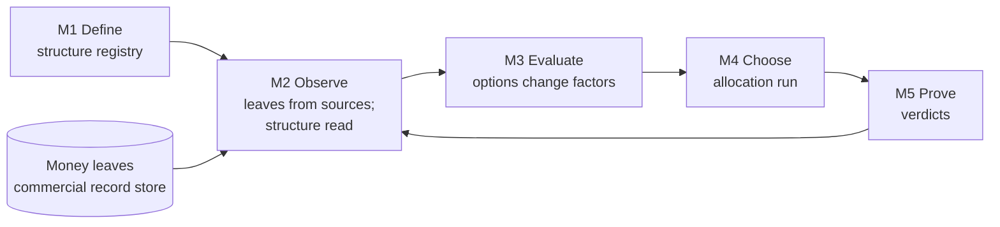
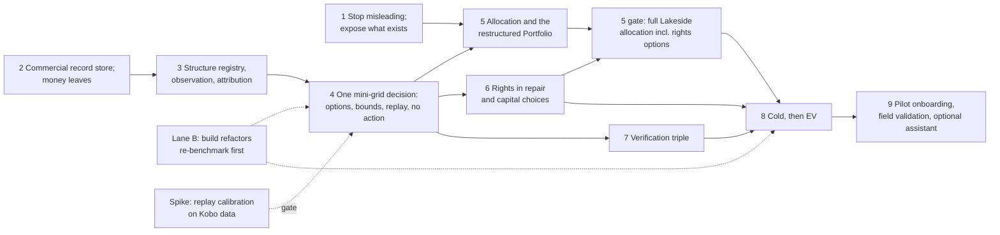

# Phase plan and acceptance: building the economic decision loop

**Layer 4 companion artifact · rev 4 · AssetOps Architect (Claude) · 17 Nov 2026 · design only**
Main narrative: `layer4-transformation-design.md` §2 (mechanics M1 Define, M2 Observe, M3 Evaluate, M4 Choose, M5 Prove) and §9 (delivery order). Code dispositions, verified references and migration order: `repo-reuse-and-gap-matrix.md`. Identities and negative tests: `economic-metric-and-effect-contracts.md` (E1–E10, N1–N17). Oracle and disorder cases: `demo-site-scenario-manifest.yaml` (OR-*, DUP-1 … CLOCK-1).
Labels: [code-observed] [test-confirmed] [implementation-report] [proposed] [assumption]. Everything in this plan is [proposed] unless labelled otherwise.

This is a sequencing design, not a task list. The Planner turns an approved slice into tasks; each slice below is sized as one to four reviewable pull requests.

**For readers of rev 3.** Rev 3 sequenced ten extensions (D1–D10). Its slice 2b "period economics and typed effects" is now slice 3 "structure registry, observation and attribution"; its slice 3 decision layer is slice 4; its slice 4 (portfolio, allocation, verification) is split into slice 5 (allocation and the Portfolio) and slice 7 (verification triple); its slice 5 (rights) is slice 6. The thread-origin migration of rev 3 is dropped: decisions anchor on a factor key.

---

## 1. Dependency reasoning, from the mechanics

The loop has an order that the code cannot shortcut:

1. **Nothing can be observed before it is defined.** An outcome's state is computed from its factors through its declared structure. Until the structure registry exists, the product can show factors (it already does: generator running, fuel balance, excursions, faults) but not outcomes with money in them.
2. **The structure cannot be evaluated without its money leaves.** Revenue, collections, O&M, staff and plan are leaves with no source today (`chain/strategies/recorded_amount.py:1`: "no billing source exists … NO_RECORDS, always") [code-observed]. The commercial record store is therefore the critical path; the registry can be built in parallel, but its money nodes stay "not available yet" until the store lands.
3. **Nothing can be valued before the structure can be re-evaluated on changed factors.** The valuation identity (main doc §2.3) evaluates the same structure with and without the option. Options therefore come after the structure read, not before.
4. **Nothing can be allocated before options are valued.** The allocation run sums option values only because each option changes distinct factors (identity M4).
5. **Nothing can be proved before a commitment exists.** Verdicts compare later observations of the same factors with a frozen prediction.

**The minimal evidence path to a credible executive decision** is therefore: the mini-grid structure declared → its money leaves sourced for one period → the structure read showing contribution against plan with attribution and coverage → one decision with no action, a rejected option and a recommended one, checked against a hard bound → a plan across three sites. That path is slices 2 to 5.

**What can be exposed immediately** (slice 1). The Portfolio API returns per-site headline money, nodes, earnings, thread lines and outcome reasons that the UI does not render [implementation-report §5.6; code-observed, matrix §F3]. Showing them and stating the true scope of the Optimize card's last-day figure needs no new data and removes the one misleading figure on the first screen.

**Why mini-grid first, end to end.** It has the deepest existing factor observers (dispatch-3.2, fuel balance, fuel exposure, reserve trial, verification families; matrix §B2, §E) and the only existing trial carrier. Proving the store, registry, structure read, decision records, bounds, allocator and verdicts where evidence is richest leaves only vertical structures and observers to add for cold and EV (slice 8). Cold and EV cannot reach VERIFIED today (`actions/verification_families.py:502`, `:516`) [code-observed], so starting there would put the loop's last step on the critical path.

**Cross-vertical requirements are designed in from slice 2, not retrofitted.** The commercial record store takes all record kinds of all three verticals from its first migration; the structure registry declares the three business models (mini-grid contribution, cold contribution, captive EV cost per departure with revenue NOT_APPLICABLE) in slice 3 even though only mini-grid is sourced; the decision records and allocator are vertical-neutral. Slice 3's gate includes a captive-EV fixture that must return NOT_APPLICABLE revenue (N13).

**No all-or-nothing build.** Each slice leaves the product more honest and more useful on its own: slice 1 removes a misreading; slice 3 gives the CFO answer; slice 4 gives one defensible decision; slice 5 gives the first full demo vertical.

---

## 2. Slice order and the change from the brief

| Brief's suggested order (C1 Deliverable 8) | This plan | Why it differs |
|---|---|---|
| (1) eliminate misleading UI and expose fields | slice 1 | same |
| (2) ingest commercial and plan facts into shared typed economic measures | slices 2 and 3 | split: the store (2) is a migration and intake contract; the structure registry and read (3) are code. Splitting lets the registry start before the store lands and keeps each PR reviewable |
| (3) complete mini-grid decision with negative control, counterfactual, no action | slice 4 | same content; preceded by a replay calibration spike because the forward-replay design values (210 L, 20 L) have never been produced by the kernel |
| (4) portfolio variance, alternatives, resource allocation | variance moves to slice 3; allocation is slice 5; verification is slice 7 | the variance bridge is a reading of the structure (main doc §2.2), so it arrives with the structure, before decisions; verification is a separate mechanic (M5) with its own data dependency (after-window records) and is not on the demo's critical path |
| (5) entitlements in repair and capital choices | slice 6, run in parallel with slice 5 | Lakeside's full plan contains rights options (MTO-INV-CLAIM, BAT-EVIDENCE) and the plan's decisive switch is claim-versus-buy-now, so the full Lakeside allocation gate (OR-ALLOC-1) closes only after slice 6. Slice 5 builds and proves the allocator on the non-rights options |
| (6) cold then EV | slice 8 | same; cold first by default, or the first qualified prospect's vertical (design question Q10) |
| (7) pilot onboarding, field validation, optional AI | slice 9 | same; the intake path built in slice 2 is the pilot path, so slice 9 is mostly consent, mapping and validation |

**Disagreement with the main document §9, stated.** §9 lists "5 Allocation and the restructured Portfolio (Lakeside end to end)" before "6 Rights". Because Lakeside's recommended set and its switches depend on the rights options (manifest `allocation.recommended`, `switches`), Lakeside cannot be shown end to end until slice 6. This plan keeps the main document's order for building and moves the end-to-end Lakeside gate to the close of slice 6.

---

## 3. Slices, with gates

Each slice states purpose, scope by PR, touchpoints (verified in the matrix), tests written first, acceptance gate, and owner checkpoint. "Gate" means the slice does not merge until it passes; review rules are unchanged (fresh reviewer, High/Medium findings block).

### Slice 1 — Stop misleading; expose what exists (UI only)

- **Purpose.** No figure on the Portfolio or the site board may be read as a period total unless it is one; show computed fields that are hidden.
- **PR 1a (tests only).** Pin today's Optimize scope: a 30-day window's Optimize card is one lead Finding's exposure on the window's last day (`site_outcomes/read.py:602-606`, `:901-923`; `chain/read.py:190`) [code-observed]. Keep `test_ch5d1_optimize_card.py::test_two_priced_sites_list_each_and_never_sum` passing.
- **PR 1b.** Relabel the Optimize card face with its day and scope ("lead issue on 31 Oct, not the period's cost") (N12).
- **PR 1c.** Render the fields of matrix §F3: per-site headline money and nodes, `sites_needing_attention`, estate counts, outcome reasons, nodes on every board row, structured thread lines, warning detail, "Why?" nodes.
- **Gate.** N12 passes; every newly rendered value carries its existing evidence wording; mock fidelity rules apply (any departure labelled MOCK DEVIATION).
- **Owner checkpoint.** None blocking (copy review folded into the end-of-wave walkthrough).

### Slice 2 — Commercial record store and money leaves (mini-grid first; all kinds declared)

- **Purpose.** A source for every money leaf: revisable, effective-dated, money-denominated source facts.
- **PR 2a.** Migration 0062: commercial record + revision + intake receipt; raw payload immutable; idempotency key (tenant, source system, source record id, version); four clocks (service, effective, recognition, settlement); kinds charge, receipt, settlement, adjustment, expense, plan line, roster, tariff schedule, storage movement, contract document, QA note. Downgrade refuses while rows exist (0059 / 0061 precedent) [code-observed]. Pure validator module.
- **PR 2b.** CSV intake API on the authenticated site-bound path with dry run and whole-file plain-word refusal (pattern of `reading_upload/service.py:213`), without the late-interval refusal (`reading_upload/service.py:244-248`) that commercial revisions must not inherit [code-observed]. Source-emulator CSVs for Lakeside (billing, settlement statements, invoices, plan lines) labelled *source-emulated*.
- **PR 2c.** `recorded_amount@2` reads revisions by recognition period; `chain_input_change` triggers so a late record dirties cached reads.
- **Tests first.** DUP-1 / N16 (identical re-upload, 0 new revisions); LATE-SETTLE-1 / N3; FX-1 / N2; TENANT-1 / N17 (refused at ingestion); a corrected row becomes a revision and the prior one is kept (OOO-1 shape).
- **Gate.** Lakeside October billing, settlements, receipts, invoices and plan lines ingest from emulated CSV and read back to the cent; a Harvest Cold row with Lakeside's key is refused.

### Slice 3 — Structure registry, observation and attribution

- **Purpose.** Outcomes computed bottom-up from observed factors through declared structures, with attribution and coverage: the CFO answer.
- **PR 3a.** Structure registry in code (reworking `CONTRIBUTIONS`, `outcomes/outcome_map.py:150-180`) with the start-up integrity check pattern of `chain/graph.py:177` [code-observed]: mini-grid structure in full (main doc §2.1 diagram), cold and captive-EV structures declared; plan values per factor read from plan lines; every factor has a shared factor ID and a unit (E10).
- **PR 3b.** Structure read: bottom-up evaluation, coverage as share of each node on Recorded leaves, composition Σ / Σ (pattern `chain/vocabulary.py:459-508`), exclusion with names; nothing stored as a total (`chain/period_read.py:139`, D-MONEY.3).
- **PR 3c.** Attribution: exact for sums, the declared product rule (volume at plan price, then price at actual volume), residual factors only beside an unobserved leaf, tolerance; existing observers attached as factor observers (dispatch-3.2 split, fuel balance residual).
- **PR 3d.** Energy-to-cash observer for Mto (delivered → metered → billed → collected with effective-dated meter identity).
- **PR 3e (UI).** *Outcomes by site* tab body and the site economics section: each outcome's factor structure by site, plan vs actual per factor, evidence class in words, residual and coverage, drawer within two interactions.
- **Tests first.** E1–E5, E9, E10; N1, N4, N5, N13, N14; OR-MG-4 (Mto 140 unbilled mapping, 40 authorised, 120 unexplained unpriced; 2,160 = 1,890 + 150 + 120); OR-MG-5 (−852.00 with residuals explicit); MAP-1; GAP-1.
- **Gate.** Lakeside October: contribution 1,443.00 against plan 2,295.00, −852.00 = −97.00 revenue factors + −755.00 cost factors, to the cent; cost 91.5% on Recorded leaves; Kisiwa O&M Estimated, never zero; a captive-EV fixture shows revenue NOT_APPLICABLE.
- **Owner checkpoint.** Walk the *Outcomes by site* tab on computed data (first screen with real money).

### Spike before slice 4 — Forward-replay calibration (time-boxed)

- Replay observed PV-available and load for the existing Kobo demo data through the simulator kernel via `host/` (`host/execution_adapter.py:869`) [code-observed], under the current settings, and compare with the observed generator and SOC series. Measure how many slots refuse on inverter-clipped days (60 kW PV behind a 50 kW AC limit), since the 14-matched-day rule needs enough admissible days (rev 3 review residual risk 1).
- **Exit.** Either the replay reproduces observed behaviour within a stated tolerance and slice 4 uses it, or the Kobo option is valued with a bounded proxy, labelled, and the design values (210 L, 20 L, 68 L) are replaced by what the kernel produces. The manifest's figures are design values until this spike passes.

### Slice 4 — One complete mini-grid decision

- **Purpose.** Prove M3 where evidence is deepest: options as factor changes, no action, bounds before recommendation, net value.
- **PR 4a.** Migration 0063: decision, option and evaluation records anchored on a factor key (site, factor, cause); options reference their calculation record and their carrier by id; approval rows with a USER principal (stored SYSTEM events untouched, `actions/lifecycle.py:53-55`) [code-observed].
- **PR 4b.** Obligation bounds as code rows (hard / costed / advisory; unknown → refuse or conditional); every former CHECKED declaration must have one (integrity check); verification guardrails generated from the same rows, byte-equal for today's reserve plan.
- **PR 4c.** Forward replay adapter in `host/` behind a **new** port method returning a neutral projection; `run_to_end` → `LabProjection` untouched (protected seam; rev 3 review residual risk 2). The backend never imports the simulator (`runs/execution_ports.py:20-23`) [code-observed].
- **PR 4d.** Stop-threshold carrier: today the `action` table admits only `reserve-trial-1` with `proposed_value = old_value - 5` (`0016:60`, `0016:72`) [code-observed], so a "lower the stop threshold" option cannot be applied by any existing path even though the site property exists (`sites/models.py:167`) [code-observed]. Add a carrier rule for the `stop-soc-threshold` property with its own CHECKs and generated guardrails; do not widen the reserve-trial CHECKs.
- **PR 4e.** Mto decisions: demand-on-headroom replay (huller vs welder) and the billing correction and meter audit options.
- **PR 4f (UI).** Decision page: options incl. no action, value, cost and who pays, bounds, disposition and reason in plain words, sensitivity, records behind it.
- **Tests first.** E6, E8; N9, N11, N15; OR-MG-1 (KOB-RESERVE rejected by dawn adequacy; KOB-STOPSOC recommended), OR-MG-2 (Kisiwa: no fuel option qualifies), OR-MG-3 (huller +395.00/month, welder −8.25/month rejected); a pinned failing fixture for a constraint dispatch-3.2 cannot see (evening energy) which the replay must refuse; rule-3 PV-alone Candidate pinned (matrix §J).
- **Gate.** The C3 "candidate vs necessary diesel" and "paying daytime vs unsupported evening demand" scenarios pass end to end; gross exposure never appears as an option value.
- **Owner checkpoint.** Walk the Kobo decision page.

### Slice 5 — Allocation and the restructured Portfolio

- **Purpose.** M4 and the Portfolio's tab bodies re-based on the loop.
- **PR 5a.** Migration 0064: allocation run (must-do first, exhaustive subsets ≤ 15 options, budget, crews, dependencies, exclusions with reasons, switches, sensitivity); stored and re-runnable.
- **PR 5b (UI).** *Act first* = the plan; *Overview* = outcomes with their factors, factors needing attention, look-alike-sites contrast, first moves; *Opportunity* = qualified demand; placement moves to triage on the Findings root.
- **PR 5c (UI).** Switches next to the plan that re-run allocation visibly (budget; letter-of-intent extension).
- **Tests first.** Allocator properties on synthetic fixtures (spend ≤ budget, crews ≤ crews, every exclusion has a reason, no different evidence classes summed); Lakeside allocation over the non-rights options with the inverter restore declared as a dependency of MTO-HULLER.
- **Gate.** Allocator properties hold; the Portfolio frame (six tabs, names, range bar, coverage line) is unchanged; every tab body reads computed data. The full OR-ALLOC-1 gate closes at the end of slice 6.

### Slice 6 — Rights in repair and capital choices

- **Purpose.** Rights as cost-bearer factors inside existing decisions (brief S12, X9; P4, A5).
- **PR 6a.** Migration 0065: rights register (obligation, condition, exception, notice, remedy rows) from contract documents in the commercial record store; AI-assisted extraction proposes rows, a person approves each (review states pattern `0027:174`) [code-observed]; no coverage decision is automated.
- **PR 6b.** Migration 0066: supplier-claim work-case kind and typed claim events in a sibling table; rights state machine (recorded events only; duplicate-recovery guard).
- **PR 6c.** Residual-cost-per-remedy-path options (claim and wait, buy now and claim, local repair, no action) with notice deadlines; rights tracker on *What changed*.
- **Tests first.** OR-ENT-1 (INV-MT-02 potentially covered, GEN-KS-01 expired and excluded, BAT-001 insufficient evidence; no remedy booked as money), OR-ENT-2 (70.00 potential credit review-required, never booked), OR-ENT-3; N6, N7; notice-deadline flag.
- **Gate.** Same failure type, three different recommended actions; "This is not a legal decision. Coverage is decided by the supplier or insurer." on every rights screen; **OR-ALLOC-1** passes (5,000 → spend 3,880.00, value +6,096.00; 6,500 without LOI extension → MTO-INV-BUYNOW replaces MTO-INV-CLAIM, +3,546.00).
- **Owner checkpoint.** Lakeside seven-minute walkthrough on computed data; entitlement copy and the legal boundary.

### Slice 7 — Verification triple

- **Purpose.** Close the loop (M5): operational, economic and causal verdicts kept apart.
- **PR 7a.** Migration 0067: economic and causal verdicts beside the operational outcome (do not widen `0019:166`) [code-observed]; economic verdict from after-window commercial records; causal strength graded from comparability bands (`actions/verification_rules.py:36-41`) with untreated sites as controls.
- **PR 7b.** Admit field and upload sources with their provenance label (`evidence/source_provenance.py:40-44`, `actions/verification_rules.py:688`) [code-observed]; option one-off cost replaces the constant 0 (`actions/verification.py:1167`) [code-observed].
- **Tests first.** OR-VER-1; "not proven yet" before the after-window closes; late evidence withdraws a verdict (`chain/lifecycle.py:53`); non-zero intervention cost; unserved-critical FAIL branch pinned.
- **Gate.** Kobo commitment: operational target and dawn bound verified on the after-window; economic verdict only from later recorded litres and invoices; supplier repair, credit note and cash receipt are distinct events.

### Slice 8 — Cold, then EV

- **8a Cold.** Storage movement and QA records; occupancy ledger observer; normalised refrigeration energy observer (per-room calibration on ≥ 60 days hourly); batch exposure observer (exposure ≠ damage ≠ liability); cold verification family (the first); Thika EPC claim through slice 6 components. Gates: OR-CC-1, OR-CC-2, N8; Harvest Cold allocation (spend 720.00 of 2,500; 2 of 2 visits; aggregator switch).
- **8b EV.** Roster, tariff schedule and OCPP log intake; session ↔ bus attribution by idTag; CLOCK-1 correction; tariff pricing of energy; deadline-aware charging feasibility; fault consequence; EV verification family; captive revenue NOT_APPLICABLE. Gates: OR-EV-1 (cheapest rejected, 8,082.00/month vs November no-action, never 8,788.80; N10), OR-EV-2, OR-EV-3; Metro allocation (spend 1,590.00; tariff switch).
- Only vertical structures and observers are new; store, registry, read, decisions, bounds, allocator and verdicts are reused.

### Slice 9 — Pilot onboarding, field validation, optional assistant

- One consented operator dataset through the slice 2 intake (S9); mapping and quality report per leaf factor; field-integrated provenance; field verification of one commitment; optional explanation assistant that only cites stored computations and refuses unsupported numbers (S10).
- **Gate.** Data protection and integration rights confirmed before any data is received; no provider API assumed without contractual access.

### Lane B — Build refactors (parallel, starts first)

Re-benchmark on an authorised `*_test` or `<prefix>_audit*` database (design question Q12) **before** any build budget is quoted; then scoped regeneration keyed by manifest hash, incremental match (`analytics/finding_service.py:44-60`), explicit story anchor for fixed-date worlds (`tools/demo_story_days.py`), EV nightly windows beyond the one weekly rule (`host/ev_publication.py:282`), grouped stages (`demo-build-cost-plan.md` §5.3). Gate: re-benchmark table published in the shape of `demo-build-cost-plan.md` §4.

---

## 4. Readiness by capability

"Today" is [code-observed] unless labelled; "ready after" is [proposed].

| Capability | Today | Ready after | Blocker to remove |
|---|---|---|---|
| S1 Portfolio economics and coverage | estimates and counts; no money position | 3 | money leaves (2), structure read (3) |
| S2 Variance driver bridge | none | 3 | attribution through the structure |
| S3 Qualified opportunities and controllability | one rule; headroom shown as opportunity | 4 | options with refusal; latent factor needs customer evidence |
| S4 Competing interventions | none; no no-action option | 4 | decision records, valuation identity |
| S5 Cross-outcome safeguards | text-only CHECKED; post-action guardrails | 4 | obligation bounds before recommendation |
| S6 Resource and capital prioritisation | placement triage only | 5 (full Lakeside after 6) | allocation run; rights options |
| S7 Evidence drill-through | "Why?" text; Finding evidence | 3 (money), 4 (options) | lineage from commercial records |
| S8 Action and verification | mini-grid trials, simulated or authored evidence only | 7 (mini-grid), 8 (cold, EV) | economic and causal verdicts; families |
| S9 Pilot onboarding | readings CSV only | 2 (path), 9 (real data) | consented dataset |
| S10 Exploration assistant | none | 9 (optional) | stored computations to cite |
| S11 External opportunity intelligence | none | after 9 (P2) | not a demo gate |
| S12 Entitlement-aware decisions | mock only | 6 | rights register, review step |
| MG-C1 Fuel/dispatch intervention | observer and trial exist; gross exposure | 4 | replay calibration spike |
| MG-C2 Productive-use activation | headroom studies only | 4 | demand-on-headroom replay, customer evidence |
| MG-C3 Energy-to-cash | none | 3 | billing, meter register, settlements |
| MG-C4 Fuel procurement assurance | fuel balance exists [test-confirmed] | 3 | delivery-note and invoice leaves |
| MG-C5 Portfolio investment comparator | none | 5 / 6 | allocation; rights options |
| MG-C6 Supplier remedy | none | 6 | rights register |
| CC-C1 Occupancy to contribution | none | 8a | storage ledger |
| CC-C2 Temperature exposure | excursion observer; amounts null | 8a | batch and QA records |
| CC-C3 Normalised energy, repair vs replace | none | 8a | 60 days hourly per room |
| CC-C4 Commodity scenarios | none | 8a (scenario only) | customer commitments |
| CC-C5 Facility allocation | none | 8a | allocator reuse |
| CC-C6 Entitlement assurance | none | 8a | rights reuse |
| EV-C1 Fleet-ready schedule | sessions, peak observer | 8b | roster, tariff schedule |
| EV-C2 Critical repair priority | fault observers | 8b | roster, fault consequence |
| EV-C3 Capacity vs expansion | availability observer | 8b | roster, feasibility |
| EV-C4 Commercial settlement | gross tariff estimate | N/A for captive; later for commercial | business model declared |
| EV-C5 Depot allocation | none | 8b | allocator reuse |
| EV-C6 SLA enforcement | none | 8b | rights reuse |

---

## 5. Resource and generation-cost estimates [assumption]

Relative size only (the brief asks for product priorities, not engineer estimates). PR counts are the plan above.

| Slice | Size | PRs | Main risk |
|---|---|---|---|
| 1 | small | 3 | none |
| 2 | medium | 3 | intake contract and revision semantics |
| 3 | large | 5 | attribution rule for products; cache invalidation |
| Spike | small (time-boxed) | 0–1 | replay may not reproduce design values |
| 4 | large | 6 | protected port seam; new carrier rule |
| 5 | medium | 3 | allocator explanations in plain words |
| 6 | medium | 3 | review workflow for extracted rows |
| 7 | medium | 2 | after-window commercial data for the economic verdict |
| 8a / 8b | medium each | 3–4 each | normalisation calibration; roster and OCPP data |
| 9 | depends on the pilot | – | consent and access |

**Generation cost.** The only measurements are historical: about 62 s per built site-day for ingest, assessment and matching, about 147 s for the whole build [implementation-report §8.9]. Per-hero targets are in `demo-build-cost-plan.md` §6 (e.g. Kobo hero ≤ 15 min cold, ≤ 2 min per option change; whole three-tenant world ≤ 45 min cold) and stay labelled **targets** until lane B's re-benchmark replaces them. Ledger history (4 monthly periods × 9 sites) is generated directly from coherent ledgers with no physics, so its cost is dominated by intake, not simulation [assumption, to measure].

---

## 6. API and UI migration

- **Portfolio frame kept.** Route `/portfolio/:tab?`, the six tabs and their owner-approved names (`frontend/src/estate/portfolioWords.ts:29-37`), the range bar and the coverage line stay; old `?lens=` addresses keep redirecting (`frontend/src/estate/EstatePortfolio.tsx:1077-1080`) [code-observed]. Each tab body is re-based on its mechanic in slices 3 (*Outcomes by site*), 5 (*Overview*, *Act first*, *Opportunity*), 6–7 (*What changed*) and 2/9 (*Scope & coverage*).
- **No new menu items.** The rail (`frontend/src/shell/OperatorShellLayout.tsx:61-71`) is unchanged; decision and factor pages are drill-downs whose links are built by `chain/refs.py` `href_for` [code-observed].
- **Additive reads.** New reads for the structure (site × period, portfolio), decisions, allocation and verdicts [proposed]; existing Portfolio, board and chain payloads keep their shape until the tab that reads them is re-based, then the superseded fields are retired with their tests changed on purpose (e.g. the Optimize card in slice 5).
- **Caches.** Every new table that feeds a cached route registers `chain_input_change` triggers (`0047:61`) [code-observed]; response cache versions bump when a body changes shape.
- **Demo operators.** Three tenants; client demos use one login per operator (design question Q5 recommendation). The product UI has no operator switch (main document §6.2); the mock-up selects the demo operator from its review bar, which is review tooling, not product UI.

---

## 7. Test-first strategy

1. **Oracle before code.** Each slice starts by turning its OR-*, E* and N* cases into failing tests over the source-emulated fixtures; the private oracle in the manifest is compared with computed results and is never read by product code.
2. **Pure cores, thin stores.** Registry, structure evaluation, attribution, valuation, bounds, allocator and verdict rules are pure modules tested without a database (the existing pattern: `actions/reserve_trial.py`, `fuel_balance/rules.py`) [code-observed]; PostgreSQL tests cover migrations, idempotency, tenancy and triggers only.
3. **Pin before changing.** Behaviour that a slice deliberately changes is pinned first and the pin is changed in the same PR with a stated reason (Optimize scope; CHECKED changes nothing; mill `guardrails = {}`; registry replacing the exact `CONTRIBUTIONS` set).
4. **Negative controls are first-class tests.** Kisiwa (no fuel option), Mwea (no equipment fault), CH-R7 (no departure consequence), the welder (negative margin), the cheapest schedule (fails a bound), Kobo headroom (no customer).
5. **Suite policy.** Full suites run only as the project's test policy allows; slice gates name the targeted tests.

---

## 8. Snapshot reproducibility

Every structure evaluation, option evaluation, allocation run and verdict stores an inputs digest: commercial record revision ids, Finding revision ids, registry version, bound-policy versions, replay projection hash, price and tariff revisions. A screen can always say "evaluated on <date> from these records"; re-evaluation creates a new revision and keeps the old one; a late record marks every dependent result as superseded, never silently changed (identity M5). Demo worlds are rebuilt from the manifest hash; a whole-database clone (`tools/chain_clone.py:64`) freezes a demo snapshot [code-observed].

---

## 9. End-to-end release tests

| Id | Covers | Pass condition |
|---|---|---|
| R1 Exact economic identities | E1–E10 | every identity exact to the cent for all nine manifest sites; units compose at start-up |
| R2 Source coverage | N1, N14, GAP-1 | missing leaves shown as *not available yet* with the record that fills them; coverage = share on Recorded leaves; never zero |
| R3 True negative controls | OR-MG-2, OR-CC-1 (Mwea), OR-EV-2 (CH-R7), MTO-WELDING, N11 | no option, value or priority beyond the oracle |
| R4 Third-party remedy conditionality | OR-ENT-1, OR-ENT-2, OR-ENT-3, N6, N7 | potential rights never booked; three contrasting cases give three actions; no legal conclusion |
| R5 Obligation-protected recommendations | KOB-RESERVE, EMB-CHEAPEST, KIS-NOACT | rejected by a bound **before** recommendation, with the bound named |
| R6 Cross-tenant isolation | TENANT-1, OR-TEN-1, N17 | refused at ingestion; no read, cache or allocation crosses tenants |
| R7 Integration disorder | DUP-1, OOO-1, LATE-SETTLE-1, MAP-1, FX-1, CLOCK-1 | manifest behaviour; late records recompute the structure and flag dependent decisions |
| R8 Valuation integrity | E6, E8, N9, N10, N15 | every decision has no action; windfalls go to no action; modelled never shown as realised; gross never as net |
| R9 Allocation | OR-ALLOC-1 and the cold and EV allocations | spend, crews, exclusions with reasons; switches change the plan as the manifest states |
| R10 Verification integrity | OR-VER-1 | three verdicts separate; supplier repair, credit and cash distinct; "not proven yet" is a verdict |
| R11 Front-end interaction | vNEXT walkthroughs per vertical | every click path works on computed data; source within two interactions; WCAG 2.2 AA spot checks; no horizontal scroll at 390 px; evidence class in words |
| R12 Mock-up change log | `interactive-mockup-vNEXT/CHANGE-REGISTER.md` | every screen Preserved / Changed / Merged / Added / Retired with a reason; approved by the owner before it is the layout spec |

---

## 10. Commercial validation (no fabricated benchmarks)

Observe per prospect demo, recorded in one sheet; no rate is claimed until there are real observations:
1. demo completed to the convert step (yes / stopped at step n);
2. prospect recognises an issue as theirs, recorded verbatim;
3. which decision they want investigated on their own portfolio;
4. data-access feasibility per minimum pilot source category (yes / with effort / no);
5. paid diagnostic accepted, declined or deferred, with the stated reason.

**Customer-facing diagnostic offer (template).** *Three-site economic diagnostic, about four weeks from data receipt.* You provide the minimum sources for your vertical (main document §4): for a mini-grid, controller export, customer meter register with change log, billing export, settlement statements, fuel records, your monthly plan, and the contract set for your most important asset; equivalent lists for cold rooms and EV depots. You receive: each site's outcomes computed from their factors against your plan, with what is recorded and what is missing; the three highest-value decisions with no action compared and the options we would reject and why; contract rights at risk with their deadlines; a verification plan for the first change. Agreed validation: figures reconcile to your books within a stated tolerance; your operations lead confirms each recommended change is feasible. We do not promise savings; we show how they would be proven.

---

## 11. Owner approval checkpoints

1. Design pack direction: the five mechanics and their derivations (design question Q1) and the delivery order with this plan's Lakeside-gate adjustment (Q9).
2. The vNEXT mock-up (separate gate; not approved until inspected).
3. Re-benchmark authorisation for lane B (Q12).
4. After slice 3: *Outcomes by site* on computed data.
5. After slice 4: the Kobo decision page.
6. After slice 6: the Lakeside seven-minute walkthrough on computed data; entitlement copy and the legal boundary (Q11).
7. Before slice 8: cold or EV first (Q10).
8. Before slice 9: pilot consent, data protection and integration rights.
