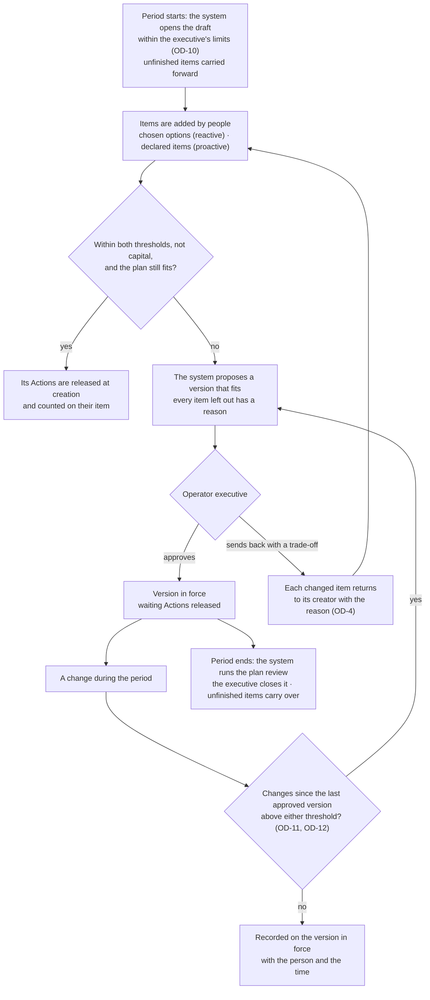
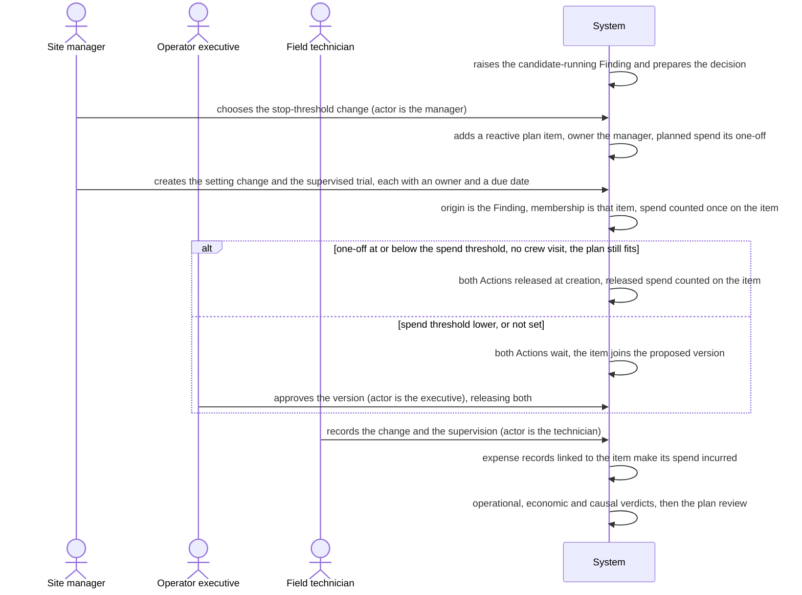
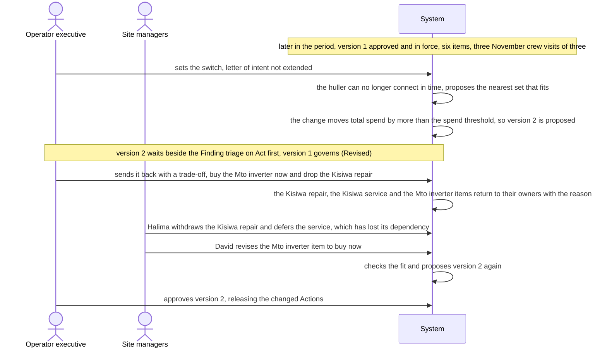
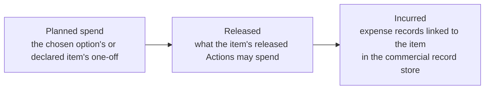

# Plan and Action workflow: who acts, the money, approval and the system's part

**AssetEcon · Layer 4 pack document 12 · AssetOps Architect (Claude) · 19 Nov 2026 · derived from design rev 16.7, updated to `rev 16.12` (OD-13 to OD-18, item states, Lakeside's proactive item; the demonstration workflow of WP §1.5; checked against `rev 16.10` and `rev 16.11`; the chooser ruling and the release machine of `rev 16.12`)**

**Why this document exists.** The owner asked for more clarity about how the plan and Action work together, "in its workflow document that combines workflow, finan ces, ownership and system mechanics" (`.agent/owner-recreate-document-packs-2026-11-19.md`). Every rule here is the design's (`layer4-transformation-design.md` §2.4–§2.6, Figures 5–8 and 6b). This document adds no construct, role, state or figure. Where the design leaves something open, it is listed as a design gap in §10, not decided here. The Architect's calls quoted here are the design's own and are labelled as such.

*Serves the objective:* operator executives adopt the product when they can see who decided, who approved, what was spent and whether it paid off, across every Site. This workflow is where that is recorded.

## 1. What exists today, and stays
<!--derives: §1.4; Part 1; G1; §2.6-->

Today's product already runs act and track for a person (design §1.4):
- **The Finding** is the reason to act. It is the stored, living result of an evaluation, with its thread.
- **The carriers** hold the work: the trial action, the domain action and the work case. Each has events, idempotent commands and typed refusals.
- **The thread** moves to *action in hand*, then *change applied*, then *resolved and monitoring*, or back to *recurred*.
- **The Actions rail** lists the work, and **verification** judges it before any money is credited.

All of this stays. What it lacks is **G1, a recorded person**: trial commands are recorded as a "SYSTEM demonstration" actor, work writes refuse a user actor, and trials have no owner or due date. Nothing today holds a budget, crew visits, or a trade between Sites (§2.5).

What is added on top:
- **CH2:** the person recorded on every command.
- **P:** the plan, the portfolio's committed changes for a period.
- Two links on every Action: **origin** and **plan membership**.

*Serves the objective:* acting and tracking are what turn a Finding into money. Recording the person is what lets an executive trust that record.

## 2. The five roles: what each decides, does and has recorded
<!--derives: §2.6; Figure 7; OD-2; OD-3; OD-12; OD-14; OD-15; OD-17; OD-18; Q-A2; WP §1.5-->

Roles govern who may decide; they are not views, and every role sees the same screens. Everything a role does is recorded under the person's name, with the time (§2.6).

| Role | Decides, in this workflow | Does | Recorded |
|---|---|---|---|
| **Operator executive** | Approves every plan version or sends it back with a trade-off. Sets the budget, the crew visits, the switches, the spend threshold (OD-2) and the crew-visit threshold (OD-12). Makes capital choices: declares expansions and approves new connections as capital (OD-17). Grants and removes roles in Organisation settings (OD-14) | Approves; sends back; closes the period's plan; accepts imported records when the finance and commercial lead is absent (OD-15) | Each approval, send-back, setting, role grant and close, as the approver; a backup acceptance as the executive's own |
| **Finance and commercial lead** | Chooses billing, collection and customer-account options; declares budget lines and money targets; sets money tolerances | Creates Actions against money Findings, and every notice and claim Action, including under items other roles chose (design §2.4 step 3); files rights events | Each choice as an item owner (OD-16); each Action as its creator |
| **Operations or site manager** | Chooses options within decisions on the Site's assets and operations, including an asset's warranty or service remedy (Mto inverter, OD-16); declares proactive items (maintenance, replacements); proposes new connections as plan items (OD-17); sets operational tolerances | Creates Actions from Findings or proactive items, and a new connection's Actions once it is approved; applies setting changes; assigns work | Each choice, declared item and proposed connection as the item owner (OD-16); each Action as its creator |
| **Field technician or O&M contractor** | — | Does the work; records readings, dips and completion | Each record and completion as the actor |
| **Analyst** | Maps sources to factors; places data-quality holds | Onboards sources, including the expense records that make spend *incurred* (§6) | Each mapping and hold |

**The two thresholds (OD-2, OD-12).** Both are Site or portfolio settings that the executive sets and can change at any time:
- the **spend threshold**: the most a chosen change's total one-off may be and still be released without approval;
- the **crew-visit threshold**: the most crew visits a change may add and still be released without approval. It **defaults to zero** until the executive sets it, so by default any change that uses a crew visit waits for approval (owner, 19 Nov: "the crew-visit threshold default of zero is fine so long as it is configurable").

A change is released at creation only if it is at or below **both** (§2.4 step 4, the design's Architect's reading of OD-11 and OD-12), and is not a capital item (the design's reading of OD-17). For both thresholds a Site's setting wins over the portfolio's, and a change spanning Sites is judged against the portfolio's (OD-18). A spend threshold that is not set releases nothing without approval (§2.4 step 4).

**In the demonstration** (WP §1.5, illustrative): each operator's spend threshold is 250.00<!--rec:demo_workflow.tenants[lakeside-power].spend_threshold-->, a portfolio setting with no Site setting, and the crew-visit threshold is 0<!--rec:demo_workflow.tenants[lakeside-power].crew_visit_threshold-->, OD-12's default. Each role is shown by its title with a fictional first name, for example "Site manager, Kobo · Peter".

*Serves the objective:* a few clear roles mean an executive sees exactly who is accountable at each Site, without a new menu or a role-specific screen.

## 3. One period, from opening to close
<!--derives: §2.5; Figure 6b; OD-10; OD-11; OD-12; OD-4-->

A period is one portfolio's budget period: a month unless the executive sets another (design Architect's call, §2.5). Lakeside's executive set November and December, to match the budget (WP §1.5). The flow below is the plan's life in that period. Its five states (Draft, Proposed, Approved, Revised and Closed) are drawn in design Figure 6b and are not redrawn here.

<!--diagram:period-flow-->

*Figure 12.1. One period. All of it is new. The system opens, checks, proposes and reviews. People add items, create Actions, approve and close.*

Step by step:
1. **Opening (OD-10).** When the period starts, the system opens the draft within the limits the executive has set. These are the budget, the crew visits, both thresholds and the switches. Opening chooses nothing. Unfinished items carry forward with their approval, spend and owners. A carried item is approved again only if its spend changes (design Architect's call).
2. **Collecting.** People add items: an option they chose from a decision (a **reactive** item), or a change declared straight into the plan (a **proactive** item). Each item records its Site, target factors, frozen prediction, spend, crew visits, dates and dependencies (§2.5).
3. **Release at creation.** A change within both thresholds has its Actions released when they are created, provided the plan still fits its budget and crew visits and the item is not a capital item (OD-17). The system checks that fit at each creation, in order, so two changes created together cannot jointly overrun it (§2.4 step 4).
4. **Proposing.** For everything else, the system assembles the items, checks budget, crew visits and dates, and proposes the nearest set that fits. Its order is fewest service-rule breaches, then the highest value, then the lowest spend, and every item left out has a reason (§2.5).
5. **Approving.** The executive approves the version or sends it back with a trade-off. A version sent back returns to draft, and each item it changes returns to its creator with the reason (OD-4).
6. **Changing (OD-11, OD-12).** A version stays in force until the next is approved. A change that moves total spend by more than the spend threshold, or crew visits by more than the crew-visit threshold, proposes a new version (state *Revised*). Until that version is approved, the version in force governs and the change's Actions wait. Smaller changes are recorded on the version in force. Changes are counted together since the last approved version, so a run of small ones cannot slip past a threshold (design Architect's call).
7. **Closing.** At the period's end the system runs the plan review: each item's predicted factor changes against the observed ones. The executive closes the period's plan, and its unfinished items carry into the next draft.

*Serves the objective:* one approval per version, on Act first, gives the executive control over money and crews without a sign-off for every small task.

## 4. Kobo: from a Finding to released Actions (the path a setting takes once it has a value)
<!--derives: §2.4; §2.5; Figure 5; Figure 8; OD-1; OD-2; OD-8; OD-12; WP §1.1; WP §1.5-->

Kobo's candidate-running Finding is a bottom-line impact: 25<!--fig:sites.lakeside-power/Kobo.actual.nodes.candidate_l--> L of generator running in October that the solar and battery could have carried (§2.1), as the simulated world records it (dispatch-3.2); dispatch-3.3 re-classifies it in 0K4f. The system prepares a decision on the candidate-litres factor (design Figure 5). Both settings pass the admission rule on K8's replayed days, but their litres and value are Not available yet (a dispatch replay on Kobo's October as recorded; 0K4f). So on 6 Nov the plan proposes neither, and version 1 holds no Kobo setting (WP §1.5). The walk-through below is the path a setting takes once it has a value. Peter, Kobo's Site manager, compares the options and chooses, say, the stop-threshold change, recorded under his name. Its total one-off is 90.00<!--fig:options.KOB-STOPSOC.operator_one_off-->, the vendor's remote reconfiguration plus the trial supervision. It needs no crew visit. Peter creates two Actions: the reconfiguration, which he owns, and the 14-day supervised trial, owned by Musa, the field technician. Creator and owner differ on the second, as the design allows (§2.5).

<!--diagram:kobo-sequence-->

*Figure 12.2. Kobo, below and above the spend threshold. Under the demonstration's 250.00<!--rec:demo_workflow.tenants[lakeside-power].spend_threshold--> threshold the change would take the first branch, because the threshold is above the change's one-off; on 6 Nov the demonstration holds no Kobo setting, and its released-at-creation cases are the Thika and Kasarani stopgaps (WP §1.5). Under a spend threshold of at least 90.00<!--fig:options.KOB-STOPSOC.operator_one_off-->, both Actions are released at once and still counted in the plan. Under a lower threshold, or none set, both wait for the executive (§2.4 step 4; design Figure 8). The crew-visit threshold's default of zero does not hold this change back, because it adds no crew visit (OD-12).*

Three things in this walk-through are rules, not choices of the example:
- **The threshold applies to the whole chosen change**, summed over its Actions, never one Action at a time. Splitting the change into smaller Actions cannot slip it under the threshold (design Architect's call, §2.4 step 4).
- **The Action joins the plan even when it is released at once** (OD-8). The executive still sees the spend on the version in force.
- **If an approved version later drops the item**, a released Action stops at its next step. No further spend is released, the Action returns to its creator with the reason, and the spend already incurred stays recorded against the item (design Architect's call, consistent with OD-4).

A Finding-origin Action that spends, with no decision behind it, creates its own reactive item, which records the Finding and the spend (design Architect's call, §2.5).

## 5. Lakeside: the whole portfolio, and a revision across Sites
<!--derives: §2.4; §2.5; Figure 6b; Figure 6c; OD-4; OD-5; OD-11; OD-12; OD-16; OD-17; OD-18; WP §1.1; WP §1.5-->

**The limits** (set by the operator, `worked-portfolios.md` §1.1): budget 5,000<!--rec:tenants[lakeside-power].portfolio_constraints.budget_usd_nov_dec--> for November and December, and 3 crew visits in November and 3<!--rec:tenants[lakeside-power].portfolio_constraints.crew_visits_dec--> in December, each visit counted in its month (design §2.5). Every decision is taken on 6 Nov, the demonstration's today. The system opened the draft on 1 Nov (OD-10), and on 6 Nov version 1 is *proposed*, awaiting Amina, the operator executive (WP §1.5).

**Version 1.** The managers take the Recommended options, and the four chosen items fit. Kobo's two settings are not among them: both are admitted on K8's replayed days, and their litres and value are Not available yet (a dispatch replay on Kobo's October as recorded; 0K4f). Halima also declares one proactive item. The items, their owners, the Actions and their state on 6 Nov are WP §1.5's:

| Item (Site; owner, OD-16) | Finding it answers (§1.3) | One-off | Crew visits | Actions: creator → owner, due | On 6 Nov, and why |
|---|---|---:|---:|---|---|
| Alternator repair (Kisiwa; Halima) | risk: evening hours with no backup | 1,800.00<!--fig:options.KIS-REPAIR.operator_one_off--> | 1 | repair, Halima → Musa, 9 Nov | waits: above the spend threshold, and a crew visit |
| Battery evidence (Kobo; Peter) | risk: warranty cover that cannot be claimed | 430.00<!--fig:options.BAT-EVIDENCE.operator_one_off--> | 1 | capacity test and sensor, Joseph → Joseph, 20 Nov | waits: above the spend threshold, and a crew visit |
| Inverter warranty claim (Mto; David) | risk: half inverter capacity, cover at stake | 230.00<!--fig:options.MTO-INV-CLAIM.operator_one_off--> | 1 | file the notice (deadline 27 Nov), Joseph → Joseph, 13 Nov; install the unit, David → David, 28 Nov | **waits on the crew visit alone**: within the spend threshold, but one crew visit at a threshold of 0 (OD-12) |
| Huller connection (Mto; David) | opportunity: the cooperative's signed letter of intent | 1,200.00<!--fig:options.MTO-HULLER.operator_one_off--> | 0 | none yet: David creates "connect, after the inverter" (due 5 Dec) once Amina approves | waits as **capital** (OD-17): a new connection waits for the executive whatever its spend |
| Generator service (Kisiwa; Halima), **proactive** | none: declared upkeep, "no factor (upkeep or compliance)" (OD-5) | 0.00<!--rec:demo_workflow.tenants[lakeside-power].items[KIS-SERVICE].planned_spend--> | 1, in December | none yet: Halima creates the service Action (owner Musa, 8 Dec) when she books the visit | waits: one crew visit at a threshold of 0; once version 1 is in force, its Action is released at creation |
| **Version 1** | | **3,660.00<!--fig:plans.lakeside-power.default.spend-->** | **3 of 3 in November; 1 of 3 in December** | | proposed; Amina's approval releases the waiting Actions together, and its items become *Released* (design Figure 6c) |

**The Mto claim is the demonstration's crew-visit case.** Its 230.00<!--fig:options.MTO-INV-CLAIM.operator_one_off--> is within the 250.00<!--rec:demo_workflow.tenants[lakeside-power].spend_threshold--> spend threshold, so spend alone would release it. Its crew visit holds it for Amina. Under OD-12 the executive can raise the crew-visit threshold, and then a one-visit change like this one would be released at creation, provided the plan still fits its 3 crew visits.

**Who owns the items (OD-16).** Each item's owner is the person who chose its option or declared it, and each Action keeps its own creator and owner. So David owns the Mto inverter-claim item, which he chose, while Joseph creates and owns its warranty-notice Action and David the install. David also owns the huller connection, which he proposed (OD-17). If Amina sends version 1 back, each changed item returns to its owner, and each Action to its creator (OD-4).

**Reactive and proactive.** The five chosen items are **reactive**: each is a chosen option from a decision that the system prepared on a Finding (§2.4). The Kisiwa generator service is **proactive**: no Finding triggered it, it is the origin and the plan membership of its own Actions, and it carries no value (OD-5). It depends on the Kisiwa repair, because GEN-KS-01 must be back before GEN-KS-02 goes off for its service.

**A later revision: the cooperative does not extend its letter of intent.** This happens after Amina approves version 1, and it is not part of the 6 Nov demonstration. The huller needs the inverter restored plus 5 working days before the letter lapses on 30 Nov. The claim restores the inverter on 28 Nov, so the huller can no longer connect in time (WP §1.1).

<!--diagram:lakeside-revision-->

*Figure 12.3. A revision across Sites. The system proposes. The executive alone makes the trade between Kisiwa and Mto, and each item's owner, Halima and David, revises their own item (OD-4, OD-16). The trade spans two Sites, so it is judged against the portfolio's thresholds (OD-18).*

What each path costs, and why only the executive can choose:

| Path | Spend | Crew visits | Evening hours with no backup at Kisiwa, 6–30 Nov |
|---|---:|---:|---:|
| The system's proposal: keep the claim and the repair, lose the huller | 2,460.00<!--fig:plans.lakeside-power.switch_cases.5000/False.spend--> | 3 | 15 |
| The executive's trade: buy the inverter now, keep the huller, drop the repair | 4,540.00<!--figx:{plans.lakeside-power.default.spend}-{options.KIS-REPAIR.operator_one_off}-{options.MTO-INV-CLAIM.operator_one_off}+{options.MTO-INV-BUYNOW.operator_one_off}--> | 2 | 125 |

- **The proposal keeps the repair** because the search breaks service rules least before it weighs money. The trade is worth more in money but leaves 125 evening hours without backup instead of 15 (WP §1.1). That trade belongs to the budget holder (§2.5).
- **Both paths make a new version.** The proposal moves total spend by 1,200.00<!--figx:{plans.lakeside-power.default.spend}-{plans.lakeside-power.switch_cases.5000/False.spend}-->, above the demonstration's 250.00<!--rec:demo_workflow.tenants[lakeside-power].spend_threshold--> threshold. The trade also removes a crew visit, and at a crew-visit threshold of 0 any change in crew visits needs approval (OD-11, OD-12).
- **Timing matters.** If the Kisiwa repair's Actions were already released and its crew visit on 8 Nov has happened, the repair cannot be undone. Its Actions stop at their next step, and the spend incurred stays recorded against the item (§2.5).

**Proactive and capital items, generally.** An operations or site manager declares scheduled maintenance or a replacement, as Halima does at Kisiwa. The executive declares an expansion. A new customer connection is proposed by the site manager and approved by the executive as capital, and its Actions are created after that approval (OD-17). A proactive item is the Action's **origin** and also its **plan membership**. The same thresholds release its Actions, except that a capital item always waits for the executive. It names the factor or Protect measure it moves, or is marked "no factor (upkeep or compliance)" and carries no value (OD-5).

*Serves the objective:* this is the cross-Site judgement that monitoring tools cannot make. It weighs money against service obligations within one budget, and it records who made the trade.

## 6. The money: budget, thresholds, release, and spend counted once
<!--derives: §2.4; §2.5; §2.7; Rules; OD-2; OD-8; OD-12-->

**The budget and its lines.** The executive sets the period's budget and crew visits. The finance and commercial lead declares budget lines by Site. In the demonstration these are budget records in the commercial record store (§2.3, B3).

**Spend moves through three steps on its item** (§2.5):

<!--diagram:spend-steps-->

*Figure 12.4. The three steps of an item's spend. They are steps of one amount on one item, never three amounts added together.*

**Counted once.** The budget in use counts each item once: its incurred spend where expense records exist, otherwise its released spend, otherwise its planned spend (design Architect's call, §2.5). An Action never carries spend of its own beside its item. That is why every Action has at most one plan membership (OD-1): the same work is never counted twice.

**What the thresholds act on.**

| Threshold | Acts on | Default until set |
|---|---|---|
| Spend (OD-2) | a chosen change's total one-off, over all its Actions, for release at creation; the total spend change since the last approved version, for a new version | not set, so nothing is released without approval (§2.4 step 4) |
| Crew visits (OD-12) | the crew visits a change adds, and the crew-visit change since the last approved version | zero, so any added crew visit needs approval |

**What the money is not.** Spend is the operator's outlay. Realised value comes only from economic verdicts on recorded records (§2.7). The modelled value of a plan, its spend and its realised value are different kinds and are never added together (Rules 2 and 5).

*Serves the objective:* an executive trusts a money figure only if each amount appears once and says how it is known.

## 7. Ownership and approval
<!--derives: §2.5; §2.6; §1.4; OD-4; OD-10; OD-14; OD-16; OD-17-->

| Who | Holds | Recorded |
|---|---|---|
| **Chooser** | the role accountable for what the decision concerns: the Site manager for the Site's assets and operations, including an asset's warranty or service remedy (Mto inverter: David, OD-16); the finance and commercial lead for billing, collection and customer accounts; the executive for capital (design §2.4 step 2) | name and time, on the item |
| **Item owner** | the person who chose the item's option or declared it, who stays its owner whoever creates its Actions (OD-16) | name and time, on the item, as its chooser and owner |
| **Action creator** | the person who created the Action, against a Finding or a plan item: the chooser for operational Actions; the finance and commercial lead for every notice and claim Action (design §2.4 step 3) | name and time; the origin and the plan membership |
| **Action owner** | the person accountable for doing it, who may differ from the creator | name and a **due date**; overdue is computed, as it already is for maintenance schedules (§2.6) |
| **Approver** | the operator executive, for every version, and for each capital item in it (OD-17) | name, time and the version number |
| **Role grants** | the operator executive, in Organisation settings (OD-14) | each grant and removal, with its person and time |

**Send-back and return (OD-4).** When the executive sends a version back, or an approved version leaves an item out, that item's Actions are not released. The item returns to its owner and each Action to its creator, with the reason. Each revises, defers to the next period's draft, or withdraws.

**Where approval waits.** A version awaiting approval appears beside the Finding triage on Act first. No notification is sent, as today (§1.4). The executive finds it there, among the Findings.

## 8. The Action's release, step by step
<!--derives: §2.4; §2.5; Figure 6c; OD-4; OD-8; OD-11-->

The plan version's states are design Figure 6b, a plan item's five states (Chosen, Released, Left out, Done, Withdrawn) are design Figure 6c, and an Action's release is design Figure 6d (`rev 16.12`). None is redrawn here. An item's state is derived from its Actions and the plan's versions, and its spend moves through its three steps (§6 above) alongside. An Action keeps its carrier's existing lifecycle, which stays (§1.4). What is new is its release, step by step, in the terms of Figure 6d:

1. **Created and checked.** A person creates the Action, with its origin and membership. The system checks it against both thresholds and the plan's fit, as a change to its item.
2. **Released** if its item is Released, or its item's whole change is within both thresholds and the plan still fits. Today's carrier lifecycle and thread states then run unchanged.
3. **Waiting** otherwise, until the executive approves a version that holds its item; then **Released**.
4. **Returned** when a send-back or an approved version leaves its item out (OD-4). A released Action stops at its next step, and incurred spend stays recorded against the item. Its creator revises it (checked again, as at step 1), defers it with its item to the next draft (Waiting there), or withdraws it (**Withdrawn**).

## 9. What the system does, and what it never does
<!--derives: §2.4; §2.5; §2.6; §1.4; OD-10; Figure 7-->

| Step | The system does | People do |
|---|---|---|
| Period start | opens the draft within the executive's limits; carries unfinished items (OD-10) | the executive sets the limits beforehand |
| Finding | raises it under the owner's rule and its tolerance; prepares and values the decision; marks one option Recommended; rejects an option that breaks a hard bound | the accountable role chooses an option, or none |
| Item | records it with its owner; checks fit at each creation, in order | a person chooses the option or declares the item |
| Action | records origin, membership, creator, owner and due date; releases it within the thresholds; holds it otherwise | a person creates it and owns it |
| Version | proposes the nearest set that fits, with reasons; counts changes since the last version | the executive approves or sends back |
| Spend | links expense records to the item; counts the budget in use once | the finance and commercial lead accepts imported records, or the executive in the lead's place (OD-15) |
| Close | runs the plan review: predicted against observed factors | the executive closes |

**It never chooses, approves or creates an Action** (§2.6). It never sends a notification and writes no device command (§1.4). Opening a draft chooses nothing (OD-10). A hard-bound rejection is overridden only by a recorded change to the bound (design Architect's call, §2.4).

## 10. Open questions and design gaps
<!--derives: Decisions; §2.4; §2.5; §2.6; OD-12; OD-16; OD-18; WP §1.1-->

The five design gaps of this document's first draft are settled in design rev 16.8, the first and third by the owner (`.agent/owner-pack-questions-defaults-2026-11-19.md`), the rest as approved housekeeping:
1. **Threshold precedence:** a Site setting wins for both thresholds, and a change spanning Sites is judged against the portfolio's (OD-18; §2 above).
2. **Item states:** five, derived from the item's Actions and the plan's versions (design Figure 6c; §8 above).
3. **Who owns an item whose Actions different roles create:** the person who chose it; at Mto, David (OD-16; §5 above).
4. **A proactive item in the worked portfolio:** the Kisiwa generator service (WP §1.1; §5 above).
5. **The crew-visit limit across a two-month period:** a limit per month, 3 in November and 3 in December (design §2.5; WP §1.1).

No new gap is open.

**When I want the owner to weigh in:** the design's reading of OD-17, that a capital item waits for the executive whatever the thresholds, because it decides whether a small connection can ever be released at creation.
