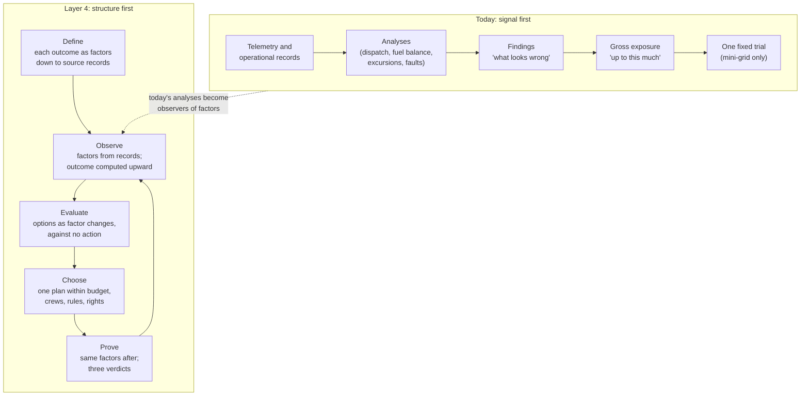
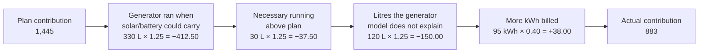
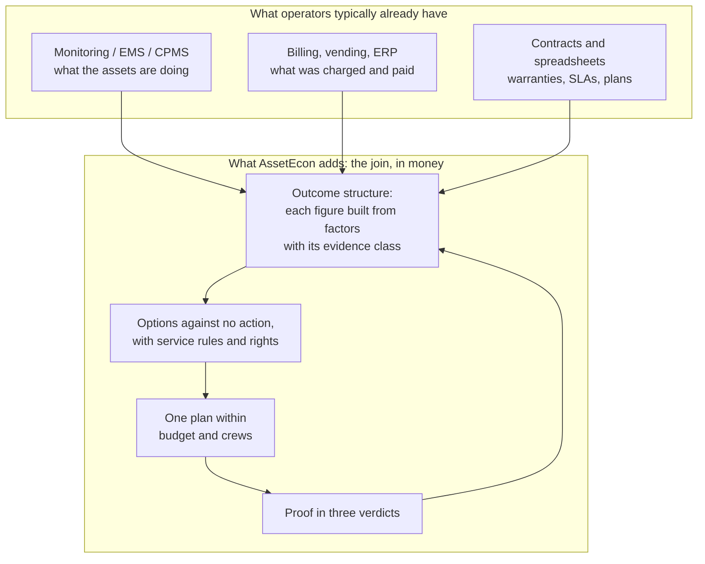
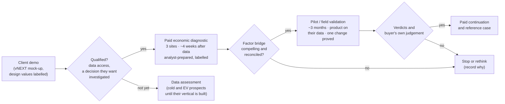
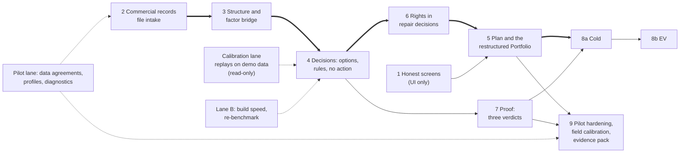
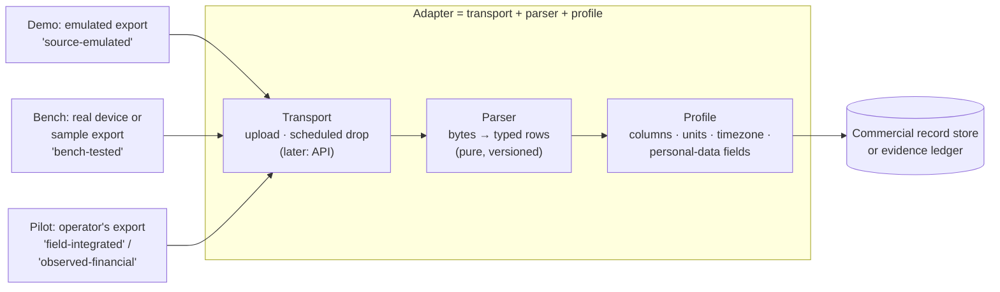

# Product transition and roadmap: from today's product to the economic decision loop

**AssetEcon · decision document for the owner · AssetOps Architect (Claude) · 18 Nov 2026**
**Status:** for owner decision. No application code, test, database or other pack document was changed (one link was added to the pack index). Code citations were read against the current branch `task/product-direction-layer4-design`.
**Request:** owner, 18 Nov 2026, verbatim in `.agent/owner-product-transition-request-2026-11-18.md`, with the owner's demo objective: *convert mini-grid, EV and cold-chain operator executives to adopt the product, with real value that monitoring tools and competitors in Africa do not offer.*
**Built on:** the product brief (`.agent/AssetEcon_Product_Direction_Layers_1_to_3_and_Claude_Brief_REVISED.md`), the owner's standing rules (`.agent/owner-layer4-direction-feedback-2026-11-17.md`) and the Layer 4 pack in this folder. The coordinator's two chat answers were the starting point; every factual claim in them was checked against code and pack, and §1.5 and §2.6 list what was corrected and where this document disagrees.

> **How figures are labelled.** Every money figure below is from the demonstration world (`derived-values.json`, produced by `evaluate_structure.py` from the manifest). It is an **illustration**, never a customer result. Figures that rest on a replay not yet run on recorded data are marked **design value**. Effort and calendar ranges are **estimates** with their assumptions stated; they are not commitments.

---

## On one page

| Question | Answer |
|---|---|
| What is the fundamental difference? | Today the product starts from **signals** and reports what looks wrong. Layer 4 starts from **how each business outcome is made up** (its factors, down to the records that evidence them) and computes where the money stands, which choice is worth making within budget and crews, and whether it paid off. |
| Why does it matter for the buyer? | Operators already have monitoring. What they lack is one place where operational, commercial and contract facts are joined into money, choices and proof. That is the brief's differentiation **hypothesis**; pilots must confirm it. |
| Recommended path | **Diagnostic-led, in between.** Sell and deliver the decision loop narrowly from now, first as an analyst-prepared paid diagnostic on a prospect's own records, while the product builds the loop in its dependency order. Pilot onboarding moves from last to first, as a parallel lane. |
| Lead vertical | **Mini-grid.** It has the deepest observation today and the only executable and verifiable changes. Cold and EV prospects get the demo and a data assessment; their vertical is built second and third, in the order the first qualified prospect decides. |
| The decisive early test | The **factor bridge** on the first operator's own month: contribution against plan, split by factor, reconciled to their accounts. If it is not compelling, stop and rethink before building options and allocation. |
| Rough size | Mini-grid core loop (honest screens → money from records → factor bridge → decisions → rights and plan → proof): about **4–7 months** of build with two lanes. Each further vertical: about **1.5–3 months**. Wide uncertainty; see §4.3. |
| Decisions needed | Ten, in §5. The main ones: approve the diagnostic-led path (changes Q9); diagnostic terms (paid); lead vertical; who prepares diagnostics before the product can; client exposure of design values (Q13). |

---

## 1. Where we are and where we are going

### 1.1 The difference in one picture

Today's product is not wrong; it is one layer of the loop. Its analyses observe physical factors well and carry over. What is missing is everything that turns those observations into money, choices and proof.

### 1.2 Side by side, verified against the code

| | Today's product (as the code shows it) | Layer 4 |
|---|---|---|
| **Starting point** | Telemetry and operational records produce Findings, such as "generator running while solar and battery could carry the load" (dispatch classification, `analytics/dispatch_v3.py`) | Each outcome (contribution, cost to serve, service obligations) is declared as a structure of factors: litres, kWh billed, crate-days, departures met |
| **How an outcome is read** | Ten outcome-map rows link a signal straight to an outcome, all of kind "moves" (`outcomes/outcome_map.py:149-180`); Portfolio cards are counts and estimates | Plan against actual is computed factor by factor and read upward. Kobo, October (demo): contribution 1,445 → 883, the 562 shortfall = 412.50 + 37.50 + 150.00 − 38.00 |
| **Where money comes from** | No recorded commercial money at all: `recorded_amount@1` "returns no money … always" (`chain/strategies/recorded_amount.py:1`). Money shown is **estimated** from declared prices (productive-use income, EV charging income) or **modelled** (possible extra fuel cost) | Recorded money from billing, receipts, invoices, plans and tariffs, beside operational data |
| **What a value means** | Gross exposure: fuel cost "versus the generator being off" (`financials/fuel_cost.py`), and the Portfolio's Optimize card shows one Finding's **last-day** exposure on a 7- or 30-day range (`chain/read.py:190`, `site_outcomes/read.py:901-923`) | The change an option makes against doing nothing, over the same horizon, net of its own cost |
| **Choices** | Findings carry next-step text (`analytics/plain.py:360`). One executable change exists: the reserve trial, a fixed −5 points (`actions/reserve_trial.py:37`; the action table admits only that rule, migration `0016:60`). Mini-grid alternatives and scenarios only read the Finding; cold and EV scenarios are authored what-ifs with no computed amount | Several options per decision, always including no action, compared, with rejected options and why |
| **Trade-offs** | Shown as text and counts ("checked" rows). Only two protections act: a classification rule that keeps running near reserve "necessary" (`dispatch_v3.py:290-293`) and guardrails checked after a trial (`verification_rules.py:787-800`) | Service rules and rights are evaluated before recommending: an option that breaks dawn battery charge or loses warranty cover is left out or ranked down |
| **Across sites** | Findings ranked by placement, which "says where to look first, never a value ranking" (`estate/placement.py:1-6`); money is **listed per site, never summed** (`estate/portfolio.py:681`, test `test_two_priced_sites_list_each_and_never_sum`) | One plan across the portfolio within budget, crew visits and dated dependencies; switches (budget, a customer's letter of intent) re-compute it |
| **Proof** | An operational verdict for a **trial action**, mini-grid only (families: reserve, midday shift, fuel; `actions/verification_families.py`); only simulated or authored evidence admitted (`verification_rules.py:688`); intervention cost fixed at 0 (`actions/verification.py:1167`). Cold and EV cannot reach "verified" | Three separate verdicts: the operational change happened; the money followed (from later records); it was caused by the action (untreated sites as comparison) |
| **Honesty of figures** | Already strong on provenance (*demo-simulated, source-emulated …*), "not available yet", and never-sum rules | Adds an evidence class on every figure (Recorded, Calculated, Estimated, Quoted, Modelled, Design value), and different classes are never added |
| **Contracts and rights** | Battery warranty exists only as withheld fields (`sites/battery_boundary.py:26`) | Warranty, EPC, O&M/SLA and insurance rights decide who bears a cost, inside repair decisions |

### 1.3 The same site, read both ways (Kobo, October; demo values)

Today the product tells Kobo's operator that the generator ran when solar and battery could have carried the load, and how much that fuel might have cost. It cannot say what the month did to the site's contribution, because no billing or plan record exists in the product.

Layer 4 reads the month up from its factors:

| Factor (Kobo, October) | Plan | Actual | Effect on contribution | How it is known |
|---|---|---|---|---|
| Fuel for necessary running | 700 L | 730 L | −37.50 | split: declared input standing in for a calculation |
| Fuel for running solar/battery could carry | 0 L | 330 L | −412.50 | split: declared input standing in for a calculation |
| Fuel not explained by the generator model | 0 L | 120 L | −150.00 | fuel balance (Record) minus model |
| kWh billed × 0.40 | 8,550 | 8,645 | +38.00 | billing export (Record) |
| O&M and staff | 1,100 | 1,100 | 0 | invoices (Record) |
| **Contribution** | **1,445** | **883** | **−562.00** | Calculated |

<!--fig:sites.lakeside-power/Kobo.plan.nodes.contribution--><!--fig:sites.lakeside-power/Kobo.actual.nodes.contribution-->

From there the loop continues: the options that change those factors are valued against doing nothing (the demo's recommended setting change is worth 2,916.00 over twelve months, a **design value** until the replay runs on recorded data; the simpler reserve change is rejected because it breaks dawn battery adequacy on 4 of 61 days), the plan across Kobo, Kisiwa and Mto is chosen within 5,000 and three crew visits, and the change is later proved on the same factors.

### 1.4 What the buyer gets, by vertical

The mechanics are the same for all three; each vertical fills them in with its own factors, levers and limits.

| Buyer | Today's product gives | Layer 4 gives (demo illustrations) |
|---|---|---|
| **Mini-grid operator** | generator running split into necessary and avoidable; fuel balance; possible extra fuel cost (gross); productive-use headroom; one reserve trial with an operational verdict | contribution against plan per site, split into fuel, billing, losses and collections; a setting change valued net against no action, with the tempting one rejected on a service rule; productive demand valued only with a customer behind it (the huller adds contribution, the welder loses money); claim the inverter under warranty or buy now, with the deadline |
| **Cold-chain operator** | chamber temperature excursions; backup-start failures; authored stock-value what-ifs; no money computed; changes cannot be verified | contribution per room from occupancy and energy; separating low occupancy from inefficiency (Mwea +0.6% vs Kirinyaga +24% energy against expectation); repair vs replace; batch exposure kept apart from damage and from liability; an EPC claim |
| **EV depot operator (captive fleet)** | interrupted sessions; charger availability; peak warning; an **estimated** charging income from a declared tariff (which does not fit a captive fleet); changes cannot be verified | cost per departure met (revenue "not applicable", never zero); a charging schedule that meets every departure, chosen over the cheapest one that misses buses; a charger fault ranked by the departures it costs; SLA rights. The largest demo figure, Embakasi's 8,082.00 a month, rests on an **assumed** tariff and is a design value (Q7) |

<!--fig:options.EMB-DEADLINE.monthly_or_horizon_change-->

### 1.5 Why Layer 4 is the differentiator against monitoring tools

A monitoring tool answers "what is the asset doing". Each of the operator's systems answers part of the money question in its own terms. The brief's differentiation hypothesis is the **join**: cross-system economic judgement at site and portfolio level, compared interventions, transparent assumptions, and proof after the change (brief, line 94). This document does not claim uniqueness in any single feature; the brief itself says that is a hypothesis to validate with prospects and pilots, not a demonstrated moat. No competitor is named or characterised here, because the pack holds no sourced competitor facts.

What a demo can show that monitoring cannot, using the mechanics rather than one site: the outcome read from its factors (a monitoring tool has no plan or billing records); the counter-intuitive contrast (the highest diesel user may have nothing worth changing); a rejected option and the rule that rejected it; a contract right that changes who pays; and how the result will be proved.

### 1.6 Corrections to the coordinator's first answer

| Coordinator's claim | Verified? | Correction |
|---|---|---|
| "Across sites, findings are listed and summed per site" | **No** | Money is listed per site and **never summed** across sites (`estate/portfolio.py:681`; test `test_two_priced_sites_list_each_and_never_sum`). Findings are ranked by placement, which is explicitly not a value ranking (`estate/placement.py:1-6`) |
| "One recommended action per finding" | **Partly** | Findings carry next-step text; there is **one** executable change type in the product (the fixed reserve trial; the action table admits only that rule). There is no option comparison and no no-action baseline anywhere |
| "Proof: verification of the specific finding" | **Partly** | Verification judges a **trial action**, not a Finding; it is operational only, mini-grid only, admits only simulated or authored evidence, and counts the change's cost as 0 |
| "Money sources: operational data (telemetry, fuel)" | **Yes, with a nuance** | No recorded commercial money exists. The money that is shown is estimated from declared prices or modelled as exposure |
| "Observation work roughly two-thirds done for mini-grid" | **Not supported** | No measurement gives two-thirds. What the code and the reuse matrix show: **physical** observation is largely in place (12 of 15 observer elements kept as they are), **economic** observation has not started (no money leaves). Of 114 code elements assessed, 40 are kept as is, 21 extended, 22 reworked, 14 integrated, 7 only need rendering, 3 retired, and 7 components are new (`repo-reuse-and-gap-matrix.md` §K). The new components are most of the effort |
| "The 562 shortfall breaks down into 412.50 + 37.50 + 150 − 38" | **Yes** | Matches `derived-values.json` (Kobo plan 1,445, actual 883). Note: the 730 / 330 / 120 litre split is a declared input in the demo standing in for a calculation |
| "Trade-offs mostly displayed rather than enforced" | **Yes** | Two exceptions act: a dispatch classification rule near reserve, and post-trial guardrails |
| "Some labelling of where figures come from" | **Understated** | Provenance labels, "not available yet" and never-sum rules are already systematic; Layer 4 adds the money evidence class per figure |
| Today's product "overlaps with monitoring tools" | **Partly** | It goes beyond monitoring (causal classification of generator running, fuel balance, trials), but a buyer is likely to place it in the monitoring and diagnostics category, which the brief says is an enabler, not the promise (brief, line 6) |

---

## 2. The transition strategy

### 2.1 Three options

| | A. Pilot with today's product | B. Build Layer 4 first, then pilot | C. In between: diagnostic-led, Layer 4 as destination |
|---|---|---|---|
| What the buyer sees | monitoring and diagnostics with exposure figures | nothing for months, then the full loop | from the first meeting: the loop on their own records, prepared by an analyst at first, more of it by the product each month |
| What we learn | whether we match a dashboard | late: whether real data fits a design built without it | early: whether their records support the factor bridge, which decisions they care about, what their files look like |
| Risk | lands in the category the buyer already has; the demo promises more than the product does | the design meets real data late; calibration, record shapes and the option list stay guesses; no revenue or reference | analyst work does not scale; promising more than is built |
| Fit with the brief | weak: the brief says monitoring is not the promise | weak on validation: the brief's path is demo → paid diagnostic → field validation | strong: it is the brief's own path (line 38) |
| **Judgement** | not recommended | not recommended | **recommended**, with the controls in §2.2 |

### 2.2 The recommended path

**The controls that keep it honest:**
1. **Everything an analyst prepares is labelled** as analyst-prepared from the buyer's records, with the same evidence classes the product will show. The analyst uses the pack's method (the structure, the evaluator script and its independent check), never hand arithmetic.
2. **Each manual step becomes the next product slice.** The diagnostic's deliverable has the shape of the product's *Outcomes by site* and decision pages, so the analyst work shrinks as the product grows.
3. **Cap concurrent diagnostics** (two, assumption) until the factor bridge is in the product.
4. **No replay-derived saving is presented as a result** until it has been reproduced on recorded data (Q13).

### 2.3 The offer

| Stage | Buyer provides | Buyer receives | Length (estimate) | Terms |
|---|---|---|---|---|
| **Demo** | an hour of executive time | the loop on one demo operator of their vertical (separate login per operator, Q5) | 30–45 min | free |
| **Economic diagnostic** (the brief's "paid diagnostic"; offer template in `phase-plan-and-acceptance.md` §10) | the minimum records below, for three sites, one to four months | each site's outcomes computed from their factors against their plan, with what is recorded and what is missing; the three highest-value decisions with no action compared and the options we would reject, and why; contract rights at risk and their deadlines; a verification plan for the first change | about 4 weeks from data receipt; data agreement before that, 2–6 weeks (assumption) | **paid** (owner decision D2; no price is proposed here) |
| **Pilot / field validation** | continuing exports; an operations lead's time; agreement to one supervised change | monthly economic review in the product; the first change proved operationally and then economically | about 3 months (an after-window of at least 14 matched days, then the next closed month for the money verdict) | owner decision D2 |

We do not promise savings; we show how they would be proven (pack wording, kept).

### 2.4 Onboarding data checklist

Derived from the leaf factors: each record family evidences one group of factors, so the checklist is the structure read from the bottom (`integration-source-to-canonical-design.md` §7.1).

| Record (mini-grid) | Unlocks | If missing |
|---|---|---|
| Controller / EMS export, 60–90 days | generator, battery and solar factors; necessary vs avoidable running; replay calibration | no fuel split; no setting option can be valued |
| Customer meter register with change dates | delivered → metered → billed mapping | unmapped meters cannot be separated from losses |
| Billing or vending export, 4 months | kWh billed and revenue | contribution "not available yet" |
| Payment settlement statements | collected, in transit, outstanding | cash position unknown |
| Fuel deliveries and dips | litres consumed; unexplained litres | the fuel factor rests on the model only |
| Monthly plan or budget, by site and line | plan at every factor | no plan against actual; bridge shown as "not decomposed" where the plan is a total |
| Contract set for the most important asset (warranty, O&M) | rights, notice deadlines, who pays | repair options valued as if the operator pays |
| *(for the plan)* open repairs, quotes, budget and crew limits | options and the plan's limits | decisions without costed options |

| Vertical | Minimum records (five to seven) |
|---|---|
| **Cold rooms** | storage ledger (batch in/out, commodity, crates, rate); energy bills; chamber temperature log; invoices and receipts; QA notes; plan; refrigeration contract and goods-in-custody policy |
| **EV depot** | charging-system (OCPP) log export; fleet roster with departures and required energy; utility invoice and tariff contract; service tickets; plan; charger warranty and SLA |

A prospect who cannot supply billing (or, for cold, the storage ledger; for EV, the roster) and the plan qualifies itself out of the diagnostic; offer the data assessment instead.

### 2.5 Success criteria (stated in advance; no invented benchmarks)

| Stage | Criterion | Measured how |
|---|---|---|
| Demo | the executive names an issue as theirs and a decision to investigate | recorded verbatim in the validation sheet (`phase-plan-and-acceptance.md` §10) |
| Diagnostic | one closed month reconciles to their management accounts on revenue and fuel or energy cost within a tolerance agreed at the start | reconciliation table |
| Diagnostic | the factor bridge leaves an unexplained residual the buyer accepts as small, and names at least one cost they did not know | buyer's own judgement, recorded |
| Diagnostic | their operations lead confirms at least one recommended change is feasible | recorded |
| Pilot | one change committed with a frozen prediction; operational verdict after the after-window; money verdict from the next closed month's records; causal strength stated | the three verdicts in the product |
| Commercial | diagnostic accepted, declined or deferred, with the reason; pilot converted or not, with the reason | validation sheet |

### 2.6 Lead vertical, and how cold and EV follow

**Mini-grid leads**, for reasons the code confirms: it has the deepest physical observers (dispatch-3.2, fuel balance), the only executable change and the only verification families (`actions/verification_families.py`: reserve, midday shift, fuel); cold and EV cannot reach "verified" today. Leading elsewhere would put the loop's last step on the critical path.

**Cold and EV follow without being shaped by mini-grid.** The general parts (commercial record store, structure registry and read, option evaluator, bounds, allocator, verdicts) are built once and tested on cold and captive-EV fixtures from the start (`phase-plan-and-acceptance.md` slices 3–5). Only each vertical's own structure, observers and lever models are added later. Which comes second is decided by the first qualified prospect (Q10). If no prospect decides, cold is the shorter path (storage ledger and energy normalisation, no roster or tariff contracts), while EV carries the largest demo figure on an assumed tariff, which is a reason to prove it on a real tariff before leading with it.

### 2.7 Where this document disagrees with the coordinator's recommendation

| Coordinator | This document | Why |
|---|---|---|
| Pilot "ideally paid with a low fee or free with a conversion clause" | **Paid diagnostic first**, pilot after | The brief's path is demo → **paid** diagnostic → field validation (lines 38, 376), and the pack's offer is a paid three-site diagnostic. A paid step is also the brief's own conversion signal. Price and terms are the owner's call (D2) |
| Step C "calibration on their data" as one step that needs the pilot | **Two steps**: the calibration lane on the existing demo data now; calibration on the pilot's own series later | The pack's calibration spikes run read-only on existing demo data and need no pilot (`phase-plan-and-acceptance.md`, calibration lane). Running them now de-risks the demo's biggest figures for every prospect. Calibration on a pilot's series is part of field validation |
| "Slices 0 (calibration) and 2 (commercial data) need a real operator's data to be done properly" | **Only partly** | The commercial record store is designed so that a pilot changes only transport and profile, not the parser, records or structure (`integration-source-to-canonical-design.md` §7.2). Real exports test the profiles, the plan's granularity and the option list; they are not needed to build the store |
| Step B "plan against actual, mini-grid only" | **General from the start**, sourced for mini-grid first | The owner's rule is general before particular; the pack declares the cold and captive-EV structures in the same slice and tests them (e.g. EV revenue "not applicable"). It costs little and avoids a mini-grid-shaped core |
| Rights and warranties in the last step (G) | **Inside the mini-grid core**, in the diagnostic from day one (by hand) and in the product before the full plan | Contract rights are among the clearest things monitoring does not do, the evidence is cheap (a few PDFs), and Lakeside's plan turns on claim-versus-buy-now, so the full mini-grid plan cannot close without them (`phase-plan-and-acceptance.md` §2) |
| "A and B roughly weeks" | A is weeks; **A + B about 1.5–3 months** | B is the store and the structure read: two slices sized medium and large, about eight reviewed changes, with the attribution rules (§4.3) |
| Proof (E) before the plan (F) | **Agree on calendar, with a different reason** | The first change should start as early as possible because proof waits for an after-window and a closed month; the plan is built during that wait |
| "Don't keep polishing the design pack" | **Agree**, with two exceptions | The open owner decisions (Q1–Q16) and the mock-up approval gate must still close before the UI build |

---

## 3. Technical details to get there

### 3.1 The steps and their dependencies

Each step builds a **general** piece of one mechanic, proves it first on mini-grid, and leaves the product more useful on its own. The step names map to the pack's slices (`phase-plan-and-acceptance.md`).

*Thick arrows are the critical path: records → structure → decisions → rights → plan. The calibration lane, honest screens, Lane B and the pilot lane run in parallel from the start.*

### 3.2 What each step builds

**Calibration lane (first, read-only, parallel with step 1)**
| Area | What |
|---|---|
| Algorithms | forward dispatch replay of Kobo (setting change), demand-on-headroom replay of Mto (huller), deadline schedule replay of Embakasi |
| Code | an adapter in `host/` around the simulator kernel (`host/execution_adapter.py:869`), behind a **new** port method; the backend still never imports the simulator (`runs/execution_ports.py`) |
| Exit | each replay reproduces its design values within a stated tolerance on at least 14 admissible days, or the option is valued with a labelled bounded proxy |
| Reuse | kernel kept; adapter new |

**Step 1: Honest screens (UI only)**
| Area | What |
|---|---|
| UI | relabel the Optimize card with its day and scope; render fields the API already returns: per-site headline money and nodes, sites needing attention, outcome reasons, structured thread lines, "Why?" nodes (`repo-reuse-and-gap-matrix.md` §F3) |
| Data, API | none new |
| Verification | pin today's Optimize behaviour first (`test_ch5d1_optimize_card.py`), then change it on purpose |

**Step 2: Commercial records and file intake**
| Area | What |
|---|---|
| Store | **new** commercial record store: raw payload kept unchanged, source-versioned revisions, four clocks (service, effective, recognition, settlement), idempotency key (tenant, source system, record id, version); all record kinds of all three verticals declared from the first migration (0062) |
| Why new | existing intake is first-write-wins (`evidence/service.py:487-492`) and refuses late intervals (`reading_upload/service.py:244-248`); commercial records arrive late and are corrected by nature |
| Integration | CSV intake on the authenticated site-bound path with dry run and plain-word refusal, reusing the reading-upload pattern (`reading_upload/service.py:213`) without its late-interval refusal |
| Algorithms | `recorded_amount@2` reads revisions by recognition period (modified from `@1`) |
| Tests first | duplicate upload adds nothing; late settlement; currency; another tenant's row refused at intake |

**Step 3: Structure and factor bridge**
| Area | What |
|---|---|
| Model | structure registry in code: outcome → factors → leaves per vertical and business model, plans and bounds at factor level; **reworks** the outcome map (`outcomes/outcome_map.py:149-180`) and keeps its start-up integrity check pattern (`chain/graph.py:177`) |
| Algorithms | bottom-up evaluation; attribution through the structure (exact for sums, a declared rule for products: volume at plan price, then price at actual volume); energy-to-cash observer (delivered → metered → billed → collected); existing analyses attached as factor observers (dispatch-3.2, fuel balance: **kept**) |
| Store | none: totals are recomputed from stored lines on every read, as today's rule requires (`chain/period_read.py:138-139`) |
| API, UI | new structure read (site × period, portfolio); *Outcomes by site* tab and the site economics section; evidence drawer within two interactions |
| Gate | Lakeside October to the cent (demo: contribution 1,443.00 against plan 2,295.00); captive-EV revenue "not applicable"; Protect measures compose for all three operators |

<!--fig:portfolio.lakeside-power.actual.sums.contribution--><!--fig:portfolio.lakeside-power.plan.sums.contribution-->

**Step 4: Decisions**
| Area | What |
|---|---|
| Model | **new** decision, option and evaluation records anchored on a factor key (site, factor, cause), with a named human approver (migration 0063) |
| Algorithms | option evaluation on the valuation identity (new); obligation bounds as code rows, hard / costed / advisory, replacing text-only "checked" (reworked); forward replay from the calibration lane; demand-on-headroom replay; the reserve trial becomes one option generator among several (modified) |
| Carrier | a setting-change carrier for the stop threshold (the site property exists, `sites/models.py:167`; the action table admits only the reserve rule) |
| UI | decision page: options including no action, value, cost and who pays, rules, reason in plain words, sensitivity |
| Gate | the reserve change rejected by dawn adequacy and the setting change recommended; the same evaluator passes cold and EV fixtures with no vertical code in it |

**Step 6: Rights (before the full plan)**
| Area | What |
|---|---|
| Model | rights register (obligation, condition, exception, notice, remedy rows) from contract documents in the commercial record store; a supplier-claim work-case kind with typed events (new) |
| Algorithms | residual cost per remedy path (claim and wait, buy now and claim, local repair, no action); rights state machine (new) |
| Integration | AI-assisted extraction proposes rows; a person approves every row (Q11) |
| UI | rights inside decision pages; rights tracker on *What changed*; "This is not a legal decision" on every rights screen |

**Step 5: Plan and the restructured Portfolio**
| Area | What |
|---|---|
| Algorithms | allocator: one joint search over all decisions under budget, crew visits and dated dependencies, ranked by least rule violation, then value, then spend; exclusions with reasons; switches (new; placement kept only for Findings triage) |
| Store | allocation run, stored and re-runnable (0064) |
| UI | Portfolio tabs in loop order with *Opportunity* renamed *Demand and capacity* (Q2); *Act first* becomes the plan with its downside; Overview's first fold reads outcome → figures → first moves; old addresses redirect |
| Gate | demo Lakeside plan: spend 3,750.00, value +6,088.50 (design value), downside +2,548.50; Harvest Cold case on the same allocator |

<!--fig:plans.lakeside-power.default.spend--><!--fig:plans.lakeside-power.default.value--><!--fig:plans.lakeside-power.downside-->

**Step 7: Proof**
| Area | What |
|---|---|
| Algorithms | economic and causal verdicts beside today's operational verdict (kept); comparability bands with untreated sites as controls (`actions/verification_rules.py:36-41`) |
| Changes | admit field and uploaded evidence with its label (today only simulated or authored, `verification_rules.py:688`); the change's own cost replaces the constant 0 |
| Store | verdict rows beside the existing outcome (0067), never widening the operational verdict's values |

**Step 8: Cold, then EV (order by prospect, Q10)**
| | Cold | EV |
|---|---|---|
| Records | storage movements, QA notes | roster, tariff schedule, OCPP log |
| Observers (new) | occupancy ledger; normalised refrigeration energy (≥ 60 days hourly per room); batch exposure | session-to-bus attribution; tariff pricing per interval; charging feasibility per night; fault consequence |
| Kept | excursion and backup-start Findings | fault and availability Findings |
| Verification | first cold family | first EV family |
| Reused unchanged | store, registry, read, decisions, bounds, rights, allocator, verdicts | same |

**Step 9: Pilot hardening and the evidence pack**
consent, data protection and integration rights confirmed before any data arrives; pinned profiles per pilot source; one month reconciled to the cent before money is shown as Recorded; calibration on the pilot's own series; field verification of one change; an investor and lender evidence pack (coverage, residuals, verdicts, rights states, lineage; no new measure); optional explanation assistant that only cites stored computations.

**Lane B (parallel, from the start):** re-benchmark the demo build on an authorised test database (Q12), then scoped regeneration and faster stages, so multi-month worlds and pilot recomputation stay affordable.

### 3.3 File import first

Every source starts as a file in its native shape (CSV, statement, PDF) on the same authenticated path. From demo to pilot, only transport and profile change; parsers, records, observers and structures do not (`integration-source-to-canonical-design.md` §7.2). An API replaces transport only when the operator grants contractual access; none is assumed. The existing field package already separates these parts (`field/profiles/*.json`, `gateway/assetops_gateway/uploader.py:66`).

### 3.4 Reuse, rework and new, at a glance

| Disposition (of 114 elements, matrix §K) | Count | Examples, with the reason |
|---|---|---|
| Kept as is | 40 | evidence ledger and gateway (right for telemetry); dispatch-3.2, fuel balance, excursion and fault analyses (they observe factors well); work cases and the trial action (working carriers); plan freeze and operational verdict |
| Extended | 21 | Portfolio frame and tabs (order and one name); demo build producers (add commercial records) |
| Reworked | 22 | outcome map → structure registry; "checked" → obligation bounds; scenarios and reserve trial → options; Portfolio tab bodies; verification admission |
| Integrated / rendering only | 14 / 7 | the pack's evaluator as the test oracle of demo figures; fields the API already returns |
| Retired | 3 (+2 within rows) | Optimize card's last-day figure; placement as the Portfolio spine; headroom shown as opportunity |
| **New components** | **7** | commercial record store; structure registry and read; decision records; forward replay adapter; rights register and claim case; allocation run; economic and causal verdicts |

### 3.5 Critical path and technical risks

| Risk | Where it bites | Mitigation |
|---|---|---|
| Real billing, plan and meter data do not fit the structure (plans as totals, meters not mapped) | step 3; every diagnostic | the structure shows "not decomposed" and "not available yet" rather than guessing; the first diagnostic tests this before steps 4–5 are committed |
| A replay does not reproduce its design value (e.g. inverter clipping at Kobo) | step 4; the demo's largest figures | calibration lane first; labelled bounded proxy as fallback; client exposure rule (Q13) |
| Attribution rules for products are disputed by a finance reader | step 3 | one declared rule, shown on screen, applied everywhere |
| Allocator explanations are not understandable | step 5 | every exclusion carries a plain reason; switches shown beside the plan |
| Protected seams (simulator import ban, operational verdict values, action-table checks) | steps 4, 7 | new port method; verdicts stored beside; new carrier rule rather than widened checks |
| Build and test cost grows with multi-month worlds | all | Lane B before any build budget is quoted |
| Contract extraction errors | step 6 | every row approved by a person; no automated coverage outcome |
| Personal data in billing and meter exports | step 2, pilots | minimisation at intake, tenant isolation tested at intake |

---

## 4. Overall product roadmap

### 4.1 The roadmap

Months are counted from the owner's approval of this path (M0), not from a calendar date, because the start of the first diagnostic depends on a prospect.

```mermaid
gantt
  title Roadmap (months from approval, estimates)
  dateFormat X
  axisFormat M%s
  section Product
  Calibration lane + honest screens        :p0, 0, 1
  Records and factor bridge (steps 2-3)    :p1, 0, 3
  Decisions and rights (steps 4, 6)        :p2, 2, 5
  Plan and Portfolio (step 5)              :p3, 4, 6
  Proof (step 7)                           :p4, 4, 6
  Second vertical (8a or 8b)               :p5, 6, 8
  Third vertical                           :p6, 8, 10
  section Data
  Diagnostic kit and profiles              :d0, 0, 1
  Pilot profiles pinned                    :d1, 2, 5
  Field calibration on pilot data          :d2, 5, 7
  section Pilots
  First mini-grid diagnostic               :q0, 1, 3
  Mini-grid pilot (field validation)       :q1, 3, 7
  Second-vertical diagnostic               :q2, 5, 7
  section Commercial
  Demos and qualification                  :c0, 0, 10
  First conversion decision                :milestone, c1, 7, 7
  Investor and lender evidence pack        :c2, 7, 9
```

### 4.2 Phases

| Phase | Goal | What ships | What the customer sees | Entry gate | Exit gate and decision point |
|---|---|---|---|---|---|
| **0. Decide and prepare** (≈ M0–M1) | make the demo and the offer honest; de-risk the largest figures | calibration lane; honest screens; diagnostic kit (templates, data agreement, analyst procedure); Lane B re-benchmark | demo on the mock-up with design values labelled; the live product without misleading figures | owner approves this path and Q1, Q2 | replays reproduced or replaced by labelled proxies; **decision: Q13 exposure rule for client demos** |
| **1. First diagnostic + money from records** (≈ M1–M3) | prove the factor bridge on a real operator | steps 2–3 | their own contribution against plan, factor by factor, analyst-prepared, then in *Outcomes by site* | a qualified mini-grid prospect with a signed data agreement | **decision point: is the first operator's factor bridge reconciled and compelling?** Continue, adjust the structure, or stop |
| **2. Decisions, rights, plan** (≈ M2–M6) | turn the bridge into choices | steps 4, 6, 5 | their decisions valued against no action; rights with deadlines; one plan within their budget and crews | phase 1 gate passed | the full mini-grid loop runs on computed data; owner walkthrough |
| **3. Proof and conversion** (≈ M4–M7) | close the loop on a real change | step 7; field calibration; first pilot change proved | three verdicts on their change | one change committed with a frozen prediction | **decision: convert to paid continuation; publish a reference case if the operator agrees** |
| **4. Second vertical** (≈ M6–M8) | reuse the general core | step 8a or 8b | the loop on cold rooms or EV depots | the vertical chosen (Q10) with a qualified prospect | the same core passes that vertical's gates with no vertical code in it |
| **5. Third vertical** (≈ M8–M10) | complete the three verticals | the remaining step 8 | same | phase 4 exit | three verticals on one core |
| **6. Beyond** | scale and finance | evidence pack for investors and lenders; APIs replacing file transport where access is granted; explanation assistant; commercial EV charging model; external opportunity intelligence | lender-ready evidence; less manual exporting | pilots converted | driven by customer demand |

### 4.3 Effort, with its assumptions

| Block | Reviewed changes (pack) | Estimate with two build lanes | Basis |
|---|---|---|---|
| Calibration lane + step 1 | 3 spikes + 3 | 2–4 weeks | small, read-only or UI-only |
| Steps 2–3 | 3 + 5 | 6–10 weeks | store and intake are medium; structure and attribution are large and novel |
| Steps 4, 6, 5 | 6 + 3 + 3 | 8–14 weeks | protected seams, new carrier, allocator explanations |
| Step 7 | 2 | 2–4 weeks | overlaps with phase 2 |
| Each vertical in step 8 | 3–4 | 6–12 weeks | new observers need calibration data (60 days for cold energy; a full roster cycle for EV) |

**Assumptions.** Recent comparable work in this repository, a migration-bearing slice with a ready specification (e.g. the CSV reading upload with migration 0061, merged 12–13 Nov), took one to three days from build to merged review (git history); Layer 4 changes are more novel and need their specification written first, so a range of one to two weeks per reviewed change per lane is assumed, with owner checkpoints and fix rounds included. **Uncertainty:** the ranges could be off by a factor of up to two either way; the largest unknowns are the attribution rules on real data, the allocator's explanations and how messy pilot records are. Pilot calendar time (data agreements, after-windows, closed months) is often the real constraint, not build time. A planning pass by the Planner should replace these ranges once phase 0 is approved.

---

## 5. Decisions needed from the owner

| # | Decision | Recommendation | Links |
|---|---|---|---|
| **D1** | Adopt the diagnostic-led path (§2.2) with Layer 4 as destination | Adopt | **changes Q9**: the build order stays as in the pack (it follows the mechanics), but pilot onboarding moves from last to a parallel lane from the start, and the old final slice splits into early pilot lane, field calibration after step 4, and the evidence pack after step 7. Rights (step 6) are also built before the plan (step 5); the phase plan already holds the full mini-grid plan gate until rights are done |
| **D2** | Diagnostic and pilot terms | Diagnostic **paid**; pilot terms set after the first diagnostic. Price is yours; nothing here proposes one | brief lines 38, 376; `phase-plan-and-acceptance.md` §10 |
| **D3** | Lead vertical | Mini-grid | §2.6 |
| **D4** | Second vertical | By the first qualified prospect; default cold | **Q10**, unchanged in substance, now tied to a prospect's diagnostic |
| **D5** | Who prepares diagnostics before the product can, and labelling | An analyst using the pack's evaluator and independent check, every deliverable labelled analyst-prepared; cap two at a time | new |
| **D6** | Client exposure of design values | Labelled and said aloud in early demos; hidden in anything framed as evidence of results; never in a diagnostic | **Q13**, more important now that real prospects see figures |
| **D7** | Approve the mechanics and the Portfolio frame before any UI build | Approve | **Q1, Q2, Q3** |
| **D8** | Re-benchmark run before build budgets | Authorise | **Q12** |
| **D9** | Contract extraction posture | AI-assisted with every row approved by a person | **Q11** |
| **D10** | Freeze the design pack except for decisions and the mock-up gate | Freeze | coordinator's advice, agreed |

Other open items stay as they are: Q4 (visual re-skin after structure approval), Q5 (separate demo login per operator), Q7 (EV tariff assumption labelled, with its switch), Q8 (buyer's currency in diagnostics, with the FX basis shown), Q14–Q16 (demo policies).

---

## Appendix. Sources

| Topic | Where |
|---|---|
| Mechanics, integrations, algorithms, UI, today's system on merit, delivery order | `layer4-transformation-design.md` §2, §4, §5, §6, §8, §9 |
| Slices, gates, calibration lane, offer, validation sheet | `phase-plan-and-acceptance.md` |
| Code dispositions and counts | `repo-reuse-and-gap-matrix.md` §F, §H, §I, §K |
| Pilot asks, adapters | `integration-source-to-canonical-design.md` §7 |
| Demo figures | `derived-values.json` (from `evaluate_structure.py`) |
| Owner decisions Q1–Q16 | `design-questions-and-decisions.md` |
| Code read for this document | `outcomes/outcome_map.py`, `chain/strategies/recorded_amount.py`, `chain/read.py`, `estate/placement.py`, `estate/portfolio.py`, `financials/fuel_cost.py`, `actions/reserve_trial.py`, `actions/verification.py`, `actions/verification_families.py`, `actions/verification_rules.py`, `analytics/plain.py`, `cold_scenarios/rules.py`, `ev_scenarios/rules.py`, migrations `0016`, `0052`, `0057` (all under `backend/assetops_backend/` or `backend/migrations/versions/`); `frontend/src/estate/portfolioWords.ts`, `frontend/src/shell/OperatorShellLayout.tsx` |
