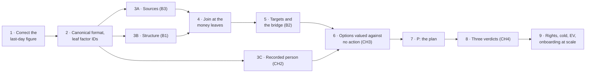

# Layer 4 roadmap: a solid core, then boosters

**AssetEcon · rev 5 · AssetOps Architect (Claude) · 20 Nov 2026.** This replaces rev 4.2 of 18 Nov, which is kept at `.ai/history/layer4-roadmap-rev4.2/` (owner, 20 Nov: "yes, send it to the architect", `owner/owner-roadmap-replace-2026-11-20.md` on `main`). It states the order and links to the detail: the design (`layer4-transformation-design.md`), the decisions (`decisions-register.md`), the fortnight (`two-week-build-plan.md`, `delivery-plan.md`) and the data and build strategy (`Docs/engineering/data-and-build-strategy.md` on `task/data-build-strategy`).

**The objective every step serves:** operator executives of mini-grids, cold rooms and EV depots adopt the product because it shows their own money explained, their choices compared and results proven, which their monitoring tools cannot do (design Introduction). Each step below says what it adds to that.

## 1. Today's core, and what it already delivers
<!--derives: Part 1; §2.0; §2.9; Rules-->

Today's product turns Site evidence into honest, bounded operational judgement that a person can act on and later verify (design §1.1). It keeps:
- **the evidence ledger and the analyses**, which say what happened and how sure they are, interval by interval;
- **Findings and threads**, the living results of evaluating a condition, each with its next step;
- **the act-and-track carriers** (Actions, setting trials, domain actions, work cases) and **verification**, which judges whether a change worked;
- **the honesty rules**: every figure says how it is known, kinds are never added together, and a missing record is named.

*Serves the objective:* this honesty is the credibility an executive needs before trusting a money figure. Nothing below replaces it; each booster extends one part of it (design §2.9, change register).

## 2. The boosters, in delivery order
<!--derives: §2.0; §2.1; §2.2; §2.3; §2.4; §2.5; §2.6; §2.7; §2.8; §2.9; Figure 10; B1; B2; B3; P; CH1; CH2; CH3; CH4; CH5-->

The order is the design's Figure 10. Lanes A (sources) and B (structure) run in parallel and join at the money leaves.

| Step | What it adds on top of the core | Value to the executive, and why monitoring tools cannot match it |
|---|---|---|
| 1, 2 | The period's own figure on the Optimize card (CH5); one canonical format | The screens stop understating a month; one contract for every source |
| 3A (B3) | A commercial record store, file intake, emulators labelled *Emulated* (D14) | Billing, collections and costs beside telemetry, which monitoring tools do not hold |
| 3B (B1, CH1) | The factor structure from leaves to outcomes; Findings pinned to their factors | Kobo's October contribution, 1,565.50<!--fig:sites.lakeside-power/Kobo.actual.nodes.contribution--> against a target of 1,951.25<!--fig:sites.lakeside-power/Kobo.plan.nodes.contribution-->, computed factor by factor |
| 3C (CH2) | Sign-in and roles (OD-13, OD-14); a named person on every command | Accountability the executive can see |
| 4, 5 (B2) | Money leaves from records; targets per factor; the bridge | Why the month came in below target, in money |
| 6 (CH3) | Options valued against no action, bounds first | Choices compared net of their cost: Mto's huller connection is worth 2,213.33<!--fig:options.MTO-HULLER.value--> over twelve months (MODELLED on SIMULATED litres from the M8 replay); Kobo's stop-threshold litres and value are Not available yet (a dispatch replay on Kobo's October as recorded; 0K4f) |
| 7 (P) | The plan's items, each with its chooser and owner, released within thresholds and approved by the executive (OD-16, OD-17) | Cross-Site trade-offs within budget and crews |
| 8 (CH4) | Economic and causal verdicts beside the operational one | Proof that the money followed |
| 9 | Rights from contracts, cold rooms, EV depots; the EMS API, then the edge gateway (OD-22) | Remedies inside repair decisions; all three verticals |

**The person in the loop.** The system proposes; people choose and act. The role accountable for what a decision concerns chooses its option, the executive approves the plan, and each choice, approval and completion is recorded under the person (design §2.6, OD-16, OD-25).

## 3. The fortnight's lanes
<!--derives: §2.8; §2.9; Figure 10; OD-23; D7; plan_model-->

The day-by-day schedule is `two-week-build-plan.md` §4, computed by `plan_model.py`. Four build lanes run: sources and money, structure and the plan's records, person and decisions, screens and tooling. Two strands join them:

**Data slices** (data and build strategy §9; units are the strategy's unless noted). They enter the model at the day-7 re-cut (owner, question 8):
- `DS1` generator core and the demo operators' July to September history (owner U9): 4 units by the DS1 spec's rev 2 ruling (`specs/DS1-history-generator/rulings.md` D-DS1.14 on `main`), not the strategy's 2.5; `DS1b`, the source-shaped record writers, 1 unit after `2a`;
- `DS2` shapes, synthetic by default and switchable to public excerpts (owner Q2), 3; `DS3` bulk loader on plain Postgres (Q3), 3; `DS4` template ladder and the re-benchmark, 2.5;
- `3B7a` the daily structure snapshot, 2.5, and `3B7b` its triggers and the worker, 3. Recalculation runs at the daily run or on demand, recorded under the person (OD-23 as amended, owner Q7);
- `DS6` the rolling world, 2.5, on the stretch line; `DS7` only if `DS4` misses 45 minutes.

**The screens.** UI wave 2c is merged to `main`: the UI/UX guide, the redesigned Portfolio and the East Africa pack, the starting pack for the demo operators with Neutral as the product default (owner U10). The Decision page redesign is in review. Under D7, the mock-up governs the Layer 4 screen slices once the owner approves the pack; until then a screen slice may build but does not merge without the owner's walkthrough.

**Unknown is not zero.** Every empty state names the record that would fill it, read from a `missing` field, never from a null alone (register call 22, `D-2026-11-20-l4-empty-states`; `structure-specification.md` §3.1).

## 4. After the demo
<!--derives: §2.3; §2.9; D1; D3; D4; D15; OD-22-->

- **The pilot** follows the engagement path: a call, a deep-dive on the operator's own exports, an integration pack, the pilot, then SaaS (D1). By D15's default, the first change is agreed at the end of the deep-dive and made when the pilot starts, so the pilot's three verdicts prove it.
- **The second vertical** follows the first qualified prospect; cold rooms if none (D3, D4 defaults). Mini-grid goes first.
- **Usable capacity by time window** (queued slice `4c`) is pulled when a lane is free after the must-keep set, at the latest when a pilot pins a real register profile (register call 23).
- **Deferred, each with its trigger** (register §5 and `delivery-plan.md` §7): asset value at risk waits for condition data and failure history in a pilot; the EMS API and the edge gateway on hardware are step 9 (OD-22); single sign-on follows sign-in by email (OD-13); `DS7` runs only if `DS4` misses its target.

The open questions and their defaults are in `decisions-register.md` §5. The owner's view would help most on call 22's target assumption and on D15.
