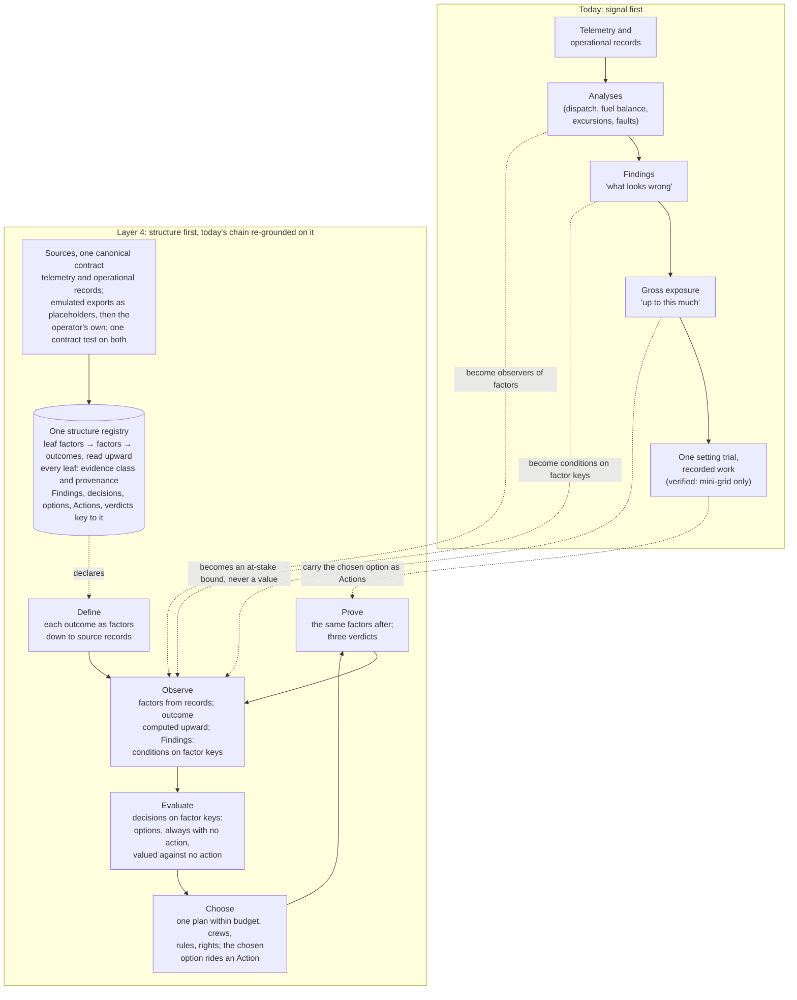
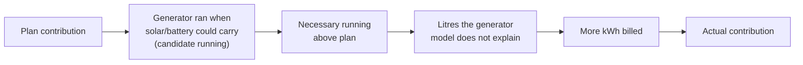
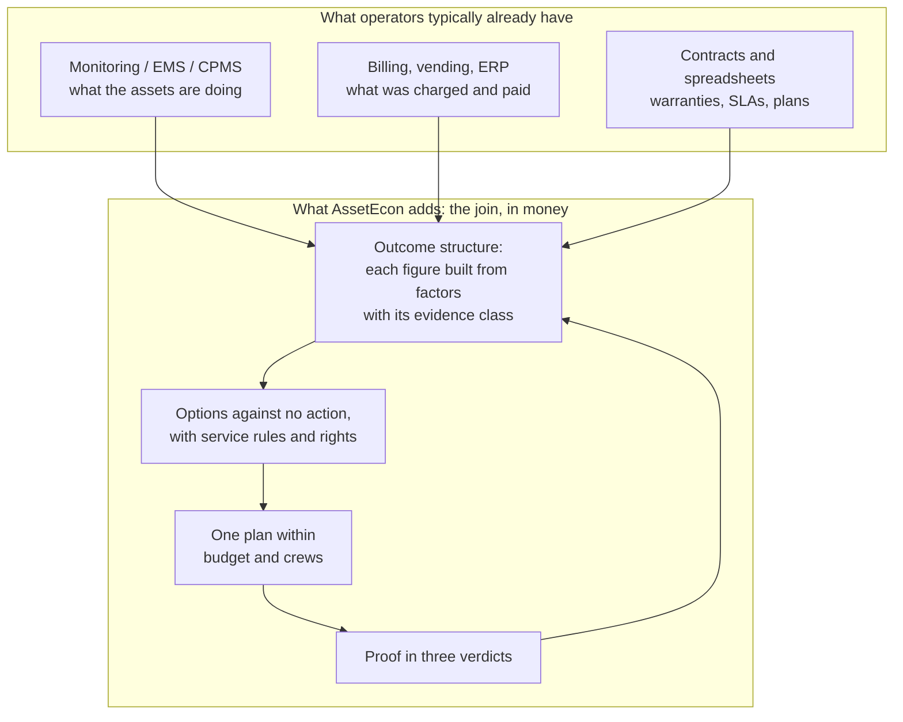
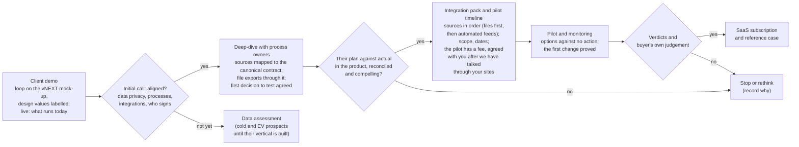
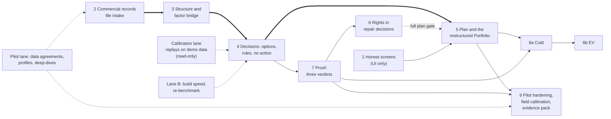
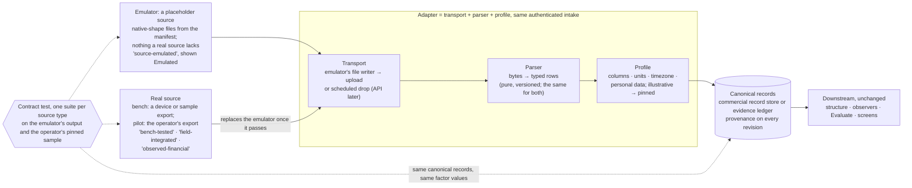
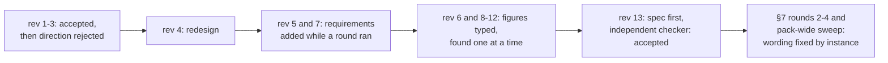
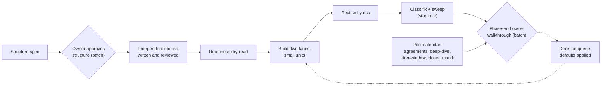

# Product transition and roadmap: from today's product to the economic decision loop

**AssetEcon · decision document for the owner · AssetOps Architect (Claude) · 18 Nov 2026 · revision 4**
**Status:** for owner decision. Revision 4, with its review fixes, answers the owner's grounded-path question of 18 Nov (§3.6–§3.9, §4.4, D13–D15). Revision 4.1 follows the owner's revision of D1 the same day (`/opt/assetecon/AssetOpsV1/owner/owner-d1-engagement-path-2026-11-18.md`): the engagement path is initial call → deep-dive with process owners → integration pack and pilot timeline → pilot and monitoring → SaaS, with no priced diagnostic; D13 and D14 are adopted, D15 is pending (`/opt/assetecon/AssetOpsV1/owner/owner-sitting1-answers-2026-11-18.md`). Revision 4.2 (18 Nov) takes the engagement's durations, the owner's capacity and the first-proof date from the go-to-market plans revised to the same path (commercial plan rev 4 and two-week plan rev 4.2 §9, changes PK1–PK10, on `task/gtm-documents` at `ea5eb2cef`). Revision history: Appendix C.
**Request:** owner, 18 Nov 2026, verbatim in `.agent/owner-product-transition-request-2026-11-18.md` (including the follow-ups on the effort basis and the workflow change), with the owner's demo objective: *convert mini-grid, EV and cold-chain operator executives to adopt the product, with real value that monitoring tools and competitors in Africa do not offer.*
**Built on:** the product brief (`.agent/AssetEcon_Product_Direction_Layers_1_to_3_and_Claude_Brief_REVISED.md`), the owner's standing rules (`.agent/owner-layer4-direction-feedback-2026-11-17.md`) and the Layer 4 pack in this folder. The coordinator's two chat answers were the starting point. Every factual claim in them was checked against the code and the pack; §1.6 and §2.7 list what was corrected and where this document disagrees.

> **How figures are labelled.** Every money figure below comes from the demonstration world (`derived-values.json`, produced by `evaluate_structure.py` from the manifest). It is an **illustration**, never a customer result. Each figure carries a tag in the source that `check_manifest.py` recomputes independently (§4.3). A replay-derived figure is a **design value** until its replay has run. Run on the simulated demo series, it becomes **Modelled on simulated data**. Only a run on an operator's recorded series makes it evidence about a real site (§2.7, D6). Effort and calendar ranges are **estimates** with their assumptions stated; they are not commitments.

---

## On one page

| Question | Answer |
|---|---|
| What is the fundamental difference? | Today the product starts from **signals** and reports what looks wrong. Layer 4 starts from **how each business outcome is made up** (its factors, down to the records that evidence them). From there it computes where the money stands, which choice is worth making within budget and crews, and whether it paid off. |
| Why does it matter for the buyer? | Operators already have monitoring. What they lack is one place where operational, commercial and contract facts are joined into money, choices and proof. That is the brief's differentiation **hypothesis**; pilots must confirm it. |
| Recommended path | **The owner's engagement path (D1, revised 18 Nov), in between, on a grounded path.** Initial call (alignment on data privacy, processes, integrations and who signs) → deep-dive with process owners → integration pack and pilot timeline → pilot and monitoring → SaaS. Today's chain (Findings, threads, what-ifs, Actions, verification) is re-grounded on the factor structure and becomes the delivery vehicle; the steps are ordered by how soon the client's screens become economically useful (§3.6–§3.9). Two safeguards: the operator's own file exports go through the canonical contract during the deep-dive, so their plan against actual is in the product within weeks as the pilot's baseline; and a pilot fee, modest or credited against the first SaaS year (the owner's words; which form is C2, open default), with the price disclosed after the client conversation. The product computes; nothing is transcribed by hand. Pilot onboarding runs as a parallel lane from the start. The demo shows the loop on the mock-up, then the live product as what runs today, and closes on a deep-dive and pilot on the prospect's data, offered as a design partnership (§2.3). Conversations start during phase 0; no deep-dive starts before the kit and a data agreement exist. **Decided by the owner, 18 Nov.** The commitment, the first revenue, comes about **weeks 7–14** from approval (weeks 9–18 at the owner's 240-minute baseline; commercial plan rev 4 §5.6). Go-to-market defaults, not decided by the owner: the deep-dive without a fee, timeboxed at about 11.5 owner-days (C12, open default), and the pilot fee credited in full against the first SaaS year (C2, open default). |
| Lead vertical | **Mini-grid.** It has the deepest observation today and the only setting change and verified changes. Cold and EV prospects get the demo and a data assessment. Their verticals are built second and third, in the order the first qualified prospect decides. |
| The owner's grounded path | **Holds**, on two conditions: findings attach to factors and outcomes are read upward through them; findings, options, Actions and verdicts key to one registry. "Economic benefit realised early" holds only on an operator's records: on emulators the loop is demonstrable and testable, never a benefit (§3.7–§3.8) |
| When value reaches a customer | The site is onboarded during the deep-dive and, if the owner adopts D15 (pending), the first change is agreed at its end, carried as an Action and made when the pilot starts: the first proved change about **M4–M5** in the go-to-market plans' planning case, about M4–M6 at the owner's 240-minute baseline (commercial plan rev 4 §5.6), against M6–M7 with the change made inside the pilot (revision 3). It needs 4f, 4d and 4g merged before the commit and 7b before the after-window ends. The first factor views and decision view arrive a few days to a week sooner and no longer wait for commercial records (§4.4) |
| The decisive early test | The **factor bridge** on the first operator's own month: contribution against plan, split by factor, reconciled to their accounts. If it is not compelling, stop and rethink before building operator-specific options and plans. |
| Rough size | Agentic development in this repository (Architect, Implementer and Reviewer agents, owner checkpoints, two lanes). Mini-grid core loop: about **2–4 months** of build (8–16 weeks on the balanced lanes of revision 4). The first version said 4–7 months; this is revised to the observed pace and the workflow in §5. Each further vertical takes about **1–2.5 months**, mostly waiting for data. The **pilot calendar** sets the date of the first proved change on a customer site (now about M4–M5), not the build. A human team: roughly 7–12 months for the same core (a judgement, §4.3). |
| How we build it | Approve the structure before building. Write independent checks before figures. Batch decisions with defaults applied, so no agent waits. Match review depth to risk. Fix classes of problem, not instances, and stop after two repeated rounds (§5). |
| Decisions needed | Fifteen, in §6. Adopted by the owner on 18 Nov: the workflow (D11), the grounded, visible-first path (D13), the two labels with benefit only on field provenance (D14), and the revised engagement path (D1, with D2 and D5 following from it). Pending: the first change agreed at the end of the deep-dive (D15; the owner asked for more context). The main open ones: lead vertical; how design values are shown to clients (Q13), now needed before the first pitch; the demo and pitch shape (D12). |

---

## 1. Where we are and where we are going

### 1.1 The difference in one picture



Today's product is not wrong; it is one layer of the loop. Its analyses observe physical factors well, and they carry over. What is missing is everything that turns those observations into money, choices and proof.

**Why the transition, in full.** How far today's mechanics reach, dimension by dimension (how data is organised, how it is processed, how it is presented), is set out in `layer4-transformation-design.md` §0, with Kobo's month as the running example. For each dimension, §0 gives what today answers, one operator question it cannot answer and why, and three sorted lists: missing, repurposable and must change. It is not repeated here. §1.2 below sets today beside Layer 4 in one table, and §3.6–§3.7 are the path that §0's conclusion leads into.

### 1.2 Side by side, verified against the code

| | Today's product (as the code shows it) | Layer 4 |
|---|---|---|
| **Starting point** | Telemetry and operational records produce Findings, such as "generator running while solar and battery could carry the load" (dispatch classification, `analytics/dispatch_v3.py`) | Each outcome (contribution, cost to serve, service obligations) is declared as a structure of factors: litres, kWh billed, crate-days, departures met |
| **How an outcome is read** | Ten outcome-map rows link a signal straight to an outcome, all of kind "moves" (`outcomes/outcome_map.py:149-180`). Portfolio cards show counts and estimates. Each site's outcome board names every outcome's drivers, issues, levers, what is in hand and earlier results, in words (`frontend/src/sites/OutcomeBoard.tsx:42-48`) | Plan against actual is computed factor by factor and read upward. Kobo, October (demo): contribution 1,445<!--fig:sites.lakeside-power/Kobo.plan.nodes.contribution--> planned, 883<!--fig:sites.lakeside-power/Kobo.actual.nodes.contribution--> actual, built up in §1.3 |
| **Where money comes from** | No recorded commercial money at all: `recorded_amount1` "returns no money … always" (`chain/strategies/recorded_amount.py:1`). The money shown is **estimated** from declared prices (productive-use income, EV charging income: `chain/strategies/priced_energy.py`) or **modelled** (possible extra fuel cost) | Recorded money from billing, receipts, invoices, plans and tariffs, beside operational data |
| **What a value means** | Gross exposure: a modelled potential fuel cost, from 0 up to an upper bound on the fuel burned during candidate running (`financials/fuel_cost.py`: `POTENTIAL_FUEL_COST`, `MODELLED_CONDITIONAL`, `quantity_low = 0 L`). The Portfolio's Optimize card shows the lead Finding's exposure for the window's **last day** on a 7- or 30-day range (mini-grid reads one day, `site_outcomes/read.py:602-606`; card `:901-923`; lead Finding `chain/read.py:190`) | The change an option makes against doing nothing, over the same horizon, net of its own cost |
| **Choices** | Findings carry next-step text (`analytics/plain.py:360`). There is **one setting-change action**, the reserve trial: a fixed −5 points (`actions/reserve_trial.py:37`); the action table admits only that rule (migration `0016:60`). Operators also record **domain work actions** for all three verticals (`domain_action`, migrations 0033, 0035, 0051). Mini-grid scenarios are authored productive-load what-ifs: energy and gross sales over measured headroom at an authored tariff, with no cost, no net value and no no-action comparison (`mini_decisions/scenario_rules.py:191`). Alternatives are competing explanations of a Finding and change nothing downstream (`mini_decisions/alternatives.py:1-14`). Cold and EV scenarios are authored what-ifs with no computed amount | Several options per decision, always including no action, compared, with rejected options and the reasons |
| **Trade-offs** | Shown as text and counts ("checked" rows). Only two protections act: a classification rule that keeps running near reserve "necessary" (`dispatch_v3.py:290-291`) and guardrails checked after a trial (`verification_rules.py:787-800`) | Service rules and rights are evaluated before recommending. An option that breaks dawn battery charge or loses warranty cover is left out or ranked down |
| **Across sites** | Findings are ranked by placement, which "says where to look first, never a value ranking" (`estate/placement.py:1-6`). Possible extra fuel cost is **listed per site and never summed** (`site_outcomes/read.py:901-903`; test `test_ch5d1_optimize_card.py:60`). Credited results are never summed (`estate/portfolio.py:680-681`). Estimated income **is summed** into one Portfolio total when every site uses the same currency (`chain/vocabulary.py:459-508`, called from `site_outcomes/read.py:777`) | One plan across the portfolio within budget, crew visits and dated dependencies. Switches (budget, a customer's letter of intent) re-compute it |
| **Proof** | An operational verdict, mini-grid only, in three families: the reserve trial and the midday mill shift (`actions/verification_families.py:502`), and the fuel-balance work action (`actions/fuel_verification.py`, migration 0057). A positive verdict admits only simulated or authored evidence (`verification_rules.py:688`). The intervention cost is fixed at 0 (`actions/verification.py:1167`). Cold and EV work actions cannot reach "verified" | Three separate verdicts: the operational change happened; the money followed (from later records); it was caused by the action (untreated sites as comparison) |
| **Honesty of figures** | Already strong on provenance (*demo-simulated, source-emulated …*), "not available yet", and never-sum rules | Adds an evidence class and a provenance to every figure (Recorded, Emulated, Calculated, Estimated, Quoted, Modelled, Design value). Figures of different kinds (observed, modelled, at stake, verified) are never added together; a figure the structure composes from mixed leaves takes the weakest class and carries every provenance beneath it, and a benefit total admits only field records (§3.8) |
| **Contracts and rights** | Battery warranty exists only as withheld fields (`sites/battery_boundary.py:26`) | Warranty, EPC, O&M/SLA and insurance rights decide who bears a cost, inside repair decisions |

### 1.3 The same site, read both ways (Kobo, October; demo values)

Today the product tells Kobo's operator two things: the generator ran when solar and battery could have carried the load, and how much that fuel might have cost. It cannot say what the month did to the site's contribution, because the product holds no billing or plan record.

Layer 4 reads the month up from its factors:



| Factor (Kobo, October) | Plan | Actual | Effect on contribution | How it is known |
|---|---|---|---|---|
| Fuel for necessary running | 700<!--fig:sites.lakeside-power/Kobo.plan.nodes.necessary_l--> L | 730<!--fig:sites.lakeside-power/Kobo.actual.nodes.necessary_l--> L | −37.50<!--figx:-({sites.lakeside-power/Kobo.actual.nodes.necessary_l}-{sites.lakeside-power/Kobo.plan.nodes.necessary_l})*{sites.lakeside-power/Kobo.actual.nodes.diesel_price}--> | split: declared input standing in for a calculation |
| Fuel for candidate running (solar/battery could carry) | 0<!--fig:sites.lakeside-power/Kobo.plan.nodes.candidate_l--> L | 330<!--fig:sites.lakeside-power/Kobo.actual.nodes.candidate_l--> L | −412.50<!--figx:-({sites.lakeside-power/Kobo.actual.nodes.candidate_l}-{sites.lakeside-power/Kobo.plan.nodes.candidate_l})*{sites.lakeside-power/Kobo.actual.nodes.diesel_price}--> | split: declared input standing in for a calculation |
| Fuel not explained by the generator model | 0<!--fig:sites.lakeside-power/Kobo.plan.nodes.unexplained_l--> L | 120<!--fig:sites.lakeside-power/Kobo.actual.nodes.unexplained_l--> L | −150.00<!--figx:-({sites.lakeside-power/Kobo.actual.nodes.unexplained_l}-{sites.lakeside-power/Kobo.plan.nodes.unexplained_l})*{sites.lakeside-power/Kobo.actual.nodes.diesel_price}--> | fuel balance (Record) minus model |
| kWh billed | 8,550<!--fig:sites.lakeside-power/Kobo.plan.nodes.billed_kwh--> | 8,645<!--fig:sites.lakeside-power/Kobo.actual.nodes.billed_kwh--> | +38.00<!--figx:({sites.lakeside-power/Kobo.actual.nodes.billed_kwh}-{sites.lakeside-power/Kobo.plan.nodes.billed_kwh})*{sites.lakeside-power/Kobo.actual.nodes.tariff}--> | billing export (Record) |
| O&M and staff | 1,100<!--figx:{sites.lakeside-power/Kobo.plan.nodes.om}+{sites.lakeside-power/Kobo.plan.nodes.staff}--> | 1,100<!--figx:{sites.lakeside-power/Kobo.actual.nodes.om}+{sites.lakeside-power/Kobo.actual.nodes.staff}--> | 0 | invoices (Record) |
| **Contribution** | **1,445<!--fig:sites.lakeside-power/Kobo.plan.nodes.contribution-->** | **883<!--fig:sites.lakeside-power/Kobo.actual.nodes.contribution-->** | **−562.00<!--figx:{sites.lakeside-power/Kobo.actual.nodes.contribution}-{sites.lakeside-power/Kobo.plan.nodes.contribution}-->** | Calculated |

Diesel is priced at 1.25<!--fig:sites.lakeside-power/Kobo.actual.nodes.diesel_price--> per litre and the tariff is 0.40<!--fig:sites.lakeside-power/Kobo.actual.nodes.tariff--> per kWh.

From there the loop continues. The options that change those factors are valued against doing nothing. The demo's recommended setting change is worth 2,916.00<!--fig:options.KOB-STOPSOC.value--> over twelve months; that is a **design value** until replay K has run. The simpler reserve change is rejected, because it breaks dawn battery adequacy on 4<!--fig:options.KOB-RESERVE.params.dawn_days_below_35pct--> of 61 days. The plan across Kobo, Kisiwa and Mto is chosen within a budget of 5,000<!--rec:tenants[lakeside-power].portfolio_constraints.budget_usd_nov_dec--> and 3<!--rec:tenants[lakeside-power].portfolio_constraints.crew_visits_nov--> crew visits, and the change is later proved on the same factors.

### 1.4 What the buyer gets, by vertical

The mechanics are the same for all three verticals. Each fills them in with its own factors, levers and limits.

| Buyer | Today's product gives | Layer 4 gives (demo illustrations) |
|---|---|---|
| **Mini-grid operator** | generator running split into necessary and candidate; fuel balance; possible extra fuel cost (gross); productive-use headroom and authored what-ifs; one reserve trial; verified midday-shift and fuel-balance work actions | contribution against plan per site, split into fuel, billing, losses and collections; a setting change valued net against no action, with the tempting option rejected on a service rule; productive demand valued only with a customer behind it (the huller adds contribution, the welder loses money); claim the inverter under warranty or buy now, with the deadline |
| **Cold-chain operator** | chamber temperature excursions; backup-start failures; authored stock-value what-ifs; no money computed; changes cannot be verified | contribution per room from occupancy and energy; separating low occupancy from inefficiency (energy above what occupancy explains: Mwea +0.6%<!--figx:round({sites.harvest-cold/Room A · Mwea.actual.nodes.excess_kwh}/{sites.harvest-cold/Room A · Mwea.actual.nodes.kwh_model}*100, 1)-->, Kirinyaga +24%<!--figx:round({sites.harvest-cold/Room C · Kirinyaga.actual.nodes.excess_kwh}/{sites.harvest-cold/Room C · Kirinyaga.actual.nodes.kwh_model}*100, 0)-->); repair or replace; batch exposure kept apart from damage and from liability; an EPC claim |
| **EV depot operator (captive fleet)** | interrupted sessions; charger availability; peak warning; an **estimated** charging income from a declared tariff (which does not fit a captive fleet); changes cannot be verified | cost per departure met (revenue "not applicable", never zero); a charging schedule that meets every departure, chosen over the cheapest one, which misses buses; a charger fault ranked by the departures it costs; SLA rights. The largest demo figure, Embakasi's 8,082.00<!--fig:options.EMB-DEADLINE.monthly_or_horizon_change--> a month, rests on an **assumed** tariff and is a design value (Q7) |

### 1.5 Why Layer 4 is the differentiator against monitoring tools



A monitoring tool answers "what is the asset doing". Each of the operator's systems answers part of the money question, in its own terms. The brief's differentiation hypothesis is the **join**: cross-system economic judgement at site and portfolio level, compared interventions, transparent assumptions, and proof after the change (brief, line 94). This document does not claim that any single feature is unique; the brief itself says that is a hypothesis to validate with prospects and pilots, not a demonstrated moat. No competitor is named or characterised here, because the pack holds no sourced competitor facts.

What a demo can show that monitoring cannot, using the mechanics rather than one site:
- the outcome read from its factors (a monitoring tool has no plan or billing records);
- the counter-intuitive contrast (the highest diesel user may have nothing worth changing);
- a rejected option and the rule that rejected it;
- a contract right that changes who pays;
- how the result will be proved.

### 1.6 Corrections to the coordinator's first answer

Revision 2 re-verified every code claim in §1.2–§1.5 and corrected four claims of the coordinator's first answer: whether money is summed across sites, the fuel-cost wording, the mini-grid scenarios and the domain work actions. The claim-by-claim table is in revision 3 of this document (git history of this file, commit `ff72c58fb`); its conclusions are folded into §1.2.

---

## 2. The transition strategy

### 2.1 Three options

| | A. Pilot with today's product | B. Build Layer 4 first, then pilot | C. In between: the owner's engagement path, Layer 4 as destination |
|---|---|---|---|
| What the buyer sees | monitoring and diagnostics with exposure figures | nothing for months, then the full loop | from the deep-dive: the loop on their own records, computed by the product from their file exports, more of it each month |
| What we learn | whether we match a dashboard | late: whether real data fits a design built without it | early: whether their data access, privacy rules and processes allow it, whether their records support the factor bridge, which decisions they care about, what their files look like |
| Risk | lands in the category the buyer already has; the demo promises more than the product does | the design meets real data late; calibration, record shapes and the option list stay guesses; no revenue or reference | the first baseline waits for file intake (step 2) if a deep-dive starts before it merges; promising more than is built |
| Fit with the brief | weak: the brief says monitoring is not the promise | weak on validation: the brief's path is demo → paid diagnostic → field validation | strong on validation; it departs from the brief's priced diagnostic by owner decision (D1, §2.7) |
| **Judgement** | not recommended | not recommended | **recommended** (the owner's path, D1), with the controls in §2.2 |

### 2.2 The recommended path

The owner revised D1 on 18 Nov (`/opt/assetecon/AssetOpsV1/owner/owner-d1-engagement-path-2026-11-18.md`). A new vendor does not charge for analysis before trust exists, the founder does not become a bottleneck preparing analyses by hand, and the work goes into the product: the integration pack maps onto the canonical data contract and its source adapters.



| Stage | What happens | Who does the work |
|---|---|---|
| Initial call | demo; alignment on data privacy, processes, integrations, and who signs | owner |
| Deep-dive with process owners | map their data sources to the canonical contract; take file exports through it; agree the first decision to test | owner, with the product doing the computing |
| Integration pack and pilot timeline | which sources in what order (files first, then automated feeds); pilot scope and dates; commitment agreed | owner and their IT |
| Pilot and monitoring | their plan against actual, options against doing nothing, the first change proved | the product, the owner overseeing |
| SaaS | subscription | — |

**The controls that keep it honest:**
1. **The product computes; nothing is transcribed by hand.** The deep-dive's file exports enter through the same canonical contract and intake as every source (step 2's file intake; `integration-source-to-canonical-design.md` §7). Their plan against actual appears in *Outcomes by site* once steps 2–3 have merged, and becomes the pilot's baseline. If a deep-dive starts before file intake runs, it maps the sources and agrees the integration pack meanwhile; its baseline waits for intake rather than being prepared by hand (Architect default, logged in §6 under D1).
2. **Each gap a deep-dive finds becomes the next product slice.** A source shape the contract does not cover, a plan granularity the structure does not handle, or a decision the option list lacks is recorded and scheduled, never patched for one operator (owner's rule: general before particular).
3. **Cap concurrent deep-dives** at two (an assumption) until the factor bridge is in the product. The owner's time caps it lower (TW11's 240-minute baseline, up to 480 on peak days; commercial plan rev 4 §5.4): **one deep-dive at a time, with a pilot beside it**; a second deep-dive with a few days of a second person's help (C10/C11, open); at the 240-minute baseline alone, one piece of work at a time.
4. **No replay-derived saving is presented as a result** until its replay has run on the operator's own recorded series. A replay on the simulated demo series changes the label from design value to Modelled on simulated data. It shows that the figure is consistent with the simulated world; it measures nothing about a real site (§2.7, D6).
5. **Benefit only from an operator's own records.** Emulators are placeholders for the canonical contract, replaced by real integrations (§3.8). Every figure carries its provenance beside its evidence class; a figure on emulated or simulated records is demonstrable and testable, never benefit. Where the structure composes it with field records, the result takes the weakest class and carries every provenance beneath it, so it is never shown as field-integrated and never enters a benefit total (§3.8, D14).
6. **The first change agreed at the end of the deep-dive and made when the pilot starts** (D15, open: the owner asked for more context; the Architect's default is applied meanwhile). The deep-dive onboards the site (site model, controller-export profile), replays the recommended option on the operator's own export, freezes its prediction and, where the operator agrees, commits it as an Action. The change is made when the pilot starts and proved by the end of the pilot's second month: first proved change about **M4–M5**, about M4–M6 at the owner's 240-minute baseline (§4.4). It depends on the forward replay adapter (built by spike K) before the replay, on the decision view, the stop-threshold carrier and its verification family (4f, 4d, 4g) merged before the commit, and on field-evidence admission (7b) before the after-window ends.

**Delivered on a grounded path.** The product builds the loop by re-grounding today's chain on the primitives rather than beside it, in the order in which the client's screens become useful (§3.6–§3.9). Each deep-dive and demo therefore shows more of the loop live each month.

### 2.3 The offer

| Stage | Buyer provides | Buyer receives | Length (estimate) | Terms |
|---|---|---|---|---|
| **Demo and initial call** | an hour of executive time; a view on data privacy, processes, integrations and who signs | the loop on one demo operator of their vertical (mock-up; separate login per operator, Q5), then the live product as what runs today (below); an honest read on whether their data and processes fit | 30–60 min | free |
| **Deep-dive with process owners** | their process owners' time; the minimum file exports below, for up to three sites, one to four months; a data agreement | their sources mapped to the canonical contract; each site's outcomes computed by the product from their exports against their plan, with what is recorded and what is missing (the pilot's baseline); the first decision to test, compared with no action; contract rights at risk and their deadlines | about **2.1–4.3 weeks**, their first plan against actual about 1.1–2.5 weeks in (commercial plan rev 4 §6.3, from the owner-days and the calendar minimums); data agreement before that, 2–6 weeks | free, timeboxed at about 11.5 owner-days (C12, open default); ends with the integration pack (D2) |
| **Integration pack and pilot timeline** | their IT's time | which sources in what order (files first, then automated feeds), pilot scope and dates, the commitment | about **1–1.4 weeks**; at the owner's 240-minute baseline the deep-dive and the pack together take 4.7–9.9 weeks | a **pilot fee**, credited against the first SaaS year (C2, open default; the alternative is modest and not credited); price disclosed after the client conversation (D2) |
| **Pilot and monitoring** | continuing exports, then feeds; an operations lead's time; agreement to one supervised change | monthly economic review in the product; options against no action; the first change, where agreed at the deep-dive's end, proved operationally and then economically; further changes | about 2–3 months (an after-window of at least 14 matched days, then the next closed month for the money verdict) | as agreed in the integration pack |
| **SaaS** | — | the product on their sites | subscription | set after the client conversation |

**What runs today, shown live.** After the loop, the demo switches to the live product for the layer the loop is built on: file intake of readings with a dry run (`sites/ReadingUpload.tsx`), generator running split into necessary and candidate, fuel balance, and the verified reserve trial and work actions (§1.2, §1.4), each with its provenance label (demo-simulated, source-emulated). The live part grows with each visible increment (§3.6): findings on their factors (V1), site factor views (V2), the Kobo decision and its Action (V3), the bridge on emulated records (V4). The presenter says which parts run and which are the mock-up. Until step 1 ships, the live part stays on Site pages and leaves out the Portfolio's Optimize card, whose last-day figure misleads (§1.2).

**Design partnership.** The deep-dive and the pilot are offered as a design partnership: the gap between what runs and the loop is the reason to join early. A partner gets the loop on its own records first; its decisions and record shapes set the option lists and profiles built for it; its choice weighs on which vertical comes second (Q10); and a reference case is published only with its agreement. It does not get bespoke work: the pilot carries its fee (D2; credited against the first SaaS year is C2's open default), the core stays general (§2.7), the alignment gate stands, and one deep-dive runs at a time, with a pilot beside it (control 3).

We do not promise savings; we show how they would be proven (pack wording, kept).

### 2.4 Onboarding data checklist

The checklist is derived from the leaf factors. Each record family evidences one group of factors, so the checklist is the structure read from the bottom (`integration-source-to-canonical-design.md` §7.1).

| Record (mini-grid) | Unlocks | If missing |
|---|---|---|
| Controller / EMS export, 60–90 days | generator, battery and solar factors; necessary vs candidate running; replay calibration on recorded data | no fuel split; no setting option can be valued |
| Customer meter register with change dates | delivered → metered → billed mapping | unmapped meters cannot be separated from losses |
| Billing or vending export, 4 months | kWh billed and revenue | contribution "not available yet" |
| Payment settlement statements | collected, in transit, outstanding | cash position unknown |
| Fuel deliveries and dips | litres consumed; unexplained litres | the fuel factor rests on the model only |
| Monthly plan or budget, by site and line | plan at every factor | no plan against actual; the bridge is shown as "not decomposed" where the plan is a single total |
| Contract set for the most important asset (warranty, O&M) | rights, notice deadlines, who pays | repair options valued as if the operator pays |
| *(for the plan)* open repairs, quotes, budget and crew limits | options and the plan's limits | decisions without costed options |

| Vertical | Minimum records (five to seven) |
|---|---|
| **Cold rooms** | storage ledger (batch in/out, commodity, crates, rate); energy bills; chamber temperature log; invoices and receipts; QA notes; plan; refrigeration contract and goods-in-custody policy |
| **EV depot** | charging-system (OCPP) log export; fleet roster with departures and required energy; utility invoice and tariff contract; service tickets; plan; charger warranty and SLA |

A prospect who cannot supply billing (for cold, the storage ledger; for EV, the roster) and the plan is not ready for a deep-dive; offer the data assessment instead.

### 2.5 Success criteria (stated in advance; no invented benchmarks)

| Stage | Criterion | Measured how |
|---|---|---|
| Demo and initial call | the executive names an issue as theirs and a decision to investigate; data privacy, processes, integrations and signatories are aligned or the blocker is named | recorded verbatim in the validation sheet (`phase-plan-and-acceptance.md` §10) |
| Deep-dive | one closed month reconciles to their management accounts on revenue and fuel or energy cost, within a tolerance agreed at the start | reconciliation table |
| Deep-dive | the factor bridge leaves an unexplained residual the buyer accepts as small, and names at least one cost they did not know about | buyer's own judgement, recorded |
| Deep-dive | their operations lead confirms at least one recommended change is feasible; where agreed, it is committed with a frozen prediction | recorded; the Action and its frozen prediction in the product |
| Pilot | one change committed with a frozen prediction; operational verdict after the after-window; money verdict from the next closed month's records; causal strength stated | the three verdicts in the product |
| Commercial | deep-dive agreed, declined or deferred; integration pack and pilot commitment (a pilot fee; its form is C2, open default) agreed or not; pilot converted to SaaS or not; each with the reason | validation sheet |

### 2.6 Lead vertical, and how cold and EV follow

**Mini-grid leads**, for reasons the code confirms. It has the deepest physical observers (dispatch-3.2, fuel balance), the only setting-change action, and the only verification families (reserve and midday shift, `actions/verification_families.py`; fuel balance, `actions/fuel_verification.py`). Cold and EV cannot reach "verified" today. Leading with another vertical would put the loop's last step on the critical path.

**Cold and EV follow without being shaped by mini-grid.** The general parts (commercial record store, structure registry and read, option evaluator, bounds, allocator, verdicts) are built once and tested on cold and captive-EV fixtures from the start (`phase-plan-and-acceptance.md` slices 3–5). Only each vertical's own structure, observers and lever models are added later. Which comes second is decided by the first qualified prospect (Q10). If no prospect decides, cold is the shorter path (storage ledger and energy normalisation; no roster or tariff contracts). EV carries the largest demo figure on an assumed tariff, which is a reason to prove it on a real tariff before leading with it.

### 2.7 Where this document disagrees with the coordinator

This is the one place for every point where this document departs from the coordinator, or agrees for a different reason: its recommendation (first rows), its three pitch points, weighed on merit at the owner's request, and, in revision 4, the owner's grounded-path question with the coordinator's four risks (last five rows).

| Coordinator | This document | Why |
|---|---|---|
| Pilot "ideally paid with a low fee or free with a conversion clause" | **A pilot fee**, credited against the first SaaS year (C2, open default); no priced diagnostic (owner's D1 revision, 18 Nov) | Revision 4 recommended a paid diagnostic first, as in the brief (lines 38, 376). The owner revised D1: for a new product, a call and a deep-dive with process owners come before any charge, the founder does not prepare analyses by hand, and the commitment comes with the pilot (`/opt/assetecon/AssetOpsV1/owner/owner-d1-engagement-path-2026-11-18.md`). This departs from the brief's priced diagnostic by owner decision; the pilot fee keeps a conversion signal. Price is disclosed after the client conversation (D2) |
| Step C "calibration on their data", as one step that needs the pilot | **Two steps that prove different things.** Replays on the demo data now; replays on the pilot's recorded series later. Only the second makes a saving evidence for a client | The replay on demo data needs no pilot (`phase-plan-and-acceptance.md`, calibration lane). It turns three typed design values into simulator outputs and catches design errors (for example inverter clipping at Kobo) before prospects see them. But the demo series are simulator output, so it shows only that the figures are consistent with the simulated world. The coordinator was right that replay figures stay unproven until they run on real series; revision 1 overstated the demo-data step (review M2). The phase 0 exit and D6 now follow this split |
| "Slices 0 (calibration) and 2 (commercial data) need a real operator's data to be done properly" | **Partly agree** | Calibration that counts for clients does need the operator's series (row above). The commercial record store does not: it is designed so that a pilot changes only transport and profile, not the parser, records or structure (`integration-source-to-canonical-design.md` §7.2). Real exports test the profiles, the plan's granularity and the option list; they are not needed to build the store |
| Step B "plan against actual, mini-grid only" | **General from the start**, sourced for mini-grid first | The owner's rule is general before particular. The pack declares the cold and captive-EV structures in the same slice and tests them (for example, EV revenue "not applicable"). It costs little and avoids a core shaped around mini-grid |
| Rights and warranties in the last step (G) | **Inside the mini-grid core**: in the deep-dive from day one (the contract set is among its exports), and in the product in parallel with the plan | Contract rights are among the clearest things monitoring does not do; the evidence is cheap (a few PDFs); and Lakeside's plan turns on claim versus buy now. As in the pack, rights and the plan are built in parallel after decisions, and only the full mini-grid plan gate waits for rights (`phase-plan-and-acceptance.md` §2) |
| "A and B roughly weeks" | **Agree, at the observed pace**: A about 0.5–2 weeks, alongside B; B about 3–7 weeks, including rework and the owner's structure approval | B is the store and the structure read: two slices sized medium and large, about eight reviewed changes (about 1.5–5 weeks of build), with the attribution rules (§4.3). The first version said 1.5–3 months on a padded pace |
| Proof (E) before the plan (F) | **Agree on the calendar, for a different reason** | The first change should start as early as possible, because proof waits for an after-window and a closed month; the plan is built during that wait |
| "Don't keep polishing the design pack" | **Agree**, with two exceptions | The open owner decisions (Q1–Q16) and the mock-up approval gate must still close before the UI build |
| Pitch 1: keep the live product in the demo, shown first as the foundation, then the decision layer as what is being built | **Included, with the order changed**: the demo opens on the loop and switches to the live product at the evidence step, showing only what is honest today (§2.3, D12) | Executives will ask what is real, and a mock-up-only demo cannot answer it; the brief also rules out "a simulator-only story without source-shaped records" and asks for source and limitation within two interactions (brief, lines 376, 386). But the brief's demo opens on a business result, not a technical landing page (line 376), and opening on monitoring places the buyer in the category they already have (option A, §2.1). The live product is the observation layer the loop is built on (§1.1), so it belongs at the brief's Investigate step (line 382). Until step 1 ships, its Portfolio money card misleads and stays out |
| Pitch 2: frame the pitch as a design-partner offer, turning the gap into a reason to join early | **Included, with limits** (§2.3) | The gap is real and stated, and the brief treats the differentiation as a hypothesis that pilots must test (lines 94, 100), so early partners are what the path needs. But a design partnership often means free work and features shaped to one customer. Here the pilot carries its fee (D2, as revised by the owner; credited against the first SaaS year is C2's open default), the alignment gate stands, and partners shape their option lists and profiles, not the general core (owner's rule: general before particular) |
| Pitch 3: early conversations in parallel with phase 0; no deep-dive started until the kit and the data agreement exist | **Included**; it moves one decision earlier | It was implied (demos from M0 in Figure 10; data agreements from M0 in W9) and is now explicit in phases 0 and 1 and in Figure 10. Pitching before any replay has run means the exposure rule for design values (D6, Q13) must be decided before the first pitch, not at phase 0's exit. Friendly prospects then see design values labelled and said aloud |
| Owner's question (18 Nov) and the coordinator's four risks: emulator data is not benefit; causality runs bottom-up; one structure; the honest-figure rules survive | **The path holds, with two conditions and one narrowing; all four risks agreed and made structural** (§3.7–§3.9) | Emulators are placeholders and every figure carries class and provenance (§3.8); a Finding is a condition on a factor key and carries no outcome money (§3.7); the outcome map is recomputed from one registry behind a parity test (§3.7); the honest-figure rules are restated so the bridge's mixed leaves stay legal (§3.8). Added risk: early compromises becoming permanent, hence the register (§3.9) |

---

## 3. Technical details to get there

### 3.1 The steps and their dependencies

Each step builds a **general** piece of one mechanic, proves it first on mini-grid, and leaves the product more useful on its own. The step names map to the pack's slices (`phase-plan-and-acceptance.md`). Revision 4 keeps the steps and reorders the work by what becomes visible (§3.6): in lane 2 the registry, structure read and factor views (3a, 3a′, 3b, 3e) and the Kobo decision path (4a, 4a′, 4c, 4d, 4f, 4g) run beside step 2; proof (7) comes before rights (6).



*Thick arrows are the critical path: records → structure → decisions → plan. The registry, the structure read, the factor views and the Kobo decision path are built in lane 2 beside step 2 (§3.6). After decisions, proof (7) and then rights (6) are built in lane 2, in parallel with the plan. Only the full mini-grid plan gate waits for rights, as in the pack. The calibration lane, honest screens, Lane B and the pilot lane run in parallel from the start.*

### 3.2 What each step builds

One line per step; the PRs, tests and gates in full are in `phase-plan-and-acceptance.md` §3. A *change* is one reviewed PR. Lane 1 carries the critical path (records → bridge → plan); lane 2 carries what becomes visible without commercial records (§3.6).

| Step | Lane: changes | What it builds | Gate (demo values) |
|---|---|---|---|
| Calibration spikes K, M, E | 1: 3 | the forward-replay adapter in `host/` around the simulator kernel (`host/execution_adapter.py:869`) behind a new port method (spike K builds it; M and E reuse it); replays of Kobo's setting change, Mto's huller and Embakasi's schedule on the **simulated** series | each replay reproduces its design value on at least 14 admissible days, or the option is valued with a labelled bounded proxy; this proves consistency, not a saving |
| 1 Honest screens (1a–1c) | 2: 3 | relabel the Optimize card with its day and scope; render the fields the API already returns (`repo-reuse-and-gap-matrix.md` §F3) | today's Optimize behaviour pinned first (`test_ch5d1_optimize_card.py`), then changed on purpose |
| 2 Commercial records (2a–2c) | 1: 3 | the commercial record store (raw payload kept, source-versioned revisions, four clocks, idempotency key; all record kinds of three verticals); CSV intake with a dry run, without today's late-interval refusal (`reading_upload/service.py:244-248`); `recorded_amount@2`; placeholder emulators for billing, collections and plan with their contract test (§3.8) | a duplicate upload adds nothing; late settlement; another tenant's row refused at intake |
| 3 Structure and bridge (3a, 3a′, 3b, 3e in lane 2; 3c, 3d in lane 1) | 2: 4; 1: 2 | the registry (outcome → factors → leaves for all three business models), the observer rows and parity shim (3a′, §3.7), the structure read (3b), the factor views (3e: first the site outcome board, `frontend/src/sites/OutcomeBoard.tsx`, whose columns become factor rows with their Findings, then the Portfolio's *Outcomes by site* tab and the site economics section, reading the same rows; observed factors first, plan against actual once 3c lands); attribution (3c) and the energy-to-cash observer (3d) | every stored Finding mechanism resolves to a factor key or is listed as not mapped; parity holds; Lakeside October to the cent: contribution 1,443.00<!--fig:portfolio.lakeside-power.actual.sums.contribution--> against plan 2,295.00<!--fig:portfolio.lakeside-power.plan.sums.contribution-->; captive-EV revenue "not applicable" |
| 4 Decisions (4a, 4a′, 4c, 4d, 4f, 4g in lane 2; 4b, 4e in lane 1) | 2: 6; 1: 2 | decision, option and evaluation records on a factor key with the trigger Finding (4a); the carrier-origin migration (4a′, §3.7); obligation bounds as code rows (4b); the evaluator wired to the replay port (4c); the stop-threshold carrier `stop-soc-trial-1` as a domain-action apply path (4d); the Mto decisions (4e); the decision page (4f); **the stop-setting verification family** (4g), since verdicts are dispatched by rule and an unknown rule fails closed (`actions/verification_families.py:502-516`) | a Finding opens the Kobo decision; the reserve change is rejected by dawn adequacy and the setting change recommended; the chosen option becomes an Action and receives an operational verdict of the same kind as today's, from the new family; the same evaluator passes cold and EV fixtures with no vertical code |
| 5 Plan and Portfolio (5a–5c) | 1: 3 | the allocator (one joint search under budget, crew visits and dated dependencies), the stored allocation run, the Portfolio tabs in loop order | Lakeside plan: spend 3,750.00<!--fig:plans.lakeside-power.default.spend-->, value +6,088.50<!--fig:plans.lakeside-power.default.value--> (design value), downside +2,548.50<!--fig:plans.lakeside-power.downside-->; the full gate waits for rights |
| 7 Proof (7a–7b) | 2: 2 | economic and causal verdicts beside the operational one (7a); field and uploaded evidence admitted with its label, and the change's own cost instead of 0 (7b; today positive evidence is only simulated or authored, `actions/verification_rules.py:688`) | Kobo: operational target and dawn bound verified; money verdict only from later records |
| 6 Rights (6a, 6b in lane 1; 6c in lane 2) | 1: 2; 2: 1 | rights register from contract documents (emulated first), supplier-claim case and claim states, residual cost per remedy path | three contract cases give three different recommendations; "This is not a legal decision" on every rights screen |
| 8 Cold, then EV | – | each vertical's records, observers, lever models and verification family; the core is reused unchanged | the same core passes the vertical's gates |
| 9 Pilot hardening | – | consent, pinned profiles, scheduled drops replacing the remaining emulators, field calibration for further pilots, the investor and lender evidence pack | one month reconciled before money is shown as Recorded |

**Lane totals.** Lane 1: 3 + 3 + 2 + 2 + 3 + 2 = 15 changes; lane 2: 3 + 4 + 6 + 2 + 1 = 16; 31 in all. The core's last change lands after about 16 changes in sequence (§4.3).

### 3.3 File import first



Every source starts as a file in its native shape on the same authenticated path; from demo to pilot only transport and profile change (`integration-source-to-canonical-design.md` §7.2). Emulators are placeholders for the canonical contract, replaced source by source (§3.8).

### 3.4 Reuse, rework and new, at a glance

| Disposition (of 116 elements, matrix §K) | Count | Examples, with the reason |
|---|---|---|
| Kept as is | 40 | evidence ledger and gateway (right for telemetry); dispatch-3.2, fuel balance, excursion and fault analyses (they observe factors well); work cases and the trial action (working carriers); plan freeze and operational verdict |
| Extended | 22 | Portfolio frame and tabs (order and one name); the site outcome board (the first factor view); demo build producers (add commercial records) |
| Reworked | 23 | outcome map → structure registry; the board's per-vertical drivers → rows generated from the registry; "checked" → obligation bounds; scenarios and reserve trial → options; Portfolio tab bodies; verification admission |
| Integrated / rendering only | 14 / 7 | the pack's evaluator as the test oracle of demo figures; fields the API already returns |
| Retired | 3 (+2 within rows) | the Optimize card's last-day figure; placement as the Portfolio spine; headroom shown as opportunity |
| **New components** | **7** | commercial record store; structure registry and read; decision records; forward replay adapter; rights register and claim case; allocation run; economic and causal verdicts |

### 3.5 Critical path and technical risks

| Risk | Where it bites | Mitigation |
|---|---|---|
| Real billing, plan and meter data do not fit the structure (plans as totals, meters not mapped) | step 3; every deep-dive | the structure shows "not decomposed" and "not available yet" rather than guessing; the first deep-dive tests this before operator-shaped work in steps 4–5 is committed |
| A replay does not reproduce its design value (for example inverter clipping at Kobo) | step 4; the demo's largest figures | calibration lane first; a labelled bounded proxy as fallback; client exposure rule (D6, Q13) |
| A replay that passes on simulated data fails on recorded data | deep-dives and pilots | savings are never presented as results before the operator's own replay (control 4); field calibration is a named pilot step |
| Attribution rules for products are disputed by a finance reader | step 3 | one declared rule, shown on screen, applied everywhere |
| Allocator explanations are not understandable | step 5 | every exclusion carries a plain reason; switches shown beside the plan |
| Protected seams (simulator import ban, operational verdict values, action-table checks) | steps 4, 7 | new port method; verdicts stored beside; a new carrier rule rather than widened checks |
| Build and test cost grows with multi-month worlds | all | Lane B before any build budget is quoted |
| Contract extraction errors | step 6 | a person approves every row; no automated coverage outcome |
| Personal data in billing and meter exports | step 2, pilots | minimisation at intake; tenant isolation tested at intake |
| An early compromise becomes permanent (the outcome-map wire, the origin arms) | steps 3–9 | every compromise has a trigger and a retirement step (§3.9); a reviewer refuses a new one without both |
| An emulated figure is read as a result | demos, deep-dives | two labels on every figure; benefit words require field provenance (§3.8, D14) |

### 3.6 Visible first: the order in which the client's screens become useful

**The governing criterion (owner, 18 Nov).** What the product shows on Portfolio, Site and the decision views must be useful and intentionally aligned with the economic movers, as fast as possible. Nothing that exists and points towards Layer 4 is dropped; it is extended or updated while the missing pieces are added. The utility being maximised is differentiation and usefulness that converts clients.

**Ranking rule.** Work is ordered by *how soon a screen a client sees becomes economically useful and differentiated*, subject to three limits: no figure appears before its records and its derivation exist (honest-figure rules, D6); a piece is built general, not for one site (owner's rule); and a dependency of the mechanics cannot be skipped. Back-end purity is not a criterion; it is scheduled in the compromise register (§3.9).

**How it relates to the critical path.** The critical path stays records → plan against actual (steps 2–3), because the contribution bridge is both the decisive test and the most differentiating screen. The visible-first rule changes what runs *beside* it: the registry, the structure read on observed factors and the first decision view need no commercial records, so they move into lane 2 in parallel with step 2 instead of waiting behind it. That also balances the two lanes (§4.3). Lane 2's early work still starts only after the owner approves the structure (W1); if that sitting slips, V1's findings on factors, V2 and V3 slip with it rather than being built ahead of it.

| Increment | What becomes visible | Built from | Lane | Needs commercial records? |
|---|---|---|---|---|
| **V1** findings on their factors, honest screens | every Finding shown as a condition on its factor, in the factor's units, with the at-stake bound labelled, first in the site board's *Issues* column beside its driver; the Optimize card states its day and scope; computed fields rendered (§3.2 step 1) | step 1 + the observer rows (3a′); the site outcome board | 2 | no |
| **V2** factor views on observed factors | first on the **site outcome board**: its drivers become factor rows with value, unit, plan, evidence class and coverage; then *Outcomes by site*, which reads the same rows, and the site economics section. Money nodes from declared prices labelled Estimated; billing and plan nodes "not available yet", naming the record | steps 3a, 3a′, 3b, 3e (registry, parity shim, structure read; 3e extends the board before the Portfolio tab body) | 2 | no |
| **V3** the first live decision view | opened from the board's *What can be done*, with *Must not harm* showing its bounds: the Kobo stop-setting decision: options with no action, bounds, value against no action on the cost factors, the rejected reserve change and its rule; the chosen option becomes an Action, verified by an operational verdict of today's kind from the new stop-setting family | steps 4a, 4a′, 4c, 4d, 4f, 4g; bounds (4b) and spike K from lane 1 | 2 | no: the option changes cost factors priced by declared prices; revenue lines cancel against no action |
| **V4** contribution against plan, factor by factor | the bridge on emulated records, labelled "demonstrated on emulated records"; on the first deep-dive's exports, reconciled (the pilot's baseline) | step 2 (store, emulators) + steps 3c–3d | 1 | yes |
| **V5** the whole loop | every decision (demand, repair, rights), the plan within budget and crews, three verdicts | steps 4e, 5, 7, then 6 | 1, 2 | yes |

**Screen by screen.** Screens are named as in the vNEXT mock-up (`interactive-mockup-vNEXT/CHANGE-REGISTER.md` §5) and today's product (`frontend/src/estate/portfolioWords.ts:30-37`).

| Area (mock-up route) | What a client sees today | What it becomes | Economic mover | Existing construct that carries it | Missing | Useful at |
|---|---|---|---|---|---|---|
| Portfolio · Overview (`#/portfolio`) | pulse counts, three top-placed Findings, outcome cards of counts and one estimated income total | outcomes read from factors; factors needing attention; the plan's first moves | contribution and its largest factor deviations; Protect measures | Findings on factors, thread counts (`chain/claims.py`), placement kept for triage | structure read, plan | V1 (attention on factors), V4 (outcome figures), V5 (first moves) |
| Portfolio · Outcomes by site (`#/portfolio/outcomes-by-site`) | outcome rows with statuses; nodes the API returns but the screen does not show | each outcome broken down through its factors to plan against actual, evidence class, coverage | contribution, cost to serve, Protect | outcome catalogue as registry nodes, the site board's driver rows, objectives as operational plans, depth reads, source health | commercial records (plan, billing) | V2 (operational factors), V4 (money) |
| Portfolio · Demand and capacity (`#/portfolio/demand-and-capacity`) | one headroom study shown as an opportunity | capacity without a customer, kept as capacity; demand with customer evidence valued as an option | Grow revenue | headroom study, PRODUCTIVE_LOAD what-if | customer evidence records, demand-on-headroom replay | V1 (relabelled), V5 (valued demand) |
| Portfolio · Act first (`#/portfolio/act-first`) | Findings ranked by placement | until step 5, the open decisions on factor keys with their recommended option; then the plan | the choices worth money within budget and crews | Findings, decisions, placement as triage | allocator | V3 (decisions), V5 (plan) |
| Portfolio · What changed (`#/portfolio/what-changed`) | counts of accepted actions and verifications | Actions with frozen predictions and three verdicts; rights tracker | proof that the money followed | Actions, domain actions, work cases, threads, operational verdict | economic and causal verdicts; rights | V3 (Actions, operational verdict), V5 (three verdicts, rights) |
| Portfolio · Scope & coverage (`#/portfolio/scope`) | coverage by site | sources per leaf factor, with provenance and evidence class; the pilot request | Assure | source health, evidence ledger, provenance labels | commercial sources | V2 |
| Site · Overview (`#/site/kobo`) | the outcome board: per outcome, what drives it, issues, what can be done, already in hand, earlier interventions, must not harm (in words); the cost claim's last-day figure | the same board with drivers as factor rows (amounts, plan, evidence class), Findings on their factor, decisions from *What can be done*, bounds in *Must not harm* | the site's contribution and obligations | the outcome board (`frontend/src/sites/OutcomeBoard.tsx:42-48`; drivers `site_outcomes/board.py:276`), Findings, threads | registry rows for the drivers, structure read | V1 (issues on factors), V2 (factor rows), V3 (decisions) |
| Site · Financials (`#/site/kobo/economics`) | price entry, possible extra fuel cost and its history, estimated income | every factor against plan with its price and model | fuel and energy cost, billed revenue, collections | published price assumptions, consequence history | commercial records | V2 (prices, at stake), V4 (recorded money) |
| Site · Performance and Findings | dispatch classification, fuel balance, excursions, faults; Findings with next-step text | the observers behind each factor, drilled into from it; each Finding opens its decision where a lever exists | the physical factors under cost and Protect | dispatch-3.2, fuel balance, depth reads, Findings, threads, claim ceilings | observer rows | V1 |
| Decision view (drill-down, `#/decision/…`) | the reserve recommendation and authored what-ifs beside a Finding | options including no action, value, cost, who pays, bounds, the reason, sensitivities | the value of each choice | reserve recommendation as a generator, STOP_SOC and PRODUCTIVE_LOAD what-ifs as calculation records, tariff contexts as sensitivities, the forward replay | evaluator, bound rows, replay adapter | V3 (cost-side options), V5 (all) |
| Actions and Work (rail) | trial actions, domain actions, work cases | the chosen option's carrier, which the user acts on and tracks | getting the change done | today's carriers | decision link | V3 |

**The site outcome board as the first factor view (added after the review of design §0, H1).** Today every outcome row of a site already carries *What drives it*, *Issues*, *What can be done*, *Already in hand*, *Earlier interventions* and a *Must not harm* line, for all three verticals (`frontend/src/sites/OutcomeBoard.tsx:42-48`, `:262-330`; drivers built per vertical, `site_outcomes/board.py:276`). Judged on merit, extending it is cheaper than building a new site factor view, and it already has the mechanics' order. So V1–V3 land on it first, and the Portfolio's *Outcomes by site* follows from the same rows. The condition is one model: the driver rows are generated from the registry (3a, 3a′) and filled from the structure read (3b), never kept hand-written per vertical beside it. What changes in the plan is only where 3e starts and what it reuses. The steps, their dependencies, the lane counts and the effort ranges are unchanged; no calendar gain is claimed until the readiness dry-read (W4) has sized 3e against the board's code (`design §0.3`; matrix F2).

Figure 7 draws the two tables together: the increment at which each screen becomes useful, the existing construct that carries it, and what each increment waits for.

<!--diagram:visible-->

**Retired, and only where it misleads or contradicts the mechanics.** The Optimize card's last-day figure (one day's gross exposure shown on a 7- or 30-day window reads as a period cost); headroom shown as an opportunity value (capacity is not demand, brief R1); estimated charging income for a captive fleet (revenue is not applicable to it); placement as the Portfolio's spine (it orders evidence, not choices; it is kept as triage on Findings). Everything else on these screens is kept, extended or re-based.

### 3.7 The grounded path: today's chain re-grounded on the primitives

**The owner's question (18 Nov).** Should the transition re-ground today's signal → finding → action → verification chain on Layer 4's primitives (factor structure, factor keys, evidence classes), bring integrations in first through simple emulators, keep Findings as what Evaluate acts on and Actions as what the user acts on and tracks, and so realise economic benefit early while architectural purity catches up?

**Verdict: it holds, with two conditions and one part that does not hold as stated.**
- *It holds on the mechanics.* Today's Findings already observe factors (dispatch-3.2 observes the necessary and candidate split; the fuel balance observes the unexplained litres), and today's carriers and operational verdict already serve Prove (§3.4). Re-grounding them is cheaper than building Layer 4 beside them and switching later, and it puts the user's own loop (see a finding, choose, act, track, verify) on the primitives from step 4 instead of after step 7.
- *Condition 1: findings attach to factors, never above them.* A finding states a condition on a factor key; the outcome is read upward through the structure (§3.7). A finding never carries an outcome value, a value of action or money of its own.
- *Condition 2: one registry.* Findings, options, bounds, actions and verdicts are all keyed to the factor IDs of one structure registry; today's outcome map becomes rows of it, not a second model beside it (§3.7).
- *What does not hold as stated:* "economic benefit realised early" holds only on an operator's own records. On emulators the loop is demonstrable and testable, never a benefit (§3.8, D6). What genuinely moves earlier is the first change on a customer site, by about one month (§4.4).

**The mapping.** Each construct of the chain grounds onto one primitive. The default is to keep, extend or update; a construct is retired only where it misleads or contradicts the mechanics, with the reason (§3.6). The order in which the mapping is built follows what the client sees (§3.6).

<!--diagram:mapping-->

| Today | On the primitives | Stays | Changes |
|---|---|---|---|
| **Finding** | an observation of a condition on a factor key: a deviation from plan, a bound at risk, or a latent factor. It may claim its condition within its observer's claim ceiling and cite the structure's attribution; never an outcome value, money of its own or the value of acting | stores, lifecycle, reads, claim ceilings | each mechanism names its factor through an observer row; conditions without a physical observer are computed from the structure and shown as Findings |
| **How Evaluate acts on it** | a Finding on a factor with a declared lever opens a decision: options as factor changes, always with no action; without a lever, "investigate" | the qualification checks of today's recommendation | the Finding is the decision's frozen trigger; the reserve recommendation becomes one option generator |
| **Outcome map** (moves, checks) | registry rows: moves derived by walking the structure upward; checks become obligation bounds with a policy | the code-registry form and start-up check | the wire is computed from observer rows behind a parity test, then the literal goes (C1) |
| **Opportunity, Actions, work cases** | options on the decision; the chosen option's carrier, which the user acts on and tracks as an Action; headroom stays a capacity factor | the carriers, their events and commands, the Actions rail item | a decision origin on domain actions and the thread link (one migration, 4a′), a decision-to-carrier link, the stop-threshold carrier (C4, C5) |
| **Verification** | the operational verdict, beside new economic and causal verdicts on the same factors | plan freeze, the operational verdict's values, and the cost check after a verified trial with its credit rule (the seed of the economic verdict) | a verification family per new carrier rule (4g); field evidence admitted (7b); the change's own cost replaces 0 |
| **Site outcome board** | the site's factor view: drivers as factor rows keyed to the registry; *Issues* = Findings on those factors; *What can be done* = the decision's entry; *Must not harm* = bounds; *Already in hand* and *Earlier* = Actions and verdicts | the component, its columns, links and its honest "not connected yet" texts | driver rows generated from the registry and filled from the structure read, with value, unit, plan and evidence class, instead of being written per vertical |

The same table with code references and migration rules is Appendix A.1.

**The other constructs** (threads, what-ifs, scenario definitions, replays, objectives, claim limits, document bounds, possible extra fuel cost, depth reads, source health, published assumptions, domain work routes) are placed reading by reading in Appendix A.2. Rejected readings: scenario definitions are the demonstration world, not what-ifs; the cold and EV replays are lineage reads, not the forward replay; document bounds are parser limits, not honesty bounds.

#### One structure, read from the bottom

**One registry.** Every construct above keys to the factor IDs of one structure registry: findings through their observer rows, decisions through their factor key, options through the factors they change, bounds through the factors they limit, Actions through their chosen option, verdicts through the factors of the frozen prediction. Nothing keeps its own model of outcomes. The registry's start-up check (the `chain/graph.py:177` pattern) refuses a stored mechanism without an observer row or a *not mapped* entry, an option that changes an undeclared factor, a bound without a policy, and an outcome declared outside the registry.

**The direction holds.** Observe reads leaf factors from records and computes every node above them; findings attach at the factor where something happened; the outcome's position against plan is a reading of the structure, never detected at the top first. Kobo, October (demo values):
- the structure reads contribution 1,445<!--fig:sites.lakeside-power/Kobo.plan.nodes.contribution--> planned and 883<!--fig:sites.lakeside-power/Kobo.actual.nodes.contribution--> actual, −562.00<!--figx:{sites.lakeside-power/Kobo.actual.nodes.contribution}-{sites.lakeside-power/Kobo.plan.nodes.contribution}--> in all, split by factor;
- today's candidate-running Finding attaches to the candidate-litres factor, whose deviation the structure attributes as −412.50<!--figx:-({sites.lakeside-power/Kobo.actual.nodes.candidate_l}-{sites.lakeside-power/Kobo.plan.nodes.candidate_l})*{sites.lakeside-power/Kobo.actual.nodes.diesel_price}-->;
- today's unexplained-fuel Finding attaches to the unexplained-litres factor, −150.00<!--figx:-({sites.lakeside-power/Kobo.actual.nodes.unexplained_l}-{sites.lakeside-power/Kobo.plan.nodes.unexplained_l})*{sites.lakeside-power/Kobo.actual.nodes.diesel_price}-->;
- two factors have no physical observer and still appear: necessary running above plan, −37.50<!--figx:-({sites.lakeside-power/Kobo.actual.nodes.necessary_l}-{sites.lakeside-power/Kobo.plan.nodes.necessary_l})*{sites.lakeside-power/Kobo.actual.nodes.diesel_price}-->, a deviation finding computed from the structure, and kWh billed above plan, +38.00<!--figx:({sites.lakeside-power/Kobo.actual.nodes.billed_kwh}-{sites.lakeside-power/Kobo.plan.nodes.billed_kwh})*{sites.lakeside-power/Kobo.actual.nodes.tariff}-->, a favourable deviation with nothing to fix.

So the shortfall is not explained by the findings; the findings are two of the factors it is read through. A month with no Finding at all still shows its bridge.

**The honest-figure rules survive the re-grounding** (coordinator's risk 4): gross exposure stays an at-stake bound on its factor, listed per site and never summed (`site_outcomes/read.py:901-903`); headroom without a customer stays a capacity factor; figures of different kinds (observed, modelled, at stake, verified) are never added, and within the structure a node takes the weakest class and every provenance of its leaves (§3.8); captive-fleet charging income becomes "not applicable", never an estimate.

### 3.8 Integrations: emulators are placeholders for the canonical contract

**What an emulator is (owner, 18 Nov).** An emulator is a **placeholder source** that real integration replaces. It defines and exercises the practical **canonical data contract** that everything downstream uses (structure, observers, Evaluate, screens), by writing native-shape files through the same intake a pilot uses. A real source adapter (transport, parser, profile) emits the same canonical records, so nothing downstream changes when it replaces the emulator; the GX-shaped Modbus emulator already works this way for telemetry (`field/tests/field_emulators/gx_server.py:1`). The canonical records per source type (billing, collections, plan, quotes, contracts, fuel), the replacement rule (an emulator encodes nothing a real source of its type lacks), the contract test that runs against both emulator and real adapter, and the order of replacement (the first deep-dive's files first) are in `integration-source-to-canonical-design.md` §7.3.

**How figures are labelled (D14).**
- Every leaf carries its **evidence class** and its **provenance** (demo-simulated, source-emulated, bench-tested, field-integrated, observed-financial). A record from an emulated export is shown as **Emulated** where a real one would be Recorded (`economic-metric-and-effect-contracts.md` §4.4).
- Within the structure, a node takes the **weakest** class of its leaves, carries every provenance beneath it, and states its coverage; no total is shown as a stronger class or provenance than its weakest part. So the Kobo bridge on demo data reads "Emulated, with simulated telemetry", never Recorded.
- Figures of different kinds (observed, modelled, at stake, verified) are never added, as before.
- A **benefit** total, and the words "realised", "saved" and an economic verdict of "money followed", admit only *field-integrated* or *observed-financial* leaves with the month reconciled; otherwise the screen says "demonstrated on emulated records".

**What "economic benefit realised" means at each stage.**

| Stage | Records | What can be claimed |
|---|---|---|
| Demo world | simulated telemetry, emulated exports | the loop is **demonstrable** and **testable**: every screen computes, the checker reconciles it; no benefit |
| Bench | a real device or a sample export | the adapter passes the contract test; no benefit |
| Deep-dive | the operator's own exports, through the canonical contract | benefit **identified**: their contribution bridge, reconciled; options valued on their records, Modelled on their recorded data once replayed on their series |
| First change committed | the operator's records and a frozen prediction | benefit **accruing**, predicted and not claimed |
| Operational verdict | after-window telemetry, admitted as field evidence (step 7b) | the factor moved: **real**, operational |
| Economic verdict | the next closed month's bills, dips and receipts | benefit **realised**: real money, with its causal strength stated |

### 3.9 Purity catches up: the compromise register

Each compromise below is taken to deliver early. Each has a cost, a trigger that says it must go, and the step that retires it. A compromise without a retirement step is not allowed.

<!--diagram:register-->

| ID | Compromise taken early | What it costs | Trigger for retirement | Retired by | Taken at step | Retired by step |
|---|---|---|---|---|---|---|
| C1 | **Outcome-map wire kept**: moves and checks are computed from the registry, not declared | two vocabularies on the wire; screens read categories, not factors | the Portfolio and site screens read the structure | step 5: the wire field is removed once nothing reads it | 3 | 5 |
| C2 | **Findings in their own stores**: they keep their per-domain stores; the factor key is derived at read through the observer row | a remapped mechanism re-keys history; generator-shaped columns stay in `finding` | the first mechanism that observes two factors, or the cold and EV observers | step 8: new finding revisions store the factor ID | 3 | 8 |
| C3 | **Computed findings without threads**: deviation, bound and latent findings are computed at read, without threads | no recurrence history for conditions without a physical observer | a decision or *What changed* needs that history | step 7: condition history from the late-data revision read | 4 | 7 |
| C4 | **Decision origin on carriers**: one migration (4a′) adds a decision origin beside the Finding and opportunity origins, across seven objects and a downgrade guard; legacy origins stay | three ways an Action can get its origin; a protected seam touched once more | every new Action comes from a decision | step 9: the Finding and opportunity arms refuse new rows | 4 | 9 |
| C5 | **Two setting carriers**: the reserve trial keeps its own table; the stop threshold rides a domain-action apply path | two carriers for one kind of change; a new setting lever needs its own apply rule | a third setting lever | step 8: one setting-change carrier keyed to factor and site property, the reserve trial folded into it | 4 | 8 |
| C6 | **Estimated money leaves**: Estimated money leaves from declared prices (productive-use income, charging income) stay in the structure | Estimated money in outcome reads; lower coverage | a billing record for that leaf; captive EV declared not applicable (step 3) | per site as records arrive; the last at step 9 | 3 | 9 |
| C7 | **Emulators as placeholder sources**: emulated exports define and feed the canonical contract through illustrative profiles | figures are Emulated, so no benefit can be claimed; the contract may miss what real exports carry | the first operator's export of that source type passes the contract test | source by source from the first deep-dive; the last at step 9, when scheduled drops replace the remaining emulators, which stay only as contract-test fixtures | 2 | 9 |
| C8 | **Operational proof only**: proof is operational only; an economic verdict on emulated records is labelled a demonstration | proof incomplete in demos | the first change committed on an operator's site | step 7, before that change's after-window closes | 4 | 7 |
| C9 | **Manual file exports**: a deep-dive's and pilot's records arrive as files uploaded by hand through the canonical intake (revised with D1, 18 Nov; it replaces the former hand transcription, which the revised path does not use) | monthly upload effort; freshness limited to the operator's export cycle | the integration pack's automated feeds for that source | step 9: scheduled drops and feeds replace the uploads | 2 | 9 |

---

## 4. Overall product roadmap

### 4.1 The roadmap

Months are counted from the owner's approval of this path (M0), not from a calendar date, because the start of the first deep-dive depends on a prospect. Revision 2 shortened the product lane to the observed build pace (§4.3). Revision 4 orders it by what becomes visible and moves the first customer change to the end of the deep-dive (D15, open), so the pilot lane and the conversion decision move earlier (§4.4).

```mermaid
gantt
  title Roadmap (months from approval, estimates)
  dateFormat X
  axisFormat M%s
  section Product
  Honest screens, findings on factors (V1) :p0, 0, 1
  Registry, factor views (V2), decision (V3) :p1, 0, 2
  Records and the bridge (step 2, V4)      :p2, 0, 2
  Bounds and Mto decisions (4b, 4e)        :p3, 1, 3
  Plan and Portfolio (step 5)              :p4, 2, 3
  Proof (step 7), then rights (step 6)     :p5, 1, 3
  Second vertical (8a or 8b)               :p6, 4, 6
  Third vertical                           :p7, 6, 8
  section Data
  Deep-dive kit and emulated exports      :d0, 0, 1
  Site model, profile, replay (deep-dive) :d1, 0.9, 2.8
  Further pilots' profiles pinned          :d2, 3, 5
  section Pilots
  First deep-dive to the commitment      :q0, 0.9, 3.2
  Pilot: prove the first change, then more :q1, 1.6, 6.2
  Second-vertical deep-dive               :q2, 2, 5
  Second-vertical pack and pilot          :q3, 4, 6
  section Commercial
  Demos and qualification                  :c0, 0, 10
  Kit ready: deep-dives can start        :milestone, c3, 1, 1
  First money verdict on a customer site   :milestone, c4, 4.5, 4.5
  First conversion decision                :milestone, c1, 5, 5
  Investor and lender evidence pack        :c2, 6, 8
```

### 4.2 Phases

| Phase | Goal | What ships | What the customer sees | Entry gate | Exit gate and decision point |
|---|---|---|---|---|---|
| **0. Decide and prepare** (≈ M0–M1) | make the demo and the offer honest; start conversations with friendly prospects; check the largest figures against the simulated world | calibration lane; honest screens; the deep-dive and pilot kit, KT01–KT07 in the two-week plan rev 4.2 (the offer one-pager; the data agreement after its legal review; the initial-call script and alignment checklist for data privacy, processes, integrations and who signs; the deep-dive agenda and export request; the mapping procedure, with the second person's mapping check if the owner keeps it (TW21 = C10, open default); the integration pack and pilot timeline templates; the deep-dive dry run on emulated exports), ready to send on about day 6; Lane B re-benchmark | friendly prospects: the loop on the mock-up, design values labelled and said aloud, then the live product's Site pages as what runs today; once step 1 ships, the live product without misleading figures | owner approves this path, the workflow (§5), Q1 and Q2, and the exposure rule D6 / Q13 before the first pitch | the kit is ready, so a deep-dive can start. Replays reproduce their design values on the simulated series (relabelled Modelled on simulated data) or are replaced by labelled proxies; this is a consistency check, not a calibration. **Decision point: agree the first deep-dive with an aligned prospect** |
| **1. First deep-dive + money from records** (≈ M1–M3: the deep-dive starts about weeks 4–8, the commitment about weeks 7–14) | prove the factor bridge on a real operator's exports, onboard the site, agree the integration pack and pilot timeline, and the first change (D15, open) | steps 2–3; lane 2's Kobo decision path (4a, 4a′, 4c, 4d, 4f, 4g) | their own contribution against plan, factor by factor, computed by the product from their file exports in *Outcomes by site* (the pilot's baseline); the integration pack and pilot timeline; where agreed, the first recommended change committed as an Action | the kit ready, and an aligned mini-grid prospect with a signed data agreement; no deep-dive starts before both | **exit: the reconciled baseline and the signed commitment**, at about weeks 7–14 from approval (weeks 9–18 at the owner's 240-minute baseline; commercial plan rev 4 §5.6). **Decision point: is the first operator's factor bridge reconciled and compelling?** Continue, adjust the structure, or stop |
| **2. Decisions, proof, rights, plan** (≈ M1–M3) | turn the bridge into choices and make the first change provable | step 4, then 5 in lane 1; 7, then 6, in lane 2 | their decisions valued against no action; rights with deadlines; one plan within their budget and crews | general parts start at M1 and are tested on fixtures; anything shaped by the operator's records (profiles, plan granularity, option list) waits for the phase 1 gate | the full mini-grid loop runs on computed data; owner walkthrough |
| **3. Proof and conversion** (≈ M3–M6) | close the loop on a real change | the proof of the first change, on step 7's verdicts (built in phase 2) | three verdicts on their change; the first savings modelled on their own data | one change committed with a frozen prediction | **decision: convert to SaaS; publish a reference case if the operator agrees** |
| **4. Second vertical** (≈ M4–M6) | reuse the general core | step 8a or 8b | the loop on cold rooms or EV depots | the vertical chosen (Q10), with a qualified prospect and their data history | the same core passes that vertical's gates with no vertical code in it |
| **5. Third vertical** (≈ M6–M8) | complete the three verticals | the remaining step 8 | same | phase 4 exit | three verticals on one core |
| **6. Beyond** | scale and finance | evidence pack for investors and lenders; APIs replacing file transport where access is granted; explanation assistant; commercial EV charging model; external opportunity intelligence | lender-ready evidence; less manual exporting | pilots converted | driven by customer demand |

### 4.3 Effort: its basis, the observed pace, and what limits it

**Basis.** These estimates assume **agentic development in this repository's setup**: Architect, Implementer and Reviewer agents (`.ai/ROLE_CONFIG.md`), owner checkpoints, and two build lanes, under the workflow in §5. They are not human-team estimates.

**Observed pace.** Recent slices in this repository move fast once specified. Between 18 Oct and 14 Nov there were 238 task-branch merges to main (first-parent merges whose subject starts "Merge task/" or "Merge branch 'task/"; time measured from the branch's earliest non-merge commit to the merge). The median was 2.7 hours, three quarters merged within 6 hours, and the longest took about three days (git history). This understates the full cycle: specification, pre-flight and the first unit's build come before the first commit. A fair reading is one to three days per specified, reviewed change, including its specification, review and fix round. Revision 1 assumed one to two weeks per reviewed change per lane, which was padded several times over.

**What actually limits the pace** is not build time:
- **Owner review and decision time.** The Layer 4 pack drew thirteen owner messages. The site-range work needed 83 Architect rulings (D-SR.1 to D-SR.83) on 12–13 Nov while its slices were being built.
- **Rework.** The Layer 4 pack took thirteen revisions plus four further review rounds. Of the 238 merges, 70% have at least one branch commit whose subject contains "fix", and 47% one whose subject names a fix round or a review fix. The first count includes fixes no review asked for; neither counts how many reviews found something. §5 shows the causes.
- **Pilot calendar time.** A data agreement takes 2–6 weeks, a deep-dive about 2.1–4.3 weeks and its integration pack about 1–1.4 weeks (4.7–9.9 weeks together at the owner's 240-minute baseline; commercial plan rev 4 §6.3), an after-window at least 14 days, then a closed month. No build speed shortens these.

| Block | Lane | Reviewed changes (pack) | Revision 1 estimate | Revised: build at 1–3 days per change | What sets its length |
|---|---|---|---|---|---|
| Calibration lane + step 1 | 1 (spikes), 2 (step 1) | 3 spikes + 3 | 2–4 weeks | about 1–3.5 weeks, alongside step 2 | owner approval of Q1 and Q2 |
| Steps 2–3 | 1 (2, 3c, 3d), 2 (3a, 3a′, 3b, 3e) | 3 + 6 | 6–10 weeks | about 2–5.5 weeks | the attribution rules (novel); the first deep-dive's exports |
| Step 4 | 2 (4a, 4a′, 4c, 4d, 4f, 4g), 1 (4b, 4e) | 8 | 8–14 weeks (with 5 and 6) | about 1.5–5 weeks | protected seams: the carrier-origin migration and the new verification family |
| Step 5 in lane 1; step 7, then step 6, across both lanes | 1, 2 | 3; 2 + 3 | 2–4 weeks (step 7 alone) | about 1–3 weeks | allocator explanations; owner checkpoint on the Portfolio |
| Each vertical in step 8 | – | 3–4 | 6–12 weeks | 1–2.5 months elapsed (about 0.5–2.5 weeks of build) | data: 60 days of hourly energy per cold room, a full roster cycle for EV, and a qualified prospect |

<!--diagram:effort-->

**How the revised range is reached.** Revision 4 has about 31 reviewed changes (the grounded path adds three, §4.4), and the visible-first order balances the lanes (assignment in §3.2). Lane 2 carries step 1, the registry, structure read and factor views, the Kobo decision path with its carrier and verification family, proof and the last rights change (16 changes). Lane 1 carries step 2, the three calibration spikes while the registry lands, the bridge, bounds and the Mto decisions, the plan and the first two rights changes (15). The core's last change therefore lands after about 16 changes in sequence, against 19 in revision 3. At one to three days per change and five working days to the week, that is about 3–9.5 weeks of build. Add a rework allowance of 15–20% (the rate estimated after the W1 lessons; `.ai/ROLE_CONFIG.md`, Token Efficiency, says "about"; the rules that came from those lessons, W4 and W5, stay) and about one week of elapsed time per phase for the owner's structure approval and walkthrough (four phases). That gives about 8–16 weeks: about **2–4 months** for the mini-grid core, down from 4–7, with little slack at the top. Without the new rules in §5 (W1–W3, W6, W7), the risk is not a higher build-rework rate but the Layer 4 pattern of repeated rounds at owner checkpoints. Assuming one extra owner-and-revision round of about a week per phase (an assumption; the Layer 4 pack lost more), that is about 12–20 weeks, or about 3–5 months. Either way, the first proved change on a customer site lands at about M4–M5 (§4.4), because the pilot calendar sets it. Faster build does not move that date; it frees capacity for the second vertical and for the owner's time in calls and deep-dives.

**A human team, for comparison (a judgement, not a measurement).** Assume three to four experienced developers and a product lead, new to this codebase. Building the same mini-grid core (seven new components, 22 reworked elements and the same depth of independent checks) would likely take **roughly 7–12 months**, including one to two months to learn the codebase. That is about two to four times the agent build. The pilot calendar would be the same for both. The owner's review and decision time would not shrink with a human team either.

**Uncertainty.** These ranges could still be off by up to a factor of two. The largest unknowns are the attribution rules on real data, the allocator's explanations, and how messy pilot records are. The Planner's pass after phase 0 approval should replace them with per-slice estimates.

**Figures are checked.** `check_manifest.py` now includes this document. Each demo figure carries a tag: a direct path into the independent model, an arithmetic expression over such paths (`<!--figx:…-->`, for example the factor effects in §1.3), or a manifest record. The checker recomputes each value with no input from the evaluator. It also flags any untagged plan or option figure, and any untraced money figure in §1–§4. An arithmetic tag must use at least one path, every part of it must move when its paths move, and its only number literals are rounding places and the unit factor 100, so a tag cannot carry a typed figure; an expression that does not evaluate (such as a division by zero) is a failed check. Run: `python3 check_manifest.py`.

### 4.4 What the grounded, visible-first path changes in the roadmap

| Item | Revision 3 | Revision 4 | Why |
|---|---|---|---|
| Step order | 1 → 2 → 3 → 4 → (5 ‖ 6) → 7 | the same steps, ordered by what becomes visible (§3.6). Lane 2: step 1, the registry, observer rows, structure read and factor views (3a, 3a′, 3b, 3e), the Kobo decision with its carrier and verification family (4a, 4a′, 4c, 4d, 4f, 4g), proof (7), then the last rights change. Lane 1: step 2, the calibration spikes, the bridge (3c, 3d), bounds and the Mto decisions (4b, 4e), the plan (5), the first two rights changes | the registry, structure read and a cost-side decision need no commercial records; proof must be in place before the first customer change's after-window closes |
| Step contents | 28 changes | 31: the parity shim (3a′), the carrier-origin migration (4a′) and the stop-setting verification family (4g) are added | §3.2, §3.7 |
| Effort, mini-grid core | about 8–18 weeks (2–4 months); 19 changes in sequence | about **8–16 weeks (2–4 months)**; 31 changes, about 16 in sequence (lane 1: 15, lane 2: 16) | three more changes, but the lanes are balanced (§4.3) |
| Phases | phase 1 M1–M3, phase 3 M3–M7 | phase 1 onboards the site and ends with the first change committed; phase 3 about M3–M6 | §4.2 |
| Diagnostic offer (now the deep-dive, D1 revised) | factor bridge, decisions, rights, verification plan; about 4 weeks from data | the same, plus the site's onboarding (site model, controller profile, replay on its own export) and, where the operator agrees at the end of the deep-dive, the first recommended change committed with a frozen prediction; the deep-dive about 2.1–4.3 weeks, then the integration pack about 1–1.4 weeks (commercial plan rev 4 §6.3) | control 6 |
| D-items | D1–D12 | D13 (grounded, visible-first path), D14 (labels; benefit only on field provenance), D15 (first change at the end of the deep-dive; pending); D1 revised by the owner, D6 amended | §6 |

**Does economic value reach the customer earlier? Yes, by about two months for the first proved change, and by a few days to a week for the first visible screens.**
- *The first change.* In revision 3 the first change was committed inside the pilot, after its profiles were pinned and its replays run (about M4.5–M5), and proved at about M6–M7. Revision 4.2 onboards the site during the deep-dive and, if the owner adopts D15, agrees the change at its end; the go-to-market plans derive the calendar (commercial plan rev 4 §5.6, two-week plan rev 4.2 §7.3): the first deep-dive starts about weeks 4–8 from approval, the commitment is signed about weeks 7–14 (M1.6–M3.2; weeks 9–18 at the owner's 240-minute baseline), and the change is made when the pilot starts. The operational verdict follows the after-window (at least 14 matched days, so about two to four weeks), and the money verdict the next closed month and its books, by the end of the pilot's second month: first proved change about **M4–M5** in the planning case, about M4–M6 at the baseline, instead of M6–M7. Of the two months, about one is D15's (a no moves the first change into the pilot, about a month later) and the rest the shorter deep-dive. Revision 4's M5–M6, and M4.5 as its best case, rested on the old path's diagnostic report, which the revised path removes. Savings accrue on the customer's site from the commit, about one to two months sooner; they are claimed only after the money verdict.
- *What must have merged by then.* The forward replay adapter, which spike K builds in the calibration lane, before the deep-dive replays the option on the operator's export; the decision view, the stop-threshold carrier and its verification family (4f, 4d, 4g; lane 2 changes 11–13) before the commit; field-evidence admission (7b; lane 2 change 15) before the after-window ends. At one to three days per change, with rework and the owner's sittings, change 15 lands at about M1–M3: in time except at the top of the range, where the after-window must wait for it. The two-week plan rev 4.2 lands spike K's adapter on day 6, 4d, 4f and 4g by day 12 and 7b on day 14 (its §7.3).
- *The screens.* The site factor views (3e) arrive after 7 changes in lane 2 instead of 8 in sequence, and the decision view (4f) after 12 instead of 14: about a few days to a week sooner. The larger gain is that neither waits for commercial records or the bridge, so a slip in step 2 no longer delays them. Both still wait for the owner's structure approval (W1): if that sitting slips, they slip with it.
- *Assumptions.* A qualified mini-grid prospect signs a data agreement by about M1 (2–6 weeks); the deep-dive, with onboarding, takes about 2.1–4.3 weeks and the integration pack about 1–1.4 weeks (commercial plan rev 4 §6.3, each part the longer of the owner's days at the delivery limit and its calendar minimum; they replace the 5–6 weeks carried over from the diagnostic; a longer deep-dive moves every date by the same amount); the operator agrees at the end of the deep-dive to one supervised change; the recommended option uses the step 4 carriers; the controller export covers 60–90 days. The baseline appears about 1.1–2.5 weeks into the deep-dive, before the first change is agreed.

The changes needed in the two go-to-market documents are listed in Appendix B.

---

## 5. How we build it: the workflow change to avoid rework and cut time

This section covers how work is specified, built, reviewed and approved. Repository organisation and agent context efficiency are assessed separately, in the committed recommendation `.agent/repo-declutter-recommendation-2026-11-18.md`, with the owner's decisions O1–O7 in `.agent/owner-repo-declutter-request-2026-11-18.md`; they are not repeated here.

### 5.1 Where the time went



| Evidence | What it shows |
|---|---|
| Layer 4 pack, 16–18 Nov: thirteen revisions, then four more review rounds on §7 and the pack (`REVIEW.md`, `REVIEW-response.md`, commit subjects) | Revisions 1–3 were accepted by review, then the owner judged the direction "narrow stitched ideas": the structure had never been approved before content was built (4 rounds lost, counting the redesign). New requirements were added while two rounds ran: owner messages 7 and 8 arrived during the revision 5 round, and owner-requested review points were added to the revision 5 and revision 7 reviews. Messages 9 to 11 were answers on revisions 8 and 9, given between rounds and folded into the next one. In revisions 6 and 8–12, figures were typed and checks shared the author's assumptions, so each review found the next instance (6 rounds). The round-by-round classification (Figure 12) is the author's judgement from the review verdicts. Revision 13 wrote the structure specification first and an independent checker, and was accepted in one round. In the §7 rounds, one wording class ("plan search in two steps") was fixed in §7, then found again pack-wide |
| This document, revision 1 (review M1, M3) | One code claim was spot-checked rather than swept, and the figures sat outside the checker: the same two classes again |
| 238 task merges, 18 Oct–14 Nov (git; selection rule in §4.3) | The build is fast (median 2.7 hours from first commit to merge). 70% of merges have a commit subject containing "fix"; 47% one naming a fix round or review fix |
| Site-range work, 12–13 Nov: 83 Architect rulings during the build | Questions the specification had not answered stopped builders mid-slice |
| W1 and W2 lessons (`.ai/ROLE_CONFIG.md`, Token Efficiency and the readiness gate) | Avoidable rework was estimated at about 30–40% in W1, then 15–20%. W2-02 needed six question rounds. A dry-read of the W4-01 and W3-01 specifications found 66 questions before any code was written |

The lesson is consistent: agent time is cheap, while the owner's attention and repeated rounds are not. Most lost rounds came from building before the structure was agreed, and from checking instances instead of classes.

### 5.2 The workflow for the roadmap's build

The owner adopted the workflow W1–W9 on 18 Nov (D11). Its text now lives in the agent rules, `.ai/RULES.md` §4, and is not repeated here. In one line each: W1 structure first, owner-approved; W2 independent checks before figures; W3 a decision queue with defaults; W4 a readiness dry-read, then small units in two lanes; W5 review depth matched to risk; W6 fix classes, not instances; W7 a stop rule; W8 human and real-data checkpoints where they decide something; W9 the pilot calendar overlaps the build. The evidence for each is §5.1.

### 5.3 Effect on the roadmap



- The product lane shortens from 4–7 to **2–4 months** for the mini-grid core (§4.3). Most of that comes from using the observed pace instead of padding. Without the new rules, expect about 3–5 months (§4.3; it assumes one extra round per phase).
- The owner's time moves from many interruptions to two fixed sittings per phase plus the decision queue.
- The workflow alone does not move the date of the first proved change, because the pilot calendar sets it; agreeing the first change at the end of the deep-dive does (about M4–M5, §4.4; D15 open). The build now waits for data rather than the other way round. That is the right way round, and it frees capacity for the second vertical and for automating analyst work.

---

## 6. Decisions needed from the owner

| # | Decision | Recommendation | Links |
|---|---|---|---|
| **D1** | The engagement path (§2.2) with Layer 4 as the destination: initial call → deep-dive with process owners → integration pack and pilot timeline → pilot and monitoring → SaaS, with two safeguards (the operator's file exports through the canonical contract early, as the pilot's baseline; a pilot fee, modest or credited, its form C2, open default) | **Revised and adopted by the owner, 18 Nov** (`/opt/assetecon/AssetOpsV1/owner/owner-d1-engagement-path-2026-11-18.md`; recorded at the coordinator's instruction). Architect default under it: a deep-dive that starts before file intake runs waits for intake for its baseline; nothing is transcribed by hand (control 1). Timing (commercial plan rev 4 §5.6, §6.3): the first deep-dive starts about weeks 4–8 from approval and takes about 2.1–4.3 weeks, the integration pack about 1–1.4 weeks; the commitment comes about **weeks 7–14** (weeks 9–18 at the owner's 240-minute baseline). Go-to-market defaults, not decided by the owner: the deep-dive without a fee, timeboxed at about 11.5 owner-days (C12, open default); the pilot fee credited in full against the first SaaS year if they subscribe within 60 days of the pilot's end (C2, open default) | **changes Q9**: the build order follows the mechanics, ordered within them by what becomes visible (D13); proof comes before rights in lane 2. Pilot onboarding moves from last to a parallel lane from the start, and the old final slice splits into three: an early pilot lane, field calibration on pilot data, and the evidence pack after step 7 |
| **D2** | Deep-dive and pilot terms | Follows from D1 as revised. The pilot fee is disclosed after the client conversation (TW7, **decided by the owner, 18 Nov**: "it is disclosed after client conversation", `/opt/assetecon/AssetOpsV1/owner/owner-sitting1-answers-2026-11-18.md`), with no list price; its form, credited against the first SaaS year, is C2's open default. The deep-dive carries no fee, timeboxed (C12, open default) | departs from brief lines 38, 376 by owner decision; `phase-plan-and-acceptance.md` §10 |
| **D3** | Lead vertical | Mini-grid | §2.6 |
| **D4** | Second vertical | Decided by the first qualified prospect; default cold | **Q10**, unchanged in substance, now tied to a prospect's deep-dive |
| **D5** | Who does the deep-dive's work | **Decided with D1 as revised (18 Nov; the go-to-market plans' C3 = TW8):** the owner runs the initial call, the deep-dive and the mapping of each source to the canonical contract; the product computes the figures from the operator's exports; nothing is transcribed by hand. One deep-dive at a time, with a pilot beside it (control 3). **Open, not decided with D1 (TW21 = C10, open default):** whether a second person checks each mapping and the first reconciled month, and who. The owner's D1 text names no second person; the check is the Architect's default, carried over from the old transcription check, and it adds a cash cost and a gate (a mapping waits until the checker is named), so C10 asks both whether and who | was new in revision 4 |
| **D6** | How replay-derived figures are shown to clients | Three labels in sequence: *Design value* (a typed input) → *Modelled on simulated data* (after the demo-data replay; consistency only) → *Modelled on your recorded data* (after the replay on the operator's series). In early demos, the first two are labelled and said aloud. Nothing is presented as a result, or used in a deep-dive, until the third. Each label sits beside the figure's provenance (D14) | **Q13**, sharpened, and now needed at phase 0's entry, before the first pitch (§2.7, pitch 3). This reads `phase-plan-and-acceptance.md`'s rule that the label drops when a spike "passes" (R13, A21) as a change to the second label, not as evidence. If adopted, that wording is clarified in the next decision round; it is not edited here |
| **D7** | Approve the mechanics and the Portfolio frame before any UI build | Approve | **Q1, Q2, Q3** |
| **D8** | Re-benchmark run before build budgets | Authorise | **Q12** |
| **D9** | Contract extraction posture | AI-assisted, with a person approving every row | **Q11** |
| **D10** | Freeze the design pack except for decisions and the mock-up gate | Freeze | coordinator's advice, agreed |
| **D11** | Adopt the build workflow W1–W9 (§5) | **Adopted by the owner, 18 Nov.** Recorded in the lean agent start path the declutter creates (its rules file, `.ai/RULES.md`, `.agent/repo-declutter-recommendation-2026-11-18.md` §2.2–§2.3), not in today's `.ai/ROLE_CONFIG.md`; the owner starts the declutter after this pass (`.agent/owner-repo-declutter-request-2026-11-18.md`) | makes the owner-approved Layer 4 rules standard |
| **D13** | Adopt the grounded, visible-first path (§3.6–§3.9): today's chain re-grounded on one registry, ordered by how soon client screens become useful, with the compromise register | **Adopted by the owner, 18 Nov**: "yes, with clear and sensible transition" (`/opt/assetecon/AssetOpsV1/owner/owner-sitting1-answers-2026-11-18.md`; recorded at the coordinator's instruction) | new (**Q17**); owner's question of 18 Nov; changes the lane order in §3.1 and the two-week plan's (§4.4) |
| **D14** | Emulators are placeholder sources for the canonical contract, replaced source by source by real adapters that pass the same contract test; their outputs are labelled Emulated. Every figure shows its evidence class and provenance; a node takes the weakest class and every provenance of its leaves; "realised", "saved" and an economic verdict of "money followed" only on field provenance with a reconciled month | **Adopted by the owner, 18 Nov** (`/opt/assetecon/AssetOpsV1/owner/owner-sitting1-answers-2026-11-18.md`; recorded at the coordinator's instruction) | new (**Q18**); sharpens D6 and Q13; coordinator's risk 1; owner's clarification that emulators are placeholders |
| **D15** | The first change agreed at the end of the deep-dive and made when the pilot starts: the deep-dive onboards the site, replays the recommended option on the operator's own export and freezes its prediction; where the operator agrees, the change is committed as an Action, made when the pilot starts, and the pilot proves it | Adopt; ask at alignment: "If the deep-dive finds a change worth testing, will you make it, under our supervision, when the pilot starts?" (commercial plan rev 4 §1.2, kit item KT07). A no moves the first change into the pilot, and its proof about a month later. **Open**: the owner asked for more context (`/opt/assetecon/AssetOpsV1/owner/owner-sitting1-answers-2026-11-18.md`); the default applies meanwhile (W3) | new (**Q19**); changes the deep-dive (onboarding plus the commit, inside its 2.1–4.3 weeks) and the pilot (§2.3); puts the first proved change at about **M4–M5** in the planning case, about M4–M6 at the owner's 240-minute baseline (commercial plan rev 4 §5.6), replacing "about M5–M6, M4.5 at best", which rested on the old path's diagnostic report; needs the replay adapter (spike K) before the deep-dive's replay, 4d, 4f, 4g merged before the commit and 7b before the after-window ends |
| **D12** | Demo and pitch shape | The loop on the mock-up first, then the live product as what runs today (Site pages only until step 1 ships), growing with each visible increment V1–V4 (§3.6); close on a deep-dive and pilot on the prospect's data, offered as a design partnership, with the limits in §2.3 | new; the coordinator's pitch points 1 and 2, weighed in §2.7; brief lines 376–386 |

Other open items stay as they are: Q4 (visual re-skin after structure approval), Q5 (separate demo login per operator), Q7 (EV tariff assumption labelled, with its switch) and Q8 (the buyer's currency in deep-dives and pilots, with the FX basis shown). Q14–Q16 are open **structure questions** for the build, not demo policies: Q14 (the Kisiwa battery saving has no model behind it), Q15 (when losing a unit counts as a redundancy breach) and Q16 (protective fallback when no plan fits).

---

## Appendix A. Today's constructs, placed on the primitives, with code references

Code references are under `backend/assetops_backend/` or `backend/migrations/versions/`.

### A.1 The core path

| Today (code) | On the primitives | What it may claim, and what it may not | Stays | Changes | Migration rule |
|---|---|---|---|---|---|
| **Finding**: one stored episode per (site, mechanism, asset), lifecycle by revision (`0009_finding_store.py:33-64`), with a claim ceiling per assessment (`analytics/declaration.py:41`, `claim_limit_api.py:1`). Five stored mechanisms (`outcomes/outcome_map.py:19-23`) | **An observation of a condition on a factor key** (site, factor ID, period). The condition is one of three, as Observe defines attention: a factor **deviates** from its plan, a factor **approaches or breaches a bound**, or a **latent factor** appears. Today's mechanisms map as: candidate running → deviation on candidate litres, against a structural plan of zero until plan lines exist (then the operator's planned litres); unexplained fuel → bound on unexplained litres (the fuel balance's tolerance band); cold excursion → bound on crate-minutes above limit; backup start failure → bound on backup cover; EV interruption → bound on chargers in service and departures met | **May claim** the condition, in the factor's unit and period, within its observer's claim ceiling, and cite the structure's attribution of that factor's deviation (the structure's figure, labelled as such). **May not claim** an outcome value, money of its own, the value of acting, a saving, or a cause beyond its observer's model | stores, episodes, matcher, lifecycle, reads (`finding_api.py:115`), claim ceilings | each mechanism names its factor and condition through one **observer row** of the registry. Conditions the structure read finds with no physical observer (necessary running above plan, kWh billed below plan, a customer's letter of intent) are shown as findings too: computed at read from the structure, not stored | observer rows for the five mechanisms in step 3; no column added to `finding`; the factor key is derived at read, pinned to the registry version beside `matcher_version`. A mechanism without an observer row stays visible as *not mapped* (`outcome_map.py:97` returns `NOT_MAPPED` today) and cannot open a decision |
| **How Evaluate acts on a finding.** Today one fixed trial is recommended per Finding (`actions/service.py:300` `recommendation`) | A finding on a factor key **opens a decision** when a lever is declared for that factor. Options are factor changes, always with no action, valued by the one valuation rule, checked against bounds, each with a disposition. A finding with no lever stays a finding with "investigate" as its next step | a decision is a choice between options about one factor; it is never "the fix for this finding". Gross exposure ("up to this much fuel") is not an option's value | the recommendation's qualification checks | the finding is the decision's **trigger**, frozen into the decision record (a finding revision id, or the structure read's snapshot of the factor) | `recommendation` becomes the reserve option generator, called by the decision, in step 4 |
| **Outcome map** `ENTRIES` (moves, checks per signal, `outcome_map.py:17-37`) and `CONTRIBUTIONS` (10 node records, `:149-180`) | **Registry rows.** *Moves* becomes derived: the outcomes a factor feeds are found by walking the structure upward. Until the screens read the structure (C1), each observer row also declares what today's wire needs. *Checks* become **obligation bounds** on factors, each with a policy (hard, costed, advisory; unknown → refuse or conditional). Node kinds: *kpi* → an operational factor with its plan; *earnings* from declared prices → an Estimated money leaf; *potential* (headroom, idle chargers) → a capacity factor, never money; *possible extra fuel cost* → the at-stake bound of the candidate factor | a registry row declares a relation; it claims nothing about a site until the structure is read | the code-registry form, versioning and the start-up integrity check (`chain/graph.py:177`) | the rows declare outcome → factor → leaf relations; each signal row names the factor it observes | `outcome_roles` and `categories_for` (`outcome_map.py:75`, `:97`) stay as functions computed from the observer rows, which declare the primary outcome (it drives `lens_flags`, `:119-122`), the order (first-appearance category order, ruling A-Q3), the domain aliases (`@COST`, `@ASSET_LIFE`, `@EVIDENCE`, `:44-49`) and, until bound rows land in 4b, the checked roles. The parity test runs over every (signal × domain × linked) input and the not-mapped cases, not only the 16 entries; each difference is listed and ruled; the literal is deleted only after parity holds; the checked roles move to bound rows in 4b. `test_ch6_contributions.py` gives way to a registry integrity test (compromise C1) |
| **Opportunity and action**: the reserve trial (`0016_action_store.py:46`, rule `:60`, fixed −5 points `:72`); domain actions with intents and case links (`0033_w5_cold_work.py:39`, `:62`, `:82`); work cases (`work/model.py:29`); the headroom study (`0030_w4_mini_decisions.py:144`) | **Options and the chosen option's carrier.** Options live on the decision. The chosen option becomes a commitment (a frozen prediction on factors), carried by today's carriers: the trial for a setting change, a domain action or a work case for field work, a supplier-claim case for rights. The user acts on it and tracks it as an **Action**, as today. The headroom study becomes a capacity factor; only customer evidence makes a latent demand factor | an Action claims what was chosen, by whom, its frozen prediction and its state; it does not claim the result | the tables, their events and commands (`actions/service.py:390` accept, `:504` apply), case links, the Actions rail item | an Action is created from a chosen option; the stop threshold is carried by a domain-action apply path that publishes a Foundation revision (`domain-and-decision-models.md` §1.5), and the reserve table is not widened | **PR 4a′**, one migration in the pattern of `0051_action_opportunity_origin.py`: (1) `domain_action` gains `origin_decision_id` and `origin_option_id`, which hold a decision-originated Action's origin; (2) `domain_action_one_origin` (`:73`) becomes exactly one of Finding, opportunity or decision; (3) `domain_action_mini_origin` (`:78`) admits a decision as a mini-grid origin; (4) `chain_action_thread` gains `origin_decision_id` and a third arm on its one-origin check; (5) the `chain_action_thread_target()` trigger (`:34-49`) checks that arm; (6) the `chain_action` view carries the decision columns; (7) a downgrade guard refuses while decision-originated rows exist. The trigger Finding stays on the decision, not on the Action; the Action joins the trigger's thread when one exists. The reserve trial keeps its Finding origin (its generator runs only on a stored candidate-running Finding). Every carrier also gets a row in a new decision-to-carrier link table. After this, a new kind of trigger needs no carrier change; a new kind of carrier still does (C4) |
| **Verification**: plan freeze (`actions/verification.py:193`), verdict (`actions/verification_rules.py:739`), outcome values (`0019_verification_core.py:166`), positive evidence only simulated or authored (`verification_rules.py:688`), intervention cost 0 (`verification.py:1167`), mini-grid families only (`verification_families.py:502`, `:516`) | **The three verdicts.** Today's verdict is the operational verdict: VERIFIED = the targeted factor moved as predicted with bounds held; INEFFECTIVE = it did not; INCONCLUSIVE = not proven yet. The economic and causal verdicts sit beside it | the operational verdict claims a factor moved; the economic verdict claims money followed, only on the provenance of its records (§3.8); the causal verdict states strength, never certainty | plan freeze, the operational verdict and its values, comparability bands | targets are the option's frozen prediction; guardrails are generated from the same bound rows; each new carrier rule gets its verification family (the stop setting's: 4g), because verdicts are dispatched by rule and an unknown rule fails closed (`verification_families.py:505-510`); field evidence is admitted with its label (7b); the change's own cost replaces 0 | economic and causal verdicts stored beside, never widening the outcome values (`0019:166`); frozen plans keep their basis |

### A.2 The other constructs

Each reading was tested against the code and kept only where it holds (§3.7).

| Today (code) | On the primitives | Reading tested | Migration rule |
|---|---|---|---|
| **Threads**: thread, occurrences, events OPEN … WITHDRAWN, action link (`0042_chain_threads.py:29`, `:43`, `:64`, `:81`); lifecycle (`chain/lifecycle.py:47-58`); site read (`chain/adapters/postgres_chain_read.py:273`) | the **history of one observation** on a factor key: recurrence, action in hand, change applied, resolved, withdrawn. A thread whose occurrences are headroom studies (`opportunity_id`, `0042:53`; `SIGNAL:PRODUCTIVE_USE_HEADROOM`, `outcomes/outcome_map.py:110-117`) becomes the history of the **capacity factor** it observes; it never becomes a demand or opportunity value | **holds in part.** A thread is keyed (site, mechanism, subject) and reaches a factor key through the observer row. It is not the decision's anchor, and not the history of a deviation or latent factor that has no observer | tables and the one-source occurrence check unchanged; the thread read shows the factor key; a decision-originated Action joins its trigger Finding's thread. History of non-physical conditions is read from stored period inputs (C3) |
| **What-ifs**: mini kinds STOP_SOC, PRODUCTIVE_LOAD, TARIFF_ONLY, OTHER (`mini_decisions/scenario_rules.py:24`); "Productive-use what-if" (`site_outcomes/mini.py:99`); cold `STOCK_VALUE_CONTEXT` (`cold_scenarios/rules.py:26`); EV `GROSS_TARIFF_CONTEXT` (`ev_scenarios/rules.py:27`) | STOP_SOC and PRODUCTIVE_LOAD → an option's **calculation record**: their inputs become factor changes, evaluated against no action. TARIFF_ONLY and the EV tariff context → **sensitivities**. The cold stock value → **value at stake** beside a batch-exposure bound | **holds for two kinds, not for the rest.** No authored amount is carried over | stored revisions stay immutable; an option references the revision id |
| **Scenario definitions** (`scenarios/__init__.py:1`) | the demonstration world's simulated intervals; a forward replay may run one under an option's settings | **rejected as a what-if**: it names no site; it stays on the simulator side of the seam | unchanged |
| **Replays** (`cold_replay.py:1`, `ev_replay.py:1`) | lineage reads of a persisted simulated run (Assure) | **rejected as the forward replay**: they project nothing; the forward replay is new (§3.2) | unchanged |
| **Objectives** (`objectives/model.py:36`, `declare_objective.py:1`; measures `outcomes/objectives.py:56`, `:71`) | **plan values** of the factors their measures observe. Five are operational; one, EV energy cost per km (`energy_cost_per_km`, currency per km), is a money ratio: it becomes the plan of the EV cost-per-km node, Σ cost / Σ km, and stays "not available yet" until odometer records exist | **holds for targets on factors.** Money plans come from plan lines; bounds come from Protect measures and contracts, not objectives | each objective becomes the plan of its factor in step 3; the money-ratio objective is superseded by a plan line when one exists |
| **Claim limits** (`claim_limit_api.py:1`; `analytics/declaration.py:41`) | a Finding's claim ceiling | **holds** | reused |
| **Document bounds** (`document_bounds.py:1`) | a parser safety limit | **rejected as an honesty bound** | reused by the commercial parsers and emulator imports |
| **Possible extra fuel cost** (`consequence_history_api.py:1`, `recompute_consequences.py:1`; `financials/fuel_cost.py:41`) | the at-stake upper bound on the candidate-running factor; the late-data recompute pattern | gross exposure is never an option value | kept, labelled at stake, never summed; the Optimize card's last-day figure retired |
| **Depth reads** (`mini_depth/read.py:462`, `analytics/cold_depth.py`, `analytics/ev_depth.py:34`), **fuel balance** (`fuel_balance/rules.py:216`) | factor observers and drill-down reads | holds | kept |
| **Source health** (`source_health_api.py:1`, `evidence/source_health.py:83`) | coverage and cadence of leaf factors | holds | read per leaf in step 3 |
| **Published assumptions and fixtures** (`publish_assumption.py:1`, `publish_source.py:1`) | declared price leaves, Estimated until invoices exist; the telemetry side of the emulator path | holds | kept; commercial emulators follow the same labelled publication |
| **Domain work routes** (`domain_work_api.py:1`) | the command routes of the domain-action carrier | holds | decision origin added by 4a′ |
| **Site outcome board** (`frontend/src/sites/OutcomeBoard.tsx:42-48`, `:262-330`; `Contributor` `site_outcomes/board.py:276`; drivers per vertical in `site_outcomes/mini.py`, `cold.py`, `ev.py`) | the site's factor view, carrying Findings, decisions, bounds, Actions and verdicts in its existing columns | **holds**, on one condition: the drivers are generated from the registry, not written per vertical beside it | 3e extends the board first; nodes rendered on every row (today Grow only, `OutcomeBoard.tsx:238`, `:263`) |
| **Cost check after a verified trial** (`financials/trial_fuel_comparison.py:1-13`) and **credit rule** (`outcomes/credit.py:1-3`) | the seed of the economic verdict: a modelled fuel-cost change, credited only when verified | holds in part: modelled, not realised, and not net (the change's cost is stated beside it, never subtracted) | the option's own cost and frozen prediction replace the constant 0; realised money comes from later records (7) |

## Appendix B. Changes needed in the go-to-market documents

**Superseded (revision 4.2, 18 Nov): see the two-week plan rev 4.2 §9.** The go-to-market documents were revised to the owner's engagement path on `task/gtm-documents` (`ea5eb2cef`: commercial plan rev 4, two-week plan rev 4.2, website brief rev 4). The rows that stood here described the old path (a diagnostic and its report, the owner as analyst, "the diagnostic adds 2–4 owner-days of onboarding") and are in git history (`16f4cd8d0`). Onboarding now sits inside the deep-dive (commercial plan rev 4 §6.1). The changes between those documents and this pack are listed once, in the two-week plan rev 4.2 §9 ("Pack changes still needed on the Layer 4 branch", PK1–PK10); revision 4.2 of this document applies them, and nothing further is owed to the go-to-market documents from here.

## Appendix C. Revision history

- **Revision 4** (18 Nov) answers the owner's grounded-path question and its follow-ups (`.agent/owner-grounded-transition-request-2026-11-18.md`, verbatim): today's chain re-grounded on the primitives and ordered by what the client's screens show (§3.6–§3.9, §4.4, D13–D15); the coordinator's four risks weighed in §2.7. Its review fixes (`REVIEW.md`, "Review of grounded, visible-first path") restate the Kobo verdict path, the carrier migration, the labelling rule and the phase order, and move three tables here. It is a decision-level change, so the frozen pack (D10) is updated where it follows from it.
- **Revision 4.1** (18 Nov): D1 revised by the owner (`/opt/assetecon/AssetOpsV1/owner/owner-d1-engagement-path-2026-11-18.md`): §2.1–§2.3 and Figure 4 rewritten to the engagement path; the one-page rows, §2.4–§2.5, §2.7, the risks, §3.8, C9, phases 0, 1 and 3, Figure 10, §4.4, §6 (D1, D2, D4, D5, D6, D12, D15) and Appendix B follow. D13 and D14 recorded as adopted by the owner; D15 pending (`/opt/assetecon/AssetOpsV1/owner/owner-sitting1-answers-2026-11-18.md`).
- **Revision 4.2** (18 Nov): the go-to-market plans' pack changes PK1–PK10 (two-week plan rev 4.2 §9, `ea5eb2cef` on `task/gtm-documents`): §2.3's durations (deep-dive about 2.1–4.3 weeks, integration pack about 1–1.4); control 3 (one deep-dive at a time, with a pilot beside it); the one-page path row and D1 in their decided state, with C2 and C12 as go-to-market defaults (open defaults, not decided); Figure 4's pilot fee credited and Figure 10's bars (deep-dive to commitment at weeks 4–14, first money verdict about M4.5); D15, control 6 and §4.4 with the first proved change about M4–M5 (M4–M6 at the baseline), still open; phases 0 and 1; D5 and D2; Appendix B replaced by a pointer; step 3's row says 3e starts on the site outcome board. Swept: every old deep-dive or diagnostic duration and first-proof date in the pack.
- **Revision 4.3** (18 Nov, final review F2, F3, F7): the pilot fee's form (C2) and the free, timeboxed deep-dive (C12) are written as open defaults wherever they appear, and Figure 4 uses the website's neutral line ("The pilot has a fee, agreed with you after we have talked through your sites"); D5 no longer records the second person's mapping check as decided with D1 (it is open as TW21 = C10, whether and who); Figure 10's second-vertical deep-dive moves to M2–M5 with its pack and pilot at M4–M6, and the first conversion decision to M5, as in the commercial plan rev 4 §3.6 and §6.5. Swept: "credited against", "no fee", "free", "second person" across the pack and the mock-up sources.
- **Revision 4, after the §0 review** (18 Nov): the site outcome board recorded as the first factor view (§3.6 V1–V3, the screen table, Figure 7, §3.7, Appendix A.2), the cost check and credit rule placed (§3.7, Appendix A.2), §3.4 counts follow the matrix (116 rows). Steps, dependencies, lanes and effort unchanged.
- **Revision 4, pointer** (18 Nov): §1.1 points to the design document's new §0 (why the transition, by data, processing and presentation, owner request `.agent/owner-design-intro-and-motivation-request-2026-11-18.md`) instead of repeating it; no figure or claim here changed.
- **Revision 4, diagrams** (18 Nov): Figures 1 and 6 redrawn to the grounded path (one registry, today's chain re-grounded, emulators with one contract test); Figure 7 added (visible-first increments by screen); figures renumbered in reading order. Combined-review fixes GL1–GL3 and GM2 (spike K builds the forward replay adapter; PR 4c wires the evaluator to it).
- **Revision 3** weighed the coordinator's three pitch points (§2.3, §2.7, §4.2, D6, D12) and answered the re-review's L-A to L-E: the effort arithmetic follows the lanes, the workflow evidence says what its counts measure, and D11 records the owner's adoption. Its claim-by-claim table of corrections to the coordinator's first answer is in git (`ff72c58fb`).
- **Revision 2** answered the first review (M1–M3, L1–L7), stated the effort basis and added the workflow (§5). Outside this document, only the pack's checker changed: `check_manifest.py` covers this document's figures, and its computed-figure tags cannot hold a typed figure.
- No application code, test or database was changed by any revision. Code citations were read against `task/product-direction-layer4-design`.

## Appendix D. Sources

| Topic | Where |
|---|---|
| Mechanics, integrations, algorithms, UI, today's system on merit, delivery order | `layer4-transformation-design.md` §2, §4, §5, §6, §8, §9 |
| Slices, gates, calibration lane, offer, validation sheet | `phase-plan-and-acceptance.md` |
| Code dispositions and counts | `repo-reuse-and-gap-matrix.md` §F, §H, §I, §K |
| Pilot asks, adapters | `integration-source-to-canonical-design.md` §7 |
| Demo figures and their independent check | `derived-values.json` (from `evaluate_structure.py`); `independent_model.py` and `check_manifest.py` |
| Owner decisions Q1–Q16 | `design-questions-and-decisions.md` |
| Workflow evidence | `REVIEW.md`, `REVIEW-response.md`, `.ai/ROLE_CONFIG.md`, git history of `main` (18 Oct–14 Nov) and of this folder |
| Code read for this document | `outcomes/outcome_map.py`, `chain/strategies/recorded_amount.py`, `chain/strategies/priced_energy.py`, `chain/read.py`, `chain/vocabulary.py`, `site_outcomes/read.py`, `estate/placement.py`, `estate/portfolio.py`, `financials/fuel_cost.py`, `actions/reserve_trial.py`, `actions/verification.py`, `actions/verification_families.py`, `actions/fuel_verification.py`, `actions/verification_rules.py`, `analytics/plain.py`, `analytics/dispatch_v3.py`, `mini_decisions/scenario_rules.py`, `mini_decisions/alternatives.py`, `cold_scenarios/rules.py`, `ev_scenarios/rules.py`, migrations `0016`, `0033`, `0035`, `0051`, `0052`, `0057` (all under `backend/assetops_backend/` or `backend/migrations/versions/`); `host/execution_adapter.py`; `frontend/src/estate/portfolioWords.ts`, `frontend/src/shell/OperatorShellLayout.tsx`. Added for revision 4: `outcomes/catalogue.py`, `chain/threads.py`, `chain/claims.py`, `chain/adapters/postgres_chain_read.py`, `actions/service.py`, `analytics/declaration.py`, `claim_limit_api.py`, `document_bounds.py`, `cold_replay.py`, `ev_replay.py`, `cold_scenarios/rules.py`, `ev_scenarios/rules.py`, `scenarios/__init__.py`, `site_outcomes/mini.py`, `objectives/model.py`, `declare_objective.py`, `consequence_history_api.py`, `recompute_consequences.py`, `source_health_api.py`, `publish_assumption.py`, `publish_source.py`, `domain_work_api.py`, `mini_depth/read.py`, `analytics/ev_depth.py`, `fuel_balance/rules.py`, `work/model.py`, migrations `0009`, `0019`, `0030`, `0042`; `field/tests/field_emulators/gx_server.py`, `field/profiles/gx-system-illustrative-2.json` |
