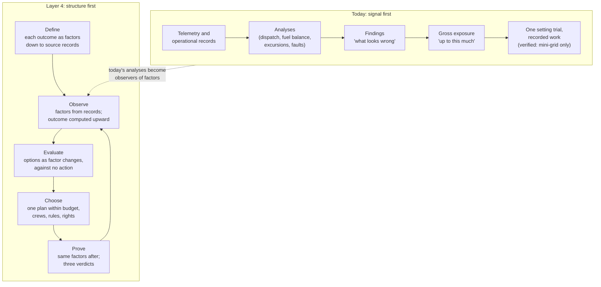
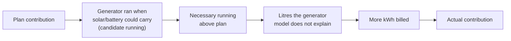
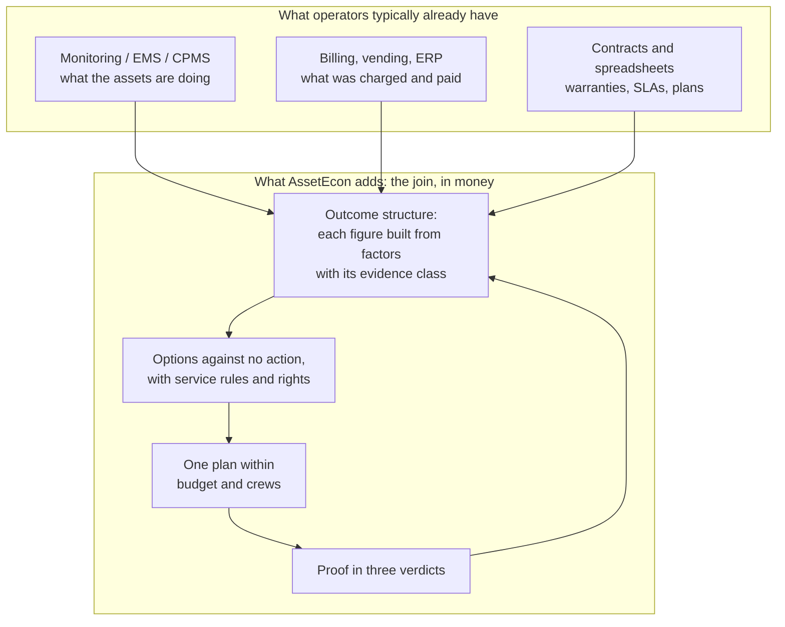
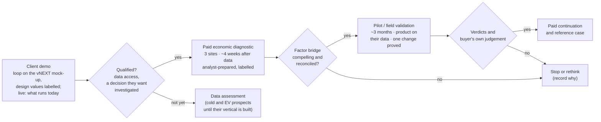
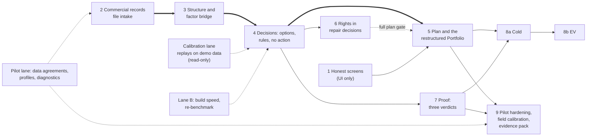
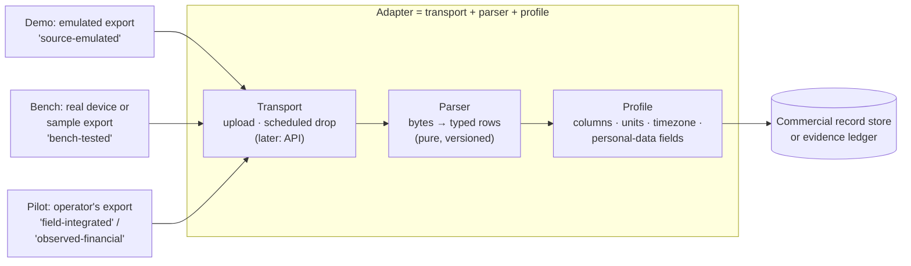
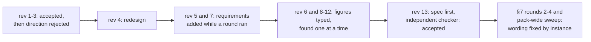

# Product transition and roadmap: from today's product to the economic decision loop

**AssetEcon · decision document for the owner · AssetOps Architect (Claude) · 18 Nov 2026 · revision 3**
**Status:** for owner decision. Revision 3 weighs the coordinator's three pitch points on merit, as the owner asked (§2.3, §2.7, §4.2, D6, D12), and answers the re-review's L-A to L-E (`REVIEW.md`, "Re-review of product transition and roadmap rev 2 (21c329aeb)"): the effort arithmetic follows the lanes (§4.3), the workflow evidence says what its counts measure (§4.3, §5.1), and D11 records the owner's adoption. Revision 2 answered the first review (M1–M3, L1–L7), stated the effort basis and added the workflow (§5). Outside this document, only the pack's checker changed: `check_manifest.py` covers this document's figures, and its computed-figure tags can no longer hold a typed figure (§4.3). No application code, test or database was changed. Code citations were read against the current branch `task/product-direction-layer4-design`.
**Request:** owner, 18 Nov 2026, verbatim in `.agent/owner-product-transition-request-2026-11-18.md` (including the follow-ups on the effort basis and the workflow change), with the owner's demo objective: *convert mini-grid, EV and cold-chain operator executives to adopt the product, with real value that monitoring tools and competitors in Africa do not offer.*
**Built on:** the product brief (`.agent/AssetEcon_Product_Direction_Layers_1_to_3_and_Claude_Brief_REVISED.md`), the owner's standing rules (`.agent/owner-layer4-direction-feedback-2026-11-17.md`) and the Layer 4 pack in this folder. The coordinator's two chat answers were the starting point. Every factual claim in them was checked against the code and the pack; §1.6 and §2.7 list what was corrected and where this document disagrees.

> **How figures are labelled.** Every money figure below comes from the demonstration world (`derived-values.json`, produced by `evaluate_structure.py` from the manifest). It is an **illustration**, never a customer result. Each figure carries a tag in the source that `check_manifest.py` recomputes independently (§4.3). A replay-derived figure is a **design value** until its replay has run. Run on the simulated demo series, it becomes **Modelled on simulated data**. Only a run on an operator's recorded series makes it evidence about a real site (§2.7, D6). Effort and calendar ranges are **estimates** with their assumptions stated; they are not commitments.

---

## On one page

| Question | Answer |
|---|---|
| What is the fundamental difference? | Today the product starts from **signals** and reports what looks wrong. Layer 4 starts from **how each business outcome is made up** (its factors, down to the records that evidence them). From there it computes where the money stands, which choice is worth making within budget and crews, and whether it paid off. |
| Why does it matter for the buyer? | Operators already have monitoring. What they lack is one place where operational, commercial and contract facts are joined into money, choices and proof. That is the brief's differentiation **hypothesis**; pilots must confirm it. |
| Recommended path | **Diagnostic-led, in between.** Sell and deliver the decision loop narrowly from now. At first it is an analyst-prepared paid diagnostic on a prospect's own records, while the product builds the loop in its dependency order. Pilot onboarding moves from last to first and runs as a parallel lane. The demo shows the loop on the mock-up, then the live product as what runs today, and closes on a paid diagnostic offered as a design partnership (§2.3). Conversations start during phase 0; no diagnostic is signed before the kit and a data agreement exist. |
| Lead vertical | **Mini-grid.** It has the deepest observation today and the only setting change and verified changes. Cold and EV prospects get the demo and a data assessment. Their verticals are built second and third, in the order the first qualified prospect decides. |
| The decisive early test | The **factor bridge** on the first operator's own month: contribution against plan, split by factor, reconciled to their accounts. If it is not compelling, stop and rethink before building operator-specific options and plans. |
| Rough size | Agentic development in this repository (Architect, Implementer and Reviewer agents, owner checkpoints, two lanes). Mini-grid core loop: about **2–4 months** of build. The first version said 4–7 months; this is revised to the observed pace and the workflow in §5. Each further vertical takes about **1–2.5 months**, mostly waiting for data. The **pilot calendar** sets the date of the first proved change on a customer site (about M6–M7), not the build. A human team: roughly 7–12 months for the same core (a judgement, §4.3). |
| How we build it | Approve the structure before building. Write independent checks before figures. Batch decisions with defaults applied, so no agent waits. Match review depth to risk. Fix classes of problem, not instances, and stop after two repeated rounds (§5). |
| Decisions needed | Twelve, in §6; the owner adopted the workflow (D11) on 18 Nov. The main open ones: approve the diagnostic-led path (changes Q9); diagnostic terms (paid); lead vertical; who prepares diagnostics until the product can; how design values are shown to clients (Q13), now needed before the first pitch; the demo and pitch shape (D12). |

---

## 1. Where we are and where we are going

### 1.1 The difference in one picture



Today's product is not wrong; it is one layer of the loop. Its analyses observe physical factors well, and they carry over. What is missing is everything that turns those observations into money, choices and proof.

### 1.2 Side by side, verified against the code

| | Today's product (as the code shows it) | Layer 4 |
|---|---|---|
| **Starting point** | Telemetry and operational records produce Findings, such as "generator running while solar and battery could carry the load" (dispatch classification, `analytics/dispatch_v3.py`) | Each outcome (contribution, cost to serve, service obligations) is declared as a structure of factors: litres, kWh billed, crate-days, departures met |
| **How an outcome is read** | Ten outcome-map rows link a signal straight to an outcome, all of kind "moves" (`outcomes/outcome_map.py:149-180`). Portfolio cards show counts and estimates | Plan against actual is computed factor by factor and read upward. Kobo, October (demo): contribution 1,445<!--fig:sites.lakeside-power/Kobo.plan.nodes.contribution--> planned, 883<!--fig:sites.lakeside-power/Kobo.actual.nodes.contribution--> actual, built up in §1.3 |
| **Where money comes from** | No recorded commercial money at all: `recorded_amount@1` "returns no money … always" (`chain/strategies/recorded_amount.py:1`). The money shown is **estimated** from declared prices (productive-use income, EV charging income: `chain/strategies/priced_energy.py`) or **modelled** (possible extra fuel cost) | Recorded money from billing, receipts, invoices, plans and tariffs, beside operational data |
| **What a value means** | Gross exposure: a modelled potential fuel cost, from 0 up to an upper bound on the fuel burned during candidate running (`financials/fuel_cost.py`: `POTENTIAL_FUEL_COST`, `MODELLED_CONDITIONAL`, `quantity_low = 0 L`). The Portfolio's Optimize card shows the lead Finding's exposure for the window's **last day** on a 7- or 30-day range (mini-grid reads one day, `site_outcomes/read.py:602-606`; card `:901-923`; lead Finding `chain/read.py:190`) | The change an option makes against doing nothing, over the same horizon, net of its own cost |
| **Choices** | Findings carry next-step text (`analytics/plain.py:360`). There is **one setting-change action**, the reserve trial: a fixed −5 points (`actions/reserve_trial.py:37`); the action table admits only that rule (migration `0016:60`). Operators also record **domain work actions** for all three verticals (`domain_action`, migrations 0033, 0035, 0051). Mini-grid scenarios are authored productive-load what-ifs: energy and gross sales over measured headroom at an authored tariff, with no cost, no net value and no no-action comparison (`mini_decisions/scenario_rules.py:191`). Alternatives are competing explanations of a Finding and change nothing downstream (`mini_decisions/alternatives.py:1-14`). Cold and EV scenarios are authored what-ifs with no computed amount | Several options per decision, always including no action, compared, with rejected options and the reasons |
| **Trade-offs** | Shown as text and counts ("checked" rows). Only two protections act: a classification rule that keeps running near reserve "necessary" (`dispatch_v3.py:290-291`) and guardrails checked after a trial (`verification_rules.py:787-800`) | Service rules and rights are evaluated before recommending. An option that breaks dawn battery charge or loses warranty cover is left out or ranked down |
| **Across sites** | Findings are ranked by placement, which "says where to look first, never a value ranking" (`estate/placement.py:1-6`). Possible extra fuel cost is **listed per site and never summed** (`site_outcomes/read.py:901-903`; test `test_ch5d1_optimize_card.py:60`). Credited results are never summed (`estate/portfolio.py:680-681`). Estimated income **is summed** into one Portfolio total when every site uses the same currency (`chain/vocabulary.py:459-508`, called from `site_outcomes/read.py:777`) | One plan across the portfolio within budget, crew visits and dated dependencies. Switches (budget, a customer's letter of intent) re-compute it |
| **Proof** | An operational verdict, mini-grid only, in three families: the reserve trial and the midday mill shift (`actions/verification_families.py:502`), and the fuel-balance work action (`actions/fuel_verification.py`, migration 0057). A positive verdict admits only simulated or authored evidence (`verification_rules.py:688`). The intervention cost is fixed at 0 (`actions/verification.py:1167`). Cold and EV work actions cannot reach "verified" | Three separate verdicts: the operational change happened; the money followed (from later records); it was caused by the action (untreated sites as comparison) |
| **Honesty of figures** | Already strong on provenance (*demo-simulated, source-emulated …*), "not available yet", and never-sum rules | Adds an evidence class to every figure (Recorded, Calculated, Estimated, Quoted, Modelled, Design value); figures of different classes are never added together |
| **Contracts and rights** | Battery warranty exists only as withheld fields (`sites/battery_boundary.py:26`) | Warranty, EPC, O&M/SLA and insurance rights decide who bears a cost, inside repair decisions |

### 1.3 The same site, read both ways (Kobo, October; demo values)

Today the product tells Kobo's operator two things: the generator ran when solar and battery could have carried the load, and how much that fuel might have cost. It cannot say what the month did to the site's contribution, because the product holds no billing or plan record.

Layer 4 reads the month up from its factors:



| Factor (Kobo, October) | Plan | Actual | Effect on contribution | How it is known |
|---|---|---|---|---|
| Fuel for necessary running | 700<!--fig:sites.lakeside-power/Kobo.plan.nodes.necessary_l--> L | 730<!--fig:sites.lakeside-power/Kobo.actual.nodes.necessary_l--> L | −37.50<!--figx:-({sites.lakeside-power/Kobo.actual.nodes.necessary_l}-{sites.lakeside-power/Kobo.plan.nodes.necessary_l})*{sites.lakeside-power/Kobo.actual.nodes.diesel_price}--> | split: declared input standing in for a calculation |
| Fuel for candidate running (solar/battery could carry) | 0<!--fig:sites.lakeside-power/Kobo.plan.nodes.candidate_l--> L | 330<!--fig:sites.lakeside-power/Kobo.actual.nodes.candidate_l--> L | −412.50<!--figx:-({sites.lakeside-power/Kobo.actual.nodes.candidate_l}-{sites.lakeside-power/Kobo.plan.nodes.candidate_l})*{sites.lakeside-power/Kobo.actual.nodes.diesel_price}--> | split: declared input standing in for a calculation |
| Fuel not explained by the generator model | 0<!--fig:sites.lakeside-power/Kobo.plan.nodes.unexplained_l--> L | 120<!--fig:sites.lakeside-power/Kobo.actual.nodes.unexplained_l--> L | −150.00<!--figx:-({sites.lakeside-power/Kobo.actual.nodes.unexplained_l}-{sites.lakeside-power/Kobo.plan.nodes.unexplained_l})*{sites.lakeside-power/Kobo.actual.nodes.diesel_price}--> | fuel balance (Record) minus model |
| kWh billed | 8,550<!--fig:sites.lakeside-power/Kobo.plan.nodes.billed_kwh--> | 8,645<!--fig:sites.lakeside-power/Kobo.actual.nodes.billed_kwh--> | +38.00<!--figx:({sites.lakeside-power/Kobo.actual.nodes.billed_kwh}-{sites.lakeside-power/Kobo.plan.nodes.billed_kwh})*{sites.lakeside-power/Kobo.actual.nodes.tariff}--> | billing export (Record) |
| O&M and staff | 1,100<!--figx:{sites.lakeside-power/Kobo.plan.nodes.om}+{sites.lakeside-power/Kobo.plan.nodes.staff}--> | 1,100<!--figx:{sites.lakeside-power/Kobo.actual.nodes.om}+{sites.lakeside-power/Kobo.actual.nodes.staff}--> | 0 | invoices (Record) |
| **Contribution** | **1,445<!--fig:sites.lakeside-power/Kobo.plan.nodes.contribution-->** | **883<!--fig:sites.lakeside-power/Kobo.actual.nodes.contribution-->** | **−562.00<!--figx:{sites.lakeside-power/Kobo.actual.nodes.contribution}-{sites.lakeside-power/Kobo.plan.nodes.contribution}-->** | Calculated |

Diesel is priced at 1.25<!--fig:sites.lakeside-power/Kobo.actual.nodes.diesel_price--> per litre and the tariff is 0.40<!--fig:sites.lakeside-power/Kobo.actual.nodes.tariff--> per kWh.

From there the loop continues. The options that change those factors are valued against doing nothing. The demo's recommended setting change is worth 2,916.00<!--fig:options.KOB-STOPSOC.value--> over twelve months; that is a **design value** until replay K has run. The simpler reserve change is rejected, because it breaks dawn battery adequacy on 4<!--fig:options.KOB-RESERVE.params.dawn_days_below_35pct--> of 61 days. The plan across Kobo, Kisiwa and Mto is chosen within a budget of 5,000<!--rec:tenants[lakeside-power].portfolio_constraints.budget_usd_nov_dec--> and 3<!--rec:tenants[lakeside-power].portfolio_constraints.crew_visits_nov--> crew visits, and the change is later proved on the same factors.

### 1.4 What the buyer gets, by vertical

The mechanics are the same for all three verticals. Each fills them in with its own factors, levers and limits.

| Buyer | Today's product gives | Layer 4 gives (demo illustrations) |
|---|---|---|
| **Mini-grid operator** | generator running split into necessary and candidate; fuel balance; possible extra fuel cost (gross); productive-use headroom and authored what-ifs; one reserve trial; verified midday-shift and fuel-balance work actions | contribution against plan per site, split into fuel, billing, losses and collections; a setting change valued net against no action, with the tempting option rejected on a service rule; productive demand valued only with a customer behind it (the huller adds contribution, the welder loses money); claim the inverter under warranty or buy now, with the deadline |
| **Cold-chain operator** | chamber temperature excursions; backup-start failures; authored stock-value what-ifs; no money computed; changes cannot be verified | contribution per room from occupancy and energy; separating low occupancy from inefficiency (energy above what occupancy explains: Mwea +0.6%<!--figx:round({sites.harvest-cold/Room A · Mwea.actual.nodes.excess_kwh}/{sites.harvest-cold/Room A · Mwea.actual.nodes.kwh_model}*100, 1)-->, Kirinyaga +24%<!--figx:round({sites.harvest-cold/Room C · Kirinyaga.actual.nodes.excess_kwh}/{sites.harvest-cold/Room C · Kirinyaga.actual.nodes.kwh_model}*100, 0)-->); repair or replace; batch exposure kept apart from damage and from liability; an EPC claim |
| **EV depot operator (captive fleet)** | interrupted sessions; charger availability; peak warning; an **estimated** charging income from a declared tariff (which does not fit a captive fleet); changes cannot be verified | cost per departure met (revenue "not applicable", never zero); a charging schedule that meets every departure, chosen over the cheapest one, which misses buses; a charger fault ranked by the departures it costs; SLA rights. The largest demo figure, Embakasi's 8,082.00<!--fig:options.EMB-DEADLINE.monthly_or_horizon_change--> a month, rests on an **assumed** tariff and is a design value (Q7) |

### 1.5 Why Layer 4 is the differentiator against monitoring tools



A monitoring tool answers "what is the asset doing". Each of the operator's systems answers part of the money question, in its own terms. The brief's differentiation hypothesis is the **join**: cross-system economic judgement at site and portfolio level, compared interventions, transparent assumptions, and proof after the change (brief, line 94). This document does not claim that any single feature is unique; the brief itself says that is a hypothesis to validate with prospects and pilots, not a demonstrated moat. No competitor is named or characterised here, because the pack holds no sourced competitor facts.

What a demo can show that monitoring cannot, using the mechanics rather than one site:
- the outcome read from its factors (a monitoring tool has no plan or billing records);
- the counter-intuitive contrast (the highest diesel user may have nothing worth changing);
- a rejected option and the rule that rejected it;
- a contract right that changes who pays;
- how the result will be proved.

### 1.6 Corrections to the coordinator's first answer

Every code claim in §1.2–§1.6 was re-verified for revision 2 (review M1). Four claims in revision 1 were wrong or incomplete and are corrected above: whether money is summed across sites, the fuel-cost wording, the mini-grid scenarios, and the domain work actions.

| Coordinator's claim | Verified? | Correction |
|---|---|---|
| "Across sites, findings are listed and summed per site" | **Partly** | Possible extra fuel cost is listed per site and never summed (`site_outcomes/read.py:901`). Estimated income is summed into one Portfolio total when every site uses the same currency (`chain/vocabulary.py:459`). Findings are ranked by placement, which is explicitly not a value ranking (`estate/placement.py:1-6`) |
| "One recommended action per finding" | **Partly** | Findings carry next-step text. The product has **one** setting-change action (the fixed reserve trial) and recorded domain work actions in all three verticals. There is no option comparison and no no-action baseline anywhere |
| "Proof: verification of the specific finding" | **Partly** | Verification judges an **action** (the reserve trial, or a recorded mini-grid work action), not a Finding. It is operational only and mini-grid only, admits only simulated or authored evidence for a positive verdict, and counts the change's cost as 0 |
| "Money sources: operational data (telemetry, fuel)" | **Yes, with a nuance** | No recorded commercial money exists. The money shown is estimated from declared prices or modelled as exposure |
| "Observation work roughly two-thirds done for mini-grid" | **Not supported** | No measurement gives two-thirds. **Physical** observation is largely in place (12 of 15 observer elements kept as they are); **economic** observation has not started (no money leaves the product). Of 114 code elements assessed, 40 are kept as they are, 21 extended, 22 reworked, 14 integrated, 7 only need rendering and 3 retired; 7 components are new (`repo-reuse-and-gap-matrix.md` §K). The new components are most of the effort |
| "The 562 shortfall breaks down into 412.50 + 37.50 + 150 − 38" | **Yes** | The independent model gives the same figures (§1.3). The 730 / 330 / 120 litre split is a declared input in the demo, standing in for a calculation |
| "Trade-offs mostly displayed rather than enforced" | **Yes** | Two exceptions act: a dispatch classification rule near reserve, and post-trial guardrails |
| "Some labelling of where figures come from" | **Understated** | Provenance labels, "not available yet" and never-sum rules are already systematic; Layer 4 adds a money evidence class to each figure |
| Today's product "overlaps with monitoring tools" | **Partly** | It goes beyond monitoring (causal classification of generator running, fuel balance, verified trials). Even so, a buyer is likely to place it in the monitoring and diagnostics category, which the brief calls an enabler, not the promise (brief, line 6) |

---

## 2. The transition strategy

### 2.1 Three options

| | A. Pilot with today's product | B. Build Layer 4 first, then pilot | C. In between: diagnostic-led, Layer 4 as destination |
|---|---|---|---|
| What the buyer sees | monitoring and diagnostics with exposure figures | nothing for months, then the full loop | from the first meeting: the loop on their own records, prepared by an analyst at first, and more of it by the product each month |
| What we learn | whether we match a dashboard | late: whether real data fits a design built without it | early: whether their records support the factor bridge, which decisions they care about, what their files look like |
| Risk | lands in the category the buyer already has; the demo promises more than the product does | the design meets real data late; calibration, record shapes and the option list stay guesses; no revenue or reference | analyst work does not scale; promising more than is built |
| Fit with the brief | weak: the brief says monitoring is not the promise | weak on validation: the brief's path is demo → paid diagnostic → field validation | strong: it is the brief's own path (line 38) |
| **Judgement** | not recommended | not recommended | **recommended**, with the controls in §2.2 |

### 2.2 The recommended path



**The controls that keep it honest:**
1. **Everything an analyst prepares is labelled** as analyst-prepared from the buyer's records, with the same evidence classes the product will show. The analyst uses the pack's method (the structure, the evaluator script and its independent check), never hand arithmetic. One step is manual: the evaluator reads the design manifest, not customer exports (`phase-plan-and-acceptance.md` §8). So the analyst transcribes the buyer's records into the manifest's input form by hand. That transcription is the main analyst cost, and an error source the evaluator and checker cannot catch. A second person checks each transcribed month, and the month is reconciled to the buyer's own totals (§2.5). Step 2's file intake is the first thing that automates it.
2. **Each manual step becomes the next product slice.** The diagnostic's deliverable has the shape of the product's *Outcomes by site* and decision pages, so the analyst work shrinks as the product grows.
3. **Cap concurrent diagnostics** at two (an assumption) until the factor bridge is in the product.
4. **No replay-derived saving is presented as a result** until its replay has run on the operator's own recorded series. A replay on the simulated demo series changes the label from design value to Modelled on simulated data. It shows that the figure is consistent with the simulated world; it measures nothing about a real site (§2.7, D6).

### 2.3 The offer

| Stage | Buyer provides | Buyer receives | Length (estimate) | Terms |
|---|---|---|---|---|
| **Demo** | an hour of executive time | the loop on one demo operator of their vertical (mock-up; separate login per operator, Q5), then the live product as what runs today (below) | 30–45 min | free |
| **Economic diagnostic** (the brief's "paid diagnostic"; offer template in `phase-plan-and-acceptance.md` §10) | the minimum records below, for three sites, one to four months | each site's outcomes computed from their factors against their plan, with what is recorded and what is missing; the three highest-value decisions, compared with no action, and the options we would reject and why; contract rights at risk and their deadlines; a verification plan for the first change | about 4 weeks from data receipt; data agreement before that, 2–6 weeks (assumption) | **paid**, offered as a design partnership (below; owner decisions D2 and D12; no price is proposed here) |
| **Pilot / field validation** | continuing exports; an operations lead's time; agreement to one supervised change | monthly economic review in the product; the first change proved operationally and then economically; replays run on their own series | about 3 months (an after-window of at least 14 matched days, then the next closed month for the money verdict) | owner decision D2 |

**What runs today, shown live.** After the loop, the demo switches to the live product for the layer the loop is built on: file intake of readings with a dry run (`sites/ReadingUpload.tsx`), generator running split into necessary and candidate, fuel balance, and the verified reserve trial and work actions (§1.2, §1.4), each with its provenance label (demo-simulated, source-emulated). The presenter says which parts run and which are the mock-up. Until step 1 ships, the live part stays on Site pages and leaves out the Portfolio's Optimize card, whose last-day figure misleads (§1.2).

**Design partnership.** The diagnostic and the pilot are offered as a design partnership: the gap between what runs and the loop is the reason to join early. A partner gets the loop on its own records first; its decisions and record shapes set the option lists and profiles built for it; its choice weighs on which vertical comes second (Q10); and a reference case is published only with its agreement. It does not get free or bespoke work: the diagnostic stays paid (D2), the core stays general (§2.7), the qualification gate stands, and at most two run at a time (control 3).

We do not promise savings; we show how they would be proven (pack wording, kept).

### 2.4 Onboarding data checklist

The checklist is derived from the leaf factors. Each record family evidences one group of factors, so the checklist is the structure read from the bottom (`integration-source-to-canonical-design.md` §7.1).

| Record (mini-grid) | Unlocks | If missing |
|---|---|---|
| Controller / EMS export, 60–90 days | generator, battery and solar factors; necessary vs candidate running; replay calibration on recorded data | no fuel split; no setting option can be valued |
| Customer meter register with change dates | delivered → metered → billed mapping | unmapped meters cannot be separated from losses |
| Billing or vending export, 4 months | kWh billed and revenue | contribution "not available yet" |
| Payment settlement statements | collected, in transit, outstanding | cash position unknown |
| Fuel deliveries and dips | litres consumed; unexplained litres | the fuel factor rests on the model only |
| Monthly plan or budget, by site and line | plan at every factor | no plan against actual; the bridge is shown as "not decomposed" where the plan is a single total |
| Contract set for the most important asset (warranty, O&M) | rights, notice deadlines, who pays | repair options valued as if the operator pays |
| *(for the plan)* open repairs, quotes, budget and crew limits | options and the plan's limits | decisions without costed options |

| Vertical | Minimum records (five to seven) |
|---|---|
| **Cold rooms** | storage ledger (batch in/out, commodity, crates, rate); energy bills; chamber temperature log; invoices and receipts; QA notes; plan; refrigeration contract and goods-in-custody policy |
| **EV depot** | charging-system (OCPP) log export; fleet roster with departures and required energy; utility invoice and tariff contract; service tickets; plan; charger warranty and SLA |

A prospect who cannot supply billing (for cold, the storage ledger; for EV, the roster) and the plan qualifies itself out of the diagnostic; offer the data assessment instead.

### 2.5 Success criteria (stated in advance; no invented benchmarks)

| Stage | Criterion | Measured how |
|---|---|---|
| Demo | the executive names an issue as theirs and a decision to investigate | recorded verbatim in the validation sheet (`phase-plan-and-acceptance.md` §10) |
| Diagnostic | one closed month reconciles to their management accounts on revenue and fuel or energy cost, within a tolerance agreed at the start | reconciliation table |
| Diagnostic | the factor bridge leaves an unexplained residual the buyer accepts as small, and names at least one cost they did not know about | buyer's own judgement, recorded |
| Diagnostic | their operations lead confirms at least one recommended change is feasible | recorded |
| Pilot | one change committed with a frozen prediction; operational verdict after the after-window; money verdict from the next closed month's records; causal strength stated | the three verdicts in the product |
| Commercial | diagnostic accepted, declined or deferred, with the reason; pilot converted or not, with the reason | validation sheet |

### 2.6 Lead vertical, and how cold and EV follow

**Mini-grid leads**, for reasons the code confirms. It has the deepest physical observers (dispatch-3.2, fuel balance), the only setting-change action, and the only verification families (reserve and midday shift, `actions/verification_families.py`; fuel balance, `actions/fuel_verification.py`). Cold and EV cannot reach "verified" today. Leading with another vertical would put the loop's last step on the critical path.

**Cold and EV follow without being shaped by mini-grid.** The general parts (commercial record store, structure registry and read, option evaluator, bounds, allocator, verdicts) are built once and tested on cold and captive-EV fixtures from the start (`phase-plan-and-acceptance.md` slices 3–5). Only each vertical's own structure, observers and lever models are added later. Which comes second is decided by the first qualified prospect (Q10). If no prospect decides, cold is the shorter path (storage ledger and energy normalisation; no roster or tariff contracts). EV carries the largest demo figure on an assumed tariff, which is a reason to prove it on a real tariff before leading with it.

### 2.7 Where this document disagrees with the coordinator

This is the one place for every point where this document departs from the coordinator, or agrees for a different reason: its recommendation (first rows) and its three pitch points, weighed on merit at the owner's request (last three rows).

| Coordinator | This document | Why |
|---|---|---|
| Pilot "ideally paid with a low fee or free with a conversion clause" | **Paid diagnostic first**, pilot after | The brief's path is demo → **paid** diagnostic → field validation (lines 38, 376), and the pack's offer is a paid three-site diagnostic. A paid step is also the brief's own conversion signal. Price and terms are the owner's call (D2) |
| Step C "calibration on their data", as one step that needs the pilot | **Two steps that prove different things.** Replays on the demo data now; replays on the pilot's recorded series later. Only the second makes a saving evidence for a client | The replay on demo data needs no pilot (`phase-plan-and-acceptance.md`, calibration lane). It turns three typed design values into simulator outputs and catches design errors (for example inverter clipping at Kobo) before prospects see them. But the demo series are simulator output, so it shows only that the figures are consistent with the simulated world. The coordinator was right that replay figures stay unproven until they run on real series; revision 1 overstated the demo-data step (review M2). The phase 0 exit and D6 now follow this split |
| "Slices 0 (calibration) and 2 (commercial data) need a real operator's data to be done properly" | **Partly agree** | Calibration that counts for clients does need the operator's series (row above). The commercial record store does not: it is designed so that a pilot changes only transport and profile, not the parser, records or structure (`integration-source-to-canonical-design.md` §7.2). Real exports test the profiles, the plan's granularity and the option list; they are not needed to build the store |
| Step B "plan against actual, mini-grid only" | **General from the start**, sourced for mini-grid first | The owner's rule is general before particular. The pack declares the cold and captive-EV structures in the same slice and tests them (for example, EV revenue "not applicable"). It costs little and avoids a core shaped around mini-grid |
| Rights and warranties in the last step (G) | **Inside the mini-grid core**: in the diagnostic from day one (by hand), and in the product in parallel with the plan | Contract rights are among the clearest things monitoring does not do; the evidence is cheap (a few PDFs); and Lakeside's plan turns on claim versus buy now. As in the pack, rights and the plan are built in parallel after decisions, and only the full mini-grid plan gate waits for rights (`phase-plan-and-acceptance.md` §2) |
| "A and B roughly weeks" | **Agree, at the observed pace**: A about 0.5–2 weeks, alongside B; B about 3–7 weeks, including rework and the owner's structure approval | B is the store and the structure read: two slices sized medium and large, about eight reviewed changes (about 1.5–5 weeks of build), with the attribution rules (§4.3). The first version said 1.5–3 months on a padded pace |
| Proof (E) before the plan (F) | **Agree on the calendar, for a different reason** | The first change should start as early as possible, because proof waits for an after-window and a closed month; the plan is built during that wait |
| "Don't keep polishing the design pack" | **Agree**, with two exceptions | The open owner decisions (Q1–Q16) and the mock-up approval gate must still close before the UI build |
| Pitch 1: keep the live product in the demo, shown first as the foundation, then the decision layer as what is being built | **Included, with the order changed**: the demo opens on the loop and switches to the live product at the evidence step, showing only what is honest today (§2.3, D12) | Executives will ask what is real, and a mock-up-only demo cannot answer it; the brief also rules out "a simulator-only story without source-shaped records" and asks for source and limitation within two interactions (brief, lines 376, 386). But the brief's demo opens on a business result, not a technical landing page (line 376), and opening on monitoring places the buyer in the category they already have (option A, §2.1). The live product is the observation layer the loop is built on (§1.1), so it belongs at the brief's Investigate step (line 382). Until step 1 ships, its Portfolio money card misleads and stays out |
| Pitch 2: frame the pitch as a design-partner offer, turning the gap into a reason to join early | **Included, with limits** (§2.3) | The gap is real and stated, and the brief treats the differentiation as a hypothesis that pilots must test (lines 94, 100), so early partners are what the path needs. But a design partnership often means free work and features shaped to one customer. Here the diagnostic stays paid (D2; the brief's close is a paid diagnostic, line 376), the qualification gate stands, and partners shape their option lists and profiles, not the general core (owner's rule: general before particular) |
| Pitch 3: early conversations in parallel with phase 0; no diagnostic signed until the kit and the data agreement exist | **Included**; it moves one decision earlier | It was implied (demos from M0 in Figure 7; data agreements from M0 in W9) and is now explicit in phases 0 and 1 and in Figure 7. Pitching before any replay has run means the exposure rule for design values (D6, Q13) must be decided before the first pitch, not at phase 0's exit. Friendly prospects then see design values labelled and said aloud |

---

## 3. Technical details to get there

### 3.1 The steps and their dependencies

Each step builds a **general** piece of one mechanic, proves it first on mini-grid, and leaves the product more useful on its own. The step names map to the pack's slices (`phase-plan-and-acceptance.md`).



*Thick arrows are the critical path: records → structure → decisions → plan. After decisions, rights (6) and proof (7) are built in the second lane, in parallel with the plan. Only the full mini-grid plan gate waits for rights, as in the pack. The calibration lane, honest screens, Lane B and the pilot lane run in parallel from the start.*

### 3.2 What each step builds

**Calibration lane (first, read-only, parallel with step 1)**
| Area | What |
|---|---|
| Algorithms | forward dispatch replay of Kobo (setting change); demand-on-headroom replay of Mto (huller); deadline schedule replay of Embakasi |
| Code | an adapter in `host/` around the simulator kernel (`host/execution_adapter.py:869` `run_to_end`), behind a **new** port method; the backend still never imports the simulator (`runs/execution_ports.py`) |
| Exit | each replay reproduces its design values within a stated tolerance on at least 14 admissible days of the **simulated** series, or the option is valued with a labelled bounded proxy. The figures become simulator outputs labelled Modelled on simulated data. That proves internal consistency, not a real saving |
| Later | the same replays on the pilot's recorded series (step 9, field calibration): the first figures that can be stated as modelled on that operator's own data |
| Reuse | kernel kept; adapter new |

**Step 1: Honest screens (UI only)**
| Area | What |
|---|---|
| UI | relabel the Optimize card with its day and scope; render fields the API already returns: per-site headline money and nodes, sites needing attention, outcome reasons, structured thread lines, "Why?" nodes (`repo-reuse-and-gap-matrix.md` §F3) |
| Data, API | none new |
| Verification | pin today's Optimize behaviour first (`test_ch5d1_optimize_card.py`), then change it on purpose |

**Step 2: Commercial records and file intake**
| Area | What |
|---|---|
| Store | **new** commercial record store: raw payload kept unchanged; source-versioned revisions; four clocks (service, effective, recognition, settlement); an idempotency key (tenant, source system, record id, version); every record kind of all three verticals declared from the first migration (0062) |
| Why new | existing intake is first-write-wins (`evidence/service.py:484-492`) and refuses late intervals (`reading_upload/service.py:244-248`); commercial records arrive late and are corrected by nature |
| Integration | CSV intake on the authenticated site-bound path, with a dry run and refusals in plain words, reusing the reading-upload pattern (`reading_upload/service.py:213`) without its late-interval refusal |
| Algorithms | `recorded_amount@2` reads revisions by recognition period (modified from `@1`) |
| Tests first | a duplicate upload adds nothing; late settlement; currency; another tenant's row refused at intake |

**Step 3: Structure and factor bridge**
| Area | What |
|---|---|
| Model | a structure registry in code: outcome → factors → leaves per vertical and business model, with plans and bounds at factor level; **reworks** the outcome map (`outcomes/outcome_map.py:149-180`) and keeps its start-up integrity check pattern (`chain/graph.py:177`) |
| Algorithms | bottom-up evaluation; attribution through the structure (exact for sums; a declared rule for products: volume at plan price, then price at actual volume); energy-to-cash observer (delivered → metered → billed → collected); existing analyses attached as factor observers (dispatch-3.2 and fuel balance are **kept**) |
| Store | none: totals are recomputed from stored lines on every read, as today's rule requires (`chain/period_read.py:138-139`) |
| API, UI | new structure read (site × period, portfolio); *Outcomes by site* tab and the site economics section; evidence drawer within two interactions |
| Gate | Lakeside October to the cent (demo: contribution 1,443.00<!--fig:portfolio.lakeside-power.actual.sums.contribution--> against plan 2,295.00<!--fig:portfolio.lakeside-power.plan.sums.contribution-->); captive-EV revenue "not applicable"; Protect measures compose for all three operators |

**Step 4: Decisions**
| Area | What |
|---|---|
| Model | **new** decision, option and evaluation records anchored on a factor key (site, factor, cause), with a named human approver (migration 0063) |
| Algorithms | option evaluation on the valuation identity (new); obligation bounds as code rows, hard / costed / advisory, replacing text-only "checked" (reworked); forward replay from the calibration lane; demand-on-headroom replay; the reserve trial becomes one option generator among several (modified) |
| Carrier | a setting-change carrier for the stop threshold (the site property exists, `sites/models.py:167`; the action table admits only the reserve rule) |
| UI | decision page: options including no action; value, cost and who pays; rules; the reason in plain words; sensitivity |
| Gate | the reserve change rejected by dawn adequacy and the setting change recommended; the same evaluator passes cold and EV fixtures with no vertical code in it |

**Step 5: Plan and the restructured Portfolio (lane 1, after step 4)**
| Area | What |
|---|---|
| Algorithms | allocator: one joint search over all decisions under budget, crew visits and dated dependencies, ranked by least rule violation, then value, then spend; exclusions with reasons; switches (new; placement kept only for Findings triage) |
| Store | allocation run, stored and re-runnable (0064) |
| UI | Portfolio tabs in loop order, with *Opportunity* renamed *Demand and capacity* (Q2); *Act first* becomes the plan with its downside; the Overview's first fold reads outcome → figures → first moves; old addresses redirect |
| Gate | demo Lakeside plan: spend 3,750.00<!--fig:plans.lakeside-power.default.spend-->, value +6,088.50<!--fig:plans.lakeside-power.default.value--> (design value), downside +2,548.50<!--fig:plans.lakeside-power.downside-->; the Harvest Cold case on the same allocator. The full Lakeside gate includes the rights options, so it closes after step 6 |

**Step 6: Rights (lane 2, in parallel with step 5)**
| Area | What |
|---|---|
| Model | rights register (obligation, condition, exception, notice and remedy rows) from contract documents in the commercial record store; a supplier-claim work-case kind with typed events (new) |
| Algorithms | residual cost per remedy path (claim and wait, buy now and claim, local repair, no action); rights state machine (new) |
| Integration | AI-assisted extraction proposes rows; a person approves every row (Q11) |
| UI | rights inside decision pages; rights tracker on *What changed*; "This is not a legal decision" on every rights screen |

**Step 7: Proof (lane 2, after step 6)**
| Area | What |
|---|---|
| Algorithms | economic and causal verdicts beside today's operational verdict (kept); comparability bands with untreated sites as controls (`actions/verification_rules.py:36-41`) |
| Changes | admit field and uploaded evidence with its label (today only simulated or authored, `verification_rules.py:688`); the change's own cost replaces the constant 0 |
| Store | verdict rows beside the existing outcome (0067), never widening the operational verdict's values |

**Step 8: Cold, then EV (order set by prospect, Q10)**
| | Cold | EV |
|---|---|---|
| Records | storage movements, QA notes | roster, tariff schedule, OCPP log |
| Observers (new) | occupancy ledger; normalised refrigeration energy (≥ 60 days hourly per room); batch exposure | session-to-bus attribution; tariff pricing per interval; charging feasibility per night; fault consequence |
| Kept | excursion and backup-start Findings | fault and availability Findings |
| Verification | first cold family | first EV family |
| Reused unchanged | store, registry, read, decisions, bounds, rights, allocator, verdicts | same |

**Step 9: Pilot hardening and the evidence pack.**
- Consent, data protection and integration rights confirmed before any data arrives.
- Pinned profiles per pilot source.
- One month reconciled to the cent before money is shown as Recorded.
- Replays run on the pilot's own series (field calibration).
- Field verification of one change.
- An investor and lender evidence pack: coverage, residuals, verdicts, rights states, lineage; no new measure.
- An optional explanation assistant that only cites stored computations.

**Lane B (parallel, from the start):** re-benchmark the demo build on an authorised test database (Q12), then scoped regeneration and faster stages, so multi-month worlds and pilot recomputation stay affordable.

### 3.3 File import first



Every source starts as a file in its native shape (CSV, statement, PDF), on the same authenticated path. From demo to pilot, only transport and profile change; parsers, records, observers and structures do not (`integration-source-to-canonical-design.md` §7.2). An API replaces transport only when the operator grants contractual access; none is assumed. The existing field package already separates these parts (`field/profiles/*.json`, `gateway/assetops_gateway/uploader.py:66`).

### 3.4 Reuse, rework and new, at a glance

| Disposition (of 114 elements, matrix §K) | Count | Examples, with the reason |
|---|---|---|
| Kept as is | 40 | evidence ledger and gateway (right for telemetry); dispatch-3.2, fuel balance, excursion and fault analyses (they observe factors well); work cases and the trial action (working carriers); plan freeze and operational verdict |
| Extended | 21 | Portfolio frame and tabs (order and one name); demo build producers (add commercial records) |
| Reworked | 22 | outcome map → structure registry; "checked" → obligation bounds; scenarios and reserve trial → options; Portfolio tab bodies; verification admission |
| Integrated / rendering only | 14 / 7 | the pack's evaluator as the test oracle of demo figures; fields the API already returns |
| Retired | 3 (+2 within rows) | the Optimize card's last-day figure; placement as the Portfolio spine; headroom shown as opportunity |
| **New components** | **7** | commercial record store; structure registry and read; decision records; forward replay adapter; rights register and claim case; allocation run; economic and causal verdicts |

### 3.5 Critical path and technical risks

| Risk | Where it bites | Mitigation |
|---|---|---|
| Real billing, plan and meter data do not fit the structure (plans as totals, meters not mapped) | step 3; every diagnostic | the structure shows "not decomposed" and "not available yet" rather than guessing; the first diagnostic tests this before operator-shaped work in steps 4–5 is committed |
| A replay does not reproduce its design value (for example inverter clipping at Kobo) | step 4; the demo's largest figures | calibration lane first; a labelled bounded proxy as fallback; client exposure rule (D6, Q13) |
| A replay that passes on simulated data fails on recorded data | diagnostics and pilots | savings are never presented as results before the operator's own replay (control 4); field calibration is a named pilot step |
| Attribution rules for products are disputed by a finance reader | step 3 | one declared rule, shown on screen, applied everywhere |
| Allocator explanations are not understandable | step 5 | every exclusion carries a plain reason; switches shown beside the plan |
| Protected seams (simulator import ban, operational verdict values, action-table checks) | steps 4, 7 | new port method; verdicts stored beside; a new carrier rule rather than widened checks |
| Build and test cost grows with multi-month worlds | all | Lane B before any build budget is quoted |
| Contract extraction errors | step 6 | a person approves every row; no automated coverage outcome |
| Personal data in billing and meter exports | step 2, pilots | minimisation at intake; tenant isolation tested at intake |

---

## 4. Overall product roadmap

### 4.1 The roadmap

Months are counted from the owner's approval of this path (M0), not from a calendar date, because the start of the first diagnostic depends on a prospect. Revision 2 shortens the product lane to the observed build pace (§4.3). The pilot and commercial lanes are unchanged, because calendar time sets them.

```mermaid
gantt
  title Roadmap (months from approval, estimates)
  dateFormat X
  axisFormat M%s
  section Product
  Calibration lane + honest screens        :p0, 0, 1
  Records and factor bridge (steps 2-3)    :p1, 0, 2
  Decisions (step 4)                       :p2, 1, 3
  Plan and Portfolio (step 5)              :p3, 2, 4
  Rights (step 6), then proof (step 7)     :p4, 2, 4
  Second vertical (8a or 8b)               :p5, 4, 6
  Third vertical                           :p6, 6, 8
  section Data
  Diagnostic kit and profiles              :d0, 0, 1
  Pilot profiles pinned                    :d1, 2, 4
  Field calibration on pilot data          :d2, 4, 6
  section Pilots
  First mini-grid diagnostic               :q0, 1, 3
  Mini-grid pilot (field validation)       :q1, 3, 7
  Second-vertical diagnostic               :q2, 4, 6
  section Commercial
  Demos and qualification                  :c0, 0, 10
  Kit ready: diagnostics can be signed    :milestone, c3, 1, 1
  First conversion decision                :milestone, c1, 7, 7
  Investor and lender evidence pack        :c2, 6, 8
```

### 4.2 Phases

| Phase | Goal | What ships | What the customer sees | Entry gate | Exit gate and decision point |
|---|---|---|---|---|---|
| **0. Decide and prepare** (≈ M0–M1) | make the demo and the offer honest; start conversations with friendly prospects; check the largest figures against the simulated world | calibration lane; honest screens; diagnostic kit (templates, data agreement, analyst procedure); Lane B re-benchmark | friendly prospects: the loop on the mock-up, design values labelled and said aloud, then the live product's Site pages as what runs today; once step 1 ships, the live product without misleading figures | owner approves this path, the workflow (§5), Q1 and Q2, and the exposure rule D6 / Q13 before the first pitch | the kit is ready, so a diagnostic can be signed. Replays reproduce their design values on the simulated series (relabelled Modelled on simulated data) or are replaced by labelled proxies; this is a consistency check, not a calibration. **Decision point: offer the first diagnostic to a qualified prospect** |
| **1. First diagnostic + money from records** (≈ M1–M3) | prove the factor bridge on a real operator | steps 2–3 | their own contribution against plan, factor by factor: analyst-prepared at first, then in *Outcomes by site* | the kit ready, and a qualified mini-grid prospect with a signed data agreement; no diagnostic is signed before both | **decision point: is the first operator's factor bridge reconciled and compelling?** Continue, adjust the structure, or stop |
| **2. Decisions, rights, plan** (≈ M1–M4) | turn the bridge into choices | steps 4, then 5 and 6 in parallel | their decisions valued against no action; rights with deadlines; one plan within their budget and crews | general parts start at M1 and are tested on fixtures; anything shaped by the operator's records (profiles, plan granularity, option list) waits for the phase 1 gate | the full mini-grid loop runs on computed data; owner walkthrough |
| **3. Proof and conversion** (≈ M3–M7) | close the loop on a real change | step 7; replays on the pilot's recorded series; the first pilot change proved | three verdicts on their change; the first savings modelled on their own data | one change committed with a frozen prediction | **decision: convert to paid continuation; publish a reference case if the operator agrees** |
| **4. Second vertical** (≈ M4–M6) | reuse the general core | step 8a or 8b | the loop on cold rooms or EV depots | the vertical chosen (Q10), with a qualified prospect and their data history | the same core passes that vertical's gates with no vertical code in it |
| **5. Third vertical** (≈ M6–M8) | complete the three verticals | the remaining step 8 | same | phase 4 exit | three verticals on one core |
| **6. Beyond** | scale and finance | evidence pack for investors and lenders; APIs replacing file transport where access is granted; explanation assistant; commercial EV charging model; external opportunity intelligence | lender-ready evidence; less manual exporting | pilots converted | driven by customer demand |

### 4.3 Effort: its basis, the observed pace, and what limits it

**Basis.** These estimates assume **agentic development in this repository's setup**: Architect, Implementer and Reviewer agents (`.ai/ROLE_CONFIG.md`), owner checkpoints, and two build lanes, under the workflow in §5. They are not human-team estimates.

**Observed pace.** Recent slices in this repository move fast once specified. Between 18 Oct and 14 Nov there were 238 task-branch merges to main (first-parent merges whose subject starts "Merge task/" or "Merge branch 'task/"; time measured from the branch's earliest non-merge commit to the merge). The median was 2.7 hours, three quarters merged within 6 hours, and the longest took about three days (git history). This understates the full cycle: specification, pre-flight and the first unit's build come before the first commit. A fair reading is one to three days per specified, reviewed change, including its specification, review and fix round. Revision 1 assumed one to two weeks per reviewed change per lane, which was padded several times over.

**What actually limits the pace** is not build time:
- **Owner review and decision time.** The Layer 4 pack drew thirteen owner messages. The site-range work needed 83 Architect rulings (D-SR.1 to D-SR.83) on 12–13 Nov while its slices were being built.
- **Rework.** The Layer 4 pack took thirteen revisions plus four further review rounds. Of the 238 merges, 70% have at least one branch commit whose subject contains "fix", and 47% one whose subject names a fix round or a review fix. The first count includes fixes no review asked for; neither counts how many reviews found something. §5 shows the causes.
- **Pilot calendar time.** A data agreement takes 2–6 weeks, a diagnostic about 4 weeks after data, an after-window at least 14 days, then a closed month. No build speed shortens these.

| Block | Lane | Reviewed changes (pack) | Revision 1 estimate | Revised: build at 1–3 days per change | What sets its length |
|---|---|---|---|---|---|
| Calibration lane + step 1 | 2 | 3 spikes + 3 | 2–4 weeks | about 1–3.5 weeks, alongside steps 2–3 | owner approval of Q1 and Q2 |
| Steps 2–3 | 1 | 3 + 5 | 6–10 weeks | about 1.5–5 weeks | the attribution rules (novel); the first diagnostic's records |
| Step 4 | 1 | 6 | 8–14 weeks (with 5 and 6) | about 1–3.5 weeks | protected seams; the new carrier |
| Step 5, and step 6 in parallel | 1, 2 | 3 + 3 | (above) | about 0.5–2 weeks | allocator explanations; owner checkpoint on the Portfolio |
| Step 7 | 2 | 2 | 2–4 weeks | about 0.5–1 week, after step 6 | proof itself waits for the pilot calendar |
| Each vertical in step 8 | – | 3–4 | 6–12 weeks | 1–2.5 months elapsed (about 0.5–2.5 weeks of build) | data: 60 days of hourly energy per cold room, a full roster cycle for EV, and a qualified prospect |

<!--diagram:effort-->

**How the revised range is reached.** The core has about 28 reviewed changes, and the lanes are not balanced. Lane 1 carries the dependency critical path, steps 2 → 3 → 4 → 5 (17 changes); lane 2 carries the calibration lane, step 1, rights and proof (11). After step 4, plan (3 changes), rights (3) and proof (2) cannot all run at once in two lanes, so the core's last change lands after 19 changes in sequence: steps 2–4 (14), then rights and proof (5). At one to three days per change and five working days to the week, that is about 4–11.5 weeks of build. Add a rework allowance of 15–20% (the rate estimated after the W1 lessons; `.ai/ROLE_CONFIG.md`, Token Efficiency, says "about"; the rules that came from those lessons, W4 and W5, stay) and about one week of elapsed time per phase for the owner's structure approval and walkthrough (four phases). That gives about 8–18 weeks: about **2–4 months** for the mini-grid core, down from 4–7, with little slack at the top. Without the new rules in §5 (W1–W3, W6, W7), the risk is not a higher build-rework rate but the Layer 4 pattern of repeated rounds at owner checkpoints. Assuming one extra owner-and-revision round of about a week per phase (an assumption; the Layer 4 pack lost more), that is about 12–22 weeks, or about 3–5 months. Either way, the first proved change on a customer site lands at about M6–M7, because the pilot calendar sets it. Faster build does not move that date; it frees capacity for the second vertical and for the analyst work in diagnostics.

**A human team, for comparison (a judgement, not a measurement).** Assume three to four experienced developers and a product lead, new to this codebase. Building the same mini-grid core (seven new components, 22 reworked elements and the same depth of independent checks) would likely take **roughly 7–12 months**, including one to two months to learn the codebase. That is about two to four times the agent build. The pilot calendar would be the same for both. The owner's review and decision time would not shrink with a human team either.

**Uncertainty.** These ranges could still be off by up to a factor of two. The largest unknowns are the attribution rules on real data, the allocator's explanations, and how messy pilot records are. The Planner's pass after phase 0 approval should replace them with per-slice estimates.

**Figures are checked.** `check_manifest.py` now includes this document. Each demo figure carries a tag: a direct path into the independent model, an arithmetic expression over such paths (`<!--figx:…-->`, for example the factor effects in §1.3), or a manifest record. The checker recomputes each value with no input from the evaluator. It also flags any untagged plan or option figure, and any untraced money figure in §1–§4. An arithmetic tag must use at least one path, every part of it must move when its paths move, and its only number literals are rounding places and the unit factor 100, so a tag cannot carry a typed figure; an expression that does not evaluate (such as a division by zero) is a failed check. Run: `python3 check_manifest.py`.

---

## 5. How we build it: the workflow change to avoid rework and cut time

This section covers how work is specified, built, reviewed and approved. Repository organisation and agent context efficiency are assessed separately, in the committed recommendation `.agent/repo-declutter-recommendation-2026-11-18.md`, with the owner's decisions O1–O7 in `.agent/owner-repo-declutter-request-2026-11-18.md`; they are not repeated here.

### 5.1 Where the time went



| Evidence | What it shows |
|---|---|
| Layer 4 pack, 16–18 Nov: thirteen revisions, then four more review rounds on §7 and the pack (`REVIEW.md`, `REVIEW-response.md`, commit subjects) | Revisions 1–3 were accepted by review, then the owner judged the direction "narrow stitched ideas": the structure had never been approved before content was built (4 rounds lost, counting the redesign). New requirements were added while two rounds ran: owner messages 7 and 8 arrived during the revision 5 round, and owner-requested review points were added to the revision 5 and revision 7 reviews. Messages 9 to 11 were answers on revisions 8 and 9, given between rounds and folded into the next one. In revisions 6 and 8–12, figures were typed and checks shared the author's assumptions, so each review found the next instance (6 rounds). The round-by-round classification (Figure 9) is the author's judgement from the review verdicts. Revision 13 wrote the structure specification first and an independent checker, and was accepted in one round. In the §7 rounds, one wording class ("plan search in two steps") was fixed in §7, then found again pack-wide |
| This document, revision 1 (review M1, M3) | One code claim was spot-checked rather than swept, and the figures sat outside the checker: the same two classes again |
| 238 task merges, 18 Oct–14 Nov (git; selection rule in §4.3) | The build is fast (median 2.7 hours from first commit to merge). 70% of merges have a commit subject containing "fix"; 47% one naming a fix round or review fix |
| Site-range work, 12–13 Nov: 83 Architect rulings during the build | Questions the specification had not answered stopped builders mid-slice |
| W1 and W2 lessons (`.ai/ROLE_CONFIG.md`, Token Efficiency and the readiness gate) | Avoidable rework was estimated at about 30–40% in W1, then 15–20%. W2-02 needed six question rounds. A dry-read of the W4-01 and W3-01 specifications found 66 questions before any code was written |

The lesson is consistent: agent time is cheap, while the owner's attention and repeated rounds are not. Most lost rounds came from building before the structure was agreed, and from checking instances instead of classes.

### 5.2 The workflow for the roadmap's build

Rules W4 and W5 already exist in `.ai/ROLE_CONFIG.md` and stay. The others are new, or are the owner-approved Layer 4 rules (owner's twelfth message) made standard for the build.

| # | Change | What it removes | Evidence |
|---|---|---|---|
| **W1** | **Structure first, owner-approved.** For each phase, the Architect writes the structure specification before any build or figure: factors and records, decisions and bounds, screens citing the mock, and acceptance tests written as questions the screens must answer. The owner approves the structure in one sitting, from a one-page summary and a figure. Figures are outputs, never targets | building on an unapproved direction: the class that lost Layer 4 revisions 1–4 | Layer 4 revisions 1–4; revision 13 accepted once the structure came first |
| **W2** | **Independent checks before figures and features.** The phase's checker (an independent model, golden records from the specification, and anchors in every document) is written and reviewed before the code or figures it checks. It shares no logic, list or expected figure with them | figures found wrong one at a time | revisions 6 and 8–12 (6 rounds); review M3 here |
| **W3** | **A decision queue with defaults.** Every open question gets the Architect's default, applied pending the owner's answer (as Q15 and Q16 were), and goes into one queue. The owner answers in batches at two fixed points per phase: structure approval and the phase-end walkthrough. No agent waits. Reversing a default costs one scoped change. New owner input that arrives during a round goes to the next round unless the owner says stop | agents waiting; requirements changing mid-round | owner messages 7 and 8 arrived during the revision 5 round, and review points were added to the revision 5 and 7 reviews; 83 rulings during one build |
| **W4** | **Readiness dry-read, then small units in two lanes** (existing rule). A fresh reviewer dry-reads the specification against the code before the build starts; units are one to three commits each. Lane 1 takes the critical path (steps 2 → 3 → 4 → 5). Lane 2 takes the calibration lane, honest screens, rights, proof and build speed | mid-build stops; context lost on hand-over | 66 questions found before code; six question rounds without the dry-read |
| **W5** | **Review depth matched to risk.** A *discovery* review (the strongest fresh reviewer) for a new schema, a new mechanism, a protected seam or any money figure. A *verification* re-review (a lighter fresh reviewer) for named findings only. A *mechanical* check (checker, render, coordinator) for merge preparation. A verification pass that finds something new is escalated to discovery | deep reviews on low-risk work; light reviews on money and seams | `.ai/ROLE_CONFIG.md` "Which Reviewer For Which Round"; 47% of merges carry a named fix round or review fix |
| **W6** | **Fix classes, not instances.** Each finding is answered with its class, a recorded sweep (a search or script over all code and documents), and the sweep's result. Reviewers check the sweep, not just the cited lines | the same class found again next round | §7: one wording class needed three rounds and a pack-wide pass; review M1 here |
| **W7** | **Stop rule.** If two rounds in a row each expect to be the last and still find the same class, stop and take the pattern to the owner. A slice with more than two fix rounds gets a fresh readiness pass before it continues | long chains of rounds | revisions 8–12 would have stopped after revision 9, saving about three rounds |
| **W8** | **Human and real-data checkpoints where they decide something.** The owner walks through computed screens once per phase, not per slice. The real-data checkpoint is the first diagnostic's reconciliation: general parts keep building on fixtures, and only parts shaped by the operator's records wait for it. A replay on simulated data never stands in for this checkpoint | waiting on the owner per slice; treating simulated passes as calibration | walkthroughs batched since W1; review M2 here |
| **W9** | **The pilot calendar overlaps the build.** Data agreements start at M0. Each product step is scheduled to finish before the pilot needs it. Spare build capacity goes to the second vertical's general fixtures and to automating analyst steps | the build waiting for data, or data waiting for the build | pilot calendar items in §4.3 |

### 5.3 Effect on the roadmap


- The product lane shortens from 4–7 to **2–4 months** for the mini-grid core (§4.3). Most of that comes from using the observed pace instead of padding. Without the new rules, expect about 3–5 months (§4.3; it assumes one extra round per phase).
- The owner's time moves from many interruptions to two fixed sittings per phase plus the decision queue.
- The date of the first proved change does not move (about M6–M7), because the pilot calendar sets it. The build now waits for data rather than the other way round. That is the right way round, and it frees capacity for the second vertical and for automating analyst work.

---

## 6. Decisions needed from the owner

| # | Decision | Recommendation | Links |
|---|---|---|---|
| **D1** | Adopt the diagnostic-led path (§2.2) with Layer 4 as the destination | Adopt | **changes Q9**: the build order stays as in the pack (it follows the mechanics), including rights and the plan in parallel after decisions. Pilot onboarding moves from last to a parallel lane from the start, and the old final slice splits into three: an early pilot lane, field calibration on pilot data, and the evidence pack after step 7 |
| **D2** | Diagnostic and pilot terms | Diagnostic **paid**; pilot terms set after the first diagnostic. Price is yours; nothing here proposes one | brief lines 38, 376; `phase-plan-and-acceptance.md` §10 |
| **D3** | Lead vertical | Mini-grid | §2.6 |
| **D4** | Second vertical | Decided by the first qualified prospect; default cold | **Q10**, unchanged in substance, now tied to a prospect's diagnostic |
| **D5** | Who prepares diagnostics until the product can, and how they are labelled | An analyst using the pack's evaluator and independent check. Records are transcribed by hand and checked by a second person; every deliverable is labelled analyst-prepared; at most two at a time | new |
| **D6** | How replay-derived figures are shown to clients | Three labels in sequence: *Design value* (a typed input) → *Modelled on simulated data* (after the demo-data replay; consistency only) → *Modelled on your recorded data* (after the replay on the operator's series). In early demos, the first two are labelled and said aloud. Nothing is presented as a result, or used in a diagnostic, until the third | **Q13**, sharpened, and now needed at phase 0's entry, before the first pitch (§2.7, pitch 3). This reads `phase-plan-and-acceptance.md`'s rule that the label drops when a spike "passes" (R13, A21) as a change to the second label, not as evidence. If adopted, that wording is clarified in the next decision round; it is not edited here |
| **D7** | Approve the mechanics and the Portfolio frame before any UI build | Approve | **Q1, Q2, Q3** |
| **D8** | Re-benchmark run before build budgets | Authorise | **Q12** |
| **D9** | Contract extraction posture | AI-assisted, with a person approving every row | **Q11** |
| **D10** | Freeze the design pack except for decisions and the mock-up gate | Freeze | coordinator's advice, agreed |
| **D11** | Adopt the build workflow W1–W9 (§5) | **Adopted by the owner, 18 Nov.** Recorded in the lean agent start path the declutter creates (its rules file, `.ai/RULES.md`, `.agent/repo-declutter-recommendation-2026-11-18.md` §2.2–§2.3), not in today's `.ai/ROLE_CONFIG.md`; the owner starts the declutter after this pass (`.agent/owner-repo-declutter-request-2026-11-18.md`) | makes the owner-approved Layer 4 rules standard |
| **D12** | Demo and pitch shape | The loop on the mock-up first, then the live product as what runs today (Site pages only until step 1 ships); close on a paid diagnostic offered as a design partnership, with the limits in §2.3 | new; the coordinator's pitch points 1 and 2, weighed in §2.7; brief lines 376–386 |

Other open items stay as they are: Q4 (visual re-skin after structure approval), Q5 (separate demo login per operator), Q7 (EV tariff assumption labelled, with its switch) and Q8 (the buyer's currency in diagnostics, with the FX basis shown). Q14–Q16 are open **structure questions** for the build, not demo policies: Q14 (the Kisiwa battery saving has no model behind it), Q15 (when losing a unit counts as a redundancy breach) and Q16 (protective fallback when no plan fits).

---

## Appendix. Sources

| Topic | Where |
|---|---|
| Mechanics, integrations, algorithms, UI, today's system on merit, delivery order | `layer4-transformation-design.md` §2, §4, §5, §6, §8, §9 |
| Slices, gates, calibration lane, offer, validation sheet | `phase-plan-and-acceptance.md` |
| Code dispositions and counts | `repo-reuse-and-gap-matrix.md` §F, §H, §I, §K |
| Pilot asks, adapters | `integration-source-to-canonical-design.md` §7 |
| Demo figures and their independent check | `derived-values.json` (from `evaluate_structure.py`); `independent_model.py` and `check_manifest.py` |
| Owner decisions Q1–Q16 | `design-questions-and-decisions.md` |
| Workflow evidence | `REVIEW.md`, `REVIEW-response.md`, `.ai/ROLE_CONFIG.md`, git history of `main` (18 Oct–14 Nov) and of this folder |
| Code read for this document | `outcomes/outcome_map.py`, `chain/strategies/recorded_amount.py`, `chain/strategies/priced_energy.py`, `chain/read.py`, `chain/vocabulary.py`, `site_outcomes/read.py`, `estate/placement.py`, `estate/portfolio.py`, `financials/fuel_cost.py`, `actions/reserve_trial.py`, `actions/verification.py`, `actions/verification_families.py`, `actions/fuel_verification.py`, `actions/verification_rules.py`, `analytics/plain.py`, `analytics/dispatch_v3.py`, `mini_decisions/scenario_rules.py`, `mini_decisions/alternatives.py`, `cold_scenarios/rules.py`, `ev_scenarios/rules.py`, migrations `0016`, `0033`, `0035`, `0051`, `0052`, `0057` (all under `backend/assetops_backend/` or `backend/migrations/versions/`); `host/execution_adapter.py`; `frontend/src/estate/portfolioWords.ts`, `frontend/src/shell/OperatorShellLayout.tsx` |
