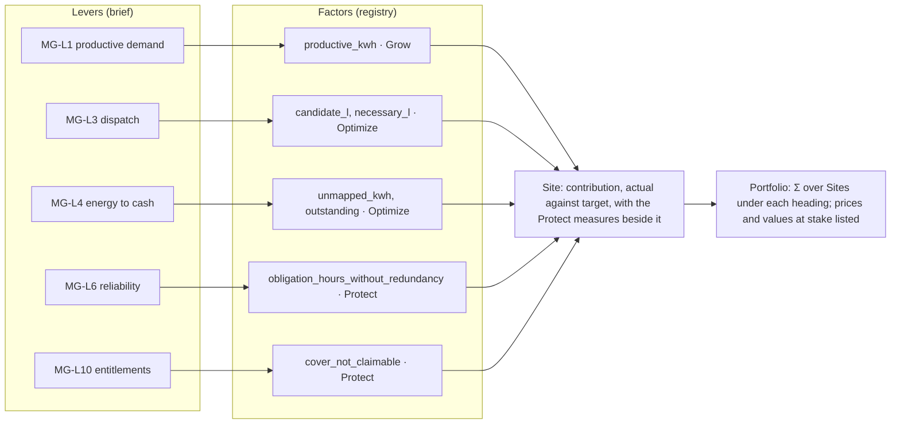
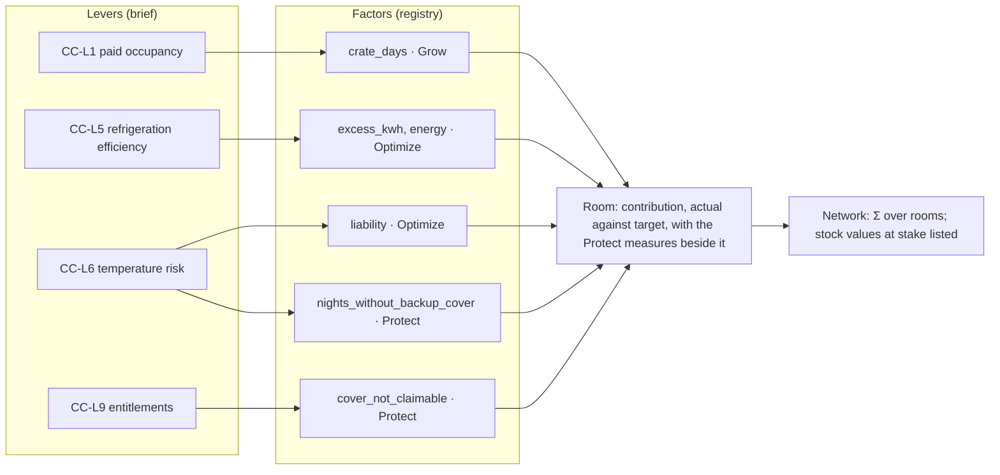
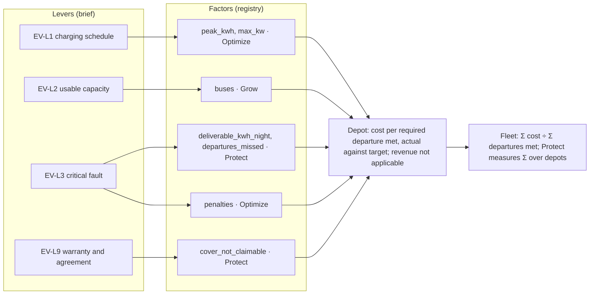
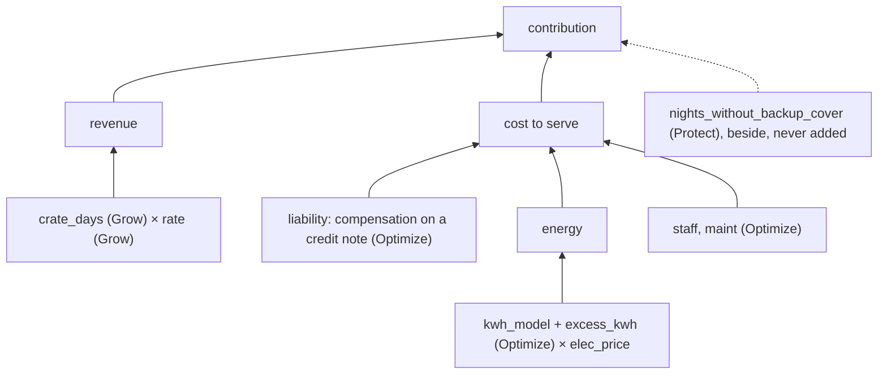
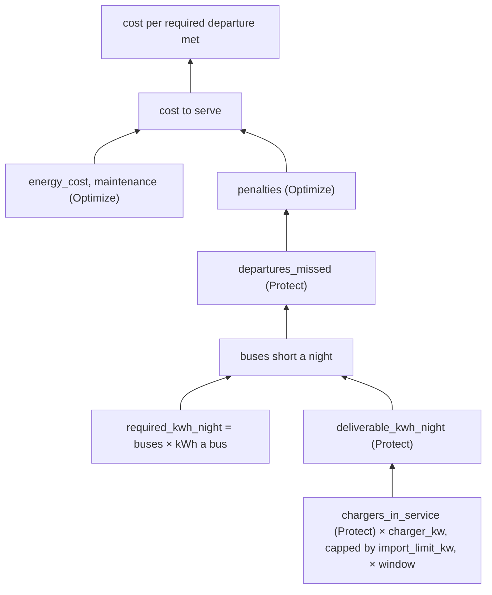

# Vertical factor map: from the brief's levers to factors, Sites and the portfolio

**AssetEcon Layer 4 · a derived builder document (regeneration F, #13) · from the design (`rev 16.12`), `worked-portfolios.md` and the brief's research (R1 to R3a, its `L1.2` and its lever catalogues `L2.2` to `L2.4`) · AssetOps Architect (Claude) · 19 Nov 2026**

## 1. What this map is, and how to read it
<!--derives: §2.0; §2.1; §2.3; §2.4; WP §1.0; owner: .agent/owner-vertical-factor-map-2026-11-19.md-->

**What exists, and stays.** The brief researched the needle movers of each vertical and catalogued them as levers: ten for mini-grids, nine for cold rooms, nine for EV depots. Today's product already observes several of them through its analyses (dispatch classification, the fuel balance, headroom qualification), and `outcome-lever-capability-traceability.csv` traces every lever to its objectives and capabilities in 454 rows.

**What this map adds.** It ties each lever to the factor IDs of the structure registry (the manifest's `home_categories`), so a lever becomes quantities the structure computes. For every lever it says which factors move, which heading each sits under, how a Site reads it against target, how the portfolio rolls it up, what acts on it (Findings, decisions and their options, plan items), how it is observed or valued, and where its evidence comes from. The traceability file's `factor` column now uses the same IDs, and `check_manifest.py` checks that the two agree (§6). *Serves the objective:* an operator executive sees that each researched driver of the business is measured at a Site, rolled up for the portfolio and acted on by a named person, which a monitoring tool does not do.

**How to read the tables.**
- *Scope now* is one of: in scope; in scope, conditional (needs evidence the operator must supply); not in scope now (the brief's `L2.7` list of what AssetEcon should not own); not applicable here (the demonstration's business model); later (a different business).
- *Heading* is the factor's home category with the brief's objective code. The codes stay off every screen.
- *Site reads* follows the design's bridge: actual against target for the period, with the effect in money where the factor carries a price (§2.2). Protect measures read against a target of zero. *Portfolio rolls up* is a sum over Sites for quantities and money, a ratio of sums for a ratio, and a list for prices and values at stake, which are never added.
- *Evidence and route* follows the integration order (OD-22): operational exports by upload today, then the EMS link, then the edge gateway; commercial records through the canonical contract (B3), emulated until the operator's exports replace them (D14).
- **No factor was added to the design for this map.** Every lever in scope reaches factors already in the registry. Two needle movers rest on potential entries rather than structure nodes: usable headroom by time window (`headroom`, not available until the EMS export by window) and a signed customer's demand (`letter_of_intent_demand`). Both sit beside Grow and are never its actual.

**Where each decision sits** (owner, OD-25; design §2.0, `rev 16.12`). A decision takes the heading of its Finding's factor, where the executive met the problem, or its lever's when no Finding stands behind it. Each Finding is pinned to the most specific factor it observes. For every decision below, the Finding's factor and the lever share a heading; `check_manifest.py` fails if this table and the manifest's `home_categories.decisions` differ, or if a Finding's factor and its lever ever sit under two headings. Each option's effects still sit under their own factors' headings.

| Decision | Site | Its Finding | Finding's factor | Lever | Heading |
|---|---|---|---|---|---|
| `kobo-generator` | Kobo | Candidate running: the generator runs while solar and the battery could carry the load | `candidate_l` | `candidate_l` | Optimize |
| `kobo-battery` | Kobo | Risk to a right: the battery warranty cannot be claimed without a capacity test and a temperature record | `cover_not_claimable` | `cover_not_claimable` | Protect |
| `kisiwa-genset` | Kisiwa | At its limit: the evening supply runs on one generator since generator 1 failed | `obligation_hours_without_redundancy` | `obligation_hours_without_redundancy` | Protect |
| `kisiwa-om` | Kisiwa | Late repair response: 96 h against the O&M contract's 48 h, so a fee credit may be due | `om` | `om` | Optimize |
| `mto-demand` | Mto | Opportunity: the cooperative's signed letter of intent for a daytime rice huller | `letter_of_intent_demand` | `productive_kwh` | Grow |
| `mto-billing` | Mto | Unbilled charges: kWh metered but not billed after the 3 Oct meter swap | `unmapped_kwh` | `unmapped_kwh` | Optimize |
| `mto-inverter` | Mto | Deadline on a right: inverter 2's warranty notice is due by 27 Nov | `cover_not_claimable` | `cover_not_claimable` | Protect |
| `mto-losses` | Mto | Losses beyond expected: kWh delivered but not explained after expected losses | `unexplained_loss_kwh` | `unexplained_loss_kwh` | Optimize |
| `mwea-occupancy` | Room A · Mwea | Off target: occupied crate-days below target | `crate_days` | `contract_crate_days` | Grow |
| `thika-backup` | Room B · Thika | Limit breached: the backup start failed and a batch went above its limit | `nights_without_backup_cover` | `nights_without_backup_cover` | Protect |
| `kirinyaga-energy` | Room C · Kirinyaga | Off target: electricity above what occupancy explains | `excess_kwh` | `excess_kwh` | Optimize |
| `embakasi-schedule` | Embakasi | Off target: the share of charging at peak price | `peak_kwh` | `peak_kwh` | Optimize |
| `kasarani-charger` | Kasarani | EV interruption: charger 2 down, so deliverable energy is below what the roster needs | `chargers_in_service` | `departures_missed` | Protect |
| `ruiru-expansion` | Ruiru | Opportunity: the city offers 6 more buses on a new route | `spare_deliverable_energy` | `buses` | Grow |
| `ruiru-connector` | Ruiru | EV interruption: charger 7, connector 2 stopped on a fault on 6 Oct and has reported nothing since | `chargers_in_service` | `charger_days_out_of_service` | Protect |

## 2. Mini-grid
<!--derives: §2.0; §2.1; §2.4; §2.5; WP §1.1-->
<!--vertical:MINI_GRID-->

**Levers.**

| Lever (brief) | Scope now | Factors | Acts on it | How it is observed or valued | Evidence and route |
|---|---|---|---|---|---|
| **MG-L1** Productive-use demand | In scope, conditional | `productive_kwh` `productive_tariff` `necessary_l` `letter_of_intent_demand` `headroom` | Opportunity Finding on the demand factor once a letter of intent is signed (Mto); decision `mto-demand` (huller, welder); plan item: the Mto huller connection, a capital item | Demand-on-headroom replay: the customer's load replayed against supply by hour, with its marginal fuel; daytime kWh are solar, evening kWh are diesel | Customer letter of intent (commercial record, B3); EMS export by hour (upload) |
| **MG-L2** Demand shaping, daytime use | In scope, no demonstration option | `productive_kwh` `necessary_l` `headroom` | None in the demonstration | The same replay, moving kWh from evening to daytime; deferred because a time-linked tariff or operating change must be agreed and lawful | Customer meter profiles (upload); tariff schedule (B3) |
| **MG-L3** Dispatch and fuel efficiency | In scope | `candidate_l` `necessary_l` `diesel_price` `battery_wear` `dawn_days_below` | Candidate-running Finding, pinned to `candidate_l` (Kobo); decision `kobo-generator` (stop setting, reserve); plan item: Kobo stop setting | Dispatch classification splits the litres; the forward dispatch replay (replay K) values each setting, with the dawn charge as a hard bound and battery wear costed | EMS export: generator kWh, battery charge (upload); fuel delivery notes (B3) |
| **MG-L4** Energy-to-cash realisation | In scope | `unmapped_kwh` `adjustments_kwh` `billed_kwh` `in_transit` `outstanding` `collected` | Unbilled-charges Finding (Mto, after the meter swap); decision `mto-billing` (records fix, meter audit); outstanding bills raised for the finance and commercial lead | Energy-to-cash observer: metered to billed to collected, each leak on its own stage; restored charges listed beside the plan until the option is valued against no action (queued: `decisions-register.md` §5) | Meter register, billing and settlement exports (B3) |
| **MG-L5** Fuel reconciliation | In scope, conditional | `unexplained_l` `diesel_l` `diesel_price` | Unexplained-fuel Finding, pinned to `unexplained_l` (Kobo): investigation, no recovery claimed | Fuel balance: deliveries and dip change against model-implied use, with a tolerance | Tank dips, delivery notes and receipts (B3) |
| **MG-L6** Reliability and asset protection | In scope | `obligation_hours_without_redundancy` `asset_days_out_of_service` `unserved_critical_kwh` `customer_hours_interrupted` `om` | At-limit Finding (Kisiwa, one generator); decision `kisiwa-genset` (repair, replace, battery); plan items: Kisiwa repair, and the proactive Kisiwa generator service | Protect observer: hours with no backup unit, from asset status and the obligation window; a hard bound on every option | Fault logs, EMS export (upload); O&M invoices (B3) |
| **MG-L7** Network-loss remediation | In scope, conditional | `technical_loss_kwh` `unexplained_loss_kwh` | Losses beyond expected at Mto, shown, not priced; the meter audit, its own decision `mto-losses` (D-RECON.7) | Delivered minus metered, against the expected loss; never called theft | Feeder and customer meter readings (upload) |
| **MG-L8** Asset sizing and capital deferral | In scope | `major_assets` `standby_kw` `obligation_hours_without_redundancy` `headroom` | Options over a longer horizon: Kobo battery (deferred), Kisiwa replacement, Mto inverter bought now; the plan's budget decides | Each capital option re-evaluates the structure over its horizon against no action | Supplier quotes (B3); the asset register |
| **MG-L9** Tariff, financing and regulation | Not in scope now (`L2.7`: tariff lobbying, equipment financing) | `tariff` `productive_tariff` | None; break-even tariffs shown beside an option (the welder) | Sensitivity only, never a forecast | Tariff schedule (B3) |
| **MG-L10** Equipment and service entitlements | In scope | `cover_not_claimable` `unclaimable_cover` `rights_value_at_stake` `om` `asset_days_out_of_service` | Deadline Finding (Mto inverter notice); decisions `mto-inverter`, `kobo-battery`, `kisiwa-om`; plan items: Mto inverter claim, Kobo battery evidence | Residual cost per remedy path; the cover bound tests what is lost; a credit counts only when its credit note arrives | Contract rows extracted with a person's approval (D9); service tickets (B3) |

**Factors.**

| Factor | Heading | Site reads | Portfolio rolls up |
|---|---|---|---|
| `productive_kwh` | Grow `G3` | kWh sold to productive-use customers against target | Σ over Sites |
| `productive_tariff` | Grow `G3` | the productive-use tariff in force | not summed: listed by Site |
| `letter_of_intent_demand` | Grow `G3` (potential) | kWh a month a signed letter names, beside Grow | listed beside Grow, never added |
| `headroom` | Grow `G2` (potential) | usable capacity minus delivered, by window: not available yet | listed beside Grow, never added |
| `billed_kwh` | Grow `G1` | billed kWh against target | Σ over Sites |
| `tariff` | Grow `G1` | the residential tariff in force | not summed: listed by Site |
| `candidate_l` | Optimize `O1` | litres of candidate running against target, × diesel price | Σ over Sites |
| `necessary_l` | Optimize `O1` | litres of needed running against target, × diesel price | Σ over Sites |
| `unexplained_l` | Optimize `O1` | litres beyond the generator model against target, × diesel price | Σ over Sites |
| `diesel_l` | Optimize `O1` | litres used against target (the fuel balance records them) | Σ over Sites |
| `diesel_price` | Optimize `O1` | the price on the period's delivery notes | not summed: listed by Site |
| `battery_wear` | Optimize `O1` | wear cost of the added battery throughput, under an option | Σ over Sites |
| `om` | Optimize `O1` | operations and maintenance cost against target; an estimate until the invoice arrives | Σ over Sites |
| `technical_loss_kwh` | Optimize `O2` | delivered minus metered at customer meters | Σ over Sites |
| `major_assets` | Optimize `O2` | power-conversion and generation units on the asset register | Σ over Sites |
| `unexplained_loss_kwh` | Optimize `O3` | kWh beyond the expected loss, not priced | Σ over Sites |
| `unmapped_kwh` | Optimize `O3` | kWh metered but not billed to a mapped customer, against a target of zero | Σ over Sites |
| `adjustments_kwh` | Optimize `O3` | authorised allowances deducted before billing, against target | Σ over Sites |
| `in_transit` | Optimize `O3` | billed value in transit at the period's end | Σ over Sites |
| `outstanding` | Optimize `O3` | billed value not yet collected | Σ over Sites |
| `collected` | Optimize `O3` | cash collected of what was billed, outside the contribution gap | Σ over Sites |
| `dawn_days_below` | Protect `P1` | replayed days below the dawn charge limit, under an option: a hard bound | not summed: a bound per Site |
| `obligation_hours_without_redundancy` | Protect `P1` | obligation hours resting on one unit, against a target of zero | Σ over Sites |
| `unserved_critical_kwh` | Protect `P1` | critical load not served, against a target of zero | Σ over Sites |
| `customer_hours_interrupted` | Protect `P1` | customer-hours of material outage, against a target of zero | Σ over Sites |
| `standby_kw` | Protect `P1` | standby capacity behind a lost unit, from the asset register | not summed: listed by Site |
| `asset_days_out_of_service` | Protect `P2` | asset-days out, from the fault logs, against a target of zero | Σ over Sites |
| `cover_not_claimable` | Protect `P4` | warranty cover an option would leave unclaimable: a hard bound | not summed: listed by right |
| `unclaimable_cover` | Protect `P4` | cover not claimable today for want of evidence | not summed: listed by right |
| `rights_value_at_stake` | Protect `P4` | each right's value, at stake, with its state and deadline | listed, never summed |

*Figure M1. Mini-grid: five of the ten levers, the factors they move, read at the Site and rolled up for the portfolio.*

## 3. Cold chain (pay-as-you-store)
<!--derives: §2.0; §2.1; §2.4; WP §1.2-->
<!--vertical:COLD_CHAIN-->

**Levers.**

| Lever (brief) | Scope now | Factors | Acts on it | How it is observed or valued | Evidence and route |
|---|---|---|---|---|---|
| **CC-L1** Paid occupancy and throughput | In scope | `crate_days` `rate` `capacity_crate_days` `contract_crate_days` `idle_capacity` | Off-target occupancy Finding (Mwea); decision `mwea-occupancy` (aggregator contract); plan item: Mwea aggregator | Occupancy ledger observer: capacity to occupied to chargeable crate-days; a contract valued over its own months | Storage ledger and invoices (B3) |
| **CC-L2** Customer and commodity mix, seasons | In scope, conditional | `contract_crate_days` `crate_days` `batches_exposed` | The aggregator's off-season contract is one case; compatibility limits enter as exposure | Seasonal occupancy by commodity; forecast demand must be evidenced by the operator | Storage ledger (B3); commodity limits on the batch records |
| **CC-L3** Pricing and service packages | In scope, conditional | `rate` `contract_rate` | None in the demonstration | Agreed terms against the rate card; willingness to pay is never inferred from temperature data | Rate card and contracts (B3) |
| **CC-L4** Market connectivity and logistics | Not in scope now (`L2.7`: customer acquisition, produce brokerage) | — | None | — | — |
| **CC-L5** Refrigeration efficiency | In scope | `kwh_model` `excess_kwh` `elec_price` `energy` | Excess-energy Finding (Kirinyaga); decision `kirinyaga-energy` (repair, replace); plan item: Kirinyaga repair | Normalised energy: base plus kWh per crate-day, ambient-corrected; low occupancy is told apart from a fault | Room energy meter, chamber temperature (upload); occupancy ledger (B3) |
| **CC-L6** Temperature and service risk | In scope | `batches_exposed` `crate_minutes_above_limit` `days_backup_start_unproven` `nights_without_backup_cover` `stock_value_exposed` `liability` | Limit-breached Finding, pinned to `nights_without_backup_cover` (Thika); decision `thika-backup`; plan item: Thika night cover | Batch exposure observer: batch presence × chamber temperature × commodity limit; exposure, damage and liability kept apart | 5-minute chamber readings (upload); stock register, inspection notes (B3) |
| **CC-L7** Repair, replace, consolidate or expand | In scope | `excess_kwh` `maint` `capacity_crate_days` `cover_not_claimable` | Kirinyaga replacement (deferred until the repair's recovery is verified); fitting a controller ourselves at Thika (rejected: voids cover) | Life-cycle comparison over a horizon against no action | Supplier quotes (B3) |
| **CC-L8** Service-to-cash correctness | In scope, no demonstration option | `crate_days` `received` `outstanding` | None in October: the reconciliation ran and found no difference | Storage-ledger-to-invoice reconciliation, each leak on its own stage | Storage ledger, invoices, receipts (B3) |
| **CC-L9** Equipment and service entitlements | In scope | `cover_not_claimable` `rights_value_at_stake` `maint` `liability` | Decision `thika-backup` (the installer's remedy, accepted); the insurer notified, no claim below the deductible | Residual cost per remedy path; no reimbursement until a settlement | Contract and policy rows with a person's approval (D9) |

**Factors.**

| Factor | Heading | Site reads | Portfolio rolls up |
|---|---|---|---|
| `crate_days` | Grow `G1` | occupied crate-days against target (chargeable equals occupied in October) | Σ over Sites |
| `rate` | Grow `G1` | the storage rate per crate-day | not summed: listed by Site |
| `capacity_crate_days` | Grow `G2` | room capacity in crate-days for the period | Σ over Sites |
| `idle_capacity` | Grow `G2` (potential) | capacity minus occupied crate-days, beside Grow | listed beside Grow, never added |
| `contract_crate_days` | Grow `G3` | crate-days under a new storage contract, under an option | Σ over Sites |
| `contract_rate` | Grow `G3` | the contract's rate | not summed: listed by contract |
| `kwh_model` | Optimize `O1` | electricity expected at this occupancy against target | Σ over Sites |
| `excess_kwh` | Optimize `O1` | electricity above what occupancy explains, against a tolerance | Σ over Sites |
| `elec_price` | Optimize `O1` | the electricity price | not summed: listed by Site |
| `energy` | Optimize `O1` | electricity cost against target | Σ over Sites |
| `maint` | Optimize `O1` | maintenance cost; an estimate until the invoice arrives | Σ over Sites |
| `liability` | Optimize `O1` | customer compensation on a credit note (Thika) | Σ over Sites |
| `received` | Optimize `O3` | cash received of what was invoiced | Σ over Sites |
| `outstanding` | Optimize `O3` | invoiced value not yet received | Σ over Sites |
| `batches_exposed` | Protect `P1` | batches above their commodity limit, against a target of zero | Σ over Sites |
| `crate_minutes_above_limit` | Protect `P1` | crate-minutes above the limit, a bounded range | Σ over Sites, as a range |
| `days_backup_start_unproven` | Protect `P1` | days since a failed start without a witnessed test | Σ over Sites |
| `nights_without_backup_cover` | Protect `P1` | nights with stock present, the start unproven and no rota | Σ over Sites |
| `stock_value_exposed` | Protect `P3` | customer stock value exposed, at stake | listed, never summed |
| `cover_not_claimable` | Protect `P4` | cover an option would void: a hard bound | not summed: listed by right |
| `rights_value_at_stake` | Protect `P4` | each right's value, at stake, with its state | listed, never summed |

*Figure C1. Cold rooms: a high energy cost per crate-day can be low occupancy (Grow) rather than a fault (Optimize); the map keeps the two levers on different factors.*

## 4. EV depot (captive fleet)
<!--derives: §2.0; §2.1; §2.4; WP §1.3-->
<!--vertical:EV_DEPOT_CAPTIVE-->

**Levers.**

| Lever (brief) | Scope now | Factors | Acts on it | How it is observed or valued | Evidence and route |
|---|---|---|---|---|---|
| **EV-L1** Deadline-aware charging schedule | In scope | `peak_kwh` `kwh_0000_0500` `kwh_2200_2400` `max_kw` `energy_cost` `departures_missed` `import_limit_kw` | Peak-share Finding (Embakasi); decision `embakasi-schedule` (charge to departure; cheapest hours, rejected for missed departures); plan item: Embakasi schedule | Deadline-aware charging feasibility: every bus's energy before departure within import and charger limits, priced by tariff interval | Charger session log from the charging management system (upload); utility invoice (B3); fleet roster (B3) |
| **EV-L2** Charger sharing and usable capacity | In scope | `deliverable_kwh_night` `scheduled_kwh_night` `required_kwh_night` `buses` `spare_deliverable_energy` | Opportunity Finding on spare deliverable energy (Ruiru: the city's route offer); decision `ruiru-expansion` (6 or 10 more buses) | Deliverable energy a night (chargers in service × power, capped by the import limit, × window) against what the roster needs | Session log (upload); roster (B3) |
| **EV-L3** Critical fault repair and redundancy | In scope | `chargers_in_service` `deliverable_kwh_night` `departures_missed` `nights_below_required` `penalties` | Below-limit Finding (Kasarani); decision `kasarani-charger` (cover, wait, local repair); plan item: Kasarani cover | Fault consequence: chargers in service to buses short a night to departures missed; a noncritical idle connector ranks below | Fault log, session log (upload); penalty statement (B3) |
| **EV-L4** Tariffs and demand charges | In scope, conditional | `peak_price` `night_price` `offpeak_price` `demand_rate` `demand_cost` | The tariff switch beside the plan on Act first (Embakasi) | Tariff pricing of energy by interval; whether time-of-use applies is a contract fact | Utility tariff and invoices (B3) |
| **EV-L5** Charger, grid and storage capital | In scope | `chargers_installed` `charger_kw` `import_limit_kw` `deliverable_kwh_night` | Decision `ruiru-expansion`: four more chargers listed beside as the purchase avoided, never added | Capital options compared with scheduling and repair first, over the capital horizon | Supplier quotes, grid connection terms (B3) |
| **EV-L6** Commercial fleet contracts, paid sessions | Not applicable here (a captive fleet sells no charging) | — | None | Revenue is not applicable for a captive depot, never zero | — |
| **EV-L7** Charging reliability and battery health | In scope for charger reliability; battery health not in scope now (no validated battery data) | `departures_missed` `charger_days_out_of_service` | Departures and charger-days bound every schedule option | Carried by fault consequence (EV-L3); battery wear is not estimated | Fault log (upload) |
| **EV-L8** Battery swapping inventory | Later (a different business and data model) | — | None | — | — |
| **EV-L9** Charger warranty and service agreement | In scope | `cover_not_claimable` `rights_value_at_stake` `maintenance` `penalties` `charger_days_out_of_service` | Decisions `kasarani-charger` (the supplier's restore within its agreement) and `ruiru-connector` (claim at the next routine visit) | Residual cost per remedy path; the restore date follows the agreement; a local repair that voids cover is rejected | Contract rows with a person's approval (D9); service tickets (B3) |

**Factors.**

| Factor | Heading | Site reads | Portfolio rolls up |
|---|---|---|---|
| `buses` | Grow `G2` | buses served on the chargers in place | Σ over depots |
| `spare_deliverable_energy` | Grow `G2` (potential) | deliverable minus required kWh a night, beside Grow | listed beside Grow, never added |
| `scheduled_kwh_night` | Optimize `O2` | kWh charged a night, as scheduled | Σ over depots; the share used is a ratio of sums |
| `chargers_installed` | Optimize `O2` | chargers installed | Σ over depots |
| `peak_kwh` | Optimize `O1` | kWh at peak price against target, × the peak premium | Σ over depots |
| `kwh_0000_0500` | Optimize `O1` | kWh charged after midnight | Σ over depots |
| `kwh_2200_2400` | Optimize `O1` | kWh charged off-peak before midnight | Σ over depots |
| `max_kw` | Optimize `O1` | the month's peak import against target, × the demand rate | not summed: listed by depot |
| `energy_cost` | Optimize `O1` | the electricity bill against target, or a stated total where the target is not decomposed | Σ over depots |
| `peak_price` | Optimize `O1` | the peak price in force | not summed: listed by depot |
| `night_price` | Optimize `O1` | the after-midnight price in force | not summed: listed by depot |
| `offpeak_price` | Optimize `O1` | the off-peak price in force | not summed: listed by depot |
| `demand_rate` | Optimize `O1` | the demand rate per kW | not summed: listed by depot |
| `demand_cost` | Optimize `O1` | the demand charge against target | Σ over depots |
| `maintenance` | Optimize `O1` | charger service fee; an estimate until the invoice arrives | Σ over depots |
| `penalties` | Optimize `O1` | penalties for missed departures, from the authority's statement | Σ over depots |
| `chargers_in_service` | Protect `P1` | chargers working, from the fault log | Σ over depots |
| `charger_kw` | Protect `P1` | power per charger | not summed: listed by depot |
| `import_limit_kw` | Protect `P1` | the grid import limit: a hard bound | not summed: listed by depot |
| `deliverable_kwh_night` | Protect `P1` | energy deliverable a night against what the roster needs | not summed: listed by depot |
| `required_kwh_night` | Protect `P1` | buses × kWh each needs a night | Σ over depots |
| `departures_missed` | Protect `P1` | required departures missed, against a target of zero | Σ over depots |
| `nights_below_required` | Protect `P1` | nights with deliverable energy below required | Σ over depots |
| `charger_days_out_of_service` | Protect `P2` | charger-days out, including Ruiru's charger 7, connector 2 | Σ over depots |
| `cover_not_claimable` | Protect `P4` | cover an option would void: a hard bound | not summed: listed by right |
| `rights_value_at_stake` | Protect `P4` | each right, with its state and restore date | listed, never summed |

*Figure E1. EV depots: the cheapest schedule is rejected when it misses departures; the departures factor is the Protect bound every cost lever must keep.*

## 5. Worked structures: a cold room and an EV depot beside Kobo
<!--derives: §2.1; §2.2; Figure 2; WP §1.1; WP §1.2; WP §1.3-->

**Kobo (mini-grid)** is the design's worked example (Figure 2): contribution 1,445.00<!--fig:sites.lakeside-power/Kobo.plan.nodes.contribution--> targeted and 883.00<!--fig:sites.lakeside-power/Kobo.actual.nodes.contribution--> actual, read upward from billed kWh and the three kinds of generator litres.

**Thika (cold room), October.** Contribution = revenue − cost to serve, read upward:

- Revenue is 1,736.00<!--fig:sites.harvest-cold/Room B · Thika.actual.nodes.revenue-->, on target; energy is 744.00<!--fig:sites.harvest-cold/Room B · Thika.actual.nodes.energy-->, on the occupancy model; staff 350.00<!--fig:sites.harvest-cold/Room B · Thika.actual.nodes.staff-->; maintenance 80.00<!--fig:sites.harvest-cold/Room B · Thika.actual.nodes.maint-->, an estimate.
- The customer compensation of 108.00<!--fig:sites.harvest-cold/Room B · Thika.actual.nodes.liability--> is the whole deviation: contribution 562.00<!--fig:sites.harvest-cold/Room B · Thika.plan.nodes.contribution--> targeted, 454.00<!--fig:sites.harvest-cold/Room B · Thika.actual.nodes.contribution--> actual.
- Beside it, under Protect, 26<!--fig:sites.harvest-cold/Room B · Thika.actual.nodes.nights_without_backup_cover--> nights without backup cover: the measure the decision restores, never added to the money.
- Cash received is 1,650.00<!--fig:sites.harvest-cold/Room B · Thika.actual.nodes.received--> with 86.00<!--fig:sites.harvest-cold/Room B · Thika.actual.nodes.outstanding--> outstanding, outside the gap.

**Kasarani (EV depot), October and November to date.** The outcome is cost per required departure met, with revenue not applicable:

- October was on target: cost to serve 5,880.00<!--fig:sites.metro-bus/Kasarani.actual.nodes.cost_to_serve-->, energy 5,580.00<!--fig:sites.metro-bus/Kasarani.actual.nodes.energy_cost--> and maintenance 300.00<!--fig:sites.metro-bus/Kasarani.actual.nodes.maintenance-->, an estimate; 1,400<!--fig:sites.metro-bus/Kasarani.actual.nodes.deliverable_kwh_night--> kWh deliverable a night.
- From 1 Nov, 3<!--fig:sites.metro-bus/Kasarani.november_to_date.nodes.chargers_in_service--> chargers in service deliver 1,050<!--fig:sites.metro-bus/Kasarani.november_to_date.nodes.deliverable_kwh_night--> of the 1,200<!--fig:sites.metro-bus/Kasarani.november_to_date.nodes.required_kwh_night--> kWh needed, so 2<!--fig:sites.metro-bus/Kasarani.november_to_date.nodes.departures_missed--> departures were missed (Protect) and 240.00<!--fig:sites.metro-bus/Kasarani.november_to_date.nodes.penalties--> of penalties fell into cost to serve (Optimize), read before any invoice.

## 6. The check, and the traceability file
<!--derives: §2.1; §2.9; Decisions-->

`check_manifest.py` (`factor_map()`) fails when:
- a lever of the brief's catalogues `L2.2` to `L2.4` is missing from this map;
- a factor ID in this map is not a registry node, a manifest measure or a potential entry of its vertical;
- a mapped factor has no row in its vertical's factor table, a heading that differs from the registry, or no Site or portfolio read;
- a lever in scope maps to no factor;
- the traceability file's `factor` column names an ID outside the registry, or a lever row's IDs differ from this map's for that lever;
- the traceability file's free text breaks the naming lint (OD-6).

It proves itself on planted copies every run: a lever removed, an unknown factor, a blank Site read, a wrong heading, and a traceability row with a different factor each must fail.

**The traceability file now.** The `factor` column holds registry IDs (space-separated; `—` where a row has no factor of its own, such as cross-vertical class rows). The former free text is kept as `factor_description`, cleaned: "target" for a target (OD-6), the construct names for the old mechanic numbers, and customer compensation and penalties as Optimize cost lines (`rev 16.11`).

## 7. What moved here from the retiring documents
<!--derives: §2.9; Appendix; DA §4-->

Before `domain-and-decision-models.md` and `economic-metric-and-effect-contracts.md` are retired (regeneration F), their lever narrative lives here:
- *From `domain-and-decision-models.md` §3 (observers):* the energy-to-cash observer (MG-L4), fuel balance (MG-L5), dispatch classification (MG-L3), tariff pricing by interval (EV-L1, EV-L4), occupancy ledger (CC-L1), normalised refrigeration energy (CC-L5), batch exposure (CC-L6), charging capacity and fault consequence (EV-L2, EV-L3), headroom qualification (MG-L1, MG-L8), the Protect observer (MG-L6) and the storage-ledger-to-invoice reconciliation (CC-L8): each is now the "How it is observed or valued" cell of its lever.
- *From the same document's §4 (lever models):* the valuation identity (every option), the forward dispatch replay (MG-L3), the demand-on-headroom replay (MG-L1, MG-L2), commercial correction and investigation (MG-L4, MG-L7), the occupancy contract and repair-or-replace (CC-L1, CC-L5, CC-L7), deadline-aware charging feasibility (EV-L1, EV-L2), obligation bounds (MG-L6, CC-L6, EV-L3) and the residual cost per remedy path (MG-L10, CC-L9, EV-L9), in the same cells. Their full mechanisms stay in `decision-loop-specification.md` §6 and `structure-specification.md`.
- *From the same document's §4.9 (levers with no demonstration option):* MG-L2, CC-L8 and EV-L7, now in each lever's scope cell.
- *From `economic-metric-and-effect-contracts.md` §2.2 to §2.4 (the structure per vertical):* the cold-room and EV-depot structures, now §5 above; the Protect and operations measures by vertical (its §2.6 and §2.7) are the factor tables' Protect and `O2` rows.

## 8. Open questions
<!--derives: Decisions; §2.0-->

| Question | Example | Default (applies now) |
|---|---|---|
| Should usable headroom by time window become a structure node rather than a potential entry? | Mto's daytime headroom decides whether the huller fits | Keep it a potential entry until an operator's EMS export by window is pinned; then add the node under the gaps rule |
| Should battery health enter the EV structure? | EV-L7's battery half | Not until validated battery data exists, as the brief says |
