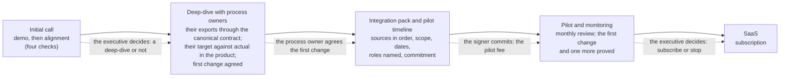

# Commercial approach: what converts operator executives, how they engage, and the first committed pilot

**AssetEcon · go-to-market document for the owner · AssetOps Architect (Claude) · 19 Nov 2026 · recreated from the design (rev 16.7), updated for rev 16.9 and the owner's commercial answers of 19 Nov (C2, C12 to C15)**

**Status.** Recreated from scratch at the owner's order (`.agent/owner-recreate-document-packs-2026-11-19.md`; `regeneration/F-pack-recreation-plan.md`, document #9). It replaces revision 4.1 of 18 Nov, whose framing predates the design's Part 2; only its selling facts are kept.

**Two source layers** (P4 in `F-pack-recreation-plan.md`).
- *Product claims* come only from the design, `Docs/demo-sprint/product-direction-layer4/layer4-transformation-design.md` (rev 16.7), with `worked-portfolios.md` and `design-appendix.md`, now at rev 16.8. Every section names the design sections it derives from.
- *Commercial facts* come from the owner's decisions in `/opt/assetecon/AssetOpsV1/owner/`: the engagement path (`owner-d1-engagement-path-2026-11-18.md`), the sitting-1 answers (`owner-sitting1-answers-2026-11-18.md`), the analyst answer (`owner-gtm-documents-request-2026-11-18.md`); and, on this branch, the ten pack answers of 19 Nov (`.agent/owner-pack-questions-defaults-2026-11-19.md`: "defaults for all 10, go ahead"), which decide C2, C12, C13, C14 and C15. Where no decision exists, a planning assumption is stated as one, with its default.

**Three kinds of number.**
- *Demo illustration*: computed from the demonstration world and checked by `check_manifest.py`. It is never a customer result. A figure read from the demonstration world's commercial records is *Emulated* (D14).
- *Planning assumption*: an effort, cost or time guess, to be replaced by what the first deep-dives and pilots measure.
- *Option for the owner*: a candidate price, internal and never published.

No conversion rate, market size or competitor capability is claimed. `render_commercial_plan_html.py` recomputes every commercial table from its stated inputs before it renders the page.

## On one page
<!--derives: Introduction; §2.0; D1; D2; D5-->

*Serves the objective:* operator executives adopt AssetEcon for economic value their monitoring tools do not give. This document says who to convert, with what, by which path, at what cost to the owner, and what the owner still decides.

| Question | Answer |
|---|---|
| What converts an executive | Their own money explained factor by factor, choices valued against doing nothing net of their cost, their Sites' changes combined in one plan the executive approves, proof that the money followed, and a record of who decided and who approved (§1). Each **should convert**; that it does is the hypothesis the pilots test (design §2.0) |
| What it stands on | Today's product: honest, bounded judgement on Site evidence, with proof before credit (design Part 1). It is the credibility the money claims need, and it is shown live |
| Who first | Mini-grid portfolio operators with three or more Sites, a budget per Site and billing exports, whose CEO, CFO or COO cannot say why a month came in below target (§2; D3) |
| The path | **Initial call → Deep-dive with process owners → Integration pack and pilot timeline → Pilot and monitoring → SaaS** (D1, decided by the owner, 18 Nov). Their own target against actual appears in the product during the deep-dive, from files they already export (§3) |
| What the product must have built | The deep-dive's first view needs delivery steps 3A, 4 and 5 live; its first change needs step 6; the pilot's proof needs step 8 (Figure 10). Until a step is live, what depends on it waits; nothing is done by hand (§3.3) |
| Price | Disclosed after the client conversation, never listed (decided, 18 Nov). The pilot carries a fee, credited against the first subscription year if they subscribe within 60 days (C2, decided 19 Nov). The deep-dive carries no fee, is timeboxed, and is offered only after the alignment checks pass and a data agreement is signed (C12, decided 19 Nov) (§4) |
| The constraint | The owner's time: the owner runs every call, deep-dive and mapping, and the product computes (D5). One deep-dive at a time, with a pilot beside it (§5) |
| First revenue | The pilot commitment, at about weeks 7–14 after the path is approved in the owner's decided month (C14, C15), if the build is ready; the first change proved at about M4–M5 (§5.2) |
| Open for the owner | Seven items, each with a default (§8). The offer's terms (C2, C12, C13) and the owner's month (C14, C15) were decided on 19 Nov. The owner's weigh-in now matters most on C10, the second person who checks each mapping, and on D15, the first change |

## 1. What converts an executive, and why it should
<!--derives: Part 1; §1.1; §1.5; §2.0; §2.2; §2.4; §2.5; §2.6; §2.7; Figure 1b; Figure 3; Figure 5; OD-21; WP §1.1; WP §1.2; WP §1.3; WP §1.5-->

*Serves the objective:* this is the differentiation. Executives already see what their assets did. What they lack is economic judgement across their systems: why the month came in below target, which lever moves it, what it is worth, and whether it paid off (design Introduction).

### 1.1 What today's product already gives, and why it matters to a buyer

Today's product turns Site evidence into honest, bounded operational judgement that a person can act on and later verify (design §1.1). For a mini-grid it answers five questions: what happened and how sure we are; whether fuel is missing; what it might be worth, as a modelled range never summed; what to look at first and what can be done; and whether the response was made and worked. Money is credited only after a Verified verdict.

This is the base of the sale: today's product already labels how every figure is known, never adds figures of different kinds, names missing records, and claims savings only after proof (design Rules). What it cannot yet do is state money or record who decided (design §1.5, L1–L6, G1).

**The four headings the executive already knows stay** (OD-21). Grow revenue, Optimize cost and efficiency, Protect asset and capital, and Assure performance and returns remain the Portfolio's headings. What changes is underneath: each heading is built from the factors under it, so a buyer reads their money by the headings they think in. Grow and Optimize together explain the contribution gap, and collecting what was billed is Optimize. Assure carries no money of its own: it presents the evidence, from target against actual with its sources to the verdicts and contract remedies, which is what boards and lenders ask for (design Figure 1b). Productive use is Grow; headroom with no customer is shown as potential, never as Grow's actual.

### 1.2 What is added on top, and what each should do for the buyer

Each construct below is built on today's core, not instead of it. Each line says what it is meant to do for the buyer, and what would show that it does not.

| Differentiator (design) | What the executive gets | Why it should convert | What would prove it wrong |
|---|---|---|---|
| **Their money explained** (B1, B2, B3, CH1) | Each Site's contribution, cost to serve and collections computed from their own records, with the gap to target split cause by cause. Kobo, October: 1,565.50<!--fig:sites.lakeside-power/Kobo.actual.nodes.contribution--> against a target of 1,951.25<!--fig:sites.lakeside-power/Kobo.plan.nodes.contribution-->, a gap of −385.75<!--figx:{sites.lakeside-power/Kobo.actual.nodes.contribution}-{sites.lakeside-power/Kobo.plan.nodes.contribution}--> built from four effects (demo illustration, Emulated, with simulated telemetry; Figure 3) | It answers the question monitoring cannot: why the month came in below target, and by how much from each cause | Their finance team already produces this split each month, or on their data it leaves a large unexplained remainder |
| **Choices valued against doing nothing, net of cost** (CH3) | Options for each issue, each valued against no action after its one-off cost, checked against service and contract bounds, one marked Recommended. At Mto the rice-huller connection is worth +2,213.33<!--fig:options.MTO-HULLER.value--> over twelve months after its 1,200.00<!--fig:options.MTO-HULLER.operator_one_off--> one-off (modelled on simulated replay litres, M8). At Kobo both generator settings pass the operating checks on the replay, with the dawn battery margin shown beside each as information; their litres and value are Not available yet until a replay runs on Kobo's own October (0K4f; Figure 5) | The executive sees what is worth doing, in money, and which obvious move would break a service rule | Options agree with what their engineers would have done anyway, with no money gained from the comparison |
| **The Sites' changes in one plan, approved by the executive** (P) | The period's chosen changes checked against budget, crew visits and dates, with the nearest set that fits proposed and every left-out item given its reason. Lakeside's proposal is worth +2,213.33<!--fig:plans.lakeside-power.default.value--> on a spend of 3,660.00<!--fig:plans.lakeside-power.default.spend--> (demo illustration; WP §1.1) | Only the budget holder can trade one Site against another; no other tool gives that trade a home | The operator plans spend Site by Site and never meets a budget or crew conflict |
| **Proof that the money followed** (CH4) | After a change: did it happen, did the money follow in recorded records, and did the action cause it, each answered separately, with the option's cost subtracted | Proof on their own Sites is what the pilot sells and what renews the subscription | Verdicts stay "not proven yet" on field records for want of comparable days or recorded money |
| **A recorded person deciding and approving** (CH2, P) | Who raised, chose, approved and owns each Action, with due dates and overdue shown; the executive approves each plan version. In the demonstration on 6 Nov, Lakeside's version 1 is proposed and awaits its executive; the Kobo change was released when it was created, because it uses no crew visit and is within the spend threshold, while the Kisiwa repair waits (illustrative; WP §1.5) | Boards, lenders and owners ask who decided; the record answers them | Executives see the record as overhead and do not use the approval step |

**The line we never cross.** We do not promise savings; we show how they would be proven. Demo figures are said aloud as demo figures, emulated ones as Emulated, and replay-based ones as modelled on simulated data, or as not available yet where the replay has not run (D6, D14).

### 1.3 Per vertical: what they probably have, and what we add

| Vertical | What they probably have (tool types, not vendors) | What we add | Demo illustration |
|---|---|---|---|
| **Mini-grid** | inverter or controller portal; remote monitoring; prepaid or smart-meter billing; spreadsheets for budget and fuel | contribution against target per Site, split into fuel, billed kWh and collections; options against doing nothing; the Sites' changes in one plan, approved by the executive | Kobo above (Emulated, with simulated telemetry) |
| **Cold rooms** | temperature loggers and alarms; a storage ledger; energy bills | return per room, occupancy kept apart from efficiency; repair or replace valued against doing nothing | Mwea's room is empty, not inefficient (202.74<!--fig:sites.harvest-cold/Room A · Mwea.actual.nodes.contribution--> against 794.80<!--fig:sites.harvest-cold/Room A · Mwea.plan.nodes.contribution-->); Kirinyaga's draws 260.03<!--fig:sites.harvest-cold/Room C · Kirinyaga.actual.nodes.excess_kwh--> kWh above its model, and the repair at 350.00<!--fig:options.KIRI-REPAIR.operator_one_off--> is Recommended (WP §1.2) |
| **Captive EV depot** | charge-point management system; telematics; utility bills | cost per required departure met; a schedule that meets every departure, chosen over the cheapest | the cheapest Embakasi schedule misses 93<!--fig:options.EMB-CHEAPEST.protect.departures_missed--> departures a month, so it is Rejected (WP §1.3) |

## 2. Who we sell to
<!--derives: §2.6; WP §1.0; WP §1.5; D3; D4; D5; OD-12-->

*Serves the objective:* the buyer is the operator's management, and the deep-dive needs the people who will later hold the design's roles.

### 2.1 The buyer and the people the pilot needs

| | Mini-grid operator (lead, D3) | Cold-room network | Captive EV fleet and depot |
|---|---|---|---|
| **Profile** | 3+ Sites (ideally 10+), solar, battery and diesel, prepaid or postpaid billing | several rooms charging per crate-day | a depot charging its own fleet to a timetable; departures are the obligation |
| **Economic buyer** | CEO or CFO | CEO | COO |
| **Triggers** | a diesel price rise; a missed budget month; a lender report due; a failure near warranty end | a low-return room; an outage with stock at risk; repair or replace | a tariff change; fleet growth; a charger fault that cost departures |

**The design's five roles, named in the integration pack** (design §2.6). A pilot works only if the operator names a person for each: the operator executive (approves each plan version, sets budget and thresholds), the finance and commercial lead (budget lines, money targets, collections and claims), the operations or site manager (chooses options, creates Actions), the field technician or O&M contractor (does and records the work), and the analyst (maps sources; during the engagement this is the owner, D5). This is where a buyer first meets the recorded person: the deep-dive names them, the pilot records them.

### 2.2 Alignment: four checks before a deep-dive

The initial call ends in alignment (D1). A prospect that fails a check gets no deep-dive.

| Check | Passes when | Fails into |
|---|---|---|
| **Data privacy** | they can sign our data agreement, or name what must change and who approves it | the agreement goes to their lawyer; no file is taken until it is signed |
| **Processes** | the executive names an issue as theirs and a decision to test, and names the process owners (finance, operations) who will join | nurture: a second call |
| **Integrations** | billing (cold: storage ledger; EV: roster) and a budget by Site for one closed month, plus the controller, energy or charging export | a free data assessment: what they have, what it would unlock |
| **Who signs** | the person in the room can sign the pilot commitment, or names who can and when | nurture until the signer joins |

**The first-change question** (D15, pending). At alignment ask: *"If the deep-dive finds a change worth testing, will you make it when the pilot starts?"* A yes lets the deep-dive end with the first change agreed and its prediction frozen; a no moves it into the pilot, about a month later.

**Who gets the owner's deep-dive time first:** the best data readiness, then a named decision with money and a date, then the signer's budget.

## 3. The engagement path
<!--derives: D1; D2; D4; D12; D14; D15; §2.3; §2.6; §2.9; Figure 10; owner: .agent/owner-gtm-documents-request-2026-11-18.md-->

*Serves the objective:* the path puts the buyer's own money in the product early, so the decision to adopt rests on their records, not on a demo.

### 3.1 The path, with who decides at each step

The owner revised D1 on 18 Nov to this path, with two safeguards: value on the operator's own file exports early, and a commitment before the pilot.

*Every stage has a stop. If a check fails, if the deep-dive's view does not reconcile or convince, if no commitment follows, or if verdicts are negative, we stop and record why. A stop is a result: it tests the hypothesis.*

| Stage | Buyer gets | Buyer gives | Who does the work | Terms |
|---|---|---|---|---|
| **Initial call** | today's product live on their vertical, and the coming constructs on the mock-up once the owner approves it for clients (D12); then alignment | an hour of executive time | owner | free |
| **Deep-dive with process owners** | their sources mapped to the canonical contract; their own target against actual in the product, reconciled to one closed month (safeguard 1); the first change valued against doing nothing and its prediction frozen (D15) | files they already export for three Sites, one to four months; a signed data agreement; a few hours from each process owner | owner, the product computing | no fee, timeboxed, only after the four checks and a signed data agreement (C12, decided) |
| **Integration pack and pilot timeline** | which sources come in what order: files first (EMS, billing and budget exports), then the EMS API, then the edge gateway over Modbus on their hardware (OD-22); the pilot's scope, dates and success criteria; the five roles named, with each person's sign-in and the roles their executive grants (OD-13, OD-14); the executive's budget, spend threshold and crew-visit threshold set (OD-2, OD-12) | their IT's time; the signer's commitment (safeguard 2) | owner and their IT | the pilot fee, credited against the first subscription year if they subscribe within 60 days (C2, decided) |
| **Pilot and monitoring** | a monthly review on their data; the first change proved operationally, then in money, then as caused; one more change the same way | continuing exports; the process owners' time; approval of each plan version | the product, the owner overseeing | the pilot fee |
| **SaaS** | the loop every month on all their Sites | a subscription | – | a framework of options (§4) |

### 3.2 The two safeguards

1. **Value on their own data before any integration is built.** The deep-dive takes their exports through the same canonical contract later feeds will use, so their target against actual appears within weeks (design §2.3). The safeguard holds only once delivery steps 3A, 4 and 5 are live (design §2.9; §3.3 below). A person in the Analyst role, the owner in the first deep-dives (D5), onboards their exports through step 3A's intake. It is the pilot's baseline. Until an export passes the contract test it is not read, and an emulator's figure is never shown as theirs (D14).
2. **A commitment before the pilot.** A new vendor should not charge for analysis before trust exists, so the deep-dive carries no fee and is timeboxed (C12, decided 19 Nov). The pilot carries a fee agreed in the integration pack. A prospect who will not commit after seeing their own target against actual is unlikely to adopt.

### 3.3 What each stage needs the product to have built

The path and the delivery order meet here. Each stage can sell only what is live (Figure 10).

| Stage | What it shows | Delivery steps that must be live | If a step is not live yet |
|---|---|---|---|
| Initial call | today's product (Part 1); the coming constructs on the approved mock-up | none for the live part | the coming constructs are described, not shown |
| Deep-dive: mapping | their sources against the canonical contract | step 2 (format, version 1) | the mapping waits |
| Deep-dive: first view | their target against actual, cause by cause | 3A (record store, contract test), 4 (money leaves), 5 (targets and the bridge) | the deep-dive maps sources and agrees the pack; the baseline waits |
| Deep-dive: first change | a cost-side option valued against doing nothing | 3B, 3C (recorded person), 6 (decisions) | the first change moves into the pilot |
| Pilot | the plan approved by the executive; the three verdicts | 7 (the plan and the Portfolio), 8 (three verdicts) | proof waits; the pilot's length is stated in the pack |
| Second vertical; rights; onboarding at scale | cold, then EV; contract rights in repair decisions; real adapters for more operators | 9 | the cold or EV route (§3.4) |

When each step lands is set by `delivery-plan.md` and `two-week-build-plan.md`, not here. The dates in §5.2 assume the deep-dive's steps are live when the first deep-dive starts.

### 3.4 Design partners, and the route for cold and EV

**Design partners (C4, decided by the owner, 18 Nov):** at most three, a time-limited discount on the pilot fee, a reference case only on positive results and with consent. Partners shape the options and record formats built for them, never the general core.

**Cold and EV.** Mini-grid is built first (D3). The first cold or EV prospect that passes every alignment check chooses the second vertical and runs its deep-dive as its design partner; if none does by about M2, the default is cold (D4, C8). Its pilot starts when that vertical's step 9 work is built for its records. Meanwhile it gets the data assessment and a say in what is built.

## 4. Pricing
<!--derives: D2; D1; owner: .agent/owner-gtm-documents-request-2026-11-18.md; owner: .agent/owner-pack-questions-defaults-2026-11-19.md-->

*Serves the objective:* the terms must make a pilot an easy, real commitment without charging for analysis before trust exists.

- **No list price.** The price is disclosed after the client conversation (owner, 18 Nov: "it is disclosed after client conversation"). Nothing sent before a call carries a figure.
- **The pilot fee.** One fee for a three-month pilot on three Sites, agreed in the integration pack. *Its form (C2, decided 19 Nov):* credited in full against the first subscription year if they subscribe within 60 days of the pilot's end. *Still a planning default:* half paid at the commitment and half a month later.
- **The deep-dive** (C12, decided 19 Nov): no fee, timeboxed, offered only after the four checks pass and the data agreement is signed. *Its review (C13, decided 19 Nov):* after two deep-dives in a row end without a commitment, the owner reviews the checks and C12 before offering another.
- **What the client hears, and when.** The credit and the deep-dive's terms are disclosed after the client conversation, like the price (D2). The website states neither (`website-content.md` WC5).
- **The subscription** stays a framework without prices until the first pilots measure three things: the owner-days a Site needs once feeds run, the buyer's own judgement of the pilot's value, and what they pay today for the tools they use. Candidates: per Site with a minimum, a portfolio band, or a base with modules (cold, EV, rights).
- **Gain-share: not now** (C7). It needs proof in money and of cause; revisit at the first subscription decision.
- **Currency.** Fees are quoted in the buyer's currency at the rate on the proposal date.

The internal guide to the fee is in §6.

## 5. The owner's time and the sales motion
<!--derives: D5; D1; owner: .agent/owner-gtm-documents-request-2026-11-18.md; owner: .agent/owner-pack-questions-defaults-2026-11-19.md-->

*Serves the objective:* the owner is the only seller and the analyst (owner, 18 Nov: "The owner is the analyst"), so the owner's month sets how many executives can be converted, and when.

### 5.1 Who does what

- **The owner** runs the initial calls and alignment, leads the deep-dive sessions, maps each source to the canonical contract, reconciles one closed month with their finance, agrees the first change, writes the integration pack with their IT, takes the commitment and oversees the pilot's monthly review (D5).
- **The product** computes: the contract test on every file, the intake, the target-against-actual view, the options and, in the pilot, the verdicts. Nothing is transcribed by hand.
- **A second person** checks each mapping and the first reconciled month, because the owner cannot check their own mapping (C10, open). An agent's check may be added but never replaces the person.
- **The Architect and agents** draft the target list, the data agreement template, the mapping and the integration pack.

### 5.2 The owner's month, and how long an engagement takes

The owner's day is 240 minutes, up to 480 on peak days (decided, 18 Nov). The owner decided the other two inputs on 19 Nov: up to eight peak days a month (C14) and two owner-days a month kept for the product (C15). Because C14 says "up to", the month with no peak days is also within the decision. The four-day reserve rows are kept only as a sensitivity. The tables are computed from the inputs in §6.

<!--table:owner-month-->
| Case | Peak days a month (C14) | Product reserve, owner-days (C15) | Owner-days a month | For commercial work | Delivery limit, after the selling floor |
|---|---:|---:|---:|---:|---:|
| decided: up to 8 peak days, 2-day reserve (C14, C15) | 8 | 2 | 13 | 11 | 9.5 |
| within the decision: no peak days | 0 | 2 | 9 | 7 | 5.5 |
| sensitivity only: four-day reserve | 8 | 4 | 13 | 9 | 7.5 |
| sensitivity only: no peak days, four-day reserve | 0 | 4 | 9 | 5 | 3.5 |
<!--/table-->

The selling floor keeps four initial calls a month going even while a deep-dive runs, so the pipeline does not empty. Each part of an engagement takes the longer of the owner's days at the delivery limit and its calendar minimum. The commitment dates assume the deep-dive starts 4–8 weeks after the path is approved and that steps 3A to 6 are live by then (§3.3).

<!--table:durations-->
| Case | Delivery limit | First view of their target against actual (weeks into the deep-dive) | Deep-dive and integration pack (weeks) | Commitment (weeks from approval) | First change proved |
|---|---:|---:|---:|---|---|
| decided: up to 8 peak days, 2-day reserve (C14, C15) | 9.5 | 1.1–2.5 | 3.1–5.7 | weeks 7–14 | about M4–M5 |
| within the decision: no peak days | 5.5 | 2–4.3 | 4.7–9.9 | weeks 9–18 | about M4–M6 |
| sensitivity only: four-day reserve | 7.5 | 1.4–3.2 | 3.6–7.2 | weeks 8–15 | about M4–M6 |
| sensitivity only: no peak days, four-day reserve | 3.5 | 3.1–6.8 | 7.5–15.5 | weeks 12–24 | about M5–M8 |
<!--/table-->

**What this means.** In the decided month one deep-dive fits at a time, with a pilot beside it; a second at once needs a few days of the second person's help (C11). If no peak day is available in a month, which C14 allows, the commitment moves to about weeks 9–18, and the deep-dive and pack still fit three to ten weeks. So the website may now state that duration (T13 in `website-content.md` §4). The first view stays unstated until the bridge is live in the demo (T6, T14). Only the four-day reserve, which the owner did not choose, would push the commitment to about weeks 12–24.

### 5.3 Finding prospects, and what to track

**Sources:** the mini-grid association's member list (the natural first list), financiers and grant programmes that already ask operators for performance evidence, the owner's network, each pilot's introductions with consent, and the website. **Target list by week 4:** about 30 mini-grid, 10 cold-room and 10 captive-EV operators, each scored from public information.

**One row per prospect, rates computed only from real rows:** calls and the share reaching alignment; which check fails most; deep-dives ending in a commitment, with every decline's reason; days to the first view and to the commitment; owner-days per stage; the unexplained remainder; and the tools each prospect uses and pays for. These replace the planning assumptions in §6.

## 6. Unit economics
<!--derives: D2; D5; owner: .agent/owner-gtm-documents-request-2026-11-18.md-->

*Serves the objective:* the fee must be an easy yes and still pay for the owner's scarce time. Every figure here is a planning assumption or an option for the owner, computed by the renderer from the two input tables.

**Inputs.** Low, mid and high cases. Owner time is valued at its opportunity cost, not as cash.

<!--table:assumptions-->
| Assumption | Low | Mid | High | Basis |
|---|---:|---:|---:|---|
| Owner-day value | 300 | 450 | 600 | opportunity cost of a delivery day not spent selling or on the product; USD-equivalent; not cash |
| Second-person cost per day | 200 | 300 | 400 | cash, fully loaded: the mapping check (C10) |
| Agent and compute cost up to the pilot | 50 | 175 | 300 | model usage for mapping drafts, checks and the pack |
| Agent and compute cost per pilot | 100 | 300 | 500 | the same, over three months |
| Working days per month | 18 | 18 | 18 | after leave and admin |
| Owner minutes, ordinary day | 240 | 240 | 240 | decided, 18 Nov: the baseline |
| Owner minutes, peak day | 480 | 480 | 480 | decided, 18 Nov: "could be as high as 480" |
| Minutes in an owner-day | 480 | 480 | 480 | the unit of every owner-day here |
| Selling floor, initial calls a month | 4 | 4 | 4 | about one a week, kept during delivery |
| Minutes per initial call | 180 | 180 | 180 | a 60-minute call, 60 of preparation, 60 of follow-up |
| Deep-dive, calendar minimum (weeks) | 2 | 2.5 | 3 | sessions with up to three process owners and their finance's confirmation |
| Integration pack, calendar minimum (weeks) | 1 | 1 | 1 | one meeting and a signature |
| First view, calendar minimum (weeks) | 1 | 1 | 1 | their exports arrive after the first session |
| Deep-dive start (weeks from approval) | 4 | 6 | 8 | first calls, then alignment and the data agreement, 2–6 weeks |
| Partner discount | 30% | 30% | 30% | the time-limited discount of C4; the size is a placeholder |
<!--/table-->

<!--table:effort-->
| Stage | Owner-days (low–high) | Second person (low–high) | What the product does meanwhile |
|---|---|---|---|
| Alignment | 1–2 | 0–0 | the demo; agents draft the agreement |
| Deep-dive, to the first view | 2.5–5.5 | 0.5–1 | contract test, intake, the target-against-actual view |
| Deep-dive, the rest | 2–4 | 0–0 | onboarding drafts; options valued against doing nothing |
| Integration pack | 1.5–3 | 0–0 | agents draft the pack from the mapping |
| Pilot, three months | 7.25–14.5 | 0.75–1.5 | monthly intake and view; the verdicts |
<!--/table-->

**What an engagement costs.** The mid case is the midpoint of each range.

<!--table:cost-->
| Effort case | Owner-days up to the pilot | Owner-days in the pilot | Cost at value, up to the pilot | Cost at value, the pilot | Cost at value, whole engagement | Cash only, whole engagement |
|---|---:|---:|---:|---:|---:|---:|
| low | 7 | 7.25 | 2,250 | 2,425 | 4,675 | 400 |
| mid | 10.75 | 10.88 | 5,238 | 5,531 | 10,769 | 1,038 |
| high | 14.5 | 14.5 | 9,400 | 9,800 | 19,200 | 1,800 |
<!--/table-->

**The internal guide to the pilot fee** (options for the owner, never published; applied after the conversation, by portfolio size).

<!--table:fee-guide-->
| Option (internal, never published) | Pilot fee, three Sites | Margin at low cost | Margin at mid cost | Margin at high cost | Cash margin at high cost |
|---|---:|---:|---:|---:|---:|
| A. Modest | 5,000 | +325 | −5,769 | −14,200 | +3,200 |
| B. Middle | 10,000 | +5,325 | −769 | −9,200 | +8,200 |
| C. Covers a mid-effort engagement | 15,000 | +10,325 | +4,231 | −4,200 | +13,200 |
| C for a design partner (C4) | 10,500 | +5,825 | −269 | −8,700 | +8,700 |
<!--/table-->

**Reading it.** Every option is cash-positive at every effort; the margins show how well each pays the owner's time. Only C covers a mid-effort engagement, so C is the default guide (C1); a design partner's discounted C falls just short of it, which is the price of the first three references. A deep-dive that ends without a commitment earns nothing and costs the owner's days up to the pack; C13 limits how many can run in a row.

## 7. Risks
<!--derives: Rules; D6; D14; §2.3; Figure 10-->

*Serves the objective:* each risk below would stop an executive converting, or stop the owner delivering what converted them.

| Risk | Likelihood / impact | Mitigation |
|---|---|---|
| They see a monitoring tool and compare us with what they have | medium / high | open on their money, not the plant; show the rejected obvious option; show today's product as the trusted base, not the offer |
| They take the free deep-dive and do not commit | medium / high | the four checks first; the fee's size disclosed after alignment; the deep-dive timeboxed (C12); review after two in a row (C13) |
| A demo figure is taken as a promise | medium / high | simulated (replay) figures and Emulated figures said aloud; never shown as Recorded; no total stronger than its weakest part (D6, D14) |
| A mapping error reaches the baseline | medium / high | the contract test on every file; the second person's check (C10); their finance confirms the month before any option is shown |
| Their target against actual is unconvincing on real data | unknown / high | it is the decisive test: stop and rethink rather than sell further |
| The build steps the deep-dive needs are not live when it starts | medium / high | the deep-dive maps and agrees the pack while the baseline waits; dates in the pack say so (§3.3) |
| The owner sells and delivers at once and the pipeline empties | high / high | the selling floor; peak days up to 480 minutes; the second person for overflow (C11) |

## 8. Open items for the owner, each with its default
<!--derives: D1; D2; D4; D5; D6; D12; D15-->

*Serves the objective:* these set the offer's terms and the owner's month. No default here is applied to client material until the owner answers; the website treats each as open.

**Decided (18 Nov):** D1, the path; C1, price disclosed after the conversation, with Option C as the internal guide's default; C3, the owner does the work and the product computes (D5); C4, design partners.

**Decided (19 Nov, the owner's defaults; `decisions-register.md` §3):** C2, the pilot fee credited against the first subscription year if they subscribe within 60 days; C12, no fee for a timeboxed deep-dive, only after the alignment checks pass and a data agreement is signed; C13, the owner reviews after two deep-dives in a row end without a commitment; C14, up to eight peak days a month; C15, two owner-days a month kept for the product.

| # | Item | Context and example | Default |
|---|---|---|---|
| **C10** | Whether a second person checks each mapping and the first reconciled month, and who | The owner cannot check their own mapping | Keep the check: a part-time contract checker, named before the first file is mapped |
| **C5** | How demo values are described in sales | A replay-based value said as a result breaks trust | As D6: not available yet until a replay runs, then modelled on simulated data, then modelled on your recorded data; emulated figures said as Emulated (D14) |
| **C6** | The pitch shape | The executive must meet their money first | As D12: the loop on the approved mock-up, then today's product live; close on the deep-dive and pilot as a design partnership |
| **C8** | How the second vertical is chosen | A cold or EV executive passes every check first | That prospect chooses (D4); cold if none by about M2 |
| **C7** | Gain-share on the verified change | It needs proof in money and of cause, which a first pilot only begins to give | Not now; revisit at the first subscription decision |
| **C11** | When the second person also takes overflow | The next commitment would push delivery above the limit | Decide when the second commitment is in sight |

**Also pending: D15**, the first change agreed at the end of the deep-dive, whose context and default are in `decisions-register.md`. Its default here: where the operator says yes to the first-change question at alignment, the deep-dive ends with the first change agreed and its prediction frozen, and it is made when the pilot starts.

**Where I want the owner to weigh in most:** C10, because the mapping check is the main guard on the baseline and has a cash cost; and D15, because it decides whether the first change is agreed in the deep-dive or moved into the pilot.

**Pushback, with reasons.** With C14 and C15 decided, the deep-dive and pack fit three to ten weeks in every month the decisions allow, so the website may state that duration. I still recommend against publishing the pilot fee, its credit or the deep-dive's terms: D2 keeps every price term for after the conversation, and a stated "no fee" invites deep-dives that skip the alignment checks C12 requires.
