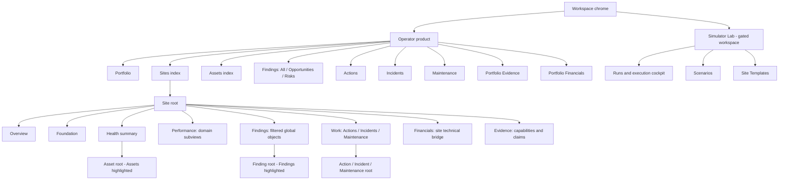
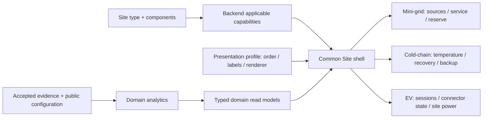
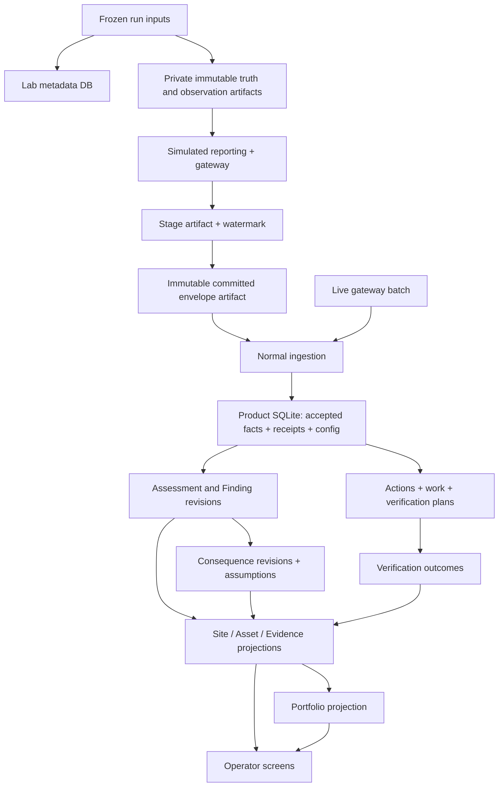
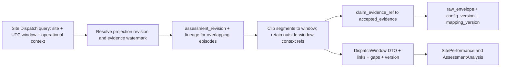
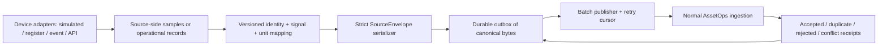
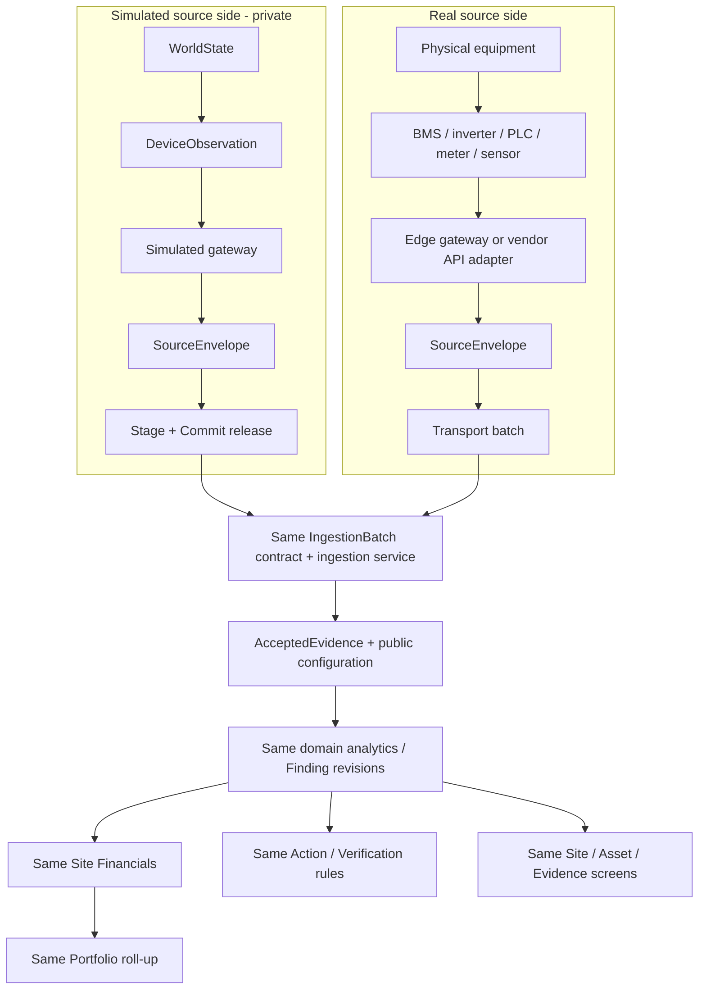
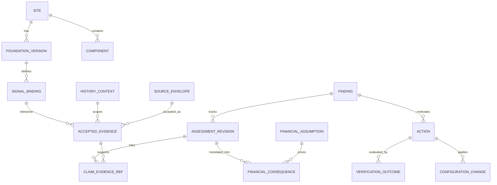

# AssetOps: implementation-ready v6.9 pivot recommendation

**Architect:** configured Codex Architect. **Date:** 2026-10-06. **Inspected baseline:** `6954107`, following completed T028. **Status:** recommendation for planning; this document does not activate tasks, record owner acceptance, or claim that proposed features have shipped.

The deliverable is one architecture document. Wireframes are content/layout specifications, not screenshots of an implemented redesign. Numerical walkthroughs are hand-worked proposed fixtures, not measurements from a newly executed run. Existing behavior and proposed changes are distinguished throughout.

Primary references, relative to this document:

- [Canonical product experience v6.9](../../../Docs/Product/AssetOps_Integrated_Product_Experience_and_Canonical_Screens_v6_9.pdf).
- [Simulator design v4](../../../Docs/simulator_design_v4.md), especially boundaries, timing, controls, interventions and comparisons.
- [Architecture](../../../.ai/ARCHITECTURE.md), [current context](../../../.ai/ACTIVE_CONTEXT.md), [task queue](../../../tasks/README.md), and [decisions](../../../.ai/DECISIONS.md).
- [Earlier demo recommendation](../../../.ai/ARCHITECT_DEMO_RECOMMENDATION.md), retained where this recommendation does not identify a change.

**Reference correction:** the supplied PDF calls navigation ownership **2.4**, supported by 2.1–2.3; it has no section 22.4. This document interprets the brief's “22.4” as **2.4**. Similarly, “8.108.11” and “8.128.17” mean 8.10–8.11 and 8.12–8.17. EV-specific screens below are explicitly extrapolated; v6.9 defines no EV vertical.

## 1. Executive pivot recommendation

Preserve the simulator, the two shells, canonical envelope ingestion, accepted-evidence inspection, dispatch analytic, assessment revision history, and the plain-language Finding presentation. Turn the current working path into the canonical product journey:

**Portfolio → Site Overview → Performance/Dispatch → Finding → Site Financials → Action → Verification → evidence behind each claim.** Show Lab proof last. Add Renewable/Productive-use as the first opportunity story, then a bounded cold-chain story and an EV service story within the same Site shell.

This is a migration of working behavior. T027 and T028 already delivered Commit, ingestion, Overview, Evidence, Findings and dispatch classification. Rebuilding those would delay useful feedback. The main changes are:

1. Make window, history context, evidence revision and configuration-at-time consistent across product pages. Today Overview/Evidence can select windows while dispatch/readiness largely assess all site history.
2. Extend the existing domain presentation profile; do not build a plugin system. Move analytic input selection from named demonstration devices to configured semantic signal roles.
3. Introduce SQLite behind existing repository ports while completing the priced dispatch journey. Keep large immutable artifacts as files and private truth in a separate Lab store. Persistence already exists; its transactional/query behavior needs to mature.
4. Preserve the owner-approved Analysis destinations and graphics. On Performance, expose analysis as a selected-interval detail destination with a back link, avoiding another permanent tab row below the domain subtabs. Keep Analysis as a deliberate additional Finding tab.
5. Preserve Foundation's working definition/topology/controls. Restore **configuration readiness** there, using a distinct view from Evidence's **claim readiness**. Add Changes with the first managed intervention.
6. Prioritize one verified intervention before additional mini-grid analytics. Build Portfolio before expanding to six mini-grid sites. Move cold-chain and EV from indefinite deferral into two narrow, explicitly bounded vertical slices.

The strongest demo asset is the causal simulator connected to evidence, not a dense configuration interface. Each addition must reveal an operator decision: investigate a cost, fix an evidence gap, change a policy, verify a result, or evaluate an opportunity.

### 1.1 Boundaries and status meanings

| Concern | Owner and rule |
| --- | --- |
| Physical operation | Simulator for simulated sources; equipment for live sources. Neither assigns product Findings. |
| Reported observation | Device/reporting path; may be biased, absent or delayed. A controller-local view is separate. |
| SourceEnvelope | Strict source contract. Stage/Commit release it; ingestion alone accepts it. |
| Operational assessment | Backend analytic plus accepted evidence and versioned public configuration. Healthy / Watch / Needs attention / Degraded / Unknown. |
| Dispatch claim | Necessary / Candidate avoidable / Indeterminate. These are interval classifications, not Finding lifecycle states. |
| Source health | Online / Stale / Offline only with a declared heartbeat/cadence and observation clock; otherwise “last report” and Unknown. Historical silence does not mean equipment failed. |
| Evidence capability | Full / Limited / None / N-A, with explicit assessed window and claim ceiling. Full does not mean healthy or continuous telemetry. |
| Finding workflow | Open, accepted-action/awaiting-verification, resolved, reopened; lifecycle is persisted independently of analytic revision. |
| Work and verification | Work completed is an activity fact. Final Verified / Ineffective / Inconclusive requires an evaluated, closed window; later recurrence can reopen. |
| Financial consequence | Measured / Modelled / Extrapolated / Scenario basis, currency, window, uncertainty and overlap group. No financial assessment enum. |
| Opportunity | A lens/classification on Findings; capacity opportunity is not proven market demand or realized revenue. |

Site assessment remains Unknown for objectives not assessable. A healthy Dispatch assessment must not make the entire site Healthy while Service is unknown. Return a coverage-aware roll-up: known adverse conditions remain visible, incomplete scope is explicit, and “Healthy” requires adequate evidence for the declared objective set. Freeze the roll-up rule/version in the backend; presentation only applies its label and colour.

### 1.2 Feature map before tasks

| Product capability | Existing foundation | Missing causal prerequisite | Visible result |
| --- | --- | --- | --- |
| Explain candidate operating cost | Dispatch/Finding/evidence already work | Window-scoped revisions, time-valid fuel basis, assumptions and consequences | 8.21 → 8.32 → 8.36 |
| Demonstrate intervention benefit | Frozen runs, deterministic policy behavior | Immutable change, Action, later accepted window, service/reserve guardrails | 8.11 / 8.38 |
| Prioritize estate | Sites and global Findings | Shared site summaries, economic roll-up, deterministic priority | 8.1 / 8.2 |
| Show opportunity | PV/storage/load physics | Published capability, service constraints and recurrence analytic | 8.23 / 8.32 |
| Show domain reuse | Site type and presentation profile | Semantic role binding; cold/EV evidence and small analytics | 8.28–8.31; EV adaptation |
| Show asset-life risk | SOC/power evidence | Stress projection, temperature/history limits, asset root | 8.19 / 8.27 |

## 2. Proposed navigation and screen hierarchy

### 2.1 Stable shell



This is the target inventory, not an instruction to render empty destinations immediately. Render a route once its content contract exists; on applicable sites with no evidence, render the route with a meaningful gap state. Do not hide an implemented capability because the selected site is missing data. Site type, installed analytic capability and object scope determine applicability.

Use one Site contextual row in canonical order: **Overview | Foundation | Health | Performance | Findings | Work | Financials | Evidence**. One additional subtab row is permitted. Time-window, provenance and history-context controls belong in the header, not in new tabs. The selected time is retained on drill-down and back-navigation. A fixed Finding revision keeps its original assessed window even if the surrounding global filter later changes.

### 2.2 Current-surface disposition and canonical mapping

Every design row states its canonical basis and deliberate adaptation. “Deferred” means unavailable capabilities stay out of navigation, rather than becoming dead links.

| Surface; current condition | Concrete disposition | Canonical basis | Preserved | Adapted | Deferred |
| --- | --- | --- | --- | --- | --- |
| Portfolio; absent | Add Value & Operations as landing after the priced Site journey; aggregate existing outputs | v6.9 8.1, 8.8, 8.9 | Finding rows; Site/Finding/Action root changes | Three sites first; explicit partial assessment; financial categories separate | Portfolio objective percentages until denominators exist |
| Sites; working inventory | Keep; fill assessment/evidence/last-analysed/top-issue cells; remove any ranking-dashboard expansion | 8.2 | One row per site_id; mode is provenance | Filterable inventory, modest sorting; Portfolio owns prioritization | Live registration/clone workflows |
| Assets; absent | Add thin component-backed index with first Battery Health page | 8.3, 8.27 | Asset root and site breadcrumb; condition distinct from evidence | Existing Component identity becomes Asset key, no duplicate inventory | Warranty and full asset hierarchy |
| Findings; working global and scoped indexes | Keep shared table; add lenses as supported and workflow filters | 8.4, 8.25 | One Finding object/state; scoped filter only | Plain-language type and compact consequence column | No Opportunities/Risks roots; no separate site KPI strip |
| Evidence root; absent | Add cross-site capability/gap matrix when three domains have useful rows | 8.8, 8.35 | Global roll-up links to Site-owned readiness | Small matrix and recurring gap count | Another global raw-record browser |
| Actions; absent | Add queue plus detail from first accepted dispatch recommendation | 8.5, 8.38 | Managed Action; completed versus verified | One policy-change action first | General workflow builder |
| Incidents; absent | Add only with a reconstructed backup/cold-chain incident | 8.6, 8.33 | Correlated event case; linked Findings and work | One event-chain case type | Automatic arbitrary incident correlation |
| Maintenance; absent | Add a narrow inspection/test work request with cold-chain or backup repair | 8.7, 8.34 | Same Verification layout as Actions; activity ≠ outcome | Simple queue and one work type | CMMS inventory, procurement, scheduling suite |
| Settings; absent operator destination | Workspace menu for actual profile/workspace settings when needed | 2.4 ownership pattern; no dedicated 8.x Settings anchor | Object-owned configuration stays with object | Site settings in Foundation; economics in Financials; Lab settings in Lab | Global configuration dumping ground |
| Simulator Lab; working gated workspace | Keep separate; compose cockpit panels into Site View / Devices & Sensors / Gateway & Ingestion, with run selection retained | 8.12–8.17 | Draft/Commit boundary, simulation clock, private truth, Open in AssetOps | Reuse current run cockpit, history, SLD and stage inspector | Broad event authoring, log console, replay controller |
| Site Overview; working mini-grid | Keep cards/graphics; make backend domains/time-window consistent; add concise value and next-action sections | 8.18, 8.28 | Assessment versus metric, links to detailed owners | Product meaning first; omit unsupported global health claims | Invented SLA or renewable-share values |
| Foundation; working long page | Keep definition/topology/controls section links initially; add Changes and configuration Readiness as real views | 8.10–8.11 | Public time-valid configuration and topology | Readiness summarizes definitions, mappings and missing commissioning records, links to Evidence | Full commissioning management |
| Health; absent | Site asset-condition summary plus separate source-health block; link to Asset Health | 8.19, 8.27 | Asset root changes | One battery analytic first; compressor/charger rows as supported | Repeating asset lifecycle charts in Site Health |
| Performance/Dispatch; working | Keep analytic and selected-period explanation; convert extra permanent Overview/Analysis row to selected-detail navigation | 8.21, 2.4 | Classifications, gaps, evidence drill-down | Plain-language default plus separate analysis destination via “Inspect this interval” | Third tab row; automatic optimal-dispatch claims |
| Site Findings; working | Keep as a filtered global Findings table | 8.25 | Same columns, lenses and state model | Domain column routes to Performance | Independent scoped Finding lifecycle |
| Site Work; absent | Add filtered Actions; add Incidents/Maintenance subtabs when implemented | 8.26 | Global names and root changes | Counts in subtab labels; no summary KPI strip | Site-owned work objects |
| Site Financials; planned T029 | Implement Overview and Assumptions, with driver rows embedded in Overview | 8.36 | Technical → mechanism → money; no assessment | Inline editable assumptions with version preview | Separate Drivers/Scenarios tabs until substantive |
| Site Evidence; working | Keep capability table and raw/normalized inspector; scope capability readiness to window; preserve source detail | 8.35, 8.37 | Accepted evidence, limits and provenance | Overview/Analysis fits sole subtab row here; assessment detail deep links preserve root | Generic data-quality score masking claim gaps |
| Finding Analysis; owner-approved addition | Retain as an extra contextual tab, reusing current AssessmentAnalysis | 8.32, 8.37; deliberate extension under 2.4 | Finding remains root; evidence drawer stays in context | Distinct operational explanation and technical method | Literal duplication of all detail on Overview |
| Global Financials; absent | Add later only for meaningful multi-site consequence comparison, reading Site consequences | 8.9 | No re-derivation or financial status | Category/currency/window grouping | Shared assumption management as a prerequisite |

Current `?view=analysis` links should remain resolvable. Performance analysis can be an interval detail route/query view with a breadcrumb/back control, while the Site row and one Performance domain row remain visible. This preserves the owner's separate analysis destination; it changes the extra row's navigation treatment, not its content or purpose.

### 2.3 Domain subviews

| Domain | Performance subviews, in order | Health emphasis | What must not be inferred |
| --- | --- | --- | --- |
| Mini-grid | Service, Dispatch, Fuel, Renewable, Backup | Battery reserve/thermal/power stress; generator alarms; inverter condition | No service percentage from served-power meters alone without a demand/service baseline |
| Cold-chain | Temperature, Cooling, Backup | Refrigeration assets, probes, backup assets | Excursion ≠ spoiled stock; slow recovery ≠ diagnosed compressor failure |
| EV charging | Sessions, Availability, Energy | Connector/charger faults; stationary battery only when present | Plugged-in time ≠ failed service; low power ≠ site constraint without request/limit evidence |

Cold-chain recovery is content inside Cooling; door/loading/defrost are timeline context in Temperature/Cooling. They do not justify extra tabs in this demo. EV session service belongs in Sessions; grid limit and battery use belong in Energy. Do not display mini-grid Dispatch/Fuel tabs on an EV site without an actual, declared relevant capability.

## 3. Implementation-ready mockups

### 3.0 Shared rendering contract

All mockups below use this header: breadcrumb → object title → identity/site/provenance → selected window and timezone → applicable contextual tabs. For a Site, use the row in §2.1, filtered only by built capability/applicability. Header includes `SIMULATED` for demo history; friendly wording is primary and source/run references remain in evidence detail. `Unknown` is a status with a reason; unavailable numeric values render `—` plus the missing input, never zero. Loading, read error and no accepted evidence are distinct states.

A consequence card always carries value/range, unit/currency, window, basis and source link. Clicking a claim opens the shared drawer: claim/revision, derivation version, raw/normalized references, temporal support, public configuration, mappings, alternatives/limits. The drawer does not change the root. Tables use stable object IDs, keyboard-accessible row links and filters; colour supplements labels.

Sections below are in rendering order. The named read models are contracts to retain or implement, not instructions to create one class per box.

### M01. Portfolio Value & Operations

**Root/title:** Portfolio / “Portfolio Value & Operations”. **Tabs:** none initially; Findings lenses All priorities / Cost / Risks / Opportunities are filters over the ranked list, not another object queue. **Question:** Where should an operator act, and what is at stake?

**Visual revision after reference comparison:** the interactive Portfolio v2 in `frontend/mockups/v69/index.html#/portfolio` and `AssetOps-Portfolio-v2.pdf` supersede the first visual composition. It combines v6.9 §8.1 (p24) with *AssetOps Client Demo Recommendation with Mockups, September 2026*, Screen 1 and Appendix A1 (p11). `portfolio.js` carries the ordered sections, content owners and explicit reference decisions; `screen-manifest.json` exports them for implementation.

```text
Portfolio Value & Operations                  Selected example windows
3 simulated sites · 3 domains · assessment scope and periods disclosed
[Operating-cost exposure] [Service/product risk] [Productive-use opportunity]
[Asset-life exposure] [Verified value recovered: Not established]
Secondary context: priority sites / opportunities / evidence gaps / accepted actions
Where management should act first             Objectives across the estate
Site | Finding / mechanism | Value / basis | Priority | Confidence | Action / next move
Cold room | Failed backup | Product exposure, unpriced | High | High | ACT-051
Kobo | Generator support | $3.31–3.97, one hour | High | Low | ACT-048
Depot | Interrupted session | Revenue loss unpriced | Medium | Medium | ACT-061
Kobo | Productive-use headroom | 18–20 kW; scenario sales | Medium | Medium | Recommendation
Productive-use evaluation                     What changed / verification
10 kW × 1 h → $2.50 scenario gross sales       Completed activity / pending outcome / 0 verified
```

Counts come from `PortfolioSummary`, value categories from `PortfolioConsequenceRollup`, rows from the global `FindingIndex` with `ActionSummary`, changes from accepted workflow/verification events. Backend priority is a versioned tuple: safety/service severity, Finding severity, action urgency, confidence/coverage, then same-category value; it never sums dollars and severity into an unexplained score. Evidence-limited sites remain prominent without invented loss estimates.

**Actions/drills:** open Site, Finding, Action or Site Evidence; scope/filter estate. **Empty:** no Findings is “No supported Findings in this window,” accompanied by coverage; never automatically all healthy. Currency/window mismatches yield separate totals. **Domain change:** priority reasons and consequence categories follow owned domain outputs; cold product exposure and EV interruption are separate from OPEX.

**Canonical basis:** v6.9 8.1 Portfolio command center; 8.8 Portfolio evidence; 8.9 Portfolio financials; secondary composition input from Client Demo Recommendation Screen 1 / A1. **Preserved:** roll-up ownership, ranked Finding objects, separate priority/confidence, root-changing links and named Action references confined to the Action column. **Adapted:** business consequences lead, counts become secondary; objectives use a site/objective matrix instead of unsupported percentages. Existing three-site evidence remains the example basis. Dedicated productive-use and verification panels express two different value paths. **Deferred:** Reports, estate-wide financial scenarios, six sites as an entry gate, monthly extrapolation, productive-use share, comparable estate energy total, asset valuation and verified recovered money until supporting records exist. The $0.40 maintenance accrual is already included in the mini-grid cost range; it must not be added twice. A separate complete-evidence teaching example is not a verified Portfolio outcome.

### M02. Sites Index

**Root/title:** Sites / “Sites”. **Tabs:** none; filters All / Mini-grid / Cold-chain / EV charging / Live / Simulated plus assessment/evidence filter. **Question:** Which site should I open?

Order: (1) scope and inventory counts; (2) search/filter; (3) one table: Site, Type, Mode, Assessment and reason, Top issue, Evidence readiness, Last analysed; (4) pagination. `SiteDirectorySummary` joins Site identity to the same window's `SiteAssessmentSummary`, top Finding and `CapabilityReadiness`. Inventory counts are stored identity counts; statuses are derived. Last analysed is an analysis timestamp, not last received telemetry.

**Actions/drills:** row → Site Overview; top issue → Finding; readiness → Site Evidence. Existing gated Create simulated site remains available through the established workspace entry point. **Empty:** no sites, no matching sites, and a site with no evidence have different copy. **Domain change:** type and assessment domains differ; table columns do not.

**Canonical basis:** v6.9 8.2 Sites index. **Preserved:** stable site_id, provenance and one row per Site. **Adapted:** sort/filter rather than Portfolio-like prioritization; no empty action menus. **Deferred:** Register live site and clone wizard.

### M03. Mini-grid Site Overview

**Root/title:** Sites / “Kobo Mini-grid”. **Tabs:** Site row; no subtabs. **Question:** Is this site meeting its operating objective, and what deserves attention?

```text
Kobo Mini-grid · PV 60 kWp / inverter 50 kW / battery 200 kWh / genset 40 kW
Objective: serve residential, clinic and productive loads with protected reserve
Assessment: Needs attention · assessed scope: Dispatch · Service not yet assessed
[Service: Unknown] [Dispatch: Needs attention] [Battery: Unknown]
[Fuel: no balance assessment] [Renewable: capacity evidence only]
Operational timeline: delivered load / PV output / generator output / SOC
Needs attention: Generator support review → Dispatch → Finding
Value: candidate-window cost exposure, $3.31–3.97 modelled/scenario → Financials
Next action and verification state                Evidence limitations
```

`SiteOverview` supplies objective/configuration summary; `DomainAssessmentSummary[]` supplies status/reason and links; `OperationalTimeline` supplies accepted series; `FindingSummary[]`, `FinancialConsequenceSummary` and `ActionSummary` own remaining sections. The chart does not compute assessment. Delivered load is labelled delivered load until demand is independently evidenced. Missing spans stay visible; no smooth interpolation across outages.

**Actions/drills:** assessment card → owning Performance/Health view; Finding → Findings root; value → Financials; gap → Evidence; Foundation from objective/configuration link. **Empty:** retain configured objective/ratings but say “No accepted evidence in this window”; cards Unknown, chart empty. **Domain change:** replaced by M13/M14 content, not relabelled mini-grid cards.

**Canonical basis:** v6.9 8.18 Mini-grid Site Overview. **Preserved:** overview aggregation, assessment vocabulary, operational context and downstream ownership. **Adapted:** metric/assessment separation when only dispatch is built, compact bounded value. **Deferred:** unsupported overall service health and exact renewable contribution.

### M04. Site Foundation and change effect

**Root/title:** Sites / “Kobo Mini-grid — Foundation”. **Tabs:** Site row; eventual Foundation row Definition / Topology / Controls / Changes / Readiness. Current three section anchors may remain until Changes makes separate views useful. Do not render both a Foundation subtab row and a permanent second contents row.

**Question:** What is the site expected to do, which configuration applied, and what remains unverified?

Order by selected subview:

- **Definition:** identity/timezone/objectives; physical component ratings; critical/productive load obligations; commercial-assumption link. Owner `Site` + immutable `SiteFoundationVersion`; currency/price comes from Financials, not physical properties.
- **Topology:** existing SLD; component and connection table; configured devices/signal mappings. Owner `TopologyReadModel` + `SignalBindingVersion`. Configuration SLD displays ratings, not live flows.
- **Controls:** time-valid reserve/start/stop/minimum-runtime/source-priority values with source/effective time. Owner `SiteControls` and reported policy evidence shown separately where available.
- **Changes:** CHG identity, requested/applied times, before/after values, linked Action, target versus guardrail results. Owner `ConfigurationChange` + linked `VerificationOutcome`; Retain/Retune/Revert creates new records, never overwrites history.
- **Readiness:** Definition / topology / specifications / control configuration / mapping / commissioning-record checklist. Owner `FoundationReadiness`. Show “Configured” separately from “Confirmed by evidence.” Link to capability claim readiness in Evidence instead of copying its table.

**Actions/drills:** inspect configuration at selected time; open source/record; propose configuration review Action; open Change/Action verification. **Empty:** missing capacity/mapping produces Needs review with affected capability, not fabricated rating. **Domain:** cold-room policy band, sensor placement and loading obligations; EV connectors/rated limits/service schedule; mini-grid priority/critical load requirements.

**Canonical basis:** v6.9 8.10 Site Foundation and readiness; 8.11 Configuration change and effect. **Preserved:** configuration-at-time, objectives, target/guardrails. **Adapted:** configuration readiness and claim readiness explicitly separated; staged conversion of current long page. **Deferred:** arbitrary topology editor and generalized commissioning workflow.

### M05. Site Performance — Mini-grid Dispatch

**Root/title:** Sites / “Kobo Mini-grid — Dispatch”. **Tabs:** Site row + Service / Dispatch / Fuel / Renewable / Backup, only implemented capabilities. **Question:** Which generator operation could merit a policy review, and why?

Order: (1) backend assessment/confidence/coverage/window; (2) neutral metrics: generator observed/inferred runtime, Necessary, Candidate avoidable, Indeterminate; (3) accepted power/SOC timeline with classified segment band; (4) selected interval panel; (5) all assessed intervals, including Necessary periods without Findings.

Selected-window example: 14:20–15:20, **30 min Candidate / 30 min Indeterminate** under segment continuity assumptions; 5-minute power means every 15 minutes measure 20 of 60 minutes. Selected 14:20–14:35 panel: load 30 kW; PV capability 42 kW; PCS discharge capability 30 kW; SOC 74→77.5625%; reserve 30%; generator 18 kW; no override record effective in that segment; minimum runtime elapsed. State why this is Candidate, including the useful battery-charging alternative.

Owner `DispatchWindow`/`DispatchIntervalRevision` plus linked Finding. “Inspect this interval” opens the separate analysis view using existing `AssessmentAnalysis`; it has a back link, not a third permanent row. Necessary intervals use the same analysis component without manufacturing a Finding.

**Actions/drills:** select interval; open Finding; inspect individual claim/drawer; review policy in Foundation; inspect fuel consequence. **Empty:** no generator-state evidence → cannot reconstruct; no capability → Indeterminate; stopped throughout with coverage → no running interval, not an error. **Domain:** this is mini-grid specific, not shared EV/temperature layout.

**Canonical basis:** v6.9 8.21 Mini-grid Dispatch; 8.37 claim drawer. **Preserved:** feasibility and classification ownership, neutral uncertainty, evidence links. **Adapted:** explicit sampling support; plain-language default and analysis drill-down. **Deferred:** optimizer, controller AUTO enum not currently supported, claims of net savings.

### M06. Site Performance — Renewable / Productive-use

**Root/title:** Sites / “Desta Mini-grid — Renewable”. **Tabs:** same Mini-grid Performance row; no Productive-use subtab beneath Renewable. **Question:** Is there recurrent usable electrical capacity, and what intervention could test its value?

Order: (1) assessment and recurrence statement; (2) available PV / produced PV / evidenced curtailment / feasible headroom cards; (3) time-aligned available-versus-used chart with storage/reserve constraints; (4) eligible-window table; (5) “Productive-use evaluation” panel linked to opportunity Finding and optional paired comparison.

Separate proposed fixture: PV capability 42 kW, accepted output 20 kW, delivered load 20 kW, battery SOC 98%, zero current charge acceptance evidenced, no critical service deficit, generator stopped. Zero charge acceptance needs an observed limit/condition; SOC 98% alone does not establish it. Observe comparable one-hour windows on 3 of 5 adequately covered days, with actual one-minute interval means covering each whole hour. For this illustrative rule, declare PV capability uncertainty ±1 kW and retain a 3 kW operating margin: `[41,43] − 20 − 3 = [18,20] kW`, hence **18–20 kWh/window**. Public calibration/model assumptions own that uncertainty and margin. The other two days are explicitly excluded. Do not infer curtailment from nameplate power alone.

Owner `RenewableOpportunityWindow`/recurrence projection, with `DispatchInterval` constraints and `ServiceWindow`; actual tariff translations from `FinancialConsequence`. A 10 kW mill for 1 h is a **scenario** yielding up to 10 kWh and, at an illustrative $0.25/kWh, $2.50 gross sales before other costs; neither consumption nor demand is guaranteed. T032's accepted-evidence paired comparison tests the electrical intervention separately.

**Actions/drills:** window → dispatch/evidence; opportunity → Finding; Evaluate load addition → comparison once built. **Empty:** unavailable PV capability, charging obligation or unknown service → bounded/unavailable opportunity with reason. **Domain:** mini-grid-specific; cold-chain capacity and EV sales use their own analytics.

**Canonical basis:** v6.9 8.23 Renewable; 8.4 opportunities lens; 8.36 scenarios. **Preserved:** constraints precede opportunity, links to dispatch evidence. **Adapted:** productive-use panel and explicit physical-versus-commercial distinction. **Deferred:** demand forecast and market viability engine.

### M07. Site Evidence and claim drawer

**Root/title:** Sites / “Kobo Mini-grid — Evidence”. **Tabs:** Site row; Overview / Analysis may occupy its one local row. **Question:** What can AssetOps substantiate for the selected period, and what would improve the claim?

Order: (1) selected-window readiness with denominator/scope; (2) capability table; (3) prioritized evidence gaps; (4) source/connector health; (5) record/ingestion inspector, reached by filter or disclosure.

Capability columns: Capability / Full-Limited-None-N-A / Current claim ceiling / Missing-required / Preferred / Next best evidence. Dispatch row: Limited; Candidate for supported portions; PCS capability absent at 14:50; obtain missing PCS evidence. `CapabilityReadiness` owns this row, not the frontend. Source table: source/device, last source time, last receipt, expected cadence, lag, quality, rejection/conflict counts; no claim of current live connectivity from old simulated history.

The existing raw inspector displays source value, normalized value, measurement interval, message ID, mapping version, historical Foundation reference and source/publish/receive times. The **claim drawer** additionally displays the selected `ClaimLineage`: derivation/model version, all contributing record IDs, gaps, configuration-at-time, evidence revision and limit statement. Raw records alone are not a full claim lineage.

**Actions/drills:** capability → filtered records/assessment; gap → create evidence-improvement Action when work exists; source → record inspector; global Evidence → root change. **Empty:** no records → None, not Offline; unsupported analytic → not advertised as built. **Domain:** requirements/capability names are backend-owned per analytic; temperature probe calibration and EV session completeness replace dispatch roles.

**Canonical basis:** v6.9 8.35 Site Evidence; 8.37 Claim evidence drawer; global link 8.8. **Preserved:** readiness is Site-owned, drawer claim-specific, accepted evidence only. **Adapted:** default concise language plus detailed Analysis/record inspection. **Deferred:** complete source-management console in operator shell.

### M08. Finding Detail

**Root/title:** Findings / “Generator remained online while support appeared available”. **Tabs:** Overview / Analysis / Evidence / Alternatives / Recommendation / History as built. **Question:** What is the defensible conclusion, what is its consequence, and what should happen next?

Order on Overview: (1) severity, technical confidence, lifecycle state and claim level as separate fields; (2) plain-language bounded claim; (3) affected period and classified timeline; (4) candidate runtime and modelled fuel exposure; (5) economic consequence from the shared consequence model; (6) prominent limitations; (7) next investigation/recommendation and linked Action.

Example: selected-window Candidate 30 min; 30 min not classifiable due to PCS capability gap; candidate-associated fuel 2.43–2.97 L modelled; generator energy charged the battery, so net fuel savings remain unverified. No override record observed is labelled observed absence, not “no override”. `FindingRevision`, `DispatchWindowSlice`, `FinancialConsequence` and `ActionLink` feed the page. Whole-episode Finding totals and clipped selected-window totals are explicitly distinguished.

Analysis reuses existing graphics/calculation; Evidence lists claims with drawers; Alternatives names corroborated, contradicted and not-excluded explanations; Recommendation proposes review and success/guardrails; History shows revisions and workflow events. Do not generate an Action simply by opening a Finding.

**Actions/drills:** Accept recommendation creates Action once; inspect claim; open Site/Asset/configuration; view prior revision. **Empty:** superseded/retired Finding remains readable with active-version link; no price means quantity remains and money is unavailable. **Domain:** conclusion/mechanism/alternatives differ; common lifecycle and detail structure remain.

**Canonical basis:** v6.9 8.32 Finding Detail, 8.37. **Preserved:** one defensible claim and root ownership. **Adapted:** retained owner-approved Analysis tab; compact financial bridge and selected-window distinction. **Deferred:** unsupported precise diagnoses and arbitrary recommendation generation.

### M09. Site Financials

**Root/title:** Sites / “Kobo Mini-grid — Financials”. **Tabs:** Site row + Overview / Assumptions. **Question:** What is this technical condition worth under declared assumptions?

Order: (1) window, currency, assumption version, consequence count, no assessment status; (2) non-overlapping category totals; (3) technical-driver bridge; (4) exclusions/trade-offs; (5) assumption history/link.

```text
Technical basis             Mechanism            Consequence                 Basis
Candidate fuel 2.43–2.97 L   × $1.20/L            $2.91–3.57                 modelled
Candidate runtime 0.50 h    × $0.80/h accrual     $0.40                       scenario accrual
Combined eligible exposure                       $3.31–3.97                 modelled/scenario
Battery energy supplied by generator             net avoided cost unproven  excluded from savings
```

Amounts are outward-rounded display bounds; totals use exact unrounded amounts, so displayed lines need not sum penny-for-penny. The combined value is **candidate-window operating-cost exposure**, not realized savings. Fuel and maintenance are distinct categories; replacement exposure and fuel residual remain separate and may overlap technical bases.

`FinancialConsequenceRevision` owns every value. `FinancialAssumptionSet` supplies fuel price/currency, maintenance accrual, effective and recorded times, author and source. Assumptions view previews which periods an edit affects; save appends a version and recalculates consequences only. Historical technical and financial revisions remain available.

**Actions/drills:** edit assumptions; inspect prior interpretation; open source Finding/claim. **Empty:** missing price → no priced consequence; mixed currencies → separate groups, no implicit FX; unknown quantity → no fabricated zero. **Domain:** cold product exposure is a declared stock-value scenario; EV delivered energy × tariff is gross revenue estimate until billing evidence exists.

**Canonical basis:** v6.9 8.36 Site Financials; 6; 8.9 roll-up. **Preserved:** technical bridge and basis discipline. **Adapted:** Drivers embedded in Overview, explicit gross exposure versus demonstrated savings. **Deferred:** general cash-flow, precise asset replacement date, realized savings ledger.

### M10. Action / Verification and Maintenance Verification

**Root/title:** Actions / “Review generator stop policy”; Maintenance uses its own work-request title and root. **Tabs:** Overview / Plan / Execution / Evidence / Verification / History. **Question:** Did the intervention achieve its target without harmful trade-offs?

Order on Verification: (1) lifecycle state, window progress and provisional/final outcome; (2) frozen target/guardrails/comparability criteria; (3) before/after table; (4) activity evidence versus outcome evidence; (5) limitations/confounders and next step; (6) linked Finding/history.

Example rule, declared **before** post evidence: reduce candidate generator runtime at least 25% over matched one-hour periods; no new reserve breaches, no increase in critical unserved energy, adequate endpoint SOC/service/coverage. Demo windows may be one hour but are labelled short-window simulated verification, not sustained field improvement. A later scenario can show seven-day verification after adequate histories exist.

Table columns: Metric / Role (target, guardrail, consequence) / Before / After / Coverage / Result / Evidence. If baseline candidate time is 30 min and post is 0 with sufficient evidence, the target passes. If critical-load demand is unobserved or final battery reserve margin is not comparable, outcome is **Inconclusive**, even with a passed target. Work completion alone displays “Completed; awaiting outcome evidence.”

Owners `Action`, `VerificationPlanVersion`, `VerificationOutcome`, `ConfigurationChange`, accepted work records and metric projections. Work evidence may include a witnessed policy application/test record, but only measured outcomes verify the Finding. A final Verified outcome records its precise scope and can resolve the linked Finding through a backend workflow transition.

**Actions/drills:** accept plan, record execution, evaluate closed window, request next evidence, open Foundation Change; Retune creates a new change/action. **Empty:** no post evidence → pending; insufficient closed window → Inconclusive; failed observed guardrail → Ineffective. **Domain:** cold temperature recovery/backup success; EV session success/availability and site-power limits; backend owns rule versions.

**Canonical basis:** v6.9 8.38 Action Verification; 8.34 Maintenance Verification; 8.11. **Preserved:** shared verification grammar and completion-versus-resolution. **Adapted:** one explicit demo rule, later evidence rather than a complex workflow suite. **Deferred:** approvals hierarchy and generalized CMMS.

### M11. Asset Health / Lifecycle

**Root/title:** Assets / “Kobo battery — Health”. **Tabs:** Overview / Health / Performance / Configuration / Work / Evidence where built; no Lifecycle tab is necessary. **Question:** What condition/stress is evidenced, what asset-life risk is plausible, and what test is needed?

Order: (1) asset/site identity, rating, assessment/confidence, capacity verification; (2) reserve exposure / high-power exposure / thermal exposure / usable-capacity cards; (3) observed stress trajectory with coverage and explicit history start; (4) bounded interpretation and replacement-exposure scenario link; (5) next evidence/test Action; (6) linked Findings/work.

Owner `AssetHealthSummary`, `BatteryStressWindow`, `CapacityEvidence`, `FinancialConsequence`. Unknown historical accumulated stress stays unknown. A 30-day stress trend is not 30 days of remaining-life loss. No temperature sensor means thermal exposure unavailable, not Normal. Current configured capacity is not a measured capacity test.

**Actions/drills:** controlled capacity-test Action, BMS review, Evidence, site breadcrumb → Sites root. **Empty:** asset registered without evidence → Unknown; independent stress dimensions can still display with their own coverage. **Domain:** stationary batteries reuse the battery analytic wherever configured; compressor/charger health use different analytics and vocabulary.

**Canonical basis:** v6.9 8.27 Battery Asset Health; 8.19 Site Health summary. **Preserved:** asset ownership, observable stress and capacity uncertainty. **Adapted:** lifecycle exposure is a section and scenario consequence. **Deferred:** precise RUL, warranty and validated degradation diagnosis.

### M12. Simulator Lab — Gateway & Ingestion / proof boundary

**Root/title:** Simulator Lab / “Kobo — Run R-MG-01 — Gateway & Ingestion”. **Tabs:** Lab run views Site View / Configuration / Environment & Scenario / Events / Devices & Sensors / Gateway & Ingestion, as implemented; separate workspace is exempt from operator tab grammar. **Question:** How did a private physical state become a product claim, and where could evidence have been lost?

```text
Run R-MG-01 · Draft or Committed · frozen inputs / mapping / run clock
Truth                  Device observation        Gateway staging
SOC 74%                PCS reports 74%           schema-2 envelope +3 s
PCS capability 30 kW    no 14:50 report           no envelope for that sample
                                       Commit C-MG-01 → Batch B-MG-01
Ingestion: accepted / duplicate / rejected / conflict / pending counts
Selected message: canonical bytes, source time, publish time, receipt after ingestion
Open Site Evidence → Dispatch → Finding
```

Order: (1) run identity/frozen inputs/time controls; (2) device mapping/report cadence; (3) selected truth-versus-observed comparison; (4) staged-envelope inspector with published-through watermark; (5) Commit eligibility/action/manifest; (6) ingestion result and accepted-record links. Owner `LabProjection`, private observations, `SourceStage`, `CommitManifest`, `BatchProgress`; only the last two link into product receipt/evidence.

**Actions/drills:** step/play, inspect stage, Commit, inspect receipt, Open in AssetOps. **Empty:** no completed interval explains first power sample; incomplete staging blocks Commit; committed-but-ingestion-incomplete is explicit and resumable. **Domain:** devices/signals and SLD change; boundary inspector does not.

**Canonical basis:** v6.9 8.12–8.17, especially 8.13 Devices & Sensors/Gateway & Ingestion and 8.17 Truth vs observed. **Preserved:** Draft isolation, manifest release, private truth gating. **Adapted:** existing cockpit composition and named-message proof. **Deferred:** broad scenario authoring, buffered-outage simulator realism and full replay controls. Replay later reads accepted history, never reruns physics.

### M13. Cold-chain shell example

**Root/title:** Sites / “GreenHarvest Cold Room”. **Tabs:** stable Site row; Performance has Temperature / Cooling / Backup. **Question:** Were product conditions protected, and is the problem power, cooling or operating context?

Overview order: purpose and 2–4°C policy → Temperature / Backup / Cooling / Maintenance / Evidence summaries → synchronized incident timeline → bounded product-exposure context → immediate actions. Example proposed incident: grid lost 19:11; accepted start command at 19:11:05; failed-start status 19:11:10; compressor power absent; manual start 19:14; cooling resumed 19:15; temperature peak 8.2°C at 19:19. In-policy return must come from the actual subsequent probe series. Door/loading/defrost records are displayed if present; their absence is not proof that they did not occur.

**Temperature:** in-policy fraction over covered time; excursion duration/boundaries; maximum deviation; degree-minutes integrated only over supported samples; temperature/policy/door/loading/power timeline; `TemperatureExcursion` → Finding/Incident. **Cooling:** recovery duration/energy over comparable ambient/loading/door/defrost/power conditions; `CoolingRecoveryWindow`; unmatched windows produce “Not comparable.” **Backup:** `BackupEventChain` reconstructs grid→command→generator→power→compressor→temperature; missing transfer evidence prevents naming a transfer fault.

Owner mappings: objective/band → Foundation; temperatures → AcceptedEvidence; excursion/recovery/backup → separate analytics; stock exposure → FinancialAssumptions + technical excursion, explicitly Scenario; work → Action/Maintenance; narrative chronology → Incident. Primary action is witnessed backup test or investigate cooling; links change to Incident/Finding/Work roots. No accepted probe data → Temperature Unknown; no stock records → no currency exposure.

**Canonical basis:** v6.9 8.28 Cold-room Overview, 8.29 Temperature, 8.30 Cooling, 8.31 Backup; 8.33–8.34 work/case. **Preserved:** temperature objective, context-matched recovery, exposure not spoilage. **Adapted:** first slice builds Temperature + one backup event chain; Cooling view appears only with its analytic. **Deferred:** food-specific spoilage models, stock ERP, door/loading standalone pages.

### M14. EV-charging shell example — extrapolated vertical

**Root/title:** Sites / “Depot Charging Hub”. **Tabs:** stable Site row; Performance Sessions / Availability / Energy. **Question:** Can drivers charge, what interrupted service, and did site-power limits contribute?

Overview order: service schedule and 2 × 60 kW charger identity → Sessions / Availability / Site power / Charger condition / Evidence → session/connector timeline → prioritized Finding → gross energy-sales and intervention context. Example day: 12 session attempts, 10 with confirmed delivered energy, one observed fault-aborted session, one incomplete record; show denominators separately rather than “83% success” without the unknown case. Two connectors over an eight-hour schedule yield 16 connector-hours. With 14 h known available, 1 h observed unavailable and 1 h unknown, report **93.3% over known time; coverage 93.75%** and an overall availability bound 87.5–93.75%.

**Sessions:** session/connector ID, start/end, outcome, metered kWh, stop reason, completeness; `ChargingSession` + `SessionServiceWindow`. **Availability:** connector state durations aligned with intended service schedule; unknown telemetry gap separate from Faulted; `ConnectorAvailabilityWindow`. **Energy:** site import, per-charger energy, declared 80 kW site limit, observed 76 kW peak and any accepted power-limit commands; `ChargingEnergyWindow`. A low-power session does not establish a site limit: EV acceptance, requested current, connector capability and limit records may be needed to distinguish causes.

Primary actions: investigate repeated connector interruptions, inspect session evidence, create witnessed charging-test Action. Links: charger → Assets; interrupted session → Finding/Incident if supported; billing/price interpretation → Site Financials. Delivered 120 kWh × illustrative $0.30/kWh is $36 gross tariff estimate, not collections or profit. If no stationary battery exists, omit battery health and reserve cards entirely.

Owner mappings: schedule/site limit → Foundation; session state/meter/event records → AcceptedEvidence; aggregates and classifications → EV analytics; tariff → financial assumptions; charger physical condition → Asset health. No stop record → incomplete session, no fabricated duration/energy; no heartbeat → availability Unknown rather than Offline.

**Canonical basis:** extrapolation from v6.9 2.2 domain pattern, 2.4, 8.2–8.4, 8.32, 8.35–8.38; no canonical EV screen exists. **Preserved:** Site/Asset/Finding roots, evidence and work semantics, bounded finance. **Adapted:** session/service, connector availability and site-power content. **Deferred:** roaming, billing settlement, charging optimization, vehicle battery health without appropriate evidence.

## 4. Screen content ownership matrix

In this table, **D** means derived and rebuildable; **S** means authoritative stored fact/version; **D+S** means a derived result whose released revision must be retained. “Evidence” always means accepted product evidence unless explicitly marked private Lab. The mockups above plus these rows define ownership for their major visible items.

| Screen | Section / visible content | Canonical owner/read model | Derived or stored | Evidence required | Domain-specific? | Source of truth | Drill-down target | v6.9 anchor |
| --- | --- | --- | --- | --- | --- | --- | --- | --- |
| All Site pages | Name, type, timezone, ratings, objective | Site + FoundationVersion | S | Configuration authority, not telemetry | Fields vary | Versioned configuration | Foundation | 8.10, 2.4 |
| All analytical pages | Window, history context, as-of revision | QueryScope + ProjectionRevision | S/D | Selected accepted history | No | Backend query contract | Scope/evidence detail | 6, 8.16 |
| Portfolio | Site/attention/opportunity/gap counts | PortfolioSummary | D | Site summaries and capability readiness | Roll-up | Referenced site revisions | Sites / Findings / Evidence | 8.1 |
| Portfolio | Ranked Finding, priority, confidence | FindingIndex + PriorityRule | D | Finding revision and rule version | Reasons vary | Analytic + workflow facts | Finding | 8.1, 8.4 |
| Portfolio | Value categories | PortfolioConsequenceRollup | D | Site consequence IDs, overlap groups | Yes | Site FinancialConsequence | Site Financials | 8.9 |
| Portfolio | Action due / changed / verified | ActionSummary + WorkflowEvent | S/D | Action and verification events | No | Work/verification records | Action Verification | 8.1, 8.38 |
| Sites | One Site row, mode and contributing sources | SiteDirectorySummary | S/D | Configuration + release provenance | Type | Site and batch records | Overview | 8.2 |
| Sites | Assessment, top issue, last analysed | SiteAssessmentSummary + FindingSummary | D | Window-scoped assessment revision | Yes | Analytics | Finding / Overview | 8.2 |
| Sites | Evidence readiness | CapabilityReadiness summary | D | Required input support in scope | Yes | Evidence + declarations | Site Evidence | 8.2, 8.35 |
| Overview | Assessment cards/reasons | DomainAssessmentSummary | D | Domain analytic and quality limits | Yes | Backend analytic | Performance / Health | 8.18, 8.28 |
| Overview | Power/SOC/temp/session timeline | OperationalTimeline | D | Accepted measurements/events | Yes | AcceptedEvidence | Record / interval | 8.18, 8.28 |
| Overview | Attention list / value / next action | FindingSummary + Consequence + ActionSummary | D | Their existing revisions | Yes | Respective owners | Finding / Financials / Action | 8.18, 8.32 |
| Foundation | Definition, topology, component/device table | FoundationVersion + TopologyReadModel | S/D | Public declarations | Yes | Immutable config version | Component / mapping | 8.10 |
| Foundation | Controls effective at time | SiteControls + PolicyEvidence | S/D | Declared policy; reported policy separately | Yes | Versioned config + accepted POLICY | Change / evidence | 8.10–8.11 |
| Foundation | Readiness checklist | FoundationReadiness | D | Defined fields, mappings, commissioning refs | Yes | Config validation + evidence links | Evidence / readiness Action | 8.10 |
| Foundation | Change target and guardrails | ConfigurationChange + VerificationOutcome | S/D+S | Applied change and before/after evidence | Yes | Change/work + verification | Action Verification | 8.11 |
| Dispatch | Runtime/classified portions | DispatchIntervalRevision / window slice | D+S/D | Generator state/output plus continuity rule | Mini-grid | Dispatch analytic | Interval analysis | 8.21 |
| Dispatch | Constraint panel, margins and classification | Dispatch analytic | D+S | Load, PV capability, PCS, SOC, policy, overrides | Mini-grid | Accepted input roles + rule | Finding / claim drawer | 8.21 |
| Renewable | PV used/available/curtailed | RenewableWindow | D | Output and capability, supported intervals | Mini-grid | Energy analytic | Evidence | 8.23 |
| Renewable | Feasible kW/kWh and recurrence | RenewableOpportunityWindow | D+S | Reserve, charge needs, demand/service constraints | Mini-grid | Opportunity analytic | Opportunity Finding | 8.23 |
| Renewable | Load-addition comparison/revenue | PairedComparison + FinancialConsequence | D+S | Two isolated accepted histories, assumptions | Mini-grid | Experiment + accepted evidence | Comparison / scenario finance | 8.23 adaptation |
| Site Evidence | Capability ceiling and gaps | CapabilityReadiness | D | Required/preferred roles and coverage | Yes | Backend declaration and evidence | Records / claim | 8.35 |
| Site Evidence | Source timing/quality/conflicts | SourceHealth + BatchProgress | D/S | Source/receipt times, heartbeat or cadence | Mostly shared | Ingestion and accepted health reports | Source / rejection | 8.35, 8.13 |
| Site Evidence | Raw/normalized value and provenance | AcceptedEvidence | S | Accepted envelope bytes + normalization record | No | Ingestion | Raw record | 8.35, 8.37 |
| Claim drawer | Algorithm, inputs, limits, config-at-time | ClaimLineage | D+S | Referenced revision and accepted records | Yes | Assessment/claim revision | Raw / normalized records | 8.37 |
| Finding | Claim type/severity/confidence | Finding analytic revision | D+S | Analytic evidence basis | Yes | Backend analytic | Analysis / Evidence | 8.32 |
| Finding | Lifecycle, recommendation acceptance/history | FindingWorkflow + Recommendation + ActionLink | S | User/work events and verification | Rules vary | Workflow service | Action / History | 8.32, 8.38 |
| Finding | Alternatives / limits | Analytic alternatives | D+S | Observed/absent/conflicting records | Yes | Analytic | Evidence | 8.32 |
| Financials | Technical driver quantity | Referenced technical revision | D+S | Same technical basis as Finding | Yes | Analytic, not finance | Finding | 8.36 |
| Financials | Price/tariff/accrual/version/history | FinancialAssumptionSet | S | Declared owner/source/effective time | Yes | Business context | Assumptions | 8.36 |
| Financials | Money/range/overlap/exclusions | FinancialConsequenceRevision | D+S | Technical quantity + assumptions | Yes | Finance translator | Claim / assumption | 6, 8.36 |
| Actions | Plan, owner, due, execution evidence | Action + ActionEvent | S | Accepted user activity records | Content varies | Work service | Execution / History | 8.5, 8.38 |
| Verification | Target/guardrails/coverage/comparability | VerificationPlan + Outcome | S/D+S | Closed later window and frozen criteria | Yes | Verification service | Evidence / Change | 8.38 |
| Maintenance | Work completed versus measured resolution | WorkRequest + VerificationOutcome | S/D+S | Activity and outcome evidence separately | Yes | Work/verification service | Finding | 8.34 |
| Asset Health | Stress, capacity and limits | BatteryStressWindow + CapacityEvidence | D+S/S | SOC/power/temp/alarms/capacity test | Asset-specific | Asset analytic | Evidence / test Action | 8.27 |
| Site Health | Asset condition versus source health | AssetHealthSummary + SourceHealth | D | Separate physical/evidence inputs | Yes | Respective owners | Assets / Evidence | 8.19 |
| Cold Overview/Temperature | Policy compliance, excursion, degree-minutes | TemperatureExcursion | D+S | Probe series, policy band and gap rule | Cold-chain | Temperature analytic | Finding / Incident | 8.28–8.29 |
| Cold Cooling | Recovery and context matching | CoolingRecoveryWindow | D+S | Temp/power/ambient/door/loading/defrost | Cold-chain | Cooling analytic | Finding / Maintenance | 8.30 |
| Cold/Mini-grid Backup | Start/recovery chronology, result | BackupEventChain + Incident | D+S/S | Grid, command, controller, power/service | Yes | Analytic + case service | Incident / Evidence | 8.24, 8.31, 8.33 |
| EV Sessions | Attempts, outcome, delivered kWh | ChargingSession / SessionServiceWindow | D+S | Session events and energy counter | EV | EV analytic | Session / Finding | 2.2 extrapolation |
| EV Availability | Available/unavailable/unknown durations | ConnectorAvailabilityWindow | D+S | State transitions, heartbeat, service schedule | EV | EV analytic | Connector / evidence | 8.35 pattern |
| EV Energy | Peak power, limits, tariff estimate | ChargingEnergyWindow + Consequence | D+S | Meter/limit records; financial assumptions | EV | Energy analytic + finance | Finding / Financials | 8.36 pattern |
| Lab | Truth, controller intent, accepted flows | LabProjection / private trace | Private S | No product evidence implied | Pack-specific | Simulator | Private step inspector | 8.12, 8.17 |
| Lab | Reported samples and staged envelope | DeviceObservation / SourceStage | Private S / immutable artifact | Generated source-side reports | Mapping varies | Reporting path / gateway | Staged raw bytes | 8.13 |
| Lab | Commit and ingestion counts | CommitManifest / BatchProgress | S | Sealed bytes / ingestion outcomes | Shared | Commit service / ingestion | Site Evidence | 8.13, 8.15 |

A Site card never assigns a Finding classification; Portfolio never reprices a site; Evidence never promotes simulator truth; a financial page never strengthens the technical claim it translates.

## 5. Domain-aware screen model

### 5.1 Extend the seam that already exists

`frontend/src/sites/presentationProfiles.json` already contains MINIGRID; `presentationProfile.ts` selects it from `site_type`. Backend `analytics/declaration.py` owns the served analytics, Finding types, requirements and claim ceilings. Keep this split. Add typed renderer IDs, domain vocabulary and capability-to-view placement to the profile; add semantic source binding and query scope to backend declarations. There is no runtime plugin loading, pack marketplace, frontend rule engine or dynamic code generation.

Conceptual presentation data, shown with proposed capability IDs:

```yaml
MINIGRID:
  overview_order: [Service, Dispatch, Battery, Fuel, Renewable]
  performance:
    - {capability: service, label: Service, renderer: service_window}
    - {capability: dispatch, label: Dispatch, renderer: dispatch_intervals}
    - {capability: fuel_balance, label: Fuel, renderer: fuel_balance}
    - {capability: renewable_headroom, label: Renewable, renderer: renewable_windows}
    - {capability: backup, label: Backup, renderer: backup_chain}
  health_emphasis: [battery, generator, inverter]
  vocabulary: {service_subject: loads, productive_use: productive load}
COLDCHAIN:
  overview_order: [Temperature, Backup, Cooling, Maintenance, Evidence]
  performance:
    - {capability: temperature, label: Temperature, renderer: temperature_excursions}
    - {capability: cooling_recovery, label: Cooling, renderer: recovery_windows}
    - {capability: cold_backup, label: Backup, renderer: backup_chain}
  health_emphasis: [compressor, refrigeration, backup_battery, generator]
  vocabulary: {service_subject: chamber conditions, exposure: potential product exposure}
EVCHARGING:
  overview_order: [Sessions, Availability, SitePower, ChargerHealth, Evidence]
  performance:
    - {capability: charging_sessions, label: Sessions, renderer: session_service}
    - {capability: connector_availability, label: Availability, renderer: availability_timeline}
    - {capability: charging_energy, label: Energy, renderer: charging_energy}
  health_emphasis: [charger, connector, stationary_battery_if_present]
  vocabulary: {service_subject: charging sessions, exposure: interrupted charging service}
```

These are labels/order/renderer choices. Backend response supplies `applicable`, `implemented`, assessment, reason, evidence readiness, permitted claim levels, consequence kinds and verification-rule IDs. An unimplemented profile capability does not appear as a promised route. An implemented/applicable capability without evidence appears with None/Unknown inside. An unknown backend capability uses a generic named summary and evidence links; do not crash or silently hide it.

Mini-grid status logic stays in dispatch/service/fuel modules. Cold temperature band/excursion thresholds stay in configuration and the analytic. EV session success definition and intended availability schedule stay in backend contracts. The profile must contain **no** numeric analytic threshold, required input list, severity rule, money formula or verification criterion.

### 5.2 Semantic input binding

Replace hard-coded `("battery-pcs-controller", "state-of-charge")` selection with an immutable, time-valid binding resolved at ingestion/analysis:

```yaml
site: MG-DEMO-01
foundation_version: 4
bindings:
  - role: battery.soc
    component_id: battery
    device_id: battery-pcs-controller
    signal_id: state-of-charge
    measurement: STATE_AT_INSTANT
    unit: '%'
  - role: battery.discharge_capability
    component_id: battery-pcs
    device_id: battery-pcs-controller
    signal_id: discharge-capability
    measurement: INTERVAL_MEAN
    unit: kW
  - role: load.delivered_power
    component_id: load-clinic
    device_id: clinic-meter
    signal_id: active-power
    qualifiers: {critical: true}
```

The exact current measurement envelope carries **device/signal**, not a measurement `component_id` or a semantic `battery.soc` field. Resolve the component/role through the historical Foundation binding. Persist that resolved reference with accepted evidence in the new adapter so future config edits cannot remap old data. Do not silently add fields to schema 2.

Role selection must explicitly address multiple components and redundant sensors. For this demo, one selected authoritative source per role/component with declared validity is enough; additional sources are retained and conflicts visible. If no source is selected, conflicting parallel signals yield an indeterminate input, not an arbitrary latest value. Multi-feeder loads sum distinct configured components, never multiple gateways' reports of the same feeder. This is what permits a real `BMS-001` to replace the simulator's named PCS without changing dispatch semantics.

### 5.3 Common shell, distinct domain content



Add `EVCHARGING` deliberately to the backend Site type/parser vocabulary and tests; currently the model admits only MINIGRID and COLDCHAIN. Cold-chain configuration already exists, but its operational analytics and presentation profile do not. The requested pivot changes earlier roadmap deferrals; it does not retroactively claim that a cold-room template was an implemented cold-chain product.

## 6. Concrete simulator-to-screen dry run

### 6.1 Scope, identities and assumptions

The following is a proposed **hand-worked acceptance fixture** using the shipped mini-grid model's laws and Kobo ratings. It supplies exact representative values for implementation; the current checked-in recipe was not executed to produce these numbers. The Planner should assign this fixture to the windowed dispatch/finance slice and verify it independently through execution.

| Identity / parameter | Value |
| --- | --- |
| Site | `MG-DEMO-01`, MINIGRID, Africa/Nairobi, SIMULATED |
| Public Foundation | v4, effective `2026-10-06T00:00:00Z`; copied from Kobo template v3, explicit new site/version |
| Run / source / gateway | display aliases `R-MG-01` / `src-R-MG-01` / `gw-MG-01`; real run ID remains computed from frozen content |
| Run interval | 10:20–15:50 EAT on 6 Oct; 07:20–12:50 UTC; timestep 5 min |
| Product focus window | 14:20–15:20 EAT = `[11:20Z,12:20Z)` |
| PV / inverter | 60 kW rating; 700 W/m² forcing → 42 kW available; inverter ceiling 50 kW |
| Battery / PCS | 200 kWh, 30 kW charge/discharge ceiling, 95% conversion efficiency each way |
| Generator | 40 kW, 0.3 L/kWh linear fuel law; no idle/start fuel in current model |
| Loads | Residential 18 kW; clinic 4 kW; grain mill 8 kW; total demand 30 kW |
| Baseline controls | PV → battery → generator source priority; reserve 30%; start 35%; stop 90%; minimum runtime 30 min; start delay 5 min |
| Initial state at 10:20 | SOC 17.7125%; generator STOPPED; tank 221.15 L; all initial fields frozen |
| Event | Temporary reserve override 35% effective 14:05–14:20; it expires at T=14:20, restoring 30% |
| Reporting | Selected dispatch channels every 15 min, aligned to run start; power/capability reports are preceding 5-minute means |
| Imperfection | PCS discharge-capability sample at 14:50 absent; SOC sample at 14:35 published 120 s later than its usual +3 s delay; zero bias in this primary fixture |
| Mapping | Existing `simulator-lab-gateway-dispatch` v1, envelope schema 2; any reporting-profile change is frozen/versioned rather than editing old runs |

The initial SOC is deliberately low to establish a causal start; it is not an operating recommendation. At 10:20, PV supplies the 30 kW loads and 12 kW battery charging during the generator's start delay. That first five minutes adds 0.95 kWh, or 0.475 SOC points. From 10:25 to 14:20, 47 five-minute intervals at 30 kW charging add 111.625 kWh, or 55.8125 points. Thus **17.7125 + 0.475 + 55.8125 = 74%** at 14:20. Generator output during those 47 intervals is 18 kW, using 21.15 L; the tank reaches exactly 200 L. Generator RUNNING is reached through the modeled lifecycle; it is not illegally supplied as a timer-less initial condition.

This example asks whether the high stop threshold merits review. Generator operation is consistent with the configured stop policy. The analytic must not turn a questionable policy into a claim of controller malfunction.

### 6.2 Boundary order — sample before deciding the next interval

```mermaid
sequenceDiagram
  participant E as Due events/configuration
  participant W as Private world
  participant D as Device sampler
  participant C as Controller
  participant P as Physical resolver
  participant G as Gateway/stage
  E->>W: At T, expire reserve override; apply due physical transitions
  W->>D: Sample post-event stocks/states and completed interval rates
  W->>C: Restricted local ControlObservation at T
  C->>P: ControlIntent for [T,T+5min)
  P->>W: AcceptedFlowSet; evolve stocks; check balances
  D->>G: DeviceObservation if due and reportable
  Note over D,G: Source time T; power describes [T-5min,T)
  Note over W,D: Flows just resolved become reportable at next boundary
```

The numbered trace below covers all requested transitions. Device sampling is listed at step 8 for trace readability, but it occurs at phase B before step 4's new intent. Sampling the just-computed future interval at T would violate the current execution contract.

### 6.3 Steps 1–7: configuration, world, control, acceptance and evolution

**1. Due changes at 14:20.** End the temporary reserve override; effective reserve becomes the baseline 30%. The operational override record still exists with effective end 11:20Z; it is not erased. No load, irradiance or generator-state event is due. The controller cannot read a scenario name or “expected avoidable runtime.”

**2. Post-event private state:**

```yaml
WorldState:                         # conceptual private projection
  at: 2026-10-06T11:20:00Z
  stocks:
    state-of-charge@battery: {value: '74', unit: '%'}
    stored-energy@battery: {value: '148', unit: kWh}
    fuel-tank-volume@fuel-tank: {value: '200', unit: L}
  discrete: {generator-state@generator: RUNNING}
  physical_history: {generator_running_since: '2026-10-06T07:25:00Z'}
  effective_policy: {reserve_pct: '30', stop_soc_pct: '90', min_runtime_min: '30'}
  boundary_conditions:
    pv_available_kw: '42'
    load_kw: {load-res: '18', load-clinic: '4', load-mill: '8'}
```

Stored energy above the reserve floor is `148 − 0.30×200 = 88 kWh`; discharge-deliverable energy above that floor is `83.6 kWh` at 95% efficiency. These are **private feasibility calculations here**; product analytics must derive its own bounded estimate from accepted SOC and public, uncertain capacity if it uses energy sufficiency.

**3. Controller-local observation:** current implementation calls this `ControllerView`; the conceptual `ControlObservation` is its role.

```yaml
ControlObservation:
  at: 11:20Z
  interval_end: 11:25Z
  load_demand_kw: {load-res: '18', load-clinic: '4', load-mill: '8'}
  pv_available_kw: '42'
  soc_pct: '74'
  reserve_pct: '30'
  generator_state: RUNNING
  generator_running_for_min: '235'
  stop_soc_pct: '90'
  min_runtime_min: '30'
  generator_rating_kw: '40'
  source_priority: [pv, battery, generator]
```

This local view is independent of reporting dropout/delay. Making a source sample disappear must not change this controller's decision or the world. A later physical controller model may include its own sensor defects, but that is a separate modeled mechanism.

**4. Intent:** keep generator running because SOC 74% is below stop 90%; request battery charging from offered surplus. The current controller's offered PV+generator is 82 kW, so requested battery power is `30 − 82 = −52 kW` (negative = charge).

```yaml
ControlIntent:
  interval: ['11:20Z', '11:25Z']
  requests:
    - {target: battery, quantity: battery-power, requested: '-52', unit: kW}
    - {target: generator, quantity: generator-run, requested: RUN}
  private_reason: SOC below configured stop threshold
```

**5. Physical resolver:** apply PCS ceiling 30 kW, available battery headroom, fuel availability and actual generator state. Serve loads from PV first. PV surplus is 12 kW; the remaining 18 kW of accepted charging comes from the generator. The generator rating 40 kW is a ceiling, not an instruction to generate 40 kW. Battery does not charge and discharge simultaneously.

**6. Accepted flows for `[14:20,14:25)`:**

| Flow | Mean kW | Energy kWh over 5 min |
| --- | ---: | ---: |
| PV → residential | 18 | 1.5 |
| PV → clinic | 4 | 1/3 |
| PV → mill | 8 | 2/3 |
| PV → PCS charging | 12 | 1 |
| Generator → PCS charging | 18 | 1.5 |
| Total AC → PCS | 30 | 2.5 |
| PCS → battery stored | 28.5 | 2.375 |
| Charge conversion loss | 1.5 | 0.125 |
| Unserved load / curtailed PV | 0 / 0 | 0 / 0 |

```yaml
AcceptedFlowSet:                     # private, never sent to ingestion
  interval: ['11:20Z', '11:25Z']
  pv_to_load_kwh: '2.5'
  pv_to_battery_kwh: '1'
  generator_output_kwh: '1.5'
  generator_to_battery_kwh: '1.5'
  battery_charge_stored_kwh: '2.375'
  charge_loss_kwh: '0.125'
  load_demand_kwh: '2.5'
  unserved_load_kwh: '0'
  accepted_battery_power_kw: '-30'
  constraint: PCS charge limit
```

AC source energy `3.5 PV + 1.5 generator = 2.5 load + 2.5 charging = 5 kWh`. Storage balance `2.5 charging = 2.375 stored + 0.125 loss`. Fuel burn `1.5×0.3 = 0.45 L`. All three balances are exact under this model.

**7. Evolve stock:** battery `148 → 150.375 kWh`; SOC `74 → 75.1875%`; tank `200 → 199.55 L`; generator remains RUNNING. At 14:25 the previous interval's physical rates can be sampled, but the selected channels are not due to report then.

### 6.4 Steps 8–11: device sampling, reporting, mapping, envelope

**8. Samples at 14:20** describe post-event SOC/state and the completed `[14:15,14:20)` interval, which has the same powers in this fixture. There is no circular use of the new AcceptedFlowSet. Devices produce their own records:

```yaml
DeviceObservation:                  # representative fields, private reporting artifact
  device_id: battery-pcs-controller
  signal_id: state-of-charge
  address: state-of-charge@battery
  source_sample_time: 2026-10-06T11:20:00Z
  reading_class: STATE_SIGNAL
  reported_value: '74'
  unit: '%'
  report_status: reported
# A separate observation:
generator_report:
  device_id: generator-controller
  signal_id: ac-power
  source_sample_time: 2026-10-06T11:20:00Z
  interval: ['2026-10-06T11:15:00Z', '2026-10-06T11:20:00Z']
  reported_value: '18'
  unit: kW
```

These are explanatory structures, not a promise of exact private dataclass field spelling. The wire example below follows the actual schema-2 nesting. Any reporting diagnostics containing true value, noise draw or cause stay on the private side.

**9. Reporting behavior across several boundaries:**

| Boundary EAT | True SOC % | Tank L | Device/gateway consequence |
| --- | ---: | ---: | --- |
| 14:20 | 74 | 200 | All selected channels due; reserve override has expired; normal +3 s publish |
| 14:25 | 75.1875 | 199.55 | Not due on 15-minute reporting schedule; private history still evolves |
| 14:30 | 76.375 | 199.10 | Not due |
| 14:35 | 77.5625 | 198.65 | SOC report source 11:35Z, published 11:37:03Z; other reports +3 s |
| 14:50 | 81.125 | 197.30 | PCS discharge-capability sample absent; other reports arrive |
| 15:05 | 84.6875 | 195.95 | PCS capability returns at 30 kW |
| 15:20 | 88.25 | 194.60 | Full selected-channel report; selected window ends |
| 15:30 | 90.625 | 193.70 | Controller requests STOP; state transition follows sample phase |
| 15:35 | 91.10 | 193.70 | Reported STOPPED; preceding 5-minute generator mean is 0 |

The 15:30 SOC follows fourteen five-minute charging intervals after 14:20. Once stopped, PV-only 12 kW charging adds 0.475 SOC points over the next five minutes. Absence of the PCS report at 14:50 is not a zero-kW reading or a physical PCS fault.

The 14:35 delayed SOC can affect a live provisional projection until it arrives. After Commit of the fully staged fixture it is present; the receipt history still records its latency. The 14:50 absent sample remains absent. Do not conflate these two cases.

**10. Gateway mapping:** allowlist `simulator-lab-gateway-dispatch` v1 recognizes PCS/state-of-charge as `%`, STATE_AT_INSTANT. Foundation v4 binds that device signal to `battery`. It recognizes generator/ac-power as `kW`, INTERVAL_MEAN. It does not accept private controller reason, state address, oracle or flow set. The gateway neither evaluates necessity nor builds a Finding.

**11. Canonical envelope:** `<SOC-message-id>` below means the actual 64-hex digest produced by the existing contract from site/gateway/source/device/signal/source-time identity; it is not a valid literal wire ID. Sequence 17 is consistent with due reports at offsets 0,15,…,240 for this no-drop SOC stream.

```json
{
  "schema": {"id": "assetops.source-envelope", "version": 2},
  "message": {"message_id": "<SOC-message-id>", "sequence": 17},
  "source": {
    "site_id": "MG-DEMO-01", "source_id": "src-R-MG-01",
    "gateway_id": "gw-MG-01", "device_id": "battery-pcs-controller",
    "signal_id": "state-of-charge"
  },
  "mapping": {"mapping_set_id": "simulator-lab-gateway-dispatch", "mapping_version": 1},
  "timing": {"source_time": "2026-10-06T11:20:00Z", "published_at": "2026-10-06T11:20:03Z"},
  "payload": {
    "family": "MEASUREMENT", "measurement": "STATE_AT_INSTANT",
    "value": "74", "unit": "%", "quality": "GOOD",
    "unavailable_reason": null, "interval_start": null, "interval_end": null
  }
}
```

Generator power changes device/signal, value=`"18"`, unit=`"kW"`, measurement=`INTERVAL_MEAN`, interval_start=`11:15:00Z`, interval_end/source_time=`11:20:00Z`, and its own computed ID/sequence. Generator state is a **separate** envelope with `value:"RUNNING"`, `unit:"state"`, STATE_AT_INSTANT. PV capability is its own `available-power` report of 42 kW; PV delivered power is 42 kW here but the distinction must survive other scenarios.

The existing schema has no `received_at`, source-mode, run ID, measurement component ID or free-form metadata in an envelope. `SIMULATED` and the Foundation reference belong to the **IngestionBatch**; run lineage belongs to the Commit artifact. Policy and override payloads use their own exact schema-2 family keys, including effective interval/component/control, not a measurement disguised as a record.

### 6.5 Steps 12–15: stage, Commit, ingestion, acceptance

**12. Persist stage:** canonical envelope bytes plus frozen mapping, source identity, run/window reference, ordered envelope digest and published-through watermark. Missing source sample is an intentional absence, not an unfinished gateway stage; a due-but-delayed envelope remains pending until its publication time. No Site history changes while this is a Draft. Stage revisions/snapshots are immutable inputs to sealing even if the working stage head grows.

**13. Commit:** after execution and staging are eligible, create `C-MG-01` once, sealing run input references, envelope bytes/digest, mapping and public Foundation reference. Release batch `B-MG-01` through the existing ingestion service. A retry resumes ingestion; it does not create a second release of different content under the same ID. A committed run is not proof that all records were accepted.

```yaml
CommitManifest:                     # conceptual alias of existing CommittedArtifact
  commit_id: C-MG-01
  run_id: R-MG-01
  stage_digest: '<computed-stage-digest>'
  input_digest: '<computed-frozen-input-digest>'
  source_ref: {site: MG-DEMO-01, source: src-R-MG-01, gateway: gw-MG-01}
  mapping_ref: [simulator-lab-gateway-dispatch, 1]
  configuration_ref: {foundation_version: 4, foundation_valid_from: '2026-10-06T00:00:00Z'}
  envelope_artifact_digest: '<computed-canonical-bytes-digest>'
  release_batch_id: B-MG-01
IngestionBatch:
  schema: assetops.ingestion-batch/v1
  batch_id: B-MG-01
  source_mode: SIMULATED
  configuration: '<the public reference above>'
  mapping: '<full registered mapping document>'
  envelopes: ['<canonical envelope text>', '...']
```

**14. Ingestion validation/normalization:** strict batch/envelope schema; registered site/source and Foundation effective time; immutable mapping content; device/signal exists in historical configuration; family/measurement/unit/member/timing/identity validation; duplicate/conflict decision. In current schema 2 normalization is **IDENTITY**: preserve source number and unit unchanged. A real adapter must map raw register scaling into the canonical unit before publishing; any later ingestion unit conversion needs an explicit normalization version and retained raw value.

**15. Acceptance:** `received_at` is the ingestion server's wall clock. For this historical demo, take actual example receipt `2026-10-06T13:00:00Z`, after all source times. Do not equate simulation clock time and backend receipt time.

```yaml
AcceptedEvidence:                   # current implementation calls this AcceptedRecord
  message_id: '<SOC-message-id>'
  content_digest: '<digest-of-canonical-envelope-bytes>'
  site_id: MG-DEMO-01
  source_id: src-R-MG-01
  gateway_id: gw-MG-01
  device_id: battery-pcs-controller
  signal_id: state-of-charge
  family: MEASUREMENT
  source_time: 2026-10-06T11:20:00Z
  published_at: 2026-10-06T11:20:03Z
  received_at: 2026-10-06T13:00:00Z
  batch_id: B-MG-01
  source_mode: SIMULATED
  foundation_version: 4
  mapping: [simulator-lab-gateway-dispatch, 1]
  original: {value: '74', unit: '%'}
  normalized: {value: '74', unit: '%', transform: IDENTITY}
  quality: GOOD
  envelope_text: '<exact original canonical text retained>'
# Proposed persisted index fields, not extra schema-2 wire fields:
resolved_binding: {component_id: battery, role: battery.soc, binding_version: 4}
history_context_id: operational
```

An envelope containing `true_soc`, `expected_finding` or `received_at` is rejected for unknown fields. Releasing identical bytes again yields duplicate receipt, no second accepted fact; same message ID with a changed value yields conflict, preserving the original. Different gateway identities reporting the same signal are retained as overlapping evidence, not summed.

### 6.6 Steps 16–20: analytical outputs and exact screen fields

**16. Construct dispatch:** use accepted reports at 14:20, 14:35, 14:50, 15:05 and 15:20, plus the preceding history needed to establish minimum runtime and effective policies. The current `dispatch-2` decision rule requires the PCS capability even when PV alone exceeds 110% of load. At supported points, `42 ≥ 30×1.1`, SOC is above reserve+10 and minimum runtime has elapsed. Keep this rule for this fixture; any change creates a new analytic version.

The one missing PCS report affects two adjacent report-to-report segments because a Candidate segment requires both ends supported:

| Segment EAT | Classification | Exact duration | Basis/limit |
| --- | --- | ---: | --- |
| 14:20–14:35 | Candidate avoidable | 15 min | Both endpoints supported; PV capability exceeds observed load |
| 14:35–14:50 | Indeterminate | 15 min | No PCS capability at right endpoint |
| 14:50–15:05 | Indeterminate | 15 min | No PCS capability at left endpoint |
| 15:05–15:20 | Candidate avoidable | 15 min | Both endpoints supported |

```yaml
DispatchInterval:                   # proposed selected-window projection
  site_id: MG-DEMO-01
  episode_id: '<existing-assessment-lineage-id>'
  window: ['2026-10-06T11:20:00Z', '2026-10-06T12:20:00Z']
  model_version: dispatch-2
  window_projection_version: dispatch-window-1
  necessary_minutes: '0'
  candidate_minutes: {low: '30', high: '30'}
  indeterminate_minutes: '30'
  running_minutes: {inferred_from_reports: '60'}
  basis: endpoint classification with declared continuity assumptions
  candidate_confidence: LOW
  candidate_confidence_reason: inherited episode confidence; PCS gap and 25-minute transition uncertainty
  measured_power_support_minutes: '20'
  pcs_usable_endpoints: '4/5'
  pcs_supported_segments: '2/4'
  claim_limits:
    - Does not measure continuous PV capability between reports
    - Does not prove net avoided fuel; generator is supplying stored energy
    - No operator override record observed is not proof of no override
  evidence_basis: ['<generator records>', '<load records>', '<PV capability>', '<SOC/PCS>', '<policy/override records>']
```

`dispatch-window-1` is a proposed view over the retained episode revision, not a claim that current API already returns this object. Calculate and retain whole generator episodes with sufficient context; clip durations to the requested window without truncating minimum-runtime/history inputs. Do not raise a new Finding for every filter selection. For a closed interior subwindow the segment-model Candidate quantity is 30–30 min; the UI must label its continuity assumptions. Whole-episode transition bounds remain on the episode and must not be added to this interior window. Confidence conservatively inherits the episode's rule: first ON report 10:35 after OFF at 10:20 gives 15 minutes of start uncertainty. Last ON 15:20 is followed by a zero-output mean over 15:30–15:35, so dispatch-2 uses 15:30 as the stopping bound, giving another 10 minutes. Total transition uncertainty is 25 minutes, exceeding its 15-minute threshold; together with the PCS gap this lowers High twice to Low. Selecting a better-supported subwindow must not silently upgrade that Finding's confidence.

The four five-minute rate intervals ending after 14:20 through 15:20 cover 20 min of the selected hour. A report at 14:20 measures `[14:15,14:20)` and supports endpoint evaluation but contributes no measured energy inside this half-open window. Never relabel the 15-minute reporting spacing as a 15-minute mean. `PCS 4/5 endpoint support`, `2/4 classified segment support` and `20/60 min measured power support` are different denominators.

**17. Finding construction:** the backend creates/revises one episode Finding with a stable lineage. The selected-window view links to it, carrying window and claim reference. Existing IDs are retained, not replaced with the friendly `F-MG-01` alias below.

```yaml
Finding:
  id: F-MG-01                       # display alias only
  type: generator-dispatch-interval
  site_id: MG-DEMO-01
  analytic_revision: '<episode-revision>'
  claim_level: CANDIDATE_AVOIDABLE
  classification_owner: dispatch
  workflow_state: OPEN              # proposed explicit workflow record
  lens: opportunity
  severity: '<backend-rule-result>'
  bounded_statement: Generator support appears reviewable in the supported portions
  evidence_refs: '<same revision basis as Dispatch>'
  recommended_next_step: Review stop threshold and compare service and stored-energy outcomes
```

Severity needs a declared backend rule; the example does not invent High from 30 minutes alone. The missing PCS segments can justify an evidence-improvement action, but are not counted as avoidable operation. Necessary episodes continue to be assessments without Findings, consistent with T028.

**18. Financial translation:** for the two supported Candidate segments only, the existing indicative method gives `0.5 h × 18 kW × 0.3 L/kWh × [0.9,1.1] = [2.43,2.97] L`. Modelled fuel consumption associated with candidate operation is not the fuel avoided by an unexecuted alternative. The private actual selected-hour burn is 5.4 L; the product does not import it.

```yaml
FinancialConsequence:
  id: FC-MG-01
  finding_revision_ref: '<episode-revision + selected-window-slice>'
  site_id: MG-DEMO-01
  window: ['11:20Z', '12:20Z']
  assumption_set: BC-MG-01-v1
  currency: USD
  lines:
    - category: candidate_fuel_cost_exposure
      quantity_litres: ['2.43', '2.97']
      price_usd_per_litre: '1.20'
      exact_amount: ['2.916', '3.564']
      basis: MODELLED
    - category: runtime_maintenance_accrual
      quantity_hours: '0.5'
      price_usd_per_hour: '0.80'
      exact_amount: ['0.40', '0.40']
      basis: SCENARIO
  exact_total: ['3.316', '3.964']
  display_total_outward_rounded: ['$3.31', '$3.97']
  overlap_group: MG-DEMO-01.generator.11h20-12h20.candidate
  excluded_claim: realized or net savings
```

Changing fuel price to $1.50/L gives fuel `$3.645–4.455` and combined `$4.045–4.855`, displayed outward as **$4.04–4.86**. Technical quantities, accepted records, classifications and confidence do not change. There is no daily/monthly extrapolation from this single hour. Add recurrence only from observed eligible windows and a stated extrapolation assumption.

The generator supplies 18 kWh into charging over the selected hour, storing 17.1 kWh of that at 95% efficiency. Stopping it changes endpoint SOC and may shift fuel use later. A net-saving claim therefore requires a comparable energy/service horizon or an explicit terminal-energy adjustment. This limitation belongs on Finding and Financials defaults, not only in technical detail.

**19. Portfolio aggregation:**

```yaml
PortfolioRow:
  site_id: MG-DEMO-01
  site_label: Kobo Mini-grid
  window: ['11:20Z', '12:20Z']
  finding_id: F-MG-01
  assessment: NEEDS_ATTENTION
  assessment_scope: Dispatch; other objectives incomplete
  confidence: LOW
  consequence_ref: FC-MG-01
  consequence_display: '$3.31–3.97 candidate operating-cost exposure'
  basis: 'Modelled fuel + scenario maintenance accrual; SIMULATED evidence'
  action_id: null
  projection_basis: '<site-summary-revision, finding-revision, consequence-revision>'
```

Portfolio sums eligible **consequence line IDs** after overlap exclusion, grouped by currency/window/category. It never calculates fuel from telemetry. A second row showing this same Finding on a different lens does not add it again.

**20. Exact screen population:**

| Output field | Visible UI | Canonical destination |
| --- | --- | --- |
| Truth SOC 74; report 74; source/publish/receive timestamps | Three-stage proof inspector | 8.13 / 8.17 Lab |
| Dispatch Needs attention; Candidate 30 min; Low confidence; partial objective scope | Dispatch card and attention item | 8.18 Overview |
| Four classified spans and PCS missing endpoint | Timeline/selected interval analysis | 8.21 Dispatch |
| Candidate quantity, alternative stored-energy explanation, limits | Bounded claim/Alternatives | 8.32 Finding |
| PCS Limited; 4/5 endpoints; missing 14:50 report; exact lineage | Capability table and claim drawer | 8.35 / 8.37 |
| 2.43–2.97 L, prices, $3.31–3.97, no realized savings | Driver bridge | 8.36 Financials |
| F-MG-01 row and linked consequence reference | Ranked Finding row | 8.1 Portfolio |
| Accepted review Action; declared target/guardrails; later-window evidence | Pending then evaluated verification | 8.38 Action |

### 6.7 Intervention continuation

Accepting “Review stop threshold” creates ACT-MG-01 and a proposed change, not a verified result. Freeze a subsequent scenario/configuration intervention lowering stop threshold to 70%, with effective time, actor and before/after policy. Simulated application changes world/controller behavior; its new reports pass through the same envelopes, Commit and ingestion into a **later operational window**. Do not overwrite the baseline window or label a same-window alternative as later evidence.

Predeclare target ≥25% reduction in candidate runtime; reserve-breach duration no worse; critical served-energy deficit no worse; acceptable coverage; matched forcing/load/capability context; endpoint storage-energy difference acknowledged. The first post window may yield target pass but Inconclusive if the energy-service comparison cannot be justified. The demonstrable Verified fixture must supply those missing guards, for example a longer horizon returning to comparable terminal storage, with all metrics evaluated from accepted evidence. Store the failed/inconclusive attempt as well as the later successful one. “Verified on simulated accepted evidence” is an operational-rule demonstration, not field effectiveness.

**Service evidence prerequisite:** today's clinic meter reports delivered power; it cannot observe hypothetical unmet demand. For the verification fixture, add a documented, instrumented controllable clinic-load request source and its delivered meter: `clinic-load-controller/requested-power` is the load controller's reported request, with public role/configuration and source timestamps, not an exported private WorldState demand. Service deficit is the supported integral of request minus delivered power for that explicitly controlled load. For passive loads without such a source, use evidenced voltage/service availability against configured obligations, or a visibly modelled demand baseline; do not claim measured unserved kWh. The verification plan must choose the supported service metric before evaluation and remain Inconclusive if its required evidence is missing.

## 7. Individual signal traces and prohibited crossings

| Signal | Private simulator state | DeviceObservation | SourceEnvelope | Ingestion / AcceptedEvidence | Analytic use | Screen field |
| --- | --- | --- | --- | --- | --- | --- |
| Battery SOC | `state-of-charge@battery=74%` at 11:20Z | `battery-pcs-controller/state-of-charge`, reported 74%, instant | schema 2, ID digest for that source identity/time; sequence 17; +3 s publish | Original/normalized 74%; Foundation v4 resolves battery; received 13:00Z | SOC above reserve+10; stock context, not direct stress/life assertion | 8.21 selected SOC; 8.18 timeline; 8.37 raw lineage |
| Generator state | `generator-state@generator=RUNNING` at 11:20Z | `generator-controller/status=RUNNING`, instant | discrete `state` payload, own identity; allowed mapping member | Accepted enum, not numeric coercion | Reconstruct operating episode and continuity bounds | 8.21 running band; 8.32 affected period |
| Generator power | Resolver delivered 1.5 kWh over 11:15–11:20 | `generator-controller/ac-power=18 kW`, preceding 5-min mean | INTERVAL_MEAN, explicit start/end; source time equals end | Preserve interval and kW; no assumption of 15-min mean | Candidate-associated fuel range and observed power support | 8.21 power; 8.36 technical fuel basis |
| Clinic served power | `load-clinic` accepted 1/3 kWh in 5 min | `clinic-meter/active-power=4 kW` | Same interval contract, configured clinic identity | Resolve `load.delivered_power` with critical qualifier | Sum distinct feeders for observed load; cannot alone prove no unmet demand | 8.18 delivered load; 8.21 demand proxy label |
| PV capability | Physical capability 42 kW | `pv-inverter-controller/available-power=42 kW`, interval mean | Capability signal differs from `ac-power` | Accepted mapping role `pv.available_power` | Feasibility; opportunity only with other constraints | 8.21 available PV; 8.23 headroom |

A second diagnostic variant can set a declared +1 SOC-point observation bias: true 74 → reported 75 → envelope 75 → accepted 75 → analytic 75. The product does not subtract the private known bias. A public calibration record could support a versioned correction; a simulator truth value cannot. This diagnostic is separate from the numerical primary fixture above.

**Never cross into normal product analytics:** true simulator SOC; private stored-energy/fuel totals; scenario cause/label; forced dropout reason; RNG seed/noise draw; `ControlObservation`; `ControlIntent`; `AcceptedFlowSet`; expected Finding; oracle classifications; private accumulated stress. The Lab may compare these with product results, but it must not attach them to an envelope, batch, accepted record or operator read model.

Allowed provenance is tightly typed: source mode, public mapping/configuration reference, source/gateway/device/signal identity, timing, release/receipt reference. Run identity may be inspected as provenance through a committed artifact link; no analytic may branch on it. Public configuration coefficients are allowed only when independently declared and versioned as product configuration; reaching into frozen private world inputs to obtain them is forbidden.

## 8. Storage and database architecture

### 8.1 Recommendation

Use **one product SQLite database on local disk**, a separate **Lab metadata SQLite database** if indexing runs needs it, and immutable content-addressed artifact files. Keep Python/FastAPI and the modular monolith. Begin with existing ports and standard SQLite access; an ORM is optional, not an architectural prerequisite. Use explicit schema migrations, foreign keys, short transactions, busy timeout and a single product write coordinator in the current single-host deployment. WAL is appropriate for local concurrent readers and one writer; it does not turn SQLite into a multi-writer/network-filesystem service. See [SQLite's WAL documentation](https://www.sqlite.org/wal.html).

Product DB contains accepted facts, configuration versions, work events and product projections. Private truth lives only under the Lab storage root, never in a product table “hidden” by an API filter. Product services must be able to start and serve all committed screens without the Lab DB/artifacts mounted.

Keep shipped YAML templates/scenarios read-only. Preserve current user sites/runs/evidence; import them through strict parsers and record checksums. Large frozen inputs, envelopes and traces can remain files. The database indexes their IDs/digests, not their private semantics. Object storage is a future adapter for these same artifacts, not a present dependency.



### 8.2 Persistence inventory

All authoritative demo facts are retained for the life of the demo dataset with no automatic deletion. Retention changes for a pilot require an explicit policy; references used in claims/work cannot be garbage-collected merely because a cache TTL expired.

| Persisted object | Medium and why | Mutability / identity | Query pattern | Authority, retention and rebuild |
| --- | --- | --- | --- | --- |
| Shipped templates/scenarios | Versioned YAML files in source control | Immutable identity/version and fingerprint | Catalog, freeze input by ID/version | Authoritative declarations; never auto-migrate Site instances |
| Site/current pointer | Product relational `site` | Stable site_id; current config pointer may advance | List/type/mode/name; lookup | Authoritative identity; retain permanently within dataset |
| Foundation/Controls/SignalBinding versions | Product tables with canonical JSON document plus relational identity/effective indexes | Append-only `(site_id, version)`; valid_from + recorded_at + supersedes/digest | Resolve configuration at source/effective time and historical evidence ref | Authoritative full public configuration, not just current signal subset |
| Source/mapping registration | Product `source_registration`, `mapping_version` | Source/site ownership plus immutable mapping ID/version/content | Validate source, device/signal, role and unit | Authoritative mapping; retain every referenced version |
| Run inventory/status | Lab DB `simulation_run` or initial indexed file adapter | run_id; mutable execution status pointer, immutable frozen input identity | List by site/date/status without parsing all histories | Authoritative Lab execution metadata; never needed for product analytics |
| Frozen run inputs / interventions | Private immutable file artifacts, Lab metadata refs | Content digest; no edit after freeze | Load one run; reconstruct/re-execute | Authoritative reproduction inputs; retain for demo proof |
| Private truth trace / checkpoint | Lab-only chunked JSON artifact + private index | `(trajectory_id, boundary/interval)`; chunks sealed, head advances | Selected step/history, resume | Derived from frozen inputs/model; rebuildable only with pinned implementation/numeric version; not product facts |
| Device observation trace | Lab-only artifact; edge sources use their own local store | `(observation_series_id, device, signal, sample time)` | Compare truth/report, gateway replay | Derived on simulator side, retain diagnostics; never imported as accepted evidence |
| Working stage | Immutable envelope chunks plus stage-head/watermark metadata | `(run_id, stage_revision)` and digests | Stage inspector, eligibility, Commit | Source-side published output; uncommitted stages may be rebuilt with exact inputs |
| Commit manifest / sealed release | Immutable canonical JSON artifact + receipt/index row | One sealed release per frozen run; commit ID/digest | Retry/replay same release; prove provenance | Authoritative released bytes; never regenerate changed bytes under same commit |
| Product raw envelopes | Canonical text in product `raw_envelope` keyed by digest; exportable file bundle | Immutable content hash | Exact evidence inspection/reprocessing | Authoritative received content; retain even without Lab artifact |
| Ingestion batch/attempt/progress | Product relational `ingestion_batch`, `batch_attempt`, `batch_item` | Stable batch ID + content digest; append attempts; advance processed cursor transactionally | Resume, status, record outcome | Authoritative receipts; retain acceptance clocks/decisions, not reconstruct from current clock |
| Accepted evidence | Product relational `accepted_evidence` plus raw digest | Immutable `(history_context_id, message_id)`; stored original/normalized/time/binding/config refs | Site/context/component-role/time windows and message lookup | Authoritative accepted fact; importable from original ledger, not silently regenerated with a new receipt time |
| Rejections/conflicts | Product relational `ingestion_rejection`, `evidence_conflict` + raw digest refs | Append-only attempt/item identity | Batch/source diagnosis; original versus conflicting bytes | Authoritative intake decisions; bounded malformed raw blobs retained with size limits |
| History contexts | Product `history_context` | `operational` default; immutable comparison side identity | Every evidence/projection query scopes context | Authoritative inclusion boundary; no simulator-only analytics bypass |
| Analytic assessment revisions | Product `assessment_lineage`, `assessment_revision`, `claim_evidence_ref` | Stable lineage ID; append model/basis revisions, retain retirement/merge links | By site/context/window, detail/history, reverse lineage | Derived but released revisions retained; recompute creates a new revision, never erases prior claim |
| Finding lifecycle | Product `finding`, `finding_event` | Stable Finding ID; append workflow events/current pointer | Open index, history, Action relation | Human/workflow facts authoritative; rebuild current state from events, not from analytic rerun |
| Actions/Maintenance/Incidents/Changes | Product relational root records + events; JSON plan/detail | Stable IDs; lifecycle event append, immutable plan/change versions | Scoped/global queues, links, history | Authoritative accepted decisions/activity/case membership; preserve origin refs |
| Verification plan/outcome | Product versioned tables | plan ID/version; immutable attempt ID and result basis | Action Verification, recurrence, closure | Criteria authoritative; outcome derived but auditable/retained; cannot rebuild lost owner decisions |
| Financial assumptions | Product relational scope/version/effective indexes + exact JSON values | Append-only assumption version, actor/source, recorded/effective times | Resolve at assessed time or explicit scenario selection | Authoritative business inputs; retain prior interpretations |
| Financial consequences | Product `financial_consequence_revision` and line records | Technical revision + assumption version + method + window | Site bridge; Portfolio group/overlap query | Derived/retained revisions; rebuild projections, not overwrite historical interpretation |
| Site/Asset/Evidence read models | Product `projection_snapshot` or typed small tables | Key includes site/context/window, evidence revision, model/config version | Fast screen read, reproducible scope | Rebuildable; pointer advances atomically; expose last-computed revision |
| Portfolio projection | Product projection table/materialized query | Member site revision vector + priority/aggregation version | Estate/window/category/filter | Rebuildable exclusively from site-owned results |
| HTTP/in-memory cache | Process memory | Scope + projection revision, short TTL | Repeat read | Disposable; not source of truth; no cache determines acceptance |

### 8.3 Transaction, identity and revision rules

1. **Release is not a distributed transaction with ingestion.** Persist and verify the immutable envelope artifact first; then register the manifest/release job. Retry any incomplete job until ingestion reports a terminal result. An orphan artifact is safe; a visible manifest pointing to missing bytes is not. Product stores accepted raw bytes independently, so Lab cleanup cannot erase evidence.
2. **Ingestion is resumable and record-granular.** For each bounded chunk, write accepted/rejected/conflict decisions, raw references and processed cursor in one product transaction. A crash exposes the prior complete prefix. A terminal batch may have rejected records; show counts instead of “all accepted.”
3. **Idempotence is context-scoped.** Same `(context,message_id,content_digest)` is a duplicate; same `(context,message_id)` and changed digest is a conflict. Distinct messages at the same semantic component/signal/time are overlaps requiring explicit reconciliation. Never silently choose a run as the “true” one.
4. **As-of time has two axes.** Source/effective time answers what period evidence describes; ingestion/recorded time answers what was known when a claim was made. Store both. A late record creates a new evidence revision and may revise affected analytics/finances without changing old records.
5. **Released assessments are historical facts about a computation.** Their numeric outputs are derivable; their IDs, timestamps, evidence basis and linked user decisions must survive. When late evidence splits/merges episodes, preserve lineage links and original Action references. Do not attach a workflow to whichever overlapping interval is first in iteration order.
6. **Projection invalidation is explicit.** Mark affected site/context/time range dirty at ingestion/config-assumption/work commit; a small in-process job/outbox table recomputes it. Publish new projection pointers together after successful computation. UI receives `computed_at`, `evidence_revision` and pending status; no silently stale “latest” banner.
7. **Financial deduplication is line-based.** Keep technical basis IDs, category, currency, time support and overlap group. Sum distinct eligible lines once. Alternative scenario worlds, fuel residual exposure and dispatch fuel exposure are not automatically additive. Disjoint adjacent windows can aggregate; overlapping windows need union/recomputation by the owning site finance model.

### 8.4 Migration without a storage-only detour

In the first priced-journey slice, introduce the product DB through EvidenceStore/AssessmentStore/configuration ports and add assumption/consequence persistence. Ship import/check tooling in that slice because a reloadable Site Financials page needs it. Keep run/private artifacts on their current adapters until a visible run-list improvement or intervention slice needs a metadata index.

Migration is copy-and-verify: import strict-parsed existing Site configuration, mappings, accepted/rejected/conflict/batch data and assessment histories into a new DB; verify counts, IDs, canonical digests, receipt timestamps and selected screen results; keep original files unchanged as rollback input. Activate one adapter configuration only after parity succeeds. Do not dual-write indefinitely or clear `var/sites`, `var/runs`, `var/evidence` or user scenarios. Keep legacy frozen run readers/version refusals intact.

Use local DB backups and artifact manifests captured at a consistent release boundary. Test restoration into a new directory; copying only a live DB file while ignoring its journal/WAL is not the backup procedure. Migration to PostgreSQL later is triggered by a real multi-writer/multi-host need, behind the same ports, rather than demanded for this demo.

## 9. Database/storage dry run and actual query path

### 9.1 Records written by the worked example

| Stage | Exact illustrative record/ref | Storage/write | Authoritative or rebuildable | Screen that exposes it |
| --- | --- | --- | --- | --- |
| Site setup | `site=MG-DEMO-01`, Foundation v4, mapping dispatch v1 | Product Site/config/mapping rows | Authoritative public declaration | Foundation |
| Run setup | `R-MG-01`, frozen input digest, template v3, initial SOC 17.7125, tank 221.15, seed/model/contract refs | Lab metadata + private immutable input artifact | Authoritative reproduction input | Lab setup/run |
| Boundary T | private 148 kWh, 200 L, RUNNING; accepted 5-min flows | Private trajectory chunk at offset 240 | Rebuildable with pinned inputs/implementation | Lab truth/flow inspector |
| Device report | PCS SOC 74 at 11:20Z; report series identity | Private observation chunk | Derived reporting artifact | Devices & Sensors |
| Gateway publish | SOC schema-2 canonical bytes, sequence 17, publish 11:20:03Z | Stage chunk + digest; stage head advances | Exact source output; immutable when sealed | Gateway inspector |
| Missing 14:50 PCS | Private absence diagnostic only; **no envelope and no accepted zero record** | Private diagnostic; product coverage later detects absence | Private reason; product missingness derived | Lab reason versus Evidence gap |
| Commit | `C-MG-01`, sealed digest, full envelope refs, `B-MG-01` | Manifest/artifact, release receipt/job | Authoritative release | Run Commit panel |
| Ingestion item | `<SOC-message-id>`, raw digest, accepted 74%, receipt 13:00Z, config v4 | Product raw + accepted row + batch item in one transaction | Authoritative acceptance | Site Evidence/raw drawer |
| Retry | Same ID and bytes | New attempt/duplicate outcome; no second accepted row | Authoritative receipt | Batch counts |
| Conflict variant | Same ID but value 75, changed content digest | Conflict + conflicting raw bytes; original stays 74 | Authoritative conflict | Evidence conflict drawer |
| Malformed variant | Extra `true_soc` field | Rejection UNKNOWN_FIELD and attempted content ref | Authoritative rejection; no accepted record | Ingestion diagnostics |
| Analysis | Episode lineage `F-MG-01` alias, revision, dispatch-2 basis refs; selected-window slice | Assessment revision + claim refs, projection | Derived computation with retained historical revision | Dispatch / Finding / drawer |
| Price context | `BC-MG-01-v1`, $1.20/L + $0.80/h, effective/recorded time | Assumption rows | Authoritative business inputs | Financials Assumptions |
| Finance | `FC-MG-01`, exact [3.316,3.964], quantity/revision refs | Consequence revision/lines | Derived retained interpretation | Financials / Finding / Overview |
| Estate | MG row references exact Site/Finding/finance revisions | Portfolio snapshot | Rebuildable roll-up | Portfolio |
| Intervention | ACT-MG-01, CHG-MG-01 and immutable policy artifact | Product work/change rows + private run reference | Authoritative decisions/change inputs | Action / Foundation Changes |
| Later outcome | V-MG-01, closed later window, criteria version and evidence refs | Verification outcome + workflow event | Derived retained result; event authoritative | Verification / Finding history |

The conflict and malformed rows are independent diagnostic submissions, not facts secretly added to the clean primary fixture. Their acceptance counts are reported from actual processing, not hard-coded to an invented full-run envelope count.

### 9.2 Site Dispatch query/read path

For `MG-DEMO-01`, selected local 14:20–15:20, operational context:



A rebuild reads indexed accepted facts approximately as follows; SQL is illustrative, not a prescribed module implementation:

```sql
SELECT e.*, b.role, b.component_id
FROM accepted_evidence e
JOIN signal_binding b ON b.binding_id = e.binding_id
WHERE e.site_id = :site_id
  AND e.history_context_id = 'operational'
  AND e.source_time >= :context_start
  AND e.source_time <= :context_end
ORDER BY e.source_time, e.message_id;
```

`context_start` includes the preceding generator-state observations and effective policy/override starts needed to reconstruct the episode; `context_end` includes the boundary observation at the window end. Effective policy records are additionally selected by interval overlap, even when their source timestamp predates this query range. Compute whole-episode rules, then sum segment intersections with `[from,to)`. The interval evidence query includes any rate interval intersecting the selected range, not merely samples whose timestamp falls inside it.

The normal page read uses the stored projection and returns classification/metrics already computed, with `evidence_revision` and `projection_version`. It does not run a second frontend classifier. Clicking the 14:20 SOC opens the accepted row → exact raw envelope and immutable mapping/Foundation references. Clicking the consequence loads `financial_consequence_revision` by its retained technical revision and selected assumption version. Portfolio reads that consequence ID, never this evidence SQL.

**Restart proof:** close the process; restart with Lab disabled and its private directory unavailable in a test checkout; load the same Dispatch/Finding/Evidence/Financials pages; results and provenance remain. Rebuild a disposable projection with pinned versions and check equivalence. Do not delete the owner's private artifacts to perform this test.

## 10. Minimal gateway architecture

### 10.1 Responsibilities and identity

The gateway observes, maps, timestamps, buffers and publishes. It does **not** derive AssetOps Findings, economic consequences, verification outcomes or analytic confidence.



One modest process per real edge site is sufficient. A cloud connector runs the same conceptual pipeline server-side. Reuse the dependency-neutral schema/validator/serializer and test corpus; do not force device I/O drivers and deterministic simulator timing into the same runtime class.

| Concern | Concrete contract | Simulated gateway | Real edge / cloud connector |
| --- | --- | --- | --- |
| Adapter | Yields source-side sample/event with device/signal/time/value/unit/status, no domain conclusion | Consumes DeviceObservation and independently generated source records | Reads registers, device protocol or paginated API |
| Mapping | Immutable mapping ID/version; raw field, canonical device/signal, unit/scale, enum mapping, measurement class; public component/role binding | Existing allowlist + frozen Foundation bindings | Site-owned commissioning mapping; device register addresses are manufacturer-specific |
| StateRef | Simulator address resolves observation source; product identity resolves from public mapping | `state-of-charge@battery` stays private | Physical asset ID/serial/channel maps to configured component; no simulator state required |
| Sampling | Define cadence, instant versus actual completed interval, source-time origin | Deterministic due boundaries; preceding-step mean | Device timestamp if trustworthy; otherwise documented gateway acquisition time; event versus periodic report distinct |
| Time | UTC normalized source_time, published_at; original local timestamp/zone retained source-side if needed | Simulation clock; delay from reporting/publication profile | Clock offset/uncertainty monitored; no silently future-dated or fabricated timestamp |
| Identity | Current schema message digest = site/gateway/source/device/signal/source_time; sequence per source/device/signal stream | Deterministic reproduction/retry | Persist sequence/stream epoch across restart; same publication retains same ID/bytes |
| Quality | Schema 2 GOOD or UNAVAILABLE, with allowed reason; absence is not a zero | Bias/dropout handled by observation layer | Device error/no reading handled by adapter; stale is consumer assessment |
| Outbox | Persist exact serialized bytes before marking ready to send; retain pending/terminal cursor | Existing stage is deterministic source buffer; full outages remain T026A | Small local SQLite spool; bounded capacity, oldest-pending age and overflow accounting |
| Publication | Batch identifies source/mapping/configuration and contains canonical texts | Commit releases sealed stage | Periodic bounded batches/checkpoints, no Run or Commit required |
| Retry | At-least-once transport, idempotent acceptance, conflicts retained | Recommit/resume same artifact/batch | Resend byte-identical content; do not regenerate published_at on retries |
| Ordering | Arrival may differ from source order; analytics use source/effective times | Declared delay can reorder delivery | Store-and-forward and API backfill; no discard merely because sequence/time is old |
| Health | Last contact, expected cadence, buffer depth/age, rejected sends, clock condition | Stage/latency diagnostics | Accepted health telemetry where mapped; operational transport health separate from equipment condition |

### 10.2 Edge behavior that must be explicit

**Offline store-and-forward:** samples that reached the local spool survive restart; send oldest pending data in bounded batches after reconnection; preserve source time and the original publication identity. Ingestion receipt time measures when AssetOps actually received it. A failed device sample is different from a successfully sampled but buffered report. Buffer overflow records data-loss counts/time spans in gateway health; it cannot invent the lost measurements.

**Retry semantics:** once canonical bytes are created, retry those bytes. A new network-send attempt time belongs to transport diagnostics, not a mutation of the original envelope's published_at. Batch membership and identity are stable on retry. Downstream duplicate counts do not inflate energy, durations, Findings or money.

**Multiple events in one second:** current schema 2 timestamps have second precision and message identity omits sequence. It cannot faithfully identify two distinct events on the same source/device/signal in one second, nor a corrected record with the same identity. Do not evade this by adding random IDs or falsifying source_time. For the current 15-minute demo, keep schema 2. Before EV session/event ingestion or a live source needing higher precision, add a versioned envelope schema supporting a source-native event/sample ID and finer timestamp precision, with strict new readers/writers and old v1/v2 readback. Use it for both simulated and real event adapters. A correction should carry a typed supersession reference in that new contract; it must not overwrite the prior accepted record.

**Schema evolution is necessary for domain breadth:** current OPERATIONAL_RECORD only admits OVERRIDE_COMMAND and a closed actor vocabulary. Fuel delivery/dips (T030), witnessed work, cold loading/defrost and EV sessions require typed record schemas. Numeric temperature can use existing measurement structure with a versioned unit/signal mapping; rich session/work events cannot be squeezed into override records or free-form text. Extend the shared contract by family/version when the first slice consumes it, retaining strict unknown-field rejection. Keep public actor/audit identity in the record contract or linked authoritative work record, not in private scenario metadata.

**Clock errors:** current contract requires published_at ≥ source_time. A device clock ahead of the gateway must be quarantined or corrected by an explicitly versioned source mapping with retained clock evidence, not accepted with an invented trusted timestamp. More detailed timestamp uncertainty can be added to a later strict schema. The demo need not build a clock-synchronization service to show this boundary.

### 10.3 Operator and technical presentation

8.13 Lab shows observation schedule, mapping, stage, outbox/publication and receipt detail; private failure causes may appear there. 8.35 Site Evidence shows accepted source history and declared cadence/quality/claim impact; it cannot explain a gap by reading a private forced-dropout event. 8.37 claim drawer links exactly the mapping/configuration and accepted records a claim used, including any accepted gateway-quality record that weakened it.

Full simulated gateway outage/retry/exhaustion realism stays in T026A unless required by the demo narrative. Durable ingestion retries, duplicate/conflict handling and stable source identity are part of the primary spine because they protect results, not optional visual realism.

## 11. Real-site integration equivalence

### 11.1 Replace the source side, keep product behavior



**Architectural answer: yes.** A real gateway can replace the simulator's source side without changing Findings, Financials, Evidence, Portfolio or Site analytics **after semantic role binding and the explicitly identified schema gaps are addressed**. Missing live measurements legitimately lower readiness; they do not require simulator-specific analytics. A real integration does not need `WorldState`, run setup, private scenario input, stage eligibility or a simulator Commit; its batch is simply another publisher's delivery to the same ingestion service.

Source provenance differs (`LIVE` versus `SIMULATED`) and authentication differs; physics differs because equipment produces the measurements. Those are justified source-side differences. Analytical conclusions for equivalent accepted records/configuration should agree regardless of provenance. Replay uses the same accepted records in either case; simulation truth is an additional gated proof view only.

### 11.2 Concrete source mappings

Examples below are **integration mappings to commission**, not claims that a specific vendor implements a particular register address. Modbus defines register access; the manufacturer defines register meaning/scaling. See the [official Modbus application protocol specification](https://modbus.org/docs/Modbus_Application_Protocol_V1_1b3.pdf). Charging mappings should target the source system's actual OCPP version/event contract; OCPP is an open charging-station/management-system protocol, not an AssetOps Finding format. See the [Open Charge Alliance protocol overview](https://openchargealliance.org/protocols/open-charge-point-protocol/).

| Raw source | Adapter / mapping example | Canonical envelope and ingestion | Resulting screen use / limit |
| --- | --- | --- | --- |
| Modbus TCP/RTU inverter | Commissioned register `active_power`, raw 42000 W → canonical 42 kW; separate available-power estimate only if device actually provides it | Configured inverter/ac-power or available-power; actual instant/interval semantics; identity normalization after gateway scaling | Overview power and Dispatch/Renewable. Output alone never substituted for PV capability |
| BMS SOC | Raw SOC 740 in 0.1% units → `BMS-001/soc=74%`; bind component battery, role battery.soc | STATE_AT_INSTANT, public BMS mapping v3; accepted SOC | Dispatch reserve context and Battery Health; BMS estimate remains a reported estimate |
| PCS | Reported discharge limit 30000 W → 30 kW; distinguish rated limit from dynamic permitted capability | PCS discharge-capability signal; mapping/config-at-time | Feasibility; missing dynamic capability caps dispatch claim |
| Generator controller | Vendor enum translates to RUNNING; power 18000 W →18 kW; start command/fault read as separate typed events | Measurement state/power plus supported event schema | Dispatch episode; BackupEventChain when command/failure evidence exists |
| Revenue/feeder meter | Energy counter 12540.25→12542.75 kWh over actual 5 min, or device mean 30 kW | Cumulative counter schema/semantics if added, otherwise true measured mean; no undocumented difference/resets | Service delivered energy; demand remains separate; EV metered energy |
| Fuel level sensor | Calibrated reported level 200 L, or raw depth converted with a versioned tank curve | Fuel-level measurement plus mapping/calibration refs; retain raw adapter capture if transformed | FuelBalanceWindow; cannot infer theft |
| MQTT telemetry | Broker topic maps authenticated site/device/signal; validate payload timestamps/unit; QoS duplicates share identity | Same SourceEnvelope/batch through normal endpoint | Evidence/health and relevant analytics; MQTT delivery is not evidence sufficiency |
| Vendor-cloud API | Incremental polling, page cursor, native sample ID/time; map battery/inverter/device fields; backfill retains source timestamps | Same envelopes; persistent connector cursor and duplicate/conflict receipts | All relevant Site pages; stale polling shown as source lag, not physical failure |
| Manual delivery/dip record | Operator records occurrence time, quantity, unit, witness/source, attachment digest and any correction reference | Versioned OPERATIONAL_RECORD subtype through ingestion; business/work fact retains actor/audit record | Fuel Evidence/reconciliation; contradictory sensor/dip remains visible |
| Cold-room PLC/probe | Chamber 8.2°C, compressor power/status, door contact; ambient and defrost where available | Temperature/state signals and typed operating events, site policy version | Temperature/Cooling/Backup; limited context prevents definite cooling diagnosis |
| Charger / CSMS | Session started/ended, connector status, meter values, native transaction ID and reason | New strict event identity/family where needed; canonical unit/connector binding | EV Sessions/Availability/Energy; same Finding/Evidence/Financial pipeline |

Do not manufacture interval means by relabelling instantaneous protocol samples. An adapter may aggregate actual samples into a defined interval only under a versioned rule with coverage; otherwise publish instant measurements and let the backend use only supported estimators. Meter resets/rollovers need explicit handling before an energy delta can be accepted as derived use.

### 11.3 Integration prerequisites and current threats

| Current choice | Threat to real-site equivalence | Narrow correction |
| --- | --- | --- |
| `dispatch.py`, declarations and Overview use fixed device names/three feeder keys | Real site names and different feeder counts fail despite equivalent signals | Semantic role/component binding, configured load-set coverage, no simulator-name aliases in analytics |
| `fuel_basis(site)` reads current Foundation's first generator property | Historic results may reprice/requantify after physical configuration edits; multi-generator ambiguous | Use episode component and configuration-at-time; version/split at effective changes; retain old basis |
| Mapping registry ties accepted signal to configuration but measurement evidence lacks explicit role index | Repeated joins/current mapping temptation | Persist historical binding ref; keep original device/signal |
| Readiness all-time and dispatch all-site-history APIs | Old evidence can imply present capability | Window/context/as-of queries and explicit support denominators |
| Per-site JSON aggregate rewrite, process-local locks | Growth/concurrent intake risk and slow reads | SQLite transactions/indexes through existing ports |
| Source mode compared to Site mode | Mixed live/simulated evidence on one logical Site is unsupported | Keep clean demo sites and explicit comparison contexts. Defer mixed-source Site until a pilot requires a reviewed provenance policy; do not loosen mode checks silently |
| `source_time` second precision, ID excludes sequence | Dense real/EV events collide | Versioned source-native identity and timestamp precision before such events |
| POLICY sources currently Foundation-only | Real effective controller policy may differ from declared baseline | Keep declared versus observed distinct; extend typed policy provenance on first genuine readback integration |
| Assessment identity matched by first overlapping active interval | Late split/merge could move Actions to a different conclusion | Explicit lineage transitions; stable Finding/workflow refs; maintain revision-specific links |
| Simulator has no idle/start fuel, simplified PV and storage physics | Demo may overstate field calibration | Keep model assumptions visible; real product fuel models use public measured/calibrated basis; no private coefficient dependence |

The current normal ingestion endpoint already accepts LIVE batches and does not require importing the simulator. Preserve that seam. Before a pilot, add authentication/source authorization, registered mapping/config selection and input-size limits; a live sender must not gain authority to redefine a site's configuration merely by attaching a mapping document. That is a source-admission concern, not a new analytics pipeline.

## 12. Minimum implementation data model

`Private` below means the product backend cannot consume it as analytical input. Some neutral contract types are still private by use; placing a type in `contracts/` does not grant permission to expose it.

| Structure | Responsibility / key fields | Relationships | Mutability / visibility | Consumer screens |
| --- | --- | --- | --- | --- |
| Site | Stable identity, display_name, site_type/archetype, timezone, source_mode, current_foundation_ref | Foundation versions, components, sources | Identity stable; metadata versioned; product | Sites, all Site pages, Portfolio |
| SiteArchetype | Domain ID and supported configuration category | Site; backend capabilities; presentation profile | Versioned declaration; product | Shell/domain vocabulary; no analytic truth |
| Component / Asset | Physical identity/type/site, ratings/config refs, parent/connection refs | Topology, devices, evidence binding | Stable component identity; versioned attributes; product | Foundation, Assets, Health |
| StateRef | Semantic state_key + SITE/COMPONENT scope + component_id | Frozen inputs/world/observation binding | Immutable address; private simulator use or neutral declaration | Lab state/proof only; product uses public signal binding |
| SiteFoundation | Version, valid_from, recorded_at, provenance, topology/components/specifications/objectives | Site, Controls, SignalBindings | Immutable full version; product | Foundation, analytic baseline, claim drawer |
| SiteControls | Time-valid reserve/start/stop/minimum runtime/priorities or domain policy | Foundation version, component/site target | Immutable version; product declaration | Foundation/Changes; analytic policy basis |
| SignalBinding | Site/config version, source/device/signal, component, semantic role, unit, measurement, cadence/source-priority | Mapping; AcceptedEvidence | Immutable validity/version; product | Foundation, Evidence, analytics |
| SourceMapping | Mapping ID/version, allowed entries, scaling/member/timing contract, content digest | Gateway and configuration registration | Immutable; shared public contract | Lab, Evidence drawer |
| SimulationRun | Frozen input digest, versions, seed, window/dt, site ref, status/artifact refs | Scenario, model/report profiles, interventions | Frozen identity; lifecycle mutable; Lab-only | Runs/setup/cockpit |
| WorldState | Addressed stocks/discrete state and physical histories at T | Frozen inputs + prior accepted flows | Evolves privately; trace snapshots immutable | Lab truth |
| ControlObservation | Local measured/model inputs available to controller at T, no oracle | World/controller view | Immutable per boundary; Private | Lab intent explanation |
| ControlIntent | Requested actions/powers, target addresses, interval | ControlObservation → physical resolver | Immutable per step; Private | Lab request-versus-accepted |
| AcceptedFlowSet | Physically accepted powers/energies, constraints, exact balances | Evolves WorldState; supports later measurement generation | Immutable per interval; Private | Lab SLD/flows |
| DeviceObservation | Device/signal/address/sample time, reported value/status, interval; private diagnostics separate | Reporting profile/world → gateway | Immutable report; Private source-side object | Lab devices/truth-vs-report |
| SourceEnvelope | Strict schema, message/source/mapping/timing/typed payload | Mapping; stage/batch; accepted record | Immutable canonical bytes; public boundary, not yet accepted evidence | Lab staging then raw Evidence |
| CommitManifest | Sealed stage/envelope/input/config/mapping refs, commit identity | Run → IngestionBatch | Immutable; release metadata; no truth payload | Lab Commit, evidence provenance |
| IngestionBatch / Receipt | Source/mode/config/mapping, envelope texts; per-item outcomes and progress | Gateway/Commit → evidence | Batch immutable; progress transactional, attempts append; product | Evidence intake, Lab proof |
| AcceptedEvidence | Message/context IDs, raw digest, original/normalized value/unit, source/publish/receive times, quality, config/binding/mapping refs | SourceEnvelope; analytic evidence refs | Immutable accepted fact; product | Evidence, all technical analytics |
| HistoryContext | Operational or comparison experiment/side, site, inclusion policy | Evidence and all projections | Immutable routing scope; product | Comparison, query scope; operational default |
| DomainWindow / DispatchInterval | Site/components/window, basis/version, classifications, metric values/support/gaps/confidence | AcceptedEvidence + public configuration | Derived immutable released revision; product | Performance, Overview, Finding |
| Finding | Stable ID/site/asset/type, analytic lineage/current revision, severity/claim/confidence, workflow state | Evidence/Recommendation/Action | Analytic revisions append; workflow events append; product | Findings roots/scoped index, Portfolio |
| Recommendation | Proposed change/investigation, technical rationale, target/guardrails, source Finding revision | Accepted into Action, not its own global queue | Versioned proposal; product | Finding Recommendation |
| Action | ID, origin Finding/revision, owner, due, plan/ref, state, execution/evidence refs | Change/work/verification | Event-based mutable lifecycle; product | Actions/Site Work/Verification |
| ConfigurationChange | Before/after targets, requested/effective/applied times, authority, linked Action and evidence | Foundation/control versions, frozen simulator intervention if applicable | Immutable change events; product | Foundation Changes, Action |
| MaintenanceWorkRequest | ID, asset/site, plan/activity/evidence, state | Action/Finding/Verification | Workflow events; product | Maintenance/Work/8.34 |
| Incident | ID, site/window, correlated accepted event refs, linked Findings/work | Backup/service/excursion objects | Case events append; product | Incidents, cold/backup timeline |
| VerificationPlan / Outcome | Frozen metrics/thresholds/comparability/coverage/recurrence; windows/evidence/model refs, provisional/final result | Action/Work and technical revisions | Plan version immutable; attempts immutable; product | 8.38 / 8.34 / Changes |
| FinancialAssumption | Scope/version/currency, unit price/accrual/tariff/exposure assumption, valid_from/recorded_at/source/actor | Site business context | Immutable versions; product | Financials Assumptions |
| FinancialConsequence | Source technical revision, quantity/range, assumption refs, basis/uncertainty, window/currency/category/overlap group | Finding/site/Portfolio | Derived retained revisions; product | 8.36 / Finding / Overview / 8.9 |
| Projection | Scope key, payload, evidence/model/config/assumption revisions, computed_at, dirty status | All above owners | Rebuildable snapshot; product | Fast UI contracts |
| PairedExperiment | Baseline/intervention input refs, declared delta, resolved-input comparison, two contexts, comparability | Two runs and accepted histories | Immutable; metadata product-visible, private causes remain private | Renewable comparison |



The diagram shows the Finding-emitting subset; Necessary dispatch assessments also exist without a Finding. `AcceptedEvidence` is a conceptual name for current `AcceptedRecord`, and `CommitManifest` for the relevant part of `CommittedArtifact`; renaming these classes is not required.

## 13. API and query boundaries

### 13.1 Query scope shared by product reads

Every aggregate query carries `site/portfolio`, UTC `[from,to)`, `history_context` (operational by default), and optional `as_of_evidence_revision`/explicit assessment revision. Responses include resolved scope, timezone for display, computed_at, evidence support and relevant model/config/assumption versions. Use a single Site header scope propagated by existing clients; no separate uncoordinated time picker per panel.

Where a query needs boundary observations/policy preceding the window, the backend loads them and includes them in claim lineage. It must not count their out-of-window energy in totals. Historical views are reproducible as-of receipt/revision, while ordinary current views incorporate later accepted evidence with a visible new revision.

| Boundary / suggested operation | Contract owner | Returns | Must not return/do | Canonical consumer |
| --- | --- | --- | --- | --- |
| Portfolio summary + ranked Findings | Portfolio query service | Site summary revisions, ranking reason/version, category totals, evidence matrix summary, due-action links | Reclassify technical data or reprice site consequences | 8.1 |
| Sites directory | Site query service | Identity/type/mode, windowed assessment/evidence/top issue/last analysed | One row per run; compute per-row analytics in browser | 8.2 |
| Site Overview | Site overview composition | Objective/config summary, domain cards, accepted timelines, Finding/value/action summaries | Private SLD flows; unconditional “healthy” from no Findings | 8.18 / 8.28 / EV |
| Foundation/current + version | Configuration service | Full public version, validity, component/mapping refs, config readiness | Mutable reinterpretation of historical evidence | 8.10 |
| Configuration change propose/apply/read | Change/work service | Before/after refs, authority, effective/applied times, linked verification | Mark outcome verified merely because applied | 8.11 |
| Site applicable capabilities | Backend analytic declarations | IDs, applicability/implementation, requirements/ceilings/rule versions, windowed readiness | Frontend-authored analytic rules | 8.35, domain tabs |
| Site Performance/Dispatch | Dispatch query service | Episodes/window slices, classifications/uncertainty, constraints, coverage and claim links | Scenario causes; fabricated missing rates | 8.21 |
| Domain Performance queries | Respective analytic/query service | Typed Service/Fuel/Renewable/Temperature/Cooling/EV windows | One generic mini-grid payload with renamed labels | 8.20–8.24 / 8.29–8.31 / EV |
| Finding index/detail/revisions | Finding service + analytic query | Stable Finding/workflow, explicit analytic revision, claim, alternatives, consequences, Action links | Work state inferred from latest classification alone | 8.4 / 8.25 / 8.32 |
| Claim lineage + raw record | Evidence/claim service | Exact accepted IDs, raw/normalized values, config-at-time, model and support/gaps | Current config as substitute; private truth | 8.37 |
| Site Evidence / records / rejections | Evidence service | Capability readiness, source timing, coverage, accepted records and intake decisions | Expose uncommitted staging as evidence | 8.35 |
| Site Financials / assumption versions | Finance service | Consequence lines/categories, technical refs, basis, overlaps, assumption history | Separate financial health assessment; unsupported realized savings | 8.36 |
| Save financial assumptions | Business-context service | Validated new version and impacted-window preview/result | Overwrite prior version; mutate technical assessment | 8.36 |
| Accept recommendation | Work service | One idempotently created Action, frozen source revision and plan | Execute a real controller command automatically | 8.32 → 8.38 |
| Action/work detail and execution | Work service | Plan, owner/due, activity/evidence, current state/history | Resolve Finding on activity completion | 8.5 / 8.7 / 8.34 |
| Verification evaluate/read | Verification service | Outcome/coverage/criteria/comparability, closed-window result and lineage | Treat paired comparison as later operational evidence | 8.38 |
| Asset health / site health summary | Asset query service | Component-scoped assessments, condition data, evidence limits/work | Duplicate asset inventory or precise RUL | 8.19 / 8.27 |
| `POST /api/ingestion/batches` (existing) | Ingestion service | Batch/item accepted/duplicate/rejected/conflict/progress | Import run/world/scenario objects | 8.13 / 8.35 |
| Commit simulated run (existing gated operation) | Lab release service at host composition | Manifest/ref + ingestion receipt, resumable status | Write Site projections or Findings directly | 8.13 / 8.15 |
| Lab run/history/stage reads | Gated host/Lab services | Private projections, stage and frozen refs | Serve through ungated operator DTOs | 8.12–8.17 |

Keep existing endpoint names where practical (`/api/sites/{site_id}/evidence`, `/overview`, analytics routes and ingestion). Add query parameters/read-model fields with deliberate parser/version updates; frontend clients currently validate exact response shapes, so a backend-only extra field is not automatically a harmless change. New contract versions should coexist with old stored revisions rather than reinterpret them.

### 13.2 Public commands versus source records

An operator's Accept recommendation is an authoritative application command producing an Action. A manual measured dip/witnessed test is an evidence record and enters the canonical source path. A configuration declaration is persisted product configuration; evidence that a controller actually applied it is a separate record. A simulated policy artifact applies that change privately to the source-side model. Do not collapse all four into a generic “event” payload.

## 14. Current-code impact and migration map

This is based on code inspection, not only planning files. Leading comments in several modules still describe an earlier task state; current routes/constants and executable behavior take precedence for this assessment. No behavior changes were made while preparing this document.

All paths below are relative to the repository root.

| Existing module/surface | What already satisfies the recommendation | Concrete change and why |
| --- | --- | --- |
| `frontend/src/App.tsx`, `shell/OperatorShellLayout.tsx`, `WorkspaceShellLayout.tsx`, `simulatorLabRoutes.tsx` | Separate operator/Lab routes and feature gate; Sites landing and global Findings | Add real Portfolio/Work/Asset routes with capability delivery; keep gate isolation and existing deep links |
| `shell/operatorSiteTabs.tsx` | Canonical eight-tab inventory; five currently rendered (Overview, Foundation, Performance, Findings, Evidence) | Preserve inventory; replace build-only applicability assumptions with capability/site-aware rendering as domains land; activate Financials/Work/Health with their routes |
| `sites/presentationProfile.ts`, `presentationProfiles.json` | Existing domain profile and backend capability fallback rules | Add COLDCHAIN/EVCHARGING, typed renderer mapping/vocabulary; do not duplicate evidence requirements |
| `sites/SitesIndex.tsx`, `siteDirectoryClient.ts` | One row/site, Site identity links, reusable table | Fill latest analysis/assessment/readiness/top issue from bounded directory summary; avoid N+1 analytical calls |
| `sites/SiteConfiguration.tsx`, `FoundationSubtabs.tsx`, `SiteSingleLineDiagram.tsx`, `sldViewModel.ts` | Good configuration/topology/device presentation and shared substrate | Reuse; add configuration Readiness distinct from claim readiness; Changes links with Action slice |
| `sites/SiteOverview.tsx`, `siteOverviewClient.ts` | Backend-supplied cards/metrics, coverage gaps and timeline | Keep; align time scope across analytic cards; compose domain renderers and compact consequence/action summaries |
| `sites/SitePerformance.tsx` | Backend-declared Performance subtabs, all dispatch intervals including Necessary, plain/default and Analysis views | Preserve; selected-interval analysis navigation avoids extra permanent row; new typed domain renderers |
| `sites/FindingDetail.tsx`, `assessmentAnalysis.tsx`, `assessmentGraphics.tsx`, `findingPresentation.tsx` | Strong plain-language claim, uncertainty, alternatives, timeline and fuel graphics | Reuse in canonical Finding; add shared priced consequence, Recommendation/History/workflow; retain owner-approved Analysis tab |
| `sites/FindingsIndexes.tsx` | Shared scoped/global findings presentation | Add supported lenses, severity/workflow filter and consequence refs; no duplicate scoped status model |
| `sites/SiteEvidence.tsx`, `CapabilityReadiness.tsx`, `siteEvidenceClient.ts` | Accepted evidence, source timing, raw/normalized drawer, backend capability row | Scope readiness to same window; combine claim-level lineage and raw inspector; present missingness without private cause |
| `shell/RunFrame.tsx`, `RunCommitPanel.tsx`, `HistoryInspector.tsx`, `HistoryCharts.tsx`, `ElectricalPanels.tsx`, `GeneratorPanels.tsx` | Executable/reloadable cockpit, history, request/accepted flow proof, Commit | Recompose for 8.12/8.13; extend new signals/event types in owning slice; no cockpit rewrite |
| `contracts/.../execution_contract.py`, `control.py`, `world_inputs.py`, `observation.py` | Addressed states, versioned exact timing/arithmetic, controller/report separation | Preserve; add only required cold/EV state laws and observations via reviewed execution version changes when semantics change |
| `simulator/.../kernel/`, `packs/minigrid.py`, `packs/mini_grid.py` | PV/storage/addressed loads, causal generator lifecycle, exact acceptance/reserve/fuel balances | Sufficient for primary worked story; preserve limitations (linear fuel, no idle/start fuel); domain laws in small separate packs |
| `simulator/.../observation/transform.py`, `observation/records.py` | Separate reported readings and source records; deterministic gap/delay machinery | Extend specific signals and typed records as needed; never inject expected Findings |
| `simulator/.../gateway/mappings.py`, `gateway/publish.py` | Frozen allowlist/schema-2 mappings, canonical IDs, staged publication | Generalize configured source mapping without introducing analytic logic; later durable edge spool is source-side |
| `contracts/.../source_envelope.py`, `ingestion_batch.py`, `committed_artifact.py`, `source_stage.py` | Strict independent versions, canonical bytes, source-mode batch and immutable release | Keep schema 1/2 readers; add new version for richer events/time identity when consumed; no silent schema-2 extras |
| `host/lab_execution.py`, `execution_adapter.py`, `source_stages.py`, `lab_app.py` | Neutral composition leaf alone connects simulator and backend | Keep; wire new storage ports and release receipts here; product must still start without private execution |
| `backend/.../evidence/service.py`, `models.py`, `ports.py`, `evidence_api.py` | Normal LIVE/SIMULATED ingestion, duplicate/conflict/rejection behavior, original+normalized evidence, public configuration/mapping registry | Preserve service semantics; add transactional adapter, context and semantic binding refs; later source admission for pilot |
| `backend/.../evidence/adapters/json_evidence_store.py` | Durable per-site evidence and immutable registrations already exist | Replace whole-site rewrites with indexed transactional SQLite when priced/windowed journey ships; import existing bytes and timestamps |
| `backend/.../evidence/overview.py`, `read_model.py` | Accepted-only temporal metrics and honest sparse intervals | Replace fixed mini-grid device lists with role binding; extract shared query scope; keep measured-duration semantics |
| `backend/.../analytics/dispatch.py`, `backend/tests/dispatch_decision_table.md` | Pure accepted-evidence dispatch-2, declared thresholds, alternatives and fuel band | Keep decision table; inject resolved inputs; return selected-window slices with enough episode context; label fuel as candidate-associated exposure |
| `backend/.../analytics/declaration.py` | Authoritative capability/claim/readiness declarations | Replace device-name requirements with roles; add windowed readiness and verification rule refs; retain Full/Limited/None meaning |
| `backend/.../analytics/service.py`, `analytics_api.py` | Assessment history and repeat-analysis idempotence; runs after ingestion and before reads | Historical component-specific fuel basis; bounded window/context queries; durable dirty-work processing; stable split/merge lineage for workflow |
| `backend/.../analytics/adapters/json_assessment_store.py` | Persisted revisions already survive process restart | SQLite adapter preserves IDs/revisions; current snapshot rebuildable, prior linked revisions retained |
| `backend/.../sites/models.py`, config adapters | MINIGRID/COLDCHAIN types, Foundation/component/site ports and YAML copies | Add EV type and required component/signal vocabulary; full historic config storage; no mutation of old instances from templates |
| `backend/.../runs/adapters/yaml_run_store.py`, `json_commit_store.py` | Frozen run store with libyaml and immutable verified commits | Keep artifacts; index run inventory incrementally when intervention/list performance requires it; do not delay finance for a full run-store rewrite |

### 14.1 Missing capabilities, stated accurately

- **Not missing:** ingestion, immutable committed artifacts, accepted evidence persistence, mapping/configuration registration, deterministic mini-grid execution, basic Finding revision storage.
- **Missing for the next client story:** BusinessContext/financial consequences, managed Actions/changes/verification, Portfolio, transactional window-oriented queries, stable work-linked Finding lifecycle, generic signal-role resolution, full configuration-at-time fuel basis.
- **Missing for domain breadth:** cold operational laws/evidence/analytics and profile; EV type/session event contract/laws/analytics/profile; domain-specific health and capability declarations.
- **Missing later:** dynamic generator failure/recovery causes (current FAILED is inert), ServiceWindow beyond a delivered-energy summary, renewable/fuel/stress analytics, Assets/Incident/Maintenance roots, broad source health/replay.

Preserve `D-2026-10-04-plain-language-analysis-views` and its text/graphics improvements. The pivot changes navigation treatment where necessary for 2.4 and adds canonical content; it does not undo the owner's direction in pursuit of literal tab count fidelity. Foundation Readiness and windowed readiness deliberately revise earlier scope decisions and should be recorded as such when this recommendation is adopted.

## 15. Implementation sequence and T027–T036 evaluation

### 15.1 Recommended delivery order

Use **A → B → C → D → E → F → G → H → I → J → K** below. The first slice completes the domain-expert story; the first four create the strong product demo. F and G are new domain capabilities requested by this pivot, not a cosmetic rewrite. Each slice includes source/evidence/storage/UI work only to the extent its outcome needs it.

| Slice / task treatment | Outcome and canonical screens / refs | Backend/data work | Simulator/gateway work | Database/storage work | Domain-aware UI work | Acceptance criteria and demo moment | Dependencies |
| --- | --- | --- | --- | --- | --- | --- | --- |
| **A — T029 RESCOPE**, incorporating T029B's directory fields and the minimum evidence/storage seam | Reloadable, time-scoped Dispatch → Finding → priced consequence; 8.2, 8.18, 8.21, 8.32, 8.35–8.37 | Semantic roles for existing mini-grid signals; window slices/readiness; historical fuel basis; exact priced consequences and assumptions | Existing simulator; add/rehearse worked fixture with gap/delay through Commit; no new solver | SQLite evidence/assessment adapters + historic config + assumptions/consequences; safe import/parity | Existing mini-grid profile; preserve graphics/Analysis; Financials Overview/Assumptions; Sites filled from same summaries | Same period on every screen; one missing PCS report caps claim; change $1.20→$1.50 alters money only; restart/gate-off same result; double seed no duplicates. **Moment:** explain and price one bounded Finding | Completed T027/T028 |
| **B — T029A KEEP adjacent to T034**, first coherent intervention release | Applied policy changes later evidence; 8.11, 8.13, 8.32 Recommendation | Frozen change/application contract, proposed Action link; distinguish declared/applied | Immutable policy artifact; later run, unchanged baseline; no source-side Finding | Store artifact before execution; retain config/history refs and run digest | Foundation Controls/Changes and utilitarian Lab intervention inspector | Changed threshold changes generator operation; old run remains reproducible; applied public record and accepted observations inspectable. **Moment:** execute the proposed intervention and open its resulting Site evidence | A for demo journey; existing control/run contracts technically sufficient |
| **C — T034 RESCOPE**, extract minimal service metrics from T035 in same slice | Managed Action → trustworthy verification; 8.5, 8.26, 8.34 layout, 8.38 | Work lifecycle, frozen verification rules, service/reserve/terminal-energy metrics, comparable-window checks; separate Finding workflow | Report requested/served critical-load/service evidence where currently absent; later evidence through same pipeline; negative/inconclusive fixture | Actions/events/plans/outcomes; safe Finding lineage/revision refs; dirty projection jobs | Actions root, Work scoped index, Finding Recommendation/History, Foundation Changes outcome | Completion without post evidence stays unverified; target pass+guardrail fail is Ineffective; missing guard is Inconclusive; covered comparable closed window Verified; retries don't duplicate Action. **Moment:** verify the intervention and explain a failed attempt | B + A; does not wait for full T035 backup story |
| **D — T034A REORDER before breadth; COMBINE remaining T029B** | Portfolio command center and stable inventory; 8.1–8.2 | Deterministic site/priority roll-up, shared consequence IDs, work changes | Three seeded sites through normal ingestion: dispatch attention, adequately supported reference scope, evidence-limited | Indexed Site summaries/Portfolio snapshot; no new evidence store | Portfolio landing; shared type labels ready for new domains | Reference and evidence-limited sites differ; no money double count; selected window propagates; Lab off works. **Moment:** open Portfolio and walk uninterrupted Kobo detect→money→verify | A+C; no dependence on fuel/battery breadth |
| **E — T031 KEEP** | First opportunity story; 8.23, 8.4, 8.32, 8.35 | Headroom/recurrence analytic; constraint support and capability declaration; bounded consequence category | Underutilized PV recipe; publish missing charge/service/capability inputs | Opportunity revisions/projections using same product DB | Renewable view and Productive-use panel; Opportunities lens | Independent 18–20 kWh example; reserve or missing service invalidates eligibility; no sales claim. **Moment:** find an evidenced productive-load window | A+D, C's service metrics |
| **F — ADD NEW TASK: cold-chain conditions and backup case** | Real domain-aware Site shell with excursion/case/work evidence; 8.28–8.29, 8.31, 8.33–8.35 | TemperatureExcursion + narrow backup chain; source roles, one Incident, witnessed test/work request; reused verification criteria mechanism | Small thermal stock/cooling/power/door model, explicit parameters; start-failure/response records; same envelope boundary | Typed event schema when needed; temp/event accepted facts, Incident/work records; same DB/projections | COLDCHAIN profile; Temperature + Backup; source gaps; narrow Incidents/Maintenance roots only with real records | Excursion derived from accepted probe/policy; gap caps duration; no spoilage claim; repair completion awaits test; gate-off case survives. **Moment:** explain power→temperature exposure, then witnessed outcome | A+C+D; incorporate minimum failure/event prerequisite from T035 if needed |
| **G — ADD NEW TASK: EV charging service and availability** | Sessions/Availability/Energy in same shell; EV extrapolation of 2.2/2.4, 8.32/8.35/8.36/8.38 | EV site/component types, strict session/state records, session/availability/energy read models and one interrupted-service Finding | Simple physical charging supply/request/limit and energy accumulation; session/connector observations; no optimizer | Versioned fine-time/native-message event identity; exact accepted records; domain projections in same DB | EVCHARGING profile, connector timeline/session table, no fake battery cards | Unknown session distinct from failure; denominator example reproduced; configured site limit not inferred cause; record renamed device with same role unchanged; same ingestion test on LIVE-form batch. **Moment:** open EV Site and see an operator-specific story | A+D and shared event contract from F or own prerequisite |
| **H — T032 KEEP, REORDER after domain proof** | Test one opportunity intervention; 8.23 adapted comparison + 8.36 scenario | Effective-input comparability; exactly one load-addition comparison; quantity/tariff translation | Frozen load-addition artifact, paired baseline/intervention; no generalized experiment UI | Explicit comparison contexts allocated before release; context-scoped idempotence/projections | Renewable comparison drill-down; no third Site subtab | Extra hidden input difference is Not comparable; ordinary Site/Portfolio totals unchanged; SIMULATED comparison label. **Moment:** evaluate mill opportunity without claiming real sales | B+E; independent of F/G but domain breadth now has priority |
| **I — T030 KEEP after strong demo** | Fuel balance with imperfect records; 8.22, 8.32, 8.35–8.36 | Separate physical/modelled consumption/delivery/level uncertainty and residual sign; no theft conclusion | Existing fuel world plus separate delivery/dip record conditions | Typed operational-record extension if not yet present; revision on late arrival; same ledger | Fuel view and late-record inspector; Genda Portfolio row | Late delivery narrows/revises residual; both conflicting readings visible; no double count of consumed fuel and residual. **Moment:** improve conclusion by adding evidence | A+D; not prerequisite of opportunity/domain UI |
| **J — T035 REMAINDER + T033 narrowed condition story** | Mini-grid Service/Backup and Battery Health breadth; 8.19–8.20, 8.24, 8.27 | Reuse C service metrics and F backup chain; extend generator-failure interpretation; observable battery stress/asset summary | Generator failure/recovery when not already supplied in F; temperature/power stress reports as needed | Asset projections; retained stress dimensions/history limits; scenario replacement assumptions | Assets index/root, Site Health; Battery Health; Service/Backup views | Missing demand means no precise unserved energy; absence of signal ≠ service loss; no RUL; stress and source quality separate. **Moment:** reliability and asset-life risk with evidence | C/F reusable metrics; A/D for money/roll-up. Split J into T035 and T033 implementation slices, each reviewable |
| **K — T036 RESCOPE to final integration/rehearsal** | Coherent multi-domain client demo; 8.1, 8.8 and all delivered scoped screens | Cross-site capability matrix; only useful global financial aggregation; no new analytic | Reproducible source-authored seeds across domains; Lab reveal last | Backup/restore/reseed checks; projection rebuild; keep reference artifacts | Global Evidence if meaningful; cross-domain routing, performance/accessibility polish | All milestone C criteria below; no placeholder roots; no stale cross-window values; restart/Lab-off rehearsal; feedback recorded. **Moment:** physical operation→evidence→consequence→intervention→verification plus opportunity | Delivered core and chosen breadth; six mini-grid sites not an arbitrary gate |

Slice A is intentionally one vertical outcome with staged implementation/review cuts: (A1) existing Dispatch/Evidence powered by the new storage/window seam with unchanged quantities and import parity; (A2) assumptions/Financials and priced seed. A1 is independently reviewable in existing product screens. Do not rename it “build the database” or postpone UI parity until A2. If task-size limits require an added ID, that ID exists for the reusable persisted-evidence/window capability, not for cosmetics.

The same rule applies to F/G: a first conditions/session path can be reviewed before adding richer recovery or power explanations, but each cut must finish source→ingestion→persisted read model→domain screen. Full suites/review packets belong to the final implementation cut, with focused checks for intermediate behavior, per project workflow.

### 15.2 Explicit disposition of the current queue

| Existing task | Decision | Reason / scope adjustment |
| --- | --- | --- |
| T027 completed | **KEEP** | Preserve Commit/ingestion/Evidence/Overview and stored data; do not reopen as unfinished. Follow-on seam fixes belong to A. |
| T028 completed | **KEEP + targeted follow-on REFACTOR in A/C** | Preserve dispatch-2 decision table, graphics, plain defaults and Analysis. Role binding/window/config fixes in A; workflow identity stability in C. |
| T029 | **RESCOPE, KEEP NEXT; SPLIT delivery cuts if needed** | Finance is immediate visible value. Add only persistence/query/claim corrections necessary for reproducible consequences. No global finance suite. |
| T029B | **COMBINE** | Directory fields are small shared summaries delivered with A/D; do not keep a separate cosmetic/ranking slice. Sites remains inventory. |
| T029A | **KEEP; keep immediately before T034** | Immutable policy artifact is needed; retain its reviewable Lab/Change result. Do not grow a standalone experiment framework. |
| T030 | **KEEP, REORDER after domain proof** | Strong independent fuel story, but not prerequisite of detection→verification or opportunity. |
| T031 | **KEEP after Portfolio** | Cheapest opportunity with current PV/load physics; fits canonical Renewable. |
| T032 | **KEEP, REORDER after cold/EV domain proof** | Useful scenario evaluation; recurrence opportunity already demonstrates upside. Protect comparison contexts before releasing either side. |
| T033 | **RESCOPE; defer advanced lifecycle monetization** | Ship observable stress and Assets/Health. Private aging-model breadth is not required to show evidence-based stress; add a simple scenario replacement exposure only with explicit assumptions. No exact RUL. |
| T034 | **KEEP/RESCOPE as core path** | Bring minimum service/demand/served evidence and terminal-energy comparability into verification; otherwise a “Verified” claim could be unsupported. |
| T034A | **KEEP early, COMBINE directory roll-up work** | Portfolio unlocks client orientation after one complete Site story; shared financial data only. |
| T035 | **SPLIT responsibility, retain remaining vertical slice** | Service metric prerequisites move into C; narrow failure/event reuse may move into F; remainder delivers Mini-grid Service/Backup/Bahir, not duplicate metrics. |
| T036 | **RESCOPE** | Multi-domain coherent rehearsal and assurance roll-up; revise fixed six-mini-grid-site gate into story coverage. Add domains only through accepted evidence. |
| New persisted evidence/window capability | **ADD NEW TASK only if A must be split** | Reusable storage/evidence seam with visible Dispatch/Evidence parity; not a storage-only project. |
| Cold-chain conditions/backup | **ADD NEW TASK** | Missing canonical vertical, requested by this pivot; honest domain-specific screens. |
| EV session service/availability | **ADD NEW TASK** | Missing domain-aware capability with a shared ingestion/persistence seam; explicitly extrapolated. |
| Domain presentation seam alone | **COMBINE into A/F/G** | Seam already exists. Do not create a “plugin architecture” or generic profile-only task. |
| T026A | **DEFER full fault realism** | Existing delay/gap demonstrates claim limitations; durable intake/real spool contract is defined without making simulated buffer exhaustion a demo gate. |
| T025h / T025i / carried playback work | **DEFER or fold into consuming slice** | Picker polish gates nothing; scenario-purpose label can join K if meaningful; playback performance only when measured rehearsal stutter justifies it. |

The current queue's detection→finance→intervention→verification→Portfolio order is fundamentally sound. The pivot changes what those slices must make explicit, removes a standalone Sites-polish task, brings minimum service evidence into verification, and gives cold/EV a concrete slot ahead of optional mini-grid breadth. It does not restart A/B/C milestones or invalidate accepted T027/T028 work.

### 15.3 Review evidence that matters

For implementing slices, retain the project's dependency/truth guards and relevant backend/frontend/simulator/host checks. Add focused independent assertions where behavior changes: exact five-minute energy balance; no future-interval sample; missing PCS removes both adjacent Candidate segments; duplicate/retry invariance; late evidence/config-time revision; price-only change; window clipping with outside-context policies; gate-off/private-store-unmounted reads; comparison-context exclusion; verification target-plus-guardrails. Browser review checks root highlighting, one subtab row and meaningful empty/limited states on the actual seeded screens. An automated pass does not certify field calibration or expert usefulness.

## 16. Demo completion milestones

### A. Early domain-expert demo

**Exit after A** (T027/T028 retained, T029 priced path complete). Required surfaces: Sites, Mini-grid Overview, Foundation, Dispatch, Finding Overview/Analysis/Evidence/Alternatives, Site Evidence/claim drawer, Site Financials/Assumptions. One source-authored Kobo history and one controlled evidence-gap variant must pass normal ingestion, persist and reload. Candidate-associated fuel/money is shown with charging/uncertainty limits; no realized-saving claim.

Demonstration: open Site → observe operation → select Candidate/Indeterminate portions → inspect exact records/policy → change price → see money change while evidence/technical quantity does not. Close Lab and repeat. Domain experts can assess usefulness now; there is no need to wait for six sites or the full second vertical. The document specifies other domains, but milestone A does not claim they are implemented.

### B. Strong product demo

**Exit after D + E.** Add Portfolio with three deliberately different evidence/assessment cases, Actions, scoped Work, Foundation Changes and Verification. Finish one accepted policy intervention with a later, comparable, sufficiently covered operational window. Show at least one failed or inconclusive attempt before a valid Verified outcome, and retain both. Show Renewable opportunity from repeated accepted evidence, with no commercial-demand assertion.

Uninterrupted story: Portfolio → Kobo → Finding/evidence → cost exposure → accept intervention → later evidence → verified result → Portfolio change. Then opportunity → feasible headroom/limits. Lab proof is optional at the end. No supported service or reserve guardrail may be silently omitted to get a pass. This is a strong **mini-grid** product demo; multi-domain completion remains C.

### C. Polished client demo

**Exit after F/G and chosen H/I/J breadth, integrated by K.** Required final coverage:

- Mini-grid dispatch and bounded economics with a successful, scoped verification.
- At least one opportunity story; paired productive-load evaluation is included for a full investment/use-case pitch, otherwise clearly deferred rather than mimicked.
- Battery condition/asset-life risk with coverage and no precise remaining-life prediction; price-based exposure remains scenario-labelled.
- One cold-chain Site with accepted temperature/backup evidence, meaningful Findings, incident/work and a declared outcome test. Cooling recovery can stay evidence-limited until matched windows exist.
- One EV Site with accepted session/connector/energy evidence, a service/availability Finding, correct unknown denominators and domain-specific finance assumptions.
- Portfolio aggregates site outputs and exposes evidence-limited sites; global Evidence shows the useful cross-site/domain capability matrix. Global Financials is optional if Portfolio categories and Site bridges answer the client question.
- Rehearsed source-authored, idempotent seed; restart and backup/restore proof; Lab-off product journey; all user-facing links/empty/error states work; usable laptop layout and keyboard interactions; acceptable observed page/analysis response times.

The final story convincingly follows **physical operation → accepted evidence → Finding → economic/reliability/asset consequence → intervention → verification**, plus opportunity. Every site is visibly simulated where appropriate. Technical confidence, commercial assumptions and field validation are never conflated. Owner/practitioner feedback on credibility is still required; passing tests cannot provide it.

## 17. Decisions and owner-approval items

The configured role policy delegates architecture decisions to the active Architect, with justification communicated to the owner. This recommendation therefore makes concrete architectural choices rather than blocking on a menu of options. It does not record that the owner has adopted the new roadmap or accepted an implementation.

| Decision | Architect recommendation / justification | Owner involvement |
| --- | --- | --- |
| Canonical ownership and adaptations | Apply v6.9 2.4/6; preserve approved plain-language Analysis, adjust extra navigation treatment; restore separate Foundation configuration readiness | Review/adopt this pivot; these revise the prior scoped recommendation visibly |
| Storage | SQLite product ledger plus immutable artifacts; private Lab store separate; migration through existing ports in priced journey | Architectural default decided here; no separate tool/framework selection meeting needed |
| Domain scope/order | Early/strong demo stays focused on mini-grid; cold/EV receive narrow vertical slices before optional deeper mini-grid breadth | **Owner weigh-in requested at roadmap adoption:** which client audience is next; recommendation keeps both in polished milestone per this brief |
| Financial assumptions for external exposure | Internal worked values $1.20/L, $0.80/h, $0.25/$0.30 per kWh are explicit illustrative scenarios | **Owner must supply/accept client-facing currency/prices/accrual/load/tariff/exposure assumptions before external use**, as already required by T029/T032/T033; internal implementation proceeds |
| Cold-chain operating policy | Use 2–4°C as an illustrative demonstration policy, not a universal product-storage rule | **Owner/domain expert selects actual product/site policy** before representing a real deployment; no spoilage claim permitted |
| EV service definition | Count outcomes only under a declared session-success and intended-availability definition; incomplete cases separate | **Owner/domain expert validates service expectations** for target charger/client; proposed counters remain transparent meanwhile |
| Verification scope | Require target, service/reserve and energy-context guards; one-hour simulated proof explicitly short-window | Review the delivered rule/behavior with practitioner; do not call it sustained field benefit |
| Real-site adapter commitment | Maintain equivalent envelope/ingestion path; actual protocol adapter begins with commissioned device inventory | Owner selects pilot/vendor and grants source access when a real integration is requested; no hardware purchase/deployment implied |

No approval is required to finish this document. These are adoption/external-claim decisions for the completed recommendation, not unresolved implementation mechanics delegated back to the Planner. On adoption, the Planner should update the queue/feature map and durable decisions once, with the coordinator recording actual owner acceptance where required.

## 18. Explicit deferrals and drift checks

Defer generic domain plugins, distributed services/Kafka, dedicated time-series storage, optimization/AC solvers, a generalized experiment platform, full CMMS/ERP/billing, full report scheduling, Warranty, broad scenario editing, complete replay controls, simulator gateway fault catalogue, broad connector marketplace, automated real-equipment control and precise battery RUL. Real protocol adapters are not needed to demonstrate architectural equivalence, but a source-contract conformance fixture with unrelated device names is required before claiming replacement readiness.

Keep unsupported performance subviews out of navigation; keep implemented views present with honest evidence gaps. Do not create separate “demo dashboards” when the canonical Site/Finding/Action surfaces can tell the story. Do not promote private simulation metadata into canonical records to make a page look complete.

The owner can recognize drift by asking six concrete questions while watching an implementation:

1. Does clicking this row open the canonical object root, with the correct rail highlight and at most one subtab row?
2. Can this displayed quantity name its accepted records, time support, public configuration and derivation version?
3. Does removing private Lab access leave the product claim and its evidence intact?
4. Could a differently named real device publish the same semantic evidence without changing the analytic?
5. Is money translated once, with basis/overlap limits, and is a work completion distinct from verified outcome?
6. Does the next slice finish a visible operator decision, rather than a new architectural layer with no screen result?

### Document verification record

Prepared from the local v6.9 PDF, current code and tasks at the inspected baseline. This is an architecture-only change: no product implementation, runtime fixture execution, browser acceptance or owner approval is asserted. Validation completed:

- Repository agent-workflow and architecture guards passed.
- Document audit passed for 18 numbered sections, 14 mockups, existing local reference targets, Markdown table column counts and balanced code fences; eight Mermaid diagrams were structurally inspected, not browser-rendered.
- The example SOC envelope, with its real computed message digest substituted, passed the actual schema-2 parser and dispatch mapping validator.
- Independent exact-rational arithmetic checks passed for the initial-state prelude, step balances, SOC/fuel progression and monetary bounds/rounding.
- A synthetic accepted-record audit through the existing `dispatch-2` analytic confirmed the selected four classifications (Candidate, Indeterminate, Indeterminate, Candidate) and inherited Low confidence with 25 minutes of episode transition uncertainty. This was an analytic input audit, not a simulator/Commit/ingestion run or a proof that the new window projection has been implemented.

Implementation suites and browser acceptance remain the responsibility of the consuming slices. Public protocol/storage links substantiate only the narrow platform facts beside them; proposed mappings and architecture choices are this recommendation.
