# AssetOps production-shaped MVP architecture

**Decision proposal · 2026-10-06 · Architect · branch `task/production-shaped-mvp-architecture`**

## Product first

The [v6.9 interactive mock screens](../../mockups/v69/index.html) ask one question across Portfolio, Site, Performance, Findings, Evidence, Financials, Assets and Work: **what happened, what did it cost or put at risk, what should we do, and what evidence supports that answer?** AssetOps must connect physical operation to cost, revenue, reliability, maintenance burden and asset-life risk without turning missing evidence into false certainty. The Lab demonstrates the source of observations; it is not the source of product conclusions.

The initial usable journey is **Portfolio priority → Site Overview → domain Performance → Finding → financial consequence → Action → later verification**, with an evidence drawer at every claim. A period is explicit and retained through drill-down; each claim retains its own assessed period and revision. Financial cards identify currency, basis, assumptions, uncertainty and overlap. “Unknown” includes a reason. Counts, health, and verified value are never inferred from silence or an action being marked complete.

```mermaid
flowchart LR
  W[Physical site / simulated world] --> D[Device, PLC, BMS, meter / simulated device]
  D --> G[Edge gateway / simulated gateway]
  G --> Q[SQLite outbox]
  Q --> H[HTTPS batches of SourceEnvelopes]
  H --> I[Shared ingestion boundary]
  I --> P[(PostgreSQL: accepted evidence and product state)]
  P --> A[Versioned domain analytics]
  A --> F[Finding and consequence revisions]
  F --> R[Read models / APIs]
  R --> U[Shared operator UI]
  P --> R
  L[Private Lab store] -. inspected only in Lab .-> W
```

**Invariant:** replace the simulated gateway with a real gateway that emits equivalent `SourceEnvelope`s and the ingestion, analytics, read models and operator UI remain unchanged. Only explicit source provenance and the Lab entry point differ. At the first real pilot, a contract test must run a real capture or labelled vendor-format fixture through the physical path and compare normalized envelopes and downstream claims with the simulated path. The S2 demo proves the simulated path only.

## Decisions and boundaries

| Decision | Rationale and why now | Deliberately deferred |
| --- | --- | --- |
| One Python/FastAPI modular monolith, React operator UI, Postgres product database. Separate gateway process and gated Lab process. | Current stack already proves the journey; one transactional backend is fast to build and inspect. Separate processes enforce the source boundary. | Microservices, Kubernetes, generic event platform. |
| Versioned canonical envelope at the gateway; central ingestion is the sole acceptance authority. | Physical and simulated sources need exactly one public contract, with per-record refusal and provenance. | Edge Findings, edge financial analysis, edge portfolio decisions. |
| Direct authenticated HTTPS batch upload with durable edge SQLite outbox. | A pilot can tolerate intermittent connectivity without an always-on subscription or site broker. Batches are replayable and auditable. | MQTT broker, Kafka, dedicated stream processor. |
| Postgres for time-valid configuration, accepted evidence, claim revisions, work and read projections; object storage for large sealed artifacts. | Joins, transactions, revision history and multi-site reads are product requirements now. Artifact bytes need integrity and cheap retention, not relational querying. | Time-series database, data lake, distributed cache. |
| Small domain seam: `site_type` + versioned semantic role bindings + one analytic/read-model module per domain. | Mini-grid, cold-chain and EV share workflow but need different proof and language. | Plugin discovery, user-authored analytic DSL, universal asset ontology. |

### Edge gateway

Adapters poll or subscribe to Modbus/serial, meters, PLC/BMS and vendor HTTP/OPC-UA interfaces as actually encountered at a pilot; each yields a typed device report with source clock, unit, quality and device identity. Site-local, versioned mapping binds `(device, signal)` to a canonical signal/semantic role, applies documented unit conversion, and rejects unknown or incompatible readings. The gateway generates `SourceEnvelope` after mapping, with `source_time`, `published_at`, quality/unavailable reason, interval bounds where relevant, gateway/source/device/signal IDs, mapping version and a stable message identity. Backend sets `received_at`; the gateway cannot impersonate it. Clock skew is recorded/flagged, not silently corrected. An explicit site timezone is presentation context; instants are UTC.

SQLite in WAL mode contains gateway identity/configuration, mapping snapshots, local monotonic sequence allocation per stable source stream, append-only envelope outbox, upload batches/acknowledgements and compact health counters. Write envelope and sequence in one transaction before upload. Preserve bytes and IDs across restarts, backoff with jitter, retry identical batch bytes, and delete/compact only after the server confirms each envelope's accepted/duplicate/rejected/conflict outcome and the acknowledgement is durable locally. Rejected/conflicting messages move to an inspectable dead-letter state; a whole-batch refusal retains the batch for operator repair. Ordering is by source time plus sequence for analysis, never by arrival order; late records trigger recomputation of affected periods. A sequence gap is a source-health signal, not fabricated telemetry. Expose last device contact, queue age/depth, disk pressure, clock offset, last successful upload and mapping errors locally and centrally. Limit disk use with alerts and explicit retention policy; do not silently drop unacknowledged evidence.

**Contract move required:** current `SourceEnvelope` derives `message_id` from site/gateway/source/device/signal/time and has `sequence` outside that identity (`contracts/assetops_contracts/source_envelope.py`). Two legitimate samples at the same timestamp can collide. Introduce an additive new envelope version whose identity includes stable source event ID or persisted sequence; retain parsers for historic v1/v2 records and reject identity reuse with different content. Define sequence scope, reset/epoch and batch acknowledgement schema before a real pilot. Never regenerate IDs on retry. Gateway “intelligence” stops at acquisition, mapping, validation, buffering and diagnostics; cross-device inference, Findings, economic models and verification stay central.

### Ingestion and transport

Use `POST /api/ingestion/batches` over TLS with gateway credentials scoped to site/source, bounded batch size, rate limits and a queryable batch receipt. Authenticate the declared site and gateway against registered identity; do not trust `source_mode` or mapping/version references merely because they are present in JSON. Resolve the mapping and Foundation version effective **at source time**, including old versions after edits. Validate schema, clocks, units, role binding and provenance, then atomically persist acceptance decision, raw envelope digest/reference, normalized accepted record or rejection/conflict, and batch progress in Postgres. Unique keys for `(site, gateway, source, message_id)` and `(site, batch_id)` make retries idempotent; same key and different bytes is a conflict, not overwrite. Return per-envelope disposition and a receipt only after commit. Do not let a malformed sibling hide valid records. An outbox/work table in the same transaction schedules analytic recomputation; a worker leases jobs, retries safely and publishes revisioned read models. The UI exposes ingestion lag so “no finding yet” is not interpreted as healthy.

Direct HTTPS is sufficient while pilots have tens of sites, bounded upload volume, and workers can keep up with Postgres. Upgrade to MQTT when device/site topology or near-real-time command/control requires brokered sessions; add a managed queue between receipt and workers when sustained ingest spikes or independent consumer fan-out exceed Postgres job capacity; adopt streaming infrastructure only when measured throughput/latency/replay demands it. These change transport or processing, not the envelope or acceptance semantics.

### Central product model

Keep explicit relational entities: `Tenant/Site`, `Asset` (stable physical identity), `FoundationRevision` (valid-time, recorded-time, topology, objectives, controls), `SignalBindingRevision`, `Gateway/Source`, `IngestionBatch`, `AcceptedEvidence`, `EvidenceRejection`, `AnalyticRun/AssessmentRevision`, `Finding` + immutable `FindingRevision`, `FinancialAssumptionRevision`, `FinancialConsequenceRevision`, `Action/ActionEvent`, `VerificationPlanRevision/Outcome`. Evidence retains raw digest, original and normalized value/unit, timestamps, quality, mapping/configuration revision, and provenance. No retroactive rewrite of a past basis: backdated corrections create a new revision and re-evaluation with links to both versions.

Analytics are pure, versioned functions of accepted evidence, time-valid public configuration and declared assumption versions. Each output records evidence IDs/window, model version, claim level, gaps/alternatives and input digest. A Finding has stable identity and separate lifecycle events; changed evidence creates a revision, not a new indistinguishable row. A consequence names technical driver, quantity, formula, currency, assumption revision, measured/modelled/extrapolated/scenario basis and overlap group. Never add incompatible currencies, windows or overlapping causes. Verification compares a later accepted window with the plan's target **and** service/asset guardrails; return Verified, Ineffective or Inconclusive, with later recurrence able to reopen the Finding.

Use Postgres partitions/indexes on `(site_id, source_time)` if real evidence volume warrants them; ordinary indexed tables are enough initially. Read projections can be Postgres tables/materialized views or bounded query services. Cache only reproducible, keyed views by site/window/domain/revision and invalidate on late evidence, changed configuration or analytic version. The database is the source of truth; a cache is never a second authority.

### Simulator and real-site equivalence

| Boundary | Real site | Simulated site |
| --- | --- | --- |
| Operation | Equipment and environment | World/kernel computes causal operation and private truth |
| Reporting | Device/PLC/BMS/meter samples, gaps, bias, events | Simulated devices sample the world with cadence, gaps, bias and faults |
| Gateway | Protocol adapters, mappings, SQLite outbox, HTTPS | Same gateway contract and SQLite outbox; virtual device adapter and faultable link |
| Crossing | `SourceEnvelope` batch | Same `SourceEnvelope` batch, `SIMULATED` provenance |
| Product | Shared ingestion → Postgres → analytics → APIs → UI | Exactly the same |

The world owns physics, controls, scenario causes and oracle expectations; simulated devices own only what their real counterparts could report. The simulated gateway cannot read private world state except through device reports. Its SQLite store persists staged envelopes and upload state exactly as a physical gateway would. Preserve Lab Draft/Stage/Commit only as a **release gate**: Draft may execute and inspect private truth; Stage seals public envelopes; Commit authorizes delivery through the same batch API and records a manifest/receipt. Commit cannot write evidence, Findings or site projections. Private truth, controller intent, causes, oracle and run controls live in a separate Lab store and Lab-only API with access controls; no foreign key or import from normal analytics to those objects. Simulated provenance may label a claim, never alter its calculation.

### Domain seam and screen reads

The shared shell owns identity, site/window selection, evidence drawer, claim status, Findings, money and work navigation. A small registry keyed by `site_type` selects explicit evidence roles, analytic functions, summary sections and labels. A role binding maps physical signals to analytic inputs for a *valid period*; it is not a runtime plugin. Missing roles lower or block claim capability. Mini-grid roles include generator state/power, feeder demand, PV availability, battery reserve/SOC, fuel and service baseline; cold-chain roles include chamber temperature, setpoint/policy, door/defrost, compressor and backup state; EV roles include session request/energy/end state, connector availability, charger limits and tariff. Keep roles minimal per analytic, not one global schema that pretends domains are interchangeable.

| Screen / API family (window and revision are explicit) | Read model and source | Domain difference |
| --- | --- | --- |
| Portfolio `GET /portfolio` | Site assessment coverage, ranked Finding index, consequence rollup, work/verification summaries | Priorities and consequence categories retain domain and currency; no opaque score. |
| Site Overview `GET /sites/{id}/overview` | Site objective cards, bounded metrics, timeline, latest Finding/consequence/action, source freshness | Mini-grid service/dispatch; cold temperature/backup; EV sessions/availability. |
| Performance `GET /sites/{id}/performance/{view}` | Windowed analytic revisions plus evidence coverage | Dispatch/service/fuel; temperature/cooling/backup; sessions/availability/energy. |
| Findings `GET /findings`, `/findings/{id}` | Stable Finding + revisions, alternatives, consequence and work links | Domain-specific mechanism, severity and claim limits. |
| Evidence `GET /sites/{id}/evidence`, `/evidence/{id}` | Capability matrix, accepted/raw/normalized records, source health, lineage, rejections | Role coverage required for each domain claim. |
| Financials `GET /sites/{id}/financials`, `/financials` | Consequence revisions, assumption versions and compatible rollups | Fuel/maintenance, product/reliability exposure, EV revenue/service loss; show unpriced risk. |
| Assets `GET /assets`, `/assets/{id}` | Asset identity, condition/stress evidence, warranty and linked work | Battery life, compressor/backup health, charger/connector condition. |
| Actions `GET /actions`, `/actions/{id}` | Plan, events, later-window guardrails, verification outcome | Plan target and guardrails follow Finding's domain. |

These are API families, not a command to build every mock screen immediately. Site-scoped lists filter the **same** global Finding/Action objects. Routes without a supported read model stay out of navigation; supported routes with missing evidence show a reason and next acquisition step. Example claim path: generator state/power and PV/battery/load envelopes → accepted records tied to mapping/Foundation revisions → versioned dispatch interval classification → Finding revision + bounded fuel/maintenance consequence under assumption revision → Site/Portfolio projection → Finding card and evidence drawer. The drawer resolves exact IDs and original envelope bytes; it never reconstructs lineage from a card label.

### Storage ownership

| Store | Holds | Reason and boundary |
| --- | --- | --- |
| Edge SQLite | Device mapping snapshot, sequence state, envelope outbox, batch receipts, local diagnostics | Durable offline acquisition; not the central evidence authority. |
| Central Postgres | Site/asset/configuration/assumptions, acceptance ledger, normalized evidence, analytic and Finding revisions, work and read projections | Transactional multi-site source of product truth. |
| Immutable object/artifact storage | Sealed raw batch/artifact bytes, large exports, optional Lab run artifacts; content hash and retention metadata in Postgres | Cheap integrity-preserving blobs; do not query them for UI rows. |
| Private Lab storage | Frozen scenarios, world trajectories, oracle, controller intent, Draft/Stage/Commit manifests | Gated simulator inspection only; never a product analytic input. |
| Derived cache/projection | Site cards, indexes, window aggregates | Rebuildable from Postgres evidence/configuration and model versions. |

## Current code disposition

Classification is about production direction, not a promise to preserve current APIs byte for byte.

| Disposition | Major pieces and rationale |
| --- | --- |
| **KEEP** | `contracts/assetops_contracts/source_envelope.py` strict parsing and provenance shape; `simulator/assetops_simulator/kernel/` causal world and `observation/` separation; `frontend/src/ui/` primitives, operator/Lab shell split, evidence inspection and useful Site/dispatch presentation. They protect the real/simulated boundary or already express the intended journey. |
| **ADAPT** | `simulator/.../gateway/` mapping/publication into a durable SQLite gateway with retry; `contracts/.../ingestion_batch.py` and `backend/.../evidence/service.py` into authenticated, transactional Postgres acceptance and per-record receipts; `backend/.../analytics/dispatch.py` into role-bound, windowed domain analytics; Site Foundation into time-valid configuration; `frontend/src/sites/` into domain-shaped read views. Preserve behavior through equivalence tests, not storage formats. |
| **REPLACE** | JSON whole-site evidence (`backend/.../evidence/adapters/json_evidence_store.py`), JSON assessment store, YAML mutable Site store and process-local write lock with Postgres repositories. Whole-file rewrites and local locks cannot provide concurrent multi-site product semantics. Keep Lab run inputs/artifacts private, moving large immutable run bytes to artifact storage as needed. Replace direct Lab in-process Commit-to-ingest call with the same authenticated batch boundary used by real gateways. |
| **RETIRE** | Hard-coded demonstration device keys in `backend/.../analytics/dispatch.py`; view calculations that independently reinterpret evidence; treating `source_mode` as sufficient authentication; old T0xx sequence as the implementation plan. These encode a single fixture or a demo deployment assumption. Keep historical fixtures/tests as migration evidence, not product authority. |

Present state observed: Commit, accepted Evidence, Site Overview and one mini-grid dispatch Finding exist; persistence is mainly JSON/YAML files, `SITE_TYPES` excludes EV, dispatch inputs name exact demo devices, and many v6.9 mock destinations remain unimplemented. The earlier [v6.9 pivot recommendation](assetops-v69-pivot-recommendation.md) is useful screen context, but this architecture resets storage, gateway and delivery order around real-site substitution.

## Fresh vertical-slice sequence

1. **One evidence path, two sources.** Version/fixture the envelope and batch receipt; build SQLite gateway outbox and authenticated HTTPS/Postgres ingestion. S2 proves the path with simulated input only. The first real pilot supplies one real capture or labelled vendor-format wire fixture to prove the physical adapter input and equivalent downstream behavior. Demo: unplug/reconnect, retries, deduplication, late arrival, rejection and inspectable Evidence lineage.
2. **Mini-grid decision with money.** Migrate Site/Foundation revisions and dispatch analytic to role-bound accepted evidence; produce windowed Finding and bounded fuel/maintenance consequence with editable, versioned assumptions. Demo: Portfolio → Site → dispatch Finding → raw evidence and exact money basis.
3. **Action and verification.** Persist recommendation/Action, plan revision, activity and later-window outcome with service/reserve guardrails. Demo: change a policy in Lab, commit later evidence, show Verified/Ineffective/Inconclusive and supported portfolio change.
4. **Cold-chain equivalence.** Add temperature/backup device roles and a bounded excursion/backup analytic, relevant asset and consequence view. Use the same gateway/API/shell/workflow. Demo: cold room source loss versus real excursion, with honest product-exposure wording.
5. **EV equivalence and estate view.** Add session/connector roles, interruption/availability analytic, revenue assumption and EV asset view; finish comparable Portfolio prioritization across three domains. Demo: one mini-grid, one cold-chain and one EV site, each traceable from source to action.

Each slice ends with a screen-visible claim and an evidence-lineage check. Real-device drivers may start with one pilot protocol; broader protocol libraries, MQTT, stream infrastructure, predictive maintenance, extensive financial scenarios and generic domain plugins wait for observed need. At the first real pilot, the acceptance gate is a real or labelled vendor-format gateway batch replacing the simulator batch while backend, analytics and UI tests remain unchanged. S2–S7 demo acceptance uses simulated input and makes no physical protocol proof claim.
