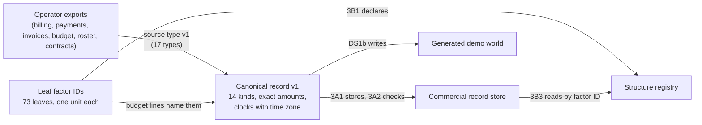

# 2a: canonical format version 1 and the leaf factor IDs (implementer spec)

Architect (Claude), 2026-11-20. **Rev 3** (review round 1 folded in: `rulings.md` "Review round 1 answers", D-2A.11, D-2A.12). **Rev 2** (handshake round 1 folded in: `rulings.md` "Handshake answers (round 1)", D-2A.10). Rev 1 was spec handshake step 1 (`.ai/RULES.md` §4). Lane B, first unit of the
non-screen build (`specs/BW1-build-wave1/rulings.md` D-BW1.1). Decisions with their reasons: `rulings.md` (D-2A.1 to
D-2A.9). Reviewer: `reviewer-guide.md`. Questions: `handshake.md` (before code), `mid-build-questions.md` (during).

Non-screen: no screen, route, store or migration changes. Discovery review (W5: a new mechanism and a shared seam).

## 0. Before you start

- **Branch** `task/2a-canonical-format` off `main` after the coordinator has merged `task/build-wave1-specs` (P1);
  worktree `/opt/assetecon/AssetOpsV1-2a`.
  Never work in `/opt/assetecon/AssetOpsV1` (the coordinator's `main` checkout).
- **Gate.** Both conditions are met: the handshake closed (rev 2) and the owner approved §2, the step-2 structure page
  `P2`, on 20 Nov (item 2: "approved"; `owner/owner-answers-eight-open-questions-2026-11-20.md`).
- **Read:** this spec; `rulings.md`; `Docs/demo-sprint/product-direction-layer4/integration-design.md` §2-§4;
  `integration-source-to-canonical-design.md` §6.1, §6.4-§6.7 (search, do not read whole);
  `contracts/assetops_contracts/operational_records.py` (style); `simulator/assetops_simulator/world/leaves.py`;
  `specs/DS1-history-generator/rulings.md` D-DS1.1 and the L4 fix-round item 4 (the number bound reused in §6.3).
- **Python:** `PYTHONPATH` as the lane rules (worktree `backend:backend/tests:contracts:...`, absolute) and
  `/opt/assetecon/AssetOpsV1/.venv/bin/python`, from the worktree root. The venv has `pytest` and `pyyaml` (the parity test needs `yaml`; it fails, never skips,
  without it).
- **Collisions.** None expected. The UI lanes (`task/uiux-decision-page`, `task/uiux-design-model`) and DS1m
  (`task/DS1-mockup-trends`) edit only `Docs/demo-sprint/product-direction-layer4/interactive-mockup-vNEXT/` and
  `Docs/design-system/`. You edit only `contracts/assetops_contracts/canonical/`, the two `backend/tests/test_2a_*.py` files, the fixture in
  `backend/tests/fixtures/`, this folder's packet and the finish bookkeeping (P10: the `.ai/state/` entry, its index
  line, the `specs/INDEX.md` row). Do not edit the pack, the
  manifest or `simulator/` (the switch of `world/leaves.py` to this catalogue is DS1b's, D-2A.8).
- **Databases:** none. No test here needs one, so nothing runs through `tools/heavy-slot.sh` except check-all
  (which takes its own slot). Never touch ports 5490 or 8990, the walkthrough DB or Docker.

## 1. Outcome and why

The canonical format version 1 for every source type, and one shared ID for every leaf factor, as code in the
neutral contracts package. It is the root of both build lanes (Figure 10, step 2): the commercial record store
(`3A1`) validates intake against these kinds, the structure registry (`3B1`) declares its leaves by these IDs and
units, and the generator's writers (`DS1b`) emit records in this format. With one definition, the store, the
registry and the generator cannot drift. Gate question (`delivery-plan.md` §3, step 2): does every source type have
a version 1 canonical format with its units and time zone, and does every leaf of the mini-grid structure (and the
cold-room and EV depot structures) have a shared factor ID that the store and the registry both use?

## 2. Structure page P2, for the owner (one page)

**What exists.** Today readings and fuel records each have a format (`source_envelope_v4`, `operational_records`).
Bills, payments, budgets, rosters and contracts have none: no screen figure rests on them yet.

**What is added.** One format, version 1, for the fourteen kinds of business record the three verticals send, and one
list of the 73 leaf factors with a single ID and unit each. Both are code that every part of the product reads, so a
bill imported for Kobo and Kobo's cost line in the structure use the same name for the same thing.



**The rules, in plain words.**
- A kind is one sort of business record: a charge, a payment, a settlement, an adjustment, an expense, a budget line,
  a storage movement, a meter read, a meter assignment, a roster line, a departure, a tariff, a service ticket, a
  contract. Each has a fixed list of fields; anything else is refused, never guessed.
- Money is written as exact decimal text with its currency (`"11457.60"`, `USD`), never as a floating-point number.
- Every moment carries its UTC offset. A day or month (a service day, a recognition month) is the Site's own calendar.
- A leaf factor has one ID across the three verticals: `staff` is staff cost at a mini-grid and at a cold room alike,
  with one unit. An ID is never reused for a different quantity.
- This is version 1. It is revised, as version 2, when the first operator's real export is pinned under the contract
  test (design D1; Architect's caution in §2.9).

**Approved by the owner, 20 Nov** (item 2: "approved").

## 3. Files and public API

New package `contracts/assetops_contracts/canonical/` (standard library only; D-2A.1):

| File | Holds |
|---|---|
| `__init__.py` | re-exports every public name below, `FORMAT_VERSION` included (defined in `records_v1.py`, which `__init__` imports; defining it in `__init__` would be circular; RV1 gap 4); a module docstring citing this spec |
| `units.py` | `Unit`, the dimensions, `parse_unit`, the named units, `QUANTITY_UNITS`, `BAND_UNITS` (§4) |
| `factors.py` | `Factor`, `STRUCTURE_KEYS`, `LEAF_FACTORS`, `leaves_of`, `FACTOR_ID_PATTERN` (§5) |
| `records_v1.py` | `KINDS`, `KIND_SPECS`, `CanonicalRecordV1`, `CanonicalBatchV1`, `BatchResult`, `CanonicalRefused`, `loads_canonical`, `parse_record`, `parse_batch`, `to_canonical_json`, `record_digest`, `batch_digest` (§6, §8) |
| `sources_v1.py` | `SourceType`, `SOURCE_TYPES`, `EXISTING_FORMATS` (§7) |

Tests (D-2A.10): `backend/tests/test_2a_canonical_v1.py`, `backend/tests/test_2a_canonical_manifest_parity.py`,
fixture `backend/tests/fixtures/canonical_v1_examples.json` (a byte copy of this folder's `examples-v1.json.txt`).
They live in `backend/tests` so that every merge's full fast tier runs them.

This package is a protected seam from this unit on (D-2A.2): a change that alters what a valid record is, or a factor
ID or unit, is a new format version, never an edit of version 1.

## 4. Units (`units.py`)

- **Dimensions** (exactly six): `KWH`, `L`, `MONEY`, `DAY`, `HOUR`, `MINUTE` (D-2A.4).
- **`Unit`**: a frozen dataclass holding `exponents: tuple[tuple[str, int], ...]`, sorted by dimension name, zero
  exponents dropped. `ONE` has no exponents. Operators: `a * b`, `a / b` (exponents add or subtract), `==`, `hash`.
  `Unit.is_money` is true only for exactly `MONEY^1`. `str(unit)` is the canonical text below.
- **Canonical text**: `"1"` for `ONE`; otherwise the numerator dimensions joined by `*` (`1` when no exponent is
  positive, so `1/DAY`), then, if any, `/` and the denominator dimensions joined by `*`, each dimension repeated per
  exponent, in dimension-name order
  (`HOUR*MONEY/KWH`, `KWH/HOUR`, `MONEY/DAY`). `parse_unit(text)` accepts exactly this grammar
  (`^(1|D(\*D)*)(/D(\*D)*)?$`, `D` one of the six names) and returns the `Unit`; `parse_unit(str(u)) == u` for every
  unit; it accepts a text only when `str(parse_unit(text)) == text`, so out-of-order, repeated, non-reduced
  (`KWH*L/KWH`) and both-sides forms raise `ValueError("CANONICAL_UNIT <text>")` too.
- **`QUANTITY_UNITS`** (`MappingProxyType`): `kWh` `KWH`, `kW` `KW`, `L` `L`, `crate` `ONE`, `crate_day` `DAY`.
  **`BAND_UNITS`**: `per_kWh` `MONEY/KWH`, `per_crate_day` `MONEY/DAY`, `per_L` `MONEY/L`. These are the only bridge
  from record units to catalogue units; `3A2`, `3B3` and `DS1b` use them and write no mapping of their own (R10).
- **Named units:** `ONE`, `KWH`, `L`, `MONEY`, `DAY`, `HOUR`, `MINUTE`, `KW = KWH / HOUR`.
- **Counts are dimensionless.** Assets, buses, chargers, crates, batches and visits are `ONE` with a display word. A
  night, a bus-night and a missed departure are `DAY` (one service day per vehicle; D-2A.4).
- No conversion exists between `DAY`, `HOUR` and `MINUTE`; only a declared factor converts (`hours_per_day`
  `HOUR/DAY`, `minutes_per_day` `MINUTE/DAY`).

## 5. Leaf factor catalogue (`factors.py`)

- `STRUCTURE_KEYS = ("MINI_GRID", "COLD_CHAIN", "EV_DEPOT_CAPTIVE")`: the manifest's `structures` and `factor_map`
  keys (a tenant's `vertical` plus business model; `EV_DEPOT` captive is `EV_DEPOT_CAPTIVE`).
- `FACTOR_ID_PATTERN = re.compile(r"[a-z][a-z0-9_]{0,63}", re.ASCII)`: the syntax of every factor ID, leaf or node,
  always applied with `fullmatch` (R5).
- `Factor`: frozen dataclass `id: str`, `structures: frozenset[str]`, `unit: Unit`, `display: str`; property
  `money -> bool` (`unit.is_money`).
- `LEAF_FACTORS: Mapping[str, Factor]` (a `MappingProxyType`), in the table's order. `leaves_of(key)` returns the IDs
  of one structure key in the table's order (not the manifest's order; the docstring says so, P9); an unknown key
  raises `KeyError`.
- The table is the whole catalogue: 73 IDs; 4 shared (`staff`, `outstanding`, `liability` across MG and CC with
  `MONEY`; `period_days` across MG and CC with `DAY`); 9 money leaves. It is typed into `factors.py` as one literal,
  row for row; the parity test (T1) compares it with the manifest, which it must not read at import time.

| # | Factor ID | Structures | Unit | Display | Money |
|---:|---|---|---|---|---|
| 1 | `delivered_kwh` | MG | `KWH` | kWh | no |
| 2 | `technical_loss_kwh` | MG | `KWH` | kWh | no |
| 3 | `unexplained_loss_kwh` | MG | `KWH` | kWh | no |
| 4 | `adjustments_kwh` | MG | `KWH` | kWh | no |
| 5 | `unmapped_kwh` | MG | `KWH` | kWh | no |
| 6 | `tariff` | MG | `MONEY/KWH` | per kWh | no |
| 7 | `productive_kwh` | MG | `KWH` | kWh | no |
| 8 | `productive_tariff` | MG | `MONEY/KWH` | per kWh | no |
| 9 | `in_transit` | MG | `MONEY` | money | yes |
| 10 | `outstanding` | MG, CC | `MONEY` | money | yes |
| 11 | `necessary_l` | MG | `L` | L | no |
| 12 | `candidate_l` | MG | `L` | L | no |
| 13 | `unexplained_l` | MG | `L` | L | no |
| 14 | `extra_l` | MG | `L` | L | no |
| 15 | `diesel_price` | MG | `MONEY/L` | per L | no |
| 16 | `battery_throughput_kwh` | MG | `KWH` | kWh | no |
| 17 | `wear_rate` | MG | `MONEY/KWH` | per kWh throughput | no |
| 18 | `om` | MG | `MONEY` | money | yes |
| 19 | `staff` | MG, CC | `MONEY` | money | yes |
| 20 | `collection_cost` | MG | `MONEY` | money | yes |
| 21 | `reduced_days` | MG | `DAY` | days | no |
| 22 | `hours_per_day` | MG | `HOUR/DAY` | hours a day | no |
| 23 | `major_assets` | MG | `1` | assets | no |
| 24 | `unserved_critical_kwh` | MG | `KWH` | kWh | no |
| 25 | `customer_hours_interrupted` | MG | `HOUR` | customer-hours | no |
| 26 | `field_visits` | MG | `1` | visits | no |
| 27 | `liability` | MG, CC | `MONEY` | money | yes |
| 28 | `period_days` | MG, CC | `DAY` | days | no |
| 29 | `standby_kw` | MG | `KWH/HOUR` | kW | no |
| 30 | `lost_unit_kw` | MG | `KWH/HOUR` | kW | no |
| 31 | `dawn_days_below` | MG | `DAY` | days | no |
| 32 | `crate_days` | CC | `DAY` | crate-days | no |
| 33 | `rate` | CC | `MONEY/DAY` | per crate-day | no |
| 34 | `contract_crate_days` | CC | `DAY` | crate-days | no |
| 35 | `contract_rate` | CC | `MONEY/DAY` | per crate-day | no |
| 36 | `base_kwh` | CC | `KWH` | kWh | no |
| 37 | `k_kwh_per_crate_day` | CC | `KWH/DAY` | kWh per crate-day | no |
| 38 | `model_factor` | CC | `1` | ratio | no |
| 39 | `excess_kwh` | CC | `KWH` | kWh | no |
| 40 | `elec_price` | CC | `MONEY/KWH` | per kWh | no |
| 41 | `maint` | CC | `MONEY` | money | yes |
| 42 | `handling` | CC | `MONEY` | money | yes |
| 43 | `uncovered_nights` | CC | `DAY` | nights | no |
| 44 | `backup_unproven_days` | CC | `DAY` | days | no |
| 45 | `excursion_crates` | CC | `1` | crates | no |
| 46 | `excursion_days` | CC | `DAY` | days | no |
| 47 | `batches_exposed` | CC | `1` | batches | no |
| 48 | `cooling_minutes_unavailable` | CC | `MINUTE` | minutes | no |
| 49 | `minutes_per_day` | CC | `MINUTE/DAY` | minutes a day | no |
| 50 | `capacity_crate_days` | CC | `DAY` | crate-days | no |
| 51 | `chargers_in_service` | EV | `1` | chargers | no |
| 52 | `chargers_installed` | EV | `1` | chargers | no |
| 53 | `charger_kw` | EV | `KWH/HOUR` | kW per charger | no |
| 54 | `import_limit_kw` | EV | `KWH/HOUR` | kW | no |
| 55 | `window_h` | EV | `HOUR/DAY` | hours a night | no |
| 56 | `buses` | EV | `1` | buses | no |
| 57 | `kwh_per_bus_night` | EV | `KWH/DAY` | kWh per bus-night | no |
| 58 | `nights_in_period` | EV | `DAY` | nights | no |
| 59 | `peak_kwh` | EV | `KWH` | kWh | no |
| 60 | `kwh_2200_2400` | EV | `KWH` | kWh | no |
| 61 | `kwh_0000_0500` | EV | `KWH` | kWh | no |
| 62 | `max_kw` | EV | `KWH/HOUR` | kW | no |
| 63 | `peak_price` | EV | `MONEY/KWH` | per kWh | no |
| 64 | `offpeak_price` | EV | `MONEY/KWH` | per kWh | no |
| 65 | `night_price` | EV | `MONEY/KWH` | per kWh | no |
| 66 | `demand_rate` | EV | `HOUR*MONEY/KWH` | per kW a month | no |
| 67 | `maintenance` | EV | `MONEY` | money | yes |
| 68 | `short_nights` | EV | `DAY` | nights | no |
| 69 | `spare_bus_nights` | EV | `DAY` | bus-nights | no |
| 70 | `covered_bus_nights` | EV | `DAY` | bus-nights | no |
| 71 | `extra_missed_departures` | EV | `DAY` | departures (bus-nights) | no |
| 72 | `charger_out_days` | EV | `DAY` | days | no |
| 73 | `penalty_rate` | EV | `MONEY/DAY` | per missed departure | no |

MG = `MINI_GRID`, CC = `COLD_CHAIN`, EV = `EV_DEPOT_CAPTIVE`. Which source fills a leaf, and what its absence means
(`filled_by`, `absent`), is the registry's (`3B1`, `3B6`), not this catalogue's (D-2A.3). `penalty_rate` (family
DOCUMENT) takes its value from a person's reviewed contract-extraction rows, the rights register `9a` builds, not from
a v1 record field; `contract_crate_days` and `contract_rate` are option-only (R11).

## 6. Canonical record v1 (`records_v1.py`)

### 6.1 Batch envelope

A batch is one JSON object; every key below is required and no other key is allowed:

| Key | Type and rule |
|---|---|
| `format_version` | JSON integer `1` (not `true`, not `1.0`) |
| `tenant_code` | tenant slug, `^[a-z0-9][a-z0-9-]{0,62}$` (the `tenant.slug` rule of migration 0001) |
| `source_type` | a key of `SOURCE_TYPES` (§7) |
| `source_system` | ref (§6.3): the operator's own system name, e.g. `mto-vending-export` |
| `provenance` | one of `demo-simulated`, `source-emulated`, `bench-tested`, `field-integrated`, `observed-financial` |
| `produced_at` | instant (§6.3) |
| `records` | JSON array, 0 to 10,000 records |

### 6.2 Record

Top-level keys (closed set; a key not listed is `CANONICAL_FORBIDDEN`): `format_version` (integer 1), `kind`,
`source_record_id` (ref), `source_version` (ref, at most 64 characters), `site_code`, `subject`, `clocks`, `amount`,
`quantity`, `status`, `body`. Absent optional keys are omitted, never `null`. A `null` where the field is allowed is `CANONICAL_TYPE`; a key on
an F row is `CANONICAL_FORBIDDEN` whatever its value, `null` included (the key's presence is the fault; RV1 Low 3.3).
`format_version`, `kind`, `source_record_id`, `source_version`, `clocks` and `body` are required for every kind;
`site_code`, `subject`, `amount`, `quantity` and `status` follow the kind's row (R4).

- `site_code`: `^[A-Z0-9][A-Z0-9-]{0,63}$`. Required for every kind except `BUDGET_LINE` and `CONTRACT_DOCUMENT`,
  where omitting it means portfolio level.
- `subject`: `{"kind": SUBJECT, "ref": ref}`, `SUBJECT` one of `CUSTOMER`, `METER`, `BATCH`, `VEHICLE`, `ASSET`,
  `SITE`. Refs are pseudonymised by the source adapter; the format does not check that.
- `clocks`: an object whose keys are a subset of `occurred_at` (instant), `effective_from` (local date),
  `effective_to` (local date), `recognition_period` (period), `settled_at` (instant). Effective ranges are half-open
  `[from, to)`; `effective_to` must be after `effective_from`; omitted `effective_to` means open-ended.
- `amount`: `{"value": decimal, "currency": "^[A-Z]{3}$"}`. `quantity`: `{"value": decimal, "unit": QUNIT}`,
  `QUNIT` one of `kWh`, `kW`, `L`, `crate`, `crate_day`.
- `status`: a kind's enum (table §6.4).
- `body`: an object holding exactly the kind's body fields (required ones present, optional ones present or omitted,
  nothing else).

### 6.3 Value types

| Type | Rule |
|---|---|
| decimal | a JSON string matching `-?(0|[1-9][0-9]*)(\.[0-9]+)?` (fullmatch, ASCII); its canonical text is `format(d, "f")`, which equals the input for every accepted text (R2); at most 32 characters, `Decimal(text).adjusted()` within [-12, 12] (the DS1 L4 bound); a JSON number, boolean or other string is `CANONICAL_NUMBER`. `-0` and `-0.00` are refused (`CANONICAL_NUMBER`) |
| sign | non-negative unless the table says "any sign"; "positive" means greater than zero (`CANONICAL_SIGN`) |
| integer | a JSON integer (Python `int` and not `bool`), within the table's range (`CANONICAL_TYPE`, `CANONICAL_SIGN`) |
| boolean | JSON `true` or `false` |
| ref | a string of 1 to 200 characters, no character below U+0020 and no U+007F, no leading or trailing whitespace (`CANONICAL_REF`) |
| set of refs | a JSON array of refs, no duplicates (`CANONICAL_DUPLICATE`); canonical output sorts it |
| instant | `^\d{4}-\d{2}-\d{2}T\d{2}:\d{2}:\d{2}(\.\d{1,6})?(Z|[+-]\d{2}:\d{2})$`, valid by `datetime.fromisoformat`; canonical output is `isoformat()` of the parsed value, keeping its offset (`Z` becomes `+00:00`) |
| local date | `^\d{4}-\d{2}-\d{2}$`, a valid calendar date, in the Site's time zone (`site.timezone`) |
| period | `^\d{4}-(0[1-9]|1[0-2])$`, a calendar month in the Site's time zone; portfolio-level records use the calendar month as written |
| local time | `^([01]\d|2[0-3]):[0-5]\d$`; a tariff band's `to` may also be `24:00` |

Clock, date, period and time failures are `CANONICAL_CLOCK`. Every pattern in this spec is ASCII (`[0-9]`, never a
Unicode `\d`) and applied with `re.fullmatch` (R5). Any string anywhere holding a code point U+D800 to U+DFFF is
`CANONICAL_REF` at its path; a ref also refuses U+0080 to U+009F; "whitespace" is `str.strip()`'s set; refs are
compared as given, with no Unicode normalisation (R6). Instants are compared as moments, never as text; digests are
of the canonical text (`isoformat()` of the parsed instant, so `.1` becomes `.100000` and `Z` or `-00:00` becomes
`+00:00`); the format never converts zones (R12, as corrected by RV1 Low 3.4). Tariff bands are wall-clock times; a
daylight-saving day is the reader's (`3B3`) to resolve (R15).

### 6.4 The fourteen kinds

R required, O optional, F forbidden (present is `CANONICAL_FORBIDDEN`). The store family says which store will hold
the kind (`integration-design.md` §4; D-2A.6).

| Kind | Store family | Clocks R (O) | Amount | Quantity | Status | Subject | Body R | Body O |
|---|---|---|---|---|---|---|---|---|
| `CHARGE` | COMMERCIAL_RECORD | `effective_from`, `effective_to`, `recognition_period` | R | R, or F when `line_type` is `FIXED`; unit `kWh` for USAGE, `kW` for DEMAND, `crate_day` for STORAGE | F | O: CUSTOMER, METER, SITE | `account_ref` ref; `line_type` USAGE, FIXED, DEMAND, STORAGE; `tariff_code` ref | `band` ref (at most 40); `tariff_class` STANDARD, PRODUCTIVE |
| `RECEIPT` | COMMERCIAL_RECORD | `occurred_at`, `recognition_period` | R, positive | F | R: PAID_IN_TRANSIT, COLLECTED | O: CUSTOMER | `payer_ref` ref; `method` CASH, MOBILE_MONEY, BANK, CARD, OTHER | `applied_to` set of refs |
| `SETTLEMENT` | COMMERCIAL_RECORD | `settled_at` (`recognition_period`) | R, positive | F | F | F | `provider` ref; `batch_ref` ref; `receipts` set of refs, at least 1 | none |
| `ADJUSTMENT` | COMMERCIAL_RECORD | `effective_from`, `recognition_period` | O, any sign | O, any sign; `kWh` or `crate_day` | F | O: CUSTOMER, METER, SITE | `reason_code` ref (at most 40); `authorised_by_ref` ref | `applies_to` set of refs; `document_ref` ref |
| `EXPENSE` | COMMERCIAL_RECORD | `occurred_at`, `recognition_period` | R | R when `category` is FUEL, else F; unit `L` | R: QUOTE, INVOICED, PAID | O: ASSET, SITE | `counterparty_ref` ref; `category` FUEL, OM, STAFF, REPAIR, ENERGY, PENALTY, COLLECTION, HANDLING; `document_ref` ref | none |
| `BUDGET_LINE` | COMMERCIAL_RECORD | `recognition_period` | F | F | F | F | `factor_id` (`FACTOR_ID_PATTERN`); `value` decimal, any sign; `version_ref` ref | `currency` `^[A-Z]{3}$`; `line_ref` ref |
| `STORAGE_MOVEMENT` | COMMERCIAL_RECORD | `occurred_at` | F | R, positive, a whole number; unit `crate` | F | R: BATCH | `batch_ref` ref; `direction` IN, OUT; `commodity` ref; `customer_ref` ref | `rate` decimal (money per crate-day); `currency` (R when `rate` is present, else F) |
| `CUSTOMER_METER_READ` | COMMERCIAL_RECORD | `effective_from`, `effective_to` | F | R for INTERVAL, F for REGISTER; unit `kWh` | F | R: METER | `meter_ref` ref; `read_type` INTERVAL, REGISTER | `register_start`, `register_end` decimal (both R for REGISTER, `register_end` not below `register_start`; F for INTERVAL) |
| `METER_ASSIGNMENT` | COMMERCIAL_RECORD | `effective_from` (`effective_to`) | F | F | F | R: METER | `meter_ref` ref; `customer_ref` ref | `correction_reason` ref |
| `FLEET_ROSTER` | COMMERCIAL_RECORD | `effective_from` (the service day; `effective_to` F) | F | F | F | R: VEHICLE | `vehicle_ref` ref; `return_at` instant; `departure_at` instant, after `return_at`; `required_kwh` decimal, positive | `tag_ref` ref; `block_ref` ref |
| `DEPARTURE` | COMMERCIAL_RECORD | `occurred_at` | F | F | F | R: VEHICLE | `vehicle_ref` ref; `service_day` local date; `block_met` boolean | `soc_pct` decimal 0 to 100; `kwh_at_departure` decimal; `block_ref` ref |
| `TARIFF_SCHEDULE` | COMMERCIAL_RECORD | `effective_from` (`effective_to`) | F | F | F | F | `contract_ref` ref; `currency`; `bands` array of 1 to 24 objects `{band, from, to, rate, unit}` (`band` ref at most 40, unique; `from` local time; `to` local time or `24:00`, after `from`; bands do not overlap; `rate` decimal; `unit` per_kWh, per_crate_day, per_L) | `demand_rate` decimal (money per kW a month) |
| `SERVICE_TICKET` | OPERATIONAL_RECORD | `occurred_at` (the ticket's creation) | F | F | R: OPEN, ACKNOWLEDGED, RESTORED, CLOSED | R: ASSET | `asset_ref` ref; `counterparty_ref` ref | `acknowledged_at`, `restored_at` instants, not before `occurred_at`; `restored_at` R when status is RESTORED |
| `CONTRACT_DOCUMENT` | COMMERCIAL_RECORD | `effective_from` (`effective_to`) | F | F | R: SUBMITTED, ACCEPTED, REJECTED | O: ASSET, SITE | `document_sha256` `^[0-9a-f]{64}$`; `counterparty_ref` ref; `contract_type` WARRANTY, EPC, OM_SLA, INSURANCE, STORAGE, SERVICE, SUPPLY; `pages` integer 1 to 10,000 | `parties` set of refs |

Clock keys a kind does not list are `CANONICAL_FORBIDDEN`. Rules across fields, checked after the fields
themselves, in the table's left-to-right order:
- `ADJUSTMENT`: at least one of `amount`, `quantity` (`CANONICAL_FIELD record.amount` when neither).
- `BUDGET_LINE`: when `factor_id` is in `LEAF_FACTORS`, `currency` is required if and only if the leaf's unit has a
  `MONEY` exponent (`CANONICAL_FACTOR record.body.currency`). For an ID not in the catalogue (a node, D-2A.5),
  `currency` is free; the registry checks it at intake (`3A2`).
- `TARIFF_SCHEDULE`: bands are sorted by `from` for the overlap check and in canonical output.
- `CHARGE` and `EXPENSE` amounts are non-negative: a reversal is an `ADJUSTMENT`.

### 6.5 Parsed objects

- `KIND_SPECS: Mapping[str, KindSpec]` holds §6.4's table as data; `KindSpec` is a frozen dataclass whose public
  attributes are `kind` and `store_family` (`COMMERCIAL_RECORD` or `OPERATIONAL_RECORD`). Its other attributes are
  private to `records_v1.py`. `KINDS` is `frozenset(KIND_SPECS)`.

- `CanonicalRecordV1`: frozen dataclass with fields `kind: str`, `source_record_id: str`, `source_version: str`,
  `site_code: str | None`, `subject: tuple[str, str] | None`, `clocks: Mapping[str, str]`,
  `amount: tuple[Decimal, str] | None`, `quantity: tuple[Decimal, str] | None`, `status: str | None`,
  `body: Mapping[str, object]`. Mappings are `MappingProxyType`; set-lists are sorted tuples; instants keep their
  canonical text (§6.3); decimals are `Decimal`, written out as `format(d, "f")`, never `str(d)` and never
  re-quantised (R2). A `CanonicalRecordV1` is **not hashable** (its mappings are `MappingProxyType`): callers key
  records by `record_digest`, never by the object (RV1 residual risk).
- `CanonicalBatchV1`: frozen dataclass `tenant_code`, `source_type`, `source_system`, `provenance`, `produced_at`.
- `BatchResult`: frozen dataclass `batch: CanonicalBatchV1`, `outcomes: tuple[CanonicalRecordV1 | CanonicalRefused, ...]`
  in input order.
- `CanonicalRefused(Exception)`: attributes `code` and `path`; `str()` is `f"{code} {path}"`. Paths are dotted from
  `json`, `batch` or `record` with array indexes as `[n]`: `batch.source_type`, `record.body.bands[1].to`. A record
  outcome's path always starts at `record` (P6).

### 6.6 Functions

- `loads_canonical(data: bytes) -> object`: the one public entry for bytes (R7). Not UTF-8 or not JSON:
  `CANONICAL_TYPE json`; a key repeated in one object: `CANONICAL_DUPLICATE json.<key>` (`object_pairs_hook`);
  `NaN`, `Infinity`, `-Infinity`: `CANONICAL_NUMBER json` (`parse_constant`).
- `parse_record(obj: object) -> CanonicalRecordV1`: validates one record object (already JSON-decoded) and raises the
  first `CanonicalRefused` in this order: `format_version`, `kind`, the top-level key set, `source_record_id`,
  `source_version`, `site_code`, `subject`, `clocks`, `amount`, `quantity`, `status`, `body` (its keys, then each
  field in table order), then the cross-field rules.
- `parse_batch(obj: object) -> BatchResult`: the envelope is checked in the record's order, `format_version` first,
  then the key set, then each field (RV1 Low 3.2: one order for batch and record); an envelope failure raises
  `CanonicalRefused` with a `batch.` path;
  otherwise each record is parsed and its refusal is kept as that record's outcome, never stopping the others
  (intake's per-row rule, `integration-design.md` §4). Then: a record whose kind is not in its source type's kinds
  becomes `CANONICAL_SOURCE_TYPE record.kind`; then, among records that parsed and passed the source-type check only, a
  second record with the same `(source_record_id, source_version)` becomes `CANONICAL_DUPLICATE
  record.source_record_id` (the first stays valid; a refused record claims no key, R13).
- `to_canonical_json(x: CanonicalRecordV1 | BatchResult) -> bytes`: UTF-8 of
  `json.dumps(obj, sort_keys=True, separators=(",", ":"), ensure_ascii=False)`, built from the parsed object (decimals
  as their kept text, instants canonical, set-lists sorted, bands sorted, absent keys omitted). For a `BatchResult`
  the envelope keys `format_version` (1), `tenant_code`, `source_type`, `source_system`, `provenance`, `produced_at`
  and `records`, holding only the valid records, in input order. Round trip: the valid records re-parse to equal
  records, in order, and give the same bytes (R8).
- `record_digest(r)` and `batch_digest(b)`: lower-case hex SHA-256 of `to_canonical_json`; a batch digest covers the
  valid records only (R8).

### 6.7 Refusal codes (closed list)

`CANONICAL_VERSION`, `CANONICAL_KIND`, `CANONICAL_FIELD` (required and absent), `CANONICAL_FORBIDDEN` (present and
not allowed, including unknown keys), `CANONICAL_TYPE`, `CANONICAL_NUMBER`, `CANONICAL_SIGN`, `CANONICAL_ENUM`,
`CANONICAL_UNIT`, `CANONICAL_CURRENCY`, `CANONICAL_CLOCK`, `CANONICAL_RANGE` (an `effective_to`, a band's `to`, a
departure, a register end or a ticket time out of order; bands overlapping), `CANONICAL_REF`, `CANONICAL_DUPLICATE`,
`CANONICAL_FACTOR`, `CANONICAL_SOURCE_TYPE`, `CANONICAL_PROVENANCE`. No bare `KeyError`, `ValueError`,
`TypeError` or `decimal.InvalidOperation` escapes `parse_record` or `parse_batch` for any JSON-decodable input.

### 6.8 Which check gives which code (R3, P4, P5, P6)

| Check | Code and path |
|---|---|
| A key anywhere (any object, and in `loads_canonical`) holding a code point U+D800 to U+DFFF | `CANONICAL_REF <container path>` (the key is left out of the path; `CANONICAL_REF json` in `loads_canonical`); checked before unknown, missing and duplicate keys (RV1 M1, D-2A.11) |
| Key set of the envelope, a record, `clocks`, `amount`, `quantity`, `subject`, `body` or a band | first unknown key in sorted order: `CANONICAL_FORBIDDEN <path>.<key>`, the key written as its key text (§6.8a); checked before any missing key |
| A required key absent | `CANONICAL_FIELD <path>.<key>`, at that field's own step in §6.6's order |
| `format_version` absent or not the integer 1 | `CANONICAL_VERSION <path>.format_version` |
| `kind` absent / not a v1 kind | `CANONICAL_FIELD record.kind` / `CANONICAL_KIND record.kind` |
| Wrong JSON type (object, array, string, boolean, integer place) | `CANONICAL_TYPE <path>`; a decimal place holding a non-string is `CANONICAL_NUMBER` |
| A record element that is not an object | that record's outcome, `CANONICAL_TYPE record` |
| Batch not an object / `records` not an array | `CANONICAL_TYPE batch` / `CANONICAL_TYPE batch.records` |
| More than 10,000 records; `bands` empty or over 24; `receipts` empty; `pages` outside 1 to 10,000; `soc_pct` over 100 | `CANONICAL_RANGE <path>` |
| Negative where not allowed; zero where "positive" | `CANONICAL_SIGN <path>` |
| Whole number breached (`"120.5"` crates); decimal syntax, length or exponent | `CANONICAL_NUMBER <path>` |
| Ref, `tenant_code`, `site_code`, `document_sha256` pattern or length (`band` 40, `reason_code` 40, `source_version` 64); surrogates | `CANONICAL_REF <path>` |
| `factor_id` pattern; currency rule for a catalogue leaf | `CANONICAL_FACTOR <path>` |
| An enum value outside its set, including `subject.kind` not allowed for the kind and `status` | `CANONICAL_ENUM <path>` |
| `subject`, `status`, `amount` or `quantity` present where the row says F | `CANONICAL_FORBIDDEN record.<key>` |
| Quantity unit wrong for the kind or `line_type`; band `unit` outside the three | `CANONICAL_UNIT <path>` |
| Currency pattern (`amount.currency`, `body.currency`) | `CANONICAL_CURRENCY <path>` |
| `STORAGE_MOVEMENT` `currency` without `rate` / `rate` without `currency` | `CANONICAL_FORBIDDEN record.body.currency` / `CANONICAL_FIELD record.body.currency` |
| Duplicate band name; duplicate in a set of refs | `CANONICAL_DUPLICATE <path>` |
| Ticket times before `occurred_at`; `departure_at` not after `return_at`; ranges out of order; bands overlapping | `CANONICAL_RANGE <path>` |
| `restored_at` absent with status RESTORED | `CANONICAL_FIELD record.body.restored_at` |
| Unknown `source_type`; bad `provenance`; `produced_at` | `CANONICAL_SOURCE_TYPE batch.source_type`; `CANONICAL_PROVENANCE batch.provenance`; `CANONICAL_CLOCK batch.produced_at` |

### 6.8a Key text in paths, conditional fields, and the contract (RV1)

- **Key text in a path** (D-2A.11). An unknown or duplicate key enters a path as
  `json.dumps(key, ensure_ascii=True)[1:-1]`, cut to its first 64 characters with `...` appended when longer. So a
  path is always ASCII, encodable and bounded. Spec-named keys are unaffected.
- **Conditional fields: the root cause first** (D-2A.12, RV1 M2). When whether a field is required, optional or
  forbidden depends on a controlling value (CHARGE `quantity` on `line_type`; EXPENSE `quantity` on `category`;
  CUSTOMER_METER_READ `quantity`, `register_start` and `register_end` on `read_type`) and that value is absent or not
  in its enum, the dependent field gets only its shape checks (type, decimal syntax, sign, and a unit among those any
  branch allows), and the controlling field's own refusal is reported at its step (`CANONICAL_FIELD` or
  `CANONICAL_ENUM` on `record.body.<control>`). So an EXPENSE with a fuel quantity and no `category` gives
  `CANONICAL_FIELD record.body.category`, never `CANONICAL_FORBIDDEN record.quantity`.
- **Arrays** (RV1 gap 2). A fault in an array points at the element (`record.body.bands[1].to`). An overlap points at
  the later band's `from`, where "later" is in order of `from` and the index is that band's **input** index.
- **Quantity unit outside the five** is `CANONICAL_UNIT` (RV1 gap 1).
- **The codes and paths are part of version 1** (D-2A.2): `3A2` shows them to operators and later tests pin them, so
  a change to any code or path is a version 2.

## 7. Source types v1 (`sources_v1.py`)

`SourceType`: frozen dataclass `id`, `kinds: frozenset[str]`, `words: str` (what the operator calls it).
`SOURCE_TYPES` (a `MappingProxyType`, this order):

| `id` | Kinds | Words |
|---|---|---|
| `billing_export` | CHARGE, RECEIPT, ADJUSTMENT | customer billing or vending export (prepaid and postpaid) |
| `mobile_money_statement` | RECEIPT, SETTLEMENT | mobile-money settlement statement |
| `meter_register` | METER_ASSIGNMENT | meter register with effective dates |
| `meter_data_export` | CUSTOMER_METER_READ | meter-data system export |
| `expense_ledger` | EXPENSE, ADJUSTMENT | supplier invoices, credit notes, quotes, fuel purchases and payroll lines |
| `budget_workbook` | BUDGET_LINE | monthly budget lines by Site and line |
| `contract_documents` | CONTRACT_DOCUMENT | warranty, EPC, O&M and SLA, insurance and storage contracts |
| `storage_ledger` | STORAGE_MOVEMENT | storage ledger, check-in and check-out per batch |
| `customer_invoicing` | CHARGE, RECEIPT, ADJUSTMENT | cold-room invoices, receipts and credit notes |
| `storage_rate_card` | TARIFF_SCHEDULE | storage rate card |
| `tariff_sheet` | TARIFF_SCHEDULE | mini-grid tariff sheet |
| `electricity_bill` | CHARGE | cold-room electricity bill |
| `utility_invoice` | CHARGE, TARIFF_SCHEDULE | utility invoice with time-of-use and demand lines, and its tariff schedule |
| `fleet_roster` | FLEET_ROSTER | fleet roster: bus, block, return, departure, required kWh |
| `depot_dispatch_log` | DEPARTURE | depot dispatch log of departures |
| `service_tickets` | SERVICE_TICKET | service tickets (vendor portal export) |
| `penalty_statement` | EXPENSE | transport authority penalty statement |

`EXISTING_FORMATS = MappingProxyType({"READING": "assetops_contracts.source_envelope_v4", "OPERATIONAL_RECORD":
"assetops_contracts.operational_records"})`: telemetry and fuel records keep their formats unchanged (D-2A.7). Every
kind is emitted by at least one source type.

## 8. Time zone and units per source type (the gate's question)

- Every instant carries its own UTC offset; a naive instant is refused. Local dates, periods and tariff times are in
  the Site's IANA time zone (`site.timezone`, migration 0001); a portfolio-level record carries only a calendar month
  or a contract's calendar dates. The format never converts time zones.
- Quantities carry one of the five units of §6.2; prices carry their unit in the band (`per_kWh`, `per_crate_day`,
  `per_L`) or by the field (`rate` per crate-day, `demand_rate` per kW a month). Money always carries its currency.

## 9. Tests (written first: commit 1)

`backend/tests/test_2a_canonical_manifest_parity.py` (the independent check, W2: it reads only the pack manifest and
this package's public names):
- **T1** For each structure key, the set of `leaves_of(key)` equals the manifest's `factor_map[key]` keys (sets, not
  order); no catalogue ID is absent from every structure key.
- **T2** Every ID that appears under more than one structure key is one `Factor` whose `structures` holds all of them.
- **T3** Every `empty_states.leaf_sources` row whose family is `COMMERCIAL_RECORD` or `OPERATIONAL_RECORD` names, before
  any ` (`, a kind in `KINDS` or one of the allowed outside set `FUEL_DELIVERY`, `TANK_DIP`, `work case` (the existing
  operational kinds, listed in the test); a `SERVICE_TICKET` row maps to the OPERATIONAL_RECORD family in
  `KIND_SPECS`; every `DOCUMENT` row names `CONTRACT_DOCUMENT`, a v1 kind (R11).
- **T4** Unit composition, units only, on these hand-listed terms (the test does not assert they occur in the manifest,
  P8): `tariff * delivered_kwh`, `diesel_price * candidate_l`, `battery_throughput_kwh * wear_rate`,
  `reduced_days * hours_per_day` (`HOUR`), `crate_days * rate`, `k_kwh_per_crate_day * crate_days` (`KWH`),
  `elec_price * excess_kwh`, `period_days * minutes_per_day` (`MINUTE`), `chargers_in_service * charger_kw` equals
  `import_limit_kw`, `charger_kw * window_h` equals `kwh_per_bus_night`, `peak_kwh * peak_price`,
  `max_kw * demand_rate`, `spare_bus_nights * penalty_rate`, `buses * nights_in_period` equals `spare_bus_nights`.
  Money results are `MONEY`. The manifest path is
  `Docs/demo-sprint/product-direction-layer4/demo-site-scenario-manifest.yaml` from the repository root
  (`Path(__file__).resolve().parents[2]`).

`backend/tests/test_2a_canonical_v1.py`:
- **T5** Every record of `canonical_v1_examples.json` (17 batches, one per source type) parses through
  `loads_canonical` and `parse_batch` with no refusal; all 14 kinds and all 17 source types occur; for every record,
  `to_canonical_json` re-parses to an equal record **and the same bytes**; `record_digest` of the first record is
  stable across two processes (`subprocess` with `PYTHONHASHSEED` 1 and 2). Decimal edge list (R2), each placed in an
  ADJUSTMENT amount and round-tripped to identical bytes: `"1.50"`, `"0.0000001"`, `"0.000000000001"`,
  `"1000000000000"`, `"-108.00"`; and refused with `CANONICAL_NUMBER`: `"0.0000000000001"`, `"10000000000000"`.
- **T6** One planted failure per code of §6.7 and per row of §6.8, each a minimal edit of an example record, asserting
  the full `str(refused)` (code and path). At least: `format_version: 2`; `kind: "INVOICE"`; an unknown top-level key;
  `amount.value: 8.4` (a JSON number); `"08.40"`; `"-0.00"`; `"1e3"`; a 33-character decimal; a RECEIPT amount `"0"`;
  `currency: "usd"`; `quantity.unit: "MWh"`; a naive `occurred_at`; `recognition_period: "2026-13"`; a period in
  Arabic-Indic digits; `effective_to` equal to `effective_from`; overlapping bands; a `band.to` of `24:00` as `from`; a
  `per_L` band accepted; a ref with a trailing space; a ref holding U+0085; a lone surrogate in a ref; a duplicate in
  `receipts`; `factor_id: "Diesel"` and `"diesel\n"`; a money leaf without `currency`; a non-money leaf with
  `currency`; a `DEPARTURE` in a `service_tickets` batch; two records with the same `(id, version)`, and the same with
  the first one refused (the second then valid); `provenance: "recorded"`; `null` for `site_code`; a CHARGE `FIXED`
  with a quantity; a REGISTER read without `register_end`; an EXPENSE FUEL without quantity; `STORAGE_MOVEMENT`
  quantity `"120.5"`; `pages: 0`; `soc_pct: "100.5"`; 10,001 records; a non-object record element; `return_at`
  `2026-10-15T00:30:00+03:00` with `departure_at` `2026-10-14T22:00:00+00:00` (accepted: compared as moments);
  `loads_canonical` on a repeated key, on `NaN` and on invalid UTF-8.
- **T7** Robustness: 500 records generated by a seeded `random.Random(2026)` that mutates example records (drop a key,
  change a type, insert a control character or a lone surrogate, swap a sign) never raise anything but
  `CanonicalRefused` from `parse_record`, and `to_canonical_json` never raises on a record that parsed. Mutations
  also insert keys (a lone-surrogate key, a control-character key, a 1,000-character key) at every object level, and
  for every refusal `str(refused).encode("ascii")` succeeds (RV1 M1).
- **T11** (RV1). Each a full-text assertion:
  - surrogate keys: `{"body": {"x\ud800": 1}}` gives `CANONICAL_REF record.body`; `loads_canonical` of
    `{"\ud800":1,"\ud800":2}` gives `CANONICAL_REF json`; a 1,000-character unknown key's path ends in 64 escaped
    characters and `...`;
  - conditional order: for CHARGE (`line_type`), EXPENSE (`category`) and CUSTOMER_METER_READ (`read_type`), the
    controlling value absent gives `CANONICAL_FIELD record.body.<control>` and invalid gives `CANONICAL_ENUM
    record.body.<control>`, with a quantity present;
  - batch order: a batch with `format_version: 2` and an unknown key gives `CANONICAL_VERSION batch.format_version`;
  - `"subject": null` on a SETTLEMENT gives `CANONICAL_FORBIDDEN record.subject`;
  - trailing junk, one case per pattern site (RV1 Low 1): `site_code` `"MTO-001 x"`, `tenant_code`, `currency`
    `"USDx"`, `document_sha256` + `"0"`, `recognition_period` `"2026-10x"`, a local date, a band `from` `"05:00x"`,
    an instant with trailing junk; each refused with its §6.8 code;
  - no normalisation (RV1 Low 2): a ref in NFD (`"Cafe\u0301"`) round-trips byte-identical and is not equal to its NFC
    form;
  - overlap index: two overlapping bands given out of order point at the later-by-`from` band's input index.
- **T8** `units`: `parse_unit(str(u)) == u` for every catalogue unit; `str(ONE / DAY) == "1/DAY"`; `KW * HOUR == KWH`;
  `MONEY / MONEY == ONE`; `parse_unit` refuses `"MONEY*HOUR/KWH"` (numerator out of order), `"KWH*L/KWH"`,
  `"KWH/KWH"`, `"kWh"` and `""` with the code text; `QUANTITY_UNITS` and `BAND_UNITS` equal §4's lists.
- **T9** Neutrality: importing `assetops_contracts.canonical` in a fresh subprocess adds no module outside the
  standard library and `assetops_contracts` to `sys.modules` (compare with `sys.stdlib_module_names`).
- **T10** `SOURCE_TYPES`: every kind in `KINDS` is emitted by at least one source type; every source type's kinds are
  in `KINDS`; the 17 IDs of §7 in order.

Commands (no database; not pooled):
```bash
cd /opt/assetecon/AssetOpsV1-2a
export PYTHONPATH=$PWD/backend:$PWD/backend/tests:$PWD/contracts:$PWD/simulator:$PWD/gateway:$PWD/field:$PWD/host:$PWD/tools
PY=/opt/assetecon/AssetOpsV1/.venv/bin/python
$PY -m pytest backend/tests/test_2a_canonical_v1.py backend/tests/test_2a_canonical_manifest_parity.py -q
$PY -m pytest contracts/tests -q               # regression: the package's existing tests
pwsh -NoProfile -File tools/check-all.ps1      # fast mode, once, at the end; it takes its own slot
python3 tools/select-tests.py --base main      # cite its output
```
`select-tests` answers "full" because of the fixture (run-time data the import graph cannot trace, P2). Do not run
the full suite: no backend module reads the fixture, and the merge's full fast tier runs these tests. Say so in the
packet.

## 10. Done (acceptance as questions)

1. Does every one of the 17 source types map to v1 kinds, each kind with its fields, units and clock rules as §6.4?
2. Does every leaf of the three structures have one ID and one unit, equal to the manifest's leaves (T1, T2)?
3. Is every money value exact decimal text with a currency, and is every float, naive instant or unknown field refused
   with its code and path (T6, T7)?
4. Is canonical JSON byte-stable across processes, and does it round-trip (T5)?
5. Does the package import nothing outside the standard library and itself (T9), and does check-all pass, including
   the dependency-direction guard?
6. Is nothing outside §0's file list changed (`git diff --stat main...HEAD`), the finish bookkeeping excepted (P10)?
7. Are the canonical tests in `backend/tests`, so the merge's full tier runs them (D-2A.10)?
8. Is every refusal's text ASCII and bounded, and does every conditional field report its root cause (T11)?

Packet: `specs/2a-canonical-format/packet.md` (at most 3k tokens; RULES §5), with the mid-build question count.

## 11. Out of scope

The store, its migration and intake (`3A1`, `3A2`); `filled_by` and `absent` per leaf (`3B1`, `3B6`); node IDs
(`3B1`); evidence words (`3A5`); switching `world/leaves.py` (`DS1b`); any screen; any backend or simulator file.

## 12. Sizing and commits

1.5 units: two commits. (1) the two test files and the fixture, failing (W2: checks first); (2) the package, tests
green. A third only for the review's fixes.

## 13. Decision queue (W3)

| # | Question | Default applied |
|---|---|---|
| Q1 | Approve §2 as structure page P2 | **Approved by the owner, 20 Nov** |
| Q2 | Are the six dimensions enough, with nights as days and counts dimensionless (D-2A.4)? | Yes. `3B1`'s unit check finds the cases they do not cover (literal `0` and `1` inside `min`, `max`) and the Architect rules them there |
| Q3 | Budget lines may name a node, not only a leaf (D-2A.5) | Yes, as `decision-loop-specification.md` §5 allows targets above leaf level. Cost: a mistyped node ID passes the format and is refused only at intake against the registry (`3A2`) |
