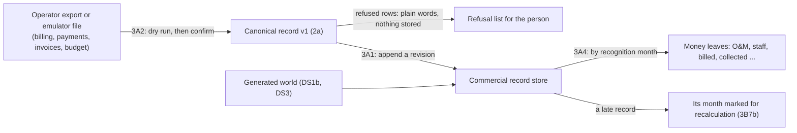

# P3A: step 3A, Sources (structure page)

**Status: awaiting owner approval.** Architect (Claude), 2026-11-20. One page, in the form of P2
(`specs/2a-canonical-format/spec.md` §2). It covers slices `3A1` to `3A5` (`delivery-plan.md` §2). Approving it lets
the non-screen slices `3A1`, `3A2`, `3A3` and `3A4` build. `3A5` is a screen slice, so it also waits for the UI review.

**What exists, and works.**
- **Telemetry and readings.** They enter through the field gateway, and through the site-bound reading upload
  (`reading_upload`, UP-1). That upload already has a dry run, plain-word refusals row by row, a receipt and an
  append-only record.
- **Fuel deliveries and dips.** They are operational records with a version chain and review state.
- **The canonical format.** It is merged (`2a`): 14 kinds of business record, 17 source types, exact amounts, clocks
  with their UTC offset.
- **The generated world.** It already writes its month cost lines and budget lines in that format (`DS1b`).
- **The gap.** No store holds a bill, a payment, an expense or a budget line, so no money figure on screen comes from
  an operator's own record yet.

**What is added.**
- **`3A1` the commercial record store.** One record per source record. Every correction from the source is a new
  revision, and nothing is overwritten.
- **`3A2` file intake.** The same dry run and plain refusals as today's reading upload, on the signed-in, site-bound
  path.
- **`3A3` emulators.** Native-shape exports (billing, collections, fuel purchases, budget lines), and the contract test
  every real export must pass before it replaces its emulator.
- **`3A4` amounts by month.** Amounts read by recognition month. A late record revises its month and marks what was
  read from it as out of date.
- **`3A5` labels on every figure.** *Emulated* beside *Recorded*, never mixed up.

**The rules, in plain words.**
- **One record per source record.** A record is known by its source system and the source's own ID. Sending the same
  file twice adds nothing. A changed row becomes a new revision, and the old one stays readable.
- **A late record changes its own month.** Thika's October service invoice arriving on 6 Nov revises October, not
  November. October's figures are then marked for recalculation at the daily run or when a person asks (owner,
  20 Nov: "once a day and on demand").
- **Another operator's rows are refused** at intake, whatever the file says.
- **A refused row never sinks its file.** Each refusal names the row and the field in plain words, and is never
  stored as a record.
- **Not received is not zero.** A line the operator has only estimated, or not sent, is carried as missing, with its
  reason (`ESTIMATED_NOT_RECEIVED`, the coverage note). It is never read as 0.
  - When the generated world is loaded (`DS3`), the loader carries these reasons with it. Kisiwa's October O&M,
    Thika's October maintenance and Kasarani's October maintenance stay estimates, not invoices (residual named in
    `specs/DS1b-canonical-writers/review.md`).
- **One canonical record per Site, month and field** (D-DS1B.8). When an emulator later writes finer records (one per
  customer, one per day), they either add up exactly to the month line or replace it. They never sit beside it.
- **Evidence words come from the record.** An emulator's record reads *Emulated*. Only an operator's own export reads
  *Recorded*. No total is labelled above its weakest part, and benefit is claimed only from field records (D14).

**Who sees and acts.**
- **The analyst** maps the operator's sources and uploads their files.
- **The finance and commercial lead** accepts each import, or the executive as their backup, recorded as the
  executive's acceptance (OD-15).
- **The person** is recorded on every upload and acceptance (`3C1`).
- Everyone reads the figures that result. No one edits a stored record: a correction comes from the source as a
  revision.

**Not in this step.** These are later slices:
- customer-level and day-level records (`DS2`, `3A3`);
- the energy-to-cash observer and the money leaves in the structure (step 4);
- the rights register (`9a0`, queued with the operations slices).

**What the owner approves.** The seven rules above as step 3A's structure. Default, if the owner prefers: approve it
at sitting 1.
