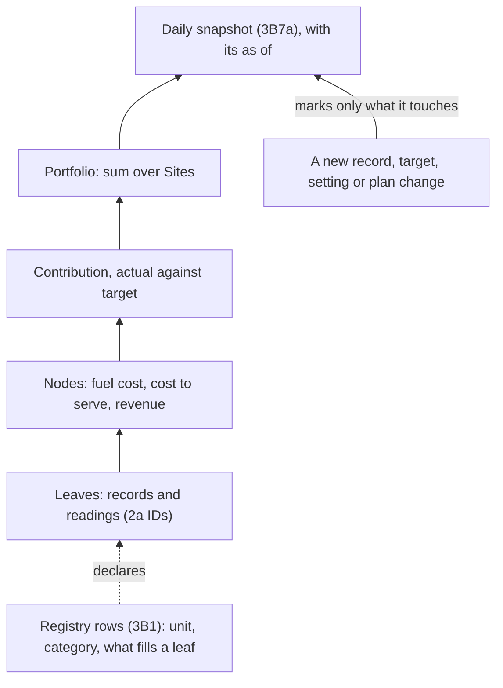

# P3B: step 3B, Structure (structure page)

**Status: awaiting owner approval.** Architect (Claude), 2026-11-20. One page, in the form of P2
(`specs/2a-canonical-format/spec.md` §2). It covers slices `3B1` to `3B7b` (`delivery-plan.md` §2). Approving it lets
the non-screen slices `3B1`, `3B2`, `3B3`, `3B4`, `3B6` and `3B7a` build. `3B5` (the site board) and `3B7b`'s
*Recalculate now* control are screen work, so they also wait for the UI review.

**What exists, and works.**
- **The outcome map.** A fixed table that turns analysis signals into outcomes (`outcomes/outcome_map.py`). The site
  board's driver lines, written per vertical (`site_outcomes/mini.py`).
- **The chain graph.** It refuses a broken chain at start-up (`chain/graph.py`).
- **The day-level snapshot.** It recalculates only what changed (`site_day_snapshot`, `snapshot_dirty`), and stored
  route responses are invalidated when their inputs change.
- **The leaf IDs.** The leaf factors have one ID and one unit each (`2a`, 73 leaves).
- **The gap.** No computed structure explains a month's money from its factors. Today's figures are read per screen,
  not from one model.

**What is added.**
- **`3B1` the registry.** One row per factor, in code and versioned. Each row holds its children, unit, home category
  (Grow, Optimize, Protect or Assure), tolerance, levers, and what fills it and what its absence means.
- **`3B2` Findings pinned to factors.** The outcome map's fixed table is removed only after a parity test shows the
  registry reproduces it.
- **`3B3` the structure read.** It evaluates bottom-up for a Site and the portfolio, actual and target.
- **`3B4` the observer.** It raises a Finding only under the owner's rule and outside the factor's tolerance (OD-3).
- **`3B6` cold rooms and captive EV depots.** Declared on the same core, with no vertical-specific code.
- **`3B7a` the daily snapshot** every screen reads, and **`3B7b` the recalculation** of what a change touched.

**The rules, in plain words.**
- **One quantity, one ID, one unit.**
  - A structure whose units do not add up refuses to start, naming the row.
  - A bare 0 or 1 in a formula (`max(x, 0)`, `0 - cost`) takes the unit its place needs. This is the Architect's
    ruling for `3B1` (D-2A.4).
- **Unknown is never zero.**
  - Each leaf declares what fills it and what its absence means (`3B1`).
  - The read fills each value's `missing` record: what record would fill it, why it is absent, and what it blocks
    (`3B3`).
  - The snapshot stores that record unchanged (`3B7a`).
  - On screen, a missing value reads "not available yet", with the record that would fill it.
- **The weakest part sets the label.** A total is never labelled stronger than the weakest value under it, and it names
  every source beneath it.
- **A target with no line of its own is a labelled assumption** (owner, 20 Nov, item 6). Where the operator gave a
  target only at a higher level, the factors below show it as an assumption, never as a declared target.
- **Every row names its own category.** A row never inherits its parent's category. Money sits only under Grow or
  Optimize. Protect and Assure carry no money of their own (OD-21).
- **No stored figure is a source.** Every figure is evaluated from records, and the snapshot can always be rebuilt from
  them. A nightly check compares the two.
- **Recalculation runs once a day and on demand** (owner, 20 Nov).
  - A new or corrected record, a target, a setting, a plan change or a new structure version marks only the Sites and
    months it touches.
  - The daily run (06:00) recalculates those.
  - A person can ask for it sooner. The request is recorded under their name.
  - Until then the screen shows the snapshot's "as of" time and "recalculation pending".
- **Operations attach to the same registry** (design §2.10, OD-26). The queued slice `OPS1` adds the operations rows
  (repeat failures, overdue schedules, scheduled share) and their fields. `9a0` attaches rights to an asset or Site.
  Both are rows and records on this structure, never a second model. They build when a lane is free after the
  must-keep set (D-L4OPS.7).

**Who sees and acts.**
- Every role reads the same structure (roles govern decisions, not views).
- The site manager and the finance lead set the targets the structure is measured against (step 5).
- The analyst maps which source fills which leaf.
- No one edits the registry on screen. A change is a new structure version, ruled by the Architect, and it recalculates
  every Site of that vertical.

**What the owner approves.** The eight rules above as step 3B's structure. One point where the owner's view would
help: whether a person's own change (a target or a setting) should recalculate at once rather than wait for the daily
run. Today's default is "on demand, by the button"; the data and build strategy flagged it for the pilot (§10, question 7).
