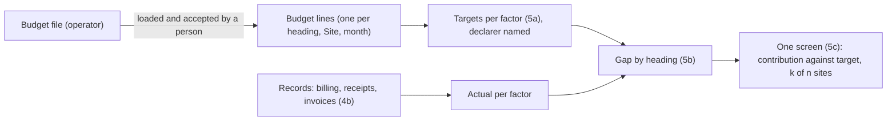

# P5: step 5, Targets and the gap (structure page)

**Status: for the owner's approval, alone, on day 3 (RC3).** Architect (Claude), 2026-11-20. One page, in the form of
P3A and P3B. It covers slices `5a` (targets), `5b` (attribution), `5c` (the one deep-dive screen) and `5d` (the Assure
wording) (`two-week-build-plan.md` §0.1 rows 9, 11, 13). Approving it lets `5a` and `5b` build; `5c` is screen work
and also follows the IA-1 stop.

**What exists, and works.**
- **The operator's budget arrives as records.** A budget workbook becomes one budget line per heading, Site and month
  (`2a`). The store keeps every revision (`3A1`). A person loads the file and accepts it, and the product records who
  (`3A2`).
- **Money by month.** Each month lists the budget lines as declared, never summed, and flags two lines for one heading
  (`3A4`).
- **The actual side.** The structure reads each factor bottom-up, with its evidence and what is missing (`3B3`), and
  from the operator's own billing, receipts and invoices (`4b`).
- **The gap.** Nothing yet says what the month should have been, factor by factor, or who said so. The Assure line
  today reads against a "plan" with no declarer.

**What is added.**
- **`5a` targets per factor.** The same structure, evaluated on the target side from the budget lines, each target
  naming its line and the person who declared it.
- **`5b` the gap, split.** Actual against target per heading, exact for sums, by a declared rule for products, with a
  residual only beside a factor that is not observed.
- **`5c` the one screen.** The month's contribution against target, the gap by heading, the bridge factor by factor,
  cash apart, every figure with its evidence word, every gap "Not available yet" (vNEXT `#/portfolio` "the month in
  one line" and Assure's "Contribution's bridge by heading", `walkthroughs.md` §2 steps 1 to 3).
- **`5d`** the Assure line reads "Actual against target" (OD-6).

**The rules, in plain words.**
1. **A target comes from the operator's budget, and names who declared it.** Each target is one budget line for one
   factor, Site and month. Its declarer is the person who loaded and accepted the file; a line loaded with no person
   (a bulk load) says so.
2. **A heading the budget states is the target for that heading.** When the budget gives revenue and fuel cost in
   money, those are the targets. Contribution is computed from them, and a contribution line in the budget is checked
   against that sum: a difference is shown, never hidden or used instead.
3. **A target with no line of its own is a labelled assumption** (owner, item 6). Leaks and avoidable use (losses,
   unexplained litres, money outstanding) are taken at zero. Prices and other drivers are taken at this month's
   actual, so no gap is put on them. The main factor under a stated heading (kWh delivered under revenue, litres
   needed under fuel cost) carries the rest. Each reads *Estimated* with its words; none is shown as the operator's.
4. **Unknown is never zero.** A target that cannot be set (no line, no actual to take, no heading to share) reads "Not
   available yet", naming the budget line that would set it.
5. **Never pick, never add.** Two budget versions for one month give no target for the headings they cover until one
   is chosen. Two lines for one factor give none for that factor.
6. **The weakest part sets the label.** A total is never labelled stronger than its weakest part. A stated heading is
   *Declared*, whatever is assumed below it.
7. **The portfolio target is the sum over the Sites that have one**, with "k of n sites" beside it (owner, 20 Nov). A
   budget line for the whole operator (head office) is listed, not spread over Sites.
8. **The gap is split, never invented** (`5b`). Sums split exactly; a product (price times volume) splits by a
   declared rule; a residual appears only beside a factor that is not observed. A missing actual line is carried at
   its own target only where one exists, *Estimated*, naming the missing record.

**Who sees, decides and acts.**
- Every role sees the same targets and gap; roles govern decisions, not views.
- The finance lead (or the analyst) loads the budget, and a person accepts it; that person is the declarer.
- The executive reads the gap and agrees the first change (RC9: an Action with its owner and due date, `3C2`).
- No one types a target on screen this fortnight (question 2).

**How it is checked.** On Lakeside's October budget, the target contribution is 2,295.00 to the cent, 3 of 3 sites
(Kobo 1,445.00, Kisiwa −65.00, Mto 915.00), every target names its line and declarer, and each assumption below a
heading is *Estimated* with its words. Kobo's gap of −562.00 splits by heading into revenue +38.00 and fuel cost
−600.00 from records alone; the litre split behind fuel cost waits for `4d`.

**What the owner approves.** The eight rules as step 5's structure. Two points where the owner's view would help:
1. **Two budget versions in one month** (an original and a reforecast). Default: no target for the headings they cover
   until one is chosen; this fortnight the analyst loads one; an "adopt this budget" step follows.
2. **Setting a target on screen.** P3B says the site manager and the finance lead set targets. Default: through the
   budget file this fortnight; entry on screen after `5c`.
