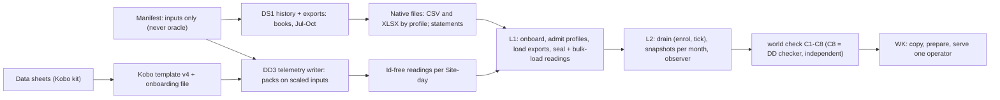

# DD: the demo data (implementer spec)

Status: **rev 1, 2026-11-22**, for the owner's choices (§A) and then the spec handshake (`.ai/RULES.md` §4).
Architect (Claude). Owner request: `owner/owner-demo-data-spec-2026-11-22.md` ("make sure it grounded on the product
goals"). Owner words on Kobo's equipment: `owner/owner-iap-q1-q2-kobo-datasheets-2026-11-22.md` ("Simulated +
datasheets"; and, relayed by the coordinator on 22 Nov, "get a representative datasheet for popular equipments in
afrcia and use that"). **Rulings:** D-DD.1 to D-DD.16, this file §9 (index lines in
`.ai/decisions/index-rulings-26.md`). **Reviewer guide:** `reviewer-guide.md`. `USER_REVIEW_REQUIRED: true` (demo
narrative, evidence labels, what the served app shows).

**Mock:** non-screen. DD supplies the data the screens already specified read: 5c's month (`specs/5c-deep-dive-screen/`),
IA-P's Overview on the range, "Month by month", Sites and Outcomes (`specs/IA-P-product-shape/spec.md` §3,
`spec-period.md` P.1, P.9), and 6a/6c's decisions (`specs/6a-decision-records/`, `specs/6c-option-evaluator/`). Where a
mock element still has no source after DD, the screen keeps its "Not available yet" and its existing MOCK DEVIATION.

**Read first:** this file §A, §0, §1, §8 and your unit's card in §7; DS4 `spec.md` §2 and §3.1 to §3.6; DS1 `spec.md`
§4.1; the manifest `Docs/demo-sprint/product-direction-layer4/demo-site-scenario-manifest.yaml` by key (`tenants`,
`sources`, `history`, `demo_workflow`, `disorder_tests`, `oracle`, `checks`), never whole.

---

## A. For the owner: what the demo shows, and the six choices (one page)

**Today.** The served world (`backend/conversions/world-layer4-v1.json`) holds one operator, Lakeside Power, with three
mini-grid Sites and one month, October 2026. It loads through the product's own commands (ON1 onboarding,
`load_emulated_exports`), it is checked (DS4 `world check`), and WK copies it for the walkthrough. That world already
carries the hardest beat, the month explained against the operator's own target and reconciled to the management
accounts (5c, 3A7, rehearsed end to end by DDR). DD keeps all of it.

**What DD adds.** The two other operators of the cast, four months of books for every Site, and the operating reality
behind them:

```
              Jul   Aug   Sep   Oct   1-5 Nov   source shown on screen
 Lakeside     ███   ███   ███   ███   ░         books: Emulated · readings: Simulated · Kobo kit: Declared (data sheet)
 Harvest Cold ███   ███   ███   ███   ░         books: Emulated · readings: Simulated
 Metro Bus    ███   ███   ███   ███   ░         books: Emulated · readings: Simulated
 ███ = a closed month of books and readings (9 Sites)     ░ = readings and the manifest's November records, to 6 Nov 06:00
```

**Why it converts (mechanism to value).** A monitoring tool shows readings. The demo shows, for each operator, the
month against its own target, where the gap came from, the choices valued against doing nothing, and who acts. DD gives
each step its data:

| Beat on screen | Operator and Site | Outcome category | What the data must carry |
|---|---|---|---|
| The month explained (5c, the Overview) | Lakeside, all three | Assure performance and returns | October books, the two statements (draft, final), Kisiwa's disagreement |
| Month by month (IA-P, a 4-month range) | all nine | Optimize cost; Grow revenue | Jul-Oct books whose trends are the manifest's: Kobo's unexplained fuel rising, Mwea's occupancy falling 56 → 49 → 42 → 35 %, Kirinyaga's energy drifting up, Embakasi's peak share creeping to 55 % |
| A choice valued against doing nothing (6a, 6c) | Kobo generator stop setting; Mwea aggregator contract; Kirinyaga repair or replace; Embakasi charging schedule; Mto huller connection | Optimize cost; Grow revenue; Protect asset | Kobo's own October readings (the study runs on them, 0K4f); the books each option changes |
| Protect what you own | Thika backup start failure; Mto and Kasarani warranties; Kobo battery evidence; Kisiwa expired cover | Protect asset and capital | the incident in the readings at its manifest time, and the work and contract records |
| A person acts and tracks | every operator's executive, finance lead and site managers | all four | the people of `demo_workflow`, onboarded by name |
| Any range, every Site type | all nine | — | readings and books on every day of the span, so every page has output for any range inside it |

**Your choices.** Each has a default that applies now (W3); none blocks the build.

| # | Choice | Default | Alternative and its cost |
|---|---|---|---|
| Q1 | How far back the readings go | **The whole span, 1 Jul to 6 Nov, every Site.** A 4-month range then shows every figure, readings-fed ones included | 1 Sep to 6 Nov only: July and August show books but read "Not available yet" for fuel split and losses; the build is about half as long |
| Q2 | How many closed months | **Four (July to October)**, the manifest's ledger history as generated today | Six (May to October): +0.75 unit (the history generator holds exactly three history months today) |
| Q3 | Showing three operators | **One operator served at a time** on the walkthrough ports 8991/5491; the coordinator switches with one command (under a minute) | All three at once on three port pairs (needs your approval of 8993/5493 and 8994/5494) |
| Q4 | Build time | **Accept a long first build (about 4 hours projected, run overnight, capped at 8).** Pull the queued speed slice DS7 only if the measured build passes 4 hours | Pull DS7 (up to 4 units) before the first build |
| Q5 | Kobo's 12-month value needs a battery wear cost; a data sheet gives cycle life, not price | **"Not available yet"** (your P6 default 2 stands): fuel saved shows, the 12-month value does not | You state a typical battery price per kWh, labelled Assumed; Kobo's 12-month value then shows (no unit change) |
| Q6 | Kobo's equipment, now from real data sheets | **FG Wilson P50-3 generator (36 kW prime, its own published fuel curve) and 42 Pylontech US5000 LFP modules (191.5 kWh usable)**: one real device each, every figure its own; Kobo is restated from 40 kW to 36 kW | The Cummins C50D5P keeps 40 kW, but its fuel row is unlabelled on the sheet and gives two points only |

I would like you to weigh in on Q1, Q3 and Q6 (Kobo's generator moves from 40 to 36 kW). The rest are routine.

---

## 0. Existing, then new (code evidence)

**Stays, unchanged in behaviour:**
- the ladder (`tools/world.py`: L0 schema, L1 inputs, L2 computed; clone, check C1 to C7; D-DS4.3);
- the product's commands as the only writers: `onboard_operator` (digest, check, apply), `load_world_inputs` (calls
  `load_emulated_exports`, and `evidence/bulk_load.py:BulkEvidenceLoad` for telemetry), `build_structure_snapshot`,
  `observe_structure`;
- the DS1 generator (`simulator/assetops_simulator/world/`: `history.py` July to September, `records.py` all three
  verticals, `exports.py`), the seeds by scope and the golden digests;
- WK (`tools/walk_world.py`: copy the checked L2, prepare, W1 to W7, serve 8991/5491) and DDR's runbook path.

**What blocks the demo today (each is fixed by the named unit):**

| Gap | Evidence | Unit |
|---|---|---|
| Only mini-grid operators can be onboarded | `onboarding/operator_file.py:255` `ONBOARD_VERTICAL`; `:132` `site_type` fixed `"MINIGRID"` | DD1.1 |
| Onboarded Sites have no sources and no binding set, so no reading can be admitted | `sites/foundation_service.py:204-229` (sources only from foundation `devices`, which the onboarding document omits); DS4 §2 | DD1.2 |
| Exports are October and mini-grid only; the world loads exports only | `world/exports.py:280-354` (`NOT_ON_PATH_VERTICAL`); `tools/world.py:571-600` | DD2.1 to DD2.3 |
| No native layout or profile for cold or EV sources | `native/layouts_v1.py:664` (four mini-grid layouts); `canonical/sources_v1.py:20-41` has the cold and EV source types | DD2.2, DD2.3 |
| No world telemetry writer | DS4 §2 ruling (D-DS4.1); only Lab packs (`packs/mini_grid.py` v8, `packs/cold.py` cold-thermal 1, `packs/ev_charger.py` ev-charger 1) | DD3.1 to DD3.3 |
| The world refuses telemetry | `tools/world.py:181-185` (`source` must be `none`), `:721` (`batches` must be 0) | DD4.1 |
| The bulk path admits mini-grid readings only | `evidence/adapters/postgres_evidence_ledger.py:687-690` `BULK_SITE_TYPE_UNPROVEN` (D-DS4.2) | DD3.4 |
| Snapshots and the month read are mini-grid only | `structure_snapshot/build.py:82`; `structure_snapshot/read.py:60` (D-3B6.6) | the Q11 unit (not DD); DD4.1 makes the ladder follow it |
| Ranges over 31 days are windowed on non-whole pages | `estate/scope.py:21` and siblings; IA-P P.9 | the Q12 task (not DD); DD's 128-day span is its measurement load |

---

## 1. Structure: the mechanism, the records and who acts



*Inputs flow once, left to right. The product computes every figure from its stores; only the checker reads the oracle.*

**Core rules (each a ruling in §9):**
- **Inputs are scaled, outputs never** (D-DD.3). The writer scales what a real Site receives (load, sun, occupancy,
  bus returns) so the month's input totals equal the manifest. What the equipment does (generator running, litres,
  battery state, chamber temperature, charger power) is the simulator's own figure. One figure per quantity, loyal to
  the operating world (`owner/owner-one-figure-loyal-to-operating-world-2026-11-21.md`).
- **Every record carries its source** (D-DD.5): books *Emulated*, readings *Simulated*, Kobo's equipment values
  *Declared (manufacturer data sheet)*, the rest of each Site's setup *Declared* or *Assumed* as today. Never *Recorded*.
- **Same span, same cadence, every Site type** (D-DD.3): the range rule holds on any range inside 1 Jul to 6 Nov.
- **People act under their names**: the onboarding files carry `demo_workflow`'s people with their roles; Actions and
  choices are made later through the product's commands (3C2, 6a), never as rows.

**The cast** (manifest `tenants`; D-DD.1). Codes are the manifest's.

| Operator (slug, vertical) | Site (code, product type) | Story (manifest `role_in_story`) | Decision (6a/6c) | Category it leads |
|---|---|---|---|---|
| Lakeside Power (`lakeside-power`, MINI_GRID) | Kobo (`KOBO-001`, MINIGRID) | generator running after the battery is full (hero); battery warranty evidence incomplete | generator stop setting (KOB-STOPSOC) | Optimize cost |
| | Kisiwa (`KISIWA-001`, MINIGRID) | highest diesel, nothing avoidable (negative control); expired cover; O&M SLA | alternator repair (KIS-REPAIR) | Protect asset |
| | Mto (`MTO-001`, MINIGRID) | paying daytime demand; energy-to-cash discrepancy; covered inverter | huller connection (MTO-HULLER); inverter claim | Grow revenue |
| Harvest Cold Network (`harvest-cold`, COLD_CHAIN) | Room A · Mwea (`COLD-MWEA`, COLDCHAIN) | healthy but underused | aggregator contract (MWEA-AGG) | Grow revenue |
| | Room B · Thika (`COLD-THIKA`, COLDCHAIN) | backup failed to start on 6 Oct; one batch exposed; EPC cover | start controller under EPC (THIKA-EPC-STOPGAP) | Protect asset |
| | Room C · Kirinyaga (`COLD-KIRI`, COLDCHAIN) | busy room, energy inefficiency (+24 %) | repair beats replace (KIRI-REPAIR) | Optimize cost |
| Metro Bus Depots (`metro-bus`, EV_DEPOT) | Embakasi (`EV-EMB`, EV_CHARGING) | deadline-aware schedule wins; cheapest rejected (3 buses short) | staggered schedule (EMB-DEADLINE) | Optimize cost |
| | Kasarani (`EV-KAS`, EV_CHARGING) | critical charger fault from 1 Nov 23:40; OEM warranty | spare-bus cover (KAS-OEM-STOPGAP) | Protect asset; Assure |
| | Ruiru (`EV-RUI`, EV_CHARGING) | looks underused: absorbs +6 buses, not +10 | none (capacity answer) | Grow revenue (avoided CAPEX) |

---

## 2. Months and simulator versions (D-DD.2, D-DD.4)

| Data | Span | Generator and version |
|---|---|---|
| Books (commercial records), every Site | 2026-07, 08, 09, 10 (closed months); plus the manifest's dated November records only (OOO-1 recorded 4 Nov, LATE-SETTLE-1 settled 2 Nov, Thika's invoice 6 Nov 09:40) | DS1 `history.py` (`assetops.history/1`, manifest `history.version` 1) for July to September; October from the manifest's `period`; written by `exports.py` with `SOURCE_VERSION` "2" (new: months and verticals) |
| Readings, mini-grid (Kobo, Kisiwa, Mto) | 2026-07-01T00:00 to 2026-11-06T06:00 local (Africa/Nairobi), every 5 minutes | `packs/mini_grid.py` **v8** (`MINI_GRID_V8_MODEL`, 0K4a) on the Site's template; Kobo on template **v4** (data-sheet values, §6) |
| Readings, cold rooms | same span; chamber temperature and cooling state every 5 minutes, energy meter hourly | `packs/cold.py` **cold-thermal 1** |
| Readings, EV depots | same span; per session (start, stop, energy) and charger power every 5 minutes while a session runs; connector state on change | `packs/ev_charger.py` **ev-charger 1**, one pack instance per charger |
| Shapes | day weights from manifest `history.families` × `history.seasons` × `history.day_classes`; Kobo's weather from the declared season v2 (D-0K4.8) | synthetic (owner, 20 Nov Q2: "synthetic by default, switchable"); `shape_source: synthetic` |

- **No reading before 1 Jul or after 06:00 on 6 Nov**; the story clock is the manifest's `as_of`.
- The kernel is `KERNEL_VERSION` 1. The writer records, per Site, `{"pack", "model_profile_version", "template_id",
  "template_version", "shape_source", "writer_version": 1}` in each Site's readings manifest (§4.1), and the world build
  manifest copies it.
- **Range consequences.** The span is 129 days: inside IA-P's 731. Overview, Outcomes and Sites read any range whole
  (IA-P P.9); other pages show the last 31 days of the range, labelled, until the Q12 task lifts the cap.

---

## 3. External sources emulated, and their format (D-DD.5)

Every file is labelled *Emulated*. Layouts are **illustrative**: no screen, document or claim names a vendor product as
compatible (`owner-telemetry-plan-feedback-2026-10-27.md`). Cold and EV files reach the store as **source profiles**
(3A6: data, admitted by command, read by the one engine), so no new parser is written.

| Vertical | Source (manifest `sources`) | File (`<slug>.<key>`) | Layout or profile id | Canonical kinds | Status |
|---|---|---|---|---|---|
| Mini-grid | customer billing export | `.billing.csv` | `billing-illustrative-1` | CHARGE | exists; DD2.1 adds months |
| | mobile-money statement | `.collections.csv` | `collections-illustrative-1` | RECEIPT, SETTLEMENT | exists; months |
| | expense ledger (fuel notes, O&M, staff) | `.expenses.csv` | `expenses-illustrative-1` | EXPENSE | exists; months |
| | budget workbook | `.budget.csv` | `budget-illustrative-1` | BUDGET_LINE | exists; months |
| | meter register, tariff schedule, adjustments | DS1b `.<source_type>.json` | `canonical-json-v1` | METER_ASSIGNMENT, TARIFF_SCHEDULE, ADJUSTMENT | exists (records.py); DD2.1 stages them |
| Cold | storage ledger (check-in, check-out per batch) | `.profile.cold-storage-ledger.csv` | `cold-storage-ledger-illustrative` | STORAGE_MOVEMENT | new profile |
| | customer invoicing and receipts | `.profile.cold-invoicing.csv` | `cold-invoicing-illustrative` | CHARGE (STORAGE), RECEIPT | new profile |
| | storage rate card | `.profile.cold-rate-card.csv` | `cold-rate-card-illustrative` | TARIFF_SCHEDULE | new profile |
| | electricity bill | `.profile.cold-electricity-bill.csv` | `cold-electricity-bill-illustrative` | CHARGE (USAGE, kWh) | new profile |
| | expenses, budget | `.expenses.csv`, `.budget.csv` | the mini-grid layouts (vertical-neutral columns) | EXPENSE, BUDGET_LINE | layouts exist |
| EV | utility invoice (ToU and demand lines) | `.profile.ev-utility-invoice.csv` | `ev-utility-invoice-illustrative` | CHARGE (USAGE by band, DEMAND), TARIFF_SCHEDULE | new profile |
| | fleet roster | `.profile.ev-fleet-roster.csv` | `ev-fleet-roster-illustrative` | FLEET_ROSTER | new profile |
| | depot dispatch log (departures) | `.profile.ev-departures.csv` | `ev-departures-illustrative` | DEPARTURE | new profile |
| | service tickets | `.profile.ev-service-tickets.csv` | `ev-service-tickets-illustrative` | SERVICE_TICKET | new profile |
| | expenses, budget | `.expenses.csv`, `.budget.csv` | mini-grid layouts | EXPENSE, BUDGET_LINE | layouts exist |
| All | management accounts (3A7 statements) | `<slug>.statements.json` | DD format `assetops.world-statements/1` (§5.4) | read by WK `prepare` | new |
| All | contract documents, QA notes, penalty statement | — | not written | — | stay "Not available yet" naming the record, as today (D-DD.5) |

Each new profile is a JSON file `backend/conversions/profiles/<profile id>.profile.json` in the `assetops.source-profile`
schema (`native/profiles_v1.py`), with a sample file beside it (`<profile id>.sample.csv`) that `run_probes` passes. The
columns of each are fixed in §5.2 and §5.3.

**Telemetry source.** Readings are written by the world generator as canonical readings (`source_envelope_v4`), sealed
into `ingestion_batch_v2` batches at load, `source_mode` SIMULATED, shown as "Simulated". They emulate no vendor format.
The EMS upload (`field/profiles/generic-interval-csv-illustrative-1.json`) and the Modbus emulator
(`gx-system-illustrative-2`) stay what they are: the real-path proof inside `world check` C5 (D-DS4.7), never the
world's source.

---

## 4. Telemetry: in, and why (D-DD.3)

**In, at every Site, for the whole span.** The demo-critical reasons, each traced to a beat:
1. **The hero choice needs Kobo's own readings.** 6c values the Kobo settings only on a simulation of Kobo's own month
   (frame `SITE_RECORD`, D-0K4.38, D-P6.2); 0K4f must derive it from stored readings with a readings digest (D-P6.26).
   Without Kobo readings in the world, the hero decision reads "Not available yet".
2. **The fuel split is a reading-fed figure.** Necessary, candidate and unexplained litres (manifest `leaf_sources`
   OBSERVER rows) come only from generator state, sun and battery state. The trend beat (Kobo's unexplained fuel rising
   July to October) needs readings in every month shown.
3. **The Protect beats are incidents in the readings.** Thika's failed start and chamber excursion (6 Oct), Kasarani's
   charger fault (1 Nov 23:40), Ruiru's connector out (from 6 Oct), Kisiwa's generator failure (30 Oct) and Mto's inverter
   failure (28 Oct).
4. **The range rule.** Every page shows output for any range with data, for every Site type; the Operations tab of each
   Site is reading-fed.

**Cost, stated plainly.** DS4's measured pipeline cost is 13.497 s per Site-day (load, depth, ticks; DS4 `packet.md`
B6). 9 Sites × 129 days × 13.497 s ≈ 15,670 s, about 4.4 hours for L2: **a projection, not a measurement**. It is
paid once per world version (after a backend merge), on a clone-able template. DD4.4 measures it; owner Q4 governs the
response.

### 4.1 The writer (`simulator/assetops_simulator/world/telemetry.py`, new; DD3.1)

- `build_telemetry(view: ManifestView, site_inputs: Mapping[str, SiteInputs], *, start, end) -> TelemetryResult`.
  `SiteInputs` = the Site's tenant, code, timezone, template (id, version, parsed foundation) and its binding role set.
  Pure: no store, no clock, no network.
- **Per Site-day**, in date order: the day's input shapes (day weight from `history.families`; the family per input:
  demand → loads, solar_surplus → PV availability, cooling → room heat load, flat → EV returns), scaled by largest
  remainder so the month's input totals equal the manifest's (mini-grid `delivered_kwh` actual; cold `crate_days`
  through occupancy; EV `kwh` through the roster's required kWh per bus-night). The pack runs the day from the previous
  day's end state (battery SOC, tank level, chamber temperature), so days chain.
- **Story events** are inputs, applied at the manifest's instants: the failures and restores named in
  `tenants.*.sites.*.observations` and `incident` (Kisiwa GEN-KS-01 30 Oct; Mto INV-MT-02 28 Oct; Thika GEN-CR-01
  failed start 6 Oct, excursion of B-1031; Ruiru CH-R7 connector 2 out from 6 Oct; Kasarani CH-K2 from 1 Nov 23:40;
  Embakasi's October charging pattern, peak share 55 %). The writer reads them from the view, never from `oracle`.
- **Output:** per Site-day one file `<slug>/telemetry/<SITE>.<YYYY-MM-DD>.readings.json`, schema
  `assetops.world-readings/1`: `{"schema", "site_code", "day", "timezone", "role_set", "readings": [{"source_id",
  "signal_id", "start", "end", "value", "unit"}]}`, sorted by (start, source_id, signal_id). No tenant, Site, gateway or
  batch UUID appears (D-DD.8): the inputs digest stays stable across databases.
- Values are decimal strings, exact (no floats). Determinism: seeds `sha256(scope digest | site code | day | stream)`;
  sorted iteration; a golden digest per Site-month in `<slug>/telemetry/<SITE>.manifest.json` with the pack versions.
- **Refusals** (exit 3 on `tools/world_history.py telemetry`, stderr `<CODE> <detail>`): `TEL_INPUT_TOTAL` (a scaled
  input misses its manifest total by any amount), `TEL_EVENT_UNPLACED` (a story instant outside the span), `TEL_PACK`
  (the pack refused a step; its own code follows), `TEL_ORACLE_READ` (the view exposed an `oracle` key; never expected).
- CLI: `tools/world_history.py telemetry --manifest M --sites F --out DIR` where `F` is the JSON list of `SiteInputs`
  produced by DD4.1's step from the onboarding files and templates.

### 4.2 Sealing at load (`load_world_inputs`; DD3.4)

`load_world_inputs.py` gains: for `telemetry/*.readings.json`, resolve `site_code → (tenant_id, site_id)` through the
imported-Site registry (`gateway_api.registered_site_scope`), the gateway `edge-<code lower>` and each `source_id`
through the foundation store, then build one `ingestion_batch_v2` per Site-day with `source_envelope_v4` envelopes
(the shapes `gateway/publish.py` writes), `source_mode` SIMULATED, batch id by the v2 digest of its content, and pass
the batches to `BulkEvidenceLoad.load` as today. An unknown Site, gateway or source refuses
(`WORLD_TELEMETRY_UNRESOLVED <file> <what>`, exit 3). The output line keeps its keys and adds `"readings_files"`.

### 4.3 Cold and EV on the bulk path (DD3.4; closes D-DS4.2)

`BULK_SITE_TYPE_UNPROVEN` is lifted per Site type only with its parity test: `backend/tests/test_dd_parity_cold_ev_postgres.py`
loads one cold Site-day and one EV Site-day both through central ingestion and through the bulk path into two harness
databases and compares the stored rows (receipt times and run ids excluded), exactly as `test_ds3_parity_postgres.py`
does for mini-grid. The allow set in `postgres_evidence_ledger.py:687` becomes `{"MINIGRID", "COLDCHAIN",
"EV_CHARGING"}` in the same commit. `world check` C5 runs both parity files.

---

## 5. Books: months, verticals and statements (DD2)

### 5.1 Mini-grid months (`exports.py`; DD2.1)

`build_exports(view, *, months=None)` writes the four files for every month in `history.months` plus
`accounting_period` (2026-07 to 2026-10), one file per key holding all months, rows ordered by (month, Site, row). July
to September values are `history.json`'s leaves for the Site-month (billed kWh, revenue, collections split, fuel
deliveries in 400 L notes, O&M, staff, budget lines), with the same totals rule as October (`EMU_REVENUE`,
`EMU_COLLECTIONS`, `EMU_FUEL` stop the emulator). A leaf `history.json` marks MISSING writes no row and is listed in
`unwritten.json` with cause `NOT_IN_HISTORY` (D-DS1.12). DS1b's METER_ASSIGNMENT, TARIFF_SCHEDULE and ADJUSTMENT
records for the same months are written as `<slug>.<source_type>.json` and staged (today they are generated but never
staged, `tools/world.py:571-600`).

### 5.2 Cold files (`world/exports_cold.py`, new; DD2.2)

Per Site-month, from October's `period` or `history.json`. Columns (CSV, comma, UTF-8, header row, ISO dates,
two-decimal money, whole crates):
- **storage ledger:** `batch_id, site_code, customer_ref, commodity, crates, direction (IN|OUT), at (ISO instant)`.
  Batches of 40 crates; the month's occupied crate-days equal the leaf exactly (largest remainder over batches and days);
  Thika's B-1029 (out 5 Oct), B-1031 and B-1034 are the manifest's batches at their times.
- **invoicing:** `invoice_id, site_code, customer_ref, period (YYYY-MM), crate_days, rate, amount, paid_amount, paid_at`.
  Σ amount = revenue; Σ paid = collected; the rest is outstanding at period end.
- **rate card:** `site_code, effective_from, rate_per_crate_day` (0.20, from 2026-07-01).
- **electricity bill:** `bill_id, site_code, period, kwh, rate, amount` (rate 0.20; kWh = the leaf `kwh`).
- **expenses / budget:** the mini-grid layouts, categories STAFF, OM (maint), ENERGY; budget lines `crate_days, kwh,
  staff, maint, liability` from `history.rules.COLD_CHAIN.plan`.

### 5.3 EV files (`world/exports_ev.py`, new; DD2.3)

- **utility invoice:** `invoice_id, site_code, period, line (PEAK|OFFPEAK|NIGHT|DEMAND), quantity, unit (kWh|kW), rate,
  amount`. October: PEAK 47,740 kWh at 0.24, OFFPEAK 39,060 at 0.12 (NIGHT starts 1 Nov), DEMAND 500 kW at 12.00 for
  Embakasi; each Site and month from its `period` or `history.json` (`peak_kwh`, `offpeak_kwh`, `kwh_2200_2400`,
  `kwh_0000_0500`, `max_kw`). Ruiru's plan stays a bill total (manifest override).
- **fleet roster:** `site_code, effective_from, bus_id, route_block, return_at, departure_at, required_kwh`.
- **departures:** `site_code, bus_id, scheduled_at, departed_at, soc_ok (Y|N)`; one row per bus-night;
  `departures_met` = rows with `soc_ok` Y.
- **service tickets:** `ticket_id, site_code, asset_ref, opened_at, closed_at, kind (FAULT|RESTORE|SERVICE), note`
  (Kasarani CH-K2, Ruiru CH-R7).
- **expenses / budget:** mini-grid layouts, categories ENERGY, OM (maintenance), PENALTY (0 in the cast).

### 5.4 Statements (`assetops.world-statements/1`; DD2.4)

`world_history.py exports` also writes `<slug>.statements.json`: `{"schema", "tenant", "statements": [{"period",
"currency", "revenue", "fuel_cost", "source_ref"}]}` for each history month, the figures being the sums of that
month's emitted billing and fuel expense rows, `source_ref` "Emulated management accounts, {Month YYYY}, final". October
is not in the file: its two statements (draft 5,100.00 fuel; final 5,000.00) stay in the walk definition, because
Kisiwa's disagreement is the story. Cold and EV tenants get the file with revenue (cold) or energy cost (EV) only when
the Q11 unit gives their months a snapshot to reconcile; until then their `statements` is `[]`.

### 5.5 Disorder (manifest `disorder_tests`)

All eight are planted in every build, as today's October plan says, and each is listed in the build manifest with the
rows it planted: DUP-1, OOO-1, LATE-SETTLE-1, MAP-1, FX-1, GAP-1 (October), TENANT-1 (a Harvest Cold storage row with
the Lakeside tenant key, refused at intake and counted), CLOCK-1 (an EV charger clock 4 minutes fast on one Embakasi
night, in the readings). None is planted in a history month (the history months are clean books).

---

## 6. Kobo on its own records, and the data sheets (D-DD.10)

**Where 0K4f stands.** 0K4f (D-0K4.13, D-0K4.44, D-0K4.45; about 3 units) is "the fuel law and the worlds on v8": the
product's fuel law reads v8's curve; the Kobo template and the world telemetry writer adopt v8; the demo database is
rebuilt; Kobo's October readings are classified by dispatch-3.3; and the structure layer is restated (generator_l, the
split from the classification, the dawn node retired, an admission leaf).

**The split (amends D-0K4.44's scope).**
- **DD builds** the template part and the writer part: Kobo template v4 with data-sheet values (DD3.2) and the v8
  writer (DD3.1, DD3.2). The world on v8 is DD4's build.
- **0K4f keeps** the product fuel law on v8's curve, the dispatch-3.3 classification of Kobo's stored October readings
  (with the readings digest, D-P6.26), the structure-layer restatement, and the Site-record study 6c values. 0K4f
  becomes about 2.25 units and builds on DD3 (§8).

**The data sheets (owner: "a representative datasheet for popular equipments in afrcia and use that").** The
coordinator's research is in `/opt/assetecon/evidence/kobo-datasheets/datasheets.md` (sections 1 to 6, sourced,
retrieved 22 Nov). **The call (Architect, D-DD.10): one real device per component, with all of its own published
figures; nothing from one sheet is mixed with another.**

| Component | Device chosen | Why | Rejected |
|---|---|---|---|
| Generator | **FG Wilson P50-3** (Perkins 1103A-33TG1), 45 kVA / **36 kW prime** at 0.8 pf, 50 Hz. Sheet doc code P50-3/4PP/0414/GB; fuel 50 Hz prime **10.5 / 7.8 / 5.6 L/h at 100 / 75 / 50 %**, matched by the UN/MSF catalogue (unicat.msf.org, product 68799) | the only sheet in the 40 kW class with a labelled part-load curve, independently matched; FG Wilson / Perkins sets are a common African dealer and NGO choice | Cummins C50D5P (40 kWe): its fuel row is unlabelled (column mapping inferred) and gives two points; FG Wilson P40P1: 32 kW, full-load fuel only |
| Battery | **Pylontech US5000 × 42** (48 V LFP rack modules): 4.8 kWh nominal, **4.56 kWh usable** per module (Pylontech brochure PY230529-EN, 2023, p. 03); bank **201.6 kWh nominal, 191.5 kWh usable** | among the most installed low-voltage LFP modules in African off-grid systems; usable energy stated by the maker | — |

**Kobo is restated to the chosen kit:** generator 40 → **36 kW**, specific fuel 0.30 → **0.2917 L/kWh**, battery 200 →
**191.5 kWh usable**. The template, Lakeside's onboarding file and the manifest's Kobo `physical` block
(`genset_kw`, `sfc_l_per_kwh`, `battery_kwh`) all change in DD3.2, with a rev note; `check_manifest.py` and the pack's
derive step are re-run and every derived figure that moves is listed in the packet for 0K4f's restatement, never edited
by hand (one figure per quantity).

**The slot:** `config/datasheets/kobo-equipment.json` (committed; a declared input, not evidence), schema
`assetops.equipment-datasheets/1`, filled by DD3.2 from section 5b and section 2 of the research file:

```json
{"schema": "assetops.equipment-datasheets/1",
 "generator": {"maker": "FG Wilson", "model": "P50-3", "document": "P50-3 data sheet", "revision": "P50-3/4PP/0414/GB",
               "url": "https://cdn.shopify.com/s/files/1/0550/6577/2262/files/P50-3.pdf",
               "cross_check": "https://unicat.msf.org/cat/product/68799",
               "prime_kw": "36", "standby_kw": "40", "frequency_hz": "50",
               "fuel_l_per_h": {"25": null, "50": "5.6", "75": "7.8", "100": "10.5"},
               "no_load_l_per_h": null, "minimum_load_pct": null},
 "battery":   {"maker": "Pylontech", "model": "US5000", "document": "Residential BESS brochure", "revision": "PY230529-EN (2023), p. 03",
               "url": "https://portal.segen.co.uk/reseller/docs/2023-Residential-BESS-PY230529-EN.pdf",
               "chemistry": "LFP", "modules": 42, "module_nominal_kwh": "4.8", "module_usable_kwh": "4.56",
               "module_recommended_current_a": "80", "module_max_continuous_current_a": "100",
               "cycle_life": ">8000 at 25 C (attribution likely, DoD not printed)", "charge_taper_start_soc_pct": null,
               "round_trip_efficiency_pct": null},
 "assumed": [
   {"item": "generator.fuel_l_per_h.25", "basis": "not published; the v8 straight line through the stated points gives it (3.09 L/h at 9 kW)"},
   {"item": "generator.minimum_load_pct", "value": "30", "basis": "not on the sheet; makers' general guidance, about 30 % (Cummins CEB 00159; Caterpillar, The Impact of Generator Set Underloading)"},
   {"item": "battery.round_trip_efficiency_pct", "value": "95", "basis": "not stated by Pylontech; comparable LFP banks state 95-97 % (BYD Battery-Box LVS, Freedom Won LiTE); not read by the model (the PCS's 95 % each way is separate)"}]}
```

`null` means the sheet does not state it. Any value later replaced by a better sheet is a new revision of this file.

**The mapping (`tools/datasheet_template.py`, new, DD3.2; pure, exact `Fraction` arithmetic; prints the template diff
and refuses on any failure):**

| Template property (`config/site-templates/kobo-mini-grid-60kw.yaml`) | Rule | Result | Label |
|---|---|---|---|
| generator `rating.value`, `generator-rated-power` (kW) | `prime_kw` | 36 | Declared (data sheet) |
| `specific-fuel-consumption` (L/kWh) | `fuel_l_per_h["100"] / prime_kw`, half-even to 4 places | 0.2917 | Declared (data sheet; derived from two stated values) |
| `generator-no-load-fuel-rate` (L/h) | `no_load_l_per_h` if stated; else the intercept of the least-squares line through the **stated** points only (load kW = pct/100 × prime_kw), half-even to 0.01; fewer than two stated points or an intercept ≤ 0 refuses `DATASHEET_CURVE_INVALID` | 0.62 (line through 36/10.5, 27/7.8, 18/5.6) | Declared (data sheet; fitted to the stated points) |
| `generator-minimum-load` (%) | `minimum_load_pct` if stated; else the `assumed` entry | 30 | **Assumed**, with its basis |
| battery `rating.value`, `battery-energy-capacity` (kWh) | `modules × module_usable_kwh`, half-even to 0.1 | 191.5 | Declared (data sheet) |
| `battery-charge-taper-start` (%) | stated value, else unchanged | 95 | Assumed (GENERIC_DEFAULT, as today) |
| PCS limits and efficiency; `reserve-state-of-charge`; start and stop SOC; delays | not from these sheets | unchanged | TEMPLATE (operator settings and separate equipment) |

The tool checks the curve against v8's refusals (`generator_curve.fuel_curve`: `NO_LOAD_NOT_POSITIVE`,
`SFC_BELOW_DIESEL_ENERGY`, `NEGATIVE_SLOPE`; here the slope is 0.2917 − 0.62/36 = 0.2745 L/kWh, admitted) and prints,
per stated point, the sheet's L/h beside the v8 line's: 100 % 10.50 / 10.50; 75 % 7.80 / 8.03; 50 % 5.60 / 5.56. The
packet quotes these residuals; they are the honest cost of v8's two-parameter line and are never tuned away.

**Labels (D-DD.10).** `sites/models.py:97` `COMPONENT_PROPERTY_SOURCES` gains `"DATASHEET"`. A DATASHEET property must
carry `source_document: {"maker", "model", "document", "revision", "url"}` (`foundation_parsing.py:1394` refuses
a DATASHEET property without it, `SiteConfigurationInvalid`). The template goes to `template_version: 4` with a header
note, and `backend/tests/test_site_template_fingerprints.py`'s pin moves. Every screen that shows a component property
shows a DATASHEET one as "Declared, from the manufacturer data sheet ({maker} {model}, {revision})", and an Assumed one with its basis, through the SC-1
statement catalogue (new statement key `component_property.datasheet`). Cycle life, module currents and the assumed round-trip
efficiency stay in the slot file only: no kernel reads them, and the battery wear cost stays "Not available yet" (owner Q5).

**The same values in the world.** Lakeside's onboarding file carries Kobo's generator and battery ratings and the
DATASHEET properties (DD1.2 writes them from the slot by the same tool), so the world's Site and the template agree; a
check (C-DD16) fails if they differ.

**Order inside DD3.2.** Commit 1: the tool, the schema, the parser change and the slot file; commit 2: template v4,
Lakeside's file, the manifest's Kobo `physical` and the derive re-run.

**Story consequence, stated in advance.** Kobo's litres become the v8 model's on the sheet's curve. The fuel invoices
(books) stay the manifest's. If the model burns more than was delivered, Kobo's unexplained fuel would turn negative:
C-DD8 fails and the build stops for the Architect. Nothing is tuned to pass.

---

## 7. Units (W4: parts of at most 6 units; units of 1 to 3 commits)

Four parts, one branch each, each with one discovery review (W5: new mechanism, a protected seam and money figures).

### DD1: three operators (3.5 units; `task/DD1-three-operators`)

- **DD1.1 Onboarding of every vertical (1.0).** `operator_file.py`: vertical map `{"MINI_GRID": "MINIGRID",
  "COLD_CHAIN": "COLDCHAIN", "EV_DEPOT": "EV_CHARGING"}`; any other value refuses `ONBOARD_VERTICAL` (message "This
  operator's business type is not onboarded yet.", SC-1 catalogue); format `assetops.operator-onboarding/2` accepted
  beside `/1`, adding optional per-Site `devices` and `topology` and per-component `properties`, each in the Site
  import's foundation content shape (exemplars: `backend/tests/fixtures/w2/cold-lab-001.yaml`, the EV lab fixture beside
  it); `site_document` passes them through. Tests: one per vertical, one refusal per new key misuse
  (`ONBOARD_SITE_INVALID` from the import), `/1` files unchanged byte for byte in digest.
- **DD1.2 The three files and their bindings (1.5).** `backend/tests/fixtures/on1/harvest-cold.onboarding.json`,
  `metro-bus.onboarding.json` (people and Sites from `demo_workflow` and `tenants`; emails `<name lower>@<slug>.example`;
  one executive, one finance lead, one analyst each); Lakeside's file moves to `/2` with devices and Kobo's data-sheet
  values. Nine binding conversions `backend/conversions/world/<SITE>-bindings.json` (`assetops.binding-conversion/1`;
  role sets `minigrid-roles-4`, `cold-roles-1`, `ev-roles-1`), published at onboarding `apply` through
  `binding_conversion.convert` and `BindingService.publish` (one new apply step, idempotent). Test: an emulated apply
  leaves each Site with its gateway, sources and one published binding set.
- **DD1.3 The checker, first (1.0; W2).** `tools/dd_check.py` (§8 C-DD1 to C-DD16 as stubs that FAIL until their unit
  lands), with C-DD1 and C-DD13 live. It shares no module with `simulator/` or the generator; it reads the clone by SQL
  and the product's HTTP reads, and the manifest's `oracle` and `checks` by its own YAML read.

### DD2: four months of books (5.5 units; `task/DD2-books`)

- **DD2.1 Mini-grid months and staging (1.25).** §5.1; `tools/world.py` `inputs()` stages DS1b JSON files too.
- **DD2.2 Cold files and profiles (1.5).** §5.2; four profiles and samples; admission by `source_profile admit`.
- **DD2.3 EV files and profiles (1.5).** §5.3; four profiles and samples.
- **DD2.4 Statements and disorder (1.25).** §5.4, §5.5; checks C-DD2 to C-DD4 and C-DD14 go live.

### DD3: the operating reality (6.0 units; `task/DD3-telemetry`)

- **DD3.1 Writer core (1.5).** §4.1 with the mini-grid pack; golden digests; C-DD11, C-DD12 live.
- **DD3.2 Kobo on v8 with the data sheets (1.25).** §6: tool, parser source, template v4, fingerprint pin, two commits.
- **DD3.3 Cold and EV writers (1.5).** §4.1 for `cold-thermal` 1 and `ev-charger` 1; story events; C-DD5 to C-DD7 live.
- **DD3.4 Sealing and the bulk path for cold and EV (1.75).** §4.2, §4.3; C-DD8 live.

### DD4: the world built and served (4.5 units; `task/DD4-world`)

- **DD4.1 Definition v2 and the ladder (1.5).** `backend/conversions/world-layer4-v2.json`, format
  `assetops.world-definition/2`: `months` ["2026-07" … "2026-10"]; three tenants, each with `profiles` (the profile
  files it admits) and `snapshot_months` (Lakeside the four months; Harvest Cold and Metro Bus `[]` until the Q11 unit
  sets them); `not_built` `[]`; `telemetry` `{"source": "world-generator", "span": {"from": "2026-07-01T00:00",
  "to": "2026-11-06T06:00"}, "writer_version": 1}`. `read_definition` accepts `/1` as today and `/2` as here. L1 adds
  `L1.admit:<slug>:<profile>` steps and the telemetry generation step; the `batches == 0` guard applies to `/1` only.
  L2 adds the drain (enrol, then `scheduling.run tick` to done, DS4 §4 B5's stages) before the snapshot steps, and runs
  snapshot and observer only for each tenant's `snapshot_months`.
- **DD4.2 World check C8 (1.0).** `world check` runs `dd_check.py` on the check clone as C8; C-DD9, C-DD10, C-DD15 live.
- **DD4.3 WK for three operators (1.25).** One walk definition per tenant (`walk-layer4-v2-<slug>.json`); `expect`
  optional (null for a tenant with no snapshot months); `prepare` records `<slug>.statements.json`'s statements then the
  definition's; `serve --tenant <slug>` on 8991/5491, switching stops the previous serve by PID (owner Q3 default).
- **DD4.4 The build, measured, and the runbook pass (0.75).** One build on a quiet machine, `--cap-seconds 28800`,
  keep-awake on; each rung's seconds and size recorded; the DDR runbook's ten queued clarity notes folded in
  (`.agent/backlog-post-demo.md`, DDR line); evidence to `/opt/assetecon/evidence/DD/<run>/`.

**Size: 19.5 units, about 32 commits.** Each part is under the 6-unit cap.

---

## 8. Checks that can fail, sequencing and guards

### 8.1 The checks (`tools/dd_check.py`; each a question; each FAILs with its detail)

| ID | Question | Live from |
|---|---|---|
| C-DD1 | Does the clone hold exactly the three tenants, nine Sites (codes, product types) and 21 people with their roles? | DD1.3 |
| C-DD2 | Does every Site-month July to October hold every record kind its vertical declares (§3), each with source word *Emulated*? | DD2.4 |
| C-DD3 | Do the manifest `checks` identities hold on the stored records, computed by the checker's own SQL (mini: revenue = billed × tariff, collected + in transit + outstanding = revenue; cold: revenue = crate-days × 0.20; EV: energy cost = peak + off-peak + demand)? | DD2.4 |
| C-DD4 | Does each Site's October commercial actual equal the manifest's `period.actual` to the cent, and each history month equal `history.json` to the cent? | DD2.4 |
| C-DD5 | Does every Site have readings on every day of the span at its declared cadence, `source_mode` SIMULATED, with no gap except a declared story outage? | DD3.3 |
| C-DD6 | Is each story incident in the readings at its manifest instant (Thika 6 Oct failed start and B-1031 above limit 20-30 min; Kasarani CH-K2 from 1 Nov 23:40; Ruiru CH-R7 from 6 Oct; Kisiwa GEN-KS-01 30 Oct; Mto INV-MT-02 28 Oct), and is B-1034 below 12 °C (OR-CC-2)? | DD3.3 |
| C-DD7 | Do readings and books agree: mini delivered kWh within 1 % of the manifest's; cold metered kWh within 3 % of the bill; EV session kWh within 1 % of the invoice and peak share within 1 point? | DD3.3 |
| C-DD8 | On the data-sheet kit (36 kW, 191.5 kWh), is Kobo's October unexplained fuel (delivered − dispatch) ≥ 0, is Kobo's unserved critical energy 0 (MG-5), and does Kisiwa show zero candidate minutes (OR-MG-2)? | DD3.4 |
| C-DD9 | For each page of IA-P's matrix × Site type, on ranges Oct (31 days), Sep-Oct (61) and Jul-Oct (123), does the page's read return 200 with output and no "Not analysed yet" when nothing is pending? | DD4.2 |
| C-DD10 | On Jul-Oct, does E2 return mode `period` with four served months for Lakeside, and name Harvest Cold's and Metro Bus's Sites as not compared (until Q11; then four months each)? | DD4.2 |
| C-DD11 | Do two generator runs in separate processes give identical bytes for books and readings (golden digests per scope)? | DD3.1 |
| C-DD12 | Does no generator module import or read `oracle` (static scan plus `TEL_ORACLE_READ`)? | DD3.1 |
| C-DD13 | Can no tenant read another's records; was TENANT-1 refused and counted? | DD1.3 |
| C-DD14 | Is each of the eight disorder tests planted, listed in the build manifest, and handled as `expect` says? | DD2.4 |
| C-DD15 | Did L2 finish under its cap, with each rung's seconds recorded beside the projection? | DD4.2 |
| C-DD16 | Do Kobo's template v4 and the world's Kobo Site carry the same DATASHEET values, each with its document? | DD3.2 |

The checker shares no logic, list or expected figure with the generator: expected figures come only from the manifest's
`oracle`, `checks` and `period` blocks, read by the checker itself.

### 8.2 Sequencing (D-DD.13)

```
 now ──► IA-P1 (frontend) ────► IA-P2 (backend rung) ────────────────► IA-P3
 now ──► DD1 ──► DD2 ─────────┐                   │
             └─► DD3 ─────────┴──► DD4 (after IA-P2 merges): ONE build = D-IAP.32's rebuild + the DD world
                       └─► 0K4f (after DD3) ─┐
 IA-P done ──► Q11 unit (cold/EV monthly figures; needs DD2's books in its world check) ─┴─► ONE rebuild (sets snapshot_months)
 IA-P done ──► Q12 task (lift the 31-day caps), measured on DD's 129-day world
```

- DD1 to DD3 run in a lane beside IA-P; they touch onboarding, `sites/`, `evidence/`, `load_world_inputs.py`, the
  simulator and contracts' data, none of IA-P2's files (`deep_dive/`, `estate/`). Each merge stales L2; nothing is
  rebuilt until DD4.
- DD4's build is the one rung rebuild D-IAP.32 asks for after IA-P2, so it is paid once.
- 0K4f and the Q11 unit each need a rebuild; the coordinator runs one rebuild after both merge.

### 8.3 Guards

- Databases: only `assetops_world_*_test`, `assetops_world_audit*` and harness `*_test` names (`check_name`); WK copies
  to `assetops_polish_walk<L>_test`. Drop your own when done. Never port 5490, 8990, 8992, or the walk server while the
  owner validates.
- Heavy work through `tools/heavy-slot.sh` (`--db` for builds). Full builds one at a time, quiet machine, keep-awake,
  cap twice the expected time (DD4.4: 8 hours).
- Scratch in the session scratchpad; generated files under `/opt/assetecon/worlds` (the ladder's state) or
  `/opt/assetecon/evidence/DD/`; never in the tree. Delete scratch at the end.

---

## 9. Rulings (D-DD.1 to D-DD.16)

- **D-DD.1 The cast.** The manifest's three operators and nine Sites, as §1's table; no Site added or dropped. *Why:* one
  world drives the manifest, mock, documents and product. *Reverse:* a cast change is a manifest change first.
- **D-DD.2 Months.** Books for July to October 2026 at every Site, plus the manifest's dated November records. *Why:* the
  generator holds exactly three history months plus the anchor (`history.py:85-103`); four months meet the owner's 3 to 6.
  *Reverse:* owner Q2 (six months, +0.75 u).
- **D-DD.3 Telemetry in, whole span, one cadence per signal, inputs scaled and outputs never.** §2, §4. *Why:* §4's four
  reasons; one cadence keeps every range alike. *Reverse:* owner Q1 (from 1 Sep).
- **D-DD.4 Versions.** mini-grid v8 at all three mini-grid Sites; cold-thermal 1; ev-charger 1; history 1; exports
  `SOURCE_VERSION` "2"; writer 1; synthetic shapes. *Why:* v8 is the model 0K4 reviewed; one version per vertical.
- **D-DD.5 Sources and words.** §3's files; illustrative layouts; cold and EV through 3A6 profiles; Emulated, Simulated,
  Declared, Assumed; contracts, QA notes and penalty statements not written (stay "Not available yet"). *Why:* claim only
  what was tested; no new parser.
- **D-DD.6 Onboarding `/2`.** Three verticals; optional `devices`, `topology`, component `properties`. *Why:* the
  product's own command onboards every Site type (owner: ingest works for any Site).
- **D-DD.7 Gateways and bindings through the product.** Import creates `edge-<code>` and sources from `devices`;
  binding sets published at apply from `backend/conversions/world/`. *Why:* DS4 §9 Q2 had no owner; the bulk path needs
  them (`BULK_UNKNOWN_GATEWAY`).
- **D-DD.8 Readings sealed at load.** Id-free readings files; `load_world_inputs` seals batches with the database's ids.
  *Why:* import ids are random (`foundation_service.py:204`), and the inputs digest must not depend on a database.
- **D-DD.9 Cold and EV on the bulk path after parity.** §4.3; closes D-DS4.2. *Why:* the bulk shortcut is trusted only
  where parity proves it.
- **D-DD.10 Kobo's data sheets.** One real device per component: FG Wilson P50-3 (36 kW prime, 10.5/7.8/5.6 L/h)
  and 42 Pylontech US5000 (191.5 kWh usable); Kobo restated from 40 to 36 kW; the 25 % point, minimum load and
  round-trip efficiency Assumed with basis. The slot, mapping, labels and template v4 of §6; DD builds the template and writer
  parts of 0K4f, 0K4f keeps the fuel law, classification, structure layer and study (amends D-0K4.44's scope; 0K4f about
  2.25 u). *Why:* owner, 22 Nov ("Simulated + datasheets"; "a representative datasheet ... use that"); one world build.
- **D-DD.11 Snapshots follow `snapshot_months`.** Cold and EV tenants get none until the Q11 unit sets them. *Why:*
  `structure_snapshot/build.py:82` builds MINIGRID only; the screens already state the gap (MD-IAP-12).
- **D-DD.12 WK: one operator served at a time.** Per-tenant walk definitions; statements file; switch by re-serve.
  *Why:* the server serves one tenant (`ONBOARD_TENANT_NOT_SERVED`, ON1). *Reverse:* owner Q3.
- **D-DD.13 Sequencing.** §8.2: DD4's build is IA-P2's rung rebuild; one rebuild after 0K4f and Q11. *Why:* each build
  costs hours; pay it as few times as possible.
- **D-DD.14 The checker is independent.** `tools/dd_check.py`, C-DD1 to C-DD16, written before the code it checks; it
  joins `world check` as C8. *Why:* W2.
- **D-DD.15 Build cap and DS7.** Cap 8 h; DS7 pulled only if the measured L2 exceeds 4 h (owner Q4). *Why:* the 4.4 h
  figure is a projection; act on the measurement.
- **D-DD.16 Owner queue.** Q1 to Q6 of §A with their defaults, applied now. Q5 keeps P6 default 2 (D-P6.2).

## 10. Done (questions; each can fail)

1. Does the served app show all three operators (one at a time), nine Sites, and four closed months for each?
2. Does every page of IA-P's matrix return output for Oct, Sep-Oct and Jul-Oct on every Site type (C-DD9)?
3. Does a Jul-Oct range on Lakeside's Overview show "Month by month" with four months, each row opening that month?
4. Are Kobo's October readings stored, digest recorded, ready for 0K4f's study (C-DD5, C-DD8)?
5. Does every Kobo equipment value from a data sheet name its maker, model and document, and read "Declared"?
6. Do C1 to C8 pass on the check clone, with L2's seconds recorded (C-DD15)?
7. Is every unit's mid-build question count 0?

## 11. Scope limits

- DD builds no snapshot or target for cold and EV (the Q11 unit), lifts no range cap (Q12), and builds no rolling
  advance (DS6).
- DD writes no contract document, QA note or penalty statement; their leaves stay "Not available yet".
- DD changes no screen. Copy is limited to the refusal message of DD1.1 and the DATASHEET label of §6.
