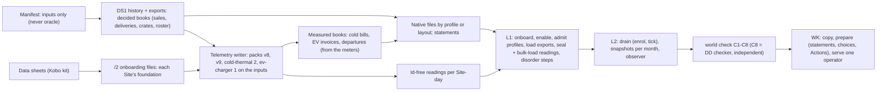

# DD: the demo data (implementer spec)

Status: **rev 2, 2026-11-22; DD1 in_review (`packet-DD1.md`); DD2a in_review (`packet-DD2a.md`); DD2b in_review (`packet-DD2b.md`); DD3a in_review with open questions (`packet-DD3a.md`)**: the combined handshake (`handshake.md`, R1-R10, I1-I15) is answered there under "Answers
(Architect)" and ruled in `rulings.md` (D-DD.17 to D-DD.34). Rev 1 (same day) had 19.5 u in four parts; rev 2 has
**30.0 u in six parts** (§7); restated by D-DD.44 to **33.0 u in seven parts** (DD3 splits into DD3a, DD3b), by D-DD.47 to 33.5 u, and by D-DD.57 to
**34.25 u in eight parts** (DD2 splits into DD2a, DD2b), by D-DD.66 to **35.25 u**, by D-DD.73 to **35.75 u**, by D-DD.74 to **36.25 u**, by D-DD.79 to **37.0 u**, by D-DD.80 to **37.5 u**, by D-DD.88 to **39.0 u** (DD4 splits into DD4a, DD4b), by D-DD.96 to **41.5 u**, by D-DD.101 to **42.0 u**, by D-DD.107 to **43.25 u in ten parts** (DD3b splits into DD3b, DD3c), and by D-DD.116 to **44.0 u** (DD3c 3.25 u), and by D-DD.142 to **49.75 u in eleven slices** (lane-wide pre-flight, `preflight-remaining.md`: DD3b 5.75, DD4b 4.75, DD5 split into DD5a 3.5 and DD5b 3.75, DD6 4.75). Architect (Claude). Owner request: `owner/owner-demo-data-spec-2026-11-22.md` ("make sure
it grounded on the product goals"); owner answers to Q1-Q6: `owner/owner-demo-data-answers-2026-11-22.md`. Owner words on
Kobo's equipment: `owner/owner-iap-q1-q2-kobo-datasheets-2026-11-22.md`. **Rulings:** D-DD.1 to D-DD.16 (§9) and
D-DD.17 to D-DD.142 (`rulings.md`; the remaining parts' pre-flight: `preflight-remaining.md`); index lines in `.ai/decisions/index-rulings-26.md`, `index-rulings-27.md`,
`index-rulings-28.md`, `index-rulings-29.md` and `index-rulings-30.md`.
**Reviewer guide:** `reviewer-guide.md` (rev 2). `USER_REVIEW_REQUIRED: true` (demo narrative, evidence labels, what the
served app shows; owner Q7-Q9 open with defaults applied).

**Goal (unchanged).** A served demo that convinces, converts and inspires mini-grid, EV and cold-chain operator
executives with value beyond their monitoring tools. Every page × Site type gives output for the range, and each of
the four outcome categories is served for every operator. The simulator produces operating reality only; no output is
calibrated to a target.

**Mock:** non-screen. DD supplies the data the screens already specified read: 5c's month (`specs/5c-deep-dive-screen/`),
IA-P's Overview on the range, "Month by month", Sites and Outcomes (`specs/IA-P-product-shape/spec.md` §3,
`spec-period.md` P.1, P.9), and 6a/6c's decisions (`specs/6a-decision-records/`, `specs/6c-option-evaluator/`). Where a
mock element still has no source after DD, the screen keeps its "Not available yet" and its existing MOCK DEVIATION.

**Read first:** §A, §0, §1, §4.0, §8 and your unit's card in §7; `rulings.md`; DS4 `spec.md` §2 and §3.1 to §3.6; DS1
`spec.md` §4.1. Read the manifest `Docs/demo-sprint/product-direction-layer4/demo-site-scenario-manifest.yaml` (`M`) by
key, never whole: `tenants`, `sources`, `history`, `operations`, `demo_workflow`, `disorder_tests`, `oracle`, `checks`.

---

## A. For the owner: what the demo shows, and the open choices (one page)

**Today.** The served world (`backend/conversions/world-layer4-v1.json`) holds one operator, Lakeside Power, with three
mini-grid Sites and one month, October 2026. It is loaded by the product's own commands, checked (DS4 `world check`)
and copied by WK. It carries the hardest beat: the month explained against the operator's target and reconciled to the
management accounts (5c, 3A7, DDR). DD keeps all of it.

**What DD adds.** The two other operators, four months of books for every Site, and the operating reality behind
them. That reality is simulated from what each Site receives: sales, sun, fuel deliveries, crates and bus returns.

```
              Jul   Aug   Sep   Oct   1-5 Nov   source shown on screen
 Lakeside     ███   ███   ███   ███   ░         books: Emulated · readings: Simulated · Kobo kit: Declared (data sheet) / Assumed
 Harvest Cold ███   ███   ███   ███   ░         books: Emulated · readings: Simulated · bills: from the meter
 Metro Bus    ███   ███   ███   ███   ░         books: Emulated · readings: Simulated · invoices, departures: from the meters
 ███ = a closed month of books and readings (9 Sites)     ░ = readings and the manifest's November records, to 6 Nov 06:00
```

**Why it converts (mechanism to value).** A monitoring tool shows readings. The demo shows, for each operator, the
month against its own target, where the gap came from, the choices valued against doing nothing, and who acts.

| Beat on screen | Operator and Site | Outcome category | What the data must carry |
|---|---|---|---|
| The month explained (5c, the Overview) | Lakeside, all three; Harvest Cold and Metro Bus after Q11 | Assure performance and returns | October books, the statements (Lakeside: draft, final; Kisiwa's disagreement) |
| Month by month (IA-P, a 4-month range) | all nine (cold and EV after Q11) | Optimize cost; Grow revenue | Jul-Oct books and readings whose mechanisms give the manifest's stories: Kobo's unexplained fuel within tolerance July to September and above it in October; Mwea's occupancy falling 56 → 49 → 42 → 35 %; Kirinyaga's compressor losing efficiency; Embakasi charging on arrival more each month |
| A choice valued against doing nothing (6a, 6c) | Kobo stop setting; Mwea aggregator contract; Kirinyaga repair; Embakasi schedule; Mto huller; Ruiru +6 buses | all four | Kobo's own readings (0K4f's study); the books each option changes |
| Protect what you own | Thika backup start failure; Kisiwa's failed set and expired cover; Mto's failed inverter under warranty; Kasarani's charger fault; Kobo battery evidence | Protect asset and capital | the failure in the readings at its manifest instant, on its own unit; the ticket and contract records |
| A person acts and tracks | every operator's people | all four | `demo_workflow`'s people onboarded; its choices and Actions made by WK `prepare` through the product's commands (D-DD.27) |
| Any range, every Site type | all nine | — | readings and books on every day of the span; month figures for every Site type (Q11) and whole ranges on every page (Q12) |

**Each operator, each category** (C-DD18 asks this of the served build):

| Operator | Grow revenue | Optimize cost and efficiency | Protect asset and capital | Assure performance and returns |
|---|---|---|---|---|
| Lakeside | Mto huller connection | Kobo generator stop setting | Kisiwa cover, Mto inverter claim, Kobo battery evidence | October explained and reconciled |
| Harvest Cold | Mwea aggregator contract | Kirinyaga repair over replace | Thika start controller under EPC | month against plan (after Q11) |
| Metro Bus | Ruiru absorbs the city's +6 bus route on existing chargers (route revenue "Not available yet") | Embakasi deadline-aware schedule | Kasarani OEM warranty and spare-bus cover; Ruiru's avoided chargers | departures met and energy cost against plan (after Q11) |

**Settled (owner, 22 Nov):** Q1 readings 1 Jul to 6 Nov; Q2 four months; Q3 one operator served at a time; Q6 FG Wilson
P50-3 and 42 Pylontech US5000, Kobo at 36 kW, unpublished values Assumed with their basis. Q4 and Q5 defaults stand.

**Open, defaults applied now (W3); I would like you to weigh in on all three.**

| # | Choice | Default | Alternative and its cost |
|---|---|---|---|
| Q7 | Kobo generator's no-load fuel rate. The P50-3 sheet states none. On 7 Nov you chose "Generic 3.3 L/h, labelled" for the 40 kW set then assumed (`owner/owner-fuel-scope-2026-11-07.md`, Q2) | **0.62 L/h, labelled Assumed: "fitted to the data sheet's three stated points"**. The straight line through 10.5 / 7.8 / 5.6 L/h meets the sheet within 0.23 L/h at every stated load. It replaces your 3.3 L/h for Kobo only on your answer; the K8 study keeps 3.3 | Keep 3.3 L/h, labelled Assumed (generic). The line then misses the sheet's own 50 % point by 1.3 L/h (6.9 against 5.6), so the "real data sheet" kit would not match its sheet. No unit change either way; DD3.2 prints Kobo's October split at both values before it commits |
| Q8 | When the demo counts as done | **After Q11 (cold and EV monthly figures) and Q12 (whole ranges on every page)**, both already queued after IA-P. The served build after them is the accepted demo. DD's first build lists every page still showing "No monthly figures yet" or a 31-day window | Accept the demo with those rows. Cold and EV trends and their Assure beat would not show, which breaks your range rule for two Site types |
| Q9 | Bills follow the meter | **The cold electricity bill, the EV utility invoice and the departure log are written from the simulated meters**, so each quantity has one figure. Their October values will move from the manifest's (for example Kirinyaga's 5,000 kWh, Embakasi's 55 % peak share) to what the simulated equipment does. Each story is checked by its direction (C-DD20), never tuned | Keep the manifest's bill figures and let the readings disagree with them: two figures for one quantity, against your 21 Nov rule |

---

## 0. Existing, then new (code evidence)

**Stays, unchanged in behaviour:**
- the ladder (`tools/world.py`: L0 schema, L1 inputs, L2 computed; clone, check C1 to C7; D-DS4.3), extended by DD5.3;
- the product's commands as the only writers: `onboard_operator`, `load_world_inputs` (calls `load_emulated_exports`
  and `evidence/bulk_load.py:BulkEvidenceLoad`), `source_profile admit`, `provision_gateway`, `build_structure_snapshot`,
  `observe_structure`;
- the DS1 generator (`simulator/assetops_simulator/world/`: `history.py`, `records.py`, `exports.py`). Its golden digests
  **move once**, in DD3.2, because Kobo's `physical` changes the Lakeside scope digest (D-DD.30). Every moved figure is
  listed; none is hand-edited;
- `packs/mini_grid.py` v8 (Kobo), `packs/cold.py` cold-thermal 1 and `packs/ev_charger.py` ev-charger 1 stay as they are.
  v9 and cold-thermal 2 are new versions beside them, each proven equal to its predecessor on the predecessor's case;
- `config/site-templates/kobo-mini-grid-60kw.yaml` v3 and every lab and test Site on it (template v4 is 0K4f's, D-DD.30);
- WK (`tools/walk_world.py`) and DDR's runbook path.

**What blocks the demo today (each is fixed by the named unit):**

| Gap | Evidence | Unit |
|---|---|---|
| Only mini-grid operators can be onboarded | `onboarding/operator_file.py:255` `ONBOARD_VERTICAL`; `:132` `site_type` fixed | DD1.1 |
| Onboarded Sites have no sources and no binding set, and import disables the gateway and sources | `sites/foundation_service.py:204-229` (`disabled_at=now` at `:210, :227`); bulk claims refuse `GATEWAY_DISABLED` (`postgres_evidence_ledger.py:625`) | DD1.2 |
| Binding sets start at 1 Jul 00:00Z, three hours after local midnight | `FOUNDATION_ORIGINAL_VALID_FROM`; `bulk_load.py:180-183` refuses the batch | DD1.2 |
| Exports are October and mini-grid only; DS1b JSON is generated but not staged | `world/exports.py:280-354`; `tools/world.py:571-600` | DD2.1, DD2.3, DD2.4 |
| A profile cannot write a bool; tariff bands cannot come from a CSV | `native/layouts_v1.py` `TYPES`; `records_v1.py` TARIFF_SCHEDULE `bands` | DD2.2; D-DD.24 |
| No world telemetry writer | only the Lab packs | DD3.1, DD4.2, DD4.3 |
| v8 has one generator and one PV inverter | `packs/mini_grid.py:933` | DD3.3 (v9) |
| cold-thermal 1 has no occupancy, COP or auxiliary load | `packs/cold.py:408-412` (heat = leak + door; compressor kW = cooling kW) | DD4.1 (cold-thermal 2) |
| ev-charger 1 shares the import limit only between its own two connectors | `packs/ev_charger.py:1-20` | DD4.3 (depot load manager) |
| The world refuses telemetry, and the check cannot see it | `tools/world.py:181-185`, `:719-721`; C6 globs `*.batch.json` (`:1097`) | DD5.3 |
| The bulk path admits mini-grid readings only | `postgres_evidence_ledger.py:687-690` | DD5.1 |
| Snapshots and the month read are mini-grid only | `structure_snapshot/build.py:82`; `read.py:60` (D-3B6.6) | the Q11 unit (gates acceptance, Q8) |
| Ranges over 31 days are windowed on non-whole pages | `estate/scope.py:21`; IA-P P.9 | the Q12 task (gates acceptance, Q8) |

---

## 1. Structure: the mechanism, the records and who acts



*Inputs flow once, left to right. The product computes every figure from its stores; only the checker reads the oracle.*

**Core rules:**
- **Inputs are scaled, outputs never** (D-DD.3; the class rule of `rulings.md`). §4.0 classes every quantity.
- **Measured books follow the meter** (D-DD.20). **Decided books are inputs, and the readings follow them** (D-DD.19).
- **Every record carries its source** (D-DD.5, D-DD.17): books *Emulated*; readings *Simulated*; Kobo's equipment
  values *Declared, from the manufacturer data sheet* or *Assumed* with their basis; never *Recorded*.
- **Same span, same cadence, every Site type** (D-DD.3): 1 Jul 00:00 to 6 Nov 06:00 local.
- **People act under their names.** Onboarding carries `demo_workflow`'s people; WK `prepare` makes the choices and
  Actions through 3C2 and 6a commands (D-DD.27).

**The cast** (manifest `tenants`; D-DD.1). Codes are the manifest's.

| Operator (slug, vertical) | Site (code, product type) | Story (manifest `role_in_story`) | Decision (6a/6c) | Category it leads |
|---|---|---|---|---|
| Lakeside Power (`lakeside-power`, MINI_GRID) | Kobo (`KOBO-001`, MINIGRID) | generator running after the battery is full (hero); battery warranty evidence incomplete | KOB-STOPSOC | Optimize cost |
| | Kisiwa (`KISIWA-001`, MINIGRID) | highest diesel, nothing avoidable (negative control); GEN-KS-01 fails 30 Oct 19:10; expired cover; O&M SLA | KIS-REPAIR | Protect asset |
| | Mto (`MTO-001`, MINIGRID) | paying daytime demand; energy-to-cash discrepancy; INV-MT-02 trips 28 Oct 11:02, covered | MTO-HULLER; inverter claim | Grow revenue |
| Harvest Cold Network (`harvest-cold`, COLD_CHAIN) | Room A · Mwea (`COLD-MWEA`, COLDCHAIN) | healthy but underused | MWEA-AGG | Grow revenue |
| | Room B · Thika (`COLD-THIKA`, COLDCHAIN) | backup failed to start 6 Oct 19:11; B-1031 exposed; EPC cover | THIKA-EPC-STOPGAP | Protect asset |
| | Room C · Kirinyaga (`COLD-KIRI`, COLDCHAIN) | busy room, compressor efficiency drifting | KIRI-REPAIR | Optimize cost |
| Metro Bus Depots (`metro-bus`, EV_DEPOT) | Embakasi (`EV-EMB`, EV_CHARGING) | deadline-aware schedule wins; cheapest rejected (buses short) | EMB-DEADLINE | Optimize cost |
| | Kasarani (`EV-KAS`, EV_CHARGING) | CH-K2 fault from 1 Nov 23:40; OEM warranty | KAS-OEM-STOPGAP | Protect asset; Assure |
| | Ruiru (`EV-RUI`, EV_CHARGING) | looks underused: absorbs +6 buses, not +10 | RUI-ABSORB6 | **Grow revenue** (the route offer; avoided chargers are its capital side, D-DD.26) |

---

## 2. Months and simulator versions (D-DD.2, D-DD.4 as amended by D-DD.21, D-DD.22)

| Data | Span | Generator and version |
|---|---|---|
| Decided books, every Site | 2026-07 to 10, plus the manifest's dated November records (OOO-1 recorded 4 Nov, LATE-SETTLE-1 settled 2 Nov, Thika's invoice 6 Nov 09:40) | DS1 `history.py` (July to September), October from `period`; `exports.py` `SOURCE_VERSION` "2"; `exports_cold.py`, `exports_ev.py` |
| Measured books (cold bills, EV invoices, departures) | 2026-07 to 10 | `exports_measured.py` from the readings (D-DD.20) |
| Readings, Kobo | 2026-07-01T00:00 to 2026-11-06T06:00 local (Africa/Nairobi), every 5 minutes | `packs/mini_grid.py` **v8** (`MINI_GRID_V8_MODEL`) |
| Readings, Kisiwa, Mto | same | **v9** (`MINI_GRID_V9_MODEL`, §4.3) |
| Readings, cold rooms | same; chamber and ambient temperature and states every 5 minutes; meter power as a 5-minute mean | **cold-thermal 2** (§4.4) |
| Readings, EV depots | same; per session START/END and energy; charger power as a 5-minute mean while charging; connector state on change | **ev-charger 1**, one instance per charger, under the depot load manager (§4.5) |
| Shapes | day weights from `history.families` × `seasons` × `day_classes`; intraday shapes from Kobo's season v2 (D-0K4.8), normalised | synthetic (`shape_source: synthetic`) |

- No reading before 1 Jul 00:00 local or after 6 Nov 06:00 local. The span is one constant, `READINGS_SPAN` in
  `world/telemetry.py`, read by every writer, the CLI and DD5's world manifest; the last day file ends at 06:00 and the
  Site manifest's `span` carries `"to"` (D-DD.103).
- Each Site's readings manifest records `{"pack", "model_profile_version", "shape_source", "writer_version": 1,
  "foundation_digest", "private_parameters", "conditions", "mappings"}` (§4.1); the world build manifest copies it.
- **Range consequences.** The span is 129 days, inside IA-P's 731. Overview, Outcomes and Sites read any range whole
  (IA-P P.9). Other pages are windowed until Q12, and C-DD9 counts a window as not yet output (D-DD.26).

---

## 3. External sources emulated, and their format (D-DD.5 as amended by D-DD.24)

Every file is labelled *Emulated*. Layouts are **illustrative**; no screen, document or claim names a vendor product
as compatible. Cold and EV files reach the store as **source profiles** (3A6), except tariff schedules, which are
canonical JSON.

| Vertical | Source | File (`<slug>.<key>`) | Layout or profile id | Kinds | Class (§4.0) | Status |
|---|---|---|---|---|---|---|
| Mini-grid | customer billing | `.billing.csv` | `billing-illustrative-1` | CHARGE | decided | exists; DD2.1 adds months |
| | mobile-money statement | `.collections.csv` | `collections-illustrative-1` | RECEIPT, SETTLEMENT | decided | exists; months |
| | expense ledger (fuel notes, O&M, staff) | `.expenses.csv` | `expenses-illustrative-1` | EXPENSE | decided | exists; months; notes per D-DD.32 |
| | budget workbook | `.budget.csv` | `budget-illustrative-1` | BUDGET_LINE | decided | exists; months |
| | meter register (MAP-1 rows only), adjustments | `.meter_register.json` (DD5.2), DS1b `.billing_export.json` | `canonical-json-v1` | METER_ASSIGNMENT, ADJUSTMENT | decided | staged in `<slug>/staged/` (D-DD.60, D-DD.61); no mini-grid ADJUSTMENT today; tariff is PROVIDED by the existing route, no schedule |
| Cold | storage ledger | `.profile.cold-storage-ledger.csv` | `cold-storage-ledger-illustrative` | STORAGE_MOVEMENT | decided | new profile |
| | invoicing (invoices, receipts, credit notes) | `.profile.cold-storage-invoicing.csv` | `cold-storage-invoicing-illustrative` | CHARGE (STORAGE), RECEIPT, ADJUSTMENT | decided | new profile (D-DD.59) |
| | storage rate card | `.storage_rate_card.json` | `canonical-json-v1` | TARIFF_SCHEDULE | decided | `world/tariffs.py`; staged (D-DD.61) |
| | electricity bill | `.profile.cold-electricity-bill.csv` | `cold-electricity-bill-illustrative` | CHARGE (USAGE, kWh) | **measured** | new profile; rows from the meter |
| | expenses | `.expenses.csv` | `expenses-illustrative-1` (unchanged) | EXPENSE (STAFF, OM) | decided | layout exists (D-DD.49) |
| | budget workbook | `.profile.cold-budget.csv` | `cold-budget-illustrative` | BUDGET_LINE | decided | new profile (D-DD.49) |
| EV | tariff schedules | `.utility_invoice.json` | `canonical-json-v1` | TARIFF_SCHEDULE | decided | `world/tariffs.py`; staged (D-DD.61) |
| | utility invoice | `.profile.ev-utility-invoice.csv` | `ev-utility-invoice-illustrative` | CHARGE (USAGE by band, DEMAND) | **measured** | new profile; rows from the meter |
| | fleet roster | `.profile.ev-fleet-roster.csv` | `ev-fleet-roster-illustrative` | FLEET_ROSTER | decided | new profile |
| | departure log | `.profile.ev-departures.csv` | `ev-departures-illustrative` | DEPARTURE | **measured** | new profile (needs `bool`, DD2.2) |
| | service tickets | `.profile.ev-service-tickets.csv` | `ev-service-tickets-illustrative` | SERVICE_TICKET | decided | new profile |
| | expenses | `.expenses.csv` | `expenses-illustrative-1` (unchanged) | EXPENSE (OM) | decided | layout exists (D-DD.49: no PENALTY row; penalties are a node) |
| | budget workbook | `.profile.ev-budget.csv` | `ev-budget-illustrative` | BUDGET_LINE | decided | new profile (D-DD.49) |
| All | management accounts | `<slug>.statements.json` | `assetops.world-statements/1` (§5.4) | read by WK `prepare` | decided | new |
| All | contract documents, QA notes, penalty statement | — | not written | — | — | stay "Not available yet" naming the record |

Energy cost for cold and EV is the bill or invoice only; their expense files carry no ENERGY line, so nothing is
counted twice. Each profile is `backend/conversions/profiles/<id>.profile.json` (`assetops.source-profile`,
`native/profiles_v1.py`), with `<id>.sample.csv` and `<id>.expected.json` beside it (D-DD.24). Columns: §5.2, §5.3,
§5.6.

**Telemetry source.** Readings are written by the world generator as canonical readings, sealed at load into
`ingestion_batch_v2` batches with `source_envelope_v4` envelopes, `source_mode` SIMULATED, shown as "Simulated". They
emulate no vendor format. The EMS upload and the Modbus emulator stay the real-path proof inside `world check` C5.

---

## 4. Telemetry: in, and why (D-DD.3)

**In, at every Site, for the whole span.** Five reasons:
1. The hero choice needs Kobo's own readings (6c, D-0K4.38, D-P6.26).
2. The fuel split is reading-fed in every month shown (D-DD.18).
3. The Protect beats are failures in the readings, each on its own unit.
4. The range rule: each Site's Operations tab is reading-fed.
5. The measured books (bills, invoices, departures) come from the meters (D-DD.20).

**Cost.** DS4 measured 13.497 s per mini-grid Site-day. 9 × 129 × 13.497 s ≈ 4.4 h for L2, but that is a projection:
cold and EV Site-days were never measured. DD6.3 measures; owner Q4 governs (cap 8 h, D-DD.15).

### 4.0 Every quantity classed (the class rule of `rulings.md`)

| Vertical | Input: scaled to the books or manifest, the readings follow | Output: the simulator's, the books follow where they report it |
|---|---|---|
| Mini-grid | customer load (month total = `delivered_kwh`); sun (season v2 at Kobo, the `solar_surplus` family at all three); fuel deliveries (the notes); the declared unexplained draw (D-DD.19); unit failures (§4.2) | PV, battery SOC and power, generator state and litres per unit, tank level, unserved energy, candidate minutes |
| Cold | crate movements (the storage ledger; month crate-days = `crate_days`); ambient per day; the efficiency condition `f_m`; grid loss and generator failure (Thika) | chamber temperature, compressor state, meter kWh → the electricity bill |
| EV | each bus-night's return, departure and required kWh (the roster; month total = `kwh`); the plug-in practice `p_m`; charger and connector faults | session energy, charger power, Site import, band kWh and demand → the invoice; energy at departure → the departure log |

### 4.1 The writer (`simulator/assetops_simulator/world/telemetry.py`, new; DD3.1, DD4.2, DD4.3)

The frame is `world/telemetry.py` alone. Cold and EV drive their packs in `world/telemetry_cold.py` and
`world/telemetry_ev.py` on D-DD.81's day-level protocol, and are joined to `build_telemetry` after DD3a merges.


- `build_telemetry(view, site_inputs, decided_books, *, start, end) -> TelemetryResult`. Pure: no store, clock or
  network.
  - `site_inputs` is the parsed `assetops.world-site-inputs/1` file `F` (D-DD.28): per Site its tenant slug, code,
    timezone, foundation (components, devices, properties from the `/2` onboarding file), binding role set and
    `foundation_digest`.
  - `decided_books` is the writer's read of the staged decided files (fuel notes, storage ledger, roster).
- `F` is written by `tools/world_history.py site-inputs --onboarding DIR --bindings DIR --out F`, a pure function in
  DD3.1. It joins each `/2` Site with its binding conversion; it reads `/2` documents only (others `SKIPPED`), a
  component's `rating` is optional, and a duplicate Site code refuses `TEL_FOUNDATION` (D-DD.95).
- **Per Site, one continuous execution advanced one local day at a time** (D-DD.69; every pack): it starts at the
  span's first local midnight from the declared initial state, and each day's file is written from that day's steps,
  so day d+1 starts from day d's end state (SOC, tank, temperature, crates, sessions, a RUNNING generator). Inputs are scaled by largest remainder so the month's input totals equal the books
  exactly (`TEL_INPUT_TOTAL` otherwise).
- **Story conditions and events** are read from `M` `operations` (each event's `asset` and `at`),
  `tenants.*.sites.*.incident` and `observations`, never from `oracle`. A date-only instant means 00:00 local. Each is
  written to the readings manifest's `conditions` with its source key.
- **Output:**
  - per Site-day, `<slug>/telemetry/<SITE>.<YYYY-MM-DD>.readings.json`, schema `assetops.world-readings/1`:
    `{"schema", "site_code", "day", "timezone", "role_set", "readings": [{"source_id", "signal_id", "start", "end",
    "value", "unit"}]}`, sorted by (start, source_id, signal_id). No UUID appears (D-DD.8). An event row has
    `"value": null`, unit `event` and an `event` object (`record_kind`, `outcome`, `actor`, `component_id`,
    `ordinal`, `correlation`); ties sort by `event.ordinal`; the ids are formed at sealing (D-DD.91);
  - per Site, `<SITE>.manifest.json`: the pack versions, private parameters, conditions, mappings and a golden digest
    per Site-month;
  - per tenant, `<slug>/telemetry/measured.json`: the meter month totals the measured books are written from (§5.6),
    schema `assetops.world-measured/1` per D-DD.99 (per vertical month objects; EV `departures`).
- **Public records to readings.** The writer maps each pack public record (device, signal) to the role set's
  `source_id` and `signal_id`, where `source_id` is the binding row's `device_id` (D-DD.72); the map is written in the readings manifest's `mappings`. `S/observation/transform.py` is
  not on this path.
- Values are exact decimal strings. Seeds: `sha256(scope digest | site code | day | stream)`; sorted iteration.
- **Refusals** (exit 3 on `world_history.py telemetry`, stderr `<CODE> <detail>`):
  - `TEL_INPUT_TOTAL`;
  - `TEL_EVENT_UNPLACED` (an instant outside the span);
  - `TEL_PACK` (the pack refused, including a tank overfill; the pack's code follows);
  - `TEL_ORACLE_READ`;
  - `TEL_FOUNDATION` (a Site in `F` lacks a property its pack needs);
  - `TEL_BINDING` (a public record with no binding row, or two; D-DD.72).
- CLI: `tools/world_history.py telemetry --manifest M --sites F --books DIR --out DIR`. `--start` and `--end` default to
  `READINGS_SPAN`; `--end` takes a local date (whole day) or a local instant `YYYY-MM-DDTHH:MM` (D-DD.103; until then
  the default end is the accounting period's last day, D-DD.106).
- **Scope digests** (history, `world/scope.py`): a digest covers only what its rules read. `physical` enters as the
  keys `PHYSICAL_READS` declares for the scope's rule words (none for mini-grid), `seasons` as D-DD.90 restricts it
  (D-DD.102).

### 4.2 Mini-grid inputs (DD3.1, DD3.3)

- **Load.** Season v2's normalised load shape (2-hour blocks, written as hour-block windows: D-DD.78) (one declared shape at all three Sites, written in
  `conditions`) times the `demand` family day weight. It is scaled so the month's served-plus-unserved load equals
  `delivered_kwh` (October `period.actual`, July to September `history.json`). A month with no books (1-6 Nov) runs at
  October's kWh per weighted shape unit over the span's hours of that month (`rate_of`, D-DD.103).
- **Sun.** Season v2's irradiance at Kobo on the days its calendar covers (1 Sep to 31 Oct). Season v2's clear-day shape
  times the `solar_surplus` day weight (season × day class) at Kisiwa and Mto, and at Kobo on any other day (D-DD.77).
- **Fuel** (D-DD.19). Each note of `<slug>.expenses.csv` with category Diesel (from `config/world/fuel-notes.json`, D-DD.92, D-DD.130) enters the Site's tank at `occurred_at`
  (OOO-1 at 26 Oct 10:00). The declared draw is the month's `unexplained_l`, in equal daily parts at 02:00 local; a month with no books draws
  the rate month's day-`n` part on day `n` (1-6 Nov: October's first six parts, D-DD.103). The
  tank starts at 50 % of `tank-capacity`, which each Site declares by D-DD.76's storage rule: Kobo 2500 L, Kisiwa
  5000 L, Mto 1000 L (source SITE, in the `/2` and `/1` files).
- **Battery start.** The starting state of charge is the SOC at the end of one warm-up day (the span's first day's
  load and sun, from the declared stop threshold, no readings written), written in `conditions.start_soc` as Derived
  (D-DD.104; Kobo about 60.4 %). No hidden default.
- **Generators.** Kobo's generator curve and battery come from the `/2` file (§6). For Kisiwa and Mto, all
  GENERIC_DEFAULT (Assumed), as the owner chose for an unsheeted set on 7 Nov:
  - no-load rate by the generic rule of 0.08 L/h per kW of unit rating (Kisiwa 4.8 L/h per set, Mto 2.4 L/h);
  - minimum load 30 %;
  - taper 95 %.
- **Unit failures** (§4.3), each written in `conditions`, from a module table with an `M` parity test (D-DD.126):
  - Kisiwa GEN-KS-01 FAILED 2026-08-14T19:20 to 2026-08-17T11:00 and from 2026-10-30T18:40+03:00 (`M` operations; 19:10 is the O&M report; D-DD.126);
  - Mto INV-MT-02 FAILED from 2026-10-28T11:02+03:00.

### 4.3 Mini-grid v9: units (`packs/mini_grid.py`, `MINI_GRID_V9_MODEL`; DD3.3; D-DD.21)

- **Generator units.** An ordered list from the foundation's GENERATOR components (declared order = component code
  order). Each has its own `generator-rated-power`, `specific-fuel-consumption`, `generator-no-load-fuel-rate` and
  `generator-minimum-load`. They share the Site's one tank and one control policy (start and stop SOC, delays,
  minimum runtime).
- **Dispatch each step.** The requested generator power is P (v8's rule).
  - The running set is the shortest prefix of the non-FAILED units, in declared order, whose summed rating ≥ P (all
    non-FAILED units if none suffices).
  - Each running unit carries P × its rating / the set's summed rating, never below its minimum load (v8's floor rule,
    per unit).
  - Each unit has v8's lifecycle (start delay, minimum runtime) on its own. A unit leaving the set stops only after its
    minimum runtime.
  - Each unit burns on its own v8 curve.
  - A FAILED unit carries nothing; a unit that fails while running stops at that step.
- **PV inverter units.** An ordered list from INVERTER components, each with `inverter-ac-limit` and a declared
  `pv-array-share` (the fraction of the array wired to it; Mto 1/2 each, from `physical.inverters`). Available array
  power is split by share, each part is clipped at its inverter's limit, and a FAILED inverter delivers 0.
- **Forcings.** `UNIT_FAIL <component>` and `UNIT_RESTORE <component>` at an instant.
- **Readings.** Per unit device: power (5-minute mean) and state on change. The Site's tank level and battery as in v8.
- **One of each = v8.** With one generator and one inverter unit, v9 produces v8's bytes. C-DD19 runs v8 and v9 on Kobo's
  October inputs and compares trajectory digests.
- Kisiwa: GEN-KS-01 and GEN-KS-02, 60 kW each, SFC 0.31 (`M:182`). Mto: INV-MT-01 and INV-MT-02, 25 kW each, and one
  30 kW set (`M:235`). Both come from their `/2` files.

### 4.4 cold-thermal 2 (`packs/cold.py`, `MODEL_PROFILE ("cold-thermal", 2)`; DD4.1; D-DD.22)

Added to cold-thermal 1, as **private load parameters** (`ColdLoadParameters`, passed by the writer, never Foundation):

| Parameter | Value (all rooms) | Basis (Assumed; written in the readings manifest) |
|---|---|---|
| `respiration_kw_per_crate` | 0.0015 | 20 kg crates of vegetables at 2-5 °C respire about 20-100 mW/kg (refrigeration handbooks' commodity tables); 75 mW/kg applied |
| `field_heat_kwh_per_crate_degc` | 37/1800 (= 20 kg × 3.7 kJ/kg·°C / 3600 ≈ 0.02056) | produce specific heat about 3.7 kJ/kg·°C |
| field heat spread | evenly over the 360 minutes after admission, cooled from the day's ambient to 4 °C | pull-down of admitted produce |
| `cop` | 2 | small air-cooled condensing units at a 2-5 °C box, 20-30 °C ambient |
| `auxiliary_kw` | 1.0 | evaporator fans, lights, controls and defrost for a room of about 400 crates |
| door per movement | `DOOR_OPEN` at the movement instant, `DOOR_CLOSE` 5 minutes later | loading one 40-crate batch |

- **State:** `crates` (whole). Forcings `CRATES_IN n` and `CRATES_OUT n` at each storage-ledger movement; `crates < 0`
  raises.
- **Heat per minute** = cold-thermal 1's leak and door terms + `crates × respiration` + the field-heat pulses active
  that minute.
- **Compressor electrical kW** = cooling kW × `f_m` / `cop`. **Meter kW** = compressor electrical + `auxiliary_kw`. The
  meter signal is its 5-minute mean.
- **Efficiency condition** `f_m` (private, per room-month) is 1 everywhere except Kirinyaga: July 1.05, August 1.10,
  September 1.17 (`history.sites`), October and November 500/403. Forcing `EFFICIENCY` at 00:00 local on a month's first
  day when it changes (D-DD.86).
- **Ambient per day** (November declared `short_rains`, scope digests unchanged: D-DD.90) = 24 °C + (w_d − 1) / 0.025, where w_d is the `cooling` family day weight. 24 °C and 2.5 % per °C
  are the manifest's reference ambient and sensitivity (`M:430`). w_d is season × day class with no jitter (22.8, 24.8 or
  24.0 °C). Forcing `AMBIENT` at each local midnight after the first day; the ambient probe reports it (D-DD.86).
- **A failed start is reported when it happens** (`start_failure_at_request`, True in the DD values): a start request
  on a faulted generator fails in the same minute (D-DD.83).
- **New forcing** `GENERATOR_HAND_START` (FAILED → RUNNING at its minute, actor OPERATOR; the transfer follows after its
  delay), for a start by hand (D-DD.83; replaces `GENERATOR_RESET`).
- **Temperature grid** 10⁻⁶ °C (`temperature_quantum`), with the rounding booked in the energy ledger (D-DD.87).
- **Field-heat validity**: a pulse active while the chamber is at or above its lot's admission ambient raises
  (D-DD.85).
- **Zero terms = v1.** With respiration, field heat and auxiliary 0, `cop` 1, `f_m` 1 and no crate forcings, v2
  produces v1's bytes (C-DD19).
- **Foundation per room** (the `/2` file; the product sees these): cold-lab-001's thirteen values
  (`backend/tests/fixtures/w2/cold-lab-001.yaml`), except `cold-cooling-capacity` 6 kW (about twice the busiest room's
  design load, the usual refrigeration margin; Assumed).
- **Thika, 6 Oct**, at minute resolution:
  - `GRID_LOSS` 19:11;
  - `GENERATOR_FAILURE` 19:11 (start requested 19:11:05, failed 19:11:10);
  - `GENERATOR_HAND_START` **20:22** (D-DD.89: running 20:22, bus powered 20:23, 72 minutes without cooling; no
    night rota in October);
  - `GRID_RESTORE` 22:00 (the manifest states none; Assumed, in `conditions`).

  B-1029 goes out on 5 Oct at 16:00. B-1031 (120 crates) and B-1034 (80 crates) are present, received in lots at their
  ledger times (D-DD.85). D-DD.89 resized the event (owner: "Change the event"): B-1031 is above 5 °C 20:08-20:32
  per minute (peak 5.477 °C), five 5-minute readings above 5 °C (bound 20-30 min, as `M`); `test_dd4_thika_incident.py`.
- What the chamber does is the pack's. C-DD6 asks the story's facts (B-1031 above its 5 °C limit for more than 15
  minutes; B-1034 below 12 °C). A failure goes to the Architect; nothing is tuned.

### 4.5 EV: roster, practice and the depot load manager (DD4.3; D-DD.23)

- **Roster (decided books, DD2.4).** One row per bus per night.
  - Embakasi: returns spread evenly over 17:30-19:30 by bus index (bus i of n at 17:30 + i × 120/(n−1) minutes);
    departure 05:30.
  - Kasarani: return 22:00, departure 05:00.
  - Ruiru: return 21:00, departure 05:00.
  - `required_kwh` is `kwh_per_bus_night`, scaled by largest remainder (to 0.001 kWh) so the month's total equals `kwh`.
  - Kasarani's spare bus is in the roster on the nights the incident lists it: a daytime-charged bus (arrives 10:00
    local, departs 05:00 with 150.000 kWh; D-DD.98), not a ninth night bus.
- **Plug-in practice (input).** At Embakasi, each night the first `round_half_even(20 × p_m)` buses by return time
  plug in on arrival, and the rest plug in at 22:00. `p_m` is 0.36, 0.43, 0.49, 0.55 for July to October; November
  keeps 0.55. At Kasarani and Ruiru every bus plugs in at its return.
- **Connector assignment.** At plug-in a bus takes the lowest-id free, enabled, unfaulted connector. If none is free it
  waits and takes the next one freed.
- **Depot load manager** (writer, each minute):
  - available = `ev-site-import-limit` − base load (0);
  - it is shared in 1 kW round-robin quanta, with a persistent pointer, across all CHARGING connectors of the depot in
    (charger, connector) id order;
  - each share is capped by connector and charger ratings and by the bus's remaining need;
  - each share is passed to that charger's pack as `REQUEST_KW` for the minute. Each pack instance has `site_limit_kw`
    = its charger rating.
- A session stops requesting when the bus has its `required_kwh`, and unplugs at departure, unless a bus waits:
  then the full bus unplugs at that minute and the longest-waiting bus plugs in on that connector 5 minutes later
  (`ROTATION_MINUTES`, Assumed; D-DD.98).
- **Faults.** Kasarani CH-K2 `FAULT` at 2026-11-01T23:40+03:00, with no `CLEAR` in the span. Ruiru CH-R7 connector 2
  `FAULT` from 2026-10-06T00:00 local, with no `CLEAR`.
- **CLOCK-1 (disorder, D-DD.25).** On 2026-10-15 at Embakasi, every reading of the third charger's sessions (by
  charger id order) carries `start` and `end` 4 minutes later than the true minute. The true minute drives the physics.
- **Foundation per depot** (the `/2` file): ev-lab-001's properties (`backend/tests/fixtures/w2/ev-lab-001.yaml`) with
  `ev-site-import-limit`, `ev-charger-max-power` and `ev-connector-max-power` from `physical` (Embakasi 500, 60, 60;
  Kasarani 250, 50, 50; Ruiru 400, 60, 60).

### 4.6 Sealing at load (`load_world_inputs`; DD5.1; D-DD.8, D-DD.29)

For each `telemetry/*.readings.json`, `load_world_inputs.py` runs under `world.env` for the file's tenant and does four
things:
- It resolves `site_code → (tenant_id, site_id)` through `gateway_api.registered_site_scope`, the gateway
  `edge-<code lower>`, and each `source_id` through the foundation store.
- It builds one `ingestion_batch_v2` per (Site, source, local day): `sequence_epoch` 1, sequences in reading order,
  `source_envelope_v4` envelopes as `gateway/publish.py` writes them, `source_mode` SIMULATED, and the batch id by the
  v2 digest.
- It writes each sealed batch to `<slug>/sealed/<SITE>.<source>.<day>.batch.json` beside the inputs, for C6.
- It passes the batches to `BulkEvidenceLoad.load`.

An unknown Site, gateway or source refuses (`WORLD_TELEMETRY_UNRESOLVED <file> <what>`, exit 3). The glob gains
`*.readings.json`, and `*.batch.json` stays accepted for `/1`. The output line adds `"readings_files"` and
`"sealed_batches"`.

### 4.7 Cold and EV on the bulk path (DD5.1; D-DD.9)

`BULK_SITE_TYPE_UNPROVEN` is lifted per Site type only with its parity test.
`backend/tests/test_dd_parity_cold_ev_postgres.py` loads one cold Site-day and one EV Site-day, each both through
central ingestion and through the bulk path, into two harness databases. It compares the stored rows, excluding receipt
times and run ids, as `test_ds3_parity_postgres.py` does. In the same commit, the condition at
`postgres_evidence_ledger.py:688` changes from `site_type != "MINIGRID"` to
`site_type not in {"MINIGRID", "COLDCHAIN", "EV_CHARGING"}`. `world check` C5 runs both parity files.

---

## 5. Books (DD2, DD4.4)

### 5.1 Mini-grid months (`exports.py`; DD2.1; D-DD.32)

`build_exports(view, history, *, months=None)` writes the four files for every month of `history.months` plus
`accounting_period`, one file per key, rows ordered by (month, Site, row).

- Leaves (O&M, staff, outstanding, in transit, the kWh and litre leaves) are `history.json`'s for July to September
  and `period`'s for October.
- **Billed kWh, revenue, collected, litres and fuel cost are nodes of `structures.MINI_GRID`** (D-DD.48), evaluated in
  every month, on both sides, from that month's leaves through `factor_map` (`NODES["MINI_GRID"]`, with a parity test
  against `M`). For October the evaluated node must equal the node `period` records (`EMU_NODE`). The plan's revenue
  and fuel cost lines come from the same evaluation.
- Fuel notes are 400 L notes of the month's litres node (`necessary_l + candidate_l + unexplained_l + extra_l`). A note
  dated by a disorder test is cut first, at its date (D-DD.53: OOO-1, Kobo, 400 L, 26 Oct). The rest fall on the 1st,
  8th, 15th, 22nd and 29th at 10:00 local, cycling. The last note carries the remainder, stated in its document
  reference.
- The totals rules `EMU_REVENUE`, `EMU_COLLECTIONS` and `EMU_FUEL` stop the emulator on any miss.
- A missing required leaf writes no row for its node or any node depending on it, and is listed in `unwritten.json`
  (`NOT_IN_HISTORY`).
- Staged canonical JSON (D-DD.60, D-DD.61) goes to `<slug>/staged/` and loads as `L1.staged:<slug>`: the tariff
  schedules of `world/tariffs.py`, DD5.2's meter register, and any DS1b ADJUSTMENT with no invoicing file of its source
  type. DS1b writes no METER_ASSIGNMENT or TARIFF_SCHEDULE. `build_books` stops `EMU_SOURCE_SWITCH` on two files of
  one source type, or a staged batch whose source type and Site an exported file holds under another system.
- The pin moves (`SOURCE_VERSION` "2", `test_3a3_exports.py:142, 243`) are listed in the packet.

### 5.2 Cold decided files (`world/exports_cold.py`; DD2.3)

Per Site-month, from October's `period` or `history.json`. CSV, comma, UTF-8, header row, ISO dates, two-decimal money,
whole crates. A profile's `source_version` is the constant "1", except that a profile with a `status` column uses
`row_digest` (D-DD.64 (1)).

**Ledger generation (D-DD.63).**
- A crate-day is a crate on a date from its admission date up to the day before it leaves. A month's crate-days are
  those dated in it, so a late batch carries crate-days into the next month. Invoices bill the crate-days dated in
  their month.
- Per Site-month in month order, `need` = the `crate_days` leaf minus what earlier batches carry in. Standard batches
  (40 crates, 7 days, Assumed) go one at a time on the day whose stay sees the fewest crates (ties: the earlier day),
  while their in-month crate-days fit in `need`. The rest (under 40) is one remainder batch inside the month:
  `rest // 7` crates for 7 days and one crate leaving after `rest % 7` days.
- Opening stock: June batches, filled at July's daily rate, that are still in on 1 Jul, IN rows dated in June
  included. June rows are opening stock, never a missing month, for every check.
- Receiving (D-DD.85): each date has receiving times 08:00 and 16:00 local; each IN takes one free time and carries at
  most 40 crates; the fill's key is (crates already admitted that date, crowd, date, 08:00 first); `EMU_RECEIVING`
  stops an unplaceable month. Check-out is at 16:00 local. OUT rows after `as_of` are not written. `EMU_CAPACITY`
  stops above capacity; reaching it is allowed (D-DD.65). DD4.2 extends the ledger to `as_of` by repeating 1-6 Oct's
  generated admissions 31 days later.
- The manifest's named batches keep their crates, received in lots (D-DD.85; Assumed): B-1029 40 on 28 Sep 08:00 and
  20 on 27 Sep 16:00, out 5 Oct 16:00; B-1031 40 each on 1 Oct 08:00, 30 Sep 16:00 and 30 Sep 08:00; B-1034 40 each on
  29 Sep 16:00 and 29 Sep 08:00; both out on 8 Oct at 16:00; customer `COLD-THIKA-K-01` (D-DD.64 (4)).

`cold-storage-ledger-illustrative` (STORAGE_MOVEMENT; constants `kind` STORAGE_MOVEMENT, `subject.kind` BATCH,
`quantity.unit` crate):

| Column | Paths (type) |
|---|---|
| Movement | `source_record_id` (text) |
| Site | `site_code` (text) |
| Batch | `subject.ref`, `body.batch_ref` (text) |
| Customer | `body.customer_ref` (text) |
| Commodity | `body.commodity` (text) |
| Crates | `quantity.value` (number) |
| Direction | `body.direction` (text, map `{"IN": "IN", "OUT": "OUT"}`) |
| At | `clocks.occurred_at` (datetime) |

`cold-storage-invoicing-illustrative` (D-DD.59; `source_type` `customer_invoicing`, `source_system`
`cold-storage-invoicing`, `version` `row_digest`, no constants). One transaction list: an `Invoice` row per customer
per month (Σ amount = revenue, the `structures.COLD_CHAIN` node `crate_days × rate`, D-DD.50, October by `EMU_NODE`), a
`Receipt` row per payment (Σ = received, the node `revenue − outstanding`; paid at month end 10:00; methods rotate
M-Pesa, M-Pesa, Bank), and a `Credit note` row for each DS1b ADJUSTMENT (today Thika's October liability, subject
`Site`, with DS1b's record id, amount, reason and approver). A cell a type does not use is empty (writes nothing).

| Column | Paths (type) | Used by |
|---|---|---|
| Type | `kind` (map `{"Invoice": "CHARGE", "Receipt": "RECEIPT", "Credit note": "ADJUSTMENT"}`) | all |
| Document | `source_record_id` | all |
| Site | `site_code` | all |
| Party | `subject.kind` (map `{"Customer": "CUSTOMER", "Site": "SITE"}`) | all |
| Party ref | `subject.ref` | all |
| Account | `body.account_ref` | Invoice |
| Payer | `body.payer_ref` | Receipt |
| From | `clocks.effective_from` (date) | Invoice, Credit note |
| To | `clocks.effective_to` (date) | Invoice |
| Month | `clocks.recognition_period` (month) | all |
| Paid at | `clocks.occurred_at` (datetime) | Receipt |
| Line | `body.line_type` (map `{"Storage": "STORAGE"}`) | Invoice |
| Quantity | `quantity.value` (number) | Invoice |
| Unit | `quantity.unit` (map `{"crate-day": "crate_day"}`) | Invoice |
| Amount, Currency | `amount.value` (number; a credit note is negative), `amount.currency` | all |
| Tariff | `body.tariff_code` (`T-STORAGE`) | Invoice |
| Method | `body.method` (map `{"M-Pesa": "MOBILE_MONEY", "Bank": "BANK", "Cash": "CASH"}`) | Receipt |
| State | `status` (map `{"Collected": "COLLECTED", "In transit": "PAID_IN_TRANSIT"}`) | Receipt |
| Reason | `body.reason_code` | Credit note |
| Authorised by | `body.authorised_by_ref` | Credit note |
| Reference | `body.document_ref` | Credit note |

If `compile_profile` or admission refuses `kind` from a column or an empty coded cell, stop and ask (D-DD.59).

The rate card is `world/tariffs.py`'s TARIFF_SCHEDULE (`T-STORAGE`, band `STORAGE` 0.20 `per_crate_day` from
2026-07-01), staged (D-DD.61). Expenses carry STAFF and OM in `expenses-illustrative-1`, unchanged.

**Budget workbooks** (D-DD.49), `cold-budget-illustrative` and `ev-budget-illustrative` (BUDGET_LINE; constants `kind`
BUDGET_LINE, `source_version` "1"). Lines: DS1b's own-leaf BUDGET_LINE records (R1), plus plan fields naming a structure
node (`NODE_LINES`: cold `kwh`; EV `energy_cost`, `departures_required`). Cold lines: `crate_days, kwh, staff, maint,
liability`. Every other plan field stays in `unwritten.json` with DS1b's reason.

| Column | Paths (type) |
|---|---|
| Line ID | `source_record_id` |
| Site | `site_code` |
| Month | `clocks.recognition_period` (month) |
| Line | `body.line_ref` (text) and `body.factor_id` (text, map: identity on the profile's line names) |
| Value | `body.value` (number) |
| Currency | `body.currency` (empty cell = absent; present on money lines) |
| Budget version | `body.version_ref` |

### 5.3 EV decided files (`world/exports_ev.py`; DD2.4)

`ev-fleet-roster-illustrative` (FLEET_ROSTER; constants `kind` FLEET_ROSTER, `subject.kind` VEHICLE), rows per §4.5:

| Column | Paths (type) |
|---|---|
| Row | `source_record_id` |
| Site | `site_code` |
| Effective from | `clocks.effective_from` (date: the service day) |
| Bus | `subject.ref`, `body.vehicle_ref` |
| Block | `body.block_ref` |
| Return | `body.return_at` (datetime) |
| Departure | `body.departure_at` (datetime) |
| Required kWh | `body.required_kwh` (number) |

`ev-service-tickets-illustrative` (SERVICE_TICKET; constants `kind` SERVICE_TICKET, `subject.kind` ASSET). Rows come
from the incident blocks, through a module table with a manifest parity test (D-DD.51): Kasarani CH-K2 opened 2026-11-01T23:40+03:00 and Ruiru CH-R7 opened 2026-10-06T00:00+03:00,
both Open on `as_of` unless the manifest records an acknowledgement.

| Column | Paths (type) |
|---|---|
| Ticket | `source_record_id` |
| Site | `site_code` |
| Asset | `subject.ref`, `body.asset_ref` |
| Opened at | `clocks.occurred_at` (datetime) |
| Acknowledged at | `body.acknowledged_at` (datetime; empty cell = absent) |
| Restored at | `body.restored_at` (datetime; empty cell = absent) |
| State | `status` (map `{"Open": "OPEN", "Acknowledged": "ACKNOWLEDGED", "Restored": "RESTORED", "Closed": "CLOSED"}`) |
| Contractor | `body.counterparty_ref` |

Tariffs are `world/tariffs.py`'s TARIFF_SCHEDULE per Site from `M` `tenants.metro-bus.sites.*.tariff` (`C-114`
twice at Embakasi, `C-117` at Ruiru, `FLAT-EV-KASARANI`), staged (D-DD.61). Expenses
carry OM only, in `expenses-illustrative-1`. There is no PENALTY row: penalties are the node `departures_missed ×
penalty_rate` (D-DD.49). Budget lines are in `ev-budget-illustrative` (§5.2's table): `peak_kwh, max_kw, maintenance`
and, wherever the plan holds them (October at every Site; Ruiru in history), `energy_cost, departures_required`
(D-DD.64 (5)). A roster row's service day is the night's start date; Embakasi returns are rounded to the whole minute,
half-even (D-DD.64 (6)). EV `kwh` and `offpeak_kwh` are `NOT_OWN_LINE`, and Ruiru `total`
is `NOT_READ_BY_A_LEAF`. The roster covers July to October here, and DD4.3 extends the same function to 6 Nov
(D-DD.52).

### 5.4 Statements (`assetops.world-statements/1`; DD2.5)

`world_history.py exports` writes `<slug>.statements.json`: `{"schema", "tenant", "statements": [{"period", "currency",
"revenue", "fuel_cost" | "energy_cost", "source_ref"}]}`.
- There is one statement per history month. Each figure is the sum of that month's emitted rows, and `source_ref` is
  "Emulated management accounts, {Month YYYY}, final".
- For cold and EV, the energy cost sums the measured bill or invoice rows, so the file is written after §5.6.
- Lakeside's October stays in the walk definition (Kisiwa's disagreement). Harvest Cold's and Metro Bus's October
  statements (final) are included, because Q11 gives their months a snapshot to reconcile.
- WK records statements only for a tenant whose `snapshot_months` is non-empty (D-DD.28).

### 5.5 Disorder (manifest `disorder_tests`; DD5.2; D-DD.25)

| Test | File and rows planted | Load step | Expected product result | C-DD14 asserts |
|---|---|---|---|---|
| DUP-1 | `lakeside-power.billing.dup.csv`: a byte copy of Mto's October billing rows | own L1 step `L1.disorder:DUP-1`, after the billing load | exit 0, 0 new revisions | the step's revision count is 0 |
| OOO-1 | Kobo's 26 Oct note in `lakeside-power.expenses.late.csv`, recorded 2026-11-04 | `L1.disorder:OOO-1`, after the October loads | October fuel revised, prior version kept | two revisions of the record; the later one is current |
| LATE-SETTLE-1 | Mto's 150.00 RECEIPT rows of 30-31 Oct as PAID_IN_TRANSIT, SETTLEMENT dated 2 Nov | with the collections file | in transit on 31 Oct, collected by 2 Nov | both states stored at their dates |
| MAP-1 | Mto METER_ASSIGNMENT rows re-pointing 6 meters, `valid_from` 2026-10-03 | `lakeside-power.meter_register.json` (DD5.2, `illustrative-meter-register`), staged (D-DD.61) | 140 kWh as unbilled mapping | the six assignments stored |
| FX-1 | one Kisiwa October EXPENSE in KES | with the expenses file | converted at the declared monthly rate | the row stored in KES with the rate's basis |
| GAP-1 | Kisiwa's October O&M row absent | — | line ESTIMATED | no row; `unwritten.json` lists it |
| TENANT-1 | `harvest-cold.billing.tenant1.csv`: one storage-invoice row carrying `lakeside-power` in its tenant key | own L1 step `L1.disorder:TENANT-1`, expected exit 3 | refused at intake, counted | the step exited 3 with its refusal code; no row stored in either tenant |
| CLOCK-1 | Embakasi's third charger, 15 Oct, stamped 4 minutes ahead of the true minute (§4.5) | in the sealed readings | admitted; correction "not built" | the shifted readings are stored and listed; the packet says the correction is not built |

The build manifest lists each test with its rows. None is planted in a history month.

### 5.6 Measured books (`world/exports_measured.py`; DD4.4; D-DD.20)

Written by `world_history.py exports --telemetry DIR` from `measured.json` (schema D-DD.99; whole months only for
bills and invoices, every bus-night for the departure log).

**Cold electricity bill**, `cold-electricity-bill-illustrative` (CHARGE; constants `kind` CHARGE, `subject.kind` SITE,
`quantity.unit` kWh, `body.line_type` USAGE). One row per room-month. kWh is the room meter's month energy (Σ 5-minute
means × 5/60, exact); amount is kWh × 0.20, rounded half-even to cents.

| Column | Paths (type) |
|---|---|
| Bill | `source_record_id` |
| Site | `site_code`, `subject.ref` |
| Account | `body.account_ref` |
| From, To, Month | `clocks.effective_from`, `clocks.effective_to` (date), `clocks.recognition_period` (month) |
| kWh | `quantity.value` (number) |
| Amount, Currency | `amount.value`, `amount.currency` |
| Tariff | `body.tariff_code` |

**EV utility invoice**, `ev-utility-invoice-illustrative` (CHARGE; constants `kind` CHARGE, `subject.kind` SITE). One
USAGE row per price class of the Site's schedule (`PEAK`, `OFFPEAK`, `NIGHT` from 1 Nov, or `FLAT` at Kasarani), plus
one DEMAND row where the schedule has a `demand_rate` (D-DD.61). Amount = quantity × the class price, half-even to
cents.
- The band kWh is the Site import energy inside the band's local hours. In October, PEAK is 18:00-22:00 and OFFPEAK is
  all other hours. From 1 Nov, Embakasi adds NIGHT, 00:00-05:00.
- DEMAND is the month's largest 30-minute mean import, in kW.

| Column | Paths (type) |
|---|---|
| Line id | `source_record_id` |
| Site | `site_code`, `subject.ref` |
| Account | `body.account_ref` |
| From, To, Month | `clocks.effective_from`, `clocks.effective_to` (date), `clocks.recognition_period` (month) |
| Line | `body.band` (text) |
| Line type | `body.line_type` (map `{"Usage": "USAGE", "Demand": "DEMAND"}`; D-DD.64 (2)) |
| Quantity | `quantity.value` (number) |
| Unit | `quantity.unit` (map `{"kWh": "kWh", "kW": "kW"}`) |
| Amount, Currency | `amount.value`, `amount.currency` |
| Tariff | `body.tariff_code` |

**Departure log**, `ev-departures-illustrative` (DEPARTURE; constants `kind` DEPARTURE, `subject.kind` VEHICLE). One row
per bus-night.

| Column | Paths (type) |
|---|---|
| Row | `source_record_id` |
| Site | `site_code` |
| Bus | `subject.ref`, `body.vehicle_ref` |
| Service day | `body.service_day` (date) |
| Departed at | `clocks.occurred_at` (datetime: the roster departure) |
| Block met | `body.block_met` (**bool**, map `{"Y": "true", "N": "false"}`) |
| kWh at departure | `body.kwh_at_departure` (number) |
| Block | `body.block_ref` |

The build manifest's `meter_billed` lists, per Site-month, each measured leaf with `history.json`'s or `period`'s value
beside the metered one, as information.

---

## 6. Kobo on its own records, and the data sheets (D-DD.10 as amended by D-DD.17, D-DD.30)

**The split with 0K4f.**
- **DD builds:** the slot file, the tool, the basis vocabulary, Kobo's data-sheet values in Lakeside's `/2` file and the
  manifest's Kobo `physical`, and the world on v8 (DD3).
- **0K4f keeps:** the product fuel law on v8's curve, the dispatch-3.3 classification of Kobo's stored October readings
  (readings digest, D-P6.26), the structure-layer restatement, the Site-record study 6c values, and **template v4**
  with its fingerprint pin and the lab moves. That makes 0K4f about 2.75 u.

**The devices (owner Q6 accepted).** Research: `/opt/assetecon/evidence/kobo-datasheets/datasheets.md`.
- **FG Wilson P50-3** (Perkins 1103A-33TG1): 45 kVA / 36 kW prime at 0.8 pf, 50 Hz. Fuel at 50 Hz prime: 10.5 / 7.8 /
  5.6 L/h at 100 / 75 / 50 % (doc code P50-3/4PP/0414/GB). The sheet's table is a scrambled text layer; the values are
  matched by the UN/MSF catalogue, product 68799.
- **Pylontech US5000 × 42**: 4.8 kWh nominal and 4.56 kWh usable per module (PY230529-EN, 2023, p. 03); bank 191.5 kWh
  usable.

**The slot** `config/datasheets/kobo-equipment.json` (`assetops.equipment-datasheets/1`; a declared input):

```json
{"schema": "assetops.equipment-datasheets/1",
 "generator": {"maker": "FG Wilson", "model": "P50-3", "document": "P50-3 data sheet (fuel row read from a scrambled text layer; matched by the UN/MSF catalogue, product 68799)",
               "revision": "P50-3/4PP/0414/GB",
               "url": "https://cdn.shopify.com/s/files/1/0550/6577/2262/files/P50-3.pdf",
               "cross_check": "https://unicat.msf.org/cat/product/68799",
               "prime_kw": "36", "standby_kw": "40", "frequency_hz": "50",
               "fuel_l_per_h": {"25": null, "50": "5.6", "75": "7.8", "100": "10.5"},
               "no_load_l_per_h": null, "minimum_load_pct": null},
 "battery":   {"maker": "Pylontech", "model": "US5000", "document": "Residential BESS brochure", "revision": "PY230529-EN (2023), p. 03",
               "url": "https://portal.segen.co.uk/reseller/docs/2023-Residential-BESS-PY230529-EN.pdf",
               "chemistry": "LFP", "modules": 42, "module_nominal_kwh": "4.8", "module_usable_kwh": "4.56",
               "module_recommended_current_a": "80", "module_max_continuous_current_a": "100",
               "cycle_life": ">8000 at 25 C (attribution likely, DoD not printed)", "charge_taper_start_soc_pct": null,
               "round_trip_efficiency_pct": null},
 "assumed": [
   {"item": "generator.no_load_l_per_h", "value": "0.62", "basis_code": "DATASHEET_FIT", "basis": "fitted to the data sheet's three stated points (36 kW 10.5 L/h, 27 kW 7.8 L/h, 18 kW 5.6 L/h); the sheet states no no-load rate"},
   {"item": "generator.fuel_l_per_h.25", "basis": "not published; the fitted line gives 3.09 L/h at 9 kW"},
   {"item": "generator.minimum_load_pct", "value": "30", "basis_code": "GENERIC_DEFAULT", "basis": "not on the sheet; makers' general guidance: Caterpillar at least 30 % load; Cummins 30 % of standby rating (12 kW, 33 % of this set's prime); the lower, 30 % of prime, is applied"},
   {"item": "battery.charge_taper_start_soc_pct", "value": "95", "basis_code": "GENERIC_DEFAULT", "basis": "not stated by Pylontech; a typical LFP taper start"},
   {"item": "battery.round_trip_efficiency_pct", "value": "95", "basis": "not stated by Pylontech; comparable LFP banks state 95-97 % in search excerpts (BYD Battery-Box LVS, Freedom Won LiTE), secondary, not read from the sheets; not read by the model (the PCS's 95 % each way is separate)"}]}
```

If the owner answers Q7 "keep 3.3", the first `assumed` entry becomes `{"value": "3.3", "basis_code": "GENERIC_DEFAULT",
"basis": "the owner's value of 2026-11-07 for an unsheeted set; the sheet states no no-load rate"}`. Nothing else
changes.

**The mapping** (`tools/datasheet_template.py`, new, DD3.2; pure, exact `Fraction` arithmetic). It writes Kobo's
generator and battery block of Lakeside's `/2` file, prints the diff, and refuses on any failure:

| Property (Kobo's `/2` foundation) | Rule | Result | `-basis` property → label |
|---|---|---|---|
| generator `rating.value`, `generator-rated-power` (kW) | `prime_kw` | 36 | MANUFACTURER_DATASHEET → Declared |
| `specific-fuel-consumption` (L/kWh) | `fuel_l_per_h["100"] / prime_kw`, half-even to 4 places | 0.2917 | MANUFACTURER_DATASHEET → Declared |
| `generator-no-load-fuel-rate` (L/h) | `no_load_l_per_h` if stated. Otherwise the owner's Q7 choice, by default the intercept of the least-squares line through the stated points (load kW = pct/100 × prime_kw), half-even to 0.01. Fewer than two points, or an intercept ≤ 0, refuses `DATASHEET_CURVE_INVALID` | 0.62 | DATASHEET_FIT → Assumed |
| `generator-minimum-load` (%) | stated, else the `assumed` entry | 30 | GENERIC_DEFAULT → Assumed |
| battery `rating.value`, `battery-energy-capacity` (kWh) | `modules × module_usable_kwh`, half-even to 0.1 | 191.5 | MANUFACTURER_DATASHEET → Declared |
| `battery-charge-taper-start` (%) | stated, else the `assumed` entry | 95 | GENERIC_DEFAULT → Assumed |
| PCS limits and efficiency; reserve, start and stop SOC; delays | not from these sheets | as Lakeside's `/1` file | as today |
| `tank-capacity` (L) | not from these sheets: D-DD.76's storage rule, in both files | 2500 | source SITE, version 1 |

The tool checks the curve against v8's refusals: `NO_LOAD_NOT_POSITIVE`, `SFC_BELOW_DIESEL_ENERGY` and `NEGATIVE_SLOPE`.
The slope is 0.2917 − 0.62/36 = 0.2745, which is admitted. Per stated point it prints the sheet's L/h beside the
line's: 10.50 / 10.50; 7.80 / 8.03; 5.60 / 5.56. The packet quotes these residuals, and nothing is tuned.

**Labels.**
- `sites/models.py` `STATE_PROPERTY_VALUES` gains `generator-rated-power-basis`, `specific-fuel-consumption-basis` and
  `battery-energy-capacity-basis` (`{GENERIC_DEFAULT, MANUFACTURER_DATASHEET, SITE_TEST}`), and `DATASHEET_FIT` in
  `generator-no-load-fuel-rate-basis`.
- The SC-1 statement `component_property.basis` renders D-DD.17's three sentences.
- D-DD.67: `financials/fuel_cost_v2.py` `NO_LOAD_BASES` gains `DATASHEET_FIT` (no parameter version change), and
  `chain/vocabulary.py` `NO_LOAD_BASIS_WORDS` gains "the datasheet-fitted idle fuel rate"; a test holds both equal to
  the state set, and D-DD.68's parity test holds the other bases unchanged.
- D-DD.71: every property the tool writes, and its `-basis` sibling, carries `source` "SITE", `source_version` 1.
- Cycle life, module currents and round-trip efficiency stay in the slot only (owner Q5: battery wear cost "Not
  available yet").

**Kobo in the manifest.** In DD3.2 commit 2, the Kobo `physical` block changes (`genset_kw` 36, `sfc_l_per_kwh`
0.2917, `battery_kwh` 191.5), with a rev note. Then:
- `history.json`, the goldens, the pinned export digests and `derived-values.json` are regenerated;
- `check_manifest.py` and `check_alignment.py` are re-run;
- every moved figure is listed for 0K4f (D-DD.30).

**Order inside DD3.2.**
- Commit 1: the tool, the basis vocabulary, the slot, and the pure run of D-DD.19 on Kobo, July to October, at 0.62
  and at 3.3 L/h (D-DD.70: Kisiwa's and Mto's pure run is DD3.3's, on v9). The three tanks of D-DD.76 are written before the pure run, which reads
  them; the order inside DD3a is D-DD.79's, amended by D-DD.80 (the cause index before the pure run).
- Commit 2, after the coordinator has put Q7 to the owner: Lakeside's `/2` values at the answer or the default, the
  manifest's Kobo `physical`, and the regeneration.

---

## 7. Units (W4: parts of at most 6 units; units of 1 to 3 commits)

Ten parts (DD2 and DD4 each split in two, DD3 in three: D-DD.107), one branch each, each with one discovery review (W5: a new mechanism, a protected seam and money figures).
Order: DD1 → (DD2a → DD2b ∥ DD3a) → (DD4a → DD4b ∥ DD3b ∥ DD3c) → DD5 → DD6 (after IA-P2 merges). See §8.2 (D-DD.107).

**Lane-wide pre-flight (D-DD.117 to D-DD.142, `preflight-remaining.md`).** Every remaining part is ruled there: DD3c parts 3-5 (D-DD.117, D-DD.118), DD4a's runs (D-DD.119 to D-DD.122), DD4b with new DD4.5 (D-DD.123 to D-DD.125), DD3b in three parts DD3b1-DD3b3 (D-DD.126 to D-DD.132), DD5 split into DD5a and DD5b (D-DD.138 to D-DD.141), DD6 (D-DD.133 to D-DD.137). Order and shared files: `preflight-remaining.md` §3 (amends the order above and §8.2). Sizes: D-DD.142.

### DD1: three operators (4.5 u, D-DD.44; `task/DD1-three-operators`)

- **DD1.1 Onboarding of every vertical (1.0).**
  - `operator_file.py` maps verticals `{"MINI_GRID": "MINIGRID", "COLD_CHAIN": "COLDCHAIN", "EV_DEPOT": "EV_CHARGING"}`.
    Any other value refuses `ONBOARD_VERTICAL` with "This operator's business type is not onboarded yet." (in
    `onboard_operator._SENTENCES`, beside the current sentence).
  - Format `assetops.operator-onboarding/2` is accepted beside `/1`. It adds optional per-Site `devices`, `topology` and
    `connector_enable_schedules` (D-DD.39) and per-component `rating` and `properties`, in the Site import's foundation
    shape (exemplars: `fixtures/w2/cold-lab-001.yaml`, `ev-lab-001.yaml`).
  - Tests: one per vertical; one refusal per new key misuse (`ONBOARD_SITE_INVALID`); every `/1` file's digest is
    unchanged byte for byte.
- **DD1.2 The three files, bindings and enabled sources (2.25; D-DD.44).**
  - `backend/tests/fixtures/on1/harvest-cold.onboarding.json` and `metro-bus.onboarding.json`: people and Sites from
    `demo_workflow` and `tenants`; emails `<name lower>@<slug>.example`; one executive, one finance lead and one analyst
    each; site managers bound to their Sites. The rooms and depots carry the foundations of §4.4 and §4.5.
  - Lakeside's file moves to `/2` with devices; Kobo's data-sheet values arrive in DD3.2.
  - Every `/2` file and binding set has `valid_from` 2026-06-30T21:00:00Z.
  - Nine binding conversions, `backend/conversions/world/<SITE>-bindings.json` (`assetops.binding-conversion/1`; role
    sets `minigrid-roles-4` at Kobo, `minigrid-roles-5` at Kisiwa and Mto (D-DD.41), `cold-roles-1`, `ev-roles-1`).
    Kisiwa's and Mto's list every unit's device, each bound to its unit. Kisiwa's site policy sits on `gen-ks-01` only
    (D-DD.43).
  - One new apply step, idempotent, run for `data: emulated` only: `onboard_operator apply --bindings DIR` (D-DD.36). It
    publishes through `binding_conversion.convert` and `BindingService.publish`, then runs `provision_gateway
    enable-gateway` and `enable-source` in process for each disabled row. The guard compares the served tenant
    (D-DD.35). Ids, ratings and schedules: D-DD.37 to D-DD.39.
  - Test: after an emulated apply each Site has `edge-<code>` enabled, its sources enabled and one published binding
    set; a second apply changes nothing.
- **DD1.3 The checker, first (1.25; W2).** `tools/dd_check.py` holds C-DD1 to C-DD20 (§8.1) as stubs that FAIL until
  their unit lands; C-DD1 and C-DD13 are live.
  - It shares no module with `simulator/` or the generators. It reads the clone by SQL, and the product's reads through
    an in-process ASGI client on the app factory (no port).
  - It reads the manifest's `oracle`, `checks` and `period` by its own YAML read. It reads `history.json` by its own
    JSON read, after asserting its sha256 equals `simulator/tests/world/golden/history_v1.json`'s digest (D-DD.31).

### DD2: four months of decided books (7.5 u in two parts, D-DD.57, D-DD.66, D-DD.74: DD2a = DD2.2, DD2.1, DD2.5, 3.0 u, `task/DD2-books`; DD2b = DD2.3, DD2.4, 4.5 u, `task/DD2b-cold-ev-books`; DD2a merges first, D-DD.62)

- **DD2.1 Mini-grid months, notes and staging (1.5).** §5.1 and D-DD.48 (node table, parity, `EMU_NODE`, plan side),
  D-DD.53 (dated note). `inputs()` stages DS1b's METER_ASSIGNMENT, TARIFF_SCHEDULE and ADJUSTMENT JSON (D-DD.54).
- **DD2.2 Profile `bool` type (0.5).** `layouts_v1.TYPES` gains `bool`. A `bool` path must carry a `map` whose values
  are exactly `{"true", "false"}`, the one exception to "a map sits only on a coded path"; it writes a JSON boolean.
  Contract tests: accept; refuse an unmapped cell; refuse a map without both values; refuse a map on a non-bool,
  non-coded path.
- **DD2.3 Cold decided books and profiles (2.5).** §5.2: ledger and invoicing profiles (D-DD.59) plus both budget
  profiles (D-DD.49), with samples and expected files; cold nodes (D-DD.50) in `world/nodes.py` (D-DD.62); the ledger
  rule (D-DD.63); `world/tariffs.py` with its parity test, the staged directory and `EMU_SOURCE_SWITCH` (D-DD.60,
  D-DD.61); sha256 pins of the cold and EV files (D-DD.65a); admission by `source_profile admit --expected E
  --as <analyst>`.
- **DD2.4 EV decided books and profiles (1.75).** §5.3: the roster and tickets profiles. The invoice and departure
  profiles of §5.6 are defined here, with samples and expected files; their rows come in DD4.4.
  D-DD.74 (0.25 u each in DD2.3 and DD2.4): `world_history.py exports --tenant SLUG` (repeatable;
  `EMU_TENANT_UNKNOWN`), passed by `tools/world.py` L1 for each definition tenant, by DDR S3 and by the ON1 and
  deep-dive runbooks, so no consumer meets another tenant's books.
- **DD2.5 Statements and checks (1.0).** §5.4 for Lakeside's history months. The cold and EV writer is wired to
  `measured.json` and tested on a fixture. C-DD2 to C-DD4 go live for the decided books, with C-DD4's node clause and
  the checker's own evaluator (D-DD.55).

### DD3: the mini-grid's operating reality (15.0 u in three parts; DD3b 5.75 u in parts DD3b1-DD3b3 by D-DD.142; D-DD.44, D-DD.73, D-DD.79, D-DD.80, D-DD.96, D-DD.107, D-DD.116: DD3a = DD3.1, DD3.2, 6.0 u (D-DD.102), `task/DD3a-mini-reality`; DD3b = DD3.3, 4.0 u, `task/DD3b-mini-units`; DD3c = DD3.4, 3.25 u, `task/DD3c-unit-roles`)

- **DD3.1 Writer core and Kobo on v8 (2.75; D-DD.79, D-DD.80).** §4.1 and §4.2 for Kobo: `site-inputs`, scaling, chaining, the tank's
  deliveries and declared draw, golden digests. C-DD11, C-DD12 and C-DD21 go live. The kernel's forcing index and its
  parity test (D-DD.75); the kernel's cause index, its cause cases and the 123-day target (D-DD.80); Kobo's sun outside season v2 (D-DD.77).
- **DD3.2 Kobo's data sheets (2.5; D-DD.79: the three tanks of D-DD.76 before the pure run).** §6: the tool, basis vocabulary, slot, Lakeside's `/2` values, the manifest's Kobo
  `physical` and the regeneration (D-DD.30), D-DD.67 and its parity test (D-DD.68), and the pure-run gate of D-DD.19
  for Kobo (D-DD.70). Two commits, in §6's order; the packet
  lists every moved figure. C-DD16 goes live.
- **DD3.3 Mini-grid v9 (2.5).** §4.3: the model, the forcings, the parity test against v8 on Kobo's October, and
  Kisiwa and Mto in the writer, with their D-DD.19 pure-run table and gate (D-DD.70). C-DD19 (mini part) goes live, and C-DD8 runs on the pure output.
  The three Sites' fuel notes restated from the tank by the reorder rule (D-DD.92, +1.0 u; owner asked first).
  First run: D-DD.97's load timing (+0.25) and D-DD.104's battery start (+0.25), both before the notes. The notes run
  starts once DD4a (D-DD.103's span to 6 Nov 06:00) is on main (D-DD.107).
- **DD3.4 Unit roles in the readers (3.25; D-DD.41, D-DD.44; part DD3c, D-DD.107; pre-flight ruled by D-DD.108 to
  D-DD.116).** `sites/unit_roles.py`: the Site-from-units rule (state as D-DD.111; installed and available rating as
  D-DD.112, all units FAILED = 0 kW available) and the lead-unit policy read, called by every Site-figure reader
  whatever the role set (D-DD.110); one `MINI_DEPTH_ROLE_SETS` constant and migration `0074_unit_role_sets` let every
  mini-depth gate accept one roles-4 or roles-5 set, with each reach and parity test of D-DD.109 (including
  `assessment_worker.ROLES_BY_SET` from the served sets); the litres split per unit (D-DD.113); Kobo's world
  conversion moves to roles-5 with D-DD.114's normalised parity of its product outputs. Five parts (D-DD.116). Merges
  before DD5.1 loads Kisiwa's or Mto's readings.

### DD4: cold and EV operating reality, and the measured books (10.25 u in two parts; DD4b 4.75 u with DD4.5 by D-DD.142; D-DD.88, D-DD.96, D-DD.101, D-DD.107: DD4a = DD4.1, DD4.2, 5.5 u (D-DD.107), `task/DD4-cold-ev-reality`; DD4b = DD4.3, DD4.4, 3.75 u (D-DD.101), `task/DD4b-ev-measured`)

- **DD4.1 cold-thermal 2 (2.0; D-DD.83, D-DD.87).** §4.4: the model and its parity test against v1, and a run at occupancy = capacity
  with no clipping (D-DD.65). C-DD19 (cold part) goes live.
- **DD4.2 Cold writer (2.0; D-DD.81's join, D-DD.85, D-DD.86).** The ledger extended to `as_of` (D-DD.63), rooms on the ledger's movements, ambient, `f_m`, and Thika's events.
  At the join, after D-DD.90's map commit: the span constant, the 06:00 end and the mini-grid month without books
  (D-DD.103, +0.5).
- **DD4.3 EV writer (2.25; D-DD.98, D-DD.100).** §4.5: roster in, practice, connector assignment and rotation, the depot load manager, faults, the daytime spare, CLOCK-1.
- **DD4.5 The capacity stage bounded by charger (1.0; D-DD.125).** `structure/rows_ev_depot.py` and `M` `structures`; parity with `6h_parity.json`; Kasarani's November story restated from DD4.4's departures (one `M` commit).
- **DD4.4 Measured books (1.5; D-DD.84, D-DD.99, D-DD.123, D-DD.124).** §5.6, including the cold electricity-bill profile (D-DD.64 (8)), and the cold and EV
  statements; `HAND_SAMPLES` empty once `exports_measured` exists (D-DD.65a). C-DD5, C-DD6, C-DD7 and C-DD20 go live.

### DD5: loaded into the world (7.25 u in two parts, D-DD.66, D-DD.142: DD5a = DD5.1 + D-DD.138 to D-DD.140, 3.5 u, `task/DD5a-seal`; DD5b = DD5.2, DD5.3 + D-DD.141, 3.75 u, `task/DD5b-ladder`)

- **DD5.1 Sealing and the cold and EV bulk path (1.75).** §4.6, §4.7. C-DD8 goes live on the store.
- **DD5.2 Disorder plan (1.5).** §5.5: the files (MAP-1's meter register, D-DD.61) and the `L1.disorder:*` steps
  with expected exits. C-DD14 goes live.
- **DD5.3 Definition `/2` and the ladder (2.0).** `backend/conversions/world-layer4-v2.json`, format
  `assetops.world-definition/2`:
  - It keeps every `/1` key (`derived_values`, `projection`, `built_by`, and per tenant `submit_as`, `accept_as`,
    `sites`) and adds `months` ["2026-07" … "2026-10"].
  - Per tenant it adds `profiles` and `snapshot_months` (Lakeside the four months; Harvest Cold and Metro Bus `[]`
    until the Q11 unit sets them).
  - It also adds `not_built` `[]`, `disorder` (§5.5's steps) and `telemetry` `{"source": "world-generator",
    "span": {"from": "2026-07-01T00:00", "to": "2026-11-06T06:00"}, "writer_version": 1}`.
  - `read_definition` accepts `/1` as today and `/2` as here.
  - L1 adds `L1.admit:<slug>:<profile>`, `L1.staged:<slug>` (after the commercial step, D-DD.60), `L1.site-inputs`, `L1.telemetry`, `L1.measured-books` and the disorder steps.
    The `batches == 0` guard applies to `/1` only.
  - L2 adds the drain (enrol, then `scheduling.run tick` to done), and the drain joins `L2_STEPS`. Snapshot and
    observer run per tenant's `snapshot_months`.
  - The inputs digest covers every input file: staged exports, DS1b JSON, profiles, samples, onboarding files, binding
    conversions, the slot, `F`, readings files and the measured books.
  - In the world check, C6 judges `<slug>/sealed/*.batch.json` and C4 judges October only.
  - `CODE_PATHS` and `CHECK_CODE` gain `tools/dd_check.py`, `tools/datasheet_template.py`, `tools/world_history.py`,
    `simulator/assetops_simulator/world/`, `simulator/assetops_simulator/packs/`,
    `backend/tests/test_dd_parity_cold_ev_postgres.py`, `config/datasheets/`, `backend/conversions/world/`,
    `backend/conversions/profiles/` and `backend/tests/fixtures/on1/`.

### DD6: the world built and served (4.75 u, D-DD.142; D-DD.133 to D-DD.137; `task/DD6-world`)

- **DD6.1 World check C8 (1.0).** `world check` runs `dd_check.py` on the check clone as C8. C-DD9, C-DD10, C-DD15 and
  C-DD18 go live; cells pending Q11 or Q12 are reported with the unit that closes them (D-DD.26).
- **DD6.2 WK for three operators (2.0).** One walk definition per tenant (`walk-layer4-v2-<slug>.json`), with `expect`
  optional (null for a tenant with no snapshot months).
  - `prepare` records `<slug>.statements.json`'s statements, then the definition's.
  - `prepare` then creates `demo_workflow`'s decision records and Actions through the 3C2 and 6a commands, as the named
    people, at their manifest times (D-DD.27). An item whose command is not on `main` is listed as pending.
  - When `snapshot_months` is empty, `statements` may be `[]`, and the rebuild, W4 and the statement steps are recorded
    as skipped.
  - `serve --tenant <slug>` runs on 8991/5491; switching stops the previous serve by PID.
- **DD6.3 The build, measured, and the runbook pass (0.75).** One build on a quiet machine, `--cap-seconds 28800`,
  keep-awake on.
  - Record each rung's seconds and size, and the cold and EV seconds per Site-day.
  - Fold in the DDR runbook's ten queued clarity notes.
  - Evidence goes to `/opt/assetecon/evidence/DD/<run>/`.

**Size: 49.75 units (D-DD.142; D-DD.116: 44.0 u; D-DD.107: 43.25 u; D-DD.101: 42.0 u; D-DD.96: 41.5 u; D-DD.88: 39.0 u; D-DD.80: 37.5 u; D-DD.79: 37.0 u; D-DD.74: 36.25 u; D-DD.73: 35.75 u; D-DD.66: 35.25 u; D-DD.57: 34.25 u; D-DD.47: 33.5 u; D-DD.44: 33.0 u; rev 2: 30.0 u), about 54 commits** (rev 1: 19.5 u). Each part is at or under 6 units. 0K4f grows by 0.5 u
(D-DD.30).

---

## 8. Checks that can fail, sequencing and guards

### 8.1 The checks (`tools/dd_check.py`; each a question; each FAILs with its detail)

| ID | Question | Live from |
|---|---|---|
| C-DD1 | Does the clone hold exactly the three tenants, nine Sites (codes, product types) and `demo_workflow`'s (person, role, Site) triples? | DD1.3 |
| C-DD2 | Does every Site-month July to October hold each record kind §3 lists for that Site, each with source word *Emulated*? | DD2.5 (measured kinds DD4.4) |
| C-DD3 | Do the manifest `checks` identities hold on the stored records, by the checker's SQL? Mini: revenue = billed × tariff, and collected + in transit + outstanding = revenue. Cold: revenue = crate-days × 0.20. EV: each invoice line's amount = quantity × its band price in `M` `tariff.prices` (a FLAT Site's at `tariff.usd_per_kwh`, D-DD.82), half-even (so lines sum to Σ band costs + demand cost); pending until DD4.4 stores EV invoices. A missing figure is a FAIL line, never an exception (D-DD.58). | DD2.5 |
| C-DD4 | Does each decided commercial leaf equal October's `period.actual` and each history month's `history.json` to the cent? Does each decided node figure of a history month (mini billed kWh, revenue, collected, litres, fuel cost; cold revenue, received) equal the checker's own evaluation of `M` `structures` and `factor_map` on `history.json`'s leaves (D-DD.55)? Leaves listed in `meter_billed` are excluded. | DD2.5 |
| C-DD5 | Does every Site have readings on every day of the span, at the cadence its readings manifest declares (the checker's own cadence table must equal it), with `source_mode` SIMULATED and no gap except a declared outage? | DD4.4 |
| C-DD6 | Is each failure in the readings at its instant, on its own unit (Thika GEN-CR-01 6 Oct 19:11; Kasarani CH-K2 1 Nov 23:40; Ruiru CH-R7 c2 6 Oct; Kisiwa GEN-KS-01 30 Oct 18:40 (D-DD.126); Mto INV-MT-02 28 Oct 11:02)? Live by vertical, pending clauses named (D-DD.121). Is B-1031 above 5 °C for more than 15 minutes, and B-1034 below 12 °C? | DD4.4 |
| C-DD7 | Do readings and books agree **exactly**? Mini: load served + unserved = `delivered_kwh`. Cold: bill kWh = room meter kWh. EV: invoice band kWh = Site meter band kWh; DEMAND = the largest 30-minute mean; each departure's `block_met` = delivered ≥ required; delivered + undelivered = roster required. Metered values are printed beside the manifest's, as information. | DD4.4 |
| C-DD8 | On the data-sheet kit, is Kobo's October balance (opening dip + deliveries − closing dip − burned) ≥ 0, printed beside the manifest's 120 L? Is Kobo's unserved critical energy 0 (MG-5)? Do Kisiwa's readings show zero candidate minutes (OR-MG-2)? Does every tank stay within [0, capacity]? | DD3.3 (pure), DD5.1 (store) |
| C-DD9 | For each cell of the table below, does the page's read return 200 with output for the whole range, and no "Not analysed yet" when nothing is pending? A pending cell is reported with the unit that closes it. | DD6.1 |
| C-DD10 | On Jul-Oct, does E2 return mode `period` with four served months for each tenant whose `snapshot_months` holds them, and name the Sites not yet compared? | DD6.1 |
| C-DD11 | Do two generator runs in separate processes give identical bytes for books, readings and measured books? | DD3.1 |
| C-DD12 | Does no generator module import or read `oracle` (static scan plus `TEL_ORACLE_READ`)? | DD3.1 |
| C-DD13 | Can no tenant read another's records? Was TENANT-1 refused and counted? | DD1.3 |
| C-DD14 | Is each disorder test planted, listed and asserted as §5.5's table says? | DD5.2 |
| C-DD15 | Did L2 finish under its cap, with each rung's seconds recorded beside the projection? | DD6.1 |
| C-DD16 | Does the world's Kobo Site carry the slot's values with their `-basis` properties, as the tool maps them? | DD3.2 |
| C-DD17 | Is Kobo's served unexplained fuel, July to October, ≥ 0 every month, within the product's tolerance July to September, and above it in October? | DD3.3 (pure), DD6.1 (served) |
| C-DD18 | For each tenant on October, is each of the four outcome categories shown by at least one surfaced item (Finding, decision or outcome row), or by a "Not available yet" naming the missing record, as §A's table expects? | DD6.1 |
| C-DD19 | Is v9 with one unit each byte-identical to v8 on Kobo's October, and cold-thermal 2 with zero load terms byte-identical to v1? Judged in `world check` C5 by the simulator's parity tests; `dd_check` prints that line and does not count it (D-DD.84). | DD3.3, DD4.1 |
| C-DD20 | Do the story mechanisms hold by direction? Mwea's kWh per crate-day rises each month as occupancy falls. Kirinyaga's kWh per crate-day rises each month. Embakasi's metered peak share rises each month. Kisiwa has unserved evening energy after 30 Oct 18:40 and none from 17 Aug 11:00 to then (D-DD.126). Mto's generator litres per day are higher after 28 Oct 11:02 than in the 28 days before. A failure stops for the Architect; nothing is tuned. | DD4.4 (Kisiwa and Mto from DD3.3) |
| C-DD21 | Does the writer's `NEEDS` table match the backend's frozen Kobo v8 initial values, address, parameter and unit (D-DD.78)? | DD3.1 |

**C-DD9 cells** (ranges Oct = 31 days, Sep-Oct = 61, Jul-Oct = 123; pages from IA-P `spec.md` §3):

| Page | Mini-grid | Cold, EV | Counts as output |
|---|---|---|---|
| Overview, Outcomes L1/L2, Sites list | month figures for each month of the range | month figures (pending Q11 until it merges) | figures per month; a "No monthly figures yet" row does not count |
| Windowed pages (IA-P P.9) | the whole range (pending Q12) | the whole range (pending Q12) | readings or records on the range's first and last day; a "Showing {span} of the range" label does not count |
| Each Site's tabs (all nine Sites) | the range | the range | readings on the range's first and last day |
| Decisions, Actions, Results | items made by `prepare` | items made by `prepare` | listed items, or the empty state while a command is pending (D-DD.27) |

The checker shares no logic, list or expected figure with the generators. Expected figures come only from the manifest's
`oracle`, `checks` and `period` blocks (and `structures` and `factor_map` for C-DD4's node clause, D-DD.55), and from
`history.json` pinned by its golden digest, each read by the checker itself.

### 8.2 Sequencing (D-DD.13, D-DD.26)

```
 now ──► IA-P1 ──► IA-P2 ─────────────────────────────────────────► IA-P3
 now ──► DD1 ──┬─► DD2a ─► DD2b ─────────────────────┐
               └─► DD3a ─┬─► DD4a ─► DD4b ─────────────┼─► DD5 ──► DD6 (after IA-P2): first build = D-IAP.32's rebuild + the DD world
                         ├─► DD3b (notes run after DD4a) ┤
                         └─► DD3c ───────────────────────┘
                     0K4f (after DD3b; takes template v4) ─┐
 IA-P done ──► Q11 (cold/EV monthly figures) ─────────────────┼─► ONE rebuild = the accepted demo (owner Q8)
 IA-P done ──► Q12 (whole ranges on every page) ──────────────┘
```

- DD1 to DD5 run in a lane beside IA-P. They touch onboarding, `sites/`, `evidence/`, `load_world_inputs.py`, the
  simulator, contracts' profile types and data, and none of IA-P2's files (`deep_dive/`, `estate/`).
- DD2.2 changes `contracts/` (a protected seam) and is reviewed as one.
- DD2b merges ahead of DD5, main green, once `world_history.py exports --tenant` and its consumers (`tools/world.py`
  L1, DDR S3, the two runbooks) are in (D-DD.74); DD3a, DD3b and DD4 build on its files from main.
- DD4 is two parts (D-DD.88): DD4a's join waits for DD3a on main; DD4b follows DD4a; DD5 follows DD3b, DD3c and DD4b.
- After DD3a (D-DD.107): DD4a, DD3b's first runs and DD3c run side by side; DD3b's D-DD.92 notes run waits for DD4a
  on main (the span to 6 Nov 06:00).
- 0K4f, Q11 and Q12 each need a rebuild; the coordinator runs one after all three merge.

### 8.3 Guards

- Databases: only `assetops_world_*_test`, `assetops_world_audit*` and harness `*_test` names (`check_name`). WK copies
  to `assetops_polish_walk<L>_test`. Drop your own when done. Never use port 5490, 8990 or 8992, or the walk server while
  the owner validates.
- Every DD packet runs `tools/checks/statement_catalogue.py`: exit 0, or output identical to main's run at the same
  time, both cited (D-DD.96).
- Heavy work goes through `tools/heavy-slot.sh` (`--db` for builds). Full builds run one at a time, on a quiet machine,
  with keep-awake and a cap of twice the expected time (8 hours).
- Scratch goes in the session scratchpad. Generated files go under `/opt/assetecon/worlds` or
  `/opt/assetecon/evidence/DD/`, never in the tree. Delete scratch at the end.

---

## 9. Rulings

- **D-DD.1 to D-DD.16** as in rev 1, kept below. D-DD.4 is amended by D-DD.21 and D-DD.22, D-DD.5 by D-DD.24, and
  D-DD.10 by D-DD.17 and D-DD.30.
- **D-DD.17 to D-DD.142**: `rulings.md` (D-DD.97 owner-approved 22 Nov; built in DD3b, D-DD.107).

- **D-DD.1 The cast.** The manifest's three operators and nine Sites, as §1's table. *Why:* one world drives the
  manifest, mock, documents and product. *Reverse:* a cast change is a manifest change first.
- **D-DD.2 Months.** Books for July to October 2026 at every Site, plus the manifest's dated November records. *Why:*
  the generator holds exactly three history months plus the anchor. *Reverse:* owner Q2 (answered: four).
- **D-DD.3 Telemetry in, whole span, one cadence per signal, inputs scaled and outputs never.** *Why:* §4's reasons.
  *Reverse:* owner Q1 (answered: whole span).
- **D-DD.4 Versions** (amended). Mini-grid v8 at Kobo and v9 at Kisiwa and Mto; cold-thermal 2; ev-charger 1 under the
  depot load manager; history 1; exports `SOURCE_VERSION` "2"; writer 1; synthetic shapes.
- **D-DD.5 Sources and words** (amended). §3's files; illustrative layouts; cold and EV through profiles, tariffs as
  canonical JSON; Emulated, Simulated, Declared, Assumed; contracts, QA notes and penalty statements not written.
- **D-DD.6 Onboarding `/2`.** Three verticals; optional `devices`, `topology` and component `properties`.
- **D-DD.7 Gateways and bindings through the product.** Import creates `edge-<code>` and sources from `devices`. Binding
  sets are published, and the gateway and sources enabled, at apply (D-DD.29).
- **D-DD.8 Readings sealed at load.** Id-free readings files; `load_world_inputs` seals batches with the database's ids.
- **D-DD.9 Cold and EV on the bulk path after parity.** §4.7; closes D-DS4.2.
- **D-DD.10 Kobo's data sheets** (amended). FG Wilson P50-3 and 42 Pylontech US5000; Kobo restated from 40 to 36 kW;
  labels per D-DD.17; template v4 in 0K4f per D-DD.30.
- **D-DD.11 Snapshots follow `snapshot_months`.** Cold and EV tenants get none until the Q11 unit sets them.
- **D-DD.12 WK: one operator served at a time** (owner Q3, answered).
- **D-DD.13 Sequencing.** §8.2.
- **D-DD.14 The checker is independent.** `tools/dd_check.py`, C-DD1 to C-DD20, written before the code it checks; C8
  of `world check`; `history.json` read as a pinned input (D-DD.31).
- **D-DD.15 Build cap and DS7.** Cap 8 h; DS7 is pulled only if the measured L2 exceeds 4 h.
- **D-DD.16 Owner queue, round 1.** Q1 to Q6, answered or default standing (22 Nov).

## 10. Done (questions; each can fail)

1. Does the served app show all three operators (one at a time), nine Sites, and four closed months for each?
2. On the accepted build (after 0K4f, Q11 and Q12), does every C-DD9 cell return output for Oct, Sep-Oct and Jul-Oct?
   On DD6's first build, is every pending cell listed with the unit that closes it?
3. Does a Jul-Oct range on Lakeside's Overview show "Month by month" with four months, each row opening that month?
4. Are Kobo's October readings stored with their digest, ready for 0K4f's study (C-DD5, C-DD8)?
5. Does every Kobo equipment value read "Declared, from the manufacturer data sheet (…)" or "Assumed: …" with its
   basis, and does none read Declared without a published figure behind it?
6. Do C1 to C8 pass on the check clone, with L2's seconds recorded (C-DD15)?
7. Does each operator show all four outcome categories on October (C-DD18)?
8. Does every story mechanism hold by direction, with no output scaled, clipped or tuned (C-DD20; reviewer guide §2)?
9. Is every unit's mid-build question count 0?

## 11. Scope limits

- DD builds no snapshot or target for cold and EV (the Q11 unit) and lifts no range cap (Q12). Both gate acceptance
  (owner Q8). DD builds no rolling advance (DS6).
- DD writes no contract document, QA note or penalty statement; their leaves stay "Not available yet".
- DD changes no screen. The new copy is DD1.1's refusal sentence and the `component_property.basis` statement (§6).
- DD adds no product mechanism for CLOCK-1's correction; it is planted and reported "not built".
